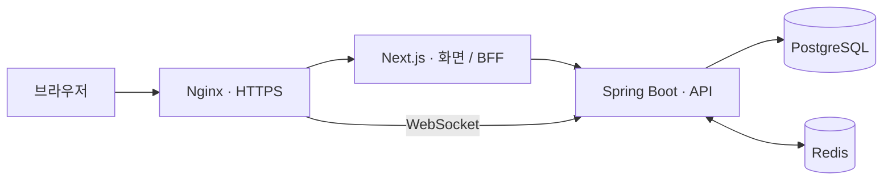

<div align="center">


# 함께 만들 사람을 찾는 곳, DevMozip

**프로젝트로 연결되고, 협업으로 신뢰를 쌓는 개발자 플랫폼**

사이드 프로젝트의 시작부터 팀 모집, 협업, 포트폴리오까지.<br />
나와 잘 맞는 동료를 찾고, 함께 만든 경험을 다음 기회로 이어갑니다.

<br />

<a href="https://devmozip.newlecture.com"></a>
<a href="https://github.com/likelion-backendschool-9th/DevMozip/issues"></a>

**[devmozip.newlecture.com](https://devmozip.newlecture.com)**

<br />


</div>

---

## 프로젝트 소개

개발자의 성장은 직접 만들고, 함께 문제를 해결하는 경험에서 시작됩니다. 하지만 사이드 프로젝트를 시작하려 할 때 **어떤 사람과 함께해야 할지, 끝까지 믿고 협업할 수 있을지** 판단하기는 쉽지 않습니다.

DevMozip은 개발자의 기술과 관심사, 포트폴리오와 협업 이력을 연결해 팀 선택의 근거를 제공합니다. 프로젝트를 모집하고 참여하는 데서 나아가, 협업 경험과 리뷰가 다음 프로젝트의 신뢰로 이어지도록 설계했습니다.

> **발견 → 팀 구성 → 협업 → 기록 → 다음 프로젝트**

## 핵심 기능

<table>
<tr>
<td width="50%" valign="top">

### 🔎 개발자 탐색 · AI 추천

기술 스택, 관심 분야, 경력과 협업 가능 여부로 동료를 탐색합니다. 대화형 추천에서는 프로젝트 요구사항을 정리하고 개발자·유사 프로젝트, 매칭 근거를 확인합니다.

</td>
<td width="50%" valign="top">

### 🚀 프로젝트 모집 · 관리

모집 직군과 인원, 기술 스택, 기간을 설정하고 팀을 구성합니다. 지원·승인·거절부터 팀원 관리, 기간 연장, 종료 요청까지 하나의 흐름으로 연결합니다.

</td>
</tr>
<tr>
<td valign="top">

### 📁 프로필 · 포트폴리오

소개, 포트폴리오, 포스팅, 활동, 리뷰로 개발 경험을 보여줍니다. 포트폴리오는 Markdown·HTML과 이미지·링크 블록을 활용해 작성하고 순서를 자유롭게 구성합니다.

</td>
<td valign="top">

### 💬 메신저 · 프로젝트 채팅

1:1 대화와 프로젝트 단체 채팅을 제공합니다. 참여 상태에 따라 채팅 멤버를 연결하고, 읽음·입력 중 표시와 강퇴 투표로 협업 공간을 관리합니다.

</td>
</tr>
<tr>
<td valign="top">

### 📝 개발자 커뮤니티

정보, 피드백, 홍보, 자유 카테고리에서 경험을 나눕니다. 이미지·태그·댓글·좋아요·북마크·퍼가기와 팔로우로 관심 있는 사람과 소식을 이어갑니다.

</td>
<td valign="top">

### ⭐ 협업 리뷰 · 프리미엄

프로젝트 종료 후 함께한 팀원을 평가하고, 받은 리뷰와 키워드·신뢰 온도를 확인합니다. 구독 상태에 따라 공고 작성·포트폴리오 상세 열람 등 권한을 구분합니다.

</td>
</tr>
</table>

<details>
<summary><strong>프로젝트 협업 흐름 자세히 보기</strong></summary>

1. **공고 작성** — 프리미엄 회원이 모집 직군·인원·기술·분야와 일정을 등록합니다.
2. **프로젝트 지원** — 공개 포트폴리오를 최대 3개 선택해 지원합니다.
3. **팀 구성** — 주최자가 지원자를 승인하면 프로젝트 팀원과 단체 채팅에 연결됩니다.
4. **협업 진행** — 프로젝트 상태·기간과 팀원을 관리하고 채팅으로 소통합니다.
5. **종료와 리뷰** — 진행 중인 프로젝트는 현재 팀원 과반수의 종료 요청으로 종료하고, 참여자는 30일 안에 팀원 리뷰를 제출합니다.

제출 포트폴리오는 당시 내용을 별도 보관해 원본 수정·삭제 이후에도 지원 내역을 유지합니다. 강퇴된 팀원은 참여 이력을 남기되 현재 인원과 채팅 접근에서 제외합니다.

</details>

## 화면 안내

| 공간 | 주요 경로 | 할 수 있는 일 |
| --- | --- | --- |
| 홈 | `/` | 서비스 진입, 추천 시작, 모집 공고·SNS 미리보기 |
| 개발자 탐색 | `/explore` | 개발자 검색·필터·프로필 탐색 |
| AI 추천 | `/matching` | 대화형 조건 수집·추천·이전 대화 확인 |
| 프로젝트 | `/projects` | 모집 공고 검색·상세·지원 |
| 내 프로젝트 | `/my-projects` | 모집·참여·지원 프로젝트 확인 및 관리 |
| 내 프로필 | `/profile/me` | 소개·포트폴리오·포스팅·활동·리뷰 |
| 포트폴리오 작성 | `/portfolios/new` | 블록 편집·초안·미리보기·공개 범위 설정 |
| SNS | `/feed` | 게시글·댓글·퍼가기·팔로우 소식 |
| 메신저 | `/messages/chats` | 1:1 대화 및 프로젝트 대화 목록 |
| 알림 | `/notifications` | 프로젝트·리뷰 등 내 알림 확인 |
| 프리미엄 | `/subscription` | 요금제·구독 관리·결제 내역 |
| 관리자 | `/admin` | 회원·콘텐츠·프로젝트·신고·구독 관리 |

세부 동적 경로와 접근 권한은 [페이지 목록](docs/frontend-pages.md)에서 확인할 수 있습니다.

## 기술 구성

| 구분 | 사용 기술 |
| --- | --- |
| Frontend | Next.js App Router · React · TypeScript · CSS Modules |
| Backend | Java 21 · Spring Boot · Spring Security · Spring Data JPA · Gradle |
| Database | PostgreSQL 17 · JSONB |
| Authentication | JWT · Next.js BFF · Kakao OAuth |
| Realtime | WebSocket · Redis Pub/Sub |
| AI | Gemini 연동 코드 · 요구사항 분석·추천·포트폴리오 분석 |
| Payment | PortOne V2 · 토스페이먼츠/카카오페이 테스트 채널 |
| Infrastructure | Docker Compose · Nginx · GitHub Actions · GHCR · Blue-Green 배포 |
| Test | Vitest · JUnit · Spring Boot Test · Testcontainers |

AI 기능은 서버 설정과 외부 API 자격 증명이 필요하며, 결제는 테스트 채널 기준입니다. 소스 구현 범위와 운영 검증 범위는 각 기능 문서에서 구분합니다.

### 요청 흐름



## 프로젝트 구조

```text
DevMozip/
├── frontend/
│   ├── app/              # App Router · 페이지 · BFF API
│   │   └── .../_components/  # 페이지 전용 UI와 CSS Module
│   ├── components/       # 공통 UI
│   ├── lib/              # API 연결 · 상태 · 검증 · 도메인 로직
│   ├── types/            # 타입과 응답 계약
│   ├── mocks/            # 기존 시연 데이터와 선택지
│   ├── public/           # 로고 · 글꼴 · 정적 파일
│   └── tests/            # 화면 및 회귀 테스트
├── backend/
│   └── src/
│       ├── main/java/com/devmozip/backend/
│       │   ├── controller/ · service/ · repository/
│       │   └── entity/ · dto/ · config/ · security/
│       └── test/         # 단위·통합 테스트
├── docs/                 # 기능 계약 · 정책 · 검증 · 운영 문서
├── deploy/               # 배포 스크립트
├── nginx/                # 프록시 설정
└── scripts/              # 개발·운영 보조 도구
```

## 로컬 실행

### 준비

- Node.js 24 LTS, JDK 21, Docker 및 Docker Compose
- PostgreSQL·Redis 연결 정보와 개인 환경 설정
- 사용 기능에 필요한 OAuth·AI·결제 등 외부 서비스 설정

```bash
git clone https://github.com/likelion-backendschool-9th/DevMozip.git
cd DevMozip
git switch develop

cp .env.example .env
cp frontend/.env.example frontend/.env.local
```

예제 파일을 참고해 개인 환경 값을 채워 주세요. 프론트의 `BACKEND_URL`은 실행 중인 백엔드 주소를 가리켜야 합니다. Gradle로 직접 실행할 경우 루트 `.env`는 자동 로드되지 않으므로 백엔드 환경 변수 또는 개인 Spring 설정을 별도로 준비합니다.

**프론트엔드**

```bash
cd frontend
npm ci
npm run dev
```

접속 주소: **http://localhost:3000**

**백엔드** — DB·Redis와 필요한 환경 설정을 준비한 별도 터미널에서 실행합니다.

```bash
cd backend
./gradlew bootRun
```

기본 주소: **http://localhost:8080**

개발용 Compose 파일은 개인 설정이 필요할 수 있습니다. 개발 DB 연결과 Docker 실행은 [PostgreSQL 개발 환경](docs/postgresql-development.md), 인증 설정은 [팀 인증 안내](docs/team-auth-deployment.md)를 따라 준비합니다. 배포용 `compose.prod.yaml`은 [운영 문서](docs/deployment-operations.md)의 배포 절차를 따릅니다.

### 빌드 · 테스트

```bash
# frontend 디렉터리
npm run build
npm run typecheck
npm test

# backend 디렉터리
./gradlew test
./gradlew build
```

일부 DB 통합 테스트는 Docker와 Testcontainers가 필요합니다. 실행 결과는 기능별 검증 기록에서 확인합니다.

## 개발 · 배포 원칙

- `develop`에서 기능을 통합하고, `main`을 배포 기준으로 사용합니다.
- 브랜치는 `type/이슈번호-작업명`, 이슈가 없으면 `type/작업명`으로 작성합니다.
- 커밋과 PR 제목은 `type: 한국어 작업 내용` 형식을 사용합니다.
- 운영 배포는 GitHub Actions와 Blue-Green 전환을 사용합니다. 자세한 절차는 [배포·운영 안내](docs/deployment-operations.md)를 참고하세요.
- 개인 환경 파일, 비밀번호·토큰·API 키는 저장소에 올리지 않습니다.

기존 Mock 시연 코드는 남아 있지만 **기본 데이터 모드는 실제 API이며 전환 UI는 숨겨져 있습니다.** 세부 범위는 [데이터 모드 안내](docs/mock-visibility.md)를 참고하세요.

## 문서 모음

| 알아볼 내용 | 문서 |
| --- | --- |
| 서비스 기획 | [프로젝트 기획](docs/project-brief.md) |
| 화면과 경로 | [페이지 목록](docs/frontend-pages.md) · [라우팅](docs/routing.md) |
| 프로젝트 도메인 | [백엔드 청사진](docs/project-backend-blueprint.md) · [API 통합](docs/project-api-integration.md) |
| 포트폴리오 | [작성·수정 API](docs/portfolio-crud-api.md) · [공개 범위](docs/portfolio-visibility-api.md) |
| AI 추천 | [기능과 정책](docs/ai-matching.md) · [API 명세](docs/ai-api-spec.md) |
| 실시간 채팅 | [메신저 API](docs/messenger-api.md) |
| 구독·결제 | [프리미엄 API](docs/premium-payment-api.md) |
| 관리자 | [관리자 API](docs/admin-api.md) |
| 실행과 운영 | [개발 DB](docs/postgresql-development.md) · [인증](docs/team-auth-deployment.md) · [배포](docs/deployment-operations.md) |
| 변경과 검증 | [개발 기록](docs/ai-progress.md) |

---

<div align="center">

**좋은 동료와 시작한 프로젝트가, 다음 기회가 되도록.**

[DevMozip 시작하기 →](https://devmozip.newlecture.com)

</div>
