<div align="center">


# DevMozip · 데브모집

### 함께 만들 사람을 찾고, 협업의 경험을 쌓다.

**AI 기반 개발자 매칭 및 사이드 프로젝트 협업 플랫폼**

프로젝트 모집부터 팀 구성, 채팅, 포트폴리오와 협업 리뷰까지.<br />
나와 맞는 동료를 찾고, 함께 만든 경험을 다음 기회로 이어갑니다.

<br />

<a href="https://devmozip.newlecture.com"></a>
<a href="https://github.com/likelion-backendschool-9th/DevMozip/issues"></a>

[서비스 소개](#서비스-소개) · [주요 기능](#주요-기능) · [서비스 화면](#서비스-화면) · [기술 스택](#기술-스택) · [팀원 소개](#팀원-소개) · [시작하기](#시작하기) · [Git History](#git-history)

</div>

---

## 서비스 소개

사이드 프로젝트는 개발자가 경험을 쌓고 포트폴리오를 만드는 중요한 기회입니다. 하지만 **어떤 사람과 함께해야 할지, 나와 잘 맞는 동료인지** 판단하기는 쉽지 않습니다.

DevMozip은 기술과 관심사, 포트폴리오와 협업 이력을 연결해 팀 선택의 근거를 제공합니다. 프로젝트를 함께 완성한 경험이 리뷰와 신뢰로 남고, 다음 협업으로 이어지는 공간을 만듭니다.

> 동료 발견 → 프로젝트 지원 → 팀 구성 → 협업 → 포트폴리오·리뷰

## 주요 기능

| 기능 | 설명 |
| --- | --- |
| AI 개발자 추천 | 프로젝트 요구사항을 대화로 정리하고 개발자·유사 프로젝트와 추천 근거 확인 |
| 개발자 탐색 | 직군·경력·기술 스택·관심 분야·협업 가능 여부로 검색 |
| 프로젝트 모집·관리 | 모집 공고 작성, 지원·승인·거절, 팀원·기간·상태·종료 관리 |
| 프로필·포트폴리오 | 소개·포스팅·활동·리뷰와 자유로운 블록 편집, 공개 범위 설정 |
| SNS·팔로우 | 게시글·이미지·댓글·좋아요·북마크·퍼가기와 팔로우 |
| 실시간 메신저 | 1:1·프로젝트 채팅, 읽음·입력 중 표시, 참여자 연동과 강퇴 투표 |
| 협업 리뷰 | 프로젝트 종료 후 팀원 평가, 리뷰 키워드와 신뢰 온도 확인 |
| 프리미엄·관리자 | 구독별 권한, 결제·해지·내역, 회원·콘텐츠·신고 관리 |

<details>
<summary><strong>프로젝트 협업 흐름</strong></summary>

1. 주최자가 모집 직군·인원·기술과 일정을 등록합니다.
2. 지원자는 공개 포트폴리오를 최대 3개 제출합니다.
3. 승인된 팀원은 프로젝트와 단체 채팅에 연결됩니다.
4. 팀원들이 채팅으로 소통하고 프로젝트 상태와 일정을 관리합니다.
5. 프로젝트 종료 후 30일 안에 팀원 리뷰를 제출합니다.

제출 포트폴리오는 당시 내용을 별도로 보관합니다. 원본이 수정·삭제되어도 제출 이력은 유지됩니다.

</details>

## 서비스 화면

배포 사이트에서 캡처한 **1440px PC 화면**입니다. 이미지를 누르면 원본 크기로 볼 수 있습니다.

### 프로젝트 탐색

<a href="docs/assets/readme/projects.png">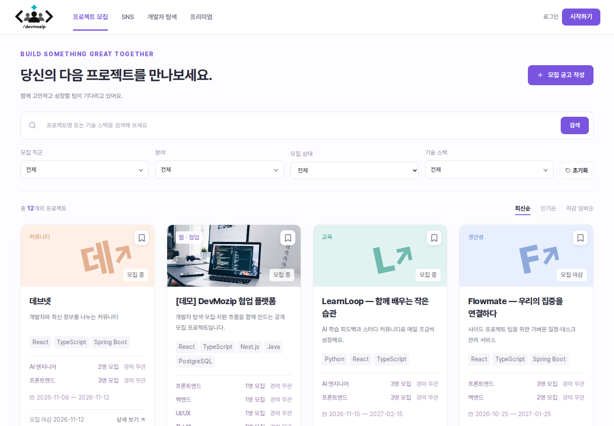</a>

<table>
<tr><th width="50%">프로젝트 상세</th><th width="50%">개발자 탐색</th></tr>
<tr>
<td><a href="docs/assets/readme/project-detail.png">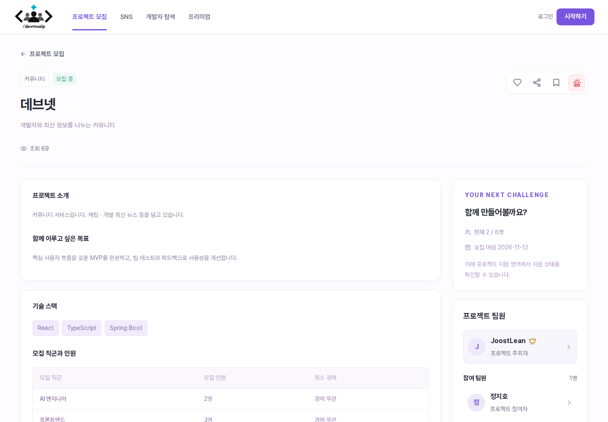</a></td>
<td><a href="docs/assets/readme/explore.png">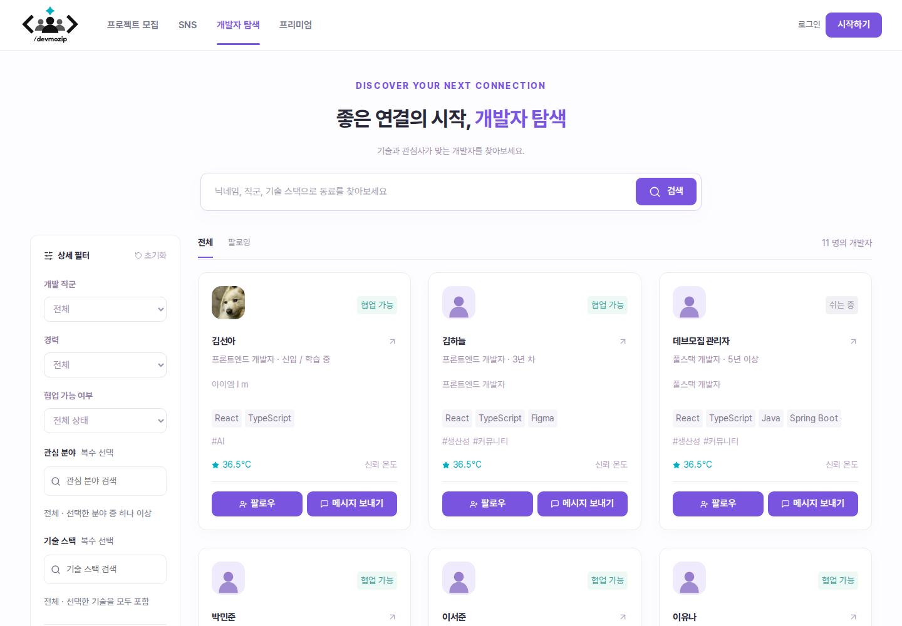</a></td>
</tr>
<tr><th>개발자 프로필</th><th>SNS 피드</th></tr>
<tr>
<td><a href="docs/assets/readme/profile.png">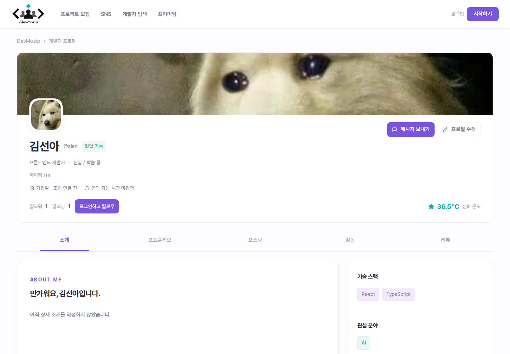</a></td>
<td><a href="docs/assets/readme/feed.png">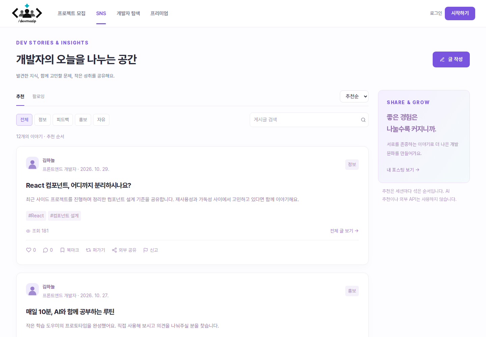</a></td>
</tr>
</table>

## 기술 스택

| 구분 | 기술 |
| --- | --- |
| Frontend | Next.js 16 · React 19 · TypeScript · CSS Modules |
| Backend | Java 21 · Spring Boot 4.1.2 · Spring Security · Spring Data JPA · Gradle |
| Database | PostgreSQL 17 · JSONB |
| Authentication | JWT · Next.js BFF · Kakao OAuth |
| Realtime | WebSocket · Redis Pub/Sub |
| AI | Gemini · 요구사항 분석·추천·포트폴리오 분석 |
| Payment | PortOne V2 · 토스페이먼츠·카카오페이 테스트 채널 |
| Infrastructure | Docker Compose · Nginx · GitHub Actions · GHCR · Blue-Green 배포 |
| Test | Vitest · JUnit · Testcontainers |
| Tools | Figma · Notion · Herdr |

<details>
<summary><strong>시스템 구성</strong></summary>

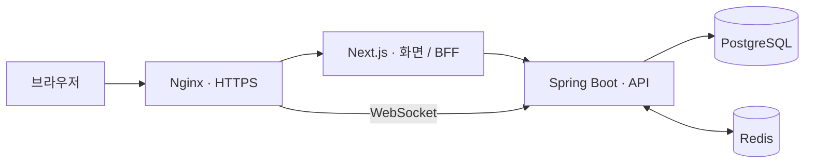

</details>

## 팀원 소개

<table>
<thead>
<tr>
<th width="25%"><a href="https://github.com/LuvZian"><br />김선아</a><br /><a href="https://github.com/LuvZian">@LuvZian</a></th>
<th width="25%"><a href="https://github.com/ureeStar">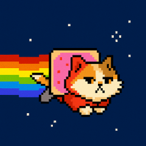<br />최유리</a><br /><a href="https://github.com/ureeStar">@ureeStar</a></th>
<th width="25%"><a href="https://github.com/JoostLean"><br />윤주상</a><br /><a href="https://github.com/JoostLean">@JoostLean</a></th>
<th width="25%"><a href="https://github.com/hdown1241-commits">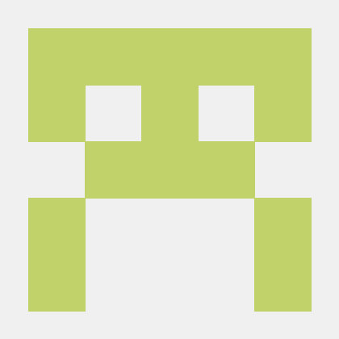<br />임재현</a><br /><a href="https://github.com/hdown1241-commits">@hdown1241-commits</a></th>
</tr>
</thead>
<tbody>
<tr>
<td valign="top">
<ul>
<li>메인 페이지</li>
<li>활동 · 리뷰 · 신뢰 온도</li>
<li>프로젝트 모집 · 관리</li>
<li>북마크</li>
<li>디자인 및 프론트엔드 아키텍처 개발</li>
</ul>
</td>
<td valign="top">
<ul>
<li>AI 매칭</li>
<li>추천 엔진 구현</li>
<li>자연어 조건 알고리즘 추출</li>
<li>프리미엄 포트폴리오 상세 분석</li>
<li>개인정보 설정</li>
</ul>
</td>
<td valign="top">
<ul>
<li>인증 · 회원가입</li>
<li>개발자 탐색</li>
<li>SNS 피드 · 팔로우</li>
<li>메신저 · 알림</li>
<li>관리자 관리 기능</li>
<li>프리미엄 · 결제</li>
</ul>
</td>
<td valign="top">
<ul>
<li>프로필 소개</li>
<li>사용자 기본 정보 조회</li>
<li>포트폴리오</li>
<li>좋아요한 글 목록 관리</li>
</ul>
</td>
</tr>
</tbody>
</table>

## 시작하기

**실행 환경:** Node.js 24 LTS · JDK 21 · PostgreSQL 17 · Redis · Docker

```bash
git clone https://github.com/likelion-backendschool-9th/DevMozip.git
cd DevMozip
git switch develop

cp .env.example .env
cp frontend/.env.example frontend/.env.local
```

예제 파일을 참고해 연결 정보를 설정합니다. 프론트의 `BACKEND_URL`은 실행 중인 백엔드 주소를 가리켜야 합니다. DB·Redis 및 외부 서비스 설정은 [개발 환경](docs/postgresql-development.md)과 [인증 안내](docs/team-auth-deployment.md)를 참고하세요.

<details>
<summary><strong>프론트엔드·백엔드 실행</strong></summary>

각각 별도 터미널에서 실행합니다. Gradle은 루트 `.env`를 자동으로 읽지 않으므로 백엔드 환경 변수 또는 개인 Spring 설정을 먼저 준비합니다.

```bash
# 프론트엔드 · http://localhost:3000
cd frontend
npm ci
npm run dev
```

```bash
# 백엔드 · http://localhost:8080
cd backend
./gradlew bootRun
```

AI·OAuth·결제는 해당 서비스의 자격 증명과 설정이 필요합니다. 개인 환경 파일과 비밀번호·토큰·API 키는 커밋하지 않습니다. Docker·운영 배포는 [배포 안내](docs/deployment-operations.md)를 따릅니다.

</details>

<details>
<summary><strong>빌드·테스트</strong></summary>

```bash
# frontend 디렉터리
npm run build
npm run typecheck
npm test

# backend 디렉터리
./gradlew test
./gradlew build
```

DB 통합 테스트는 Docker와 Testcontainers를 사용합니다.

</details>

## 협업 방식

- **브랜치:** `type/이슈번호-작업명` · 이슈가 없으면 `type/작업명`
- **커밋·PR:** `type: 한국어 작업 내용`
- **통합:** 작업 브랜치 → `develop` PR → 검증 → `main` 배포
- **배포:** GitHub Actions · GHCR · Blue-Green 전환

## Git History

GitHub 원격 브랜치 전체에서 가져온 **실제 357개 커밋**입니다. 최신 변경부터 최초 커밋까지 병합 연결을 유지해 **11장**으로 나눴습니다.

[GitHub 전체 그래프 ↗](https://github.com/likelion-backendschool-9th/DevMozip/network) · [develop 커밋 ↗](https://github.com/likelion-backendschool-9th/DevMozip/commits/develop)

<details>
<summary><strong>전체 커밋 그래프 펼쳐 보기 · 357 commits / 11 images</strong></summary>

### 01 / 11

<a href="docs/assets/readme/git-history/part-01.png">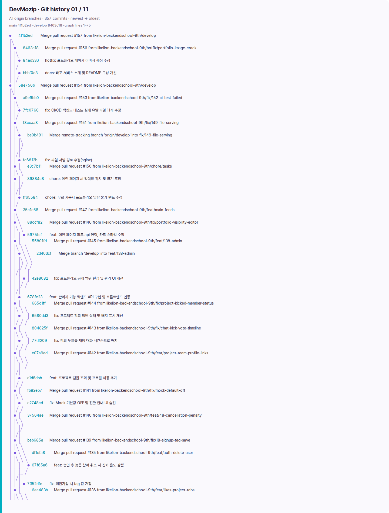</a>

### 02 / 11

<a href="docs/assets/readme/git-history/part-02.png">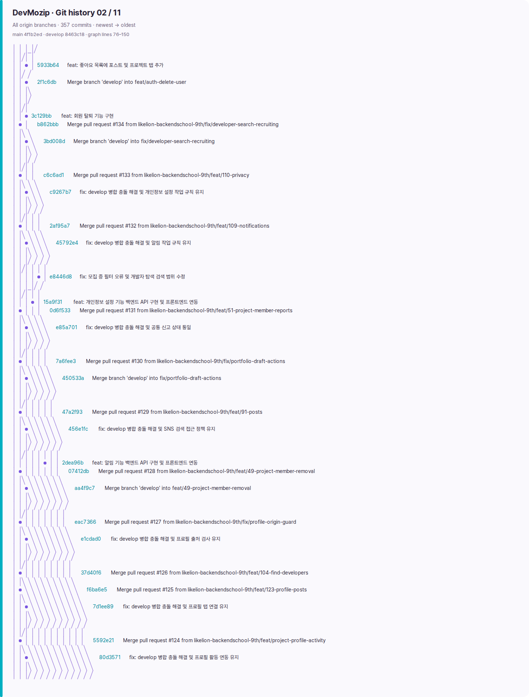</a>

### 03 / 11

<a href="docs/assets/readme/git-history/part-03.png">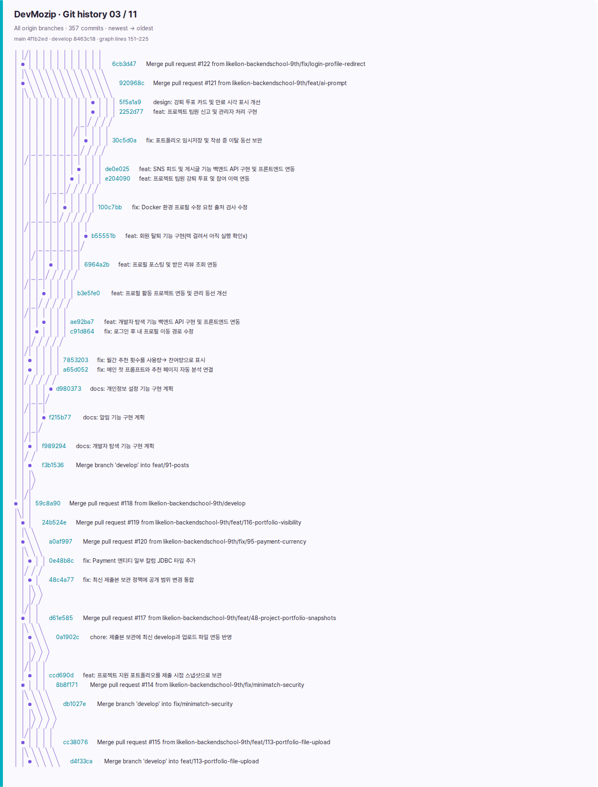</a>

### 04 / 11

<a href="docs/assets/readme/git-history/part-04.png">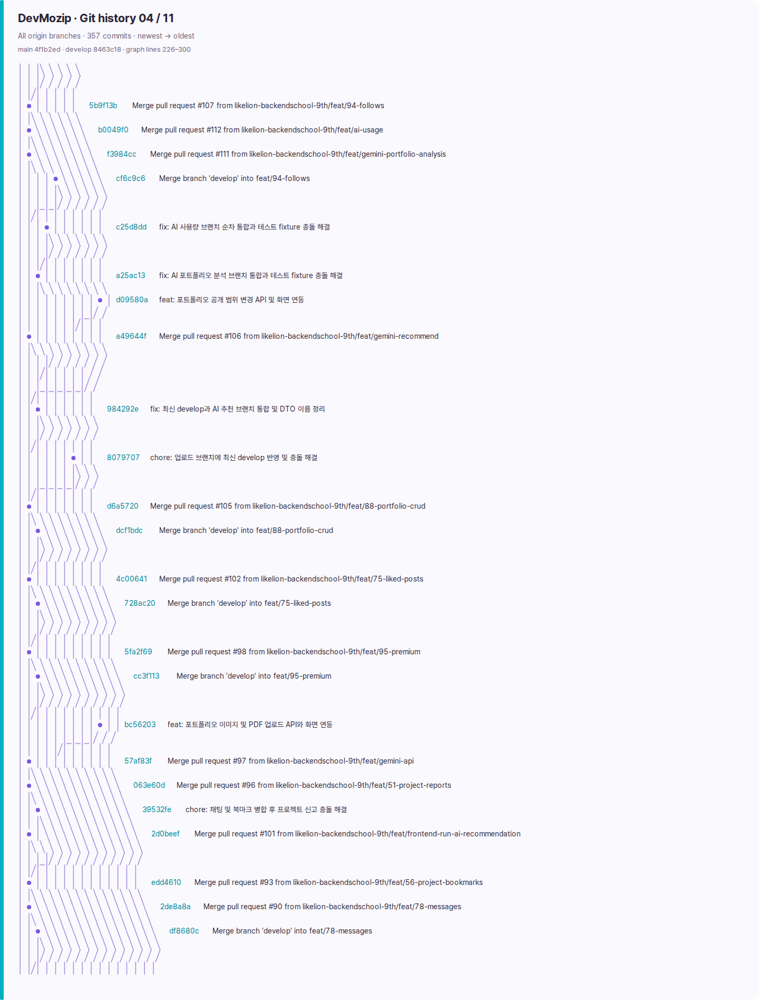</a>

### 05 / 11

<a href="docs/assets/readme/git-history/part-05.png">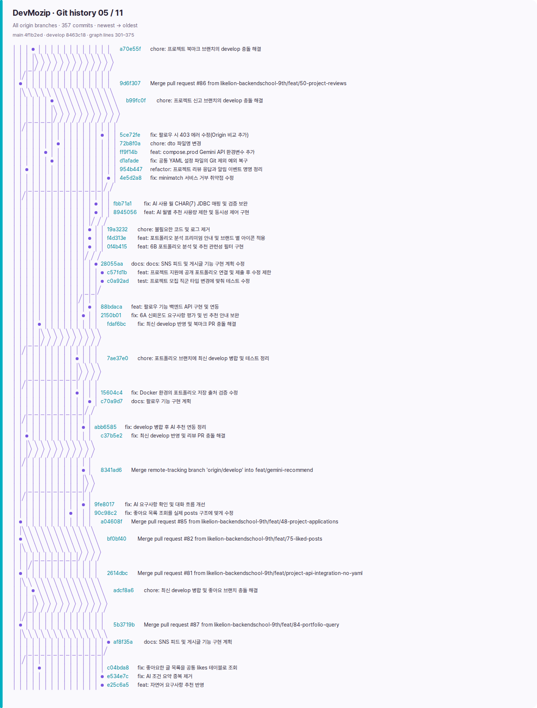</a>

### 06 / 11

<a href="docs/assets/readme/git-history/part-06.png">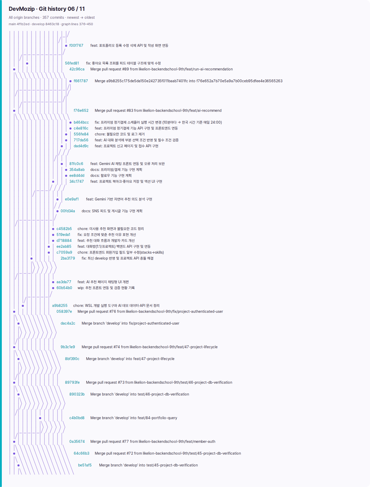</a>

### 07 / 11

<a href="docs/assets/readme/git-history/part-07.png">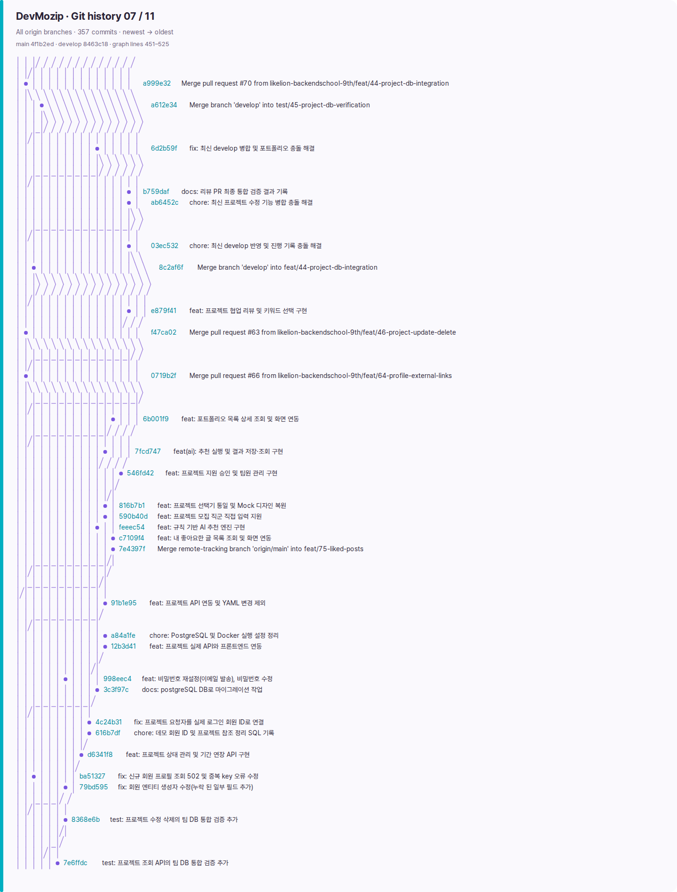</a>

### 08 / 11

<a href="docs/assets/readme/git-history/part-08.png">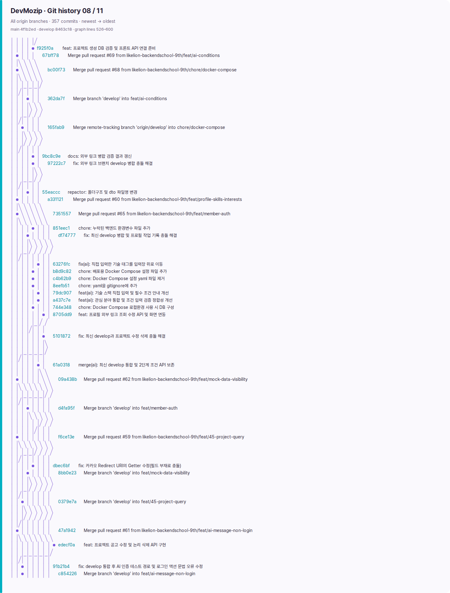</a>

### 09 / 11

<a href="docs/assets/readme/git-history/part-09.png">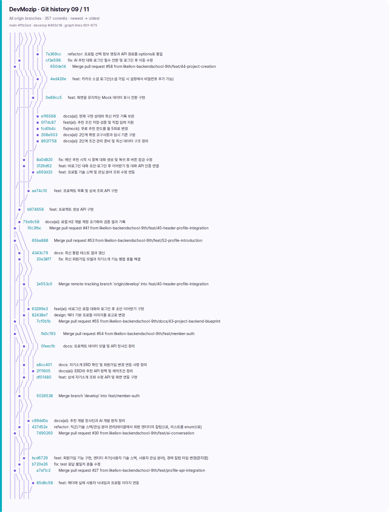</a>

### 10 / 11

<a href="docs/assets/readme/git-history/part-10.png">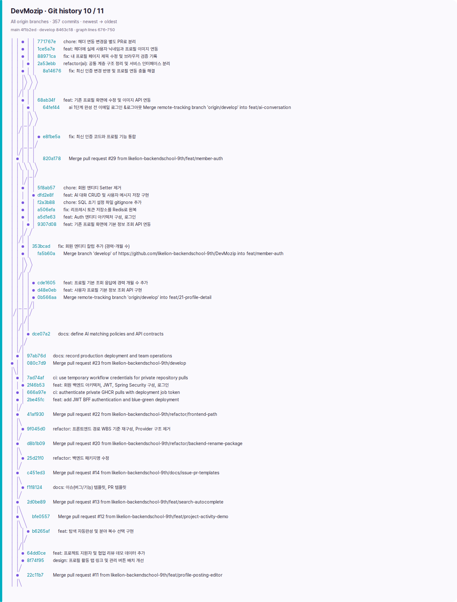</a>

### 11 / 11

<a href="docs/assets/readme/git-history/part-11.png">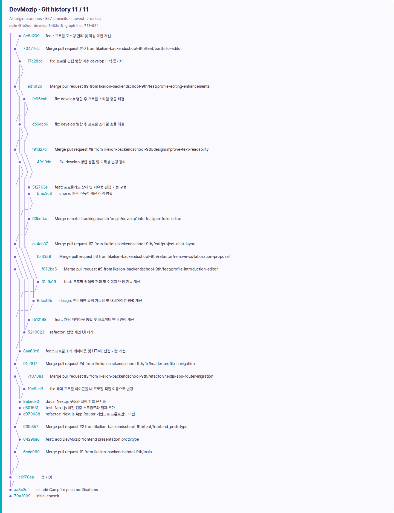</a>

</details>

<details>
<summary>그래프 기준·갱신 방법</summary>

캡처 기준: `main 4f1b2ed` · `develop 8463c18`. 로컬 작업 브랜치를 제외한 `origin` 전체 원격 브랜치를 대상으로 중복 없이 집계했습니다. [전체 커밋·분할 정보](docs/assets/readme/git-history/manifest.json)에서 확인할 수 있습니다.

```bash
git fetch origin
python3 scripts/render-readme-git-graph.py
node scripts/render-readme-git-graph.mjs
```

이미지 생성에는 Playwright·Chromium이 필요합니다. 이력 갱신 시 커밋 수와 README 이미지 목록도 함께 맞춥니다.

</details>

## 관련 문서

- [서비스 기획](docs/project-brief.md) · [페이지 목록](docs/frontend-pages.md)
- [프로젝트 설계](docs/project-backend-blueprint.md) · [프로젝트 API](docs/project-api-integration.md)
- [포트폴리오 API](docs/portfolio-crud-api.md) · [공개 범위](docs/portfolio-visibility-api.md)
- [AI 추천](docs/ai-matching.md) · [메신저](docs/messenger-api.md) · [구독·결제](docs/premium-payment-api.md)
- [관리자](docs/admin-api.md) · [개발 환경](docs/postgresql-development.md) · [배포·운영](docs/deployment-operations.md)

---

<div align="center">

**좋은 동료와 시작한 프로젝트가, 다음 기회가 되도록.**

[DevMozip 시작하기 →](https://devmozip.newlecture.com)

</div>
