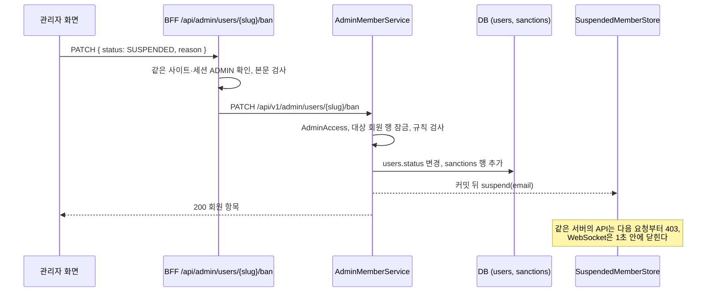

# 관리자 백엔드·연동 계획

WBS 14.0 관리자(14.1~14.13)를 실제 백엔드에 구현하고, 프론트엔드 `/admin` 화면이 그 API를 쓰도록 연결하기 위한 단계별 계획이다.

지금 `/admin` 화면은 대부분 Mock(`devmozip:administration:v1`과 각 도메인의 Mock 저장값)으로 동작한다. 서버에 있는 관리자 기능은 프로젝트 담당이 #51에서 만든 프로젝트 신고 관리(`/api/v1/admin/project-reports`)뿐이다. 이 계획은 나머지 관리자 API를 만들고, Mock 토글 OFF에서 화면이 서버 값으로 동작하게 한다.

- 상태: 2.2의 결정 항목을 확정하고(2026-11-10) 사용자 요청으로 0~10단계를 진행했다(2026-11-11). ERDCloud 반영, 담당자 공유, 실제 개발 DB 반영(서버 재시작)은 남았다. 진행 상황은 7절 상태 표와 10절 진행 기록에 적는다.
- 근거: WBS 14.1~14.13. 연관 항목은 3.x(프로필), 5.2(리뷰 키워드 선택), 6.x(탐색), 7.5·7.15(공고 삭제·신고), 8.6·8.12·8.15·8.16(게시글·댓글 삭제와 신고), 10.7·10.10(AI 추천·사용량), 11.4(사용자 신고), 13.x(구독·결제)다.
- 이 문서는 구현 승인이 아니다. 각 단계는 사용자가 요청할 때만 시작하고, 한 단계가 끝나도 다음 단계를 자동으로 시작하지 않는다. 구현을 시작하는 단계에서 `AGENTS.md`의 승인 범위에 관리자(WBS 14.1~14.13)를 추가한다.
- 작업은 develop 기준으로 검증한다. 커밋·푸시·main 병합은 사용자가 요청할 때만 한다.
- API 경로와 메서드는 WBS를 따른다. WBS에 없는 쿼리·본문·응답은 5절에서 정하고, WBS와 다르게 정하는 항목은 2절에 근거와 함께 적는다.

## 1. 범위

### 1.1 WBS 항목

| 코드 | 작업 | 페이지 | API (WBS) | 현재 (2026-11-10) | 단계 |
|---|---|---|---|---|---|
| 14.1 | 관리자 대시보드 | `/admin` | `GET /api/v1/admin/dashboard` | 화면 Mock. 회원·프리미엄·프로젝트·게시글·미처리 신고·정지 회원 수와 최근 운영 변경 | 9 |
| 14.2 | 회원 조회 | `/admin/users` | `GET /api/v1/admin/users` | 화면 Mock. 데모·가입 계정 검색 | 2 |
| 14.3 | 회원 제재 | `/admin/users` | `PATCH /api/v1/admin/users/{slug}/ban` | 화면 Mock(경고·정지·해제와 사유). 서버에는 정지 회원 차단(로그인·JWT 필터·WebSocket)만 있고 제재 API가 없다 | 2 |
| 14.4 | 프로젝트 공고 관리 | `/admin/projects` | `GET /api/v1/admin/projects`, `PUT /api/v1/admin/projects/{id}` | 화면·API 없음 | 4 |
| 14.5 | 프로젝트 공고 관리 · 프로젝트 공고 표시 여부 | `/admin/projects` | `PATCH /api/v1/admin/projects/{id}/visibility` | 없음. `projects`에 관리자 숨김 값이 없다 | 4 |
| 14.6 | 게시글·댓글 관리 | `/admin/posts` | `GET /api/v1/admin/posts`, `PUT /api/v1/admin/posts/{id}` | 화면 Mock. 게시글 숨김·복원, 댓글 삭제, SNS 신고 검토 | 3 |
| 14.7 | 게시글·댓글 관리 · 게시글·댓글 공고 표시 여부 | `/admin/posts` | `PATCH /api/v1/admin/posts/{id}/visibility` | 게시글의 관리자 숨김 값(`RESTRICTED`)과 피드 조회 반영은 있다. 값을 바꾸는 API가 없다 | 3 |
| 14.8 | 신고 내역 처리 | `/admin/reports` | `GET /api/v1/admin/reports`, `PATCH /api/v1/admin/reports/{id}` | 공고·팀원 신고만 `/api/v1/admin/project-reports`로 서버에 연결되어 있다. 사용자·게시글·댓글 신고는 저장만 된다 | 5 |
| 14.9 | 리뷰 키워드 관리 | `/admin/review-keywords` | `GET /api/v1/admin/review-keywords` (목록 로드), `PUT /api/v1/admin/review-keywords` (목록 수정) | 화면 Mock. `review_keywords`(`is_active`)는 있다 | 6 |
| 14.10 | AI 호출 · 사용량 확인 | `/admin/ai` | `GET /api/v1/admin/ai/usage` | 화면 Mock(브라우저의 Mock 사용량). `ai_usages`는 있다 | 7 |
| 14.11 | AI 호출 · 오류 관리 | `/admin/ai` | `GET /api/v1/admin/ai/logs` | 고정 예시 2건. 오류 기록 테이블이 없다 | 7 |
| 14.12 | 구독 관리 | `/admin/subscriptions` | `GET /api/v1/admin/subscriptions` | 화면 Mock. `subscriptions`는 있다 | 8 |
| 14.13 | 결제 관리 | `/admin/subscriptions` | `GET /api/v1/admin/payments` | 화면 Mock(결제 예시). `payments`는 있다 | 8 |

이 계획에서 다루지 않는 것:

- `/admin/trust-scores`(신뢰 온도 현황)는 WBS 14에 행이 없다. 지금 Mock 화면을 그대로 둔다.
- 역할 변경과 관리자 계정 생성은 WBS 14에 없다. 관리자 계정은 지금처럼 DB의 `users.role = ADMIN`으로 둔다.
- 7.14 모집 기한 경과 관리자 알림은 프로젝트 배치 범위다([notification-plan.md](notification-plan.md) 2절).
- 제재·숨김·삭제를 당사자에게 알리는 알림·메일은 WBS 12에 없어 보내지 않는다.

### 1.2 현재 코드 (2026-11-10, develop beb685a)

회원 탈퇴(#135, PR #135)와 가입 시 태그 저장(PR #139)이 병합된 뒤의 코드다.

| 위치 | 현재 |
|---|---|
| 보안 설정 | [SecurityConfig](../backend/src/main/java/com/devmozip/backend/config/SecurityConfig.java)가 `/api/v1/admin/**`에 `hasRole("ADMIN")`을 건다. 역할은 로그인 때 DB 역할로 만든 JWT의 `role` 값이다. 이 계획에서 보안 설정을 바꿀 필요가 없다. |
| 관리자 확인 선례 | [ProjectReportManagementService](../backend/src/main/java/com/devmozip/backend/service/ProjectReportManagementService.java)는 JWT 권한과 별도로 DB 회원의 역할이 `ADMIN`인지 다시 확인한다. 처리자(`handled_by`)와 처리 시각은 서버가 정하고, 처리할 신고 행을 잠근다. |
| 회원 상태 | [Member](../backend/src/main/java/com/devmozip/backend/entity/Member.java)의 `status`는 `ACTIVE`·`WARNED`·`SUSPENDED`다. 탈퇴 회원은 `status`가 NULL이다(아래 회원 탈퇴). 제재 사유·이력과 가입 시각 컬럼은 없다. 상태를 바꾸는 메서드도 없다. |
| 회원 탈퇴 (#135) | `DELETE /api/v1/users/me`([auth-delete-user.md](auth-delete-user.md), 다른 담당 코드). 행을 지우지 않고 ID·닉네임만 남긴 채 `email`·`tag`·`role`·`status` 등 나머지 컬럼을 NULL로 비운다. 탈퇴 판정은 `email IS NULL AND status IS NULL`이다([AccountWithdrawalRepository](../backend/src/main/java/com/devmozip/backend/repository/AccountWithdrawalRepository.java)). 구독은 `CANCELED`로 끝내고 결제 기록과 AI 사용량·신고 기록은 남긴다. `ACTIVE`·`WARNED` 회원만 탈퇴할 수 있어 정지 회원은 탈퇴하지 못한다(403). 탈퇴·로그인·토큰 발급은 같은 회원 행 잠금으로 직렬화된다. |
| 회원 태그 (PR #139) | 가입할 때 이메일 @ 앞부분을 `users.tag`로 저장한다. 규칙에 맞지 않거나 이미 쓰는 값이면 비워 두므로, 탈퇴 회원이 아니어도 태그가 없는 회원이 있을 수 있다. |
| 정지 차단 | [AuthService](../backend/src/main/java/com/devmozip/backend/service/AuthService.java)가 로그인·카카오 로그인·재발급에서 `SUSPENDED`를 거절한다. [JwtAuthenticationFilter](../backend/src/main/java/com/devmozip/backend/security/jwt/JwtAuthenticationFilter.java)가 [SuspendedMemberStore](../backend/src/main/java/com/devmozip/backend/security/jwt/SuspendedMemberStore.java)(서버 메모리, 시작할 때 DB에서 불러온다)로 요청마다 막고, 메신저 WebSocket도 같은 목록으로 1초 안에 연결을 닫는다. 저장소 주석에 "관리자 제재 API가 `suspend()`·`release()`를 호출해야 한다"고 적혀 있다. #135 이후 [JwtProvider](../backend/src/main/java/com/devmozip/backend/security/jwt/JwtProvider.java)의 토큰 검증은 요청마다 이메일로 회원을 조회해 토큰의 `accountId`와 대조한다. 정지 판정에는 이 조회 결과를 쓰지 않는다. |
| 요청자 식별 | [CurrentMemberProvider](../backend/src/main/java/com/devmozip/backend/security/member/CurrentMemberProvider.java)가 인증 정보의 이메일로 회원을 찾는다. 팔로우·피드·탐색이 함께 쓴다. |
| `/api/v1/users/me` | 컨트롤러는 JWT의 이메일·역할만 돌려주고 회원 상태·사유는 돌려주지 않는다. 프론트 [getSession](../frontend/lib/auth/session.ts)이 BFF 요청마다 부른다. |
| 신고 | 공통 [Report](../backend/src/main/java/com/devmozip/backend/entity/Report.java)(`reports`)에 공고(7.15)·팀원(#51)·사용자(11.4)·게시글(8.15)·댓글(8.16) 신고가 저장된다. 상태는 `AWATING`·`REVIEWING`·`RESOLVED`·`REJECTED`이고 `handle()`이 있다. 관리자 처리는 공고·팀원 신고만 된다([project-reports.md](project-reports.md)). |
| 게시글·댓글 | `posts.visibility`는 `VISIBLE`·`HIDDEN`(작성자 숨김)·`RESTRICTED`(관리자 숨김)이고 `deleted_at`이 있다. 피드 조회는 `HIDDEN`·`RESTRICTED` 글을 작성자에게만 보여 준다([feed-api.md](feed-api.md)). `comments`에는 `deleted_at`만 있고 공개 범위가 없다. |
| 프로젝트 | `projects.is_public`(주최자가 정하는 공개 여부)·`status`·`deleted_at`이 있다. 관리자 숨김 값은 없다. |
| 리뷰 키워드 | [ReviewKeyword](../backend/src/main/java/com/devmozip/backend/entity/ReviewKeyword.java)(`name` UNIQUE, `is_active`)에는 생성자만 있고 활성 여부를 바꾸는 메서드가 없다. 리뷰 제출 때 서버가 활성 여부를 다시 검사한다. 관리는 행 삭제가 아니라 `is_active = false`로 한다([project-backend-blueprint.md](project-backend-blueprint.md)). |
| AI | `ai_usages`(회원·월별 `used_count`·`pending_count`), `ai_recommendation_requests`(`PENDING`·`SUCCESS`·`FAILED`, 오류 코드·메시지 컬럼 없음). AI 추천 조건은 본인만 보고 관리자에게도 공개하지 않는다([ai-matching.md](ai-matching.md)). |
| 구독·결제 | `subscription_plans`·`subscriptions`·`payments`([premium-payment-plan.md](premium-payment-plan.md)). 결제 수단 원문(빌링키)은 암호화되어 `users.payment_methods`에 있고, `payments`에는 표시용 결제 수단 정보만 있다. |
| 프론트 `/admin` | [AdminShell](../frontend/app/admin/_components/AdminShell.tsx)이 `useAuth().user.role === 'admin'`을 확인하고, 메뉴는 [mocks/administration.ts](../frontend/mocks/administration.ts)의 `adminMenu`다. 각 `page.tsx`는 `useAuth().administration`·`useProfiles()` 등 Mock 상태를 쓴다. `/admin/reports`만 `useMockVisibility`로 ON은 Mock, OFF는 [ApiProjectReports](../frontend/app/admin/reports/_components/ApiProjectReports.tsx)를 보여 준다. 상단에 "Mock 운영 데이터 · 서버 변경 없음" 표시가 항상 있다. |
| 프론트 BFF | `app/api/admin/project-reports`가 [adminReportGuard](../frontend/lib/projects/adminReportProxy.ts)(세션 역할 `ADMIN`)와 프로젝트 프록시를 쓴다. `/admin`은 [paths.ts](../frontend/lib/auth/paths.ts)의 보호 경로라 로그인이 필요하다. |
| 테스트 | `tests/screens/AdministrationPage.test.tsx`, `lib/administration/administrationService.test.ts`(Mock 관리자 화면·서비스). |

### 1.3 계획 전에 확인한 문제

1. **경고 회원이 공개 조회에서 사라진다.** 프로필(`ProfileService` 등 `findByTagAndStatus(ACTIVE)`), 팔로우 대상(`FollowTargetFinder`), 개발자 탐색(`DeveloperSearchRepository`), 프로젝트 활동, AI 추천 후보, 좋아요한 글은 `ACTIVE` 회원만 찾는다. 반면 쓰기 요청(`CurrentMemberProvider.requireActive` 등)은 `WARNED`도 허용한다. Mock과 [decisions-pending.md](decisions-pending.md)에서 경고는 "사유와 상단 안내"이므로, 경고만으로 프로필이 404가 되면 정책과 다르다. 지금은 `WARNED` 회원이 없어 드러나지 않았다. 사용자 담당 코드(팔로우·개발자 탐색)는 2단계에서 맞추고, 다른 담당의 코드는 8절대로 공유한다.
2. **정지 목록은 서버별 메모리다.** 두 백엔드가 동시에 요청을 받으면, 제재 요청을 받지 않은 서버는 재시작 전까지 정지를 모른다. 0단계에서 [blue-green.sh](../deploy/blue-green.sh)를 확인했다(2026-11-10). 새 색을 띄우고 트래픽을 옮긴 뒤 이전 색의 백엔드를 멈추므로 평소에는 백엔드 하나만 트래픽을 받는다. 새 색이 시작해 정지 목록을 불러온 뒤 전환되기 전까지의 짧은 구간에 한 제재만 새 색이 모른다(9절). #135 이후 토큰 검증이 요청마다 회원 행을 읽으므로, 나중에 여러 서버가 트래픽을 받게 되면 이 조회 결과의 `status`로 정지를 판정하는 방법이 있다.
3. **`/api/v1/users/me`가 회원 상태를 돌려주지 않아 경고 사유를 화면에 전달할 방법이 없다.** Mock은 경고 회원의 화면 상단에 사유를 보여 준다(D8).
4. **`users`에 가입 시각이 없다.** 기획서([project-brief.md](project-brief.md) 6.12)의 "신규 가입자 통계"는 만들 수 없다(9절).
5. **탈퇴 회원 행이 `users`에 남는다(#135).** 관리자 회원 목록과 대시보드 회원 수는 이 행을 구분해야 한다. `status`·`role`이 NULL이므로 `status <> 'SUSPENDED'`나 `NOT IN` 같은 조건은 이 행을 뜻하지 않게 빼거나 넣을 수 있다. 신고·구독·결제·AI 사용량에는 탈퇴 회원의 기록이 닉네임과 함께 남는다.

## 2. 결정 사항

### 2.1 확정된 항목

| 항목 | 내용 | 근거 |
|---|---|---|
| API 경로·메서드 | 1.1 표의 WBS 경로를 쓴다 | WBS 14.1~14.13 |
| 접근 권한 | `/api/v1/admin/**`은 JWT의 `ADMIN` 역할이 있어야 하고, 서비스에서 DB 회원이 `ADMIN`이며 `ACTIVE`인지 다시 확인한다 | SecurityConfig, #51 선례 |
| 제재 | 경고·정지·해제. 경고·정지는 사유가 필수다. 관리자 본인은 제재할 수 없다. 정지는 로그인과 기능 사용을 막는다 | decisions-pending.md, Mock |
| 신고 처리 | 처리 결과만 기록하고 제재·숨김·삭제를 자동으로 실행하지 않는다. 완료·기각은 결과 입력이 필수이고, 최종 처리 후에는 다시 처리하지 않는다 | decisions-pending.md, project-reports.md |
| 게시글 관리자 숨김 | `posts.visibility = RESTRICTED`. 작성자는 이 값을 바꿀 수 없다 | feed-plan.md 1절 |
| 리뷰 키워드 삭제 | 행을 지우지 않고 `is_active = false`로 둔다. 기존 리뷰와 통계는 유지한다 | project-backend-blueprint.md, Mock |
| 구독·결제 | 조회만 한다. 포트원·결제대행사 API를 부르지 않는다 | AGENTS.md, WBS 14.12·14.13(GET만) |
| AI | 조회만 한다. AI 추천 조건·대화 내용은 관리자에게도 보여 주지 않는다. 외부 AI에 연결하지 않는다 | ai-matching.md, AGENTS.md |
| 화면 Mock 토글 | ON은 지금의 Mock 화면, OFF는 서버 값을 쓴다 | 기존 `/admin/reports` 방식 |

### 2.2 사용자가 확정한 항목 (2026-11-10)

| 항목 | 결정 |
|---|---|
| D1 | A. ERD의 `sanctions`로 제재 이력을 남긴다 |
| D2 | A. `projects.is_restricted`를 추가한다 |
| D3 | A. `PUT`은 관리자 삭제(논리 삭제)다 |
| D4 | A. WBS 경로와 `target=POST\|COMMENT`. 댓글은 삭제만 한다 |
| D5 | A. `/api/v1/admin/reports`로 통합하고 기존 `project-reports`를 정리한다 |
| D6 | A. `ai_recommendation_requests`의 실패 기록을 읽는다 |
| D7 | A. 제재 기록과 신고 처리 기록만 보여 준다 |
| D8 | A. `/api/v1/users/me`에 `status`·`warningReason`을 더한다. 프로필에는 조회수가 없어 이 조회가 조회수로 세어지지 않는다 |
| 다른 담당 코드 | 공고 숨김의 공개 조회 반영, 관리자 공고 삭제의 뒤처리, `ReviewKeyword` 변경, 기존 `project-reports` 정리까지 이 작업에서 한다 |
| ERD | 원본이 없어 3.2의 가정 컬럼으로 만든다. ERDCloud 반영이 남는다 |

아래는 결정 당시의 선택지와 근거다.

#### D1. 제재 기록

| 안 | 내용 |
|---|---|
| A (제안) | ERD의 `sanctions`(회원 제재 내역)를 엔티티로 만든다. 제재·해제마다 행을 하나 추가하고, `users.status`는 현재 상태로 함께 바꾼다. 회원 목록은 가장 최근 제재의 사유를 보여 준다. |
| B | `users.status`만 바꾸고 사유·이력은 남기지 않는다. |

Mock의 회원 목록은 사유를 보여 주고, 경고 회원은 화면 상단에서 사유를 본다. B로는 이 둘을 서버에서 할 수 없다. ERD에 `sanctions`가 있고 `reports`를 참조한다는 기록이 있다(feed-plan.md 3절). 컬럼은 0단계에서 ERD와 대조한다(3.1).

#### D2. 공고 관리자 숨김(14.5) 저장

| 안 | 내용 |
|---|---|
| A (제안) | `projects`에 관리자 숨김 컬럼(예: `is_restricted` BOOLEAN NOT NULL DEFAULT FALSE)을 추가한다. 주최자의 `is_public`과 따로 둔다. |
| B | 관리자도 `is_public`을 바꾼다. |

B는 주최자가 공개로 되돌리면 관리자 숨김이 풀린다. 게시글이 작성자 숨김(`HIDDEN`)과 관리자 숨김(`RESTRICTED`)을 나눈 것과 같은 이유로 A를 제안한다. 어느 안이든 공고 조회에 반영하는 코드는 프로젝트 담당 코드다(8절).

#### D3. `PUT /api/v1/admin/projects/{id}`·`PUT /api/v1/admin/posts/{id}`의 의미

| 안 | 내용 |
|---|---|
| A (제안) | 관리자 삭제(논리 삭제, `deleted_at`)다. 본문은 `{ "action": "DELETE" }`다. 삭제 뒤 처리는 작성자·주최자 삭제(7.5, 8.6, 8.12)와 같다. |
| B | 관리자가 공고·게시글 내용을 고친다. |

기획서 6.12의 관리자 기능은 "공고 숨김·공고 삭제", "게시글 숨김·삭제"이고, Mock도 댓글 삭제를 한다. 관리자가 내용을 고치는 기능은 기획서·Mock에 없다.

#### D4. 댓글 관리 방식과 경로 (14.6·14.7)

| 안 | 내용 |
|---|---|
| A (제안) | WBS 경로를 그대로 쓰고 쿼리 `target=POST\|COMMENT`로 게시글과 댓글을 나눈다. 댓글은 Mock·decisions-pending대로 삭제(`PUT`)만 하고, 표시 여부(`PATCH .../visibility`)는 게시글만 받는다. 스키마를 바꾸지 않는다. |
| B | A와 같은 경로에서 댓글도 숨김·복원한다. `comments`에 관리자 숨김 컬럼을 추가하고 댓글 조회에 반영한다. |
| C | 댓글은 `/api/v1/admin/comments`, `/api/v1/admin/comments/{id}`를 따로 둔다(WBS에 없는 경로). |

#### D5. 신고 처리 API (14.8)와 기존 `/api/v1/admin/project-reports`

| 안 | 내용 |
|---|---|
| A (제안) | `/api/v1/admin/reports`를 다섯 종류(공고·팀원·사용자·게시글·댓글) 모두의 처리 API로 만들고 `/admin/reports` 화면을 이 API로 옮긴다. 처리 규칙은 기존 API와 같다. 기존 `project-reports` API와 BFF는 화면을 옮긴 뒤 프로젝트 담당과 협의해 정리한다. |
| B | 기존 API를 그대로 두고 `/api/v1/admin/reports`는 사용자·게시글·댓글 신고만 다룬다. 화면은 두 API를 함께 부른다. |

A는 WBS 경로 하나로 신고를 한 목록에서 처리한다. B는 다른 담당 코드를 건드리지 않지만 화면에 목록이 둘로 나뉜다.

#### D6. AI 오류 관리(14.11)의 데이터

| 안 | 내용 |
|---|---|
| A (제안) | 새 테이블 없이 `ai_recommendation_requests`의 실패(`FAILED`) 기록을 읽기 전용으로 보여 준다. 오류 원인 컬럼이 없어 시각·회원·상태만 보인다. |
| B | 오류 기록 테이블을 새로 만들고, AI 담당 코드의 실패 지점에서 원인 코드를 기록한다. |

B는 AI 담당 코드를 바꿔야 하고 ERD에 없는 테이블이 생긴다.

#### D7. 관리자 조치 이력 (대시보드의 최근 운영 변경)

| 안 | 내용 |
|---|---|
| A (제안) | 새 테이블 없이 제재 기록(D1)과 신고 처리 기록(`reports.handled_by`·`handled_at`)을 시간순으로 보여 준다. 숨김·삭제·키워드 변경은 이력에 나오지 않는다. |
| B | 관리자 조치 기록 테이블을 새로 만들어 모든 관리자 변경(제재·숨김·삭제·신고 처리·키워드)을 남긴다. |

decisions-pending.md는 "실제 감사 로그는 후속 백엔드 설계에서 확정"이라고 남겼다. B는 ERD에 없는 테이블을 추가한다.

#### D8. 경고 회원의 상단 안내

| 안 | 내용 |
|---|---|
| A (제안) | `GET /api/v1/users/me` 응답에 `status`와 `warningReason`(경고일 때 최근 제재 사유)을 더한다. 기존 필드(`username`·`role`)는 그대로 둔다. 화면 상단 안내가 Mock 토글 OFF에서 이 값을 쓴다. |
| B | 서버 모드에서는 경고 안내를 표시하지 않는다. 경고는 관리자 화면의 기록으로만 남는다. |

A는 `/users/me`가 이메일로 회원 1건을 조회하게 되어 BFF 요청마다 DB 조회가 하나 늘어난다(#135 이후 토큰 검증도 요청마다 회원을 조회한다). 이 API는 사용자 담당(인증) 코드다.

### 2.3 설계 기준

| 항목 | 기준 |
|---|---|
| 권한 | 비로그인 401, 관리자가 아니면 403. JWT 역할(보안 설정)과 DB 역할·상태(서비스)를 모두 확인한다. 화면에서 숨기는 것만으로는 막지 않는다. |
| 요청자·처리자 | 요청자는 인증 정보로만 정한다. 처리자 ID와 처리 시각은 서버가 정하며 요청 값으로 받지 않는다. |
| 대상 지정 | 회원은 `slug`(`users.tag`, 다른 회원 API와 같다), 나머지는 ID다. |
| 목록 | `page`(0부터), `size`(1~50, 기본 20), 최신 ID순. 응답은 `{ items, totalElements, page, totalPages }`로 기존 `project-reports`와 같다. 요약 값이 있는 목록은 `summary`를 더한다. |
| 변경 요청 | 숨김·복원은 원하는 최종 값을 받는다. 같은 값을 다시 보내도 200이다. 제재는 기록이 남으므로 지금과 같은 상태로 바꾸면 409다. |
| 동시 변경 | 대상 행(회원·공고·게시글·댓글·신고)을 잠그고 바꾼다. 같은 대상의 동시 요청은 하나씩 적용된다. 회원 행 잠금은 로그인·탈퇴(#135)가 잡는 행과 같아서 제재와 탈퇴·로그인도 하나씩 처리된다. |
| 탈퇴 회원 | 판정은 #135와 같은 `email IS NULL AND status IS NULL`이다. 회원 목록과 대시보드 회원 수에서 뺀다. 제재 대상이 아니다. 신고·구독·결제·AI 사용량 목록에서는 남은 닉네임에 탈퇴 표시를 붙이고, 태그가 없으므로 프로필 링크를 두지 않는다. |
| 자동 연쇄 없음 | 신고 처리와 제재·숨김·삭제는 따로 한다. 화면은 신고에서 대상 관리 화면으로 이동하는 링크만 둔다. |
| 개인정보 | 응답에 비밀번호 해시·카카오 ID·빌링키를 넣지 않는다. 이메일은 회원 관리 응답에만 넣는다. AI 조건·대화 내용과 메시지 내용은 넣지 않는다. |
| 다른 담당 데이터 | 관리자 전용 조회 Repository로 읽기만 한다. 쓰기가 필요한 곳(공고 숨김·삭제, 키워드 활성 변경)은 8절의 계약을 담당자와 맞춘 뒤 한다. |
| 기존 동작 보존 | Mock ON 화면과 저장값, 기존 `project-reports` API(D5 정리 전까지), 피드의 `RESTRICTED` 규칙, 정지 차단 흐름, 프로필 API의 정지 회원 404를 바꾸지 않는다. |

## 3. 데이터

### 3.1 ERD 대조

저장소에는 ERD 원본이 없어 처음에는 대조하지 못했다. 사용자 결정으로 가정 컬럼으로 만든 뒤(2026-11-10), 사용자가 제공한 ERD 이미지의 `sanctions`(회원 제재 내역)와 대조했다(2026-11-11). ERD 컬럼은 `id`, `user_id`(제재 대상), `report_id`(신고), `admin_id`(처리 관리자), `type` VARCHAR(30), `reason` TEXT, `starts_at`(제재 시작), `ends_at`(제재 종료), `revoked_at`(제재 철회)이다. 가정 구현과 달랐던 점(`type` 길이, `created_at`↔`starts_at`, `ends_at`·`revoked_at` 없음, 해제를 `RELEASED` 행으로 남김)을 보고하고 사용자 결정으로 ERD에 맞췄다. 해제는 유효한 제재의 `revoked_at`을 채우고, `ends_at`은 컬럼만 두어 늘 NULL(무기한)이다(10절 기록). 같은 ERD 이미지의 `posts`·`comments`·`reports`·`bookmarks`는 엔티티와 같다. 다만 `posts.view_count`가 ERD에는 JSONB로, 엔티티·DB에는 BIGINT로 되어 있다(피드 쪽 ERD 정리 대상).

개발 DB를 읽기 전용으로 확인했다(2026-11-10).

- `sanctions` 테이블이 없다.
- `projects`에 관리자 숨김 컬럼이 없다(`is_public`만 있다). `comments`는 `id`·`created_at`·`updated_at`·`content`·`deleted_at`·`author_id`·`post_id`로 공개 범위가 없다. `users`는 23개 컬럼(`is_private` 포함)이고 가입 시각이 없다.
- `users`: `ACTIVE` 12명(`ADMIN` 1, `PREMIUM` 4, `USER` 7), `SUSPENDED` 1명, `WARNED` 0명, 탈퇴 2명. 탈퇴하지 않았는데 `tag`가 비어 있는 회원 2명.
- `users_status_check`는 `ACTIVE`·`WARNED`·`SUSPENDED`, `users_role_check`는 `USER`·`PREMIUM`·`OWNER`·`ADMIN`만 허용한다(탈퇴 회원의 NULL은 CHECK를 통과한다).
- `reports`는 0행이었고, `reports_status_check`가 `RECEIVED`·`REVIEWING`·`RESOLVED`·`REJECTED`만 허용해 코드의 초기 상태 `AWATING`과 맞지 않았다. 신고 접수가 개발 DB에서 CHECK 위반으로 실패하는 상태였다. 사용자 승인을 받아 [feed-schema-update.sql](sql/feed-schema-update.sql)의 1번(제약을 `AWATING`·`REVIEWING`·`RESOLVED`·`REJECTED`로 바꿈)만 적용했다. 2번(`posts` 인덱스 이름 바꾸기)은 Hibernate가 이미 `posts_*` 인덱스를 만들어 `feeds_*`와 함께 있어 실패하므로 적용하지 않았다(중복 인덱스 3개, 피드 쪽 정리 대상).
- `ai_recommendation_requests`: `SUCCESS` 24건, `FAILED` 2건.

### 3.2 추가·변경 (D1·D2 A, ERD 대조 반영)

`sanctions` — 회원 제재 내역 (ERD와 같다)

| 필드 | 타입 | NULL | 의미 |
|---|---|---|---|
| id | BIGINT / PK, IDENTITY | 불가 | 제재 ID |
| user_id | BIGINT / FK users.id | 불가 | 제재 대상 |
| report_id | BIGINT / FK reports.id | 가능 | 근거 신고 (있을 때만) |
| admin_id | BIGINT / FK users.id | 불가 | 처리 관리자 |
| type | VARCHAR(30), CHECK | 불가 | `WARNED`(경고)·`SUSPENDED`(정지) |
| reason | TEXT | 가능 | 사유. 서비스가 필수·300자 이하로 검사 |
| starts_at | DATETIME | 불가 | 제재 시작 시각 |
| ends_at | DATETIME | 가능 | 제재 종료 시각. 기한 있는 제재가 없어 늘 NULL(무기한) |
| revoked_at | DATETIME | 가능 | 제재 철회 시각. 해제하거나 다른 제재로 바뀌면 채운다 |

인덱스 `sanctions_user_id_idx (user_id, id)`. 유효한 제재는 `revoked_at`이 NULL인 행이며, 회원의 현재 상태는 `users.status`다.

`projects` 추가 컬럼 (D2 A)

| 필드 | 타입 | NULL | 기본값 | 의미 |
|---|---|---|---|---|
| is_restricted | BOOLEAN | 불가 | FALSE | 관리자 숨김. TRUE면 공개 조회에서 숨긴다 |

`review_keywords`는 스키마를 바꾸지 않는다. 엔티티에 활성 여부를 바꾸는 메서드만 더한다(리뷰 담당과 공유).

### 3.3 DB 반영 주의

- `ddl-auto: update`이므로 엔티티를 바꾼 서버를 재시작하면 연결된 DB에 테이블·컬럼이 생긴다. 개발 서버가 공용 DB에 연결되어 있으면 반영 시점을 팀과 맞춘다.
- 이미 행이 있는 `projects`에 `NOT NULL` 컬럼을 추가하므로 `@ColumnDefault("false")`를 함께 선언한다. 기존 행이 있는 DB로 확인한다(계정 잠금의 `is_private`와 같은 방식).
- `reports`의 CHECK 제약 등 실제 DB에만 있는 제약은 0단계에서 읽기 전용으로 확인한다.
- local 프로필의 H2와 Git 제외 SQL 파일(`members_data.sql`)이 그대로 동작하는지 해당 단계에서 확인한다.

## 4. 백엔드 구조

### 4.1 패키지·파일

기존 계층형 패키지(`backend/src/main/java/com/devmozip/backend`)를 따른다. 탭 들여쓰기와 생성자 주입을 쓰고, DTO는 record로 만든다. 엔티티를 API 응답으로 쓰지 않는다. 서비스는 피드·알림처럼 인터페이스와 `service/impl` 구현으로 나눈다.

| 위치 | 파일 | 역할 |
|---|---|---|
| security/admin | AdminAccess | 요청자가 DB에서 `ADMIN`·`ACTIVE`인지 확인하고 관리자 회원을 돌려준다(4.2) |
| config | AdminConfiguration | `adminClock`(한국 시각) |
| controller | AdminDashboardController, AdminMemberController, AdminProjectController, AdminPostController, AdminReportController, AdminReviewKeywordController, AdminAiController, AdminBillingController | HTTP 입출력. 모두 `/api/v1/admin` 아래 |
| service, service/impl | AdminDashboardService, AdminMemberService, AdminProjectService, AdminPostService, AdminReportService, AdminReviewKeywordService, AdminAiService, AdminBillingService, AdminPaging(페이지·검색어·필터 규칙) | 정책·검증·트랜잭션 |
| repository | AdminMemberQueryRepository, AdminProjectQueryRepository, AdminPostQueryRepository, AdminReportQueryRepository, AdminReviewKeywordRepository, AdminAiQueryRepository(JDBC), AdminBillingQueryRepository, AdminDashboardQueryRepository, SanctionRepository | 관리자 목록·집계 조회와 제재 저장 |
| entity | Sanction (D1 A) | `sanctions` |
| dto/admin | 요청·응답 record를 한 파일에 하나씩, 공통 `AdminPageResponse<T>`·`AdminSummaryPageResponse<S, T>`, 회원 표시 `AdminPartyResponse` | API 입출력 |

- `Member`에 상태 변경 메서드(`changeStatus`)를 더한다. 사용자 담당(회원) 코드다.
- `Project`의 관리자 숨김 필드와 변경 메서드(D2 A), `ReviewKeyword`의 활성 변경 메서드는 각 담당 엔티티이며, 사용자 결정(2.2)으로 이 작업에서 더했다.
- 관리자 삭제(D3 A)는 각 도메인의 삭제 규칙을 따른다. 구현에서는 다른 담당의 서비스에 진입점을 더하지 않고, 관리자 서비스가 같은 엔티티 메서드(`softDelete`)와 같은 조건(공고는 모집 중만, 게시글은 커밋 뒤 이미지 삭제)으로 처리했다.
- 오류는 기존 `ErrorResponse` 형식이다.

### 4.2 관리자 확인

- 보안 설정이 먼저 JWT의 `ADMIN` 역할을 확인한다(비로그인 401, 다른 역할 403).
- `AdminAccess.require()`는 `CurrentMemberProvider.find()`로 회원을 찾고, 없으면 401, 역할이 `ADMIN`이 아니거나 상태가 `ACTIVE`가 아니면 403이다. 토큰 발급 뒤 DB 역할이 바뀐 경우를 막는다.
- 모든 관리자 서비스의 공개 메서드는 처음에 `AdminAccess`를 부른다. 조회도 같다.

### 4.3 제재와 정지 반영



- 정지 목록은 트랜잭션 커밋 뒤에 바꾼다. 커밋이 실패하면 목록을 바꾸지 않는다.
- 해제(`ACTIVE`)나 정지에서 경고로 바꾸면 커밋 뒤 `release(email)`을 부른다.
- 로그인·재발급 거절은 기존 `AuthService`가 DB 상태로 하므로 바꾸지 않는다.

### 4.4 조회 쿼리

- 목록은 조회 조건과 정렬을 쿼리에서 처리하고 응답에 넣은 뒤 거르지 않는다. 페이지 크기와 전체 수가 맞아야 한다.
- 다른 도메인 테이블은 관리자 전용 Repository(JPQL 또는 JDBC)로 읽는다. 다른 담당의 Repository·Service를 고치지 않는다.
- 검색어는 앞뒤 공백을 빼고 대소문자를 무시하는 부분 일치다. `%`·`_`는 그대로 문자로 찾도록 이스케이프한다.
- 회원의 `status`·`role` 조건은 탈퇴 회원의 NULL을 고려해 쓴다(1.3의 5). 탈퇴 회원을 빼는 조건과 상태 필터를 따로 두고, 탈퇴 회원 행이 있는 데이터로 테스트한다.
- 회원 정보를 붙이는 조회(신고·구독·결제·AI 사용량)는 탈퇴 회원의 기록을 빼지 않는다. 탈퇴 여부를 함께 돌려준다.

## 5. API 계약

브라우저는 BFF만 호출한다. 확정 계약은 [admin-api.md](admin-api.md)다. 이 절은 계획 당시의 계약이며, 구현에서 바뀐 곳(회원 표시를 `member`·`reporter` 객체로 묶음, AI·구독·결제 응답의 필드 이름, 게시글 `content` 전체 제공)은 그 문서를 따른다.

### 5.1 공통 오류

| 상태 | 상황 |
|---|---|
| 400 | 잘못된 쿼리·본문(페이지·크기·허용하지 않는 값·길이), 허용하지 않는 조치 |
| 401 | 로그인 필요 |
| 403 | 관리자가 아님(JWT 또는 DB), 정지 회원(JWT 필터), 관리자 본인·관리자 계정 제재 |
| 404 | 대상 없음(삭제된 대상 포함) |
| 409 | 이미 최종 처리한 신고, 지금과 같은 상태로의 제재 |

### 5.2 대시보드 (14.1)

`GET /api/v1/admin/dashboard` → 200

```json
{
  "members": 10,
  "premiumMembers": 1,
  "suspendedMembers": 0,
  "projects": 12,
  "posts": 30,
  "pendingReports": 3,
  "aiRecommendationsThisMonth": 7,
  "recentActions": [
    { "type": "SANCTION", "actorNickname": "관리자", "summary": "회원 정지 · 닉네임", "createdAt": "2026-11-10T10:00:00" }
  ]
}
```

| 값 | 기준 |
|---|---|
| members | 탈퇴하지 않은 회원 (#135의 탈퇴 판정으로 뺀다) |
| premiumMembers | 현재 이용 기간 안의 구독(`ACTIVE`·`RENEWING`·`CANCEL_REQUESTED`)이 있는 회원 |
| suspendedMembers | `status = SUSPENDED` |
| projects | 삭제되지 않은 공고 |
| posts | 삭제되지 않은 `VISIBLE` 게시글 (Mock은 숨기지 않은 글을 센다) |
| pendingReports | 모든 종류의 `AWATING`·`REVIEWING` 신고 |
| aiRecommendationsThisMonth | 이번 달(한국 시각) `ai_usages.used_count` 합 (기획서 6.12의 "AI 사용량") |
| recentActions | D7에 따른 최근 12건 (Mock과 같은 개수) |

### 5.3 회원 조회 (14.2)

`GET /api/v1/admin/users?q=&status=&role=&page=&size=`

- `q`: 닉네임·이메일·tag 부분 일치. `status`: `ACTIVE`·`WARNED`·`SUSPENDED`. `role`: `USER`·`PREMIUM`·`OWNER`·`ADMIN`.
- 관리자 계정도 목록에 나온다(Mock과 같다). 화면은 관리자 행에 제재 버튼을 두지 않는다.
- 탈퇴 회원은 목록에서 뺀다. 개인정보가 지워져 조회·제재 대상이 아니다.
- 태그가 없는 회원(PR #139 이후에도 생길 수 있다)은 목록에 나오지만 `tag`가 `null`이다. 화면은 프로필 링크와 제재 버튼을 두지 않는다(5.4).

```json
{
  "items": [
    {
      "id": 3, "tag": "devkim", "nickname": "김개발", "email": "kim@example.com",
      "role": "USER", "status": "WARNED",
      "latestSanction": { "type": "WARNED", "reason": "사유", "adminNickname": "관리자", "createdAt": "2026-11-10T10:00:00" }
    }
  ],
  "totalElements": 1, "page": 0, "totalPages": 1
}
```

`latestSanction`은 제재 기록이 없으면 `null`이다(D1 A).

### 5.4 회원 제재 (14.3)

`PATCH /api/v1/admin/users/{slug}/ban`, 본문 `{ "status": "SUSPENDED", "reason": "사유", "reportId": 12 }` → 200, 5.3의 회원 항목

- `status`: `WARNED`(경고)·`SUSPENDED`(정지)·`ACTIVE`(해제).
- `reason`: 앞뒤 공백을 뺀 1~300자(Mock 입력 제한과 같다). 경고·정지는 필수, 해제는 선택.
- `reportId`: 선택. 있으면 존재하는 신고여야 한다(D1에서 `sanctions`가 신고를 참조하는 경우).
- 대상이 요청자 본인이거나 `ADMIN`이면 403. 지금과 같은 상태면 409.
- `slug`는 탈퇴하지 않은 회원의 태그로 찾는다. 탈퇴 회원은 태그가 없어 404다. 태그가 없는 회원은 이 경로로 지정할 수 없다(9절).
- 정지 회원은 탈퇴할 수 없다(#135). 제재와 탈퇴가 동시에 들어오면 회원 행 잠금으로 하나씩 처리된다. 탈퇴가 먼저면 제재는 404, 정지가 먼저면 탈퇴는 403이다.
- 정지·해제는 4.3대로 정지 목록에 반영한다. 기한이 있는 정지는 없다(9절).

### 5.5 프로젝트 공고 관리 (14.4·14.5)

`GET /api/v1/admin/projects?q=&status=&restricted=&page=&size=`

- `q`: 제목 부분 일치. `status`: `ProjectStatus` 값. `restricted`: `true`·`false`.
- 삭제된 공고는 목록에서 뺀다.
- 항목: `id`, `title`, `hostTag`, `hostNickname`, `status`, `isPublic`, `restricted`, `recruitmentEnd`, `developmentEnd`.

`PUT /api/v1/admin/projects/{id}`, 본문 `{ "action": "DELETE" }` → 204 (D3 A)

- 공고를 논리 삭제한다. 지원·단톡방·알림 등 뒤처리는 7.5 주최자 삭제와 같다(프로젝트 담당과 맞춘다).
- 되돌리는 API는 없다.

`PATCH /api/v1/admin/projects/{id}/visibility`, 본문 `{ "restricted": true }` → 200, 목록 항목 (D2 A)

- `restricted`는 JSON boolean만 받는다. 같은 값을 다시 보내도 200이다.
- 공개 조회 반영(프로젝트 담당과 맞출 계약 제안): 숨긴 공고는 목록·검색·메인 미리보기·북마크 목록에서 빠지고, 주최자와 참여 팀원이 아닌 사람의 상세 조회는 404다.

### 5.6 게시글·댓글 관리 (14.6·14.7, D3·D4 A 기준)

`GET /api/v1/admin/posts?target=POST|COMMENT&q=&visibility=&page=&size=`

- `target` 기본값은 `POST`. `q`는 제목·내용(댓글은 내용) 부분 일치. `visibility`는 게시글에만 쓴다.
- 삭제된 글·댓글은 뺀다.
- 게시글 항목: `id`, `type`(`POST`·`REPOST`), `title`, `content`, `authorTag`, `authorNickname`, `visibility`, `createdAt`.
- 댓글 항목: `id`, `postId`, `postTitle`, `content`, `authorTag`, `authorNickname`, `createdAt`.
- 내용은 자르지 않고 그대로 준다(Mock 댓글 목록도 본문 전체를 보여 준다. 미리보기 길이는 근거가 없어 두지 않았다).

`PUT /api/v1/admin/posts/{id}?target=POST|COMMENT`, 본문 `{ "action": "DELETE" }` → 204

- 게시글은 8.6, 댓글은 8.12의 삭제 처리와 같다(퍼간 글의 원본 안내 등).

`PATCH /api/v1/admin/posts/{id}/visibility`, 본문 `{ "restricted": true }` → 200, 게시글 항목

- 게시글만 받는다. `target=COMMENT`면 400이다.
- `true`면 `RESTRICTED`가 된다(작성자 숨김 `HIDDEN`이어도 `RESTRICTED`로 바꾼다). `false`는 `RESTRICTED`일 때만 `VISIBLE`로 바꾸고, 그 밖에는 그대로 둔다. 관리자는 작성자 숨김을 풀지 않는다.

### 5.7 신고 내역 처리 (14.8, D5 A 기준)

`GET /api/v1/admin/reports?type=&status=&page=&size=`

| type | 판정 (`reports` 컬럼) | 신고 위치 |
|---|---|---|
| PROJECT | `project_id` 있음, `reported_user_id` 없음 | 7.15 |
| MEMBER | `project_id`와 `reported_user_id` 있음 | 프로젝트 팀원 신고(#51) |
| USER | `reported_user_id`만 있음 | 11.4 |
| POST | `post_id`만 있음 | 8.15 |
| COMMENT | `comment_id` 있음 | 8.16 |

- 항목: `id`, `type`, `reporter`(`id`·`tag`·`nickname`·`withdrawn`), `target`(`projectId`·`projectTitle`·`user`·`postId`·`commentId`·`content`·`deleted`), `reason`, `status`, `resolution`, `handledByNickname`, `handledAt`, `createdAt`. `target.user`는 신고 대상 회원(팀원·사용자 신고)이거나 대상 글·댓글의 작성자이고 형식은 `reporter`와 같다. `target.content`는 게시글 제목(퍼간 글은 의견)이나 댓글 내용이다.
- 대상이 삭제되었으면 기존 API처럼 "삭제된 프로젝트" 같은 안내 문구를 넣는다. 신고자나 대상 회원이 탈퇴했으면 남은 닉네임과 탈퇴 여부를 넣고 `userTag`는 `null`이다.

`PATCH /api/v1/admin/reports/{id}`, 본문 `{ "status": "RESOLVED", "resolution": "처리 결과" }` → 200, 목록 항목

- 규칙은 기존 `project-reports`와 같다. `status`는 `REVIEWING`·`RESOLVED`·`REJECTED`, 완료·기각은 결과가 필수이고 1,000자 이하, `AWATING`으로 되돌릴 수 없고, 최종 처리 후에는 409다. 신고 행을 잠가 최종 처리를 한 번만 적용한다.

### 5.8 리뷰 키워드 관리 (14.9)

`GET /api/v1/admin/review-keywords` → 200 `{ "items": [{ "id": 1, "name": "소통이 원활해요", "active": true }] }`, ID 오름차순

`PUT /api/v1/admin/review-keywords`, 본문 `{ "keywords": ["소통이 원활해요", "약속을 잘 지켜요"] }` → 200, GET과 같은 형식

- `keywords`는 활성으로 둘 이름의 목록이다. 이름은 앞뒤 공백을 뺀 1~30자(Mock 입력 제한과 같다. DB는 100자), 목록 안에서 중복될 수 없다. 키워드 선택은 리뷰의 필수 항목이 아니므로(WBS 5.2) 빈 목록도 받는다.
- 목록에 있는 이름은 없으면 만들고, 비활성이면 다시 활성으로 한다. 목록에 없는 활성 키워드는 비활성으로 한다. 행은 지우지 않는다.
- 이름 변경은 없다. 표시명이 원본 이름이라 기존 리뷰의 표시가 바뀌기 때문이다(Mock도 추가·삭제만 한다).
- `PUT` 요청끼리는 직렬화한다. 방법(키워드 행 잠금 또는 DB 잠금)은 6단계에서 정한다.

### 5.9 AI 사용량·오류 (14.10·14.11)

`GET /api/v1/admin/ai/usage?month=YYYY-MM&page=&size=`

- `month` 기본값은 이번 달(한국 시각). 사용 횟수가 많은 순.
- 응답: `summary`(`month`, `totalUsed`, `totalPending`) + 항목(`userId`, `tag`, `nickname`, `role`, `withdrawn`, `usedCount`, `pendingCount`). 탈퇴 회원의 사용량도 남아 있으므로 함께 보여 준다.

`GET /api/v1/admin/ai/logs?page=&size=` (D6 A 기준)

- `ai_recommendation_requests`의 `FAILED` 기록. 항목: `requestId`, `conversationId`, `userTag`, `nickname`, `status`, `createdAt`, `completedAt`.
- 추천 조건(`conditions`)과 대화·메시지 내용은 넣지 않는다.

### 5.10 구독·결제 관리 (14.12·14.13)

`GET /api/v1/admin/subscriptions?status=&page=&size=`

- `status`: `SubscriptionStatus` 값.
- 응답: `summary`(상태별 구독 수) + 항목(`id`, `userTag`, `nickname`, `withdrawn`, `planName`, `status`, `startsAt`, `currentPeriodEnd`, `cancelRequestedAt`, `endedAt`).
- 탈퇴로 끝난 구독(#135, `CANCELED`)도 목록에 나온다. 결제 실패로 끝난 구독과 같은 상태값이라 탈퇴 여부(`withdrawn`)로 구분한다.

`GET /api/v1/admin/payments?status=&page=&size=`

- `status`: `PaymentStatus` 값.
- 응답: `summary`(`paidTotal`: `PAID` 금액 합, 통화별) + 항목(`id`, `orderId`, `userTag`, `nickname`, `withdrawn`, `amount`, `currency`, `status`, `provider`, `method`(결제 당시 표시용 정보), `paidAt`, `createdAt`). 탈퇴 회원의 결제 기록도 남아 있으므로 함께 보여 준다.
- 빌링키와 결제 수단 원문은 넣지 않는다. 환불·취소 API는 없다.

## 6. 프론트엔드 연결

구현 전 [frontend/AGENTS.md](../frontend/AGENTS.md)의 안내대로 `node_modules/next/dist/docs/`에서 Route Handlers 문서를 확인한다.

### 6.1 BFF

기존 관리자 신고 화면처럼 Route Handler(`app/api/admin/...`)를 쓴다.

| 파일 | 역할 |
|---|---|
| `lib/administration/adminProxy.ts` (`server-only`) | `adminGuard`: 쓰기 요청은 같은 사이트에서 왔는지(알림 BFF 방식), 모든 요청은 세션 역할이 `ADMIN`인지(`adminReportGuard` 방식) 확인한다. `proxyAdmin`: `backendFetch`로 토큰을 붙이고, 상태별 안내 문구로 바꾸고, 응답 형식을 검사해 필요한 필드만 넘긴다. `Cache-Control: no-store`. |
| `lib/administration/adminApi.ts` | 화면이 부르는 함수와 응답 해석 |
| `types/adminApi.ts` | 응답 타입 |

| 브라우저 경로 | 백엔드 |
|---|---|
| `GET /api/admin/dashboard` | `GET /api/v1/admin/dashboard` |
| `GET /api/admin/users`, `PATCH /api/admin/users/[slug]/ban` | 5.3, 5.4 |
| `GET /api/admin/projects`, `PUT /api/admin/projects/[id]`, `PATCH /api/admin/projects/[id]/visibility` | 5.5 |
| `GET /api/admin/posts`, `PUT /api/admin/posts/[id]`, `PATCH /api/admin/posts/[id]/visibility` | 5.6 |
| `GET /api/admin/reports`, `PATCH /api/admin/reports/[id]` | 5.7 |
| `GET`·`PUT /api/admin/review-keywords` | 5.8 |
| `GET /api/admin/ai/usage`, `GET /api/admin/ai/logs` | 5.9 |
| `GET /api/admin/subscriptions`, `GET /api/admin/payments` | 5.10 |

- BFF도 쿼리·본문의 형식(숫자, 허용 값, 길이)을 먼저 검사하고 허용한 키만 넘긴다(`project-reports` BFF 방식).
- 401은 다른 화면과 같이 로그인 만료로 안내한다.

### 6.2 화면

모든 화면은 Mock 토글 ON이면 지금 화면을, OFF이면 서버 화면을 보여 준다. 지금 `page.tsx`의 Mock 내용은 같은 경로의 `_components/Mock*.tsx`로 옮기고, 서버 화면은 `_components/Api*.tsx`에 둔다. 스타일은 `AdminShell.module.css`와 기존 CSS Module을 다시 쓴다(PC 1440px 우선).

| 경로 | 서버 화면 (토글 OFF) | WBS |
|---|---|---|
| `/admin` | 수치 카드와 최근 운영 변경 | 14.1 |
| `/admin/users` | 검색·상태·역할 필터·페이지, 경고·정지·해제 모달(경고·정지 사유 필수), 관리자 행은 버튼 없음, 최근 제재 사유 표시 | 14.2, 14.3 |
| `/admin/projects` (신규) | 공고 목록·검색·필터, 숨김·복원, 삭제 확인 창. 토글 ON에는 대응하는 Mock이 없어 "토글을 끄면 서버의 공고를 관리할 수 있다"는 안내만 보여 준다 | 14.4, 14.5 |
| `/admin/posts` | 게시글·댓글 탭(`target`), 게시글 숨김·복원, 게시글·댓글 삭제 확인 창. 지금 이 화면의 "SNS 신고 접수" 영역은 서버 모드에서 `/admin/reports`로 옮긴다 | 14.6, 14.7 |
| `/admin/reports` | 종류·상태 필터, 처리 모달(`ApiProjectReports`를 다섯 종류로 넓힌다), 대상 관리 화면 링크(회원·공고·게시글) | 14.8 |
| `/admin/review-keywords` | 추가·삭제 후 저장(`PUT`으로 전체 목록 전송) | 14.9 |
| `/admin/ai` | 월 선택 사용량, 실패 기록 | 14.10, 14.11 |
| `/admin/subscriptions` | 구독 목록·상태 필터·요약, 결제 내역·합계 | 14.12, 14.13 |

- 공통: 로딩, 빈 목록, 오류와 다시 시도, 요청 중 버튼 잠금, 실패 시 이전 값 유지, 변경 성공 후 다시 조회.
- `AdminShell`: 메뉴에 "프로젝트 공고"(`/admin/projects`)를 더하고 "프로젝트 신고"를 "신고 내역"으로 바꾼다. 상단의 "Mock 운영 데이터 · 서버 변경 없음" 표시는 토글 ON에만 보여 준다.
- 경고 안내(D8 A): [AppLayout](../frontend/app/_components/AppLayout.tsx)의 경고 안내가 토글 OFF에서 서버의 `status`·`warningReason`을 쓴다. `types/session.ts`의 `ServerIdentity`에 두 값을 선택 필드로 더한다.

### 6.3 바꾸지 않는 것

- Mock ON의 관리자 화면 동작과 저장값(`devmozip:administration:v1`).
- `/admin/trust-scores` 화면.
- 기존 `app/api/admin/project-reports` BFF (D5 정리 전까지).
- 다른 담당의 화면. 숨긴 공고 안내 등은 8절대로 담당자와 맞춘다.

## 7. 단계별 수행

| 단계 | 내용 | WBS | 선행 조건 | 상태 |
|---|---|---|---|---|
| 0 | 결정·사전 확인 | | | 완료. ERDCloud 반영과 담당자 공유(PR 설명)가 남았다 |
| 1 | 공통 기반: 관리자 확인·목록 형식·BFF 공통·메뉴 | 공통 | 0 | 완료 |
| 2 | 회원 조회·제재 | 14.2, 14.3 | 1 | 완료. 팔로우·탐색의 경고 회원 처리는 프로필과 함께 바꾸도록 보류 |
| 3 | 게시글·댓글 관리 | 14.6, 14.7 | 1 | 완료 |
| 4 | 프로젝트 공고 관리 | 14.4, 14.5 | 1 (다른 담당 코드 반영은 사용자 결정, 2.2) | 완료. AI 추천 후보는 AI 담당에 공유 |
| 5 | 신고 내역 처리 | 14.8 | 2~4 (대상 링크) | 완료. 기존 `project-reports` 관리자 API·BFF·화면 제거 |
| 6 | 리뷰 키워드 관리 | 14.9 | 1 | 완료 |
| 7 | AI 사용량·오류 | 14.10, 14.11 | 1 | 완료 |
| 8 | 구독·결제 조회 | 14.12, 14.13 | 1 | 완료 |
| 9 | 대시보드 | 14.1 | 2~8 | 완료 |
| 10 | 통합 검증·문서 정리 | 전체 | 1~9 | 완료. ERDCloud 반영·담당자 공유·실제 개발 DB 반영은 남음 |

3·6·7·8단계는 1단계가 끝나면 순서와 관계없이 진행할 수 있다.

모든 단계의 공통 종료 조건은 다음과 같다.

- `frontend`에서 `npm run build`와 관련 테스트를 실행한다. 백엔드를 바꾼 단계는 `backend`에서 `./gradlew test`도 실행한다. 실행한 위치(저장소 또는 복사본), 명령, 성공·실패, 실행하지 못한 이유를 기록한다.
- Testcontainers 테스트가 Docker 없이 건너뛰어지면 통과로 보고하지 않는다. Mock 테스트 통과를 실제 DB 검증으로 보고하지 않는다.
- 기존 Mock 관리자 테스트(`AdministrationPage.test.tsx`, `administrationService.test.ts`)와 기존 `project-reports` 테스트가 그대로 통과해야 한다.
- 이 문서의 상태 표와 10절 진행 기록, `docs/admin-api.md`를 갱신한다.

### 0단계: 결정·사전 확인

- [x] 2.2의 D1~D8을 확정한다 (2026-11-10).
- [x] 최신 ERD와 3.1의 항목을 대조하고 결과를 기록한다. ERD 원본이 없어 대조하지 못했고, 사용자 결정으로 3.2의 가정 컬럼으로 만든다 (2026-11-10).
- [ ] 확정한 테이블·컬럼과 NULL 여부·기본값을 ERDCloud에 반영한다.
- [x] 회원 탈퇴(#135)와 가입 시 태그 저장(PR #139)이 develop에 병합된 것을 확인하고 1.2·1.3·2.3·5절에 반영한다 (2026-11-10, beb685a).
- [x] 개발 DB를 읽기 전용으로 확인한다 (2026-11-10, 결과는 3.1): `sanctions` 테이블 유무, `WARNED`·`SUSPENDED`·`ADMIN` 회원 수, 탈퇴 회원 수, 탈퇴하지 않았는데 `tag`가 없는 회원 수(14.3은 `slug`로 대상을 찾는다), `reports`의 CHECK 제약.
- [x] 운영 블루그린에서 동시에 요청을 받는 백엔드가 하나인지 확인한다(1.3의 2). 배포 스크립트 기준 하나다 (2026-11-10).
- [ ] 8절의 연결 사항을 프로젝트·리뷰·AI·프로필 담당에게 공유한다. 다른 담당 코드 반영은 사용자 결정으로 이 작업에서 하며(2.2), 바뀐 내용은 PR 설명으로 공유한다.
- [x] develop(beb685a)에서 작업 브랜치 `feat/admin`을 만든다 (2026-11-10).
- [x] `AGENTS.md`의 구현 범위에 관리자(WBS 14.1~14.13)와 근거를 추가하고, "새 채팅에서 먼저 읽을 문서"에 이 문서를 넣는다.

**완료 기준:** 결정이 확정되고, ERD·개발 DB 확인 결과와 담당자 공유 상태가 기록되어 있다.

### 1단계: 공통 기반

- 백엔드: `AdminAccess`, 공통 `AdminPageResponse`, 페이지·크기 검사.
- 프론트: `adminProxy.ts`, `adminApi.ts`의 공통 부분, `types/adminApi.ts`, `AdminShell`의 메뉴·Mock 표시 정리, 각 `page.tsx`의 Mock 내용을 `_components/Mock*.tsx`로 옮기기(동작 변화 없음).
- 테스트:
  - 백엔드(Testcontainers PostgreSQL): `/api/v1/admin/**`의 비로그인 401, `USER`·`PREMIUM` 403, JWT는 `ADMIN`인데 DB 역할이 `ADMIN`이 아니면 403, 정지 회원 403.
  - 프론트(Vitest): BFF 가드(다른 사이트 쓰기 403, 세션 없음 401, 관리자 아님 403), 상태별 문구, 응답 형식 거절. Mock 화면 회귀.
- `docs/admin-api.md` 초안(공통 규칙과 오류).

**완료 기준:** `./gradlew test`·`npm run build`·관련 테스트 통과, Testcontainers 건너뜀 0.

### 2단계: 회원 조회·제재 (14.2·14.3)

- 백엔드: `Sanction`(D1), `Member` 상태 변경 메서드, `AdminMemberQueryRepository`, `AdminMemberService`·`AdminMemberController`, 커밋 뒤 정지 목록 반영(4.3). D8 A이면 `/api/v1/users/me`에 `status`·`warningReason`.
- 경고 회원 공개 조회(1.3의 1): 사용자 담당인 팔로우(`FollowTargetFinder`)와 개발자 탐색(`DeveloperSearchRepository`)이 `WARNED` 회원도 찾게 한다. 다른 담당 코드는 공유만 한다.
- 프론트: BFF 두 경로, `/admin/users` 서버 화면, 경고 안내(D8 A).
- 테스트:
  - 목록: 검색어(이스케이프 포함)·상태·역할 필터, 페이지·전체 수, 응답에 비밀번호 해시·카카오 ID가 없음, 탈퇴 회원 제외, 태그 없는 회원의 `tag: null`.
  - 제재: 경고·정지·해제와 기록, 사유 누락·길이 400, 본인·관리자 대상 403, 없는 회원·탈퇴 회원 404, 같은 상태 409, 같은 회원 동시 제재, 제재와 탈퇴의 동시 요청.
  - 정지 효과: 정지 직후 기존 토큰의 API 403, 로그인·재발급 거절, 해제 후 다시 로그인. 커밋이 실패하면 정지 목록이 바뀌지 않음.
  - 경고 회원의 프로필 팔로우·탐색 노출(사용자 담당 범위).
  - 프론트: BFF 검증, 화면의 모달·사유 필수·요청 중 잠금·실패 시 이전 값 유지, 경고 안내.

**완료 기준:** 공통 종료 조건과 브라우저(1440px) 확인 결과 기록.

### 3단계: 게시글·댓글 관리 (14.6·14.7)

- 백엔드: `AdminPostQueryRepository`, `AdminPostService`·`AdminPostController`. 관리자 삭제는 피드 서비스의 삭제 처리를 다시 쓴다(D3·D4).
- 프론트: BFF 세 경로, `/admin/posts` 서버 화면.
- 테스트:
  - 목록: `target` 구분, 검색, `visibility` 필터, 삭제된 글·댓글 제외.
  - 숨김: `VISIBLE`·`HIDDEN` → `RESTRICTED`, 복원 규칙(5.6), 반복 요청 200, 댓글 대상 400. 숨긴 글이 피드·상세에서 작성자 외에 보이지 않고, 작성자는 숨김을 풀 수 없음(기존 피드 규칙 회귀).
  - 삭제: 게시글·댓글 논리 삭제와 퍼간 글 안내 등 기존 삭제와 같은 결과, 이미 삭제된 대상 404.

**완료 기준:** 공통 종료 조건과 브라우저 확인 결과 기록.

### 4단계: 프로젝트 공고 관리 (14.4·14.5)

프로젝트 담당과 5.5의 계약과 관리자 삭제의 뒤처리를 맞춘 뒤 시작한다.

- 백엔드: `projects`의 관리자 숨김 컬럼(D2), `AdminProjectQueryRepository`, `AdminProjectService`·`AdminProjectController`. 공개 조회 반영은 합의한 방식대로 프로젝트 담당이 하거나, 담당자 승인 후 이 단계에서 한다.
- 프론트: BFF 세 경로, `/admin/projects` 화면, 메뉴.
- 테스트: 목록·필터, 숨김·복원·반복 요청, 숨긴 공고의 목록·검색·상세 반영(합의 범위), 삭제와 뒤처리, 기존 행이 있는 `projects`에 컬럼이 추가되고 기존 공고가 숨기지 않은 상태로 읽힘.

**완료 기준:** 공통 종료 조건과 브라우저 확인 결과 기록.

### 5단계: 신고 내역 처리 (14.8)

- 백엔드: `AdminReportQueryRepository`, `AdminReportService`·`AdminReportController`(D5).
- 프론트: BFF 두 경로, `/admin/reports` 서버 화면(종류·상태 필터, 대상 링크). D5 A이면 화면을 새 API로 옮긴 뒤 기존 `project-reports` 정리를 프로젝트 담당과 진행한다.
- 테스트: 다섯 종류의 판정과 필터, 대상 삭제 안내, 신고자·대상 회원의 탈퇴 표시, 처리 규칙(기존 API와 같은 경우들), 동시 최종 처리 한 번, 처리해도 제재·숨김이 일어나지 않음.

**완료 기준:** 공통 종료 조건과 브라우저 확인 결과 기록.

### 6단계: 리뷰 키워드 관리 (14.9)

- 백엔드: `ReviewKeyword` 활성 변경 메서드(리뷰 담당 공유), `AdminReviewKeywordService`·`AdminReviewKeywordController`.
- 프론트: BFF, `/admin/review-keywords` 서버 화면.
- 테스트: 추가·비활성·재활성, 이름 검사(공백·길이·중복), 빈 목록, 동시 `PUT`, 비활성 키워드는 새 리뷰에서 거절되고 기존 리뷰 표시는 유지(기존 리뷰 테스트 회귀).

**완료 기준:** 공통 종료 조건과 브라우저 확인 결과 기록.

### 7단계: AI 사용량·오류 (14.10·14.11)

- 백엔드: `AdminAiQueryRepository`(읽기 전용), `AdminAiService`·`AdminAiController`. AI 담당 코드는 바꾸지 않는다(D6 B를 고르면 그 범위를 AI 담당과 따로 정한다).
- 프론트: BFF 두 경로, `/admin/ai` 서버 화면.
- 테스트: 월 기본값(한국 시각 월 경계 포함), `month` 형식 400, 정렬·합계, 탈퇴 회원 사용량의 탈퇴 표시, 실패 기록만 나옴, 응답에 조건·대화 내용이 없음.

**완료 기준:** 공통 종료 조건과 브라우저 확인 결과 기록.

### 8단계: 구독·결제 조회 (14.12·14.13)

- 백엔드: `AdminBillingQueryRepository`, `AdminBillingService`·`AdminSubscriptionController`.
- 프론트: BFF 두 경로, `/admin/subscriptions` 서버 화면.
- 테스트: 상태 필터·요약·합계, 탈퇴로 끝난 구독과 탈퇴 회원 결제의 탈퇴 표시, 응답에 빌링키·결제 수단 원문이 없음, 포트원 호출이 없음(결제 클라이언트를 부르지 않음).

**완료 기준:** 공통 종료 조건과 브라우저 확인 결과 기록.

### 9단계: 대시보드 (14.1)

- 백엔드: `AdminDashboardService`·`AdminDashboardController`. 5.2의 기준으로 집계하고 최근 운영 변경은 D7대로 만든다.
- 프론트: BFF, `/admin` 서버 화면.
- 테스트: 수치별 기준(탈퇴 회원 제외·삭제·숨김·구독 상태·월 경계), 최근 변경 순서와 개수.

**완료 기준:** 공통 종료 조건과 브라우저 확인 결과 기록.

### 10단계: 통합 검증·문서 정리

`./gradlew test`, `npm test`, `npm run build`를 다시 실행한다. 공용 개발 DB에 시험 데이터를 만들지 않도록 임시 PostgreSQL·Redis에 연결한 백엔드와 프론트로 다음 시나리오를 확인한다.

| # | 시나리오 | 기대 결과 |
|---|---|---|
| 1 | 비로그인으로 `/admin` 접근 | 로그인 화면으로 이동 |
| 2 | 일반·프리미엄 회원으로 `/admin`과 관리자 BFF 호출 | 관리자 전용 안내, BFF 403 |
| 3 | 회원 검색 후 경고 | 회원 목록에 사유, 그 회원 화면 상단에 경고 안내(D8 A), 공개 프로필·탐색은 유지(사용자 담당 범위) |
| 4 | 정지 | 그 회원의 기존 세션 API 403, 다시 로그인 불가, 메신저 연결 종료 |
| 5 | 정지 해제 | 다시 로그인 가능 |
| 6 | 게시글 숨김·복원 | 피드에서 빠졌다가 다시 보임, 작성자는 상세에서 확인 |
| 7 | 게시글·댓글 삭제 | 피드·상세에서 빠짐 |
| 8 | 공고 숨김·복원·삭제 | 합의한 범위에서 목록·상세 반영 |
| 9 | 다섯 종류 신고 접수 후 처리 | 한 목록에서 필터·처리, 처리 후 재처리 불가, 자동 제재 없음 |
| 10 | 리뷰 키워드 추가·삭제 | 새 리뷰 선택지에 반영, 기존 리뷰 표시 유지 |
| 11 | AI 사용량·실패 기록 | 월별 값과 실패 기록, 조건 내용 없음 |
| 12 | 구독·결제 조회 | 구독 관리·결제 내역 화면과 같은 값 |
| 13 | 대시보드 | 위 변경이 수치와 최근 변경에 반영 |
| 14 | 신고·결제 기록이 있는 회원이 탈퇴 | 회원 목록·회원 수에서 빠지고, 신고·구독·결제 목록에는 닉네임과 탈퇴 표시로 남음. 제재 요청은 404 |
| 15 | 토글 ON | 지금의 Mock 관리자 화면과 저장값 그대로 |

문서는 실제 구현에 맞춰 갱신한다.

- `docs/admin-api.md`: 확정 계약.
- [frontend-pages.md](frontend-pages.md)의 `/admin`, [decisions-pending.md](decisions-pending.md)의 관리자·신고, [mock-data.md](mock-data.md)의 관리자 Mock 범위.
- [project-reports.md](project-reports.md)의 관리자 처리(D5 결과), [feed-api.md](feed-api.md)의 관리자 숨김·삭제.
- `AGENTS.md`: 구현 범위와 "새 채팅에서 먼저 읽을 문서".

**완료 기준:** 시나리오 결과와 미검증 항목을 구분해 기록했다.

## 8. 다른 작업과의 연결

| 대상 | 내용 |
|---|---|
| 프로필 | 경고 회원이 `GET /api/v1/users/{slug}`와 하위 조회에서 404가 된다(1.3의 1). 정지 회원 404는 유지한다. 담당자에게 공유만 한다. 팔로우 대상 조회(`FollowTargetFinder`)와 개발자 탐색은 프로필과 같은 조건을 쓰므로, 프로필이 경고 회원을 보여 주도록 바뀔 때 사용자 담당 코드도 함께 바꾼다(2단계에서 보류). |
| 프로젝트 (WBS 7.x) | 공고 숨김 컬럼(D2)과 공개 조회 반영(5.5), 관리자 삭제가 7.5 삭제 뒤처리를 다시 쓰는 진입점(D3), 기존 `project-reports` API 정리(D5), 프로젝트 활동의 경고 회원 처리(1.3의 1). 4단계 전에 계약을 맞춘다. |
| 리뷰 (WBS 5.x) | `ReviewKeyword` 활성 변경 메서드. 리뷰 화면이 선택지를 어디서 받는지 확인한다(WBS 5.2의 `GET /api/v1/review-keywords`는 develop에 없다). |
| AI (WBS 10.x) | `ai_usages`·`ai_recommendation_requests` 읽기 전용 조회. 조건 비공개 원칙을 지킨다. AI 추천 후보의 경고 회원 제외(1.3의 1)를 공유한다. 프로젝트 추천 후보(`AiCandidateRepository`)는 `is_public`만 보므로 관리자가 숨긴 공고(`is_restricted`)도 추천될 수 있다. 같은 조건을 더하도록 공유한다(4단계에서 AI 코드는 바꾸지 않았다). |
| 좋아요한 글·북마크 | 좋아요한 글의 경고 회원 제외(1.3의 1). 숨긴 공고·`RESTRICTED` 글이 북마크 목록에서 어떻게 보이는지 확인한다. |
| 피드 (WBS 8.x, 사용자) | `RESTRICTED` 규칙은 그대로 쓴다. 관리자 삭제는 8.6·8.12 삭제 처리를 다시 쓴다. |
| 메신저 (WBS 11.x, 사용자) | 정지하면 기존 정지 목록 확인으로 연결이 닫힌다. 바꾸지 않고 회귀만 확인한다. |
| 프리미엄 (WBS 13.x, 사용자) | 구독·결제는 읽기만 한다. 대시보드의 프리미엄 수는 구독 기준이다. |
| 회원 탈퇴 (#135) | 탈퇴 판정 조건(`email IS NULL AND status IS NULL`)을 관리자 조회에서도 같게 쓴다. 판정 방식이 바뀌면 관리자 조회도 함께 바꿔야 하므로 담당자와 공유한다. 탈퇴 코드는 바꾸지 않는다. |
| 공통 인증 (사용자) | `/api/v1/users/me` 필드 추가(D8 A). 보안 설정은 바꾸지 않는다. 여러 서버가 트래픽을 받는다면 정지 판정 방식(1.3의 2)을 따로 보고한다. |
| 배포 | 정지 목록이 서버별 메모리라는 제한(1.3의 2)을 운영 구성과 함께 확인한다. |
| ERD | `sanctions`와 `projects` 컬럼을 ERDCloud에 반영한다. |

## 9. 알려진 제한

- `users`에 가입 시각이 없어 신규 가입자 통계는 만들지 않는다.
- 제재 기한·통지·이의제기 정책은 미확정이다(decisions-pending.md). 정지에 기한이 없고, 해제는 관리자가 직접 하며, 당사자에게 알림·메일을 보내지 않는다.
- 정지 목록은 서버별 메모리다. 여러 백엔드가 함께 요청을 받으면, 제재 요청을 받지 않은 서버는 재시작 전까지 정지를 모른다(로그인·재발급은 DB로 막는다). 블루그린 배포는 평소 백엔드 하나만 쓰지만, 새 색이 시작한 뒤 트래픽을 옮기기 전에 한 정지는 새 색이 모른다. 그 회원의 기존 액세스 토큰은 만료(최대 30분)까지 쓸 수 있고, 재발급은 DB 확인으로 막힌다.
- 14.3은 `slug`(태그)로 대상을 찾으므로 태그가 없는 회원은 제재할 수 없다. 가입 때 태그를 저장하게 되었지만(PR #139) 규칙에 맞지 않거나 이미 쓰는 이메일 앞부분이면 비어 있다. 그 회원이 프로필에서 태그를 정하면 제재할 수 있다.
- 탈퇴 회원의 제재 기록(`sanctions`)은 탈퇴 뒤에도 남는다. 사유에 적은 내용은 탈퇴 처리가 지우지 않는다.
- ERD에 해제 사유와 해제한 관리자 칼럼이 없어, 해제에는 사유를 받지 않고 누가 해제했는지도 남지 않는다. 대시보드의 "철회" 기록은 처리자가 비어 있다. 경고에서 정지로 바꾸면 경고 철회와 정지가 함께 기록된다.
- AI 오류는 실패 여부와 시각만 보이고 원인은 보이지 않는다(D6 A).
- 숨김·삭제·키워드 변경은 최근 운영 변경에 나오지 않는다(D7 A).
- 관리자 숨김을 풀면 `VISIBLE`로 돌아간다. 관리자가 숨기기 전에 작성자가 숨겼던 사실은 남지 않는다.
- 관리자 삭제는 되돌릴 수 없다(복구 API가 없고 Mock에도 되돌리기가 없다). 공고는 모집 중일 때만 삭제할 수 있고, 진행 중·종료된 프로젝트는 숨김만 된다.
- 경고 회원의 공개 프로필(`GET /api/v1/users/{slug}` 등, 프로필 담당)은 404다. 팔로우·개발자 탐색도 같은 조건이라 함께 바꿔야 한다(8절). 10단계 통합 시나리오에서도 404로 확인했다.
- 프로젝트 AI 추천 후보(AI 담당)는 관리자 숨김을 보지 않아 숨긴 공고가 추천될 수 있다(8절). 추천된 숨긴 공고를 팀원이 아닌 사람이 열면 404다.
- 관리자가 아닌 토큰으로 `/admin`을 열면 기존 `proxy.ts`가 홈으로 돌려보낸다. 화면의 "관리자 전용 화면입니다" 안내는 그 뒤의 대비책이다.
- JWT 역할은 로그인 시점 값이며 액세스 토큰 만료(30분)까지 남는다. 관리자 API는 서비스의 DB 확인으로 막지만, 다른 화면의 역할 표시는 토큰 갱신 전까지 이전 값일 수 있다.

## 10. 진행 기록

| 날짜 | 단계 | 내용 |
|---|---|---|
| 2026-11-10 | 계획 | 이 문서 작성. WBS 14.1~14.13을 develop(b862bbb)의 회원·인증·신고·피드·프로젝트·리뷰 키워드·AI 사용량·구독·결제 코드, `/admin` 화면과 Mock, 관련 계획 문서와 대조했다. 경고 회원이 공개 조회에서 사라지는 문제, 정지 목록의 서버별 메모리, `/users/me`의 경고 정보 부재, 가입 시각 부재를 확인했다. ERD 원본은 대조하지 못했다. 코드 변경 없음. 문서만 작성해 빌드·테스트는 실행하지 않았다. |
| 2026-11-10 | 계획 | develop beb685a 기준으로 고쳤다. 회원 탈퇴(#135)는 탈퇴 회원 행을 ID·닉네임만 남기고 `status`·`role`·`tag` 등을 NULL로 둔다. 회원 목록·대시보드 회원 수에서 빼고, 신고·구독·결제·AI 사용량 목록에서는 탈퇴 표시로 남기는 기준과 테스트를 더했다. 제재와 탈퇴의 동시 처리, 정지 회원 탈퇴 불가, 토큰 검증의 회원 조회(정지 목록 문제의 해결 방법), 가입 시 태그 저장(PR #139) 뒤에도 남는 태그 없는 회원의 제재 제한을 기록했다. 코드 변경 없음. 빌드·테스트는 실행하지 않았다. |
| 2026-11-10 | 0 | D1~D8을 모두 A로 확정했다(D8은 프로필 조회수가 없어 조회수에 영향이 없음을 확인). 다른 담당 코드 반영까지 이 작업에서 하고, ERD는 가정 컬럼으로 만든다. develop(beb685a)에서 `feat/admin`을 만들었다. 개발 DB를 읽기 전용으로 확인했다(3.1). 신고 상태 CHECK 제약이 코드와 달라 신고 접수가 실패하는 상태여서, 사용자 승인을 받아 `feed-schema-update.sql` 1번만 적용하고 스크립트 머리말에 적용 내용을 적었다(2번은 중복 인덱스 때문에 실패하므로 적용하지 않음). 배포 스크립트로 평소 백엔드 하나만 트래픽을 받는 것을 확인했다. 근거 없는 상한(검색어 50자, 키워드 50개)을 계약에서 뺐다. `AGENTS.md`에 구현 범위와 읽을 문서를 추가했다. ERDCloud 반영과 담당자 공유는 남았다. 문서·DB 제약만 바꿔 빌드·테스트는 실행하지 않았다. |
| 2026-11-10 | 1 | 백엔드 `AdminAccess`(DB 역할·상태 확인), `AdminPaging`(페이지 1~50, 검색어 이스케이프), `AdminPageResponse`·`AdminSummaryPageResponse`. 프론트 `lib/administration/adminProxy.ts`(가드·전달·본문 읽기), `adminApi.ts`(응답 해석·조회 조건·화면 요청), `types/adminApi.ts`, `AdminShell`의 Mock 안내를 토글 ON에만 표시. 메뉴 추가·이름 변경과 Mock 내용의 `_components` 이동은 해당 화면 단계에서 한다(파일을 한 번만 바꾸려고 순서를 옮겼다). `docs/admin-api.md` 초안. 검증(스크래치 복사본): 변경 전 develop(beb685a) 백엔드 전체 테스트 1399개 중 실패 23개, 건너뜀 12개. 이 중 12개(`ProjectPortfolioSnapshotIntegrationTest`)는 복사본에 `docs/sql`이 없어서 생긴 실패라 복사본에 `docs`를 넣어 다시 실행해 통과했다. 나머지 11개는 develop의 기존 실패다(Redis 연결이 필요한 토큰 검증 5개, `ProfilePostsIntegrationTest`의 열 순서 INSERT 5개, `AccountWithdrawalIntegrationTest` 1개). 새 테스트 `AdminAccessTest` 8개·`AdminPagingTest` 5개 통과. 프론트 `adminApi.test.ts`·`adminProxy.test.ts`와 기존 관리자 화면 테스트 4개 파일 52개 통과, `npm run build` 성공. 1단계에는 관리자 API 경로가 없어 401·403 통합 테스트는 2단계에서 한다. |
| 2026-11-10 | 2 | 백엔드 `Sanction`(sanctions, 가정 컬럼)·`SanctionRepository`, `Member.changeStatus`, `AdminMemberQueryRepository`(탈퇴 회원 제외 검색, 태그로 행 잠금), `AdminMemberService`·`AdminMemberController`(`GET /api/v1/admin/users`, `PATCH /api/v1/admin/users/{slug}/ban`), 커밋 뒤 정지 목록 반영, `adminClock`. D8: `MeResponse`와 `MemberService.me`로 `/api/v1/users/me`에 `status`·`warningReason`을 더했다. 프론트 `adminMembers.ts`, BFF `app/api/admin/users`·`[slug]/ban`, 세션 BFF의 `status`·`warningReason`, `useServerWarning`과 `AppLayout` 경고 안내(토글 OFF), `/admin/users`를 `MockAdminUsers`·`ApiAdminUsers`로 나눔, 공통 `useAdminResource`·`AdminParts`·필터·페이지 스타일. 계획과 다르게 한 것: 팔로우(`FollowTargetFinder`)와 개발자 탐색은 경고 회원을 찾게 바꾸지 않았다. `FollowTargetFinder`는 프로필 조회와 같은 조건을 쓰도록 만든 코드라, 프로필(다른 담당)이 경고 회원을 404로 두는 동안 바꾸면 탐색 카드가 404 프로필로 이어진다. 세 곳을 함께 바꾸도록 8절에 적었다. 검증(복사본): `AdminMemberIntegrationTest` 7개(관리자 공통 401·403 포함), `MemberControllerTest` 12개, `MemberServiceTest` 54개 통과. 전체 1419개 중 실패 11개(1단계에 적은 develop 기존 실패와 같음), 건너뜀 12개. 프론트 관련 Vitest 7개 파일 80개 통과, `npm run build`·`tsc --noEmit` 성공, 바꾼 파일 eslint 오류 0(기존 `` 경고 2개). |
| 2026-11-11 | 3 | 백엔드 `Post.restrictByAdmin`(수정 시각은 그대로), `AdminActionRequest`(`DELETE`만)·`AdminRestrictRequest`(boolean만), `AdminPostQueryRepository`, `AdminPostService`·`AdminPostController`(`GET /api/v1/admin/posts?target=`, `PUT /api/v1/admin/posts/{id}`, `PATCH /api/v1/admin/posts/{id}/visibility`). 게시글 삭제는 작성자 삭제처럼 논리 삭제와 커밋 뒤 이미지 삭제, 댓글 삭제는 논리 삭제다. `AdminPaging.option`으로 목록 필터 enum 확인을 모았다. 프론트 `adminPosts.ts`, BFF 3개, `/admin/posts`를 `MockAdminPosts`·`ApiAdminPosts`로 나눔(게시글·댓글 탭, 숨김·복원, 삭제 확인 창). 계획과 다르게 한 것: 목록의 `contentPreview`(앞 100자) 대신 `content` 전체를 준다(5.6). 검증(복사본): `AdminPostIntegrationTest` 5개 통과(숨김 글은 작성자만 상세, 피드 목록 제외, 퍼간 글의 원본 안내, 작성자 숨김은 관리자가 풀지 않음, 삭제 뒤 404). 전체 1424개 중 실패 11개(기존과 같음), 건너뜀 12개. 프론트 관련 Vitest 8개 파일 96개 통과, `npm run build`·`tsc --noEmit` 성공, 바꾼 파일 eslint 오류 0. |
| 2026-11-11 | 4 | 백엔드 `Project.is_restricted`(NOT NULL, DB 기본값 FALSE)·`restrictByAdmin`·`isPubliclyVisible`, `AdminProjectQueryRepository`, `AdminProjectService`·`AdminProjectController`(`GET /api/v1/admin/projects`, `PUT /{id}`, `PATCH /{id}/visibility`). 숨긴 공고는 비공개 공고처럼 현재 팀원만 본다. 프로젝트 담당 코드의 `is_public` 판정 옆에 같은 조건을 더했다: 공개 목록(`ProjectQueryRepository`), 상세(`ProjectQueryServiceImpl`), 프로젝트 검색(`ProjectSearchRepository`), 좋아요·북마크 목록(`LikeRepository`·`BookmarkRepository`), 프로필 프로젝트 활동(`ProjectActivityRepository`), 북마크·좋아요·신고·지원 요청(`Project*ServiceImpl`, 지원 불가 안내 "관리자가 숨긴 공고에는 지원할 수 없습니다."), 받은 리뷰의 공고 링크(`ProfileReviewsServiceImpl`). 관리자 삭제는 주최자 삭제(7.5)와 같이 모집 중인 공고만 논리 삭제하고(그 밖은 409, 숨김 안내), 지원·팀원 이력은 남긴다. `ProjectServiceImpl`은 바꾸지 않았다. AI 추천 후보(`AiCandidateRepository`, AI 담당)는 바꾸지 않아 숨긴 공고가 추천에 나올 수 있다(8절). 프론트 `adminProjects.ts`, BFF 3개, 새 화면 `/admin/projects`(토글 ON은 안내만), 메뉴 "프로젝트 공고". 공고·게시글 공통 본문 확인(`checkActionBody`·`checkRestrictBody`)을 `adminApi.ts`로 옮겼다. 검증(복사본): `AdminProjectIntegrationTest` 3개(숨김 공고의 목록·검색·상세·북마크 반영, 팀원·주최자 열람, 주최자 수정 뒤에도 숨김 유지, 복원, 삭제 규칙), `AdminProjectSchemaUpdateIntegrationTest` 1개(기존 행이 있는 `projects`에 칼럼 추가, 기존 공고는 FALSE), 관련 기존 프로젝트·리뷰 테스트 70개 통과. 전체 1428개 중 실패 11개(기존과 같음), 건너뜀 12개. 프론트 관련 Vitest 10개 파일 104개 통과, `npm run build`·`tsc --noEmit` 성공, 바꾼 파일 eslint 오류 0. |
| 2026-11-11 | 5 | 백엔드 `AdminReportQueryRepository`(채워진 대상 칼럼으로 다섯 종류 판정·필터, 처리 행 잠금), `AdminReportService`·`AdminReportController`(`GET /api/v1/admin/reports?type=&status=`, `PATCH /{id}`), 응답 `AdminReportResponse`·`AdminReportTargetResponse`·`AdminPartyResponse`(탈퇴 표시). 처리 규칙은 기존 프로젝트 신고 관리와 같고 결과 1,000자 제한을 서비스에서 확인한다. D5대로 기존 관리자 API를 지웠다: `ProjectReportManagementController`·`Service`의 목록·처리(팀원 신고 접수는 그대로), `ReportRepository`의 프로젝트 신고 목록·잠금 조회, DTO 3개, 프론트 `app/api/admin/project-reports`, `ApiProjectReports.tsx`, `types/projectReportAdmin.ts`, `lib/projects/adminReportProxy.ts`. 기존 시험 `ProjectMemberReportIntegrationTest`(프로젝트 담당)는 새 경로로 바꾸고, 계약이 바뀐 두 곳(통합 목록이라 `type=MEMBER`로 거름, 응답의 처리자가 ID 대신 닉네임)과 예전 범위 밖 404였던 사용자 신고 처리를 200으로 고쳤다. `projectMemberReportRoutes.test.ts`의 관리자 BFF 시험은 새 BFF 시험으로 옮겼다. 프론트 `adminReports.ts`, BFF 2개, `/admin/reports`를 `MockAdminReports`·`ApiAdminReports`로 나눔, 메뉴 "신고 내역"(관리자 화면 시험의 메뉴 문구를 고침). 검증(복사본): `AdminReportIntegrationTest` 3개, 바꾼 `ProjectMemberReportIntegrationTest` 6개, 기존 신고 시험(`ProjectReportIntegrationTest`·`UserReportApi*`) 32개 통과. 전체 1431개 중 실패 11개(기존과 같음), 건너뜀 12개. 프론트 관련 Vitest 15개 파일 142개 통과, `npm run build`(옛 경로가 빠진 것 확인)·`tsc --noEmit` 성공, 바꾼 파일 eslint 오류 0. |
| 2026-11-11 | 6 | 백엔드 `ReviewKeyword.changeActive`(리뷰 담당 엔티티, 바뀔 때만 수정 시각 갱신), `AdminReviewKeywordRepository`(전체 목록·잠금), `AdminReviewKeywordService`·`AdminReviewKeywordController`(`GET`·`PUT /api/v1/admin/review-keywords`), 응답 `AdminReviewKeywordsResponse`·`AdminReviewKeywordResponse`. 목록 수정끼리는 기존 키워드 행 잠금으로 하나씩 처리하고, 같은 새 이름의 동시 추가는 이름 UNIQUE 충돌을 409로 알린다(H2 local 프로필에서도 동작하도록 PostgreSQL 전용 잠금은 쓰지 않았다). IDENTITY 키라 INSERT가 `save` 때 나가므로 충돌 처리 범위를 `save`까지 넓혔다. 리뷰 화면은 기존대로 활성 키워드만 쓰므로 리뷰 코드는 바꾸지 않았다. 프론트 `adminKeywords.ts`, BFF 1개(GET·PUT), `/admin/review-keywords`를 `MockAdminReviewKeywords`·`ApiAdminReviewKeywords`로 나눔(화면에서 모았다가 저장, 되돌리기). 검증(복사본): `AdminReviewKeywordIntegrationTest` 3개(추가·비활성·재활성, 행 유지, 빈 목록, 이름 검사), 기존 `ProjectReviewIntegrationTest` 10개(비활성 키워드 거절 포함)·`ProfileReviewsIntegrationTest` 4개 통과. 프론트 관련 Vitest 14개 파일 135개 통과, `tsc --noEmit` 성공, 바꾼 파일 eslint 오류 0. 백엔드 전체 테스트는 7단계와 함께, `npm run build`는 8단계에서 6~8단계를 함께 실행했다. |
| 2026-11-11 | 7 | 백엔드 `AdminAiQueryRepository`(JDBC 읽기 전용, `ai_usages`·`ai_recommendation_requests`·`ai_conversations`와 `users`), `AdminAiService`·`AdminAiController`(`GET /api/v1/admin/ai/usage?month=`, `GET /api/v1/admin/ai/logs`), 응답 `AdminAiUsageSummary`·`AdminAiUsageResponse`·`AdminAiFailureResponse`. 처음에 세 응답을 한 클래스에 묶었다가 사용자 요청으로 파일을 나눴고, 앞 단계의 중첩 record(최근 제재, 신고 대상·회원 표시, 키워드 항목)도 같은 방식으로 `AdminSanctionResponse`·`AdminReportTargetResponse`·`AdminPartyResponse`·`AdminReviewKeywordResponse`로 나눴다(JSON 형태는 같다). AI 담당 코드는 바꾸지 않았고 추천 조건·대화 내용은 읽지 않는다. 프론트 `adminAi.ts`, BFF 2개, `/admin/ai`를 `MockAdminAi`·`ApiAdminAi`로 나눔. 검증(복사본): `AdminAiIntegrationTest` 2개(이번 달 기본값, 사용량 순서·합계·탈퇴 표시, 월 형식 400, 실패 기록만·조건 미포함), 관리자 백엔드 시험 전체 37개 통과. 6·7단계를 합친 백엔드 전체 1436개 중 실패 11개(기존과 같음), 건너뜀 12개. 프론트 관련 Vitest 16개 파일 143개 통과, `tsc --noEmit` 성공, 바꾼 파일 eslint 오류 0. `npm run build`는 8단계에서 함께 실행했다. |
| 2026-11-11 | 8 | 백엔드 `AdminBillingQueryRepository`(구독·결제 목록, 상태별 수, 결제 완료 합), `AdminBillingService`·`AdminBillingController`(`GET /api/v1/admin/subscriptions`, `GET /api/v1/admin/payments`), 응답 `AdminSubscriptionResponse`·`AdminSubscriptionSummary`·`AdminPaymentResponse`·`AdminPaymentSummary`·`AdminPaymentTotal`. 회원은 `AdminPartyResponse`로 넣어 탈퇴로 끝난 구독·탈퇴 회원 결제를 구분한다. 결제 수단은 결제 당시 스냅숏의 표시값만 주고, 포트원 클라이언트를 주입하지 않는다. 계획의 `AdminSubscriptionController` 이름을 `AdminBillingController`로 바꿨다(두 경로를 함께 둔다). 프론트 `adminBilling.ts`, BFF 2개, `/admin/subscriptions`를 `MockAdminSubscriptions`·`ApiAdminSubscriptions`로 나눔. 검증(복사본): `AdminBillingIntegrationTest` 2개(상태 요약·필터, 탈퇴 표시, 결제 합계, 빌링키 미포함, 포트원 호출 없음) 통과. 프론트 관련 Vitest 18개 파일 147개 통과, `npm run build`(6~8단계 함께)·`tsc --noEmit` 성공, 바꾼 파일 eslint 오류 0. 백엔드 전체 테스트는 9단계와 함께 실행했다. |
| 2026-11-11 | 9 | 백엔드 `AdminDashboardQueryRepository`(5.2의 수치 기준, 최근 제재·신고 처리), `AdminDashboardService`·`AdminDashboardController`(`GET /api/v1/admin/dashboard`), 응답 `AdminDashboardResponse`·`AdminRecentActionResponse`. 최근 운영 변경은 제재 기록과 신고 처리 기록을 시간순으로 합친 12건이다(D7). 프론트 `adminDashboard.ts`, BFF 1개, `/admin`을 `MockAdminDashboard`·`ApiAdminDashboard`로 나눔(Mock 대시보드 항목에 "이번 달 AI 추천"을 더함). 검증(복사본): `AdminDashboardIntegrationTest` 2개(탈퇴 제외 회원 수, 해지 예약도 프리미엄, 삭제·숨김 제외, 접수·검토 중 신고, 이번 달 AI 합, 제재와 신고 처리의 최근 순서) 통과. 8·9단계를 합친 백엔드 전체 1440개 중 실패 11개(기존과 같음), 건너뜀 12개. 프론트 관련 Vitest 22개 파일 191개 통과, `tsc --noEmit` 성공, 바꾼 파일 eslint 오류 0. |
| 2026-11-11 | 10 | 복사본에서 다시 실행: 백엔드 전체 1440개 중 실패 11개(1단계에 적은 develop 기존 실패와 같다: Redis 연결이 필요한 토큰 검증 5개, `ProfilePostsIntegrationTest` 5개, `AccountWithdrawalIntegrationTest` 1개), 건너뜀 12개(기준선과 같음). 관리자 백엔드 시험은 11개 클래스 41개가 모두 통과했다. 프론트 `vitest run` 168개 파일 1779개 통과, `npm run build` 성공. 통합 시나리오: 임시 PostgreSQL 17·Redis 컨테이너에 연결한 백엔드 jar와 standalone 프론트를 띄우고, 시험 계정·구독·결제·AI 기록은 SQL로, 공고·게시글·댓글·신고 네 건은 실제 API로 만들었다. BFF를 거친 HTTP 시나리오 57개가 모두 통과했다(7절 10단계 표의 1~14: 비로그인 이동·401, 일반·프리미엄 403, 다른 사이트 쓰기 403, 경고와 세션의 경고 사유, 정지 직후 기존 토큰 403·로그인 403, 해제 후 로그인, 관리자 제재 403, 게시글 숨김·복원·삭제, 댓글 삭제, 공고 숨김·복원·삭제, 네 종류 신고 처리와 재처리 409·자동 제재 없음, 키워드 저장, AI 사용량·실패 기록·조건 미포함, 구독·결제 요약·탈퇴 표시, 대시보드 수치·최근 변경, 탈퇴 회원 제외). 경고 회원의 공개 프로필은 예상대로 404였다(9절). headless Chromium(1440px)으로 관리자 화면 8개를 열어 31개 확인이 모두 통과했다(토글 OFF 화면 내용, 가로 넘침 없음, Mock 안내 미표시, 경고 모달의 사유 필수·저장·해제, 키워드 저장 후 새로 고침 유지와 중복 추가 안내, 콘솔·페이지 오류 없음, 토글 ON의 기존 Mock 화면과 공고 관리 안내, 일반 회원의 `/admin` 접근이 홈으로 이동, 경고 회원의 상단 안내). 일반 회원이 "관리자 전용 화면" 안내를 볼 것이라 기대한 첫 확인은 실패했는데, 기존 `proxy.ts`가 먼저 홈으로 보내기 때문이라 기대를 고쳐 다시 확인했다. 시험 데이터는 임시 컨테이너에만 만들었고 서버·컨테이너는 모두 정리했다. 문서: 이 문서, `admin-api.md`(확정 계약), `frontend-pages.md`, `decisions-pending.md`, `mock-data.md`, `project-reports.md`, `feed-api.md`, `AGENTS.md`(0단계). 남은 일: ERDCloud에 `sanctions`·`projects.is_restricted` 반영, 8절 담당자 공유(프로필·AI·프로젝트·리뷰), 실제 개발 DB 반영(엔티티 변경이 있어 개발 서버 재시작 때 `sanctions` 테이블과 `projects.is_restricted`가 생긴다). |
| 2026-11-11 | ERD 대조 | 사용자가 제공한 ERD의 `sanctions`와 대조해 차이 네 가지(`type` 길이, `created_at`↔`starts_at`, `ends_at`·`revoked_at` 없음, 해제를 `RELEASED` 행으로 남김)를 보고했고, 사용자 결정으로 ERD에 맞췄다: `type` VARCHAR(30)·`WARNED`·`SUSPENDED`, `starts_at`, `ends_at`(늘 NULL), `revoked_at`. 경고·정지는 유효한 제재를 철회한 뒤 새 행을 만들고, 해제는 유효한 제재의 `revoked_at`만 채운다. ERD에 해제 사유·해제자 칼럼이 없어 해제에는 사유·근거 신고를 받지 않는다(400). 경고 안내 사유는 유효한 제재에서 읽고, 대시보드에 철회 기록(처리자 없음)을 더했다. 바꾼 파일: `Sanction`, `SanctionRepository`, `AdminMemberServiceImpl`, `MemberService`, `AdminDashboardQueryRepository`·`AdminDashboardServiceImpl`, `AdminSanctionResponse`, `AdminBanRequest` 주석, 프론트 `types/adminApi.ts`·`adminMembers.ts`·`ApiAdminUsers.tsx`(해제 폼은 사유 칸 없이 철회 안내, 최근 조치에 해제 시각), 관련 시험. 개발 DB에는 아직 `sanctions`가 없어 옮길 데이터는 없다. 같은 ERD 이미지에서 `posts.view_count`가 JSONB로 적혀 있는 것(엔티티·DB는 BIGINT)을 기록만 했다. 검증(복사본): 관리자 백엔드 시험 11개 클래스 42개(경고→정지 시 경고 철회, 해제 시 새 행 없음 포함)·`MemberControllerTest`·`MemberServiceTest` 통과, 백엔드 전체 1441개 중 실패 11개(기존과 같음)·건너뜀 12개. 프론트 `vitest run` 168개 파일 1782개 통과, `npm run build`·`tsc --noEmit` 성공, 바꾼 파일 eslint 오류 0. 통합·브라우저 시나리오는 다시 실행하지 않았다. |
