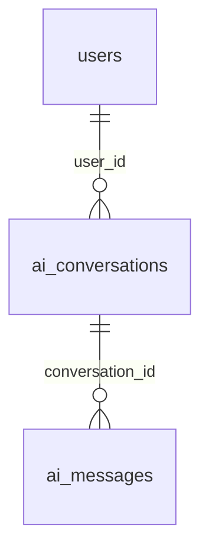

# AI 추천 개발 청사진·진행 현황

## 2026-11-10 월간 추천 잔여 횟수 표시 (`feat/ai-prompt`)

- 사용자 요청으로 matching 추천 조건 패널의 `사용 횟수 / 한도` 표시를 서버 `remainingCount` 기준의 `남은 횟수 / 한도`로 변경하고 제목을 ‘월간 추천 잔여’로 명확히 했다. 프리미엄1회 사용은99/100회, 무료1회 사용은4/5회다. 로딩·실패 시 기존 ‘—’ 표시를 유지한다.
- 변경 파일: `frontend/app/ai/matching/_components/ChatConditions.tsx`, `docs/ai-matching.md`, 이 문서. 사용량 계산·차감·처리 중 예약·API·백엔드·다른 도메인은 변경하지 않았다.
- 검증: `frontend`에서 `npm test -- lib/matching/usage.test.ts tests/screens/FollowingMatching.test.tsx` 실행,2개 파일27개 테스트 통과. `npm run build` 성공(TypeScript 검사·정적 페이지77개 생성). `npx eslint app/ai/matching/_components/ChatConditions.tsx` 오류0·종료0. 표시1줄 변경으로 새 테스트는 추가하지 않았다. 백엔드 변경이 없어 `./gradlew test`는 실행하지 않았다.
- 미검증: 실제 브라우저 및 서버 연결 검증은 수행하지 않았다. 커밋·푸시·병합·배포는 수행하지 않는다.

## 2026-11-10 메인 첫 프롬프트 분석 연결 (`feat/ai-prompt`)

- 요청 범위: 메인에서 첫 프롬프트를 제출하고 matching으로 이동했을 때 AI가 입력에 응답하고 조건을 처리하도록 수정한다. 기존 저장·이동만 하던 경로에 기존 메시지 분석을 연결하며 다음 AI 개발 단계는 시작하지 않는다.
- 원인: `startHomeChat`·`resumeLoginPrompt`는 USER 메시지만 저장하고, 분석은 matching의 전송 버튼에서만 호출했다.
- 변경 파일: `frontend/app/ai/matching/page.tsx`, 신규 `frontend/lib/matching/useInitialChatAnalysis.ts`·`useInitialChatAnalysis.test.tsx`, `docs/ai-matching.md`, 이 문서.
- 완료: 로그인 및 대화 이력 로딩 후 새 로컬 대화의 첫 메시지를 한 번 분석한다. 기존 답변·조건 반영·로딩·오류·수동 재시도를 재사용하며 분석 중 재시도 버튼을 비활성화한다. 서버 대화·미완료 분석은 자동 실행하지 않는다. 추천 생성·사용량 차감·다른 업무 도메인·백엔드·DDL·인증 설정은 변경하지 않았다.
- 검증: `frontend`에서 `npm test -- lib/matching/useInitialChatAnalysis.test.tsx lib/state/homeStore.test.tsx tests/screens/FollowingMatching.test.tsx` 실행, 3개 파일47개 테스트 통과. 새 테스트는 메인/로그인 입력의 분석 API 호출·원문/clientKey 보존·답변/조건 반영·effect 중복 실행 방지·실패 후 자동 반복 방지·기존 대화 제외를 검증한다. API 응답은 테스트 대역이다.
- 빌드·정적 검사: `frontend`에서 `npm run build` 성공(TypeScript 검사·정적 페이지77개 생성). `npx eslint app/ai/matching/page.tsx lib/matching/useInitialChatAnalysis.ts lib/matching/useInitialChatAnalysis.test.tsx` 최초 실행은 새 테스트의 렌더 중 외부 변수 대입·일반 함수 내부 hook 호출2건으로 실패했다. 테스트 Probe 컴포넌트로 수정한 뒤 같은 ESLint 명령을 재실행해 오류0·종료0을 확인했다. 수정 후 `npm test -- lib/matching/useInitialChatAnalysis.test.tsx`도4개 통과했다. 백엔드 변경이 없어 `./gradlew test`는 실행하지 않았다.
- 미검증·후속: 실제 브라우저·실제 Gemini/DB 연결은 확인하지 않았다. 실제 서버의 분석 기능 설정 및 연결 오류는 기존 API 오류 안내로 처리한다. 커밋·푸시·병합·배포는 수행하지 않았다.

## 2026-11-10 STEP 7 종료 점검 — 현재 구현 기준

이번 요청은 **문서만 갱신**한다. 현재 코드·이전 실행 로그·JUnit XML을 대조했으며 아래 테스트 수치는 이번 문서 작업에서 새로 실행한 결과가 아니다. 현재 브랜치는 `feat/ai-usage`, 본체 커밋은 `8945056`이다. 이후 CHAR JDBC 매핑 수정·스키마 검증 테스트·관련 문서는 작업 트리에 남아 있으며 커밋되지 않았다. 이전 날짜별 미구현·미적용·테스트 수치는 당시 이력이고 이 절을 최신 기준으로 삼는다.

### 완료 기능과 정책

- 사용자·KST 월별 `AiUsage`와 GET `/api/v1/ai/usage`, 인증 BFF GET `/api/ai/usage`를 구현했다. 응답은 usageMonth/usedCount/limit/remainingCount/pendingCount/availableCount다. UNIQUE(user_id, usage_month), 카운터 음수 금지, 추천 요청의 사용량 FK·예약 만료 시각을 관리한다.
- 무료5회, 현재 DB PREMIUM/ADMIN 역할+유효 구독100회이며 ADMIN 무제한 예외는 없다. 신규 요청 최초 처리 시 기록한 KST 수신 월에 귀속한다. 월이 바뀌면 새 행을 사용하며 이전 월 행을 초기화하지 않는다. 구독 변경 시 기존 used는 유지하고, 이미 예약한 요청은 완료를 허용한다.
- 0건 정상 완료를 포함해 신규 추천 요청 전체 성공에1회 차감한다. 개발자/프로젝트 중 한쪽 실패는 전체 실패·부분 결과 롤백·미차감이다. 대화·일반 메시지·조건 변경·기존 결과 GET·6B 상세 분석·실패는 차감하지 않는다.
- 대화별 멱등성 키를 먼저 확인하고 신규 요청에만 월별 행 잠금·예약을 적용한다. 외부 계산은 트랜잭션 밖에서 수행하고, 성공은 결과/SUCCESS/used 증가/pending 감소를 함께 커밋한다. 실패·만료·삭제는 예약을 한 번만 반환하며, 대화 삭제 후 성공 used를 보존한다. 첫 월 행 생성 경쟁도 DB UNIQUE와 실패 트랜잭션 밖 재조회로 처리한다.
- 자리 부족은429·AI_MONTHLY_LIMIT_EXCEEDED다. 프론트는 서버 사용량만 표시하고 실패를0회로 대체하지 않는다. 429로 생성되지 않은 요청의 대기 키는 제거하고, 네트워크 응답 유실의 기존 키는 유지한다. 같은 키의 기존 성공·처리 중·실패 조회는 추가 차감하지 않는다.
- 예약은 기본30분으로 설정 가능하다. usage GET/추천 POST/결과 GET에서 사용자 전체 월의 만료를 정리한다. 늦은 완료와 중복 정리의 상태 전이를 DB 잠금으로 보호한다. 별도 스케줄러나 외부 호출 즉시 취소는 없다.
- 사용자 SQL 적용 후 발생한 CHAR(7) 검증 오류는 `@JdbcTypeCode(SqlTypes.CHAR)`+길이7로 수정했다. 기존 SQL CHAR(7)에 Hibernate validate를 수행하는 회귀 테스트를 추가했다. DB 타입·확정된 사용량 정책을 변경한 것이 아니라 매핑 누락을 보완한 것이다.

### STEP 7 전체 변경 파일

| 루트 | 파일 |
|---|---|
| `backend/src/main/java/com/devmozip/backend/` 신규 | `config/AiUsageConfiguration.java`, `controller/AiUsageController.java`, `dto/ai/AiUsageResponse.java`, `entity/AiUsage.java`, `repository/AiUsageRepository.java`, `service/AiUsageService.java` |
| 같은 루트 수정 | `controller/AiRecommendationController.java`, `entity/AiRecommendationRequest.java`, `repository/AiConversationDeletionRepository.java`, `repository/AiRecommendationRequestRepository.java`, `service/impl/AiRecommendationExecutionServiceImpl.java` |
| `backend/src/test/java/com/devmozip/backend/ai/controller/` | 신규 `AiUsageIntegrationTest.java`, `AiUsageSchemaValidationTest.java`; 수정 `AiConversationTests.java`, `AiMessageAnalysisTests.java`, `AiRecommendationExecutionTests.java` |
| 백엔드 fixture | `backend/src/test/resources/ai/schema.sql` |
| `frontend/` | `app/ai/matching/_components/ChatConditions.tsx`/`ChatConditions.module.css`, `app/api/ai/[...path]/route.ts`/`route.test.ts`, 신규 `lib/matching/usage.ts`/`usage.test.ts`, `lib/state/homeStore.ts`/`homeStore.test.tsx`, `tests/screens/FollowingMatching.test.tsx` |
| `docs/` | `ai-matching.md`, `ai-api-spec.md`, `ai-progress.md`, `ai-usage-api.md`, `ai-step7-concurrency-notes.md`, `sql/ai-usages.sql` |

회원·프로젝트·포트폴리오·구독·공통 인증·배포 코드는 변경하지 않았다. 이번 문서 작업에서 수정하는 것은 위 목록 중 AI Markdown 문서5개뿐이며 SQL·기능 코드·기존 미커밋 테스트는 보존한다.

### 직접 대조한 검증 결과

| 실행 시점·대상 | 명령·근거 | 확인한 결과 |
|---|---|---|
| CHAR 수정 전 재현 | `backend`: PG 사용량 URL 지정 후 `DEBUG=false ./gradlew test --tests '*AiUsageSchemaValidationTest' --no-daemon`; `/tmp/devmozip-usage-char-before.log`/XML |1개 실패. 실제 CHAR를 VARCHAR로 기대하는 사용자 보고와 같은 오류 재현 |
| 최초 격리 PostgreSQL 추천·동시성 | PG18.6의 실행/사용량 URL 지정 후 `DEBUG=false ./gradlew test --tests '*AiUsageIntegrationTest' --tests '*AiRecommendationExecutionTests' --no-daemon`; `/tmp/devmozip-step7-postgres-final.log`, `/tmp/devmozip-step7-pg-results/TEST-*.xml` |33개 통과·실패/오류/스킵0. 사용량16개+기존 실행17개 |
| CHAR 수정 후 격리 PostgreSQL | 같은 PG18.6 사용량 URL 지정 후 `DEBUG=false ./gradlew test --tests '*AiUsageSchemaValidationTest' --tests '*AiUsageIntegrationTest' --no-daemon`; `/tmp/devmozip-usage-char-pg-after.log`, `/tmp/devmozip-usage-char-pg-results/TEST-*.xml` |17개 통과·실패/오류/스킵0. schema validate1개+사용량16개 |
| CHAR 수정 후 최종 백엔드 전체 | `backend`: `DEBUG=false ./gradlew test --no-daemon`; `/tmp/devmozip-usage-char-backend-final.log`, 현재 JUnit XML68개 | 총743개,731개 통과·12개 스킵·실패/오류0,2분12초 |
| 마지막 프론트 전체 테스트 | `frontend`: `npm test -- --maxWorkers=2`; `/tmp/devmozip-step7-frontend-final.log` |80개 파일897개 통과. CHAR 수정에서는 프론트 코드가 바뀌지 않아 반복하지 않음 |
| CHAR 수정 후 프론트 빌드 | `frontend`: `npm run build`; `/tmp/devmozip-usage-char-frontend-build.log` |성공, TypeScript·정적57개 생성 |

33개와17개 실행은 사용량16개가 겹치므로 고유 테스트50개로 합산하지 않는다. 최종 전체의12개 스킵은 팀DB opt-in11개와 PostgreSQL 부분 인덱스 선택 검증1개다. 이 부분 인덱스 검증은 앞선 격리 PG33개 실행에는 포함돼 통과했다. 초기598개 통과·111개 스킵 기록은 앞선 환경의 결과이며 최신731개 통과 기록으로 대체해 읽는다.

실험 근거: 잔여1회에 서로 다른8개 대화가 동시에 요청하면 성공1개/429 일곱 개·최종 used=5/pending=0. 월 행 없이8개가 경쟁하면 행1개·성공5개/거절3개다. 같은 키 재전송, 실패·저장 롤백, KST 월말→월초 완료, 무료→프리미엄/구독 종료, 계정 분리, 만료·완료·중복 정리 경합, 진행 중 대화 삭제와 성공 사용량 보존을 검증했다. PostgreSQL 결과는 단일 JVM의 독립 HTTP 요청·트랜잭션·커넥션과 계산 테스트 대역으로 수행했다.

### DB 적용 상태·미해결 문제

- 사용자가 공유 PostgreSQL17.11에 SQL을 실행했고 직전 읽기 전용 재조회로 테이블·컬럼·주요 UNIQUE/CHECK/FK를 확인했다. 도구의 결과 표시 TypeError가 SQL 롤백을 뜻하지는 않았다. 에이전트는 공유 DB에 DDL·데이터를 쓰지 않았다. 이번 문서 작업에서 DB를 다시 조회한 것으로 보고하지 않는다.
- CHAR 수정 뒤 사용자의 실제 서버 재기동 성공, 공유17의 신규 API 성공/429/실패·동시성, 브라우저·모바일, 실제 Gemini 품질·할당량은 확인하지 않았다. 스키마 확인·격리 PG18.6 검증을 전체 실사용 완료로 확장하지 않는다.
- 별도 만료 스케줄러·여러 JVM 실험·실제 프로세스 강제 종료/DB 장애 복구 실험은 없다.30분은 실제 대규모 후보 지연을 측정한 값이 아니며 실행 중 외부 호출을 취소하지 않는다. 요청이 없으면 만료 정산은 다음 접근까지 지연된다.
- 과거 usage 연결이NULL인 PENDING은 자동 회복하지 않고 과거 추천은 소급 차감하지 않는다. 외부 AI 호출 자체의 exactly-once는 보장하지 않는다.6B 본문 가산점·짧은 ‘네’ 반복 확인·구독 결제는 이번 단계에 포함하지 않는다.

### 다음 작업에서 주의할 점

1. 현재 미커밋 CHAR 수정과 회귀 테스트를 함께 관리한다. SQL을 다시 실행하거나 usage_month를 VARCHAR로 바꿔 기동 오류를 우회하지 않는다. 새 환경에는 AI SQL을 명시 적용하고 validate까지 확인한다.
2. 사용자의 서버 재기동과 유효 구독 계정으로 usage GET·추천 성공/429/실패를 확인하는 작업은 별도 지시 후 수행한다. 공유 DB 실사용 검증은 실제 used를 바꾸므로 기존 기록을 임의로 초기화·삭제하지 않는다.
3. 대화 → 사용량 → 요청 잠금 순서, 외부 호출의 트랜잭션 분리, 성공 원자 저장, 기존 키 재조회, 수신 월 귀속을 후속 변경에서도 보존한다. 요금제 변경으로 used+pending이 현재 한도를 넘는 상태는 가능하므로 고정5/100 DB CHECK를 추가하지 않는다.
4. 예약 수명·스케줄러·중단 복구를 보완하려면 기존 예약/만료 상태 전이와 검증부터 확인한다. 로컬/여러 서버 시간·타임아웃·후보 수 측정 없이 만료 시간을 줄이지 않는다.
5. 이번 정리는 정책 변경 없이 합의 내용을 현재 명세와 맞춘다. 기능 완료와 공유 DB 반영·실제 서버 검증·운영 배포를 구분하며 다음 기능·커밋·푸시를 자동 시작하지 않는다.

이번 문서 작업의 검증: 직전 로그·XML과 코드를 대조했다. `frontend`의 `npm run build`를 이번에 실행해 성공했고 로그는 `/tmp/devmozip-step7-docs-build.log`에 남겼다. 생성 next-env.d.ts를 작업 전 내용으로 복원한 뒤 기능/테스트/정적 파일834개의 전후 SHA-256이 모두 같아 이번 작업의 기능 코드 변경0건을 확인했다. 문서 상대 링크·종료 점검 앵커·`git diff --check`도 통과했다. 새 테스트를 만들거나 프론트/백엔드 기능 테스트를 재실행하지 않았으며 기존 미커밋 CHAR 수정·회귀 테스트를 보존했다. 공유 DB 조회·수정, 앱 재시작·배포, 커밋·푸시는 이번 문서 작업에서 수행하지 않았다.

## 2026-11-10 사용자 SQL 적용 후 CHAR(7) 기동 오류 수정

- 사용자 로그의 `found bpchar (Types#CHAR), expecting char(7) (Types#VARCHAR)`는 엔티티 JDBC 타입 누락이었다. `columnDefinition="char(7)"`만으로 Java String의 JDBC VARCHAR 기본 매핑을 바꾸지 못했다. 실제 DB 타입은 ERD·SQL 계약대로이며 DB 컬럼을 변경하지 않았다.
- `entity/AiUsage.java`의 usageMonth에 `@JdbcTypeCode(SqlTypes.CHAR)`와 `length=7`을 추가했다. 신규 `ai/controller/AiUsageSchemaValidationTest.java`는 독립 스키마에 SQL CHAR(7) 테이블을 먼저 만들고 Hibernate validate만 실행한다. 최초 create-drop 위주의 검증에서 놓친 배포 스키마 타입 비교를 회귀 검증한다.
- 공유 PostgreSQL17.11은 읽기 전용으로 재조회했다. 사용자가 실행한 SQL로 ai_usages, 요청의 ai_usage_id/reservation_expires_at, 사용자·월 UNIQUE, 음수 금지, 사용량 FK, 예약 쌍 CHECK가 생성됐음을 확인했다. 에이전트는 공유 SQL을 실행하거나 데이터를 바꾸지 않았다. 앞선 ‘스키마 미적용’ 기록은 사용자 실행 전 상태다.
- `docs/ai-usage-api.md`, `docs/ai-matching.md`, `docs/ai-api-spec.md`에 사용자 적용 사실과 JDBC 매핑을 반영했고, `docs/ai-step7-concurrency-notes.md`에 원인·기존 검증의 빈틈·수정·회귀 테스트를 기록했다. 코드 변경은 AI 엔티티 매핑에 한정한다. 기능 정책·DDL·공통 설정 변경, 커밋·푸시는 하지 않았다.
- 재현: 격리 PostgreSQL18.6에서 `DEVMOZIP_AI_USAGE_TEST_JDBC_URL=jdbc:postgresql://127.0.0.1:18547/ai_usage_test DEBUG=false ./gradlew test --tests '*AiUsageSchemaValidationTest' --no-daemon` 실행. 수정 전1개가 사용자와 동일한 타입 오류로 실패했다. `/tmp/devmozip-usage-char-before.log`, `/tmp/devmozip-usage-char-before.xml`에 보존했다.
- 수정 후: 같은 PostgreSQL에서 `--tests '*AiUsageSchemaValidationTest' --tests '*AiUsageIntegrationTest'`로 실행해17개 모두 통과·스킵0(33초). `/tmp/devmozip-usage-char-pg-after.log`, `/tmp/devmozip-usage-char-pg-results/TEST-*.xml`. 프론트 `npm run build`도 성공, 생성 next-env.d.ts 복원. 프론트 코드 변경이 없어 프론트 테스트는 반복하지 않았다.
- 최종 백엔드: `DEBUG=false ./gradlew test --no-daemon` 성공(2분12초), JUnit XML68개에서 총743개·731개 통과·12개 스킵·실패/오류0. `/tmp/devmozip-usage-char-backend-final.log`. 프론트 빌드 로그는 `/tmp/devmozip-usage-char-frontend-build.log`. `git diff --check`와 문서 링크 확인도 통과했다. 실제 사용자 서버 재기동·신규 AI API 쓰기·실제 Gemini 검증은 이번 테스트와 구분한다.

## 2026-11-10 STEP 7 구현·최종 검증

### 완료 범위와 실제 DB 대조

- 브랜치 `feat/gemini-portfolio-analysis`, 기준 HEAD `19a3232`에서 기존 미커밋 문서를 보존했다. Java21/Spring Boot4.1.2/Gradle9.8.2/JPA를 파일로 재확인했다. 회원·프로젝트·포트폴리오·구독 도메인·공통 인증/배포 설정은 수정하지 않았다.
- 제한 환경의 공유 DB 연결 실패 후 일반 환경에서 **읽기 전용**으로 재조회했다. 공유 PostgreSQL17.11/public에는 `ai_usages`와 추천 요청의 `ai_usage_id`, `reservation_expires_at`가 없다. 제공 ERD의 사용량 컬럼과 현재 구독/요청 DDL을 대조했다. 합의한 `pending_count` 및 비식별 FK/만료 시각만 추가 SQL로 작성했고 공유 DB에는 적용하지 않았다.
- `AiUsage` 엔티티·월별 UNIQUE·음수 금지, GET `/api/v1/ai/usage` 및 BFF `/api/ai/usage`, 현재 요금제·무료5/프리미엄100·KST 월·응답6개 필드를 구현했다. PREMIUM/ADMIN은 현재 유효 구독을 요구하며 관리자 예외·과거 소급 차감은 없다.
- 신규 추천 접수는 월별 행 잠금과 처리 중 예약을 사용한다. 기존 대화별 멱등성 키를 먼저 확인하고 신규 요청만 예약한다. 외부 계산은 잠금 밖, 성공은 결과+SUCCESS+used 증가+pending 감소를 같은 트랜잭션, 실패는 결과 롤백 후 FAILED+예약 반환을 별도 트랜잭션으로 처리한다.
- 요청 최초 수신 KST 월에 귀속하고 구독 변경 시 같은 달 used를 유지한다. 접수 후 구독 종료는 기존 요청 완료를 허용하고 다음 신규 요청부터 현재 한도를 적용한다. 0건 정상 완료는1회, 대화/메시지/조건/GET/6B 상세/실패는 미차감이다.
- 예약 기본30분(`app.ai.usage.reservation-ttl`, 양수 Duration), usage GET/추천 POST/결과 GET에서 전체 월 만료 정리를 수행한다. 과거 연결 없는 PENDING은 유지한다. 만료와 완료의 상태 전이를 잠금으로 보호해 늦은 결과·중복 정산을 차단한다. 대화 삭제는 예약을 먼저 반환하고 성공 사용량은 보존한다.
- 프론트는 로컬 Mock/역할 한도 대신 현재 서버 used/limit/remaining/pending/available을 표시한다. 계정·처리 상태 변경/포커스/명시 새로고침에서 조회하며 오류를0회로 숨기지 않는다. 월 한도429의 코드·안내를 BFF에서 유지하고 미생성 요청의 대기 키는 제거한다. 응답 유실 키 재사용은 유지한다.

### 변경 파일

| 범위 | 파일 (각 루트 상대 경로) |
|---|---|
| `backend/src/main/java/com/devmozip/backend/` 신규 | `entity/AiUsage.java`, `repository/AiUsageRepository.java`, `service/AiUsageService.java`, `config/AiUsageConfiguration.java`, `dto/ai/AiUsageResponse.java`, `controller/AiUsageController.java` |
| 같은 루트 수정 | `entity/AiRecommendationRequest.java`, `repository/AiRecommendationRequestRepository.java`, `repository/AiConversationDeletionRepository.java`, `service/impl/AiRecommendationExecutionServiceImpl.java`, `controller/AiRecommendationController.java` |
| 백엔드 테스트 | 신규 `ai/controller/AiUsageIntegrationTest.java`; 기존 `AiRecommendationExecutionTests.java`, `AiConversationTests.java`, `AiMessageAnalysisTests.java` 및 `src/test/resources/ai/schema.sql` |
| 프론트 | 신규 `lib/matching/usage.ts`/`usage.test.ts`; `app/ai/matching/_components/ChatConditions.tsx`/CSS, `app/api/ai/[...path]/route.ts`/테스트, `lib/state/homeStore.ts`/테스트, `tests/screens/FollowingMatching.test.tsx` |
| 문서·AI SQL | `sql/ai-usages.sql`, `ai-usage-api.md`, `ai-step7-concurrency-notes.md`, `ai-matching.md`, `ai-api-spec.md`, 이 기록 |

### 이번에 실행한 검증

| 검증 | 명령·환경 | 실제 결과 |
|---|---|---|
| 격리 PostgreSQL 동시성·기존 실행 | `backend`: `DEVMOZIP_AI_USAGE_TEST_JDBC_URL=jdbc:postgresql://127.0.0.1:18547/ai_usage_test DEVMOZIP_AI_EXECUTION_TEST_JDBC_URL=jdbc:postgresql://127.0.0.1:18547/ai_usage_test DEBUG=false ./gradlew test --tests '*AiUsageIntegrationTest' --tests '*AiRecommendationExecutionTests' --no-daemon` | PostgreSQL18.6, 사용량16개+추천 실행17개=33개 모두 통과·스킵0. SQL 재실행 포함.53초 |
| 백엔드 전체 회귀 | `backend`: `DEBUG=false ./gradlew test --no-daemon` | 명령 성공. JUnit XML67개에서 총709개,598개 통과·111개 스킵·실패/오류0.1분26초. Docker 비가용 Testcontainers·팀DB opt-in·PG 선택 검증 조건의 스킵이며 전체709개 실행 통과로 표현하지 않음 |
| 프론트 전체 | `frontend`: `npm test -- --maxWorkers=2` | 80개 파일897개 통과 |
| 최종 프론트 빌드 | `frontend`: `npm run build` | 일반 환경에서 성공, TypeScript·정적57개 생성. 생성 next-env.d.ts는 작업 전으로 복원 |
| 변경 프론트 제품 검사 | `npx eslint app/ai/matching/_components/ChatConditions.tsx 'app/api/ai/[...path]/route.ts' lib/matching/usage.ts lib/matching/usage.test.ts lib/state/homeStore.ts` | 종료0·오류 출력 없음 |

주요 경쟁 실험: 무료 used=4에서 서로 다른8개 대화의 동시 요청은201 한 개/429 일곱 개, 최종 used=5/pending=0. 월 행 없는8개 동시 요청은 월 행1개/성공5개/거절3개다. 같은 키 처리 중 재전송은202·추가 계산 없음, 완료 후1회다. 무료6번째/프리미엄101번째 차단, 실패·저장 롤백 미차감, 월 경계, 구독 전환/만료·ADMIN, 사용자 격리, 대화 삭제, 만료/완료/중복 정리 경합, DB 제약을 확인했다.6B 테스트 대역 통합은 전체 회귀에서 유지한다.

초기 검증 실패도 구분한다. Gradle 캐시 읽기 전용·제한 환경 Next TypeScript 설정 조회 실패는 일반 환경 재실행으로 해결했다. 최초 백엔드 회귀의 조회 경로/fixture 기대 실패, PostgreSQL DO 블록 분리 오류, 신규 테스트의 인증 없는 서비스 직접 호출·Mockito 재설정 오류, native DELETE 후 JPA 잔여 요청 참조 문제를 수정한 뒤 위 최종 검증을 실행했다. 실제 제품 문제의 원인·수정은 [학습 기록](ai-step7-concurrency-notes.md)에 남겼다.

로그: `/tmp/devmozip-step7-postgres-final.log`, `/tmp/devmozip-step7-pg-results/TEST-*.xml`, `/tmp/devmozip-step7-backend-final.log`, `/tmp/devmozip-step7-frontend-final.log`, `/tmp/devmozip-step7-build-final.log`, `/tmp/devmozip-step7-eslint.log`. 기존 단계 수치를 이번 결과로 대신 쓰지 않았다.

최종 `git diff --check`와 신규 문서 상대 링크 검사를 통과했다. 변경31개 파일의 업무 범위를 확인했고, 빌드 생성 파일 변경은 남기지 않았다. 검증 전용 `/tmp/devmozip-step7-pg` PostgreSQL 서버는 종료했으며 로그·테스트 결과는 보존했다.

### 남은 적용·검증 경계

- 공유 DB에 [AI 전용 SQL](sql/ai-usages.sql)을 검토·적용한 뒤 새 서버를 반영해야 한다. 현재 실행 중 서비스 재시작·공유 데이터/DDL 변경·운영 배포·커밋·푸시·main/develop 병합은 하지 않았다. 기존 공통 ddl-auto 설정은 그대로이며 자동 update만으로 모든 SQL 제약을 보장하지 않는다.
- 실제 Gemini 호출, 공유 PostgreSQL17에서의 신규 API 쓰기/동시성, 여러 JVM/서버 인스턴스·프로세스 강제 종료 실험, 브라우저 수동·모바일 시각 검증은 하지 않았다. 이번 동시성은 단일 JVM의 독립 HTTP 요청/트랜잭션/커넥션과 격리 PostgreSQL18.6+추천 엔진 테스트 대역이다.
- 만료 정리는 접근 시 수행하고 별도 스케줄러는 없다.30분은 설정 가능한 초기값이며 전체 후보/실제 모델 지연 측정 후 조정할 수 있다. 만료가 외부 호출을 즉시 취소하지는 않는다. 기존 연결 없는 과거 PENDING 자동 복구는 포함하지 않는다.
- 짧은 ‘네’ 대화 문제·6B 가산점·결제 구현 등 다른 범위는 진행하지 않는다. API/시간/잠금 상세는 [구현 계약](ai-usage-api.md)을 따른다.

## 2026-11-10 STEP 7 정책·동시성 학습 기록 — 문서 작업

- 사용자 합의한 무료5/프리미엄100, 현재 유효 구독 판정, KST 접수 월 귀속, 0건 성공 차감, 실패 미차감, 처리 중 구독 변경·기존 사용 횟수 유지 정책을 기록했다. 처리 중 자리 예약과 짧은 DB 잠금, 결과/상태/사용량 원자 저장 방향을 정리했다.
- 신규 `docs/ai-step7-concurrency-notes.md`: 쉬운 용어, 경쟁 상황 예시, 현재 코드 경계, ERD 비식별관계·추가 컬럼안, API 계산값, 대안 비교, 만료/삭제/월 경계, 검증 계획, 트러블슈팅 양식과 포트폴리오 작성 예시. 실제 장애·실험 결과와 설계 가설을 구분했다.
- `docs/ai-matching.md`, `docs/ai-api-spec.md`에 최신 설계 합의·예정 API 링크를 추가하고 현재 단계 설명을 보완했다. 이 문서의 전체 단계 표도6A/6B 구현 상태로 갱신했다. 이후 무료 안내·별 아이콘은 현재 f4d313e에 커밋됐으며 HEAD는19a3232다. 아래 과거 미커밋 기록은 당시 상태다.
- 미완료: 실제 DB DDL 대조·마이그레이션, AiUsage/API/예약·차감 구현, 기본 추천 예약 만료 시간·회복 실행 방식, PostgreSQL 동시성 실험. 코드·SQL·DB·실행 환경 변경·커밋·푸시는 하지 않는다.
- 이번 검증: `frontend`에서 `npm run build` 성공(TypeScript·정적57개 생성), 생성된 next-env.d.ts는 작업 전 내용으로 복원했다. `git diff --check` 및 신규 문서의 상대 파일 링크 존재 확인 통과. 문서만 변경했으므로 프론트/백엔드 기능 테스트·실제 DB/Gemini 검증은 실행하지 않았고 새 테스트도 작성하지 않았다. 기존 테스트 결과를 이번 성공으로 보고하지 않는다.

## 2026-11-10 6B 불필요 코드·로그 점검

- PR 정리 요청으로6B 및 함께 변경된 AI 제품 코드를 점검했다. `AiRecommendationServiceImpl`의 미사용 `Transactional` import1개를 제거했다. 정책·트랜잭션 경계·실제 동작은 변경하지 않았다.
- 제품 코드에 console 출력·System.out·printStackTrace·디버그 로그는 없었다. `AiPortfolioAnalysisService`의 실패 상태 저장 불가 경고1개는 임대 회복/저장소 장애 진단에 필요해 유지했다. 인용·본문·API키·예외 스택을 이 경고에 기록하지 않는다. 테스트/문서/정상 예외 처리와 운영에 필요한 상태 정보는 삭제하지 않았다.
- 검증: `backend`에서 `DEBUG=false ./gradlew test --no-daemon` 성공(4분34초), 총726개 중714개 통과·12개 스킵·실패/오류0. `frontend`의 `npm run build` 성공. 프론트 기능 코드는 바꾸지 않아 직전 통과한 프론트 테스트/ESLint는 반복 실행하지 않았다. 빌드 생성 next-env.d.ts 복원 및 `git diff --check` 통과. 로그 `/tmp/devmozip-6b-cleanup-{backend,build}.log`. 실제 Gemini·브라우저 수동 검증·새 기능 테스트는 추가하지 않았다. 기능 추가·커밋·푸시는 하지 않았다.

## 2026-11-10 6B 종료 점검 — 현재 구현 기준

이번 요청은 문서 정리만 수행했다. 브랜치는 `feat/gemini-portfolio-analysis`, 구현 커밋은 `0f4b415`다. 이후 무료 안내·단일 별 UI와 관련 문서는 아직 미커밋 상태이며 보존했다. 아래 날짜별 기록은 작업 당시 이력이고 이 절과 [6B 구현 계약](ai-portfolio-analysis.md)의 최신 정리를 우선한다. 7단계는 시작하지 않았다.

### 완료 기능

- 저장된 SUCCESS 개발자 추천 결과 소유자의 명시 요청으로만 포트폴리오 상세 분석을 생성한다. 현재 DB PREMIUM/ADMIN 역할과 현재 유효 구독을 모두 요구하며 무료·구독 없음·만료·정지·타인 결과·비공개 자료를 차단한다. 회원/포트폴리오/구독 도메인·공통 보안·DDL은 수정하지 않았다.
- 요청 당시 조건·명시 요구와 현재 PUBLIC 제목/요약/역할/기술을 비교해 관련도 양수인 최대5개를 선택한 뒤 본문을 분석한다. 본문은 자료당6000자, 요구는8개씩 처리하며 정확 인용·허용 출처를 검증한다. 관련 자료가 없으면 개수를 채우거나 Gemini를 호출하지 않는다.
- 기존 detailed_reason TEXT의 version1 JSON·DB CAS·180초 임대·자료 지문 캐시로 중복 생성과 오래된 저장을 제어한다. 생성/조회/저장 전후 권한·구독·자료를 다시 검사하고 실패/만료 임대는 명시 재시도로 회복한다. 개별 모델 최대60초·전체 예산180초·BFF190초다.
- 인용을 개발자 이름·출처 포트폴리오 제목 링크로 묶어 읽기 쉬운 문장으로 표시한다. UNKNOWN/자료 부족/빈 평가 목록은 숨기며 PARTIAL·구현 중·명시 차이는 유지한다. 메타데이터 선택 이유는 API에 보존하고 화면은 선택 원칙을 접어서 표시한다.
- 완료 후 정기 조회·포커스 복귀 조회는 제거했다. PENDING에서만3초 간격 GET을 최대60회 수행하고 완료/오류/취소 시 종료한다. 무료 버튼은 API 호출 없이 프리미엄 안내와 `/subscription` 링크를 표시한다. 프리미엄 화면에서403이면 유효 구독 확인 안내와 같은 링크를 제공한다. 최종 아이콘은 시안색 단일 별28px이며 두 별 시안은 대체됐다.
- 함께 확정한6A 보완: 프로젝트 summary를 기존 공개 평가 자료에 추가했다. 새 추천은 기술·직군·검증된 세부 요구와 연결되지 않는 개발자, 분야·기술·텍스트·검증된 요구와 연결되지 않는 프로젝트를 제외한다. 고정 점수 하한 없이 부분/진행 중 근거는 유지하며 관련성 평가 후 상위10개를 정한다. 기본80%+요구20%·UNKNOWN0점 분모를 유지하고 저장된 과거 점수/순위/GET/replay는 재계산하지 않는다. 6B 본문은 가산점에 사용하지 않는다.
- 합성 포트폴리오20개는 앞선 승인 작업에서 기존 데모6명에 연결했다(당시 기존3개 포함 총23개). 전용 seed/cleanup SQL을 제공하며 이번 점검에서는 DB 조회·삽입·정리 작업을 하지 않았다.

### 변경 파일 목록

`0f4b415`의36개 파일과 이후 프론트 변경을 확인했다. 경로가 긴 목록은 공통 루트를 생략해 표기한다.

| 범위/루트 | 파일 |
|---|---|
| `backend/src/main/java/com/devmozip/backend/` | `controller/AiPortfolioAnalysisController.java`, `dto/ai/PortfolioAnalysisResponse.java`, `repository/AiPortfolioAnalysisRepository.java`, `service/AiPortfolioAnalysisService.java`, `service/AiPortfolioAnalysisModel.java`, `service/AiPortfolioSelection.java` |
| 같은 백엔드 루트의6A 보완 | `dto/ai/internal/SimilarProjectCandidate.java`, `repository/AiCandidateRepository.java`, `service/impl/AiRecommendationServiceImpl.java` |
| `backend/src/main/resources/ai/` | `portfolio-instruction.txt`, `portfolio-schema.json`, `requirements-instruction.txt` |
| `backend/src/test/java/com/devmozip/backend/ai/` | `portfolio/AiPortfolioAnalysisIntegrationTest.java`, `engine/AiRecommendationServiceTest.java`, `engine/AiRecommendationDatabaseTest.java` |
| `frontend/app/ai/matching/_components/` | `PortfolioAnalysis.tsx`, `PortfolioAnalysis.module.css`, `PortfolioAnalysisContent.tsx`, `RecommendationCards.tsx` |
| `frontend/app/api/ai/recommendations/[id]/detailed-analysis/` | `route.ts`, `route.test.ts` |
| `frontend/lib/matching/` | `portfolioAnalysis.ts`, `portfolioAnalysis.test.ts`, `portfolioPresentation.ts`, `portfolioPresentation.test.tsx`, `recommendationPresentation.ts`, `recommendationPresentation.test.ts` |
| 프론트 기타 | `frontend/types/aiPortfolioAnalysis.ts`, `frontend/tests/screens/FollowingMatching.test.tsx`, `frontend/public/icons/premium-star.svg` |
| `docs/` | `ai-matching.md`, `ai-api-spec.md`, `ai-progress.md`, `ai-step6-design.md`, `ai-portfolio-analysis.md`, `sql/ai-portfolio-demo.sql`, `sql/ai-portfolio-demo-cleanup.sql` |

### 확인한 테스트 결과와 검증 범위

이번 문서 작업에서는 테스트·빌드를 재실행하거나 새 테스트를 작성하지 않았다. 직전 실행 로그와 현재 남아 있는 JUnit XML을 직접 대조했다. 아래 숫자는 이번 문서 수정의 신규 실행 결과가 아니다. 문서 수정 후 `git diff --check`를 통과했고, 작업 시작/종료 시 백엔드·프론트 기능 파일845개의 SHA-256을 비교해 이번 작업의 기능 코드 변경0건을 확인했다. 기존 미커밋 UI/SVG는 그대로 보존했다.

| 직전 검증 | 명령/산출물 | 결과 |
|---|---|---|
| 백엔드 전체 | `backend`: `DEBUG=false ./gradlew test --no-daemon`; `/tmp/devmozip-relevance-backend-final.log`, `backend/build/test-results/test/TEST-*.xml` | 총726개,714개 통과·12개 opt-in 스킵·실패/오류0,2분38초 |
| 6B 격리 통합 | 위 실행의 `AiPortfolioAnalysisIntegrationTest` | 19개 통과. 실제 인증/HTTP/서비스/격리 H2 저장 + Gemini 테스트 대역 |
| 추천 엔진 | 위 실행의 `AiRecommendationServiceTest` | 13개 통과. summary 입력·관련성 제외·2.50점 부분 기술 유지·기본0에서도 구현 중 근거 유지 |
| 최종 프론트 전체 | `frontend`: `npm test -- --maxWorkers=2`; `/tmp/devmozip-premium-single-star-tests.log` | 79개 파일884개 통과 |
| 최종 프론트 빌드 | `frontend`: `npm run build`; `/tmp/devmozip-premium-single-star-build.log` | 성공, TypeScript·정적57개 생성 |
| 변경 TSX 검사 | `npx eslint app/ai/matching/_components/PortfolioAnalysis.tsx`; `/tmp/devmozip-premium-single-star-eslint.log` | 종료0, 오류 출력 없음 |

6B19개는 무료/타인/구독없음/만료/미래시작/해지/기간내취소예정·권한회수·비공개/삭제·본문 변경 캐시 무효화·선택 최대5개·비공개 미전송·위조 인용/ID·429/502/503/504 실패와 재시도·동시 생성 소유자1개/202·임대 회복/오래된 CAS 거절·생성 중 만료/자료 변경·기존 점수/순위/요청 수 보존을 확인한다. 프론트는 완료 후 추가 요청 없음·PENDING 종료/취소·근거 문장/출처 링크·UNKNOWN 숨김·부분 구현 유지 등을 검증한다. 최근 무료 안내 클릭과 단일 별의 브라우저 수동/시각 검증을 이884개 테스트의 통과로 대신 주장하지 않는다.

### 미해결 문제·한계

- 실제 Gemini의 의미 판단·지연·할당량, 공유 PostgreSQL 신규 상세 API/다중 인스턴스 동시성, 실제 계정 브라우저 흐름과 모바일 시각 확인은 미검증이다. 격리 DB·테스트 대역 통과와 구분한다.
- 사용자가 보고한 Java/Spring 추가 질문 뒤 짧은 “네”에 다시 확인하는 대화 문제는 이번6B에서 수정하지 않았다. 앞선 문서의 본문/summary 입력 차이는 해결했지만 대화 의도·확인 대기 처리와 다른 문제다. 별도 승인 후 재현/수정해야 한다.
- 자료 선택은 어휘 포함 비교다. 동의어/메타데이터에 없는 본문 경험을 놓칠 수 있고 선택된 상위5개 중 빈 본문을 제거한 뒤6번째 자료로 다시 채우지는 않는다. 본문6000자 이후는 분석하지 않는다.
- 완료된 상세를 열어 둔 화면의 구독 만료/비공개 전환을 백그라운드로 지우지 않는다. 다음 명시 요청·출처 열람에서는 서버가 현재 권한을 검사한다. UNKNOWN·NO_DATA를 화면에서 숨기므로 빈 결과의 사용자 안내는 향후 검토 대상이다.
- `/subscription`은 현재 결제 없는 프로토타입이다. 링크 이동이나 로컬 프리미엄 표시는 실제 DB 구독을 활성화하지 않는다. `premium@devmozip.demo`의 구독0건은 앞선 확인 시점 기록이며 이번에 재조회하지 않았다. 실제 사용은 유효 DB 역할/구독을 갖춘 계정이 필요하다.
- 프론트는403을 유효 구독 안내로 통합하므로 정지 계정·동일 출처 검증 실패 같은 다른403 사유를 세분화하지 않는다. 관련 기능 코드는 이번에 수정하지 않았다.
- 6B 상세 임대 회복은 기존 기본 추천 요청의 장기 PENDING 자동 복구와 별개다. 기본 추천 자동 복구·월 사용량·포트폴리오 가산점/순위 변경·첨부/PDF/외부URL 분석은 미구현이다.

### 다음 단계 주의사항

- 7단계는 별도 구현 요청 후 시작한다. 무료5/프리미엄100·KST월·성공한 신규 추천만1회·조회/상세 미차감 정책을 유지하고 `GET /api/v1/ai/usage` JSON/초과 오류 계약·현재 실제 DDL·동시/멱등 차감/롤백·대화 삭제 후 사용량 보존을 먼저 확인한다. 구독/결제 도메인까지 자동 확장하지 않는다.
- 모델·프롬프트·선택/분류 규칙 변경 시 `AiPortfolioAnalysisModel.version()`의 현재 고정 `portfolio-v1`을 함께 올려야 한다. 현재 지문은 모델명·고정 정책 버전과 자료를 반영하지만 프롬프트 파일 내용을 자동 해시하지 않는다.
- 기존6A 점수/순위/요청 스냅샷과 공개 프로필의 최신 표시를 구분한다. 새 관련성 정책을 과거 결과에 소급 적용하지 않는다. 6B 본문 가산점은 별도 확정 없이 켜지 않는다.
- 실사용 검증은 유효 구독 계정으로 성공/만료/무료 접근·캐시/비공개 전환·중복 요청·실제 Gemini 품질을 확인한다. 실제 Gemini 결과는 인용 출처와 의미 판단을 사람이 함께 점검한다. 합성 자료를 실제 경력 인증으로 제시하지 않는다.
- AI 백엔드 변경 반영에는 백엔드 재시작/배포가 필요하고, 최신 단일 별/무료 안내만은 프론트 반영 대상이다. 운영 `npm run start`는 새 빌드로 재시작/배포하며 이번 문서 작업은 앱을 재시작하거나 커밋·푸시하지 않는다.

## 2026-11-10 포트폴리오 추천 버튼 단일 별로 변경

- 최신 사용자 요청으로 두 별 시안을 단일 브랜드 시안색 별로 교체하고 아이콘 영역을24px에서28px로 확대했다. SVG 내부 여백도 줄여 기존 큰 별보다 크게 보이도록 했다. 기존 버튼 문구·프리미엄 안내·분석 동작은 유지한다.
- 변경: `frontend/public/icons/premium-star.svg`(앞선 미커밋 두 별 SVG 대체), `PortfolioAnalysis.tsx`, 같은 경로 CSS Module, 이 기록. 아래 두 별 적용 기록은 이전 시안이다.
- 검증: `frontend`의 `npm test -- --maxWorkers=2` 전체79개 파일884개 통과, `npm run build` 및 변경 TSX ESLint·`git diff --check` 통과. next-env.d.ts 복원. 백엔드 변경이 없어 Gradle 미실행이며 브라우저 수동 시각 검증은 미실행이다. 로그 `/tmp/devmozip-premium-single-star-{tests,build,eslint}.log`. 커밋·푸시는 하지 않았다.

## 2026-11-10 포트폴리오 추천 버튼 브랜드 별 적용

- 사용자 확정 시안에 따라 연결선 없이 독립된 큰 별·작은 별을 문구 왼쪽에 적용했다. 큰 별은 브랜드 시안색, 작은 별은 시안→연보라 그라데이션이며 장식 아이콘은 빈 alt로 처리한다. 래스터 시안 대신24px SVG로 표시해 확대 시 선명도를 유지한다. 버튼은 흰 배경·연보라 테두리·보라 문구를 유지한다.
- 변경: `frontend/public/icons/premium-sparkles.svg`, `PortfolioAnalysis.tsx`, 같은 경로 CSS Module. 무료 안내·구독 페이지 링크·권한/분석 동작과 앞선 미커밋 변경을 보존한다. 백엔드·점수·DB 변경 없음.
- 검증: `frontend`에서 `npm test -- --maxWorkers=2` 전체79개 파일884개 통과, `npm run build` 성공(TypeScript·정적57개), 변경 TSX ESLint·`git diff --check` 통과. next-env.d.ts는 작업 전으로 복원했다. 백엔드 변경이 없어 Gradle 미실행, 브라우저 수동 시각 검증은 미실행이다. 로그 `/tmp/devmozip-premium-stars-{tests,build,eslint}.log`. 이번 디자인/앞선 무료 안내 변경은 아직 커밋·푸시하지 않았다.

## 2026-11-10 6B 무료 사용자 안내 및 구독 페이지 연결

- 사용자 요청으로 무료 사용자에게도 포트폴리오 추천 이유 버튼을 제공하고 클릭 시 API 호출 없이 프리미엄 전용 안내·`/subscription` 링크·닫기를 표시한다. 프리미엄 역할이지만403인 경우 유효 구독 안내와 같은 링크를 표시하며 그 외 오류는 기존 메시지를 유지한다.
- 변경 파일: `frontend/app/ai/matching/_components/PortfolioAnalysis.tsx`, 같은 경로 CSS Module, AI 정책/API/6B 문서와 이 기록. 백엔드·구독 도메인·결제/사용량 변경 없음.
- 검증: `frontend`에서 `npm test -- --maxWorkers=2` 전체79개 파일884개 통과, `npm run build` 성공(TypeScript·정적57개), 변경 TSX ESLint 및 `git diff --check` 통과. 빌드 생성 next-env.d.ts는 변경 전으로 복원했다. 백엔드 변경이 없어 Gradle은 재실행하지 않았다. 브라우저 클릭/실제 계정 수동 검증은 미실행이다. 로그 `/tmp/devmozip-premium-notice-{tests,build,eslint}.log`. 7단계는 시작하지 않았으며 이번 추가 변경은 아직 커밋·푸시하지 않았다.

## 2026-11-10 6B 최종 정리 및 요청 관련성 필터

- 사용자 확정 기준: 협업 가능/경력/신뢰온도만으로 남던 개발자는 새 추천에서 제외한다. 요청 직군·기술 일치 또는 정확 인용으로 검증된 요구 MET/PARTIAL이면 유지한다. 프로젝트는 분야·기술·텍스트 또는 요구 근거를 사용하고 상태만 맞는 후보를 제외한다. 점수 하한 없이 구현 중·부분 부합은 유지한다. 세부 평가 후 상위10개 전에 적용하며 과거 저장 결과/점수/순위/멱등 재조회는 유지한다.
- 변경: AiRecommendationServiceImpl 관련성 판정, AiRecommendationServiceTest 회귀 사례, RecommendationCards 빈 결과 안내 및 FollowingMatching 화면 검증. 이전6B·반복 상세 요청 중단·근거 문장과 포트폴리오 링크·UNKNOWN 숨김·프로젝트 summary 평가 입력 변경을 함께 커밋하는 범위다. 회원/프로젝트/포트폴리오/구독 도메인 및 DDL 변경 없음.
- 프론트 최종: `npm test -- --maxWorkers=2` 전체79개 파일884개 통과, `npm run build` 성공(TypeScript 및 정적57개), 변경 제품6개 파일 ESLint·`git diff --check` 통과. 최초 화면 테스트는 이전 빈 결과 문구 기대값1건을 수정 후 전체 재실행했다. 제한 환경 빌드는 TypeScript 설정 조회 실패로 끝났으며 권한 확장으로 재실행해 통과했다. 생성 next-env.d.ts는 작업 전 내용으로 복원했다.
- 백엔드 최종: `DEBUG=false ./gradlew test --no-daemon` 성공(2분38초). 총726개 중714개 통과·12개 opt-in 스킵·실패/오류0. 추천 엔진13개와6B 통합19개 모두 통과. 무관한 후보 제외·기술 일부 일치2.50점 유지·요청 직군 일치 유지·상태만 맞는 프로젝트 제외·관련 있는 진행/완료 프로젝트 유지·기술 기본0에서도 구현 중 PARTIAL 유지·가짜 인용/UNKNOWN/MISMATCH만인 후보 제외를 확인했다. 최초 제한 환경은 Gradle 캐시 lock 쓰기 거절로 실행하지 못했다. 권한 확장 첫 전체 실행에서는 신규 테스트의 정렬 기대값1건이 실패했고, 기존 점수식의 순서를 올바르게 반영한 뒤 전체 재실행으로 통과했다.
- 한계: Gemini는 테스트 대역을 사용했으며 실제 Gemini 품질·브라우저 수동·공유 DB 신규 API 실사용 검증은 미실행이다. 6B 가산점·순위 재계산·월 사용량은 보류 상태를 유지한다. 이 커밋은 신규 추천 관련성 필터와 지금까지6B 변경만 포함하며 이후 단계는 자동 시작하지 않는다. 최종 로그 `/tmp/devmozip-relevance-{backend-final,frontend-final,build-final,eslint}.log`.

## 2026-11-10 프로젝트 한줄 소개 평가 입력 연결

- 범위: 사용자 명시 요청으로 프로젝트 공개 summary를6A 세부 요구사항의 근거 자료에 추가했다. `feat/gemini-portfolio-analysis`의 기존6B/UX 미커밋 변경을 보존한다. 낮은 점수 후보 제외는 의견 요청이며 기준 미확정이므로 이번에 필터를 추가하지 않는다. 기존 Member/Project/Portfolio/구독 도메인·테이블 구조·인증·배포·6B 생성·사용량은 변경하지 않는다.
- 코드: `SimilarProjectCandidate`에 summary 추가(기존8인자 생성자는 summary=NULL로 호환), `AiCandidateRepository`의 공개·미삭제 조회에 p.summary 추가, `AiRecommendationServiceImpl`에 `project:{id}:summary`/field=summary source 추가. 기존 source의 HTML제거·개인정보 패턴 마스킹·3000자 제한과 정확 인용 검증을 재사용한다. `requirements-instruction.txt`는 프로젝트 주제/예정 기능과 완료 경험을 구분하도록 보완했다.
- 계산/이력: 요약은 동일 요구의 추가 근거이지 별도 가산점이 아니다. 요구별 동일 비중·기본80%+요구20%·UNKNOWN0점 분모와 후보/상위10개 정책을 유지한다. 정형 조건만 있거나 세부 요구가 없는 경우의 기존 기본 텍스트 계산은 바꾸지 않는다. 새 요청부터 적용하고 과거GET/동일키 replay의 저장 점수·이유·순위는 재계산하지 않는다.
- 회귀 검증 추가: `AiRecommendationDatabaseTest`에서 실제 JPA projection이 공개 summary/NULL을 유지하고 PRIVATE를 제외하는지 확인한다. `AiRecommendationServiceTest`는 요약에만 존재하는 ‘개발자들이 함께 공부하는 스터디 커뮤니티’ 근거가 HTML/이메일 제거 후 모델 입력에 포함되고, NULL summary는 빈 자료이며 기본 점수는 같은 상태에서 요구100/UNKNOWN0에 따라 최종100/80·순위가 달라지고 요구는1번만 채점되는지 검증한다. 모델 응답은 fixture이며 실제 Gemini의 의미 판단 정확도를 검증한 것은 아니다.
- 변경 파일: 백엔드 `dto/ai/internal/SimilarProjectCandidate.java`, `repository/AiCandidateRepository.java`, `service/impl/AiRecommendationServiceImpl.java`, `resources/ai/requirements-instruction.txt`, 관련 테스트2개; 문서 `ai-matching.md`, `ai-api-spec.md`, 이 파일. 이번에 프론트 제품 파일은 수정하지 않았으며 빌드 생성 next-env.d.ts만 원래 상태로 복원했다.
- 검증: 프론트 관련3개 파일35개 테스트와 `npm run build`(TypeScript·57개 정적 페이지) 성공. `backend`에서 `DEBUG=false ./gradlew test --no-daemon` 성공(5분13초): JUnit총723개 중711개 통과·12개 opt-in 스킵·실패/오류0. AI 엔진10개·DB projection5개 모두 통과하며 신규 summary 회귀2개 포함. 이번 실행은 기존 PostgreSQL/Redis 컨테이너 테스트도 가능했고 직전 Docker불가 실행의 총수/스킵 수와 구분한다. 로그 `/tmp/devmozip-summary-{backend,frontend,build}.log`. `git diff --check` 통과.
- 미확정/후속: 협업·경력은 필터이지 점수가 아니므로 기술·직군·세부 요구의 일치 없이 신뢰온도만으로0점/작은 점수 후보가 반환될 수 있다. 단순 점수선보다 실질 관련 근거가 없는 후보를 제외하는 기준을 제안하되 사용자 확정 전 구현하지 않는다. 구현 중/PARTIAL 근거는 보존한다. 실제 Gemini·새 브라우저/공유DB 실행 검증·스키마/데이터 쓰기·앱 재시작·커밋·푸시는 수행하지 않는다.

## 2026-11-10 상세 분석 반복 조회·추천 설명 UX 수정

- 사용자 승인 범위: 완료된 포트폴리오 상세의 반복 네트워크 요청 중단, 자료 부족 UNKNOWN 언급 숨김(개발자/프로젝트), 근거가 있는 구현 중/PARTIAL/명시 차이는 유지, 이름·포트폴리오 출처로 연결되는 읽기 쉬운 추천 문장. 6A 긴 요구사항 평가표는 알려진 근거 설명으로 정리한다. 요구사항 계산·후보·과거 결과·서버 입력은 변경하지 않는다. 브랜치는 `feat/gemini-portfolio-analysis`; 기존6B 미커밋 변경을 보존했다. 이번에 백엔드/DB/스키마/공통 도메인·구독·인증·배포·기술 확인 대화 로직을 수정하지 않았다.
- 반복 요청 원인과 수정: 기존30초 완료 조회와 window focus/document visibility 조회를 제거했다. `runPortfolioAnalysis`는 명시 POST 후 PENDING에서만3초 간격 GET을 하며 완료/NO_DATA/오류/취소 시 멈춘다. 최대60번 대기 후 명시 재확인을 안내하며 자동 POST 재시도는 없다. 프론트의 백그라운드 만료 감지는 중단되고 다음 명시 요청에서 기존 서버 권한/자료 검사를 수행한다. 계정·권한·추천 변경/닫기 시 요청과 대기 타이머 취소 및 이전 응답 숨김은 유지한다.
- 표시: 6A UNKNOWN 항목·기본/요구 점수 분해·빈 평가박스/내부 계산 안내를 숨기고 알려진 MET/PARTIAL/MISMATCH의 근거를 간결히 표시한다. 프로젝트 진행 상태는 한국어로 남긴다. 6B UNKNOWN·NO_DATA/빈 목록·UNKNOWN 확인 질문을 숨기며 후보를 탈락시키지 않는다. 일부 구현/명시 차이는 유지한다. 포트폴리오별로 실제 인용과 요구의 관계를 이름과 연결한 문장으로 묶고 중복 인용·기술 JSON을 합친다. 출처는 제목의 `/portfolios/{id}` 링크이며 자동 prefetch를 끄고 실제 열람 시 기존 권한 검사를 따른다. 선택 원칙은 접어서 제공하고 미확인 요구가 selectionReason을 통해 우회 노출되지 않게 긴 원문 열거를 제거했다. 추가 Gemini 호출/기능·경험 창작 없이 검증된 응답으로 문장을 구성한다.
- 질문에 대한 코드 확인: 현재 카드의 한줄 summary와 상세 description은 별도 컬럼이다. 프로젝트6A는 제목/description/기술을 받고 summary는 받지 않는다. 따라서 카드에 보이는 ‘스터디 커뮤니티’가 모델 입력에는 없을 수 있다. 실제 요구목록과20%계산은 이미 반영되며 모든 UNKNOWN이면100×0.8+0×0.2=80이다. 이번에는 표시만 변경해 산식·분모/과거 결과를 보존했다. summary 포함 또는 본문 의미 판단 보완은 평가 입력/품질 측의 별도 작업이며 아직 수정하지 않았다.
- 이번 변경 파일: `frontend/app/ai/matching/_components/PortfolioAnalysis.tsx`, `PortfolioAnalysis.module.css`, 신규 `PortfolioAnalysisContent.tsx`, `RecommendationCards.tsx`; `lib/matching/portfolioAnalysis.ts`/테스트, 신규 `portfolioPresentation.ts`/`portfolioPresentation.test.tsx`, `recommendationPresentation.ts`/테스트, `tests/screens/FollowingMatching.test.tsx`; 문서 `ai-matching.md`, `ai-api-spec.md`, `ai-portfolio-analysis.md`, 이 파일. 기존6B의 다른 미커밋 파일은 이번 변경에 섞어 수정하지 않았다. 빌드 생성 next-env.d.ts만 원래 상태로 복원했다.
- 검증: 관련4개 파일45개 테스트 통과. 최종 `frontend`의 `npm test -- --maxWorkers=2` 전체79개 파일884개 통과(실패0), `npm run build` 성공(TypeScript·57개 정적 페이지 생성 포함), 변경 제품6개 파일 ESLint 및 `git diff --check` 통과. 테스트는 READY 후10분 추가요청0, PENDING3초 GET→완료 종료, 취소 시 후속0, NO_DATA/STALE/FAILED/오류 자동재생성0, UNKNOWN/자료부족/무근거 포트폴리오 비노출, 인용중복·기술JSON 정리·닉네임/출처링크, 진행중/PARTIAL/MISMATCH와 프로젝트 유지·점수 미변경을 확인한다. 로그 `/tmp/devmozip-6b-ux-{targeted,frontend-final,build-final,eslint-final}.log`.
- 이번 백엔드 코드 변경이 없어 Gradle 테스트는 재실행하지 않았다. 실제 Gemini·새 브라우저 수동/시각 검증·공유 DB 쓰기는 미실행이다. 서버의 구독/동시성 검증은 직전6B 기록과 구분한다. 커밋·푸시·앱 재시작·추가 점수 정책/요약 평가 입력 변경은 수행하지 않았다.

## 2026-11-09 STEP 6B 구현·검증

- 범위/브랜치: 사용자 구현 지시로 `feat/gemini-portfolio-analysis`에서 수행했다. 시작 HEAD `2150b01`, 작업 트리 깨끗함. fetch한 origin/develop `a04608f`가 HEAD의 조상임을 재확인했다. Member/Portfolio/구독 엔티티·공통 인증·배포·기존 테이블 구조·6A 필터/점수·순위·월 사용량은 변경하지 않았다. 커밋·푸시·다음 단계는 수행하지 않는다.
- 최종 확정: 추천된 개발자의 포트폴리오 근거만 제공하고 가산점/순위 재계산은 후속이다. 공개 메타데이터를 요청 당시 요구와 비교해 관련도 높은 최대5개 본문을 분석한다. 관련도0/본문 부재를 채우지 않으며 선택 이유·사용 자료를 표시한다. 최신 답변으로 PREMIUM/ADMIN 현재 역할과 **현재 유효한 실제 구독 기록을 모두 요구**한다. 구독 없는 데모 PREMIUM을 역할만으로 허용하는 제안은 폐기했다. 상세 원문/분석은 무료 응답에 섞지 않는다.
- 실제 계약 대조: Java21/Boot4.1.2/Gradle9.8.2/JPA, 팀 DB PostgreSQL17.11 유지. portfolios의 identity PK·기존 본문/JSONB·공개 범위, subscriptions starts_at/current_period_end/ended_at 및 상태 CHECK(ACTIVE/RENEWING/CANCEL_REQUESTED/EXPIRED/CANCELED)를 읽기 전용 확인했다. 원본 ERD는 없어 전사/코드/실제 메타데이터만 대조했다. 현재 Docker WSL 통합이 없어 기존 Compose 기반 DB 조회 스크립트가 실패했으며 .env 비밀값을 출력하지 않는 직접 psql 연결로 확인했다. 기존 실행 설정은 고치지 않았다.
- 구현: AI 전용 JDBC 읽기로 소유한 SUCCESS 개발자 결과·현재 역할/계정·최신 구독 기간/상태·대상 ACTIVE/tag·PUBLIC 자료를 검증한다. POST/GET detailed-analysis 및 전용 DTO, 공개 전체 메타데이터 커서 스캔·어휘 관련도 최대5개 선택, 본문6000자 제한·마스킹·정확 출처/인용 검증, 서버 구성 질문·자료 부족 표시를 추가했다. 관련도는 자료 선택용이며 추천 점수가 아니다. 임베딩/별도 의미 검색은 없고 동의어·요약 밖 본문 경험은 놓칠 수 있다.
- 실행/저장: 기존 detailed_reason TEXT에 version1 JSON. 요청/전체 공개 메타데이터/선택 본문 전체 해시/모델·정책 지문 캐시, DB CAS180초 임대와 토큰 소유 저장으로 여러 인스턴스의 정상 동시 중복 실행/오래된 덮어쓰기를 막는다. Gemini는 트랜잭션 밖, 전체180초/기존 개별 최대60초/BFF190초. 만료·권한 회수·자료 변경은 생성/조회/저장 전후 다시 검사한다. 실패는 부분 성공 없이 FAILED·원래 오류 상태 보존, 명시 재시도 가능. 죽은 PENDING은 임대 만료 후 회복한다. 공통 DB 시각을 KST로 변환해 구독과 임대를 비교한다. 상세는 기존 점수/이유/순위/사용량을 갱신하지 않는다.
- 프론트: 개발자 카드 상세 분석 버튼·자료/선택 이유·인용·미확인/확인 질문·재시도/닫기, 별도 no-store BFF와 응답 파서를 연결했다. 열어 둔 상세의 PENDING3초/완료30초 및 포커스 복귀 GET, 무료/계정 변경 시 이전 상세 숨김과 요청 취소, 영구 저장 없음. 현재 UI 역할이 프리미엄으로 보이더라도 서버의 유효 구독 검사에서403일 수 있다.
- 합성 데이터: 사용자 별도 승인에 따라 `docs/sql/ai-portfolio-demo.sql`로 기존 데모6명에 PUBLIC 합성20개 삽입 성공. minjun6/premium3/member3/yuna3/seoyeon3/jiho2, 제목/요약/본문에 합성 표시. 실제 DB에서 총23·합성20·기존 ID1~3 보존 확인. 기존 회원/구독/자료/스키마는 수정하지 않았다. 중복 방지·회원 연결 검사·20건 트랜잭션 검증과 전용 cleanup SQL 제공. cleanup은 실행하지 않았다. 원래 `premium@devmozip.demo`는 PREMIUM이지만 구독0건이므로 새 정책에서403이며 임의 구독을 생성하지 않았다.
- 변경 파일: 백엔드 신규 `AiPortfolioAnalysisController`, `PortfolioAnalysisResponse`, `AiPortfolioAnalysisRepository`, `AiPortfolioSelection`, `AiPortfolioAnalysisModel`, `AiPortfolioAnalysisService`, `ai/portfolio-instruction.txt`, `ai/portfolio-schema.json`, `ai/portfolio/AiPortfolioAnalysisIntegrationTest`; 프론트 기존 `RecommendationCards.tsx`, 신규 `PortfolioAnalysis.tsx`/CSS Module, `types/aiPortfolioAnalysis.ts`, `lib/matching/portfolioAnalysis.ts`/테스트, `app/api/ai/recommendations/[id]/detailed-analysis/route.ts`/테스트. 문서 AI3개·설계·신규 `ai-portfolio-analysis.md`·SQL2개·이 파일. 빌드 생성 next-env.d.ts만 작업 전으로 복원했다.
- 최종 백엔드: `backend`의 `DEBUG=false ./gradlew test --no-daemon` 성공(1분16초), JUnit688개 중577개 통과·111개 스킵·실패/오류0. 6B 신규19개는 전부 통과. 스킵은 Docker 불가로 기존 PostgreSQL/Redis/컨텍스트99개와 팀 DB 쓰기/운영DDL opt-in12개다. PostgreSQL 테스트 컨테이너가 가능한 이전 실행 수와 단순 비교하지 않는다. 6B 실제 인증/HTTP/격리 H2 서비스·저장 검증에 가짜 Gemini 응답을 사용했다. 무료/타인/구독없음·만료·미래시작·해지상태·기간내취소예정, 현재역할/권한회수·비공개/삭제·본문해시변경, 원점수/이유/요청수 보존, 선택5개/자료부족/비공개전송금지, 가짜인용/위조ID,429/502/503/504·재시도·동시중복1회/202·임대회복·오래된CAS실패·모델중트랜잭션없음·생성중만료/변경·저장소오류를 검증했다.
- 최종 프론트: `npm test -- --maxWorkers=2` 전체78개 파일872개 통과, `npm run build` 성공(57개 정적 페이지 생성, 신규 상세 분석 라우트 포함), 변경 제품4개 파일 ESLint 통과. `git diff --check` 통과. 최종 로그 `/tmp/devmozip-6b-{backend-final,frontend,build,eslint-final,demo-apply}.log`. 최초 타깃 테스트는 Mockito 기존 throw/Answer를 재설정하는 fixture5개가 실패해 doAnswer로 수정 후19개 통과했으며 이후 최종 전체도 통과했다. 최초 root의 Gradle/ESLint 및 프론트 테스트 파일 작성은 경로 오류로 실패해 올바른 디렉터리에서 실행/작성했다. 성공으로 간주하지 않았다.
- 미완료/실사용 조건: 이 도구 프로세스에는 GEMINI_API_KEY가 없어 실제 Gemini 품질/지연/할당량은 미실행이다. 변경 코드의 브라우저 수동 검증·공유 PostgreSQL 신규 API/동시성·운영 배포/백엔드 재시작은 미실행이며 격리 테스트로 대신 성공했다고 보고하지 않는다. 현재 구독/역할 모두 유효한 계정이 필요하다. 원 계정의 구독 정정은 해당 담당자 범위. 첨부/PDF·다른 자료 수동 선택·가산점·순위·월 사용량은 미구현이다. 상세 계약·한계는 [6B 구현 계약](ai-portfolio-analysis.md)을 따른다.

## 2026-11-09 6A 보완 커밋

- 사용자 요청으로 직전 6A 재검증·신뢰온도 평가 누락 보완·빈 결과 안내·회귀 테스트·6B 준비 문서 변경을 `feat/gemini-recommend`에 커밋한다. 직전 절의 커밋 미실행 기록은 해당 작업 당시 상태다. 제품 코드는 추가 변경하지 않아 직전 검증 결과를 유지하고 `git diff --check`를 다시 확인했다. 푸시·6B 브랜치 생성·6B 구현은 수행하지 않는다. 6B 브랜치명 후보는 `feat/gemini-portfolio-analysis`다.

## 2026-11-09 6A 개발자 0건 조사·신뢰온도 누락 보완·6B 준비

- 범위: 사용자 요청에 따라 문서/실제 구현/팀 DB를 대조하고 6A 문제 조사·누락 보완·회귀 검증과 6B 사전 준비만 수행한다. 6B 본문 분석·상세 API·사용량·다른 팀 도메인을 새로 구현하지 않는다. 작업 브랜치 `feat/gemini-recommend`, 시작 HEAD `abb6585`, 시작 작업 트리 깨끗함. `git fetch origin develop` 결과 `a04608f`는 이미 HEAD의 조상이라 추가 병합/pull할 변경이 없다. 최신 develop 포함 상태에서 검증하며 main·커밋·푸시는 수행하지 않는다.
- 원인(실제 공유 DB 읽기 전용): 문제 요청 #36은 SUCCESS, roles=게임1/모바일1/UI/UX1, 개발자0·프로젝트9다. 공개·ACTIVE·AVAILABLE·tag 보유 후보7명의 직군은 프론트엔드2/백엔드2/풀스택2/AI1이며 요청자는 추가 제외된다. 게임/모바일/디자인 후보가 없다. 직전 #29~32는 개발자3·프로젝트9, #33~35는 개발자6·프로젝트9로 전체 개발자 추천 장애가 아니다. 기술 스택은 점수 항목이므로 이를 넓히라는 빈 결과 안내를 실제 직군/경력/공개·협업 가능 기준 안내로 수정했다. 직군·경력 필터를 임의 완화하거나 다른 회원을 조건과 무관하게 추천하지 않는다.
- 요구사항 반영: 6A facts 스냅샷→배치 근거 평가→기본80%+요구20%→저장 경로는 이미 구현됐다. 실제 #32의 개발자 결과도 requirementScore=0인 평가 JSON과 최종 점수가 저장되어 있었다. '미적용'이 아니라 확인 자료가 부족해 UNKNOWN/0점일 수 있다. #36 facts는 결제 구현 경험 선호·신뢰온도36.5도 이상 선호 두 PROJECT_PREFERENCE다. 온도는 공개 프로필에 있으나 후보 평가 source에는 빠져 있어 누락 보완했다.
- 수정: AI 개발자 공개 source에 실행 시 `trustScore`를 추가한다(NULL은 빈 자료). PROJECT_PREFERENCE의 신뢰온도 비교에만 허용하며 기술/구현 경험 증거로는 거부한다. 분석 프롬프트는 명시 온도·연산자를 PROJECT_PREFERENCE로 보존하고, 평가 프롬프트는 해당 숫자·연산 비교와 프로젝트/자료 부재 UNKNOWN을 안내한다. 서버는 정확 source/인용과 80:20 점수를 검증한다. 수치 조건의 모델 분류가 항상 정확하다는 보장은 없으며 실제 Gemini 품질 검증과 격리 응답 테스트를 구분한다. 새 하드 필터·DDL·API 필드 변경은 없다.
- 과거 결과: GET/동일 키 replay는 당시 점수·기본 이유·조건·요구별 평가·순위를 재계산하지 않는다. 현재 공개 프로필/기술 안내는 최신 값으로 바뀔 수 있다. 새 요청은 현재 DB와 모델 분류를 사용해 점수가 달라질 수 있다. 이미 UNKNOWN으로 저장된 온도 평가는 자동 갱신하지 않고 신규 요청부터 새 source를 사용한다.
- 포트폴리오 확인: 실제 DB portfolios3건(PUBLIC1/PRIVATE2), 모두 description 비NULL. JDBC Repository·목록/상세 API가 develop에서 이미 들어왔고 타인 상세는 현재 DB 역할 PREMIUM/ADMIN·작성자ACTIVE·PUBLIC을 검사한다. 본문 원문/첨부는 이번에 읽거나 AI로 전송하지 않았다. subscriptions 테이블은 있으나 기간 유효성 판정 서비스는 없다. 원본 ERD는 없어 전사/코드/실제 메타데이터만 대조했다. Java21/Boot4.1.2/Gradle9.8.2/JPA 유지, 기본 PostgreSQL 설정·개인 local H2 설정과 팀 DB 직접 실행 스크립트의 validate/never를 구분했다. [6B 준비 목록](ai-step6-design.md#2026-11-09-6b-구현-준비-재점검)에 자격·읽기 권한·대상 연결·DTO·자료 버전/캐시·동시성·검증 계약을 기록했다. 과거 문서의 포트폴리오 테이블/API 부재는 병합 전 이력이며 현재에 맞게 우선 절을 추가했다.
- 변경 파일: `AiRecommendationServiceImpl`, `AiRequirementEvaluationService`, `ai/analysis-instruction.txt`, `ai/requirements-instruction.txt`, `RecommendationCards.tsx`; 회귀 테스트 `AiRecommendationDatabaseTest`, `AiRecommendationServiceTest`, `AiRequirementEvaluationTest`, `AiRecommendationExecutionTests`, `FollowingMatching.test.tsx`; 문서 `ai-matching.md`, `ai-api-spec.md`, `ai-step6-design.md`, 이 파일.
- 검증: 프론트 `npm test -- --maxWorkers=2` 전체76개 파일851개 통과. `npm run build` 최초 샌드박스 실행은 TypeScript --showConfig 출력 파싱 실패, 권한 확장 동일 명령 재실행은 성공. 변경 제품 ESLint 통과. 빌드 생성 `next-env.d.ts`만 작업 전 상태로 복원했다. `backend`의 `DEBUG=false ./gradlew test --no-daemon` 최종 성공(4분28초): 총702개 중690개 통과·12개 스킵·실패/오류0. 스킵은 팀 DB 쓰기 opt-in11개와 별도 PostgreSQL DDL 검증1개다. 최초 일반 샌드박스 시도는 Gradle 캐시 잠금 파일 쓰기 권한 오류로 테스트 실행 전에 실패해 권한 확장 재실행했다. 새 격리 DB 테스트에서 요청 직군 후보 없음→개발자0/프로젝트유지, 직군 변경→스택 불일치 후보도 반환을 검증했다. 가짜 Gemini 응답을 쓰는 실제 엔진/API/저장 통합에서 온도40도 이상 선호로 50도 후보는 기본100/요구100/최종100, 36.5도로 변경한 새 요청은 기본75/요구0/최종60을 검증했다. 이후 대화 facts를 지워도 과거 GET/replay는 최종100/과거MET/인용50.00을 유지하고 현재 프로필 온도만36.5이며 엔진/모델 재호출0임을 확인했다. `git diff --check` 통과. 로그 `/tmp/devmozip-6a-audit-{backend,frontend,build,build-final,eslint}.log`.
- 미완료/다음 작업: 실제 Gemini 호출·변경 코드의 브라우저 검증·공유 DB 쓰기/운영 배포는 수행하지 않았다. 변경 적용에는 백엔드 재시작과 새 추천 요청이 필요하며 현재 실행 중 앱을 대신 재시작하지 않았다. 원하는 개발자 추천을 위해서는 사용자가 실제 후보가 있는 직군으로 조건을 바꾸거나 해당 직군의 실제 가입/공개·협업 가능 자료가 필요하다. 데이터/과거 이력을 고치지 않는다. 6B·월 사용량·PENDING 자동 복구는 남아 있으며 다음 구현 프롬프트를 기다린다.

## 2026-11-09 최신 develop 병합·프로젝트 상세 연결 통합

- 사용자 승인으로 기존 미커밋 AI 개선을 `9fe8017`에 먼저 커밋했다. 최신 `origin/develop` `a04608f`를 `feat/gemini-recommend`에 병합한 커밋은 `8341ad6`이며 충돌은 없었다. 푸시는 하지 않았다. develop의 프로젝트·인증·포트폴리오 등 팀 변경은 그대로 병합했으며 별도 도메인을 새로 구현하지 않았다.
- 현재 개발 프로젝트의 정식 API 식별자도 숫자 Long임을 확인했다. 프로젝트 상세 페이지가 Mock ON에서도 숫자 ID는 기존 `ApiProjectDetail`로 연결하도록 최소 수정하고 AI 전용 `PublicProjectDetail.tsx`를 제거했다. 문자열 Mock 페이지는 유지하며 UUID 브라우저 공고를 DB 공고에 임의 매칭하지 않는다. AI 카드 BFF의 모집 직군은 최신 `roleCode`와 기존 라벨 계약으로 맞췄다. 화면·BFF 테스트를 갱신했다.
- develop에 실제 포트폴리오 조회 구현이 추가됐다. 앞선 본문 조회 도메인 부재 기록은 병합 이전 상태이며, 6B 착수 전에 최신 조회/권한·구독 계약을 다시 확인해야 한다. 이번에는 포트폴리오 AI 연결·6B를 시작하지 않는다.
- 병합 후 프론트 `npm test -- --maxWorkers=2` 전체76개 파일850개 테스트 통과, `npm run build` 성공(57개 페이지), 변경 제품2개 파일 ESLint 통과. 빌드 생성 next-env.d.ts만 복원했다. 백엔드 최초 실행은 기존 AI 테스트2곳의 직군 생성자 enum→String 계약 차이로 컴파일 실패해 fixture의 `ProjectJobRole.BACKEND`를 `.name()`으로 맞췄다. 제품 프로젝트 도메인은 수정하지 않았다. 최종 `DEBUG=false ./gradlew test --no-daemon` 성공(6분2초): 전체699개 중687개 통과·12개 스킵·실패/오류0. 검증 로그 `/tmp/devmozip-develop-project-{backend-final,frontend,build,eslint}.log`. `git diff --check` 통과. 이번 상세 연결 수정은 미커밋이며 푸시는 하지 않았다.
- 기존 스크립트로 공유 DB recruitment_slots의 키별 건수만 읽기 전용 확인했다. 이전 role 전용0개·현재 roleCode21개라 해당 데이터 변환은 필요하지 않다. 실제 Gemini·공유 DB 쓰기·브라우저 수동 검증은 수행하지 않는다.

## 2026-11-09 분석 답변을 추천 결과 앞에 표시

- `chatTimeline.ts`가 연결된 USER 직후에 결과를 삽입해 이미 생성된 ASSISTANT 분석 답변이 결과 아래로 밀리던 문제를 확인했다. 같은 USER 뒤의 저장된 분석 답변 중 추천 요청 시각 이전 답변까지 먼저 표시하고 결과를 배치하도록 수정했다. 다음 USER/나중에 생성된 답변은 넘지 않으며 과거 NULL 연결·미전송 메시지·중복 결과 처리도 유지한다.
- 타임라인 테스트에 분석 답변 우선·재조회·미래 답변/다음 USER 경계3개 검증을 추가하고 기존 화면 테스트에도 답변→결과 순서를 검증했다. 제품 변경은 프론트 정렬 함수 한 곳뿐이며 추가 Gemini 호출·백엔드/API/DB 변경·커밋·푸시는 없다. 이전 미커밋 작업을 보존한다. 프론트 관련2개 파일24개 테스트·`npm run build`(50개 페이지)·`git diff --check` 통과. 빌드 생성 next-env.d.ts만 복원했다. 로그 `/tmp/devmozip-reply-order-{tests,build}.log`. 백엔드는 이번에 변경/재검증하지 않았고 실제 Gemini·브라우저 수동 검증은 수행하지 않았다.

## 2026-11-09 미전송 입력 안내·저장된 요구사항 확인

- 사용자 화면 확인 요청으로 미전송 draft가 추천/Gemini에 전달되지 않는 기존 흐름과 0점 최소 탈락 기준 부재를 코드에서 확인했다. 0점 후보와 요구 평가 미적용은 별개이며 점수/필터 정책은 바꾸지 않았다. 포트폴리오 본문은 현재 후보 projection에 없으므로 본문 추가만으로 점수에 반영되지 않는다.
- 프론트 `page.tsx`·`homeStore.ts`는 미전송 입력이 있는 새 추천을 막고 ‘메시지 보내고 분석하기’를 안내한다. 이전 pending 추천 복구는 당시 입력을 유지한다. 자동 전송/자동 추천·추가 모델 호출은 없다.
- `AiRequirementSnapshot.current`로 실제 추천과 같은 추출 규칙을 재사용하고 `AiAnalysisMergePolicy`는 평가 대상 요구가 바뀐 경우 저장된 요구사항·다음 추천 반영 예정·미확인 가능성·과거 결과 유지 안내를 ASSISTANT에 추가한다. 전체 취소는 없음으로 확인하고, 본인 기술/추론은 평가 요구로 확인하지 않는다. 프롬프트는 같은 목록을 중복 작성하지 않도록 보완했다. API 필드·DB/공통 도메인 변경은 없다.
- 백엔드 분석 API·프론트 저장소/화면 회귀 검증을 추가했다. `DEBUG=false ./gradlew test --no-daemon` 성공(3분48초): 총459개 중458개 통과·별도 PostgreSQL URL이 필요한 기존 검증1개 스킵·실패/오류0. 프론트 관련2개 파일43개 테스트·`npm run build`(50개 페이지)·변경 제품2개 파일 ESLint 통과. 빌드 생성 next-env.d.ts만 복원하고 `git diff --check` 통과. 로그 `/tmp/devmozip-requirement-confirm-{tests,frontend,build,eslint}.log`. 실제 Gemini·공유 DB·브라우저 수동 검증은 미실행이며 커밋·푸시는 수행하지 않는다.

## 2026-11-09 전체 조건 요약 중복 제거

- 중복 출력 지점을 검색해 `AiAnalysisMergePolicy`의 변경별 누적 요약이 직군뿐 아니라 모든 정형 조건에 공통인 원인임을 확인했다. 조건 적용 로직은 유지하고, 최종값이 달라진 필드만 한 번씩 `appliedChanges`·ASSISTANT에 요약하도록 변경했다. `analysis-instruction.txt`에 모델의 중복 조건 열거를 생략하도록 한 줄 추가했다. 추가 Gemini 호출·프론트/도메인 변경은 없다.
- `AiMessageAnalysisTests`에 다섯 필드의 연속 변경·중복 추가와 변경 취소·최종 해제 회귀 테스트2개를 추가했다. `DEBUG=false ./gradlew test --no-daemon` 성공(1분57초), 총457개 중456개 통과·별도 PostgreSQL URL이 필요한 기존 검증1개 스킵·실패/오류0. 프론트 `npm run build` 성공(50개 페이지), 생성된 next-env.d.ts만 복원했다. `git diff --check` 통과. 로그 `/tmp/devmozip-summary-dedup-{backend,build}.log`. AI 문서3개 외 불필요한 영역은 수정하지 않았다. 실제 Gemini 호출·기존 저장 대화 재작성·커밋·푸시는 수행하지 않는다.

## 2026-11-09 STEP 6A 작업 통합·커밋

- 사용자 요청으로 `feat/gemini-recommend`의 지금까지 구현한 6A·인원 미정 대화·주석 정리와 이번 중복 질문/프로젝트 이동 보완을 함께 커밋한다. 푸시는 요청 범위가 아니며 6B를 시작하지 않는다. 아래 커밋 미실행 기록은 각 작업 당시 이력이다.
- `AiAnalysisMergePolicy`에서 기존 모델 인원 질문이 있는 직군의 서버 보완 질문을 생략하고, 답변 본문에 포함된 동일 질문을 확인 목록에 재출력하지 않는다. `analysis-instruction.txt`는 질문을 questions에 한 번만 작성하도록 안내한다. `AiMessageAnalysisTests`에 본문·모델 질문·두 직군 보완 질문의 중복 방지 회귀 검증을 추가했다.
- `RecommendationCards.tsx`의 프로젝트 모달을 `/projects/{recommendedProjectId}` 링크로 교체했다. 기존 상세 페이지는 Mock 전용이어서 숫자 ID를 `PublicProjectDetail.tsx`로 연결하고 기존 공개 API의 제목·요약·설명·스택·모집 직군을 표시한다. 로딩/실패와 AI 추천 복귀 링크를 제공하며 기존 문자열 Mock ID는 유지한다. 새 프로젝트 백엔드/API/DB·지원/관리 기능은 추가하지 않았다. `FollowingMatching.test.tsx`에 상세 링크·모달 미사용·실제 조회 로딩 표시 회귀 검증을 추가했다.
- 프론트 `npm test -- --maxWorkers=2`: 전체61개 파일·683개 중682개 통과, 기존 `projectService.test.ts`의 공고 생성→메인 목록 반영1개 실패. 해당 fixture 마감일은 2026-11-05인데 `sortProjects`가 실제 현재 날짜로 모집 중 여부를 검사해 제외하는 날짜 의존 검증이다. 해당 테스트·projectService·homeService가 HEAD와 동일함을 확인했으며 이번 범위에서 수정하지 않았다. `npm run build`는 성공(50개 페이지)했다. 자동 생성 next-env.d.ts 변화만 복원한다.
- 백엔드 `DEBUG=false ./gradlew test --no-daemon` 성공(3분26초): 총455개 중454개 통과·1개 스킵·실패/오류0, AI 대화25개 모두 통과. 스킵은 별도 PostgreSQL URL이 필요한 기존 운영 DDL 검증이다. 변경 제품 파일 3개의 ESLint 및 `git diff --check` 통과. 로그는 `/tmp/devmozip-6a-commit-{backend,frontend-tests,frontend-build,eslint}.log`다. 실제 Gemini·공유 DB 신규 추천·브라우저 수동 검증은 별도로 수행하지 않았다. 기존 AI 문서 3개와 설계 기록을 함께 보존한다.

## 2026-11-09 인원 미정 대화 흐름 보완

- 사용자 화면의 ‘명시되지 않은 인원은 질문해야 합니다’ 분석 오류 원인을 확인했다. GeminiAnalysis.Change 생성자가 roles ADD/SET의 count:null을 거부하면서 대화 저장·응답까지 실패하던 경로였다.
- GeminiAnalysis DTO는 인원 미정 제안을 허용하고 AiAnalysisMergePolicy가 해당 제안만 정형 조건에서 제외한다. 직군·근거는 OTHER 인원 미정 사실로 보존하고 원하는 인원을 묻는 질문을 ASSISTANT에 포함한다. 다른 유효한 조건은 적용하며 기존 직군 인원을 덮어쓰거나 기본 인원을 생성하지 않는다.
- 후속 인원 답변을 기존 질문·사실 문맥에서 해석하도록 analysis-instruction.txt를 보완했다. 확인된 직군 인원 적용 후 미정 사실은 서버에서 제거한다. AiMessageAnalysisTests에 두 직군 인원 누락→각각 1명 답변→대화 4개 저장·추천 미실행과 기존 인원 보존·다른 조건 적용 회귀 검증을 추가했다. DB 스키마·공통 도메인·실제 추천 검증·점수 정책·6B는 변경하지 않았다.
- 검증: 프론트 `npm test -- --maxWorkers=2 tests/screens/FollowingMatching.test.tsx lib/state/homeStore.test.tsx` 2개 파일 40개 테스트 통과. `npm run build` 성공(50개 페이지), 자동 생성 next-env.d.ts 변화만 작업 전으로 복원했다. 최종 소스에서 `DEBUG=false ./gradlew test --no-daemon` 성공(3분 10초), 전체454개 중453개 통과·1개 스킵·실패/오류0, AI 대화24개 모두 통과. 별도 PostgreSQL URL이 필요한 기존 검증1개는 스킵이다. 최초 DEBUG 로그 환경의 실행은 기존 KakaoClientTest의 인증 코드 로그 차단 검증1개가 실패했으며, 기존 검증 방식대로 DEBUG=false를 해당 명령에만 지정해 재실행했다. 영구 설정·카카오 코드는 바꾸지 않았다. 로그는 `/tmp/devmozip-role-count-tests-final.log`, `/tmp/devmozip-role-count-build.log`, `/tmp/devmozip-role-count-frontend-tests.log`. 실제 Gemini·브라우저 수동 검증은 수행하지 않았다. 커밋·푸시는 하지 않는다.

## 2026-11-09 로컬 Compose 실행 오류 복구

- 후속 Gradle 캐시 잠금 오류의 Owner PID 38은 Docker 백엔드 내부 Java 프로세스로 확인했다. 컨테이너와 호스트가 backend 바인드 마운트의 `.gradle` 캐시를 공유한 상태에서 동시에 실행한 충돌이었다. `docker compose stop backend frontend`로 앱 컨테이너만 중지한 뒤 `backend`에서 `./gradlew help --no-daemon` 성공(14초)을 확인했다. 잠금 파일·캐시를 삭제하지 않았으며 PostgreSQL·Redis는 healthy로 유지된다. 실제 백엔드 기동은 사용자 셸에서 기존 명령으로 재실행해야 한다.
- `dev-postgres.py backend`의 Compose 설정 해석 실패를 재현했다. 개인 `compose.override.yaml`의 DB_HOST 변수 참조에 백틱이 들어가 `${DB`_HOST:-postgres}`가 된 오타가 원인이었다. `${DB_HOST:-postgres}`로 한 글자만 수정했다. Gemini 키·공통 Compose·스크립트·DB 설정값은 변경하지 않았다.
- `docker compose --env-file .env config --quiet` 성공, 기존 스크립트의 읽기 전용 `SELECT 1` DB 연결 성공. 컨테이너 상태 확인 시 backend/frontend도 8080/3000 포트를 사용 중이므로 직접 실행 방식으로 돌아갈 때 해당 앱 컨테이너만 정지해야 한다. Redis/PostgreSQL·볼륨·데이터는 변경하지 않았다. 백엔드 JVM을 대신 시작하거나 사용자 셸의 Gemini 키를 읽지 않았다. 이번 실행 설정 복구에서는 기능 테스트·프론트 빌드를 새로 실행하지 않았으며 기동 전체 성공으로 보고하지 않는다.

## 2026-11-09 AI 주석·문자 점검

- 사용자 지적에 따라 AI 코드·테스트·프롬프트·문서·SQL/스크립트 등 텍스트116개를 검사했다. 초기 작성 중 일본어를 혼입한 작성 오류가 있었으며 현재 디스크에는 해당 부분이 이미 한국어로 수정되어 있었다. 일본어/한자/깨진 문자/방향 제어 문자는0건이었다. 이번에는 평가 서비스의 한국어 설명을 정확히 정리하고 Gemini 클라이언트에서 생성자 위에 잘못 남은 스키마 주석을 제거했다.
- 추가 문자 검사에서 AI 화면 브랜드 문구의 불필요한 U+200C 한 개를 발견해 제거했다. 영문 모델 프롬프트·기술 식별자는 의도된 내용이라 유지했다. 기능 로직·점수·정책은 변경하지 않았다. 기존6A 미커밋 변경을 보존한다.
- 변경 파일: `backend/.../service/AiRequirementEvaluationService.java`, `client/GeminiAnalysisClient.java`, `frontend/app/ai/matching/page.tsx`, 이 문서. 주석·문자 정리용 새 테스트는 만들지 않았다. 당시 시작한 검증은 완료 결과를 확보하지 못했으며, 이후 인원 미정 대화 보완 절의 전체 백엔드 테스트·프론트 빌드 성공에 해당 변경이 포함된다. 커밋·푸시는 하지 않는다.

## 2026-11-09 STEP 6A 구현 — 자연어 요구사항 기반 추천

- 범위: 사용자 요청으로 `feat/gemini-recommend`에서 6A 본체 구현·자동 검증을 완료했다. 시작 HEAD `556fe84`, 작업 트리 깨끗함, 로컬 develop이 HEAD의 조상임을 확인했다. fetch·main 병합·커밋·푸시는 없다. 기존 부분 UI sync·일반 채팅/추천 분리·인증/소유권·실패 재시도를 보존한다.
- 최종 사용자 정책: 기본80%+요구20%, 요구 없으면 기존 점수. 요구별 충족100/부분50/미확인0/명시적 불일치0 동일 비중 평균. 필수 표현은 표시하되 후보 탈락 없음. 전체 필터 통과 후보 배치 평가, 분석 실패는 FAILED이며 기본 결과로 대체하지 않는다. 최신 요청의 공개/열람 가능 정보 제한을 앞선 무료 본문 내부 활용 허용보다 우선한다.
- 구현: 요청 conditions JSONB에 정형 조건+서버 facts/sources/버전/메시지 범위 텍스트 스냅샷 저장. 본인 기술/수준·추론·PURPOSE를 보존하되 대상 요구로 채점하지 않는다. 정형 stacks 중복 기술, 명시적 면제 요구·주제 제한 없음은 별도 가산하지 않는다. 현재 대화 변경과 분리해 과거 평가를 유지한다.
- 후보: 기존 공개·협업 가능·직군·경력 필터와 기본 계산을 재사용하고 전체 후보를 200건씩 읽는다. 후보4×요구8 배치로 Gemini 근거를 추출·검증한 뒤 상위10건을 유지한다. 세부 요구가 있을 때 프로젝트 원문 Jaccard 항목은 제외해 삭제 요구·본인 기술 중복 반영을 피한다. 요구가 없으면 기존 텍스트 비교를 유지한다.
- 근거: 공개 개발자의 기술/직군/경력/요약 및 공개 프로젝트 제목/설명/기술만 전송한다. 필드별 HTML 제거·개인정보 마스킹 후 3000자 제한. 후보·요구 ID/중복·상태·source 소속·정확 인용 검증, 위조 출처·인용은 UNKNOWN으로 제외한다. 기술/경력 목록만으로 실제 구현 경험을 인정하지 않는다. 자료 부재는 경험 부재가 아니다. 인용 검증이 내용 진위/의미 판단의 완벽한 정확성을 보장하지는 않는다.
- 저장/표시: 기본 이유 TEXT를 버전 있는 공개 평가 JSON으로 재사용하며 과거 일반 문자열도 읽는다. DTO·카드에 기본 적합도/요구 충족도/최종 점수·네 상태·공개 출처를 분리한다. detailed_reason은 생성·노출하지 않는다. 새 DDL·공통 도메인·배포/인증 변경·사용량 구현은 없다.
- 실행/재시도: 독립 PENDING 저장 → 트랜잭션 밖 후보 평가/Gemini → 전체 결과+SUCCESS 원자 저장. 실패는 결과 없이 FAILED. 선택 replay=true는 소유한 동일 키·메시지의 저장 요청을 현재 조건과 무관하게 재사용하며 새 실행은 하지 않는다(없는 요청/다른 메시지 409). 프론트는 facts 변경 시 재추천 허용, 미완료 분석 차단, 메타데이터 있는 응답 유실 재시도는 GET+replay로 보존한다. BFF 추천 POST 제한은 300초로 조정했다.
- 실제 환경 재확인: Java21/Boot4.1.2/Gradle9.8.2/JPA 유지. 개발 DB 읽기 전용 메타데이터에서 conditions JSONB·basic_reason/detailed_reason TEXT 확인. 이전 기록과 달리 현재 public에 subscriptions 테이블이 있으나 이 브랜치에 구독 판정 엔티티/API·도메인은 없다. portfolios 본문 테이블·엔티티/API도 없어 실제 경험·권한을 Mock으로 대체하거나 스키마를 추가하지 않았다. 원본 ERD는 없어 저장소 전사/실제 메타데이터/엔티티를 대조했다. DB 쓰기·실제 Gemini·브라우저 전체 통합은 이번에 실행하지 않았다.
- 변경 파일: 백엔드 신규 `dto/ai/RequirementEvaluation`, `service/AiRequirementSnapshot`·`AiRequirementEvaluationService`·`AiStoredEvaluation`, `resources/ai/requirements-{instruction.txt,schema.json}`, 신규 `ai/engine/AiRequirementEvaluationTest`. 기존 GeminiAnalysisClient·AI 후보 읽기 Repository/개발자 공개 요약 projection·추천 Controller/요청·응답/내부 DTO·조건 문서·추천 인터페이스/실행/엔진·분석 API/엔진 테스트 수정. 프론트 AI 타입/대화 타입·aiApi·homeStore·추천 카드·BFF·관련 테스트 수정. 문서는 `ai-matching.md`, `ai-api-spec.md`, `ai-progress.md`, `ai-step6-design.md` 갱신.
- 최종 검증: `backend`의 `DEBUG=false ./gradlew test --no-daemon` 성공(종료0, BUILD SUCCESSFUL). 이번 JUnit은 **442개 중425개 통과·17개 스킵·실패/오류0**이며 평가8개·엔진9개·분석 API22개 모두 통과했다. 스킵은 Docker/Ryuk 연결이 필요한 기존 프로젝트/컨텍스트16개와 별도 PostgreSQL URL이 필요한 운영 DDL1개다. 앞선 실행과 Docker 가용성·파라미터 테스트 실행 수가 달라 총수가 달라질 수 있으며 최종 XML을 기준으로 기록한다. `frontend` 관련4개 파일63개 통과, 제품6개 파일 ESLint 통과. `npm run build`는 최초 샌드박스 TypeScript --showConfig 출력 오류 후 권한 확장 재실행 성공(종료0, 50개 페이지). Linux Node24.22.1의 기존 설치 경로를 명령 PATH에 지정했고 의존성·영구 실행 설정은 변경하지 않았다. 로그 `/tmp/devmozip-6a-backend-final-source.log`, `/tmp/devmozip-6a-frontend-verified.log`, `/tmp/devmozip-6a-build-retry.log`, `/tmp/devmozip-6a-eslint.log`.
- 검증 이력/한계: 백엔드 최초 실행의 종전 ‘분석 사실은 엔진과 분리’ 테스트1개와 최초 프론트 재시도 테스트2개는 새 6A 스냅샷/GET+replay 계약에 맞게 갱신한 뒤 통과했다. 신규 검증은 기본/요구 점수 분리·50점 부분 충족·위조 근거/ID·기술만으로 경험 인정 금지·면제 요구 보존·상위10건 밖 후보 역전·공개 요약 근거/민감 필드 미전송·실패 시 기본 대체 없음·과거 스냅샷/replay·요구만 변경한 재추천·화면 표시를 포함한다. Gemini는 가짜 응답 기반이며 실제 호출/정확도·무료 할당량·브라우저 전체 통합·공유 DB 쓰기는 미검증이다. `users.summary TEXT`도 읽기 전용 메타데이터로 확인했고 새 컬럼은 없다. 빌드 생성 next-env.d.ts만 작업 전으로 복원했으며 `git diff --check`·AI 문서 상대 링크 대상 점검 통과. 커밋·푸시·배포는 하지 않았다.
- 한계/6B 준비: 공개 요약의 자기서술 외 실제 개발자 구현 경험·멘토링 근거는 부족해 미확인이 많을 수 있다. 필드3000자 밖 정보도 미확인이다. 전체 후보 배치 호출량·지연에 유의하며 중간429/장애는 전체 실패, 자동 모델/유료 전환·배치 재시도·PENDING 복구 작업은 없다. 6B는 유효 구독·현재 포트폴리오 열람권/변경 버전/비공개·삭제·회수/만료 차단·캐시/동시 중복 호출 계약을 갖춘 뒤 별도 사용자 지시로 진행한다. 6A 완료 후 6B·7단계를 자동 시작하지 않는다.

## 2026-11-09 PR 준비 — AI 미사용 코드·로그 점검

- 요청 범위: 5단계 Gemini·프론트 연동과 부분 조건 전달 변경의 불필요한 코드·로그 정리. 시작 시 `feat/gemini-api`, HEAD `717da56`, 작업 트리 깨끗함. 로컬 develop이 HEAD의 조상임을 확인했다. 새로운 기능·6A/6B·DB·권한·배포 설정 변경은 없다.
- 제거: 부분 초안을 항상 sync하는 현재 흐름에서 도달하지 않는 이전 USER 개별 저장 분기·반복문과 전용 `saveAiMessage`/`applySavedUserMessage`를 제거했다. `analyzeAiMessage`는 분석 전용 타입으로 직접 호출하여 불필요한 공용 래퍼·타입 단언도 제거했다. `homeStore.test.tsx`의 미사용 `loadHomeState` import를 삭제했다. sync의 전체 메시지 저장·마지막 메시지만 분석·동일 키 재시도 동작은 유지한다.
- 로그: AI/Gemini 백엔드·채팅/BFF 제품 및 관련 테스트에서 임시 console/System.out/printStackTrace 출력을 발견하지 않았다. 기존 추천 실행 실패 로그와 허용 목록의 상태만 출력하는 `gemini-diagnose.py`는 진단에 필요하여 유지했다. 다른 도메인의 로그·레거시 Mock 호환 코드는 수정하지 않았다.
- 변경 파일: `frontend/lib/matching/aiApi.ts`, `frontend/lib/state/homeStore.ts`, `frontend/lib/state/homeStore.test.tsx`, 이 문서. 제품 API·저장 구조·기능 정책은 유지하므로 API/정책 문서의 계약은 변경하지 않는다.
- 검증: Linux Node 24.22.1의 기존 설치 경로를 PATH에 지정하여 관련 프론트 4개 파일·62개 테스트 통과. 변경 제품 2개 파일 ESLint 오류·경고 0. 사전 검사에서 확인한 테스트 Probe의 기존 `react-hooks/globals` 오류는 테스트 구조 개편 범위가 아니므로 유지하고, 미사용 import 경고만 제거했다. 새 기능이 없는 정리이므로 새 테스트는 추가하지 않았다. 로그 `/tmp/devmozip-step5-cleanup-tests.log`, `/tmp/devmozip-step5-cleanup-eslint.log`. `npm run build`는 최초 샌드박스에서 TypeScript --showConfig 출력 해석 오류로 실패했고 권한 확장 재실행은 종료 0·50개 페이지 생성으로 성공했다. 로그 `/tmp/devmozip-step5-cleanup-build.log`, `/tmp/devmozip-step5-cleanup-build-retry.log`. 생성 next-env.d.ts만 작업 전 상태로 복원했으며 `git diff --check` 통과.
- 백엔드는 읽기 점검만 했으므로 Gradle 테스트는 실행하지 않았다. 실제 브라우저·Gemini·DB 쓰기 검증, 커밋·푸시·병합은 수행하지 않는다.

## 2026-11-09 6A 전 선행 작업 — 부분 선택값 대화 분석 전달

- 이번 범위: 사용자 ‘대화 분석에는 일부 선택값도 전달하고, 실제 추천 버튼을 눌렀을 때만 필수 조건을 검증. 6A 구현 전 작업’에 따라 부분 초안 전달만 구현한다. 6A 의미 분석·점수 고도화·포트폴리오 연결·6B·7단계는 시작하지 않는다.
- 최종 정책 답변 반영(확정·6A 본체 미구현): 무료/프리미엄 모두 개발자·유사 프로젝트에 적용, 허용된 후보 자료를 Gemini가 의미 대조하고 서버가 검증·계산. 요구사항 있으면 기존 80%+요구사항 20%, 없으면 기존 점수 유지. 미확인 요구도 0점으로 포함하며 요구가 모두 미확인이어도 80:20. 필터 통과 전체 후보 배치 분석, 분석 실패는 추천 실패이며 새 성공 결과를 만들지 않음. 본인 기술·수준을 상대 요구로 바꾸지 않고 목적별 새 필터·관심 제한 없음 실행 정책은 보류.
- 기존 정책 변경: 무료도 허용된 포트폴리오 본문을 내부 점수 분석에 사용하되 원문·상세 근거를 숨긴다. 현재 확인한 DB public에 본문 테이블이 없어 실제 자료/서비스 읽기 계약은 남아 있다. 새 포트폴리오 도메인·비공개 자료 임의 접근·Mock 연결은 추가하지 않는다. 6B 프리미엄 상세 열람과 구분한다.
- 완료 기능: `SyncDraftRequest.conditions`를 부분 초안 DTO로 분리. 빈/부분 조건도 전체 초안으로 저장하고 생략/null/빈 목록은 선택 해제한다. 전달된 값의 타입·허용값·길이/개수·직군 인원·기간 범위는 기존 검증을 공유한다. 수동 교체에서 facts 보존, 기존 완전 조건 PUT·추천 실행 필수 검증 유지. 새 API·DB 컬럼·배포 설정은 없다.
- 프론트: 분석 전 sync가 부분 선택값도 전달하며, 미선택 경력·기간을 빈 문자열/0으로 보내지 않는다. 실패 후 pendingAnalysisKey 재시도에서는 다시 sync하지 않아 최초 저장 초안·동일 메시지 키를 유지한다. 기존 계정별 로컬 상태·BFF 인증·소유권·추천 결과 처리는 보존한다.
- 변경 파일: 신규 `backend/.../dto/ai/DraftConditionsRequest.java`; 기존 `dto/ai/UpdateConditionsRequest.java`·`SyncDraftRequest.java`, `service/AiConditionsDocument.java`·`AiDraftService.java`, `ai/controller/AiMessageAnalysisTests.java`; 프론트 `types/aiRecommendation.ts`, `lib/matching/aiApi.ts`·테스트, `lib/state/homeStore.ts`·테스트; AI 문서 4개(`ai-step6-design.md` 포함).
- 백엔드 새 검증 4개: 부분 선택의 Gemini 문맥 전달·수동 선택 보호, 빈 초안 선택 해제·facts 보존·추천 버튼 누락 검증, 잘못된 값/메타데이터 주입 거절·쓰기 없음, 제공자 실패 후 부분 초안·동일 메시지 재시도. 기존 인증/소유권·동시 편집/동일 키·전체 조건 검증 회귀도 전체 테스트에 포함한다. Gemini는 가짜 응답이며 실제 모델 품질 검증을 뜻하지 않는다.
- 검증 완료: `frontend`의 관련 테스트 4개 파일·62개 통과. `backend`의 `DEBUG=false ./gradlew test --no-daemon`은 BUILD SUCCESSFUL, JUnit 441개 중 440개 통과·1개 스킵·실패/오류 0(분석 API 21개 모두 통과, 신규 4개 포함). 스킵은 별도 PostgreSQL URL이 필요한 기존 운영 DDL 검증이다. `frontend`의 `npm run build`도 성공했다. 최초 Gradle 캐시 잠금 쓰기 제한과 Next TypeScript --showConfig 출력 오류 후 각각 권한 확장 재실행으로 확인했다. 테스트 파일을 포함한 ESLint는 기존 homeStore.test.tsx의 Probe 전역 대입 오류·미사용 import 경고로 실패했으며 이번 작업에서 해당 기존 테스트 구조는 변경하지 않았다. 실제 DB 쓰기·Gemini·브라우저 통합은 미검증이다. 로그는 `/tmp/devmozip-partial-conditions-{frontend-tests,backend-retry,build-retry,eslint}.log`이며 빌드 생성 파일·임시 ESLint 원본 비교 사본은 정리했다.
- 환경·한계: 기존 `feat/gemini-api`의 문서 미커밋 변경을 보존했고 로컬 develop이 HEAD의 조상인 것을 재확인했다. 원격 fetch·브랜치 전환·병합·공유 DB 쓰기/DDL·앱 재시작·외부 Gemini 호출은 없다. Java 21/Boot 4.1.2/Gradle 9.8.2/JPA·PostgreSQL 17/H2 구성은 직전 파일 대조 이후 변경하지 않았다. ERD 원본은 없어 직전 문서 전사·메타데이터 비교 기록을 따른다.
- 문서 기록 후속 점검: 검증 대기 문구를 실제 완료 결과로 갱신했다. `git diff --check`·AI 문서 상대 링크 대상 점검 통과. 이번 문서 갱신 후 `frontend`의 `npm run build` 재실행은 실패(종료 1)했다. 현재 셸에 Linux node가 없고 Windows npm이 선택되어 CMD의 WSL UNC 작업 경로 오류와 next 미발견이 발생했다. 앞선 기능 구현 빌드 성공과 구분하며 실행 환경·의존성은 변경하지 않았다. 로그 `/tmp/devmozip-ai-record-build.log`.
- 다음 작업: 선행 단계 결과 검토 후 6A 본체의 요청 스냅샷·재추천/재시도·서버 부분 부합 계산과 실제 포트폴리오 읽기 계약을 구체화한다. 6A·6B를 자동 시작하지 않는다. 커밋·푸시·배포는 없다.

## 2026-11-09 STEP 6A 정책 답변 반영 — 일부 확정·구현 전

- 사용자 확정: 허용된 공개 후보 정보를 Gemini에 보내 의미상 부합 근거를 추출하고 서버가 검증해 최종 점수를 계산한다. 세부 요구사항이 있으면 기존 환산점수 80% + 요구사항 점수 20%, 없으면 기존 점수를 유지하는 선호 방식이다.
- 추가 요청: 포트폴리오 본문이 있는 경우 분석에 사용 가능하도록 한다. 기존 개발 DB에 본문이 없고 무료/프리미엄별 사용 자격·열람권·실제 저장소 계약은 답변되지 않아, 본문 사용 전체 승인이나 새 도메인 구현 승인으로 해석하지 않는다.
- 6A 전 선행 요구: 대화 분석에 부분 선택값도 전달하고 추천 버튼에서만 필수 조건의 완성을 검증한다. 부분 값을 임의로 채우지 않는다. 부분 전달 API·수정/삭제 의미 등 구현 계약은 아직 검토 단계다.
- 남은 질문: 앞 질문 중 미응답 적용 범위, 포트폴리오 자격/출처, 미확인 점수 처리, 분석 후보 범위·Gemini 실패 처리. 스냅샷·재추천/재시도 제안 전체도 이번 부분 조건 답변만으로 일괄 승인 처리하지 않는다. 사용자에게 추가 질문을 제시했다.
- 변경 파일: `docs/ai-step6-design.md`, `docs/ai-matching.md`, `docs/ai-api-spec.md`, `docs/ai-progress.md`. 확정 답변과 미확정을 분리해 문서만 수정했다. 6A·6B·선행 기능 코드·SQL·인증·배포·DB 데이터 변경은 없다. 이번에는 DB 조회·외부 Gemini 호출도 재실행하지 않았다.
- 검증: 문서만 변경해 새 기능 테스트·백엔드 테스트·프론트 단위/브라우저 테스트는 실행하지 않는다. `frontend`의 `npm run build` 최초 실행은 샌드박스 TypeScript --showConfig 출력 해석 오류로 실패(종료 1), 동일 명령 권한 확장 재실행은 성공(종료 0)했다. 로그 `/tmp/devmozip-step6-policy-build.log`, `/tmp/devmozip-step6-policy-build-retry.log`. 생성 next-env.d.ts 변화만 작업 전 내용으로 복원했다. `git diff --check`와 AI 문서 상대 링크 대상 점검 통과. 다음 작업은 남은 정책·선행 작업 계약 확정이며 6B를 자동 시작하지 않는다. 커밋·푸시는 없다.

## 2026-11-09 STEP 6A·6B 사전 분석 — 정책 답변 대기

- 최신 요청: 종전 6단계를 6A 자연어 세부 요구사항의 실제 추천 반영과 6B 프리미엄 포트폴리오 기반 상세 분석으로 분리한다. 이번에는 설계·확인 질문까지만 진행하며 구현하지 않는다. 정책 확정 후 6A부터 착수하고 6B를 자동 시작하지 않는다.
- 변경 파일: 신규 `docs/ai-step6-design.md`, 기존 `docs/ai-matching.md`, `docs/ai-api-spec.md`, `docs/ai-progress.md`. 신규 문서의 배점·범위·API/저장 방향은 제안이며 미승인이다. 기능 코드·SQL·인증·다른 도메인 변경은 없다.
- 확인: `_analysis.facts`가 추천 입력/요청 스냅샷에서 제외되고 프론트 중복 방지가 정형 조건만 비교한다. 부분 UI 조건 전달도 기존 미완료 항목이다. 6A는 엔진 연결뿐 아니라 스냅샷·이력·재추천·재시도 계약의 정비가 필요하다.
- 환경: 파일의 Java 21/Boot 4.1.2/Gradle 9.8.2/JPA와 PostgreSQL 17 설정 유지. 작업 시작 `feat/gemini-api`, `81fc0c6`, 깨끗한 작업 트리였으며 로컬 develop의 조상 관계만 확인했다. fetch·브랜치 변경·병합은 없다.
- 실제 개발 DB 읽기 전용 메타데이터 조회: PostgreSQL 17.11, 대화/요청 conditions JSONB·결과 detailed_reason TEXT 존재. analysis_level 없음. public의 portfolios/subscriptions 없고 관련 이름 검색에는 본문 없는 project_application_portfolios 연관 테이블만 있다. 서버 소스에도 포트폴리오 본문·구독 도메인/열람권 판정 구현이 없어 6B는 해당 팀 계약이 선행되어야 한다. 원본 ERD 이미지는 없어 저장소 전사와 대조했으며 실제 행 데이터·전체 제약은 검증하지 않았다.
- 미확정: 6A의 규칙/의미 대조 방식·외부 후보 정보 전송, 점수·필수/선호·미확인 처리, 평가 종류·목적/제한 없음 정책, 스냅샷·부분 UI 전달 범위. 6B의 자격 원천·포트폴리오 읽기/전송/열람권·수정/삭제/구독 만료·캐시 정책은 별도 착수 전 확인한다. 사용자에게 6A 선택 질문을 제시했다.
- 이번 검증: DB 첫 조회는 샌드박스 DNS 실패(종료 2), 권한 확장한 동일 읽기 조회 및 후속 메타데이터 조회는 성공(종료 0). DB 쓰기/DDL·Gemini 호출·앱 재시작은 없다. 문서만 변경해 새 기능 테스트·백엔드 테스트는 실행하지 않는다. `frontend`에서 `npm run build` 최초 실행은 TypeScript --showConfig 출력 해석 오류로 실패(종료 1), 동일 명령의 권한 확장 재실행은 성공(종료 0, 50개 페이지)했다. 로그는 `/tmp/devmozip-step6-design-build.log`, `/tmp/devmozip-step6-design-build-retry.log`다. 빌드가 변경한 next-env.d.ts만 작업 전 내용으로 복원했다. `git diff --check`와 AI 문서 상대 링크 대상 점검 통과. 프론트 단위/브라우저 테스트는 문서만 변경해 재실행하지 않았다.
- 다음 작업: 사용자 정책 답변을 반영하고 6A 범위·계약을 확정한다. 6A·6B·7단계 기능 구현, 커밋·푸시·배포는 아직 수행하지 않았다. 아래 과거의 단일 6단계 표기는 당시 이력이며 최신 구분은 이 절을 따른다.

## 2026-11-09 최신 상태·커밋 범위

- 사용자 요청으로 Gemini 백엔드와 Cursor 프론트/BFF 연동·오류 보완 현황 및 키 설정 안내를 정리한다. 이번 커밋에는 기존 미커밋 프론트 구현·회귀 테스트와 AI 문서 3개를 함께 포함한다. 커밋 제목은 `feat: Gemini AI 채팅 프론트 연동 및 오류 처리 보완`으로 하며 푸시는 요청되지 않았다.
- 완료: 자연어 분석·의도/세부 요구사항 보존, USER/ASSISTANT 저장, 로그인 채팅 분석 호출·응답/조건 표시, 조건 삭제 반영, 실패 재시도 키 보존, 추천 실행과 분석 분리. 실제 Gemini 성공은 사용자 Postman 확인이며 브라우저 전체 경로의 실제 성공을 대신하지 않는다.
- 남은 항목: 부분 UI 조건의 서버 전달 계약, 실제 브라우저 통합·대화 품질 검증, 6단계 상세 분석·7단계 사용량. 이번에는 새 기능·실행 설정·키 저장 방식을 변경하지 않는다.
- 키 설정: resources의 gemini.properties에는 환경변수 참조만 유지한다. 현재 `.env`에 Gemini 키를 적는 것만으로는 자동 적용되지 않으며, 같은 실행 터미널에서 export 후 백엔드를 시작한다. 실제 키는 코드·문서·커밋에 넣지 않는다. 자세한 안내는 [API 설정](ai-api-spec.md#gemini-설정무료-티어검증-경계)을 따른다.
- 직전 동일 프론트 코드 검증: 관련 58개 통과·빌드 성공, 전체 677개 중 676개 통과·날짜 의존 프로젝트 테스트 1개 실패. 아래 점검 절의 실행 기록을 따른다. 이번 문서 갱신의 `frontend` → `npm run build` 재실행 성공(종료 0, 50개 페이지). 로그 `/tmp/devmozip-ai-docs-commit-build.log`. 생성 next-env.d.ts 변화는 복원했다. 문서 상대 링크 대상·`git diff --check` 통과. 새 기능 테스트·백엔드 테스트·외부 Gemini 호출은 실행하지 않았다.

## 2026-11-09 Cursor 프론트 연동 점검·보완

- 최신 상태: 사용자가 이전 Postman 실행에서 실제 Gemini 분석 성공을 확인했다. 아래 과거의 ‘실제 Gemini 미검증’은 당시 에이전트 환경 기준이며, 이번에 외부 호출을 다시 실행한 결과는 아니다. 프론트 연동은 Cursor 구현을 유지하고 확인된 오류만 보완했다.
- 화면의 `자연어 분석이 설정되지 않았습니다`는 Gemini 클라이언트의 API 키 공백 분기(503)다. USER를 먼저 저장하므로 DB 메시지 저장과 분석 실패가 함께 발생할 수 있고, 추천 엔진은 Gemini와 분리되어 수동 조건 추천도 가능하다. 사용자는 `python3 scripts/dev-postgres.py backend`로 실행한다. 이 스크립트는 실행 터미널 환경을 상속하므로 키를 export한 같은 터미널에서 백엔드를 재시작해야 한다. 루트 `.env`에 키를 쓰는 것만으로 현재 Compose 설정을 거쳐 전달되지는 않는다. 사용자 실행 프로세스의 키 값은 읽거나 변경하지 않았다.
- 보완: 첫 메시지 전송 시 생성된 대화 ID로 로딩/오류를 표시한다. 서버 CLEAR로 JSON 키가 사라진 조건은 분석 출처를 확인해 화면에서도 비운다. 분석 직전 `pendingAnalysisKey`를 기존 v1 로컬 저장소에 보존하고, 실패·새로고침·서버 이력 복원 후에도 동일 메시지 키로 재시도한다. 미완료 분석 중 새 메시지는 재시도를 안내한다. 일반 대화마다 필수 조건 목록을 강제로 띄우지 않고 추천 버튼 검증 시 안내한다.
- UI 조건: 필수값이 완성된 UI 조건은 기존 sync API로 분석 전에 전달한다. **기존 sync는 전체 필수 조건만 수락하므로 부분 UI 선택값을 서버 분석에 전달하는 계약은 남아 있다.** 부분 조건을 임의 기본값으로 채우거나 새 API/DB 필드를 추가하지 않았다. 서버가 모르는 로컬 조건은 응답에서 키가 없다는 이유만으로 지우지 않는다.
- 변경 파일(추가 보완): `frontend/lib/matching/aiApi.ts`·테스트, `frontend/lib/state/homeStore.ts`·테스트, `frontend/types/matchingChat.ts`, `frontend/app/ai/matching/page.tsx`, AI 문서 3개. 기존 Cursor 변경은 보존한다. 백엔드·DB·추천 엔진·공통 인증·배포 설정은 변경하지 않았고 6~7단계·커밋·푸시를 진행하지 않는다.
- 검증: 관련 4개 파일 **58개 테스트 모두 통과** (`npm test -- --maxWorkers=2 lib/matching/aiApi.test.ts lib/state/homeStore.test.tsx 'app/api/ai/[...path]/route.test.ts' tests/screens/FollowingMatching.test.tsx`). 전체 `npm test -- --maxWorkers=2`는 **677개 중 676개 통과·1개 실패**. 실패는 변경하지 않은 `lib/projects/projectService.test.ts:18`로, 2026-11-05 마감 fixture가 현재 날짜 기반 메인 목록에서 제외되기 때문이다. 관련 없는 프로젝트 코드는 수정하지 않았다. 로그 `/tmp/devmozip-ai-review-tests.log`, `/tmp/devmozip-ai-review-all-tests.log`. 최초 루트에서 npm 명령을 실행해 package.json 부재로 실패했고 frontend에서 정상 재실행했다. 실제 브라우저·Gemini·공유 DB 쓰기는 이번에 재실행하지 않았다. 백엔드 미변경으로 Gradle 테스트는 실행하지 않았다. `frontend`의 `npm run build`는 최초 샌드박스에서 TypeScript 하위 프로세스 출력을 읽지 못해 실패했고 권한 확장 재실행은 종료 0으로 성공했다(50개 페이지). 로그 `/tmp/devmozip-ai-review-build.log`. 생성된 next-env.d.ts만 작업 전 상태로 복원했으며 `git diff --check` 통과.

## 2026-11-09 프론트 분석 연동

- 로그인 사용자의 `/ai/matching` 전송은 서버 대화가 없으면 만든 뒤, 아직 저장되지 않은 USER는 저장만 하고 마지막 메시지만 `analyze:true`로 보낸다. ASSISTANT와 정형 조건을 화면에 반영한다. 추천 버튼의 sync·실행과 개발자·유사 프로젝트 결과 표시는 유지한다. 분석은 추천과 사용량을 실행하지 않는다. 비로그인 입력은 서버에 저장하지 않는다.
- BFF에 `POST /api/ai/conversations`와 `POST /api/ai/conversations/{id}/messages`를 추가했다. 분석 오류 400/401/403/404/409/429/502/503/504는 안전한 message만 전달한다.
- 6·7단계는 미완료다. 실제 Gemini 성공은 이후 사용자 확인으로 갱신됐으며 이번 프론트 경로의 브라우저 검증과 구분한다. 아래 날짜별 절의 “5단계 미구현”은 그 시점의 기록이다. 현재 단계 상태는 1절 표를 따른다.

## 2026-11-09 STEP 5 — Google 400 INVALID_ARGUMENT 스키마 복잡도 대응

- 현재 상태(사용자 인수인계 반영): **Cursor의 대응 코드 반영과 자동 테스트 성공 보고를 확인했으며, 실제 Gemini 호출 성공·기존 400의 원인 확정은 아직 아니다.** 이번 요청은 문서 갱신만 수행한다. 아래 코드 변경은 파일로 대조했고 테스트 수치는 Cursor 실행 결과를 사용자가 전달한 기록으로 구분한다.
- 사용자 제보: 대화 8번 analyze POST가 앱 502로 변환된 `Google HTTP 400 / INVALID_ARGUMENT`를 반환. 허용된 ErrorInfo.reason은 없었고, 키 인증 실패만으로 단정하지 않았다. 이 환경에는 `GEMINI_API_KEY`가 없어 실제 Google 호출 진단은 실행하지 못했다.
- 근거: 공식 structured output 문서는 스키마를 출력 문법 상태 기계로 컴파일하며, `maxItems`/`minimum`/`maximum` 등이 상태 공간을 키워 `400 INVALID_ARGUMENT`를 유발할 수 있다고 안내한다. 기존 `analysis-schema.json`은 객체 배열 `maxItems` 30·50과 수치 한계를 Google에 그대로 보내고 있었다.
- 변경: `GeminiAnalysisClient`가 전송용 `wireSchema`에서 `maxItems`/`minItems`/`minimum`/`maximum` 등 한계 키만 제거하고, 앱 검증용 전체 스키마는 유지한다. BadRequest `fieldViolations`의 허용된 필드 경로만 오류 메시지에 포함한다. 원문 message/description·키·사용자 입력은 노출하지 않는다. 자동 재시도·모델 교체·유료 전환 없음.
- 진단 도구: `scripts/gemini-diagnose.py`는 프로세스 환경의 키로 최소 텍스트·JSON MIME·작은 스키마·전체 스키마·단순화 스키마를 비교하고 HTTP/status/reason/허용 필드만 출력한다. 키·본문·자유 텍스트는 출력하지 않는다. 이번 에이전트 셸에는 키가 없어 스크립트 실행을 건너뛰었다.
- 변경 파일: `client/GeminiAnalysisClient.java`, `client/GeminiAnalysisClientTest.java`, `scripts/gemini-diagnose.py`, AI 문서 3개. 기존 미커밋 STEP 5 변경은 보존했다.
- Cursor 검증 기록(사용자 전달, 이번 문서 작업에서 백엔드 재실행 안 함): `backend`에서 `DEBUG=false ./gradlew test --no-daemon` 성공(종료 0), **437개 중 436개 통과·1개 스킵·실패/오류 0**. Gemini 호출부 **15개 모두 통과**(와이어 스키마에서 한계 제거·로컬 maxItems 검증 유지, fieldViolations 허용 목록 포함). 스킵은 기존 PostgreSQL 운영 DDL 검증이다. `frontend`에서 `npm run build` 성공(종료 0, 50개 페이지). 당시 로그 `/tmp/devmozip-step5-schema-backend.log`, `/tmp/devmozip-step5-schema-frontend.log`, `/tmp/devmozip-step5-schema-client.log`. 생성 next-env.d.ts만 복원. 당시 `git diff --check` 통과.
- 한계: 가짜 응답 테스트 성공이며 **실제 Gemini 분석 성공은 아직 확인되지 않았다**. 사용자가 키를 export한 터미널에서 `python3 scripts/gemini-diagnose.py`로 full vs simplified를 비교하고, 변경 코드로 백엔드를 재시작한 뒤 같은 clientKey·본문으로 analyze를 재시도해야 한다. 커밋·푸시·배포·다음 단계는 없다.

### 재확인 순서와 완료 판단

1. 키를 export한 프로젝트 루트 터미널에서 `python3 scripts/gemini-diagnose.py`를 실행한다. 합성 입력으로 다섯 요청을 비교하며 실제 사용자 대화·DB를 사용하지 않는다. 키/본문/오류 자유 텍스트는 출력하지 않는다.
2. `full_schema_current_file`이 400이고 `simplified_wire_schema`가 200이면 전송 스키마의 한계 제거가 효과 있다는 가설을 지지한다. 최소 요청부터 실패하거나 두 스키마가 모두 실패하면 그 결과의 HTTP/status/reason/허용 필드를 기준으로 추가 진단한다. 이 비교 결과 자체는 아직 전달받지 않았다.
3. 스크립트는 한 case라도 비성공이면 종료 코드 1을 반환한다. 원본 스키마만 실패하는 비교 실험에서는 종료 코드 1 자체를 단순화 스키마 실패로 해석하지 않는다. 각 case의 HTTP 결과를 읽는다.
4. 기존 백엔드를 종료하고 같은 환경에서 `python3 scripts/dev-postgres.py backend`로 변경 코드를 실행한다. 같은 clientKey·본문으로 기존 analyze POST를 재시도한다.
5. 진단 스크립트의 HTTP 200은 모델 호출 수락 여부만 의미한다. 실제 API의 검증된 분석 응답·ASSISTANT·조건 저장까지 확인한 뒤 실제 5단계 연동 검증 성공을 기록한다. 프론트 연결과 6~7단계는 이번 범위가 아니다.

- 이번 문서 변경·검증: `docs/ai-progress.md`, `docs/ai-api-spec.md`, `docs/ai-matching.md`만 보완했다. Cursor 코드·테스트·진단 스크립트·기존 미커밋 변경은 보존했다. 이번 `frontend`의 `npm run build` 성공(종료 0), 로그 `/tmp/devmozip-step5-cursor-handoff-docs-build.log`. 생성 next-env.d.ts만 작업 전 내용으로 복원했다. `git diff --check`·AI 문서 상대 링크 대상·재확인 절 제목 확인 통과. 문서만 변경했으므로 새 기능 테스트·Gradle·실제 Gemini/DB 검증은 실행하지 않았다. 커밋·푸시·후속 단계는 진행하지 않았다.

## 2026-11-09 STEP 5 — 백엔드 구현·자동 검증, 실제 Gemini 미검증

- 최신 승인: STEP 5 요청으로 Gemini Developer API 연결을 승인했다. 후속 답변은 백엔드 API/테스트만 구현, 기존 current_conditions JSON에 `_analysis` 확장이다. 프론트/BFF·공통 회원/인증·추천 점수식·배포 설정·6~7단계는 변경하지 않는다. 첫 질문의 사용자 최종 답변(2026-11-09): 기존 필수 조건/엔진 유지, 일반 AI 대화는 필수 조건 없이 자유롭게 허용, 실제 추천 실행 시 필수 검증·누락 질문 안내, ‘주제 상관없음’ 의도 보존이다. 질문 대기는 해소됐다.
- 작업 전 확인: 브랜치 feat/frontend-run-ai-recommendation, HEAD c4582b5, 시작 시 작업 트리 깨끗함. 로컬 develop의 모든 커밋을 포함하고 9커밋 앞선 기존 feature 브랜치를 유지한다. Java 21/Boot 4.1.2/Gradle 9.8.2/JPA/compose PostgreSQL 17을 파일로 재확인했다. 신규 브랜치 통합·커밋·푸시는 하지 않는다.
- DB: 기존 읽기 전용 도구로 실제 개발 DB의 ai_conversations.current_conditions **jsonb**와 ai_messages의 role/content/client_key를 조회했다. 최초 샌드박스 DNS 실패 후 권한 확장한 동일 읽기 조회에 성공했다. 후속 읽기 조회에서 USER/ASSISTANT 역할 CHECK·메시지→대화 FK·대화/메시지 client_key 복합 UNIQUE 인덱스도 확인했다. 실제 테이블/데이터 쓰기는 없으며 새 DDL도 없다. 원본 ERD 이미지는 없어 문서 전사·기존 엔티티/SQL과 대조했다.
- 구현: 기존 POST messages의 명시적 analyze 모드, 자연어 분석 DTO/JSON Schema/프롬프트, 출처·근거·보유/학습/대상 기술 구분, 정형 조건 ADD/SET/REMOVE/CLEAR, facts 영속 보존, 수동 선택 충돌 질문, 명시적 변경, ASSISTANT 저장, 키 재전송·실패 재시도·분석 중 변경 보호. 후보/점수·사용량 API와 분리했다. 부분 조건의 엔진 필수값을 임의로 채우지 않는다.
- 저장 호환: 기존 조건 키와 DTO JSON 형식을 유지한다. PUT/sync는 `_analysis` 보존, 추천 실행은 예약 키만 제외하고 기존 DTO·엔진·정형 조건 스냅샷을 사용한다. 기존 저장 전용 메시지 호출은 Gemini를 호출하지 않는다. 기존 프론트 입력 정책/코드는 변경하지 않는다.
- 변경 파일: backend의 `client/GeminiAnalysisClient`, `config/GeminiProperties`·`GeminiConfiguration`, `dto/ai/GeminiAnalysis`·`MessageAnalysisResponse`·`CreateMessageRequest`, `service/AiConditionsDocument`·`AiAnalysisMergePolicy`·`AiMessageAnalysisService`, `utils/AiInputPrivacy`·`StrictBooleanDeserializer`, `controller/AiConversationController`, `entity/AiMessage`, `service/AiDraftService`·`impl/AiConversationServiceImpl`·`impl/AiRecommendationExecutionServiceImpl`, `resources/ai/`의 설정/프롬프트/스키마, `resources/application.yaml`의 AI 설정 import, `.env.example`; 신규 테스트 `GeminiAnalysisClientTest`·`AiInputPrivacyTest`·`AiMessageAnalysisTests`; AI 문서 3개.
- Gemini 무료 모델: Google 공식 가격/모델/REST 문서를 확인해 gemini-3.5-flash-lite를 기본 설정했다. 검색 도구가 공식 Markdown 문서 형식을 열지 못해 공식 URL 원문을 직접 읽었다. 키는 환경변수·인증 헤더만 사용하며 원문 로그·자동 재시도·모델 대체·결제 전환은 없다. 현재 Gemini 키가 없어 실제 호출은 미검증이다. 설정 방법과 과금/데이터 처리 경계는 API 문서 최신 절을 따른다.
- 최초 5단계 자동 검증(아래 필수 정책 최종 보완 전): `backend`에서 `DEBUG=false ./gradlew test --no-daemon` 성공(종료 0, BUILD SUCCESSFUL). JUnit XML **427개 중 426개 통과·1개 스킵·실패/오류 0**. 신규 5단계 **23개 모두 통과**(호출부 7·개인정보 제외 1·분석 API 통합 15). 사용자 정보/대상 조건 분리, 부분 조건, 사실 보존/문맥/모집 목적, 명시적 추가·수정·삭제, UI 충돌, 모델 JSON 타입/추가 필드/차단·잘림/429/장애/타임아웃, 실패 재시도·동시 동일 키 상대 인원 변경 1회 적용, 인증·소유권, 분석 중 수동 변경 보호, 기존 엔진 분리를 검증했다. 스킵은 `AiRecommendationExecutionTests.postgresProductionSchemaEnforcesUniqueRanksAndNumericBounds`이며 별도 PostgreSQL URL이 필요하다. `/tmp/devmozip-step5-final-backend.log`. 초기 새 통합 테스트 10개 중 재시도 fixture 재설정 1건이 실패해 Mockito 재설정을 수정했고 후속 실행에 통과했다. 제품 오류 수정으로 오인하지 않는다.
- 프론트 검증: `frontend`에서 `npm run build` 성공(종료 0, 50개 페이지), `/tmp/devmozip-step5-frontend-build.log`. 프론트 코드 변경이 없어 단위·브라우저 테스트는 이번에 실행하지 않았다. 최초 Gradle 실행은 캐시 잠금 파일 쓰기 제한, 최초 Next 빌드는 TypeScript --showConfig 하위 프로세스 출력 문제로 실패했고 각각 권한 확장 후 성공했다. 빌드 생성 next-env.d.ts 변화만 작업 전 내용으로 복원했으며 최종 frontend 추적 변경은 없다. `git diff --check`, AI 문서 3개의 상대 링크 대상 존재·신규 제목 앵커 확인 통과.
- 남은 항목: 실제 Gemini 키/무료 프로젝트 할당량·실제 모델 추출/정정/대화 품질, 실제 PostgreSQL 분석 쓰기/다중 사용자 통합은 미검증이다. 현재 분석 테스트는 모델 응답을 가짜로 제공한 H2/HTTP client 격리 검증이며 실제 Gemini 정확도를 뜻하지 않는다. 필수 조건 정책은 사용자 답변으로 확정됐으며 일반 대화와 추천 실행 검증을 분리했다. 새 프론트 연결과 6~7단계는 다음 사용자 요청을 기다린다. 사용자 앱 재시작·공유 DB 변경·배포·커밋·푸시는 수행하지 않았다.

### 필수 조건 최종 답변 반영 (2026-11-09)

- 변경 이유: 일반 대화에 필수 조건이 없어도 자유롭게 대화하고 실제 추천 실행 시 검증하라는 사용자 답변을 반영했다. 기존 미커밋 5단계 변경을 보존했다.
- 변경 파일: `AiAnalysisMergePolicy`의 매 대화 필수 질문 자동 추가 제거, `AiConditionsDocument`의 누락 항목별 질문 안내, `AiMessageAnalysisService`의 대화 수락과 무관한 선택 상태 안내, `AiRecommendationExecutionServiceImpl`의 누락 시 질문형 400 메시지, `analysis-instruction.txt`의 자유 대화/추천 준비 질문 정책, `AiMessageAnalysisTests`의 회귀 2개, AI 문서 3개.
- 일반 대화는 빈 조건·부분 조건을 허용하고 누락만으로 차단하거나 필수 질문 목록을 강제하지 않는다. 추천 준비 시 AI의 자연스러운 추가 질문은 유지한다. ‘주제 상관없음’은 facts로 유지하며 관심 분야를 임의로 채우지 않는다.
- 추천 실행은 기존 DTO/필수 정책을 유지하고 누락 항목만 기존 ErrorResponse.message에 질문형으로 안내한다. 추가 Gemini 호출·ASSISTANT/추천 요청·사용량 저장은 없다. 기존 PUT/sync 완전 DTO·프론트/BFF·DB/엔진/점수식·6~7단계는 변경하지 않는다.
- 이번 최종 검증: `backend`에서 `DEBUG=false ./gradlew test --no-daemon` 성공(종료 0), **429개 중 428개 통과·1개 스킵·실패/오류 0**, 신규 5단계 **25개 모두 통과**(호출부 7·개인정보 제외 1·분석 API 통합 17). 자유 대화에서 필수 질문 자동 추가 없음, 주제 제한 없음의 다음 대화 보존·임의 분야 미지정, 실제 추천 실행 시 누락 항목만 질문형 400 안내·추천/추가 Gemini 호출 없음까지 검증했다. 스킵은 직전과 같은 PostgreSQL 운영 DDL 검증이다. `/tmp/devmozip-step5-required-policy-backend.log`. 위 427개 결과는 직전 구현 기준으로 구분한다.
- 프론트 `npm run build` 성공(종료 0, 50개 페이지), `/tmp/devmozip-step5-required-policy-frontend.log`. 프론트 소스 변경 없음·생성 next-env.d.ts만 원상 복원했다. `git diff --check`·AI 문서 상대 링크 확인 통과. 실제 Gemini 키 미설정·모델 품질과 PostgreSQL 분석 쓰기는 미검증 상태를 유지한다. 커밋·푸시·다음 단계 진행은 없다.

### Gemini 설정 503·키 형식 호환 보완 (2026-11-09)

- 사용자 제보: `자연어 분석 설정을 확인해 주세요.` 503 응답. 이 메시지는 외부 호출 전 설정 검사에서만 발생한다. 키 미설정과는 다른 분기다. 이 환경에 대응하는 사용자 Java 프로세스는 없어 실제 키/실행 설정의 어느 항목이 실패했는지는 확정하지 못했다. 키 원문·프로세스 환경값은 출력하지 않았다.
- 코드 결함: 이전 `[A-Za-z0-9_-]{10,256}` 키 정규식이 점 포함 키 등 발급 형식을 불필요하게 제한했다. Google 공식 키 문서의 Auth key 전환을 확인하고 키를 opaque credential로 취급하도록 수정했다. 공백/제어문자/비 ASCII·4096자 초과는 로컬에서 차단하고, 키 유효성은 Google에서 판정한다. 사용자 오류의 실제 원인 확정이나 실제 키 호출 성공을 의미하지 않는다.
- 변경 파일: `client/GeminiAnalysisClient.java`, `client/GeminiAnalysisClientTest.java`, AI 문서 3개. 모델·타임아웃·토큰 설정 오류를 개별 503 안내로 분리하고 값을 노출하지 않는다. 인증·DB·프론트·기타 미커밋 작업은 유지한다.
- 검증: `backend`에서 `DEBUG=false ./gradlew test --no-daemon` 성공(종료 0), **432개 중 431개 통과·1개 스킵·실패/오류 0**. 키 형식/헤더 전달·안전하지 않은 키 차단·설정 항목별 안내 신규 3개를 포함한 Gemini 호출부 10개 모두 통과했다. 스킵은 기존 PostgreSQL 운영 DDL 검증이다. `frontend`에서 `npm run build` 성공(종료 0, 50개 페이지). 로그 `/tmp/devmozip-step5-key-format-backend.log`, `/tmp/devmozip-step5-key-format-frontend.log`. 생성 next-env.d.ts만 원상 복원했다. `git diff --check` 통과. 실제 사용자 키·Gemini 호출은 미검증이며 키를 채팅/로그로 받지 않는다. 키를 입력한 동일 터미널에서 변경 코드로 백엔드를 재시작해야 수정이 적용된다. 사용자 앱/공유 DB/커밋/푸시는 변경하지 않았다.

### Google 거절 응답 502 진단 보완 (2026-11-09)

- 사용자 제보: 올바른 POST `/api/v1/ai/conversations/8/messages` 호출에서 `AI 분석 서버가 요청을 완료하지 못했습니다.` 502. 기존 코드에서 이 메시지는 Google 비성공 HTTP 응답(429 제외) 분기다. 실제 upstream HTTP 코드가 버려져 인증/모델/요청 형식 등을 확정할 수 없었다. 로컬 키 형식 오류 503과 구분하며, 실제 사용자 환경의 원인은 아직 미확정이다.
- 확인: 키 없이 Google 공개 REST discovery 정의를 읽어 GenerateContentRequest의 systemInstruction/contents/generationConfig 및 GenerationConfig의 responseMimeType/responseJsonSchema 지원을 확인했다. 이 확인만으로 실제 요청/계정/모델의 동작 성공을 주장하지 않는다. 공식 API 오류 문서도 대조했다.
- 변경 파일: `client/GeminiAnalysisClient.java`, `client/GeminiAnalysisClientTest.java`, AI 문서 3개. Google HTTP 코드와 허용 목록의 표준 status/ErrorInfo.reason만 기존 ErrorResponse.message에 제공한다. 임의 message/metadata/알 수 없는 코드·키·입력 원문은 반환/로그하지 않는다. 외부 429는 앱 429, 그 밖의 비성공 응답은 앱 502를 유지하고 상태/원인별 안내를 구분한다. 모델 자동 교체·유료 전환·재시도·공통 인증/DB 변경은 없다.
- 검증: `backend`에서 `DEBUG=false ./gradlew test --no-daemon` 성공(종료 0), **435개 중 434개 통과·1개 스킵·실패/오류 0**. 외부 400/401/403/404/500/503 상태 구분·개인 정보가 담긴 원문/알 수 없는 코드 제외, 허용된 사유별 안내, HTML 오류 처리 신규 3개를 포함한 Gemini 호출부 13개 모두 통과했다. 스킵은 기존 PostgreSQL 운영 DDL 검증이다. `frontend`에서 `npm run build` 성공(종료 0, 50개 페이지). 로그 `/tmp/devmozip-step5-upstream-errors-backend.log`, `/tmp/devmozip-step5-upstream-errors-frontend.log`. 생성 next-env.d.ts만 복원했다. `git diff --check` 통과. 실제 사용자 키·외부 호출은 미검증이다. 재시작 후 같은 키/본문 재시도의 안전한 오류 코드가 필요하며, 이번 변경을 원래 502 원인의 해결 완료로 표시하지 않는다. 사용자 앱·공유 DB·커밋·푸시는 변경하지 않았다.

아래는 2026-11-08 이전 구현·검증 이력이다. 현재 5단계 계약은 이 절과 API 문서의 2026-11-09 절을 우선한다.

기준일: 2026-11-08. 현재 작업 브랜치는 `feat/frontend-run-ai-recommendation`이다. 백엔드 1~4단계를 유지하고 사용자 승인으로 프론트 동기화·추천 실행·저장 결과 조회 코드를 구현했다. 사용자가 공유 DB 적용 성공과 실제 연동 검토 완료를 확인했다. 이번 사용자 요청으로 채팅 UI/UX를 재구성했으며 새 화면의 사용자 최종 검토는 별도다. 공유 DB 신규 스키마 적용과 실제 계정 통합 검증은 아래 최신 기록에서 구분한다. 5~7단계는 시작하지 않는다. 과거 기록의 미완료·실행 상태는 당시 기준이다.

## PR 전 미사용 코드·로그 점검 (2026-11-08, 최신)

- 미사용 import 제거: `matchingChatService.ts`의 matchingUsage/MatchingState, `homeService.ts`의 mockDataEnabled/interestOptions. 어디에서도 참조하지 않는 구형 `RecommendationPanel.tsx`와 전용 CSS를 삭제했다.
- 누적 메시지 처리 전환 후 호출되지 않는 `AiRecommendationRequest.getMessageContent()`를 제거했다. DB/HTTP 계약·점수식·인증은 변경하지 않았다. 기존 Mock 이력 조회 및 회귀 테스트가 사용하는 함수는 유지했다.
- 추천 화면/상태/API 및 AI 백엔드에서 불필요한 console/System.out/디버그 출력은 발견되지 않았다. `AiRecommendationExecutionServiceImpl`의 요청 ID/예외 기반 실행 실패 로그는 운영 진단에 필요해 유지한다.
- 관련 프론트 테스트 4개 파일·61개 통과. 변경/추천 제품 파일을 대상으로 한 ESLint 오류/경고 0. 전체 matching 폴더의 기존 `matchingService.ts` Mock 파서에는 explicit-any 오류 5개가 있으며, 타입 구조 변경은 이번 정리 범위에서 제외했다. 로그 `/tmp/devmozip-ai-cleanup-tests.log`, `devmozip-ai-cleanup-eslint-final.log`, `devmozip-ai-cleanup-eslint.log`.
- `npm run build` 성공(50개 페이지), `git diff --check` 통과. `./gradlew test`는 404개 중 402개 통과·1개 실패·1개 스킵이다. AI 테스트는 69개 통과·PostgreSQL 운영 DDL 전용 1개 스킵으로 실패가 없다. 실패는 이전에도 발생한 범위 밖 `KakaoClientTest`의 DEBUG 로그 검증이며 인증/로깅 설정은 변경하지 않았다. `/tmp/devmozip-ai-cleanup-build.log`, `devmozip-ai-cleanup-backend.log`.
- 실제 브라우저/공유 DB 검증은 미실행이며, 커밋·푸시는 요청되지 않아 진행하지 않는다.

## 요청 조건과 현재 프로필에 공통인 기술 안내 (2026-11-08, 이전 기록)

- 사용자 요청으로 기술 이유를 `제시하신 조건 중 React, Java 기술 스택이 현재 프로필에 등록되어 있습니다.` 형태로 수정했다. 각 결과의 저장된 조건과 현재 공개 프로필의 공통 기술만 안내하며, 미요청 기술은 제외한다. 일치 기술이 없거나 프로필을 확인할 수 없으면 확인 불가로 안내한다.
- 화면 표현만 수정했다. 기존 개수/기술명 이유 모두 요청 조건과 현재 프로필 기준으로 표시하며, DB 원문·점수·백엔드 API·추천 엔진은 변경하지 않는다. 이 규칙이 앞선 기술명 스냅샷 표시 정책을 대체한다.
- 변경: frontend `RecommendationCards.tsx`, `SavedRecommendations.tsx`, `lib/matching/recommendationPresentation.ts`·테스트, `FollowingMatching.test.tsx`; AI 문서 3개. 프로젝트 추천/다른 도메인은 수정하지 않았다.
- 검증: 관련 프론트 테스트 2개 파일·20개 통과, 변경 제품 파일 ESLint 오류/경고 0, `npm run build` 성공(50개 페이지), `git diff --check` 통과. `/tmp/devmozip-reason-match-tests.log`, `devmozip-reason-match-eslint.log`, `devmozip-reason-match-build.log`. 백엔드 미변경으로 Gradle은 재실행하지 않았으며 실제 브라우저/공유 DB 검증은 미실행이다.
- 요청에 따라 `fix: 요청 조건에 맞춘 추천 이유 표현 개선` 제목으로 별도 커밋한다. 푸시·추가 단계는 진행하지 않는다.

## 누적 작업 커밋 정리 (2026-11-08)

- 사용자 요청으로 현재 브랜치의 미커밋 추천 기능 후속 변경을 하나의 커밋으로 정리한다. 범위는 대화/결과 누적·새 대화 정렬, 실제 공개 개발자 정보/경력/협업 상태/온도, 누적 사용자 메시지와 길이 제한, 관심 분야 통합, 같은 성공 조건 재추천 방지, 추천 이유 표현 및 관련 테스트·문서다.
- 기능/정책/API 변경과 단계별 테스트 결과는 아래 기록을 유지한다. 최신 백엔드 전체 검증은 404개 중 403개 통과·1개 스킵이며, 마지막 프론트 관련 검증은 19개 통과다. 앞선 전체 프론트 실행의 날짜 의존 실패와 각 브라우저 검증 범위는 당시 기록으로 구분한다.
- 커밋 전 `frontend`의 `npm run build` 성공(50개 페이지), `git diff --check` 통과를 재확인했다. 로그 `/tmp/devmozip-before-commit-build.log`. 이번 문서/커밋 단계에서는 기능 테스트·공유 DB 검증을 새로 실행하지 않았다.
- 이번 정리는 문서/커밋만 수행하며 기능 코드를 추가 수정하지 않는다. 외부 AI 연결·5~7단계·공유 DB 변경·푸시는 포함하지 않는다. 커밋 제목은 `feat: 추천 대화 흐름과 개발자 카드 개선`으로 정한다.

## 추천 이유 표현·닉네임 옆 신뢰 온도 (2026-11-08, 최신)

- 요청 범위만 수정하고 기존 미커밋 변경을 보존했다. 새 개발자 추천 이유에서 직군 일치/신뢰 온도 문구를 제거하고 실제 일치한 기술명을 `Java, Spring Boot 기술 스택을 활용할 수 있습니다.` 형태로 저장한다. 점수·배점·필터·프로젝트 이유는 유지한다.
- 공개 developer에 기존 회원의 trustScore를 추가해 닉네임 옆에 현재 온도를 표시한다. null/누락은 온도 미등록으로 표시하고 36.5도를 임의 주입하지 않는다. 공개 여부 검증·DB 스키마·공통 프로필 API는 변경하지 않았다.
- 과거 저장 이유/점수는 DB에서 갱신하지 않는다. 화면에서 기존 직군/온도 문구를 숨기고 기술 개수 문장은 현재 공개 프로필의 기술 목록 안내로 대체한다. 당시 일치 기술명을 복원했다고 표시하지 않는다. 새 추천의 기술명 문장은 현재 프로필이 바뀌어도 유지한다.
- 변경 파일: backend `RecommendationResponse.java`, `AiRecommendationScoringServiceImpl.java`, `AiRecommendationScoringTest.java`, `AiRecommendationExecutionTests.java`; frontend `RecommendationCards.tsx`, `SavedRecommendations.tsx`·CSS, `types/aiRecommendation.ts`, 신규 `lib/matching/recommendationPresentation.ts`·테스트, `FollowingMatching.test.tsx`; AI 문서 3개.
- 검증: `./gradlew test` **404개 중 403개 통과·1개 스킵, 실패/오류 0**(AI 70개 중 69개 통과·PostgreSQL 운영 DDL 전용 1개 스킵). 기존 정확 점수 64.29 유지·기술명 이유·제외 문구·공개 온도 응답을 확인했다. `/tmp/devmozip-ai-reason-backend.log`.
- 프론트 관련 테스트 **2개 파일·19개 통과**, 변경 제품 파일 ESLint 오류/경고 0, `npm run build` 성공(50개 페이지), `git diff --check` 통과. 과거 문구 정리·현재/당시 기술 구분·미등록 값·이름 옆 실제 온도를 검증했다. `/tmp/devmozip-ai-reason-tests.log`, `devmozip-ai-reason-eslint.log`, `devmozip-ai-reason-build.log`.
- 실제 브라우저/공유 DB 재검증은 미실행이다. 이전 임시 Playwright/Chromium·하네스가 없어 이번 단계는 렌더링 테스트와 빌드로 검증했다. 백엔드를 변경 코드로 재시작해야 추가 온도 필드와 새 이유 생성이 적용된다. 새 SQL·커밋·푸시·5~7단계 진행은 없다.

## 동일 조건 추천 중복 클릭 방지 (2026-11-08, 이전 기록)

- 같은 대화의 마지막 성공 조건과 같으면 중앙/조건 패널의 추천 버튼을 비활성화하고 실행 함수에서도 신규 sync/추천 POST를 차단한다. 배열 순서·기술 대소문자/공백은 무시한다. 조건 변경 시 해제되며 메시지 추가만으로는 해제되지 않는다.
- 성공 조건은 기존 계정별 로컬 저장에 보존하고 history/결과 GET으로 복원한다. 이력 복원 전 클릭도 GET 확인 후 차단한다. FAILED·기존 pending의 같은 키 재시도·계정 분리는 유지한다. 백엔드 API/점수식/DB는 변경하지 않았다.
- 변경: frontend `lib/matching/aiApi.ts`, `lib/state/homeStore.ts`, `types/matchingChat.ts`, `app/ai/matching/page.tsx`, `_components/ChatConditions.tsx`, `SavedRecommendations.tsx`; 관련 `aiApi.test.ts`, `homeStore.test.tsx`, `FollowingMatching.test.tsx`; AI 문서 3개. 기존 미커밋 변경은 보존했다.
- 검증: 관련 프론트 테스트 3개 파일·40개 통과, 변경 제품 파일 ESLint 오류/경고 0, `npm run build` 성공(50개 페이지), `git diff --check` 통과. 로그 `/tmp/devmozip-ai-duplicate-tests.log`, `devmozip-ai-duplicate-eslint.log`, `devmozip-ai-duplicate-build.log`. 백엔드 미변경으로 Gradle은 재실행하지 않았다.
- Chromium + production Next/BFF + 가짜 백엔드 10개 시나리오 통과·pageerror 0: 두 버튼 차단, 조건 변경/원복, 메시지 추가, 실제 변경 후 1회 실행, 새로고침, 로컬 정보 없는 이력 복원, FAILED 새 키 재시도, 응답 유실 같은 키/범위 유지, 모바일 패널. `/tmp/devmozip-ai-browser/report-duplicate.json`. 임시 13004/18084는 종료했으며 실제 공유 DB 검증은 아니다.
- 한계/후속: 사용자 실수 방지용 프론트 차단이다. 직접 API의 새 키 요청까지 금지하는 서버 정책/사용량 제어는 추가하지 않았다. 커밋·푸시 및 다음 단계 진행 없음.

## 추천 카드 경력·직군·협업 상태 보강 (2026-11-08, 이전 기록)

- 기존 미커밋 변경을 보존하고 추천 개발자 카드만 보강했다. 직군·경력을 라벨/굵은 값으로 표시하고, 현재 협업 상태를 배지로 구분한다. AVAILABLE만 초록색, 제안 검토는 별도 색, 그 밖의 상태는 중립색이며 미입력 경력/상태를 추정하지 않는다.
- AI 결과의 공개 developer에 기존 회원 `career`·`collaborationStatus`를 추가했다. 기존 공개 프로필 검증을 유지하고 DB 컬럼·공통 프로필/인증·추천 필터/점수식은 바꾸지 않았다. 현재 상태가 BUSY로 바뀌어도 과거 추천 점수는 유지한다.
- 적합도는 실제 DB 후보를 규칙 기반 엔진으로 계산·저장한 스냅샷이다. Gemini 점수/성공 확률이 아니다. 경력·협업 상태는 후보 필터이며 직군·기술·신뢰 온도 등을 평가한다. 포트폴리오 경험은 미평가이고 평가 가능한 항목을 100점으로 환산하는 기존 정책을 유지한다. 이번에 첨부 화면의 특정 수치를 공유 DB에서 재조회·역산하지는 않았다.
- 변경 파일: backend `dto/ai/RecommendationResponse.java`, `AiRecommendationExecutionTests.java`; frontend `RecommendationCards.tsx`, `SavedRecommendations.module.css`, `types/aiRecommendation.ts`, `FollowingMatching.test.tsx`; 문서 이 파일·`ai-matching.md`·`ai-api-spec.md`.
- 검증: 프론트 관련 화면 테스트 15개 통과, 해당 제품 파일 ESLint 오류/경고 0, `npm run build` 성공(50개 페이지). backend `./gradlew test`는 404개 중 402개 통과·1개 실패·1개 스킵이다. 실패는 이전에도 발생한 범위 밖 `KakaoClientTest`의 DEBUG 로그 검증이며 수정하지 않았다. AI 70개는 69개 통과·PostgreSQL 운영 DDL 전용 1개 스킵으로 실패가 없다. 로그: `/tmp/devmozip-ai-profile-tests.log`, `/tmp/devmozip-ai-profile-eslint.log`, `/tmp/devmozip-ai-profile-build.log`, `/tmp/devmozip-ai-profile-backend.log`.
- 실제 Chromium + production Next/BFF + 가짜 백엔드 17개 시나리오 통과·pageerror 0. 기존 회귀에 경력/직군/협업 배지 및 현재 상태 갱신 후 저장 점수 유지 검증을 추가했다. 임시 13004/18084를 사용하고 종료했으며 실제 공유 DB/외부 AI 검증은 아니다. 보고서/화면: `/tmp/devmozip-ai-browser/report-profile.json`, `profile-desktop.png`, `profile-mobile.png`.
- 후속: 새 공개 필드를 보려면 백엔드도 변경 코드로 실행해야 한다. 신규 SQL은 없고 공유 DB/기존 앱 실행 상태는 변경하지 않는다. 커밋·푸시 및 5~7단계 진행 없음.

## 추천 대화·실제 프로필 후속 개선 (2026-11-08, 이전 기록)

- 범위: 사용자가 승인한 1~6번 후속 수정과 누적 메시지 한도 구현. 브랜치 `feat/frontend-run-ai-recommendation`, 시작 시 작업 트리는 깨끗했다. 기존 API 경로·인증·권한·점수식·동기화 시점은 유지했다. 5~7단계는 시작하지 않았다.
- 완료: 메시지/모든 추천 결과를 대화 흐름에 누적, 선택 드롭다운 제거, 재진입 시 history/개별 GET 복원, 각 결과의 개발자/프로젝트 탭 유지. 새 메시지는 이전 결과 뒤에 표시한다. 기존 NULL 연결 결과도 서버 저장 시각으로 배치한다.
- 완료: 개발자 카드에 현재 공개 가능한 실제 회원 닉네임·사진·직군·기술·tag 프로필 링크를 연결했다. AI 응답에 공개 필드만 추가하며 ACTIVE/직군/tag 조건 미충족 시 정보를 숨긴다. 저장 점수/이유는 유지하고 Mock 매핑·회원 생성·비공개 정보 노출은 하지 않는다.
- 완료: 새 로컬 대화를 목록 맨 위에 배치하며, 서버/로컬 날짜 문자열은 서로 비교하지 않는다. DB/백엔드 날짜 형식·기준 시간대는 임의로 바꾸지 않았다. 관심 분야는 통합 12개 선택지를 한 그룹으로 표시하며 최소 1개 필수를 유지한다.
- 완료: 추천의 messageId는 해당 USER ID까지의 누적 사용자 메시지 범위다. 프론트 pending에 최초 범위 키를 보존하고 sync 응답의 서버 ID를 전달한다. 응답 유실/재시도 중 새 메시지가 생겨도 기존 키·조건·범위를 유지한다. 과거 범위 키 없는 pending은 종전 조건 전용 요청으로 호환한다. 통합 내용은 기존 프로젝트 텍스트 비교에만 사용한다.
- 완료: 1건 1500자·누적 10000자(UTF-16, 메시지 구분 두 줄바꿈 포함)를 프론트 전송과 서버 messages/sync/신규 추천에서 검증한다. 글자 수·남은 용량을 표시하고 초과 전송을 막는다. 과거 초과 기록은 보존·조회하며 신규 전송/추천은 새 대화를 안내한다. 중복 sync는 길이를 다시 더하지 않고 실패 배치는 롤백한다.

### 변경 파일

- 프론트: `app/ai/matching/page.tsx`, `_components/ChatComposer.tsx`, `ChatConditions.tsx`, `RecommendationCards.tsx`, `SavedRecommendations.tsx`·CSS; `lib/matching/aiApi.ts`, `matchingChatService.ts`, 신규 `chatTimeline.ts`; `lib/state/homeStore.ts`; `types/aiRecommendation.ts`, `matchingChat.ts`.
- 백엔드: AI 전용 `dto/ai/RecommendationResponse.java`, `entity/AiRecommendation.java`, `repository/AiRecommendationRepository.java`, `service/AiDraftService.java`, `service/impl/AiConversationServiceImpl.java`, `AiRecommendationExecutionServiceImpl.java`, 신규 `utils/AiMessageLimits.java`. 기존 Member/프로필 서비스·공통 인증·SQL·DB 설정은 변경하지 않았다.
- 테스트: 프론트 `chatTimeline.test.ts`(신규), `matchingChatService.test.ts`, `homeStore.test.tsx`, `FollowingMatching.test.tsx`; 백엔드 `AiConversationTests.java`, `AiRecommendationExecutionTests.java`.
- 문서: 이 문서·`ai-matching.md`·`ai-api-spec.md`. 기존 엔티티/DDL의 연결 컬럼을 재사용하므로 신규 마이그레이션은 없다.

### 검증 결과

- backend `./gradlew test`: **404개 중 403개 통과·1개 스킵, 실패/오류 0**. AI 테스트는 70개 중 69개 통과·1개 스킵. 스킵은 별도 PostgreSQL URL이 필요한 운영 DDL 부분 인덱스 검증이다. 누적 범위/재시도, 실제 프로필/비공개 상태, 초과 이력 보존, 저장/sync 한도 및 기존 회귀를 확인했다. `/tmp/devmozip-ai-followup-backend-final.log`.
- frontend `npm test -- --maxWorkers=2`: **662개 중 661개 통과·1개 실패**. 실패는 기존 `lib/projects/projectService.test.ts:18`의 날짜 의존 모집 목록 기대값이며 관련 도메인은 수정하지 않았다. `/tmp/devmozip-ai-followup-frontend-final.log`.
- frontend `npm run build`: 성공, 50개 페이지. `npm run typecheck`: 성공. 변경 제품 TS/TSX ESLint: 오류 0, 기존 matchingChatService의 미사용 import 경고 2개. `git diff --check` 통과. `/tmp/devmozip-ai-followup-build-final.log`, `/tmp/devmozip-ai-followup-typecheck.log`, `/tmp/devmozip-ai-followup-eslint.log`.
- 중간 실행: 첫 백엔드 전체 실행에서 카카오 DEBUG 로그 검증 1건이 실패했으나 최종 전체 재실행은 성공했다. 프론트 병행 검증 중 FeedPage 5초 타임아웃이 있었으나 전체 재실행에서는 통과했다. 샌드박스에서 Next의 분리 실행 TypeScript 출력이 비어 빌드가 중단되어 정상 프로세스 환경에서 동일 빌드로 성공을 확인했다. 관련 제품/공통 설정은 바꾸지 않았다.
- 마지막 점검에서 빈 환영 화면에 조건 안내가 나타나는 회귀를 수정했다. 최종 `FollowingMatching.test.tsx` 15개 통과, 빌드/타입 검사/브라우저 검증도 수정 후 다시 확인했다.
- 실제 Chromium + production Next/BFF + 가짜 백엔드에서 **15개 시나리오 통과, pageerror 0**: 닉네임/tag 연결·기존 결과 사이 메시지 복원·관심 분야 단일 그룹·새 메시지 위치·여러 메시지 sync/범위 전달·결과별 탭·재진입 GET만 사용·응답 유실/추가 입력 후 동일 키/범위·메인 새 대화 최상단·새 대화 추천·390px/고정 입력창·모바일 패널/Escape·누적 한도 초과 차단·빈 비로그인 환영 화면. 임시 포트 13004/18084와 `/tmp/devmozip-ai-browser`만 사용했으며 검증 후 프로세스는 종료했다. 공유 DB/실제 인증/외부 AI 재검증은 아니다.

### 미해결·다음 작업 주의

- 실제 공유 DB 적용·이전 연동 검토 완료라는 사용자 확인 기록은 유지한다. 이번 변경은 공유 DB를 조회/변경하거나 실제 회원으로 UI 통합 검증하지 않았다. 새 developer 응답·누적 메시지 의미를 사용하려면 백엔드도 현재 코드로 재시작/배포해야 한다. 실행 방식·실행 중 포트는 다시 확인하고 프론트 로컬 직접 실행 정책을 유지한다.
- 5단계 조건 추출·추가 질문·발언 정정 해석, 6단계 상세 분석/포트폴리오, 7단계 사용량은 미구현이다. 오래 남는 PENDING 자동 복구도 기존과 같이 없다. 관심 분야/경력/기간은 직접 선택한다.
- 기존 ai_message_id NULL 행은 갱신하지 않는다. 기존 점수/이유는 그대로 보존하며 새 요청부터 누적 범위를 연결한다. 부분 결과 조회 실패는 재조회 안내와 이미 불러온 결과를 유지한다. 현재 history는 페이지 구분 없이 각 요청을 GET하므로 대규모 이력은 후속 최적화 대상이다.
- 요청 밖 코드·공통 설정·배포/DB 스키마·브랜치는 수정하지 않았으며 커밋·푸시는 하지 않았다.

## AI 추천 화면 개선 (2026-11-07, 이전 기록)

### 요청 범위·완료 기능

- 사용자 요청에 따라 `/ai/matching`을 대화 사이드바·중앙 채팅·오른쪽 조건 패널의 3열 SaaS UI로 재구성했다. 기존 헤더·브랜드 색·공통 Modal/Button을 유지하며 백엔드·SQL·DB·기존 추천 엔진/DTO는 변경하지 않았다. 시작 시 있던 `ai-api-spec.md`·이 문서의 미커밋 수정도 보존했다.
- 화면 분석 후 구조와 기존 기능에 영향을 주는 범위를 먼저 안내했다. 페이지 전용 ChatSidebar/ChatComposer/RecommendationCards로 분리하고 기존 homeStore의 생성·전송·동기화·실행·삭제·조회 함수를 재사용했다. 메시지 영역만 스크롤하고 입력창은 하단에 유지한다. 환영 문구·입력 예시·빈 상태·실행 중·오류·재시도를 표시하며 가짜 ASSISTANT 응답이나 자연어 분석은 만들지 않는다.
- PC 패널 접기/펼치기, 모바일/태블릿 패널 열기·Escape 닫기·포커스 이동, Enter 전송/Shift+Enter 줄바꿈/한글 조합 방지, 결과 개발자/프로젝트 탭과 키보드 이동, 과거 요청 선택·최신 조회·삭제를 제공한다. 실제 요청 중 입력/중복 추천을 막으며 기존 멱등성 키 처리도 보존한다.
- 프로젝트 분야/관심 분야를 화면에서 구분하되 같은 `interests` 배열을 편집한다. 기존 기술 직접 입력·직군/인원·경력·기간 검증을 재사용한다. 조건 안내는 수동 입력 안내이며 대화에서 조건을 추출했다고 주장하지 않는다.
- 프로젝트 카드는 기존 공개 GET `/api/v1/projects/{id}`의 정보를 읽기 전용 AI BFF로 가져와 제목·소개·기술·모집 직군을 보강한다. 추천 점수·기본 이유는 저장 스냅샷이다. 기존 Mock 상세 페이지에 실제 ID를 억지로 연결하지 않고 공개 API 정보의 상세 창을 사용한다. 비공개 응답·불일치 ID·불필요한 개인정보는 전달하지 않는다.

### 사용자 요청에 따른 정책 변경

- 이전 로그인 필수 화면·로그인 전 입력 미인계 정책을 최신 요청에 맞춰 변경했다. `/ai/matching`의 환영/입력은 비로그인 공개이고 서버 조회/저장/추천은 로그인 필수다. 다른 보호 경로·쿠키·백엔드 인증·소유권은 유지한다.
- 메인/AI 입력은 비로그인 컴포넌트 메모리에 두며 명시적인 로그인 시작 때만 v1 sessionStorage에 최대 1500자·10분의 일회성 입력을 저장한다. next에는 입력 텍스트 대신 resume 토큰을 넣는다. 로그인 후 실제 계정의 로컬 USER 메시지로 한 번 저장·소비하며, 저장 실패 시 보존한다. 기존 guest 기록을 인계하거나 서버 저장·추천을 자동 실행하지 않는다.
- 이 변경은 “로그인 전 입력한 프롬프트가 로그인 후 메시지로 반영” 요청이 근거이며 기능 정책·API 명세도 일치시켰다. 처음 추천한 대화만 서버 동기화, 이후 편집은 다음 추천 시 반영, 응답 유실 시 기존 키/조건 재사용 정책은 그대로다.

### 변경 파일

- 페이지/전용 UI: `frontend/app/ai/matching/page.tsx`·`page.module.css`, `_components/ChatConditions.tsx`·CSS, `SavedRecommendations.tsx`·CSS, 신규 `ChatSidebar.tsx`·CSS, `ChatComposer.tsx`·CSS, `RecommendationCards.tsx`.
- 인계/상태/인증: `frontend/lib/matching/loginPrompt.ts`·테스트, `lib/state/homeStore.ts`·테스트, `lib/auth/paths.ts`·`proxy.test.ts`, `app/_components/MatchingStart.tsx`.
- 표시 데이터/BFF: `frontend/lib/matching/aiApi.ts`, `types/aiRecommendation.ts`, `mocks/matchingChat.ts`, `app/api/ai/[...path]/route.ts`·테스트, `tests/screens/FollowingMatching.test.tsx`.
- 문서: `docs/ai-matching.md`, `docs/ai-api-spec.md`, `docs/ai-progress.md`. 백엔드 코드·SQL·의존성·공통 헤더/배포 설정은 수정하지 않았다.

### 검증 결과

- frontend `npm run typecheck` 성공. 변경 제품 파일·인계/BFF 테스트 대상 ESLint 성공. 기존 미사용 RecommendationPanel의 경고는 수정 범위 밖이다.
- frontend `npm test -- --maxWorkers=2`: 59개 파일 중 58개 통과, 654개 중 653개 통과·1개 실패. 유일한 실패는 이전에 변경 전 재현한 `lib/projects/projectService.test.ts:18`의 날짜 의존 모집 목록 기대값이다. 이번 작업에서 해당 도메인/테스트는 수정하지 않았다. 인계 토큰/만료/저장 실패/한 번만 소비·계정 분리·프록시 공개 입력·프로젝트 공개 필드 제한 및 기존 재시도 회귀는 통과했다. 로그 `/tmp/devmozip-ai-ui-tests.log`.
- frontend `npm run build` 성공(50개 페이지). 로그 `/tmp/devmozip-ai-ui-build.log`. 백엔드 미변경으로 Gradle 테스트는 재실행하지 않았다.
- 실제 Chromium + production Next/BFF + 가짜 백엔드에서 14개 시나리오 통과: guest AI 저장 API 미호출, URL에 본문 없는 로그인 인계, 실제 Next 로그인 액션 후 메시지 1회 복원/자동 추천 없음, sync 응답 유실 재시도, 실제 실행 중 표시·중복 방지·기본 이유/점수, 필수 조건 오류의 실시간 갱신·해제, 프로젝트 탭/공개 정보/상세 창, 긴 대화에서 입력창 고정, 조건 재추천·과거 조회, PC 사이드바, 재로딩 미실행, 모바일 조건 패널/Escape, 390px 카드/가로 넘침 없음, 서버/로컬 삭제. pageerror 0. 임시 포트는 13002/18083이며 기존 3000/8080·공유 DB를 재시작/변경하지 않았다.
- 브라우저에서 실행 응답 도착 시 결과 컴포넌트를 다시 만들어 선택 탭이 초기화되는 문제를 찾아 chatKey 기반으로 상태를 보존했다. 빈 대화의 불필요한 하단 자동 스크롤도 수정했다. 브라우저 검증은 가짜 백엔드/인증 응답이므로 실제 외부 AI·공유 DB 재검증이나 실제 로그인 성공으로 표시하지 않는다.
- Playwright/Chromium 및 스크립트·화면은 `/tmp/devmozip-ui-browser`에만 둔다. 프로젝트 의존성을 추가하지 않았고 결과는 `report.json`, `welcome-1440.png`, `results-1440.png`, `results-390.png`다. 최종 정적 점검은 아래 완료 기록을 따른다.

### UI 단계 최종 점검

- 최종 코드 기준 빌드 성공·변경 제품 파일/새 인계 및 BFF 테스트 ESLint 성공·전체 테스트 653/654 통과(기존 날짜 의존 실패 1개)를 확인했다. 최종 브라우저 14개 시나리오도 통과했다. 빈 대화 자동 스크롤·서버 저장 시각 표시·모바일 프로젝트 커버/소개 길이까지 반영한 화면을 재확인했다.
- AI 문서 상대 파일 링크와 `git diff --check` 통과. 빌드가 변경한 `frontend/next-env.d.ts`만 작업 전 내용으로 복원했다. backend 파일 변경 없음, npm 의존성 변경 없음. 기존 문서 미커밋 수정은 유지했다.
- 임시 Next/가짜 백엔드·Chromium은 검증 후 종료했으며 커밋·푸시는 하지 않았다. 현재 브라우저 검증은 실제 DB/외부 AI 결과가 아니다.

### 남은 문제·백엔드 후속 계약

- Gemini 자연어 분석/추가 질문은 아직 없다. 이번 UI는 입력·수동 조건 설정·기존 규칙 엔진 추천을 제공한다. 대화 분석으로 조건이 자동 채워지거나 가짜 고정 AI 답변을 생성하지 않는다.
- 서버 월 사용량/성공 추천 차감 API가 없어 `— / 5회` 또는 `— / 100회`와 집계 준비 상태를 표시한다. 임의의 사용/잔여 횟수·로컬 차감·클라이언트 프리미엄 차단으로 대체하지 않았다. 실제 사용량은 7단계 후속 작업이다.
- 개발자 응답은 대상 ID만 있어 공개 프로필 tag/사진/닉네임/직군/스택을 연결할 계약이 필요하다. 기본 카드에 실제 저장 ID·점수·이유만 표시하고 프로필 상세 버튼은 비활성화했다. 프리미엄 상세 분석/포트폴리오도 미연결이며 기본 추천 이유는 무료에도 보인다. 실제 사용자 ID를 Mock 프로필 ID로 매핑하거나 존재하지 않는 URL을 만들지 않았다.
- 실제 프로젝트 상세 화면은 여전히 Mock 도메인이다. 이번 공개 정보 상세 창과 향후 실제 프로젝트 페이지 연결은 구분한다. 공개 정보가 변경/비공개/삭제돼 조회 실패하면 기존 추천 스냅샷을 보존하고 안내한다.
- 기존 공유 DB 적용·실제 연동 검토 완료는 사용자 확인 기록을 유지한다. 이번 UI/새 프로젝트 표시/로그인 인계는 별도 사용자 검토 대상이며 이번에 실제 DB 쓰기·삭제 검증을 반복하지 않았다. UI 후속 수정에서도 인증·계정 분리·재시도·스냅샷 계약을 보존한다. 5~7단계·백엔드 계약 변경·커밋/푸시는 자동 진행하지 않는다.

## 프론트 AI 연동 (2026-11-07, 최신)

### 사용자 검토·실행 상태 갱신 (2026-11-07)

- 최신 사용자 정정: “DB 적용 성공 확인했고 실제 연동도 검토 됨.” 이에 따라 DB 적용·실제 연동 검토를 완료로 갱신했다. 자동 테스트 수치나 세부 시나리오별 결과를 새로 추가하지 않으며, UI 개선 요청은 유지한다. 이번 정정은 문서만 수정한다. 정정 후 `frontend`의 `npm run build`는 성공(50개 페이지), `git diff --check`는 통과했다. 기능 테스트와 DB/실제 연동은 에이전트가 재실행하지 않았다. 최초 빌드 실행의 자동 승인 검토는 시간 초과됐으나 1회 재시도로 실행에 성공했다.

- 최신 요청은 구현·테스트 결과를 확인해 문서만 갱신하는 것이다. 기능 코드·테스트 코드·SQL·설정·공유 DB는 이번 문서 정리에서 변경하지 않는다. UI 개선이나 실제 연동 검증도 자동 시작하지 않는다.
- 상태 구분: **연동 코드 구현 및 아래 자동/격리 검증 수행**, **프론트 UI 개선 필요**, **공유 DB 적용 성공·실제 연동 검토 완료(사용자 확인)**다. UI 개선 필요 상태는 유지한다.
- 사용자가 로컬에서 `python3 scripts/dev-postgres.py backend`를 실행한 뒤 `Schema validation: missing column [client_key] in table [ai_conversations]`로 기동 실패한 로그를 제공했다. 이 로그 시점에는 DB 접속 뒤 스키마 검증이 실패했다. Redis 시작만으로 해결되는 문제가 아니며, 앞서 준비한 `docs/sql/ai-draft-sync.sql` 적용이 필요하다.
- 공유 DB 주소는 `cloud.newlecture.com:5442/devmozip`, 서버 DB 컨테이너 이름은 `devmozip-postgres-dev`다. 노트북의 동명/유사명 컨테이너와 구분한다. 이후 사용자가 DB 적용 성공과 실제 연동 검토 완료를 명시적으로 확인했다. 이는 사용자 확인 기록이며, 에이전트가 이번에 DB에 접속하거나 개별 인덱스·헬스·모든 시나리오를 재검증한 결과는 아니다. 이전의 “공유 DB 미적용”과 기동 실패는 해결 전 이력으로 보존한다.
- 기존 기록의 JVM/Next/Redis 기동 상태는 구현 당시 관찰이다. 다음 실행 전 실제 프로세스·포트·Docker/WSL Integration·DB 대상을 재확인한다. 프론트 직접 로컬 실행 정책은 유지한다.

### 승인 범위와 구현

- 사용자 승인: `feat/frontend-run-ai-recommendation`에서 프론트 연동만 진행하며 불필요한 변경·다른 도메인 수정·복잡한 구조 확장은 피한다. 추천 실행한 대화만 서버 저장, 이후 변경은 다음 추천 시 동기화, 실패 시 초안/키 보존·중복 없는 재시도, 최신/과거 결과 조회, 서버 저장 시각 표시를 확정했다.
- 작업 시작 시 같은 이름의 브랜치였고 추적·미추적 변경이 없었다. 현재 서버를 과거 기록으로 추정하지 않았다. Compose ps에는 Redis만 실행 중이며 3000/8080 포트와 로컬 Next dev·Spring Boot JVM을 확인했다. 기존 프로세스·컨테이너·공유 DB는 재시작/변경하지 않았다.
- AI BFF(`/api/ai/*`)는 기존 backendFetch·HttpOnly 쿠키를 재사용한다. 경로/메서드/쿼리 허용 목록·동일 Origin 변경 요청·no-store·내부 오류 비노출을 적용했다. 공통 인증/프록시/배포 설정은 수정하지 않는다.
- 최초 추천 시 선택 대화의 USER 메시지·조건을 원자적으로 동기화한 뒤 기존 추천 POST를 호출한다. 미전송 입력·로컬 편집은 유지하며 기존 단건 API·Mock 기록 호환을 보존한다. 실행 응답 유실 시 같은 키·조건을 보존하고 UI에서 이전 요청 확인/재시도를 안내한다. SUCCESS/FAILED 확인 후 새 실행은 새 키다.
- 서버 대화 목록·상세를 계정별 로컬 초안과 병합하고 최신 결과·과거 요청 선택·결과 새로고침·빈 후보·PENDING/FAILED·서버 삭제를 연결했다. 계정 전환 후 늦은 응답은 저장/후속 실행하지 않으며 삭제 실패 시 로컬 기록을 유지한다.
- 기존 생성 API에는 중복 방지가 없어 필요한 계약·영향을 먼저 보고한 뒤 AI 전용 POST sync와 GET recommendation history를 추가했다. 기존 ERD에는 client_key가 없어 두 AI 테이블에만 nullable 키와 복합 UNIQUE를 추가하는 SQL을 준비했다. 다른 테이블·공통 설정은 변경하지 않는다.
- 결과 UI는 현재 서버 DTO에 있는 대상 ID·점수·기본 이유만 표시한다. 이름·프로필 tag·상세 페이지 연결은 현재 응답으로 보장할 수 없어 Mock 조회로 대체하지 않는다. Gemini·상세 분석·포트폴리오·사용량은 미구현 범위를 유지한다.

### 변경 파일

- frontend: `app/api/ai/[...path]/route.ts`와 테스트, `lib/matching/aiApi.ts`와 테스트, `types/aiRecommendation.ts`, `types/matchingChat.ts`, `lib/state/homeStore.ts`와 테스트, `mocks/matchingChat.ts`의 환영 문구, `app/ai/matching/page.tsx`·`page.module.css`, `_components/ChatConditions.tsx`·`SavedRecommendations.tsx`·해당 CSS Module, `tests/screens/FollowingMatching.test.tsx`.
- backend: `controller/AiDraftController.java`, `service/AiDraftService.java`, `dto/ai/SyncDraftRequest.java`·`RecommendationRequestSummary.java`, `dto/ai/ConversationResponse.java`·`ConversationDetailResponse.java`·`MessageResponse.java`의 clientKey 필드, `entity/AiConversation.java`·`AiMessage.java`, `repository/AiConversationRepository.java`·`AiMessageRepository.java`·`AiRecommendationRequestRepository.java`, `service/impl/AiConversationServiceImpl.java`의 응답 필드, `AiConversationTests.java`·AI H2 fixture. Java 기본 경로는 기존 소스/테스트 루트를 따른다.
- 문서/SQL: `docs/sql/ai-draft-sync.sql`, `docs/ai-matching.md`, `docs/ai-api-spec.md`, `docs/ai-progress.md`, `docs/postgresql-development.md`.

### 구현 단계 검증 기록

- backend `DEBUG=false ./gradlew test --no-daemon`: 최종 성공. JUnit XML 399개 중 398개 통과·1개 스킵·실패/오류 0. 새 테스트는 동기화 재전송·동시 최초 업로드·내용 충돌·인증/소유권·요청 이력 정렬을 포함한다. 최초 샌드박스 실행은 Gradle 캐시 쓰기 제한으로 실패했으며 권한 확장 후 실행했다. 로그: `/tmp/devmozip-frontend-ai-backend-tests.log`.
- 격리 PostgreSQL 17: 이번 작업 전용 `devmozip-ai-sync-test-20261107`에서 추가 SQL 두 번 적용·기존 NULL-key 행 유지·사용자/대화별 키 UNIQUE를 확인했다. 공유 개발 DB 또는 노트북의 기존 DB 컨테이너가 아니다.
- frontend `npm test -- --maxWorkers=2`: 647개 중 646개 통과·1개 실패(58개 파일 중 57개 통과). 실패는 기존 `lib/projects/projectService.test.ts:18`의 마감일 2026-11-05인 공고를 현재 시각의 sortProjects가 모집 중으로 찾을 것이라는 기대다. HEAD를 `/tmp/devmozip-ai-baseline`에 별도로 추출해 변경 전 코드에서도 같은 테스트·위치의 실패를 재현했다. 해당 도메인/테스트는 수정하지 않았다. 로그: `/tmp/devmozip-frontend-ai-tests.log`.
- 연동 관련 실행: `npm test -- lib/state/homeStore.test.tsx lib/matching/aiApi.test.ts app/api/ai/ tests/screens/FollowingMatching.test.tsx --maxWorkers=2` 4개 파일·40개 통과. 통신 실패·재로딩 후 키 보존, 미저장 메시지만 전송, 계정 전환 응답 무시, 삭제 실패 보존, 저장 공간 실패 시 서버 미실행을 포함한다.
- `npm run typecheck` 성공. 최종 `npm run build` 성공(50개 페이지). 중간 빌드는 Next TypeScript CLI 출력이 샌드박스에서 비어 실패했으며 권한 확장으로 재실행했다. 그 과정에서 결과 조회 컴포넌트의 optional ID 타입 오류를 확인·수정한 뒤 같은 빌드가 성공했다. 공통 Next/TypeScript 설정은 변경하지 않았다. 브라우저 결과는 아래 후속 기록을 따른다. 일부 npm 명령의 최초 실행은 저장소 루트에서 package.json이 없어 ENOENT였고 frontend에서 다시 실행했다.
- 변경 제품 파일 및 새 API/매핑 테스트의 ESLint는 성공했다. 기존 `homeStore.test.tsx`의 전역 snapshot 재할당 fixture까지 포함한 실행은 기존 react-hooks/globals 오류와 미사용 import 경고로 실패했다. fixture 부분은 이번에 수정하지 않았다.

- 실제 Chromium + production Next BFF + 가짜 백엔드(임시 13000/18081)에서 9개 시나리오 통과: 추천 전 로컬 유지, 서버 저장 후 응답 유실 재시도 중복 없음, 기본 이유/점수, 다음 추천 시 조건 동기화, 빈 후보, 과거 선택, 새로고침/재로딩 미실행, PC 1440/모바일 390 레이아웃, 서버/로컬 삭제. pageerror 0·모바일 가로 넘침 없음. 최초 브라우저 실행에서 정상 Origin과 Next 내부 URL의 Host 차이로 요청이 차단되는 문제를 찾아 AI BFF에서 실제 Host 기준으로 수정했고 회귀 테스트를 추가했다. 기존 고정 채팅 높이가 결과를 가리는 것을 시각 확인해 저장된 대화에만 높이를 자동 적용했다.
- 브라우저 산출물은 `/tmp/devmozip-ai-browser/verify.mjs`, `report.json`, `desktop.png`, `mobile.png`다. Playwright/Chromium은 `/tmp`에만 설치했고 프로젝트 의존성은 변경하지 않았다. 가짜 인증/백엔드 검증이므로 실제 로그인·DB·서버 API 통합 성공으로 해석하지 않는다. 임시 서버와 이번 작업 전용 PostgreSQL 컨테이너/익명 볼륨은 종료·정리했다. 기존 3000/8080 프로세스와 컨테이너/볼륨은 삭제하지 않았다.
- `git diff --check` 통과. AI 정책/API/진행 문서의 상대 파일 링크는 정상이다. 기존 `postgresql-development.md`의 Postman 컬렉션 링크 대상은 현재 체크아웃에 없으며 HEAD 문서에도 동일한 링크가 있었다. 이번 범위에서 컬렉션을 새로 만들지 않았다. 빌드가 생성한 `frontend/next-env.d.ts` 변화는 작업 전 내용으로 복원했다.

### 이번 문서 정리의 확인·검증

- 현재 `git status`와 동기화/재시도 관련 소스·추가 SQL을 읽기 전용으로 대조했다. 기능 구현의 미커밋/미추적 파일은 그대로 보존한다.
- 현재 남아 있는 backend JUnit XML 합계는 399개·실패/오류 0·스킵 1로 기존 보고 수치와 일치한다. 보고서 열람이며 이번에 `./gradlew test`를 새로 실행한 결과가 아니다.
- 기존 `/tmp/devmozip-frontend-ai-tests.log`, `/tmp/devmozip-frontend-ai-build.log`, 브라우저 report 및 backend 실행 로그는 이번 확인 시 남아 있지 않았다. 이전 대화와 당시 기록의 테스트 수치는 유지하되 이번 재실행/산출물 재확인으로 표시하지 않는다. `/tmp` 자료는 영구 검증 증거가 아니다.
- 문서만 변경하므로 기능 테스트·브라우저 검증·DB 적용/조회는 재실행하지 않으며 새 테스트도 만들지 않는다. 이번 frontend `npm run build`와 문서 정적 점검 결과는 아래 문서 검증 결과에 기록한다.

### 이번 문서 검증 결과

- `frontend`의 `npm run build`: 최종 성공, 50개 페이지 생성. 최초 샌드박스 실행은 `Could not parse output from TypeScript's --showConfig`로 실패했으며 설정 수정 없이 권한 확장 후 같은 명령으로 성공했다. 이번 실행 로그는 `/tmp/devmozip-ai-docs-build.log`다.
- `git diff --check` 통과. AI 정책·API·진행 문서의 상대 파일 링크를 확인했다. 개발 DB 문서의 기존 Postman 링크 대상 부재는 유지되는 미해결 항목이다.
- 작업 전후 변경 중인 비문서 파일 30개의 SHA-256과 변경 파일 집합이 동일함을 확인했다. 빌드 생성물 중 추적 파일인 `frontend/next-env.d.ts`는 작업 시작 시 내용으로 복원했다. 이번 갱신 파일은 AI 문서 3개와 개발 DB 안내 문서뿐이다.
- 이번 요청으로 기존 확정 정책을 바꾸지 않았다. 이미 승인·구현된 동기화/재시도 계약과 UI 개선 필요 상태를 유지하며, 최신 사용자 확인에 따라 DB 적용 성공·실제 연동 검토 완료를 관련 명세에 반영했다. 커밋·푸시·PR 변경은 하지 않았다.

### 다음 작업 순서와 주의점

1. 사용자 요청으로 UI를 개선할 때에는 먼저 화면 구성과 표시 정보를 정하고, 승인된 저장 시점·계정 분리·중복 방지·재시도·스냅샷 정책을 보존한다. 이번 문서 요청은 UI 구현 승인이 아니다.
2. 공유 개발 DB 적용은 사용자 확인으로 완료했다. 다른 환경에 적용하거나 재검증할 때에는 대상 DB와 적용 권한을 먼저 확인하고 `ai-draft-sync.sql`의 컬럼 두 개·UNIQUE 인덱스를 확인한다. `dev-postgres.py db`는 읽기 전용이므로 스키마 적용에 사용하지 않는다. `ddl-auto=update/create`로 우회하지 않는다.
3. 실제 연동 검토는 사용자 확인으로 완료했다. UI 수정 후에는 backend 실행 방식을 재확인하고 프론트를 직접 로컬 실행해 최초 추천·조건 변경 후 재추천·과거 조회·새로고침·삭제·실패/재시도·계정 분리가 유지되는지 회귀 검증한다. 공유 데이터 삭제 검증은 전용 테스트 대화로 범위를 제한한다.
4. 통합 검토에서 확인된 오류는 재현 절차와 영향부터 기록하고 필요한 범위만 수정한다. 기본 이유·점수·대상 ID 외의 이름/프로필 링크가 필요하면 실제 서버 조회 계약을 먼저 확인하며 Mock 데이터로 보강하지 않는다.
5. 기존 날짜 의존 프로젝트 테스트 실패와 테스트 fixture ESLint 문제는 별도 범위로 남긴다. 다음 변경의 실패와 혼동하지 않도록 이번 baseline을 비교한다. 커밋·푸시·PR 변경은 명시적 요청 전 수행하지 않으며 5~7단계도 시작하지 않는다.

### 남은 작업·실행 경계

- 구현 당시 공유 `cloud.newlecture.com:5442/devmozip`에는 신규 `ai-draft-sync.sql`을 적용하지 않았다. 이후 기동 실패 로그가 있었고, 최신 사용자 확인으로 DB 적용 성공·실제 연동 검토 완료를 기록했다. 다른 환경에서 새 백엔드를 실행할 때에는 적용 여부를 확인하며 `ddl-auto=update/create`로 우회하지 않는다. 공유 DB의 실제 계정·BFF·다중 사용자·실패/삭제 통합 검증은 이번 자동/격리 검증과 구분한다.
- 사용자 실행 방식은 프론트 직접 로컬 실행이다. 구현 당시 backend는 로컬 JVM이었다. 이후 기동 실패 로그가 있으므로 현재 실행 중이라고 가정하지 않고 재기동 전에 포트·프로필·DB 연결 대상을 재확인한다. 이번 문서 정리에서 서버를 실행하거나 재시작하지 않았다.
- 백엔드 프로세스 종료 후 남은 PENDING 자동 복구, 도메인 탈퇴/대상 물리 삭제 계약, 앱/DB 기준 시간대 미확정은 유지한다. 과거 localStorage 전체를 서버로 이전하거나 오래된 Mock 결과를 DB에 저장하지 않는다.
- 커밋·푸시·PR 수정·다음 단계는 수행하지 않는다.

## 2026-11-09 PR #93 최신 develop 충돌 해결

- 사용자 요청으로 `feat/56-project-bookmarks`에 최신 develop a04608f를 병합했다. `ApiProjectDetail.tsx`는 지원자 관리와 좋아요/공유/북마크 import를 모두 유지했고, 청사진은 #48 및 공통 좋아요 설명을 함께 보존했다. 공통 테이블명은 likes를 유지하며 이름 변경 취소 상태를 보존한다.
- AI 테스트 입력 2곳을 문자열 모집 직군 생성자에 맞췄다. 공통 likes를 함께 사용하는 `LikedPostsIntegrationTest`는 필수 updated_at과 유효 프로젝트 FK를 갖춘 데이터로 보완했다. 업무 코드·공유 DB 스키마는 변경하지 않았다.
- 최종 backend 전체: 642개 중 630개 통과·12개 스킵·실패 0. 게시글 좋아요 통합 14개 및 프로젝트 북마크/좋아요 통합 8개 통과. 첫 실행의 updated_at 누락 오류를 수정했으며 기존 카카오 로그 검증도 최종 재실행에서 통과했다.
- frontend 전체 804개 테스트, 빌드·TypeScript 통과. git diff --check 및 unmerged 파일 없음 확인. develop 대비 YAML 추가 변경 없음. 실제 팀 DB·서버·브라우저는 이번 통합에서 변경/재검증하지 않았다.
- 검증된 병합 내용을 기존 #93 브랜치에 커밋·푸시하고 PR 본문을 현재 결과와 의존성에 맞춰 갱신한다.

## 2026-11-09 PR #86 최신 develop 충돌 해결

- 사용자 요청으로 기존 `feat/50-project-reviews` 작업 폴더에 최신 `origin/develop` a04608f를 `--no-commit`으로 병합했다. GitHub의 f47ca029 기준 15개 충돌과 달리 로컬 다중 기준 병합에서는 진행 문서 한 파일의 3구간만 충돌했다. 양쪽 기록을 모두 보존하고 자동 병합된 지원·리뷰·키워드·BFF 코드를 확인했다.
- 통합 과정에서 AI 테스트 2곳이 과거 enum을 문자열 모집 직군 생성자에 전달해 컴파일 실패했다. `AiRecommendationExecutionTests`·`AiRecommendationDatabaseTest`의 테스트 입력만 BACKEND.name()으로 맞췄으며 AI/리뷰 업무 코드는 수정하지 않았다.
- backend `./backend/gradlew -p backend test --no-daemon --max-workers=1 -Dorg.gradle.jvmargs=-Xmx384m`: 644개 중 631개 통과·12개 스킵·기존 `KakaoClientTest.java:153` 로그 검증 1개 실패. 프로젝트 114개 중 103개 통과·11개 스킵·실패 없음, 리뷰 통합 10개 통과.
- frontend `npm test -- --maxWorkers=1`: 72개 파일 795개 통과. `npm run build -- --webpack`: 빌드·TypeScript 성공. 충돌 표시와 unmerged 파일 없음, git diff --check 통과. develop 대비 YAML 추가 변경 없음.
- 실제 팀 DB·실행 서버·브라우저는 변경/재검증하지 않았다. 기존 리뷰 30일·키워드 0~5개·토큰·재알림 정책과 미연동 사항을 유지한다. 현재는 로컬 충돌 해결만 완료했으며 병합 커밋·푸시·GitHub PR 수정은 하지 않았다. 따라서 원격 #86의 충돌 표시는 아직 남을 수 있다.

## 현재 AI 상태·검증 (2026-11-06)

- 완료: 1단계 대화·USER 메시지·실사용자 인증/소유권, 2단계 조건 전체 교체·검증, 3단계 실제 DB 후보 기반 내부 추천 엔진을 유지했다. 4단계 POST/GET `/api/v1/ai/conversations/{id}/recommendations`, 요청 조건 스냅샷, PENDING/SUCCESS/FAILED, 결과 점수·기본 이유·대상별 순위 저장, 최신/특정 과거 요청 조회를 추가했다. GET은 재계산하지 않는다.
- 중복/무결성: 필수 Idempotency-Key를 대화별 UNIQUE로 보존하고 같은 키·같은 입력은 재실행하지 않는다. 조건 스냅샷·메시지 ID를 직접 비교하므로 input_hash는 없다. 같은 대화 USER 메시지만 연결하며 버튼 실행은 NULL이다. 결과 대상 FK는 정확히 하나, detailed_reason은 NULL, analysis_level은 6단계로 보류한다. 서비스 삭제는 결과 → 요청 → 메시지 → 대화 한 트랜잭션이다. 사용량은 변경하지 않는다.
- 변경 파일: 신규 `controller/AiRecommendationController.java`, `service/AiRecommendationExecutionService.java`·`service/impl/AiRecommendationExecutionServiceImpl.java`, `entity/AiRecommendationRequest.java`·`AiRecommendation.java`, 각각의 Repository, `dto/ai/CreateRecommendationRequest.java`·`RecommendationResponse.java`, `utils/StrictLongDeserializer.java`. 기존 `AiMessageRepository.java`·`AiConversationDeletionRepository.java`, AI 대화 테스트/fixture를 갱신했다. 통합 테스트 `ai/controller/AiRecommendationExecutionTests.java`, 생성 SQL `docs/sql/ai-recommendations.sql`, AI 정책·API 문서를 추가/갱신했다. Java 경로는 `backend/src/main/java/com/devmozip/backend`, 테스트는 `backend/src/test/java/com/devmozip/backend` 기준이다.
- 최종 코드 검증(7fcd747): backend `DEBUG=false ./gradlew test --no-daemon` 성공(총 384개, 367개 통과·17개 스킵·실패/오류 0). 스킵은 기존 Docker 필요 16개와 PostgreSQL 전용 1개다. 격리 PostgreSQL 18.6에서 생성 SQL을 직접 적용한 `AiRecommendationExecutionTests` 13개 전부 통과(실제 엔진 저장·조회, FK/점수/순위 제약, 동시 중복 실행, 실패·삭제 롤백 포함). frontend `npm run build` 성공(50개 페이지). 프론트 추적 파일 변경 없음. `git diff --check`·문서 상대 파일 링크·기존 기록 보존 확인. 커밋 전 fetch한 origin/develop `67bff78` 전체 포함·변경 전체를 포함한 가상 병합 충돌 없음. 프론트 단위/브라우저 테스트와 팀 PostgreSQL 17 적용 검증은 미실행.
- API 문서: `docs/ai-api-spec.md`에 구현된 HTTP API 8개 목록, 1~4단계 순서, 2·4단계 요청/응답/오류 표, 3단계 내부 입출력, 4단계 응답 JSON 예시·최신/과거 조회·실패 응답 구분을 정리했다. API 계약·기능 코드는 변경하지 않았다.
- 최종 문서 검증: frontend `npm run build` 재실행 성공(50개 페이지). API 문서 JSON 예시 파싱·상대 파일 링크·`git diff --check` 통과. 문서만 변경하여 백엔드/프론트 기능 테스트는 재실행하지 않았다. 이전 코드 검증 수치는 위 7fcd747 실행 결과이며 이번 실행으로 표시하지 않는다.
- 팀 DB 스키마: 사용자 요청으로 개발 PostgreSQL 17.11의 devmozip/public에 `docs/sql/ai-recommendations.sql`을 적용해 ai_recommendation_requests·ai_recommendations를 생성했다. 적용 후 17개 컬럼·FK/CHECK/UNIQUE·인덱스를 읽기 전용으로 확인했다. 같은 DB에 읽기 전용 JDBC 연결·ddl-auto=validate·SQL 초기화 never로 임시 백엔드를 기동해 JPA 초기화와 헬스 200 UP을 확인하고 종료했다. 기존 테이블·데이터는 변경하지 않았다. frontend `npm run build` 재실행 성공(50개 페이지), 문서 링크·JSON 예시·`git diff --check` 통과. 백엔드 제품 코드 미변경으로 Gradle 테스트는 재실행하지 않았다. 당시 Docker 데몬 연결 불가로 기존 컨테이너 재시작은 하지 않았다. 추천 쓰기 API의 현재 검증 범위는 아래 데모 검증을 따른다.
- 데모 데이터·최종 검증: `docs/sql/ai-recommendations-demo.sql`을 추가했다. 개발 PostgreSQL 17.11의 기존 `member@devmozip.demo`에 전용 대화 1개(id=1)·USER 메시지 1개(id=1)·SUCCESS 요청 2건(id=1,2)·추천 결과 28건을 저장했다. 실제 엔진이 각 요청에서 개발자 6명·프로젝트 8건을 계산했으며 조건 버튼(NULL 메시지)과 메시지 연결 실행의 스냅샷을 보존한다. 실제 POST 성공·최신/과거 GET·같은 키 재전송 200·SQL 삽입 경로의 롤백 검증·SQL 정상 재실행 중복 없음·대상/점수 무결성 및 detailed_reason NULL을 확인했다. frontend `npm run build` 성공. 제품 코드·기존 회원/프로젝트는 변경하지 않아 Gradle 테스트는 재실행하지 않았다. 이 검증은 임시 백엔드·테스트용 JWT를 사용했으며 실제 로그인·Redis·프론트 연결 검증은 아니다.
- WSL 실행·조회 도구: `scripts/dev-postgres.py`에 Compose로 해석한 루트 .env → 직접 bootRun 환경 전달, default/validate/초기화 never·호스트 Redis 연결, 읽기 전용 PostgreSQL check/db 명령을 추가했다. `docs/postman/devmozip-ai.postman_collection.json`과 `docs/postgresql-development.md`에 실제 로그인·데모 결과 조회를 정리했다. 개인 Git 제외 compose.override.yaml에 127.0.0.1 Redis 포트를 추가했다. 공통 Java 인증·DB·배포 설정과 회원 비밀번호는 변경하지 않았다.
- WSL/Compose 최종 검증(2026-11-07): Linux Docker CLI와 Windows Docker Desktop이 같은 정지 컨테이너를 조회하는 것을 확인했다. 개발 compose.yaml+개인 override로 생성된 postgres-1은 로컬 서비스이며 백엔드는 .env의 cloud.newlecture.com:5442/devmozip(PostgreSQL17.11)을 사용한다. Redis를 healthy까지 시작한 후 `docker compose up -d --no-deps backend frontend`로 개발 앱만 복구했고 로컬 postgres는 Exited 상태로 유지했다. 백엔드/프론트 헬스200·실제 데모 로그인200·최신 요청2/과거 요청1 조회200(각 개발자6·프로젝트8), DB 요청2·결과28 보존을 확인했다. 개발 실행 안내를 서비스 지정 방식과 ps -a 설명으로 보완했다. frontend npm run build·git diff --check·문서 링크/기존 기록 보존 확인 성공. 제품 Java 미변경으로 Gradle test는 재실행하지 않았다. 기존 컨테이너·볼륨·데이터는 삭제하지 않았다.
- 미완료: 팀 PostgreSQL 17의 전체 공개 계약·실제 다중 사용자/실패·삭제 통합 검증, 포트폴리오 연동, AI BFF/로컬 초안 동기화·프론트 버튼 연결, 5~7단계. 프로세스 강제 종료·DB 장애로 남는 PENDING의 자동 복구/만료는 없다. FK NO ACTION으로 참조 대상 물리 삭제를 차단하므로 탈퇴·다른 도메인의 삭제 계약은 후속 조율 대상이다. 앱/DB 기준 시간대는 기존과 같이 미확정이다.

## 2026-11-09 프로젝트 신고 PR 준비

- 사용자 요청으로 `feat/51-project-reports`의 프로젝트 신고 페이지·API·빨간 사이렌 버튼 변경을 커밋·푸시하고 develop 대상 PR을 작성한다. #51의 프로젝트 자체 신고 범위만 구현했으므로 팀원 신고까지 완료한 것으로 처리하지 않는다.
- 선행 PR #93(및 #81)에 기반하며, 공통 Report/Repository는 #90 기준에 프로젝트 기능을 확장했다. 공통 파일 병합 시 기존 사용자 신고 메서드와 프로젝트 확장을 모두 보존해야 한다. 이번 변경은 YAML·실제 환경 설정·DB DDL을 포함하지 않는다.
- 직전 검증 기록을 확인했다: 최신 UI 빌드·TypeScript와 관련 테스트 16개 통과, 신고 구현 시 프론트 전체 742개 및 신고 PostgreSQL/JWT 6개 통과. 백엔드 전체는 565개 통과·11개 스킵·기존 카카오 로그 검증 1개 실패다. PR 준비에서 기능 코드를 추가 변경하거나 같은 테스트를 재실행하지 않았다.

## 2026-11-09 신고 아이콘 위치 변경

- 사용자 요청으로 Mock/API 프로젝트 상세의 신고를 북마크 바로 오른쪽으로 이동했다. 공통 ProjectReportButton에 빨간 Siren 아이콘·연한 빨간 배경·접근 가능한 이름·툴팁을 적용했다. 본인 공고 숨김과 기존 신고 페이지 연결은 유지한다.
- 변경 파일: `ProjectReportButton.tsx`, `ProjectIconActions.module.css`, `ProjectActions.tsx`, `ApiProjectDetail.tsx`. 실행 폴더에도 UI 변경만 반영했다. 백엔드·DB는 변경하지 않았다.
- `npm run build -- --webpack` 및 TypeScript 성공. 프로젝트 화면·신고 페이지·코로케이션 관련 테스트 3개 파일 16개 통과. 이번 배치의 브라우저 시각 검증과 백엔드 테스트는 재실행하지 않았다. 커밋·푸시는 하지 않았다.

## 2026-11-09 프로젝트 자체 신고 #51 일부

- 사용자 요청으로 `feat/51-project-reports`에서 프로젝트 자체 신고만 구현했다. 기존 reports를 재사용하며 PR #90의 공통 Report/Repository에 프로젝트 생성·중복 조회를 확장했다. 사용자·팀원·게시글 신고와 관리자 처리는 구현하지 않았고 DB 스키마는 변경하지 않았다.
- 별도 `/projects/{id}/report` 페이지, 사유·선택 설명·완료 화면, Mock/실제 API 분기와 상세 링크를 추가했다. Controller/Service/DTO/사유 enum, BFF·입력 검증·페이지·테스트 파일과 계약은 [프로젝트 신고](project-reports.md)에 정리했다. 실행 폴더에는 관련 변경만 반영해 기존 지원·리뷰를 유지했다.
- frontend 빌드·TypeScript 및 전체 742개 테스트 통과. backend 전체 577개 중 565개 통과·11개 스킵·기존 카카오 로그 검증 1개 실패. 프로젝트 신고 PostgreSQL/JWT 테스트 6개 통과.
- 실행 서버의 누락된 기존 StrictStringDeserializer를 보완한 뒤 신고 페이지 200·양쪽 비로그인 신고 API 401·기존 프로젝트 목록 200을 확인했다.
- 1440px Chrome 빌드 프리뷰에서 테스트 세션 주입으로 Mock 제출·중복·본인 공고·비로그인 UI와 가로 넘침/콘솔 오류 없음을 확인했다. 실제 로그인이나 팀 DB 신고 저장을 검증한 결과로 보지 않는다. 실제 팀 DB 인증 후 접수와 관리자·팀원 신고는 남아 있다. 커밋·푸시·이슈 상태 변경은 하지 않았다.

## 2026-11-09 북마크·좋아요 PR 준비

- 사용자 요청으로 `feat/56-project-bookmarks`의 현재 변경을 커밋·푸시하고 develop 대상 PR을 준비한다. 이 브랜치는 미병합 PR #81을 기반으로 하므로 선행 의존성을 PR에 명시한다. YAML·실제 환경 설정은 이번 변경에 포함하지 않는다.
- 푸시 대상 작업 폴더에서 `npm run build -- --webpack` 및 TypeScript 성공, 프론트 전체 테스트 70개 파일 736개 통과. `./backend/gradlew -p backend test --tests '*ProjectBookmarkIntegrationTest' --tests '*ProjectLikeIntegrationTest' --no-daemon --max-workers=1 -Dorg.gradle.jvmargs=-Xmx384m`으로 PostgreSQL/JWT 통합 테스트 8개 통과. 실행 폴더에서 기록했던 프로필 테스트 실패와 구분한 결과다. 이전 1440px Mock/API 화면 캡처와 측정 결과를 `docs/artifacts/project-bookmarks`에 첨부한다.
- 실계정 로그인 401로 팀 DB 인증 후 저장·취소는 미검증이며 개발 서버의 테스트 브라우저 초기화 대기도 기존 기록대로 남긴다. 백엔드 전체 테스트의 기존 카카오 로그 검증 실패를 이번 PR에서 수정하지 않는다.

## 2026-11-09 프로젝트 카드·상세 액션 배치 정리

- 기능 변경 없이 카드 북마크를 제목 옆에서 커버 오른쪽 위(상단·우측 12px)로 이동했다. 제목은 20px/750 굵기, 한 줄 소개는 14px로 구분했다. 상세는 제목과 소개를 왼쪽, 좋아요·공유·북마크를 같은 헤더 오른쪽 끝으로 배치했다. Mock·API에 동일하게 반영했다.
- 변경 파일: `RecruitmentCard.tsx/module.css`, `ProjectSummaryCard.tsx/module.css`, `app/projects/[projectId]/page.tsx/module.css`, `ProjectActions.module.css`, `ApiProjectDetail.tsx`. 실행 폴더와 북마크 작업 브랜치에 함께 반영했다. 백엔드·DB 스키마·API 코드는 수정하지 않았다.
- `npm run build -- --webpack` 및 TypeScript 성공. 프로젝트 화면·Mock 동작·북마크/좋아요 공통 상태 관련 테스트 4개 파일 40개 통과. 기능이 바뀌지 않아 백엔드 테스트는 재실행하지 않았다.
- 실제 Chrome 1440×1100에서 빌드 프리뷰(임시 3101)로 Mock/API 목록과 상세를 확인했다. 두 모드 모두 제목20px/소개14px, 북마크 커버 내부 우측·상단12px, 상세 그룹 우측 여백0px·컨트롤3개·가로 넘침 없음을 측정하고 캡처를 확인했다. 개발 서버(3000)는 테스트 브라우저에서 초기화 대기가 지속돼 프론트만 재시작했으며, 해당 개발 서버의 시각 검증 성공으로 보고하지 않는다.
- 임시 프리뷰와 검증 브라우저는 검증 후 종료한다. 커밋·푸시는 하지 않았다.

## 2026-11-09 프로젝트 좋아요·공유·북마크 아이콘

- 상세 화면의 좋아요·공유·북마크를 아이콘 그룹으로 묶고 북마크 크기를 확대했다. Mock 좋아요는 기존 모집 상태에 계정별로 보존하며, Mock 끄기는 실제 좋아요 API·공통 상태를 사용한다. 사용자 승인대로 bookmarks와 같은 `likes` 공통 테이블을 팀 DB에 생성하고 컬럼·FK·중복·대상 CHECK를 확인했다. 변경 파일·API는 [프로젝트 아이콘 액션](project-icon-actions.md)을 참조한다.
- 실행 폴더에서 `npm run build -- --webpack` 및 TypeScript 검사 성공. 프론트 전체 테스트 682개 중 681개 통과·1개 실패. 실패는 기존 `ProfilePage.test.tsx`의 리뷰 버블 개수 기대 4/실제 14 불일치다. 첫 실행의 CSS 코로케이션 실패는 공통 ProjectIconActions 컴포넌트로 정리해 재실행에서 해결했다.
- 임시 Gradle 설정으로 기존 테스트의 직군 타입 컴파일 오류와 실행 서버 잠금을 분리하고 좋아요·북마크 PostgreSQL/JWT 통합 테스트 8개를 실행해 모두 통과했다. 실행 서버 프로젝트 페이지 200, 프론트/백 좋아요 목록 비로그인 401을 확인했다. 계정 로그인 401로 팀 DB 인증 후 좋아요 저장·취소는 검증하지 못했다. 브라우저 시각 검증·커밋·푸시는 하지 않았다.

## 2026-11-09 실행 화면의 프로젝트 북마크 누락 수정

- Docker 실행 소스는 이 브랜치가 아닌 `.worktrees/project-api`여서 화면에 북마크가 없었다. 실행 폴더에 북마크 변경만 반영하고 백엔드를 재시작했다. 기존 지원·리뷰 및 YAML은 유지한다.
- 해당 실행 소스에서 프론트 빌드·TypeScript와 관련 테스트 26개, 분리 실행한 북마크 통합 테스트 4개 통과. 기존 프로젝트 테스트 직군 타입 컴파일 오류 6건 및 실제 로그인 401은 남아 있다. 상세는 [프로젝트 북마크](project-bookmarks.md)를 참조한다. 커밋·푸시는 하지 않았다.

## 2026-11-09 프로젝트 북마크 #56

- `feat/56-project-bookmarks`의 별도 worktree에서 작업했다. 기존 Mock 화면과 실제 API 전환을 유지하며 공통 `bookmarks` 엔티티·저장소·서비스·컨트롤러·응답 record, BFF와 공통 화면 상태를 추가했다. 상세·탐색·내 북마크함에 저장·해제를 연결했다. 변경 파일은 [프로젝트 북마크](project-bookmarks.md)를 참조한다.
- 사용자 승인으로 `docs/sql/project-bookmarks.sql`을 팀 PostgreSQL에 실행했다. 컬럼 6개, 사용자/프로젝트 FK, 두 중복 제약과 대상 CHECK를 확인했다. 회원·프로젝트 데이터를 변경하거나 별도 프로젝트 북마크 테이블을 만들지 않았다.
- `frontend`: `npm test -- --maxWorkers=1` 68개 파일·728개 통과. `npm run build -- --webpack` 성공(TypeScript 포함). 제한 환경의 최초 빌드는 TypeScript --showConfig 파싱 오류로 실패해 일반 실행 환경에서 재검증했다.
- `backend`: `./backend/gradlew -p backend test --no-daemon --max-workers=1 -Dorg.gradle.jvmargs=-Xmx384m` 567개 중 555개 통과·11개 스킵·1개 실패. 북마크 PostgreSQL/JWT 통합 테스트 4개(동시 저장 포함)는 통과했다. 실패는 기존 `KakaoClientTest.java:153` 로그 검증이며 이번 변경에서 수정하지 않았다.
- 임시 18081 서버를 DDL 자동 변경 없이 팀 DB에 연결하고 프로젝트 목록 HTTP 200을 확인했다. 실제 데모 로그인은 401이므로 팀 DB의 인증 후 저장·해제는 검증하지 못했다. 계정·비밀번호는 수정하지 않았고 임시 서버는 종료했다.
- 브라우저 시각 검증은 실행하지 않았다. 게시글 실제 북마크 API와 post_id FK는 공통 SNS 담당 범위다. 커밋·푸시·PR과 다음 이슈는 진행하지 않았다.

## 2026-11-08 PR #81 충돌 해결

- 사용자 요청으로 .worktrees/pr81-conflicts의 feat/project-api-integration-no-yaml에서 develop 058397e를 반영했다. 프로젝트 초기/후속 구현이 겹친 24개 충돌을 비교하고 직군 직접 입력·실제 DB 조회·생성 권한·Mock 디자인을 보존했다. 최신 인증/프로필 변경과 양쪽 문서 기록도 유지한다.
- backend 563개 중 551개 통과·11개 스킵·기존 카카오 로그 검증 1개 실패. 프로젝트 93개 중 82개 통과·11개 스킵·실패 없음. frontend 빌드/TypeScript·721개 테스트 통과. YAML은 develop 대비 차이 0개다.
- 실제 DB/브라우저/실행 서버와 기존 root 미커밋 작업·다른 PR은 변경하지 않았다. 검증 상세는 [프로젝트 API 통합](project-api-integration.md)을 참조한다. 기존 PR #81에 반영하며 develop/main에 직접 푸시하지 않는다.

## 2026-11-05 PR #63 충돌 해결

- develop `09a438b`를 #46 브랜치에 반영하고 조회/조회수와 수정/삭제를 모두 보존했다. 충돌 파일은 ProjectController, Project, ProjectMemberRepository, 이 문서 4개다.
- 삭제 공고의 HTTP 조회 비노출과 수정 후 조회수 보존 통합 테스트 2개를 추가했다. backend 238개, frontend 51개 파일·544개 및 빌드 통과. Docker 생성물 소유권 복구 후 백엔드 재실행 결과이며 [상세 기록](project-update-delete.md)을 참조한다.

## 2026-11-05 프로젝트 #46 공고 수정·삭제

- 최신 develop `650de14`에서 프로젝트 전체 PUT 수정·모집 중 논리 삭제를 구현했다. 기존 프로젝트 구조·BaseEntity·개발 사용자 경계를 재사용하고 기간 공통 검증을 분리했다. AI·인증·배포·프론트 코드는 변경하지 않았다.
- backend 신규 PostgreSQL 통합 테스트 23개 및 전체 222개 통과(스킵 0). frontend 48개 파일·525개 테스트와 빌드 성공. 상세 변경 파일·계약·최초 컴파일 실패 수정과 재실행 결과는 [프로젝트 수정·삭제](project-update-delete.md)를 참조한다.
- #48 실제 지원자 직군 제한 연결, #47 기간/상태 API 연결, #45 병합 후 HTTP 비노출 검증 및 프론트 수정 페이지·API 연결은 후속 범위다. 실제 팀 DB에 접속하거나 커밋·푸시하지 않았다.

## 2026-11-06 #50 PR 준비 및 develop 통합

- 사용자 요청으로 feat/50-project-reviews의 리뷰/키워드 구현을 e879f41로 커밋했다. 최신 develop 0719b2f 프로필 변경을 통합하고 문서 충돌은 양쪽 기록을 보존했다. 선행 PR #81/#85는 미병합 상태다.
- 통합 후 frontend 빌드/TypeScript와 704개 테스트 통과. backend 466개 중 454개 통과·11개 스킵·기존 카카오 로그 검증 1개 실패. 프로젝트 110개 중 99개 통과·11개 스킵·실패 없음. 이번 PR 준비에서 실제 DB/브라우저 재검증·데이터 변경은 수행하지 않았다.

## 2026-11-06 리뷰 변경 잔재 정리

- DB 미연결 시 임시 ProjectReviewKeywords/ProjectReviewConfiguration을 제거하고 실제 Repository만 사용한다. 활성 키워드 중복 조회/검증·미사용 import·지원 목록의 오래된 501 안내를 정리했다. API·권한·트랜잭션·디자인·기존 DB는 유지한다.
- 리뷰 문서를 최신 연결 구조 중심으로 정리하고 과거 JSONB 보존 안내를 제거했다. 다른 DB에 필요한 이관 SQL 및 Mock 기능은 보존한다.
- 이번 backend ./gradlew test는 449개 중 438개 통과·11개 스킵·실패 0개다. 이전에 실패하던 카카오 테스트도 이번 실행에서는 통과했으며 카카오 코드를 변경하지 않았다. 프론트 빌드/674개 테스트 통과. 실제 DB를 사용하는 1440px 조회/권한 확인에 오류 없음. 변경 파일은 [리뷰 기록](project-reviews.md)에 기록했다. 커밋·푸시는 하지 않았다.

## 2026-11-06 리뷰 테이블 중복 키워드 컬럼 제거

- 최신 사용자 요청으로 reviews.selected_keywords를 실제 DB와 엔티티에서 제거했다. 선택 관계와 기존 리뷰 조회/집계는 review_keyword_selections 및 review_keywords 조인만 사용한다.
- 기존 9개 리뷰의 12개 연결과 원본 배열 일치를 검증한 뒤 컬럼을 삭제했다. 신규 생성/샘플/기존 DB 이관 SQL과 청사진을 함께 정리했다. 원본 키워드명 변경은 기존 리뷰 표시에도 반영한다. 리뷰 통합 10개·frontend 빌드/674개 테스트 통과. backend 전체 449개 중 기존 카카오 로그 검증 1개 실패·11개 스킵. 실제 DB 리뷰 조회/권한 확인 완료. 상세 검증 결과는 [리뷰 기록](project-reviews.md)에 기록했다. 커밋·푸시는 하지 않았다.

## 2026-11-06 리뷰 키워드 연결 테이블·최대 5개

- 사용자 요청으로 review_keyword_selections 연결 테이블을 생성하고 FK/UNIQUE로 선택 관계를 관리한다. 리뷰마다 등록된 활성 긍정 키워드 0~5개만 허용하고 자유 입력은 제공하지 않는다. 기본 4개에 10개를 추가해 총 14개다.
- 기존 리뷰 9건·선택값 12개를 내용 변경 없이 이관했다. 실제 PostgreSQL 리뷰 통합 테스트 9개 통과. backend 448개 중 기존 카카오 로그 검증 1개 실패·11개 스킵, 프로젝트 영역 실패 없음. 프론트 빌드·674개 테스트 통과. 실제 DB 14개 반환 및 1440px 응답 대역 UI에서 5개 선택/6번째 차단/해제 확인. 변경 파일·검증 한계는 [리뷰 기록](project-reviews.md)에 기록했다. 커밋·푸시는 하지 않았다.

## 2026-11-06 리뷰 키워드 DB 원본 연결

- 사용자 요청으로 ERD의 review_keywords 테이블을 팀 DB에 생성했다. 기본 키워드 4개를 넣고 기존 리뷰 9건을 보존했다. 활성 DB 목록을 조회·제출 검증에 연결하며 기존 이름 JSONB 저장과 Mock 디자인을 유지한다.
- [청사진](project-backend-blueprint.md), [DDL](sql/review-keywords.sql), [리뷰 기록](project-reviews.md)을 갱신했다. 실제 Repository 기반 리뷰 통합 테스트 8개 통과. 이번 전체 backend 447개 중 435개 통과·11개 스킵·기존 카카오 로그 검증 1개 실패. frontend 빌드·672개 테스트 통과, 실제 API의 DB 키워드 4개 반환 확인. 상세 결과는 리뷰 기록에 기재한다. 커밋·푸시는 수행하지 않았다.

## 2026-11-06 프로젝트 #50 종료 후 리뷰

- 사용자 요청으로 #49 투표를 보류하고 #50을 구현했다. 기존 리뷰 Mock 디자인을 재사용하고 종료 시 요청 생성·30일 기한·전체 제출·링크 재발급·3일 재알림을 연결했다.
- frontend 빌드와 672개 테스트 통과, 신규 리뷰 통합 7개 통과. backend 전체 446개 중 기존 카카오 로그 검증 1개 실패, 11개 스킵. 프로젝트 107개 중 96개 통과·11개 스킵. 1440px 실제 DB 리뷰 조회/권한 확인 완료.
- 당시 키워드 원본 미연결은 후속 요청으로 해소했다. 알림 발송·프로필 신뢰 계산 연결은 남았다. 변경 파일·계약·검증 한계는 [프로젝트 리뷰](project-reviews.md)를 참조한다. 커밋·푸시·다음 단계는 진행하지 않았다.

## 2026-11-06 프로젝트 #48 지원·승인·팀원 관리

- 기존 프로젝트 구조와 Mock 디자인을 재사용하여 지원/승인/거절/취소·팀원 목록·지원 중 목록을 연결했다. 실제 포트폴리오 테이블이 없어 신규 지원은 안전하게 차단하며 실제 어댑터 연결이 남았다.
- 신규 PostgreSQL 통합 테스트 7개, 프론트 668개 및 빌드 통과. 백엔드 전체 439개 중 기존 KakaoClientTest 로그 검증 1개 실패, 11개 스킵. 알림·채팅·신뢰 계산기는 이벤트 경계만 제공한다.
- 변경 파일·정책·검증 및 미완료 내용은 [프로젝트 지원·승인](project-applications.md)을 참조한다. 커밋·푸시·다음 이슈는 진행하지 않았다.

## 2026-11-05 PR #63 충돌 해결

- develop `09a438b`를 #46 브랜치에 반영하고 조회/조회수와 수정/삭제를 모두 보존했다. 충돌 파일은 ProjectController, Project, ProjectMemberRepository, 이 문서 4개다.
- 삭제 공고의 HTTP 조회 비노출과 수정 후 조회수 보존 통합 테스트 2개를 추가했다. backend 238개, frontend 51개 파일·544개 및 빌드 통과. Docker 생성물 소유권 복구 후 백엔드 재실행 결과이며 [상세 기록](project-update-delete.md)을 참조한다.

## 2026-11-05 프로젝트 #46 공고 수정·삭제

- 최신 develop `650de14`에서 프로젝트 전체 PUT 수정·모집 중 논리 삭제를 구현했다. 기존 프로젝트 구조·BaseEntity·개발 사용자 경계를 재사용하고 기간 공통 검증을 분리했다. AI·인증·배포·프론트 코드는 변경하지 않았다.
- backend 신규 PostgreSQL 통합 테스트 23개 및 전체 222개 통과(스킵 0). frontend 48개 파일·525개 테스트와 빌드 성공. 상세 변경 파일·계약·최초 컴파일 실패 수정과 재실행 결과는 [프로젝트 수정·삭제](project-update-delete.md)를 참조한다.
- #48 실제 지원자 직군 제한 연결, #47 기간/상태 API 연결, #45 병합 후 HTTP 비노출 검증 및 프론트 수정 페이지·API 연결은 후속 범위다. 실제 팀 DB에 접속하거나 커밋·푸시하지 않았다.

## 2026-11-05 Mock 데이터만 비우도록 정정

- 사용자 정정: API 연결 화면만 남기는 동작을 제거하고 기존 페이지·필터·버튼·폼은 유지한다. OFF는 빈 작업 공간에서 시작하고 직접 작성한 데이터는 별도 키에 저장한다. ON의 원래 샘플·수정 데이터 및 서버 인증 세션은 보존한다.
- 상태 초기화·샘플 주입·모드별 저장을 도메인 서비스에 반영했다. AI/백엔드 API 추가는 없다. 변경 파일·검증 한계는 [Mock 전환](mock-visibility.md)에 기록했다.
- frontend 테스트 50개 파일·533개 및 빌드, Chromium 화면·빈 데이터·복원·1440/390px 검증 통과. 실제 로그인 후 모든 작성 흐름은 브라우저에서 검증하지 않았다.

## 2026-11-04 develop 기준 CI 실패 수정 (최신 검증)

최신 요청은 **PR 리뷰에 따른 AI enum·역직렬화 클래스 배치와 직군 요청 DTO 이름 정리**다. RequiredCareer는 entity/enums, StrictIntegerDeserializer·StrictStringDeserializer는 utils로 이동하며 RecruitmentRoleCondition은 RecruitmentRoleConditionDto로 바꾼다. API JSON·입력 제약·저장 동작은 유지한다. 회원 실제 경력과 요구 경력 비교 방식 및 미사용 Mock 계산 코드 위치는 설명만 하며 회원/프로젝트·프론트 코드는 변경하지 않는다.

### 현재 완료 상태·최근 커밋

| 항목 | 현재 상태 |
|---|---|
| 2단계 구현 | 서버 조건 PUT·DTO 검증·전체 교체·직접 입력·본인 조건 비공개 완료. 구현 커밋 `0f7dc87`은 origin/feat/ai-conditions에 푸시 완료 |
| 필수/선택 | interests 통합 12개 선택지 중 1개 이상·경력·기간 필수. 기술·직군 선택, 직군 자유 입력 허용. 최대 직군 12개·이름 30자·인원 1~20명. 공통 Enum은 변경하지 않음 |
| 최근 별도 변경 | `fcd0b4c`: 프론트 Mock 무료 한도 15→5. 2단계 구현과 별도 커밋·푸시 완료 |
| 이전 구현 검증 | 백엔드 35개 중 34개 통과·Docker 필요 1개 스킵, 프론트 관련 26개 통과·빌드 성공. 당시 15회 기대값 불일치는 이번에 5회로 정리했다. 이번 검증 결과는 마지막 절 참조 |
| 이전 통합 검증 | 백엔드 213개 중 197개 통과·Docker 필요 16개 스킵·실패/오류 0(AI 27개 모두 통과), 프론트 49개 파일·536개 통과, 최종 빌드 성공. 실제 PostgreSQL·브라우저 검증은 미실행 |
| 남은 작업 | 팀 PostgreSQL 17 DDL/데이터 대조, 프론트 UI/BFF 연결·초안 동기화, 4~7단계 미구현 |

아래 날짜별 ‘미커밋·푸시 없음’과 이전 정책은 당시 작업 기록이다. 현재 상태는 이 요약과 마지막 기록을 우선하며 과거 실행 결과를 이번 검증 성공으로 사용하지 않는다.

## 1. 전체 기능과 단계

목표는 프로젝트 조건에 맞는 개발자와 유사 프로젝트를 실제 DB에서 찾아 함께 추천하는 것이다. 점수·순위는 백엔드가 계산한다. Gemini는 후속 단계에서 자연어 조건 분석과 상세 이유 생성을 담당한다.

| 단계 | 주요 기능 | 완료 기준 개요 | 현재 상태 |
|---|---|---|---|
| 1. 대화 CRUD·메시지 | 서버 대화 생성/목록/상세/삭제, USER 메시지 저장. 로그인 필수 로컬 초안 | 비로그인 저장 차단, 로그인 계정 로컬 보존 및 서버 인증·소유권 보호 | **로컬·실사용자 인증 연결 완료**. 로그인 필수 전환 자동 테스트·빌드 통과. 실제 PostgreSQL 통합 검증 대기 |
| 2. 조건 관리 | 통합 관심 분야·기술·직군별 인원·경력·기간 DTO, 조건 전체 교체 PUT, 검증 | 화면 입력과 서버 저장 검증 일치 | **서버 PUT·프론트 조건 변환·추천 시 sync 코드 구현**. interests·경력·기간 필수, 직군 선택/직접 입력 허용. 공유 DB의 신규 sync 적용 성공·실제 연동 검토 완료(사용자 확인) |
| 3. 추천 엔진 | 실제 DB 후보 조회·필터링, 개발자/프로젝트 적합도·순위·기본 이유 계산 | 동일 입력·데이터로 일관된 0~100점·순위 산출 | **내부 엔진 구현 완료**. H2·격리 PostgreSQL 18 검증, 팀 DB 17 대조 미완료 |
| 4. 추천 실행·결과 저장 | 로그인·소유권 확인, 추천 요청/결과 저장·조회, 성공/실패 상태, 과거 결과 조회 | 생성한 결과를 재계산 없이 다시 조회 | **백엔드 및 프론트 연동 코드 구현**. 신규 sync 스키마 적용 성공·실제 연동 검토 완료(사용자 확인). UI 개선은 남음 |
| 5. Gemini 조건 분석 | 자연어 조건 추출·변경·병합, 추가 질문, 응답 저장, 장애 처리 | 검증된 조건 JSON을 선택 UI와 동기화 | **백엔드·프론트/BFF 분석 연동 구현**. Postman 실제 Gemini 성공 사용자 확인. 관련 프론트 58개 통과·빌드 성공. 부분 UI 조건 전달·브라우저 전체 통합 검증은 남음 |
| 6A. 자연어 요구사항 추천 반영 | 확정된 세부 요구사항을 실제 후보 대조·점수/순위·기본 이유에 연결 | 스냅샷·재추천·재시도 일관성, 기존 필터 보존 | 구현 완료. 80:20 평가·summary·관련성 필터 반영. 실제 모델 품질·전체 통합 검증 한계는 상단 기록 참조 |
| 6B. 프리미엄 상세 분석 | 서버 권한·포트폴리오 열람권 확인, 실제 경험 기반 상세 이유 저장·재사용 | 무료 노출 차단, 프리미엄에 허용된 분석 제공 | 구현 완료. 유효 구독·인용 검증·캐시·임대 제어 및 프론트/BFF 연결. 실제 Gemini·공유 DB 신규 상세 API 검증은 남음 |
| 7. 사용량·동시성 | 무료 월 5회/프리미엄 월 100회, 한국 시간 월 경계, 성공 시 차감, 중복·동시 요청 제어 | 동시 요청에도 초과 사용·중복 차감 없음 | 코드·BFF/표시·CHAR 수정 및 격리 PostgreSQL 검증 완료. 사용자 공유 SQL 적용 확인, 실제 서버 재기동·실사용·배포 확인은 남음 |

2단계는 초기 빈 조건과 PUT 전체 교체를 유지하고 최신 사용자 확정으로 분야를 interests에 통합했다. 현재 입력 계약과 후속 후보 데이터 비교 규칙은 API 명세에서 구분한다. 3단계의 종전 예시 배점은 2026-11-06 정책으로 대체한다. 직군 30/기술 30/경험 20/신뢰 온도 10이며 협업 배점·후기는 제거한다. 포트폴리오 연동 전 경험은 미산정으로 표시하고 평가 가능한 배점으로 100점 환산한다. 기본 추천에서 상세 포트폴리오는 사용하지 않는다.

4단계부터 중복 요청을 구분할 수 있게 설계하고, 사용량 제한과 동시성 처리는 7단계에서 완성한다. 5단계의 직접 선택 조건 우선 원칙, 6단계의 상세 분석 미차감, 7단계의 성공한 신규 추천만 차감하는 정책은 [기능 정책](ai-matching.md)에 모았다. 후속 단계 DTO·DDL·오류 코드·구현 방식은 지금 임의로 확정하지 않는다.

정책 갱신 근거는 2026-11-04 사용자 요청·첨부와 2026-11-05 로그인 필수 전환 요청이다. 로그인 사용자도 추천 전까지 로컬 처리하고 비로그인은 저장하지 않는 흐름, 한국 시간 월 경계, 직접 선택 조건 우선, 4단계부터 중복 요청 식별 방향을 반영했다. 대화 type/status 미사용은 유지한다. 삭제 범위는 사용자 최신 요청에 따라 본인 대화와 그 메시지로 한정한다.

## 2. 1단계: 확인한 완료 기능

### 서버 API

| 구현 완료 | 동작 |
|---|---|
| POST `/api/v1/ai/conversations` | 선택 제목(null 허용, 최대 255자), 서버에서 사용자·생성/수정 시각 지정, 201 + Location |
| GET `/api/v1/ai/conversations` | 내 대화만 `createdAt DESC, id DESC` |
| GET `/api/v1/ai/conversations/{id}` | 내 대화·저장 조건·메시지 조회, 메시지 `createdAt ASC, id ASC` |
| DELETE `/api/v1/ai/conversations/{id}` | 소유권 확인, 연관 데이터와 대화를 한 트랜잭션에서 물리 삭제, 204 |
| POST `/api/v1/ai/conversations/{id}/messages` | 공백이 아닌 `content`를 USER로 저장, 대화 연결·수정 시각 갱신, 201 |

- 타인·미존재 대화는 동일한 404, 잘못된 ID·입력은 400, 익명 서버 접근은 401이다. DB/FK 오류는 현재 공통 처리에 따라 500이며 삭제 전체를 롤백한다.
- 삭제 순서는 해당 대화의 메시지 → 본인 대화다. 추천 요청·결과·사용량 테이블은 참조하거나 삭제하지 않는다. 추천 기능 도입 후 FK·삭제 정책은 별도 확정한다.
- 메시지 역할은 USER/ASSISTANT지만 저장 API는 USER만 만든다. 이미 저장된 ASSISTANT는 조회 가능하다. **Gemini 호출·임시 AI 답변 자동 생성은 없다.**
- `current_conditions`는 2단계 PUT으로 전체 교체할 수 있다. 신규 `{}` 저장·기존 NULL 조회 정규화를 적용하며 메시지 입력으로 변경하지 않는다.
- 대화 `type/status`는 현재 엔티티에 없다. 첨부의 “기존 ERD 기준” 문구로 다시 추가하지 않는다. 앞서 확정한 한 대화 내 두 종류 추천·MVP 종료/보관 미제공 정책을 유지한다.

### 프론트·인증의 실제 상태

| 확인 위치 | 현재 코드 | 판단 |
|---|---|---|
| `frontend/app/ai/matching/page.tsx`, `lib/auth/paths.ts` | `/ai/matching`은 보호 경로, 비로그인 입력 UI 숨김 | 메인부터 로그인 필수 |
| `frontend/lib/state/homeStore.ts`, `lib/matching/homeService.ts` | 로그인 계정별 로컬 대화, 메시지·조건 저장, `devmozip:home:v1` localStorage | 기존 저장 구조 재사용, 전송 전 draft 필드 추가·이전 데이터 호환 |
| `frontend/lib/matching/matchingChatService.ts` | USER 메시지만 추가, 선택 조건은 유지, 자연어 추출·ASSISTANT·추천·차감 없음 | 로컬 입력 흐름 보완 완료 |
| `frontend/lib/state/homeStore.ts` | guest 인계 제거. 일반 계정은 이메일별 키로 분리 | 기존 guest 기록은 숨기고 로그인 계정 기록은 보존 |
| 프론트 AI 흐름 | 로컬 대화·조건·입력문만 저장, 메인 비로그인 추천 시작은 로그인 이동, 로그인 대화 추천은 준비 중 안내 | 서버 동기화는 후속 계약으로 유보 |
| `backend/.../security/ai/` | 기본/local/운영은 인증 이메일 → 실제 users PK. dev/test + 명시적 옵션일 때만 고정 ID | 실사용자 어댑터 구현·H2 실제 로그인 JWT 소유권 검증 완료 |
| `backend/.../config/SecurityConfig.java`, `security/jwt/JwtAuthenticationFilter.java` | users 기반 이메일 로그인, JWT principal은 이메일 문자열 | 기존 인증을 보존하고 AI 어댑터에서 principal → `users.id` 연결 완료 |

`CurrentUserProvider`의 기본 구현은 `AuthenticatedCurrentUserProvider`다. 검증된 인증 이메일로 MemberRepository를 조회하고 익명·미인증·삭제 계정은 401, 정지 계정은 403으로 거절한다. 고정 ID는 명시적인 dev/test 개발 설정에만 남겼다. H2에서 실제 로그인 JWT로 A/B의 소유권 분리를 검증했지만 프론트 AI API 연결·실제 PostgreSQL 통합 완료를 뜻하지 않는다.

## 3. 1단계: 로컬 구현 범위와 남은 통합 요구사항

2026-11-05 사용자 요청으로 이전 비로그인 초안 정책을 대체한다. 서버 API 호출·추천 실행은 추가하지 않는다.

### 입력·보존·로그인 흐름

| 기능 | 비로그인 | 로그인 |
|---|---|---|
| 메인 입력 | 메모리에서만 작성, 저장·인계 없음 | 소유 계정이 일치하는 입력 복원 |
| 추천 시작·이전 대화 열기 | `/login?next=%2Fai%2Fmatching` 이동 | 대화 시작·기존 기록 열기 |
| 대화 URL·메시지·조건 | 진입 및 로컬 변경 차단 | 계정별 로컬 저장·복원 |
| 추천 실행 | 제공하지 않음 | 준비 중 안내, 자동 추천·차감 없음 |

- guest 초안 이어받기를 제거한다. 기존 guest 저장 데이터는 일괄 삭제하지 않지만 화면에 노출·인계하지 않는다.
- `inputOwner`가 없는 과거 공용 메인 입력은 복원하지 않는다. 로그인 계정의 대화·메시지·조건·과거 결과는 보존한다.
- 저장 실패 시 로그인 사용자의 입력·기존 대화를 유지하며 재시도할 수 있다. 일반 draft 저장 실패는 세션 보존·오류 안내를 유지한다.

### 서버 저장·인증 연결 경계

- 기존 서버 API 5개의 인증·소유권·정렬·삭제 계약을 보존했다. 로그인 직후 DB에 자동 저장하지 않는다. 첫 추천 실행 시 필요한 서버 전송은 4단계 후속 계약이며, 구체적인 저장/추천 트랜잭션·재시도·중복 방지 방식은 미확정이다.
- 실제 인증 정보의 이메일을 `users.id`로 연결하는 `CurrentUserProvider`를 AI 인증 패키지 안에서 구현했다. 기존 MemberRepository를 재사용하며 클라이언트 userId나 Mock 프로필 ID를 신뢰하지 않는다. 공통 인증·사용자 코드 변경은 없다.
- 현재 API로 대화 생성과 USER 메시지 개별 저장은 가능하지만, 초안 일괄 전송·멱등성·원래 작성 시각 보존 계약은 없다. 별도 API를 지금 확정하거나 만들어 두지 않는다.
- 조건 서버 저장은 2단계, 추천 전 최종 초안 동기화·추천 실행은 4단계와 연결된다. 1단계에서는 로컬 조건 보존과 후속 인계에 필요한 계약을 기록하고, 후속 기능을 구현한 것으로 표시하지 않는다.

### 1단계 완료 확인 항목

- [x] 서버 API 5개 및 실사용자 인증·소유권 연결 코드 확인.
- [x] 기존 로그인 계정 로컬 대화·조건·메시지·draft 저장 구조 보존.
- [x] 비로그인 UI 접근·로컬 변경 차단과 guest 인계 제거 코드 반영.
- [ ] 팀 PostgreSQL에서 CRUD·연관 삭제·FK 충돌 롤백 검증.

이전 H2·브라우저 실행 결과는 6절의 당시 기록이며 이번 실행 결과는 마지막 기록으로 구분한다.

## 4. 필요한 API·ERD·팀 정보

### 현재 파일로 확인한 환경

| 항목 | 확인 결과 |
|---|---|
| Java / Spring Boot / Gradle | Java 21 / Boot 4.1.2 / Gradle 9.8.2, Spring Data JPA |
| 기본 실행·배포 DB | `application.yaml`은 PostgreSQL, compose 이미지는 PostgreSQL 17 |
| 로컬 DB | H2 `runtimeOnly` 의존성 있음. `application-local.yml`은 메모리 H2, `bootRun`은 별도 환경변수가 없으면 local 프로필 |
| dev 프로필 | `application-dev.yaml`은 AI 고정 사용자 옵션만 설정. dev 활성화만으로 H2가 선택되지는 않음 |
| AI 테스트 | PostgreSQL 호환 모드 H2 + 격리 `backend/src/test/resources/ai/schema.sql` |
| 현재 엔티티 | `Member`(users), `AiConversation`, `AiMessage`, develop의 `Project`, `ProjectMember` 등. `ProjectRecruitmentSlot`은 JSONB 원소 record이며 별도 엔티티가 아님. 포트폴리오·AI 추천 요청/결과·사용량 엔티티는 없음. 공통 Enum 3개는 develop과 동일 |

기존 문서의 “H2는 testRuntimeOnly, local 설정 없음, 로그인은 InMemoryUserDetailsManager” 설명은 현재 코드와 달라 제거했다. 팀의 H2 사용 방침과 로컬 H2 설정은 확인되지만 실제 팀 DB의 스키마·기동 결과를 검증한 것은 아니다.

### ERD 대조 상태와 필요한 자료

과거 기록에 따르면 **2026-11-04 사용자 제공 ERD 이미지의 AI 테이블 5개를 판독하고 당시 엔티티·삭제 쿼리·참고 DDL·테스트 fixture와 대조했다.** 컬럼·타입 전사와 차이는 [API 명세의 ERD 판독 내용](ai-api-spec.md#제공-erd-판독-내용-2026-11-04)에 있다. 이번 통합에서는 원본 ERD 이미지를 직접 확보하지 못해 문서 전사와 코드만 대조했다. 전체 적용 DDL과 실제 DB 상태는 아직 미확인이다.

그림은 현재 엔티티의 관계 요약이다. 제공 ERD에는 추천 요청·추천 결과·사용량도 있으며 이들 엔티티/API는 아직 미구현이다. 대화 `current_conditions`와 요청 `conditions`는 JSONB, 점수는 DECIMAL(5,2), 사용 월은 추가 이미지 기준 CHAR(7)이다(이전 VARCHAR(7) 판독 정정). 대화 type/status와 메시지 updated_at은 ERD에도 없다.

`user_id`는 JPA 사용자 연관관계가 아닌 숫자 필드다. 실제 FK는 팀 DDL로 재확인해야 한다. 컬럼·요청/응답은 [API 명세](ai-api-spec.md), 이전 참고 DDL은 [PostgreSQL 검토용 SQL](sql/ai-conversations-proposal.sql)에 있다. 이 SQL과 H2 fixture는 승인된 팀 마이그레이션이 아니다. 오른쪽의 잘린 외부 테이블과 NULL·기본값·UNIQUE·CHECK·삭제 제약·Enum 값은 사진만으로 확정하지 않았다.

| 필요한 자료·계약 | 필요한 이유 | 필요 시점 |
|---|---|---|
| 실제 테이블/컬럼·FK·NULL·삭제 제약 DDL, 적용 DB·초기화 방식 | AI 영역 ERD는 확보·대조 완료. 실제 DB 적용 상태·제약 확인은 남음 | 1단계 마무리 전 |
| 추천 요청·결과 테이블의 실제 FK·삭제/보존 정책 | 1단계 삭제에서는 참조하지 않음. 추천 이력이 생기는 시점에 정책과 FK를 함께 확정 | 4단계 요청 시 |
| 실제 PostgreSQL 계정 A/B와 AI API BFF/프록시 전달 계약 | 실사용자 Provider·H2 A/B 검증은 완료. 실제 DB 검증과 BFF 계약은 남음 | PostgreSQL 전환/4단계 서버 연결 시 |
| 로그인 계정 초안 서버 저장 시점 계약 | 로그인 복귀 경로·계정 혼합 방지는 구현됨. 서버 전송 시점·재시도는 미확정 | 4단계 서버 연결 시 |
| 통합 관심 분야·기술·직군·경력·기간의 추천 데이터 매핑 | 2단계 저장 DTO·필수 여부는 구현됨. 임시 기준과 실제 후보 데이터 비교 규칙은 구분 | 3단계 요청 시 |
| 프로젝트·공개 프로필·기술·기본 경험·협업 상태·후기 데이터 계약 | 실제 후보 검색과 점수 설계. 없는 데이터는 먼저 보고 | 3단계 요청 시 |
| 추천 요청·결과·사용량 DDL, 포트폴리오 공개 범위, 구독 판정 원천 | 결과 FK·상세 분석 권한·사용량 연동 | 각 후속 단계 요청 시 |

이전 텍스트의 `conversation_id/message_id`는 추천 요청의 논리 관계 설명이다. 이번 ERD의 실제 표기는 현재 코드와 같은 `ai_conversation_id/ai_message_id`이므로 임의로 이름을 바꾸지 않는다. `recommended_user_id`/`recommended_project_id`는 둘 다 ERD에 있고 `recommendation_type`은 없다. 두 FK 중 정확히 하나만 사용한다는 요구의 DB 제약 적용 여부는 4단계에서 실제 DDL과 대조한다.

추가 API 표의 화면·10개 API 항목을 [기존 명세](ai-api-spec.md)에 대조·반영했다. 무료 한도는 최신 표에 따라 월 15회에서 **5회**로 갱신하고 프리미엄 100회는 유지한다. `detailed-analysi`는 마지막 s가 빠진 표기로 기록하고 기존 확정 `detailed-analysis`를 유지한다. 추가로 필요한 것은 로그인 계정 초안 저장 시점·재시도/중복 방지·BFF 인증 전달·후속 DTO 계약이며, 후속 단계 구현은 시작하지 않는다.

2026-11-05 최신 develop 통합 후 Member는 career String(길이 30), contactHours, jobCategories·skills·interests를 제공한다. 과거 브랜치의 Integer 경력·누락 필드 설명은 현재 코드 상태가 아니다. 실제 PostgreSQL 적용 DDL은 미검증이며 사용자·프로필 코드는 수정하지 않는다. 프로젝트 JSON과 AI 조건 간 변환·추천 데이터 계약은 후속 단계에서 확인한다.

## PostgreSQL 개발 DB 연결 (2026-11-05)

- 현재 브랜치 `refactor/db-h2-to-postgres`, 기준 develop `67bff78`. 앱은 로컬 Docker, DB는 팀 서버의 개발 PostgreSQL을 사용하는 방향으로 정리했다. 개인 .env의 잘못된 DB명을 수정하고 DB_HOST·DB_PORT를 설정했다. 비밀값·개인 설정은 Git 제외를 유지한다.
- 읽기 전용 psql 연결 성공: PostgreSQL 17.11, devmozip/public. AI 대화·메시지 테이블과 current_conditions JSONB, 메시지→대화 FK를 확인했다. 대화의 user_id→users FK는 없으며 현재 숫자 필드 매핑과 구분한다. 추천 요청/결과·사용량 테이블은 현재 DB에 없고 추가하지 않는다. 원본 ERD 이미지는 직접 대조하지 못했다.
- 로컬 backend는 Hibernate validate·SQL 초기화 never·실사용자 식별을 유지해 연결을 확인한다. 서버 DB의 스키마·데이터를 변경하는 검증은 하지 않으며 실제 AI 쓰기 API·삭제·Redis 인증 왕복은 별도 검증이다. 프론트 AI 대화는 여전히 로컬 초안이며 BFF 동기화·3~7단계는 미구현이다.
- 정리: 배포용 compose.prod.yaml의 이번 범위 밖 환경변수 삭제를 복원했다. 중복 SQL 점검 파일·임시 테스트·별도 설정 예제는 제거하고 실행 안내 `docs/postgresql-development.md`만 유지한다. 기존 로컬 DB 컨테이너·볼륨은 보존한다.
- 이번 검증: 로컬 backend 재생성 후 서버 JDBC URL·PostgreSQL 17.11·JPA 초기화/기동 성공과 `/actuator/health` UP을 확인했다. frontend에서 `npm run build` 성공(50개 페이지), 생성된 next-env.d.ts만 복원했다. 백엔드 제품 코드는 바꾸지 않아 Gradle 테스트는 이번에 재실행하지 않았다. 문서 링크·git diff --check를 확인했다. 과거 H2/격리 PostgreSQL 테스트를 서버 DB 검증으로 대체하지 않는다. 커밋·푸시·실제 배포는 하지 않는다.

## 5. 추가로 정해야 할 사항

### 1단계 마무리에 필요한 결정

| 미확정 사항 | 결정할 내용 |
|---|---|
| 초안의 보존 범위 | 기존 devmozip:home:v1과 계정별 대화 구조 유지. 이전 draft 없는 데이터 호환. 보존 기간·전체 저장 상한은 미확정 |
| 로그인 후 이어받기 | 로그인 후 새로 입력. guest 인계 제거, 기존 계정 대화 유지 |
| 서버 최초 저장 시점 | 로그인 후에도 추천 전까지 로컬 유지. 추천 실행 시 서버 동기화의 구체 계약은 4단계에서 결정 |
| 초안 전달 계약 | 기존 5개 API 조합/별도 계약 필요 여부, 중복·부분 실패·재시도·로컬 ID ↔ 서버 ID 연결, 원래 작성 시각·순서 보존 |
| 인증·BFF 담당 경계 | 실사용자 Provider는 AI 인증 패키지에서 구현 완료. AI API용 HttpOnly 쿠키 → Bearer 전달 방식은 후속 계약 |
| 실제 DB·시간 기준 | 팀 H2/배포 PostgreSQL의 적용 범위·DDL, LocalDateTime의 앱/DB 기준 시간대 |

### 추가 테이블 설계 정리 반영

2026-11-04 사용자 정리를 [API 명세의 5개 테이블 설계 정책·권장 제약](ai-api-spec.md#5개-테이블-설계-정책권장-제약-2026-11-04-추가-정리)에 반영했다. 컬럼별 확정 정책·권장·미확정을 구분하고 시간 설계 표기는 DATETIME으로 통일했다. 실제 DB DDL은 여전히 미확인이다.

- 확정: 추천 요청 조건은 변경 불가 스냅샷, 메시지 연결 선택, 두 추천 대상 FK 중 정확히 하나, 점수 0~100, 연관 삭제·월 사용량 유지, 무료 5회/프리미엄 100회·성공 시만 차감.
- 권장: 조건 NOT NULL·빈 객체 기본값, ID 자동 생성, 시각 NOT NULL, role/점수/대상 FK CHECK, rank 양수, 멱등성 키·UNIQUE, 메시지 단독 삭제 시 SET NULL. 사용자·월별 유일성 및 사용량 음수 금지를 위한 UNIQUE/CHECK도 실제 적용 여부를 확인해야 한다.
- 미확정: 제목 NULL 정책, call_logs 최종 삭제, analysis_level·status의 타입/값, 멱등성 키 계약, 대상별 순위 구분, 사용자 탈퇴·추천 대상 삭제 시 처리.
- 현재 구현과 구분: DB의 제목·조건은 NULL 허용이며 DB 조건 기본값 미설정. 2단계 앱에서는 신규 `{}` 저장·기존 NULL 조회 정규화를 적용했다. 메시지 created_at은 이미 존재하고 call_logs는 현재 매핑에 없다. 연관 삭제는 서비스의 명시적 쿼리로 처리하며 DB CASCADE/SET NULL을 적용한 것은 아니다. PostgreSQL 물리 시각 타입·SQL 파일은 이번 요청에서 바꾸지 않는다.

### 후속 단계에서 정할 항목

2단계 조건 스키마·필수 입력은 API 명세의 최신 구현 계약을 따른다. 조건 기간은 개월 수, 프로젝트 기간은 예정일 차이로 자동 환산하는 방향을 확정했다. 실제 계산과 월말/잔여 일수·누락 날짜·허용 오차 및 팀 데이터 비교는 후속 추천 단계에서 다룬다. 필수 필터·가중치·후보 수·동점·정보 부족 처리(3), 동기/비동기·과거 요청 조회 계약·멱등성·0건/부분 실패의 성공 기준(4), Gemini 모델·JSON 검증·삭제/충돌 병합·타임아웃·전송 데이터 범위(5), 구독 판정·열람권·분석 캐시와 비공개 전환 처리(6), 한도 오류·락/트랜잭션·중복 차감 방지·요금제 변경 세부 처리(7)는 해당 프롬프트를 받은 단계에서 정한다.

## 6. 검증과 이번 문서 변경

### 이전 검증 기록 — 이번 실행 결과가 아님

2026-11-04의 직전 보고에서 현재 브랜치 `./gradlew test --no-daemon --rerun-tasks`는 19개 중 18개 통과·1개 스킵·실패 0이었다. 스킵은 Docker가 필요한 `BackendApplicationTests.contextLoads`다. 이는 실제 팀 DB·비로그인 이어받기·외부 AI 검증을 뜻하지 않으며 이번 작업에서 재실행하지 않았다.

반복된 import/경로 수정 이력과 이미 정정된 503 기대·빌드 실패 기록은 제거했다. 현재 DB/FK 오류 계약은 500이다. 과거 브랜치·스테이징·임시 검증 디렉터리를 현재 작업 상태로 사용하지 않는다.

### 이번 변경·검증

| 구분 | 내용 |
|---|---|
| 변경 파일 | `docs/ai-progress.md`: 청사진·1단계 상세·남은 작업·자료/결정 목록으로 재작성 |
| 관련 문서 | `docs/ai-matching.md`: 공통 정책 정리. `docs/ai-api-spec.md`: 현재 5개 API와 후속 API 구분. `docs/ai-development.md`: 청사진 참조 안내 정리 |
| 문서 정리 방식 | 중요한 정책·API·개발 규칙 파일은 유지하고 역할별로 분리. 중복 이력·오래된 설정 설명·후속 단계의 반복 TODO는 정리 |
| 코드 변경 | 없음. 프론트·백엔드·SQL·인증/DB/배포 설정 변경 없음 |
| 프론트 빌드 | `frontend`에서 `npm run build`: 샌드박스에서는 TypeScript `--showConfig` 파싱 실패. 승인 후 제한 밖에서 동일 명령 재실행 성공(종료 코드 0) |
| 관련 테스트 | `frontend`에서 `npm test -- lib/matching/matchingChatService.test.ts lib/matching/homeService.test.ts`: 2개 파일·24개 테스트 통과(종료 코드 0). 기존 Mock 동작 검증이며 목표 비로그인/서버 통합의 완료 증거가 아님. 새 테스트 추가 없음 |
| 백엔드 테스트 | 미실행: 문서만 변경했으며 코드와 기존 테스트를 읽어 구현 범위를 확인 |
| 문서 검증 | 변경 문서의 상대 링크·`git diff --check`·비문서 파일 해시 비교로 변경 범위 확인 |

위 기록은 이전 문서 정리 당시 상태다. 최신 인증 연결·브라우저 검증은 아래 마지막 기록을 따른다. 남은 작업은 **실제 PostgreSQL 통합 검증 및 추천 실행 시 서버 전송 계약**이며 2단계는 시작하지 않는다.

### 2026-11-04 ERD 이미지 반영

- 변경 파일: `docs/ai-api-spec.md`, `docs/ai-progress.md`. 제공 이미지의 AI 테이블 5개 컬럼·타입을 전사하고 현재 엔티티·삭제 쿼리·참고 SQL·H2 fixture와 대조했다. ERD 미확보 안내를 갱신하고 API 명세의 추가 필요 범위를 정리했다.
- 남은 확인: 실제 DB DDL·NULL/기본값·UNIQUE/CHECK/삭제 제약·Enum 값·잘린 외부 테이블 관계. 사진 대조는 실제 DB 검증을 뜻하지 않는다.
- 검증: `frontend`에서 `npm run build` 성공(종료 코드 0), 문서 상대 링크·`git diff --check` 통과, 변경 파일이 위 문서 2개뿐임을 확인했다. 문서만 변경하여 기능/백엔드 테스트는 재실행하지 않았다.
- 코드·SQL·DB 변경과 후속 단계 구현은 하지 않았다. 이번 문서 변경은 커밋·푸시하지 않았다.

### 2026-11-04 추가 API 표·users ERD 반영

- 변경 파일: `docs/ai-api-spec.md`, `docs/ai-matching.md`, `docs/ai-progress.md`. API 10개 항목 대조, 무료 월 5회로 정책 갱신, 상세 분석 URL 오타 기록, 사용 월 CHAR(7) 판독 정정, users의 AI 관련 필드와 Member 차이를 기록했다.
- 미완료: 경력 타입·직군 구조·누락 기술/관심 필드의 실제 DB/담당자 계약, 초안 인계·BFF·후속 API 상세 계약. 기존 Mock 무료 15회 동작은 이번 문서 변경으로 수정되지 않았다.
- 검증: `frontend`에서 `npm run build` 성공(종료 코드 0), 상대 문서 링크·`git diff --check` 통과, 변경 범위는 AI 문서 3개. 문서만 변경하여 기능/백엔드 테스트는 재실행하지 않았다. 코드·SQL·다른 담당 영역 수정, 커밋·푸시는 하지 않았다.

### 2026-11-04 컬럼·제약·삭제 정책 정리 반영

- 변경 파일: `docs/ai-api-spec.md`, `docs/ai-matching.md`, `docs/ai-progress.md`. 5개 테이블의 컬럼별 설계 타입·확정 정책·권장 제약·미확정 사항과 관계별 삭제 정책을 정리했다. 시간 설계 표기는 DATETIME으로 통일하고 현재 구현·실제 DDL 미확인 상태를 구분했다.
- 검증: `frontend`에서 `npm run build` 성공(종료 코드 0), 문서 상대 링크·절 링크·`git diff --check` 통과, 변경 파일은 AI 문서 3개뿐임을 확인했다. 문서만 변경하여 기능/백엔드 테스트는 재실행하지 않았다.
- 미완료: 권장 제약의 최종 선택·실제 DB 적용 확인, 사용자/추천 대상 삭제 정책, Enum·순위 등 추가 결정. 코드·SQL·DB·다른 담당 영역 변경과 후속 단계 구현, 커밋·푸시는 하지 않았다.

### 2026-11-04 1단계 로컬 대화·초안 이어받기 구현

- 완료: 비로그인/로그인 로컬 대화 생성·조회·삭제·조건 선택·USER 저장, 전송 전 입력문 보존, 로그인 후 확인을 통한 활성 guest 초안 하나 이동, 저장 실패 시 원본 유지·재시도, 계정별 분리. 일반 계정은 로그인 이메일별로 구분하고 기존 데모 계정의 저장 키는 유지한다.
- 제거: 메시지 전송의 자연어 추출·임시 ASSISTANT·자동 Mock 추천·차감. 추천 버튼은 비로그인 로그인 안내/로그인 준비 중 안내로 분리했다. 과거 저장된 Mock 기록은 조회 호환을 보존하며 다른 화면의 샘플·한도 정책은 수정하지 않았다.
- 프론트 제품 코드 변경(6개): `app/ai/matching/page.tsx`(입력 보존·로그인 안내·이어받기 UI), 같은 경로 `_components/ChatConditions.tsx`(추천 버튼 분리), `lib/state/homeStore.ts`(로컬 저장·계정 인계), `lib/matching/matchingChatService.ts`(USER 저장만 수행·draft 복원), `types/matchingChat.ts`(선택 draft 필드), `mocks/matchingChat.ts`(현재 동작에 맞는 정적 안내). 기존 CSS·화면 구조를 재사용했다.
- 테스트 변경(3개): `lib/matching/matchingChatService.test.ts`, `tests/screens/FollowingMatching.test.tsx`, 신규 `lib/state/homeStore.test.tsx`. 비로그인/계정 전환·저장소 재로드·초안 이동·이메일 구분·ID 충돌·저장 실패·미차감·AI 네트워크 호출 없음과 기존 화면 회귀를 검증한다. 경로는 모두 frontend 기준이다.
- 문서 변경(3개): `docs/ai-progress.md`, `docs/ai-matching.md`, `docs/ai-api-spec.md`. 최신 구현 상태와 로컬 인계 계약·추천 실행 시 서버 동기화의 후속 계약을 반영했다.
- Mock 위치: 초기 대화·조건 옵션·안내는 `frontend/mocks/matchingChat.ts`, 기존 추천 초기 상태/점수 관련 옵션은 `frontend/mocks/matching.ts`, 개발자·프로젝트 샘플은 `frontend/mocks/home.ts`다. 원본 샘플과 사용자가 입력한 localStorage 데이터는 다르며, 후자는 `devmozip:home:v1`에 저장된다.
- 검증: 최초 테스트 명령은 저장소 루트에서 실행해 package.json 부재(ENOENT)로 실패했다. frontend에서 관련 4개 파일·39개 테스트 통과 후, 최종 `npm test`는 **40개 파일·436개 테스트 통과**(종료 코드 0). 최종 `npm run build`도 성공(종료 코드 0). `git diff --check`·문서 링크/절 링크 확인 통과.
- 검증 한계: 테스트는 로컬 상태·세션 상태 주입·SSR 화면 기준이다. 실제 브라우저/실계정의 로그인 성공·실패 왕복은 이번에 수행하지 않았다. 백엔드 코드를 변경하지 않아 이번 구현에서 Gradle 테스트는 재실행하지 않았다. 서버 인증 어댑터·실제 DB 삭제 연동은 완료로 표시하지 않는다.
- 범위 보존: 기존 서버 API·백엔드·SQL·공통 인증/로그인·배포·다른 팀원 영역·AGENTS.md는 수정하지 않았다. 서버 동기화·조건 PUT 등 2단계 이후 기능은 구현하지 않았다. 커밋·푸시하지 않았다.

### 2026-11-04 로컬 H2 개발 계정 자동 초기화 연결·재확인

- 사용자 요청: 로컬 H2를 시작할 때 기존 개발 계정 SQL이 자동 실행되도록 연결하고 중단 후 결과를 재확인했다. 로그인 검증을 위해 필요한 로컬 설정의 SQL 경로만 수정했으며 사용자/인증 Java 코드·운영 설정·SQL 원본은 변경하지 않았다.
- 변경: 개인 로컬 설정 `backend/src/main/resources/application-local.yml`의 data-locations를 `file:../docs/sql/members_data.sql`로 연결했다. 기존 local의 init.mode=always, JPA 초기화 지연 설정은 유지했다. **backend 디렉터리에서 `./gradlew bootRun`으로 실행**한다. 파일은 Git 제외 대상이므로 다른 환경에 자동 공유되지는 않는다.
- 실제 기동/로그인: 임시 18080 서버에서 H2 `jdbc:h2:mem:security`·헬스 200 UP, member/premium/admin 로그인 200 및 /api/v1/users/me의 USER/PREMIUM/ADMIN 권한을 확인했다. suspended는 403, 잘못된 비밀번호는 401이었다. 개발 계정 비밀번호는 기존 SQL의 `Devmozip123!`이며 토큰은 출력하지 않았다.
- 범위 한계: local만으로 AI CurrentUserProvider를 활성화하지 않는다. 일반 계정의 로그인 토큰으로 AI 대화 API 호출은 여전히 401임을 확인했다. 이번 연결은 로그인/로컬 초안 확인을 위한 것이며 AI 서버 인증 연결·추천 관련 테이블·서버 동기화 완료를 뜻하지 않는다.
- 중단/재확인: 첫 경로 수정 시 작업 디렉터리 착오를 정정했다. 최초 기동은 샌드박스 Gradle 캐시 쓰기 제한으로 실패해 승인 후 재실행했다. 동시 컴파일 중 devtools 재시작으로 빈 DB/테이블 오류와 로그인 시간 초과가 있었으며, 최종 정상 기동에서 위 실제 로그인 결과를 다시 확인했다. 검증용 서버는 종료했다.
- 프론트 빌드: `npm run build` 성공(종료 코드 0). 일부 정적 페이지는 시간 초과 후 빌드 내부 재시도로 완료되었다. 기존 next-env.d.ts 변경은 작업 전 상태로 보존했다.
- 백엔드 테스트: 중단된 실행 결과를 성공으로 간주하지 않고 `./gradlew test --no-daemon --rerun-tasks`를 독립 재실행해 성공(종료 코드 0)했다. JUnit XML 기준 19개 중 18개 통과·1개 스킵·실패/오류 0이며 스킵은 Docker가 필요한 BackendApplicationTests다. 새 테스트는 추가하지 않았다. `git diff --check` 통과, 커밋·푸시는 하지 않았다.

### 2026-11-04 1단계 실사용자 인증 연결·브라우저 초안 검증

- 요청 범위: 사용자가 승인한 1번(실사용자 인증 연결)·2번(실제 브라우저 초안 검증)만 진행했다. “AI 서버”는 별도 서비스가 아니라 기존 Spring Boot의 `/api/v1/ai` 영역이다. PostgreSQL 변경·2~7단계·AI API BFF·초안 서버 동기화·외부 AI는 구현하지 않았다.
- 제품 코드 변경(2개): `backend/src/main/java/com/devmozip/backend/security/ai/AuthenticatedCurrentUserProvider.java` 신규, 같은 경로 `CurrentUserConfiguration.java` 수정. 인증된 이메일을 기존 `MemberRepository.findByEmail`로 조회해 users PK를 얻는다. 미인증/익명/삭제 계정은 401, 정지 계정은 기존 LockedException 처리로 403이다. dev/test opt-in 고정 ID와 커스텀 Provider 교체 지점은 보존했다.
- 테스트 변경(2개): `backend/src/test/java/com/devmozip/backend/ai/CurrentUserConfigurationTests.java`, 같은 테스트 루트 `controller/AiAuthenticatedConversationTests.java` 신규. 운영/local에서 개발 ID 무시·익명/미인증 거절, 실제 로그인으로 발급한 JWT의 A/B 대화 목록/상세/메시지/삭제 분리, 본문 userId 무시, 삭제/정지 계정 거절을 검증했다. 기존 H2 fixture만 사용하며 팀 스키마를 적용한 것이 아니다.
- 브라우저 검증 파일: `scripts/verify-ai-local-draft.mjs` 신규. 로컬 테스트 계정 비밀번호는 `DEVMOZIP_VERIFY_PASSWORD`로 받고 토큰·쿠키 값은 출력하지 않는다. 기존 자동 Mock 추천을 전제로 한 과거 검증 스크립트는 수정하지 않았다.
- 문서 변경(3개): `docs/ai-matching.md`, `docs/ai-api-spec.md`, `docs/ai-progress.md`의 현재 인증 상태·완료 체크·남은 과제를 갱신했다. 과거 검증 기록의 당시 401/미완료 설명은 이 최신 기록과 구분한다.
- 브랜치/보존: develop(820a178)을 조상으로 포함한 기존 `feat/ai-message-non-login`에서 검증했다. 기존 스테이징 `frontend/next-env.d.ts` 변경은 그대로 보존한다. 공통 인증/JWT/Member/DB·배포 설정·SQL·프론트 제품 코드는 수정하지 않았다. 커밋·푸시·main 병합 없음.

#### 이번 실행 결과

| 검증 | 명령·결과 |
|---|---|
| 백엔드 전체 | `backend`에서 `./gradlew test --no-daemon --rerun-tasks`: 최종 성공(종료 코드 0). JUnit XML **24개 중 23개 통과·1개 스킵·실패/오류 0**. Docker가 필요한 BackendApplicationTests만 스킵. 최초 샌드박스 실행은 Gradle 캐시 읽기 전용 오류로 실패해 승인 후 제한 밖에서 실행했다. |
| 프론트 관련 회귀 | `frontend`에서 `npm test -- lib/state/homeStore.test.tsx lib/matching/matchingChatService.test.ts tests/screens/FollowingMatching.test.tsx lib/auth/actions.test.ts`: **4개 파일·37개 테스트 통과**, 종료 코드 0. |
| 프론트 빌드 | `frontend`에서 `npm run build`: 샌드박스 TypeScript --showConfig 파싱 실패 후 승인 재실행 성공, 종료 코드 0. |
| 실제 브라우저 | 기존 local H2 백엔드 18080 + production 프론트 14173 + Chromium 1440×1000, member/premium 실제 로그인. **6개 시나리오 전부 통과**, 종료 코드 0. 입력/조건/메시지 새로고침 복원, 로그인 취소/실패 후 보존, HttpOnly 쿠키, 확인 전 자동 인계 없음, 인계 저장 실패 후 재시도, 추천 미실행·미차감, 로그아웃/실계정 전환 분리 확인. AI API 요청·pageerror 0. |
| 실행 환경·재시도 | Playwright/Chromium은 승인 후 `/tmp`에만 설치했다. npm 설치 DNS, 프론트 포트 열기, Chromium 실행의 샌드박스 제한은 승인 후 재실행했다. 첫 브라우저 시도는 검사 스크립트가 낙관적 로그아웃 UI만 기다려 후속 이동을 너무 일찍 수행해 실패했고, 서버 액션 응답·쿠키 삭제 완료 대기로 보완한 최종 실행이 통과했다. |
| 재실행 방법 | `DEVMOZIP_VERIFY_PASSWORD` 설정 후 `node scripts/verify-ai-local-draft.mjs`. 필요하면 `DEVMOZIP_PLAYWRIGHT_MODULE`, `PLAYWRIGHT_BROWSERS_PATH`, `DEVMOZIP_BASE_URL`, `DEVMOZIP_VERIFY_OUTPUT` 지정. 이번 결과는 `/tmp/devmozip-ai-phase1-verification/report.json`, 화면은 같은 경로 `resumed-draft-1440.png`. |

#### 남은 작업·검증 한계

- 실제 WSL/SSH PostgreSQL 연결 전환, 팀 DDL·FK·제약 확인과 실제 DB에서의 CRUD/연관 삭제/롤백 검증은 미완료다. 이전 검증 당시 local에서는 추천 테이블 부재로 삭제가 실패했다. 아래 최신 수정에서 해당 의존성을 제거했으며 후속 테이블을 추가하지 않았다.
- 서버 테스트는 격리 H2에서 실제 인증 코드를 통과한 결과다. 브라우저는 기존 local H2 개발 계정으로 인증하고 로컬 초안을 검증했으며, 브라우저에서 AI 서버 API를 호출한 것이 아니다. PostgreSQL·Redis 통합 검증의 증거로 사용하지 않는다.
- 검증용 백엔드 18080·프론트 14173 프로세스는 검증 후 종료했다.
- 로그인 후에도 추천 전까지 프론트 로컬 저장을 유지한다. 추천 실행 시 서버 저장·BFF·재시도/멱등성 계약은 4단계 후속 작업이며 다음 단계는 자동 시작하지 않는다.

### 2026-11-04 1단계 대화·메시지 삭제 범위 수정

- 변경 근거: 사용자가 대화 삭제 시 그 대화의 메시지만 함께 삭제하도록 명시했다. 이전 문서의 추천 결과 → 추천 요청 → 메시지 → 대화 삭제 정책을 최신 요청으로 대체한다. 추천 실행 기능·테이블은 별도 후속 단계이며 1단계에서 추가하지 않는다.
- 변경 파일: `backend/src/main/java/com/devmozip/backend/repository/AiConversationDeletionRepository.java`의 추천 결과/요청 삭제 SQL 제거. 기존 서비스의 본인 확인·비관적 잠금·트랜잭션·대화 삭제 순서는 보존했다.
- 테스트 변경: `backend/src/test/resources/ai/schema.sql`에서 추천 요청·결과·사용량 fixture를 제거했다. `AiConversationTests.java`는 해당 테이블이 없는 상태에서 여러 메시지 동반 삭제·빈 대화 삭제·타 대화/메시지 유지·익명/타인/반복 삭제 차단·FK 실패 시 메시지/대화 롤백을 검증한다. `AiAuthenticatedConversationTests.java`도 후속 테이블 없는 fixture로 실제 로그인 JWT의 CRUD를 검증한다.
- 문서 변경: `docs/ai-matching.md`, `docs/ai-api-spec.md`, `docs/ai-progress.md`. 현재 삭제 정책과 미래 추천 FK 정책을 분리했다. 과거 테스트 수치·브라우저 검증 기록은 당시 결과이며 이번 실행 결과는 아래에 별도로 기록한다.
- 범위 보존: 현재 브랜치 유지, 이전 인증 연결·브라우저 초안 구현 및 기존 미커밋 변경 유지. AI 외 제품 코드·DB 설정·실제 DDL·운영/배포·다른 팀원 코드는 수정하지 않는다. 커밋·푸시·되돌리기·후속 단계 구현 없음.

#### 이번 삭제 수정의 최종 검증 결과

- `backend`에서 `./gradlew test --no-daemon --rerun-tasks`: 성공(종료 코드 0), JUnit XML **25개 중 24개 통과·1개 스킵·실패/오류 0**. 스킵은 Docker가 필요한 BackendApplicationTests. 최초 샌드박스 Gradle 캐시 읽기 전용 오류 후 승인하여 제한 밖에서 재실행했다. 추천·사용량 테이블 없는 H2 fixture에서 삭제·롤백 및 1단계 API·실사용자 인증을 검증했다.
- `frontend`에서 `npm test`: 성공(종료 코드 0), **40개 파일·436개 테스트 통과**. 이번에는 브라우저 자동화 시나리오를 재실행하지 않았다.
- `frontend`에서 `npm run build`: 샌드박스 TypeScript --showConfig 파싱 실패, 승인 후 재실행 성공(종료 코드 0). 실행 중 사용자 중단이 있었으므로 완료를 확인한 최종 실행만 성공으로 기록한다. 빌드가 생성한 next-env.d.ts의 추가 변화는 작업 전 스테이징 내용으로 복원했다.
- 실제 HTTP 검증: 임시 local H2 18080 서버는 정상 기동했으나, 검증 명령의 실행 승인이 거절되어 API 호출 검증은 **미실행**이다. 테스트용 서버는 종료 대상으로 정리한다. 현재 사용자의 8080 서버나 데이터는 검증 요청으로 변경하지 않았다.
- 남은 검증: 실행 중인 8080 서버에 수정 코드를 반영한 후 로그인 accessToken으로 DELETE 204·삭제 후 상세 404를 재확인할 수 있다. 실제 PostgreSQL DDL·FK 및 통합 검증은 별도 대기 상태다. 자동 테스트 성공을 실제 PostgreSQL 검증 완료로 표시하지 않는다.
- 추가 오류 분석: `/ai/matching`의 instant-unrendered-segment는 상위 ClientReady가 서버 초기 렌더링에서 children 대신 로딩만 반환하는 구조와 관련된다. AI layout 자체는 children을 반환한다. Next.js 공식 안내·설치된 16.4.3 문서와 코드를 대조했으며 인증/삭제 API와 별개다. 이 오류의 코드 수정은 하지 않았다.

### 2026-11-04 메인 초안 재제출로 인한 중복 대화 방지

- 요청 범위: 메인 대화 저장 성공 후 입력 비우기, 실패 시 보존, 연속 제출 차단. 기존 대화 열기·guest 확인 인계·사용자 직접 삭제를 유지한다. 기존 중복 자동 정리와 후속 단계 구현은 하지 않는다.
- 변경 파일: `frontend/lib/state/homeStore.ts`에 `startHomeChat` 추가. 최신 메인 설명으로 대화를 만들고 설명 초기화와 함께 저장한 뒤 메모리 상태를 갱신한다. 저장 실패 시 기존 상태와 입력을 유지한다. `frontend/app/_components/MatchingStart.tsx`에서 성공 후 이동하며 ref 잠금·버튼 비활성화로 반복 제출을 차단한다.
- 테스트: `frontend/lib/state/homeStore.test.tsx`에 guest/로그인 초안 복원·소비·반복 호출 차단·동일 내용 새 작성 허용·기존 기록 보존·저장 실패 재시도 검증 3개 추가. 정책 문서 `docs/ai-matching.md`, API 문서 `docs/ai-api-spec.md` 갱신.
- 실행 결과: frontend에서 `npm test` 성공(종료 코드 0), 40개 파일·439개 테스트 통과. `npm run build` 최초 샌드박스 실행은 TypeScript --showConfig 파싱 실패(종료 코드 1); 승인 후 제한 밖 재실행 성공(종료 코드 0). 빌드가 생성한 next-env.d.ts 변화만 작업 전 내용으로 복원. `git diff --check` 통과.
- 검증 한계: 실제 브라우저 클릭·로그인 왕복은 이번에 재실행하지 않았다. 저장/계정 동작 검증은 자동 테스트 기준이며 서버 DB·AI API 검증이 아니다. 백엔드 미변경으로 Gradle 테스트 미실행.
- 브랜치: develop을 조상으로 포함한 기존 `feat/ai-message-non-login`에서 작업. 커밋·푸시·main 병합 없음. 다음 작업은 필요 시 실제 브라우저에서 연속 클릭과 저장 실패 안내 확인이며 자동 시작하지 않는다.

### 2026-11-04 메인 복귀 후 추천 시작 잠금 수정

- 원인: 앞선 수정의 제출 성공 경로가 submitting state/ref를 해제하지 않았다. cacheComponents의 Activity는 이전 페이지 상태를 보존하므로 홈 링크/뒤로가기 복귀 시 버튼 잠금이 남았다.
- 변경 파일: `frontend/app/_components/MatchingStart.tsx`의 영구 제출 state를 `useTransition`의 pending으로 교체하고 동기 저장 ref는 finally에서 해제한다. 저장 후 메인 입력 소비와 최신 입력 기반 중복 방지는 유지한다. API·정책 변경 없음.
- 회귀 검증: `scripts/verify-home-matching-return.mjs` 추가. production 프론트 14174 + 실제 Chromium에서 메인 → 대화 → 홈 링크/뒤로가기 3회 왕복, 입력 초기화·재입력 후 버튼 활성화·연속 requestSubmit 두 번당 대화 1개 생성을 확인해 성공(종료 코드 0)했다. 비로그인 로컬 동작 검증이며 실제 로그인/DB 검증은 이번에 재실행하지 않았다.
- `frontend`의 `npm test`: 40개 파일·439개 테스트 통과(종료 코드 0). 최초 루트 npm test는 package.json 부재로 실패해 올바른 디렉터리에서 재실행했다. `npm run build`: 샌드박스 TypeScript --showConfig 파싱 실패 후 승인 재실행 성공(종료 코드 0). 임시 서버 포트·Chromium도 샌드박스 차단 후 승인 실행했다. 빌드 생성 next-env.d.ts는 작업 전으로 복원했다. `git diff --check` 통과.
- 범위: 기존 미커밋 변경 유지. 백엔드 미변경으로 Gradle 테스트 미실행. 임시 검증 서버는 종료하며 사용자 서버는 변경하지 않는다. 커밋·푸시·다음 단계 구현 없음.

### 2026-11-05 AI 대화 로그인 필수 전환

- 변경 근거·범위: 사용자 승인에 따라 비로그인 대화·조건·메시지 저장과 guest 초안 인계를 제거했다. users ERD/Member 차이는 다른 브랜치에서 해결되었다는 사용자 확인으로 제외했다. 로그인 계정의 로컬 저장·기존 대화와 백엔드 인증·API는 보존했다.
- 화면 변경: `frontend/app/_components/MatchingStart.tsx`에 로그인 필수·비로그인 입력 미저장 안내를 표시한다. guest 입력은 컴포넌트 메모리만 사용하며 추천 시작 시 입력 길이와 저장소 상태에 관계없이 `/login?next=%2Fai%2Fmatching`으로 이동한다. 로그인 후 입력을 인계하지 않고 대화 화면에서 새로 작성한다. 이전 대화 링크도 로그인으로 연결한다.
- 접근 제한: `frontend/lib/auth/paths.ts`에 `/ai/matching`을 보호 경로로 추가했다. `frontend/app/ai/matching/page.tsx`도 비로그인 UI를 숨기고 로그인으로 이동하며 guest 인계 UI를 제거한다. `frontend/lib/state/homeStore.ts`의 변경 함수는 매 호출마다 로그인 상태를 검사하므로 로그아웃 전 얻은 함수도 비로그인 저장을 할 수 없다.
- 저장 호환: `frontend/types/home.ts`, `frontend/lib/matching/homeService.ts`에 선택 필드 `inputOwner`를 추가했다. 메인 입력은 소유 계정이 일치할 때만 복원하며 소유자가 없는 과거 공용 메인 입력은 복원하지 않는다. 기존 guest 기록은 일괄 삭제하지 않지만 노출·인계하지 않고 기존 로그인 계정 대화는 유지한다.
- 테스트 변경: `frontend/lib/state/homeStore.test.tsx`, `frontend/lib/auth/proxy.test.ts`, `frontend/tests/screens/FollowingMatching.test.tsx`. 비로그인 변경 무효·기존 데이터 보존·로그아웃 후 저장 차단·계정 분리·입력 복원/소비·저장 실패 재시도·직접 접근 로그인 이동·로그인 후 접근 허용·안내 및 폼 노출을 검증한다.
- 문서 변경: `docs/ai-matching.md`, `docs/ai-api-spec.md`, `docs/ai-progress.md`. 현재 정책을 갱신하고 과거 실행 이력은 당시 기록으로 유지한다. 기존 guest 허용을 전제로 한 `scripts/verify-ai-local-draft.mjs`, `scripts/verify-home-matching-return.mjs`는 과거 시나리오이며 이번 정책의 회귀 검증으로 사용하지 않았다.
- 이번 실행: `npm test --prefix frontend` 성공(종료 코드 0), **40개 파일·437개 테스트 통과**. `frontend`에서 `npm run build` 성공(종료 코드 0), TypeScript·44개 페이지 생성 완료. `git diff --check` 통과. 빌드가 생성한 `frontend/next-env.d.ts` 변경은 작업 전 내용으로 복원했다.
- 검증 한계·미완료: 이번에는 실제 브라우저 클릭·실계정 로그인 왕복을 실행하지 않았다. 테스트는 상태/SSR/프록시 단위 검증이며 실제 DB·AI 서버 연결 검증이 아니다. 백엔드 미변경으로 Gradle 테스트 미실행. AI API BFF·서버 동기화·PostgreSQL 통합 및 2~7단계는 기존 미완료 상태로 유지한다.
- 브랜치: `develop`을 조상으로 포함한 기존 `feat/ai-message-non-login`에서 검증했다. 커밋·푸시·main 병합 없음. 다음 작업은 필요 시 실제 브라우저에서 새 로그인 진입/복귀 흐름 검증이며 자동 시작하지 않는다.

### 2026-11-05 로그인 성공 후 화면 잔류 수정

- 사용자 증상: 인증 후 헤더는 로그인 상태지만 로그인 폼에 머무름. 기존 폼은 이벤트 핸들러에서 전환 없이 서버 액션을 호출하고 서버 redirect에 이동을 맡겼다. AI 화면은 이전 익명 세션이 남으면 다시 로그인으로 연결하므로 로그인 성공 후 클라이언트 세션·화면 캐시를 재사용하지 않도록 수정했다. 실제 브라우저의 원인 재현은 이번에 실행하지 않았다.
- 변경 파일: `frontend/app/login/page.tsx`, `frontend/lib/auth/actions.ts`, `frontend/lib/auth/actions.test.ts`, `docs/team-auth-deployment.md`, `docs/ai-progress.md`. 기존 로그인 필수 전환 변경은 보존했다.
- 변경 동작: 로그인 액션은 HttpOnly 쿠키 설정 후 `{redirectTo}` 또는 오류를 반환한다. 폼은 `startTransition`에서 호출하고 성공 응답 후 `window.location.replace`로 새 문서를 요청한다. 일반 로그인은 메인 `/`, 추천 진입은 `/ai/matching` 등 안전한 next 경로로 이동하며 `/login` 자기 복귀는 메인으로 대체한다. 실패 시 폼과 오류·재시도를 유지하고 성공 후 이동 전까지 제출 잠금을 유지한다. 토큰은 클라이언트에 반환하지 않는다.
- 테스트: `npm test --prefix frontend` 성공(종료 코드 0), 40개 파일·442개 테스트 통과. 이후 폼의 React 전환 적용 후 `frontend`에서 `npm test -- lib/auth/actions.test.ts lib/auth/proxy.test.ts` 성공(종료 코드 0), 2개 파일·17개 테스트 통과. 기본 메인 이동·추천 복귀·내부 쿼리 보존·외부 URL 차단·로그인 자기 복귀 방지·인증/연결 실패 쿠키 미설정 검증을 포함한다.
- 검증 한계: 실제 브라우저 로그인·리다이렉트 왕복은 미실행이다. 백엔드 코드는 변경하지 않아 Gradle 테스트 미실행. AI API·DB·다음 단계·users ERD는 작업하지 않았으며 커밋·푸시·main 병합 없음.
- 최종 빌드: 폼 전환 적용 후 `frontend`에서 `npm run build` 재실행 성공(종료 코드 0), TypeScript·44개 페이지 생성 완료. `git diff --check` 통과. 빌드 생성 `next-env.d.ts`는 작업 전 내용으로 복원했다.

### 2026-11-05 develop 통합 후 CI 인증 테스트·프론트 문법 오류 수정

- 사용자 첨부 CI 로그는 전체 205개 중 `AiAuthenticatedConversationTests`의 3개가 공통 로그인 준비 단계(63행)에서 실패한 기록이다. 최신 원격 작업 브랜치 `c854226`을 fast-forward한 뒤 실제 Controller·SecurityConfig와 대조했다. 로그인 API는 `/api/v1/auth/login`으로 변경됐지만 AI 테스트는 `/api/auth/login`을 호출하고 있었다.
- 변경 파일: `backend/src/test/java/com/devmozip/backend/ai/controller/AiAuthenticatedConversationTests.java`의 로그인 URL 한 줄을 최신 경로로 수정. 제품 API·인증·DB·테스트 기대 상태는 바꾸지 않았다.
- 추가 빌드 오류: 충돌 해결된 `frontend/lib/auth/actions.ts`에 불필요한 닫는 중괄호가 남아 최초 `npm run build`가 `Expression expected`로 실패했다. 중괄호 하나와 더 이상 쓰지 않는 redirect import만 제거했다. 회원가입 startSession 구조·이메일 정규화·로그인 redirectTo 반환을 보존했다.
- 프론트 검증: `frontend`에서 `npm test` 성공(종료 코드 0), **49개 파일·536개 테스트 통과**. 수정 후 `npm run build` 성공(종료 코드 0), TypeScript·48개 페이지 생성 완료. 빌드 생성 next-env.d.ts 변경은 작업 전으로 복원했다.
- 검증 범위: 실제 브라우저·PostgreSQL 통합·원격 CI 재실행은 수행하지 않았다. 다음 AI 단계·다른 팀원 도메인 구현·커밋·푸시·develop/main 병합은 하지 않았다. 원격 작업 브랜치에 이미 병합된 develop 변경을 로컬에 fast-forward한 것이다.
- 백엔드 최종 검증: `backend`에서 `./gradlew test --no-daemon` 성공(종료 코드 0). 최초 샌드박스 실행은 Gradle 캐시 잠금 파일 쓰기 제한으로 실패해 승인 후 재실행했다. JUnit XML 기준 **195개 중 187개 통과·8개 스킵·실패/오류 0**이며 문제의 AI 실사용자 인증 테스트 3개도 모두 통과했다. `git diff --check` 통과.

### 2026-11-04 2단계 준비 문서 갱신

- 근거: 사용자 제공 users DDL을 최신 방향으로 채택하고 빈 조건을 `{}`로 단순화한다. AGENTS.md의 `auth` 패키지 언급은 이번 AI 작업에서 적용하지 않는다.
- 변경 파일: docs/ai-api-spec.md, docs/ai-matching.md, docs/ai-development.md, docs/ai-progress.md. 진행 문서 상단의 브랜치·최신 요청도 현재 상태로 정정했다.
- 완료: users 전체 컬럼·CHECK·UNIQUE 방향 및 Member 차이 기록. 초기 조건 `{}`·기존 NULL 조회 정규화·PUT 전체 교체/초기화·부분 조건 저장 방향 기록. 기능 구현 완료가 아니다.
- 보존: 사용자 수정 frontend/mocks/matching.ts는 수정하지 않는다. Member·SQL·인증·배포·AI 기능 코드 변경, 커밋·푸시 없음.
- 미완료·다음 작업: 단계별 구현 프롬프트 수신 후 2단계 DTO·허용 코드·검증 계약을 확정한다. 실제 DB 적용·JSONB 내부 형식·경력 문자열 변환은 별도 확인한다. 다음 단계는 자동 시작하지 않는다.
- 검증: 문서만 변경하여 새 기능 테스트·Gradle 테스트는 실행하지 않는다. 빌드·문서 검증 결과는 아래에 기록한다.
- 이번 실행 결과: `frontend`에서 `npm run build` 최초 실행은 TypeScript `--showConfig` 파싱 실패(종료 코드 1), 승인 후 동일 명령 재실행 성공(종료 코드 0). 문서 상대 파일 링크·`git diff --check` 통과. 빌드가 생성한 next-env.d.ts 변화는 작업 전으로 복원했다. 문서 편집 최초 명령은 frontend 경로에서 실행해 파일을 찾지 못했고 파일 변경 없이 실패했으며 저장소 루트에서 재실행했다.

- 원격 추가 확인: GitHub develop `10c3fbc`의 공통 계층 구조와 최신 Member·JobCategory/Skill/Interest를 읽기 전용 조회했다. 로컬과 원격 차이는 API 명세에 구분 기록했다. 원격은 career 문자열·직군/기술/관심 목록·연락 시간을 이미 매핑한다. 이번 문서 커밋은 사용자 요청에 따라 수행하며 프론트 Mock 변경은 제외한다. 2단계의 프로젝트 분야 코드·경력/기간 표현·추천 필수 조건은 구현 전 확인 대상이다.

### 2026-11-04 2단계 확정·임시·후속 수정 구분

- 요청 범위: 문서 기록만. 기능 구현·원격 develop 병합·DDL 적용·커밋·푸시는 수행하지 않는다.
- 변경 파일: docs/ai-api-spec.md, docs/ai-matching.md, docs/ai-progress.md. 상세 계약은 API 명세의 2단계 확정 요구사항과 임시 기준 절에 모으고 정책 문서에서 참조한다.
- 완료: 확정 요구사항(전체 교체·인증/소유권·인원 검증·수정 시각·빈/부분 조건 저장)과 임시 기준(분야 목록·공통 Enum 재사용 방향·직군 중복 거절·단일 경력·기간 1~36개월), 미확정 세부 계약을 분리했다.
- 이후 수정: 프로젝트 JSON/단위·분야 의미·추천 필수 조건·실제 DDL을 확인한 뒤 DTO·검증·테스트·문서를 함께 갱신한다. 기존 저장 조건·프론트 입력의 호환 영향도 확인한다.
- 구현 상태: 2단계 API·DTO·검증·테스트는 미구현이다. Gemini·추천 엔진·사용량은 시작하지 않는다. 사용자 frontend/mocks/matching.ts 변경은 보존한다.
- 검증: 문서만 변경하여 새 기능 테스트·백엔드 테스트는 미실행. 이번 빌드·문서 점검 결과는 아래 기록한다.
- 이번 실행 결과: frontend에서 `npm run build` 최초 실행은 TypeScript `--showConfig` 파싱 실패(종료 코드 1), 승인 후 동일 명령 재실행 성공(종료 코드 0). 상대 문서 파일 링크·`git diff --check` 통과. 빌드 생성 next-env.d.ts 변화는 작업 전으로 복원했다. 실제 DB·API·브라우저 검증은 미실행이다.

### 2026-11-05 2단계 조건 관리 최초 구현 — 필수화 후속 기록 우선

- 요청 범위: 조건 전체 교체 PUT·DTO·검증·관련 테스트·문서 갱신만 진행한다. 프론트/BFF 연결, Gemini·추천·차감·3단계 구현은 하지 않는다.
- 브랜치: feat/ai-conditions, 시작 HEAD 208e503. 로컬 develop 820a178을 조상으로 포함한다. 2026-11-05 원격 develop은 10c3fbc7b5f4293ec9f22191e25b35cc0de3d076이었다. 로컬 미푸시 커밋은 GitHub compare에서 404여서 공통 develop 820a178 기준으로 원격 변경 목록을 확인했다. 수정 대상 AI Controller·ServiceImpl·Entity는 원격과 동일했다. 자동 병합·커밋·푸시 없음.
- 환경: Java 21 / Spring Boot 4.1.2 / Gradle 9.8.2 / Spring Data JPA를 파일로 재확인했고 실행 JVM은 OpenJDK 21.0.12.1이다. 기본 DB PostgreSQL·compose PostgreSQL 17, local H2, ddl-auto update 설정을 보존했다. ERD 전사와 엔티티는 비교했으나 실제 DB DDL·JSONB/FK/제약은 여전히 미검증이다.
- 최소 공통 변경의 이유: 조건 값이 기존 DB/Enum label과 호환되어야 하나 현재 브랜치에는 공통 Enum이 없다. entity/enums/Interest.java·Skill.java·JobCategory.java 3개만 원격 develop 원본과 바이트 단위 동일하게 추가해 재사용했다. 회원·프로필·인증·공통 오류·Gradle 의존성·SQL·배포 설정은 수정하지 않았다.
- 제품 변경: controller/AiConversationController.java에 PUT 1개, service/AiConversationService.java와 service/impl/AiConversationServiceImpl.java에 교체 메서드 추가. 기존 본인 확인·비관적 잠금·트랜잭션을 재사용한다. entity/AiConversation.java에 초기 `{}`·NULL 조회 정규화·교체 메서드 추가. 모두 backend/src/main/java/com/devmozip/backend 아래다.
- 신규 AI DTO: dto/ai/UpdateConditionsRequest.java, RecruitmentRoleCondition.java, RequiredCareer.java, ConversationConditionsResponse.java. 별도 검증 라이브러리 없이 생성 시 검증한다. dto/ai/StrictIntegerDeserializer.java는 인원/기간의 소수·문자열 자동 변환을 AI 조건 DTO에서만 차단하기 위해 추가했다.
- 완료 기능: PUT 전체 저장/교체·`{}` 초기화·부분 조건·공통 Enum label·직군 중복 및 인원 검증·단일 경력/기간 검증·수정 시각 갱신·인증/소유권. 응답은 200 및 id/currentConditions/updatedAt. null/빈 배열/누락은 미선택으로 정규화한다. 새로운 JSON 키·응답·검증과 임시 기준을 API 명세에 기록했다.
- 테스트 변경: backend/src/test/java/com/devmozip/backend/ai/controller/AiConversationTests.java에 6개 추가. 전체 저장·DB JSON/응답·updated_at·미전송 조건 제거·빈/부분 조건·기존 NULL·정규화·다양한 잘못된 타입/Enum/인원·타인/미존재/잘못된 ID를 검증한다. AiAuthenticatedConversationTests.java 기존 3개 시나리오에 실제 로그인 JWT A/B 조건 수정 분리·익명/삭제/정지 계정 거절을 추가했다. 기존 H2 fixture를 재사용하며 추천/사용량 테이블·새 스키마는 추가하지 않는다.
- 문서 변경: docs/ai-api-spec.md, docs/ai-matching.md, docs/ai-progress.md. 과거 기록은 당시 결과로 보존하고 현재 상태·API 계약·임시 기준을 갱신했다.
- 보존: 작업 전 frontend/mocks/matching.ts의 무료 15→5 변경을 수정하지 않았다. 빌드 생성 next-env.d.ts 변화는 작업 전으로 복원했다. 프론트 제품/테스트 파일 변경 없음.

#### 이번 실행 결과

| 검증 | 이번 실행 결과 |
|---|---|
| 백엔드 전체 | `backend`에서 `./gradlew test --no-daemon --rerun-tasks` 최종 성공(종료 코드 0). JUnit XML **31개 중 30개 통과·1개 스킵·실패/오류 0**. Docker가 필요한 BackendApplicationTests.contextLoads만 스킵 |
| 백엔드 재시도 | 최초 `./gradlew test --no-daemon`은 샌드박스 Gradle 캐시 읽기 전용 오류로 실패해 승인 후 성공. 새 테스트 추가 후 전체 실행에서는 응답 나노초와 DB 마이크로초 차이로 1개 실패. 조건 갱신 시각을 마이크로초로 생성하도록 수정한 뒤 위 전체 재실행이 통과 |
| 프론트 관련 회귀 | `frontend`에서 `npm test -- lib/state/homeStore.test.tsx lib/matching/matchingChatService.test.ts tests/screens/FollowingMatching.test.tsx`: 종료 코드 1, **36개 중 35개 통과·1개 실패**, 3개 파일 중 2개 통과·1개 실패. FollowingMatching의 한도 표시 기대가 `/ 15회`인데 작업 전 사용자 Mock 변경은 5회여서 실패. AI 백엔드와 무관한 기존 불일치로 프론트/테스트를 수정하거나 실패를 성공으로 표시하지 않음 |
| 프론트 빌드 | `frontend`에서 `npm run build`: 최초 샌드박스 TypeScript `--showConfig` 파싱 실패(종료 코드 1), 승인 후 동일 명령 재실행 성공(종료 코드 0) |
| 문서·변경 범위 | 문서 상대 파일 링크·`git diff --check` 통과. 공통 Enum 3개는 조회한 원격 원본과 바이트 단위 동일. 생성된 next-env.d.ts만 작업 전으로 복원 |

신규 조건 기능은 H2 격리 통합 테스트로 검증했다. 실제 PostgreSQL/Redis·Gemini·프론트 AI API 통합 검증의 성공을 뜻하지 않는다.

#### 미완료·후속 확인

- 실제 PostgreSQL 적용 DDL·JSONB·CRUD/FK 통합 검증, 프론트/BFF와 초안 동기화는 미완료다. H2 테스트를 실제 PostgreSQL 또는 외부 AI 검증으로 간주하지 않는다. 이번에는 실제 HTTP 서버/브라우저 검증을 실행하지 않았다.
- 프로젝트 분야 의미·recruitment_slots/tech_stacks/interests 실제 JSON·경력 단위·기간 비교와 추천 필수 조건은 팀 확인 후 DTO·검증·테스트·문서·기존 조건 호환 영향을 함께 수정한다.
- 공통 Enum 원본 3개 외 develop 회원/프로필 변경은 가져오지 않았다. develop PR 통합 시 팀 코드와 함께 빌드/인증 회귀를 확인해야 한다. 사용자 요청 없이 자동 병합하거나 3단계를 시작하지 않는다.

### 2026-11-05 요구 경력·프로젝트 기간 필수화

- 변경 근거: 최신 사용자 요청으로 조건 저장 시 경력·기간을 필수로 변경한다. 종전 모든 항목 선택/빈 PUT 초기화 정책을 대체한다.
- 변경 파일: backend/src/main/java/com/devmozip/backend/dto/ai/UpdateConditionsRequest.java, backend/src/test/java/com/devmozip/backend/ai/controller/AiConversationTests.java, AiAuthenticatedConversationTests.java, docs/ai-api-spec.md, docs/ai-matching.md, docs/ai-progress.md.
- 완료: DTO 생성 시 career·durationMonths 누락/null을 거절한다. 선택 경력·기간 1~36개월·정수 타입 검증은 유지한다. 초기 `{}` 생성/기존 NULL 조회는 유지하며 PUT `{}`는 400이다. 필수 두 값만 보내면 선택 조건을 제거할 수 있다. DB·엔티티·인증·프론트는 이번 수정에서 변경하지 않았다.
- 테스트: 필수값 누락·각각 null·둘 다 null·빈 PUT 거절과 저장 조건/updated_at 유지 검증 1개 추가. 기존 전체 교체/선택 조건 초기화·정규화·잘못된 값·소유권/실제 JWT 테스트 요청에도 유효한 필수값을 넣어 검증이 다른 이유로 통과하지 않도록 보완했다. 기존 초기 빈 대화 조회 테스트는 유지한다.
- 보존: 기존 2단계 미커밋 변경 유지. Mock 한도 변경은 이미 fcd0b4c로 별도 커밋돼 있으며 이번에 수정하지 않는다. 코드 커밋·푸시·추가 단계 구현 없음.
- 검증: 이번 실행 종료 후 아래 기록한다. 실제 PostgreSQL/프론트 API 통합·브라우저 검증은 수행하지 않으며 이전 사용자 수동 API 확인을 이번 필수화 검증으로 간주하지 않는다.

#### 필수화 수정의 이번 실행 결과

- backend에서 `./gradlew test --no-daemon --rerun-tasks`: 최초 샌드박스 Gradle 캐시 읽기 전용 오류(종료 코드 1) 후 승인 재실행 성공(종료 코드 0). JUnit XML **32개 중 31개 통과·1개 스킵·실패/오류 0**. 스킵은 Docker가 필요한 BackendApplicationTests.contextLoads다. H2 격리 테스트로 필수 경력/기간 및 기존 API·실제 JWT 소유권 회귀를 검증했다.
- frontend에서 `npm test -- lib/state/homeStore.test.tsx lib/matching/matchingChatService.test.ts`: **2개 파일·26개 테스트 통과**, 종료 코드 0. 기존 15회 기대값을 가진 FollowingMatching 테스트는 이번에 재실행하지 않았다. 이전 실패를 수정하거나 성공으로 표시하지 않는다.
- frontend에서 `npm run build`: 최초 샌드박스 TypeScript `--showConfig` 파싱 오류(종료 코드 1) 후 승인 재실행 성공(종료 코드 0). 빌드가 생성한 next-env.d.ts 변경만 작업 전으로 복원했다.
- 상대 문서 파일 링크·`git diff --check` 통과. frontend 파일 diff 없음. 실제 PostgreSQL·HTTP·브라우저 검증은 미실행이며 H2 성공과 구분한다. 커밋·푸시는 하지 않았다.

### 2026-11-05 분야 필수·기술 직접 입력·조건 비공개

- 근거: 사용자가 추천한 설정을 승인하고, 저장한 조건은 본인만 볼 수 있도록 명시했다. 분야 선택/직접 입력 합쳐 1개 이상·경력·기간 필수, 기술은 선택/직접 입력 가능으로 정책을 갱신한다.
- 변경 파일: backend/src/main/java/com/devmozip/backend/dto/ai/UpdateConditionsRequest.java, 같은 경로 StrictStringDeserializer.java 신규, backend/src/test/java/com/devmozip/backend/ai/controller/AiConversationTests.java·AiAuthenticatedConversationTests.java, docs/ai-api-spec.md·ai-matching.md·ai-progress.md.
- 제품 변경: 분야 1~10개·항목당 30자, 기술 최대 30개·항목당 50자. 공백/중복 제거·알려진 기술 대소문자 표기 통일, 목록 밖 값 허용. 배열 개수는 중복 제거 전 제출 개수 기준이다. 숫자·boolean이 자유 입력 문자열로 자동 변환되지 않게 AI DTO 한정 문자열 역직렬화 파일 1개를 추가했다. 공통 Skill·회원·프로젝트·DB·인증·Service·Repository는 이번에 수정하지 않았다.
- 비공개: 기존 본인 대화 조회/수정 조건을 유지한다. 관리자를 포함한 다른 계정은 조건 상세 404·수정 404이며 목록에 다른 사람 대화를 받지 못한다. 공개·공유 API나 Enum 자동 등록을 추가하지 않았다.
- 테스트: 직접 입력 저장/조회·알려진 기술 정규화, 분야 필수/빈 값/타입/개수/길이와 기술 입력 제한·경계값·실패 시 조건/시각 보존, 실제 JWT 일반 사용자/관리자의 비공개 조건 조회/수정 차단 테스트 총 3개 추가. 기존 경력/기간·소유권 테스트에는 필수 분야를 넣어 검증 목적을 유지했다. 초기 `{}`/과거 NULL 조회는 유지한다.
- 문서: API 필수/선택·직접 입력·정규화·비공개·임시/후속 계약을 최신 정책으로 정리했다. 기능 정책의 상충하는 단계별 절은 현재 정책 하나로 통합하고 이전 변경 이력은 진행 현황에 당시 기록으로 보존한다. 추천 실행 시 직군 필수 방향은 기록만 하며 실제 엔진·Gemini·사용량·프론트 API 연결은 구현하지 않는다.
- 검증: 이번 실행 종료 후 아래 기록한다. 실제 PostgreSQL/브라우저/HTTP 검증은 실행하지 않는다. 커밋·푸시는 하지 않는다.

#### 직접 입력·비공개 수정의 이번 실행 결과

- backend에서 `./gradlew test --no-daemon --rerun-tasks`: 최초 샌드박스 Gradle 캐시 읽기 전용 오류(종료 코드 1) 후 승인 실행. 추가 테스트 JSON의 문자열 이스케이프 오류로 compileTestJava가 실패했고 해당 JSON을 text block으로 고친 최종 전체 재실행이 성공(종료 코드 0)했다. JUnit XML **35개 중 34개 통과·1개 스킵·실패/오류 0**. Docker가 필요한 BackendApplicationTests.contextLoads만 스킵. H2에서 직접 입력/필수·제한/경계/저장·조회 및 실제 JWT 일반 사용자·관리자의 비공개 접근 차단을 검증했다.
- frontend에서 `npm test -- lib/state/homeStore.test.tsx lib/matching/matchingChatService.test.ts`: **2개 파일·26개 테스트 통과**, 종료 코드 0. 기존 15회 기대값 테스트는 이번에 재실행하지 않았고 별도로 수정하지 않았다.
- frontend에서 `npm run build`: 최초 샌드박스 TypeScript `--showConfig` 파싱 실패(종료 코드 1) 후 승인 재실행 성공(종료 코드 0). 생성된 next-env.d.ts 변화는 작업 전으로 복원했고 frontend 파일 diff는 없다.
- 문서 상대 파일 링크·`git diff --check` 통과. 실제 PostgreSQL·HTTP·브라우저 실행은 미검증이다. 프론트 UI/BFF 미연결과 후속 엔진 계약을 완료로 표시하지 않는다. 커밋·푸시 없음.

### 2026-11-05 현재 상태 요약·커밋 기록 보완

- 요청 범위: AI 문서 4개만 갱신·검증한 뒤 커밋·푸시한다. 기능 코드·SQL·설정 변경, PR 생성·develop/main 병합·후속 구현은 하지 않는다.
- 변경 파일: docs/ai-progress.md의 현재 요약·2단계 상태·커밋/푸시 기록, docs/ai-matching.md의 Mock 5회 반영 상태, docs/ai-api-spec.md의 구현 커밋/필수 테스트 요약, docs/ai-development.md의 단계 범위 표현.
- 확인한 커밋: `0f7dc870b2e673294ca066ded3ebcdf3d0539ead` — feat(ai): 추천 조건 저장·검증 및 직접 입력 지원. `fcd0b4c` — fix(mock): 무료 추천 한도를 월 5회로 변경. 두 커밋은 origin/feat/ai-conditions에 포함돼 있다. 이 기록을 추가하는 문서 커밋의 SHA는 Git 이력으로 확인한다.
- 과거 기록 보존: 이전 단계의 미구현/미커밋 문장은 당시 이력으로 남기고 상단 현재 요약과 구분했다. 기존 테스트·빌드 수치는 당시 결과이며 이번에 재실행한 성공으로 표시하지 않는다.
- 검증: 문서만 변경하여 새 기능 테스트·Gradle 테스트는 실행하지 않는다. 이번 프론트 빌드·문서 점검 결과는 아래에 기록한다.
- 이번 문서 보완 실행 결과: frontend에서 `npm run build` 성공(종료 코드 0). 문서 상대 파일 링크·제목 앵커·`git diff --check` 통과. 생성된 next-env.d.ts 변화는 작업 전으로 복원했고 제품 코드 변경 없음. 문서만 변경하여 기능/백엔드 테스트는 재실행하지 않았다.

### 2026-11-05 최신 develop과 2단계 조건 API 통합

- 요청 범위: 최신 develop의 동작을 보존하면서 기존 2단계 조건 저장 구현을 유지한다. 3~7단계·AI BFF·서버 동기화·실제 DB 변경·외부 AI 연결은 진행하지 않는다.
- 브랜치: 작업 시작은 깨끗한 develop `47a1942`였다. 일반 `git fetch origin`은 샌드박스 메타데이터 쓰기 제한, 승인 재실행은 HTTPS 인증 부재로 실패했다. 연결 GitHub 도구도 저장소를 조회하지 못해, 기존 Windows GitHub CLI 인증을 이번 fetch 명령에만 사용했다. 원격 develop이 프로젝트 조회까지 병합한 `f6ce13e`로 갱신된 것을 확인했다. 인증 설정·토큰을 저장하거나 출력하지 않았다.
- 통합: `feat/ai-conditions`의 `e1f6568`에서 `git merge --no-commit --no-ff origin/develop`을 실행했다. AI 문서 3개의 충돌은 로그인 필수 정책과 2단계 조건 계약을 모두 보존하도록 해결했다. 커밋하지 않았으므로 병합 확정 전 상태이며, 로컬 develop/main과 원격 브랜치는 변경하지 않는다.
- 코드 보존: AI Controller·DTO·Service·AiConversation의 2단계 제품 코드는 기존 조건 브랜치와 동일하다. 실사용자 인증 테스트는 조건 비공개·수정 검증을 유지하고 develop의 `/api/v1/auth/login` 경로 수정을 함께 반영했다. 공통 인증·회원·프로필·프로젝트·DB/배포 코드는 최신 origin/develop을 그대로 사용한다.
- 문서 변경: `docs/ai-progress.md`, `docs/ai-matching.md`, `docs/ai-api-spec.md`. 현재 브랜치·1/2단계 상태·guest 제거·Member/Project 매핑·미완료 통합 범위를 정리했다. 두 브랜치의 날짜별 과거 검증 이력은 모두 유지한다. 기존 `docs/ai-development.md`의 2단계 범위 안내도 유지했다.
- 프론트 한도 정합성: 기존 `fcd0b4c`의 Mock 무료 5회를 유지한다. `frontend/lib/matching/matchingService.test.ts`, `frontend/tests/screens/FollowingMatching.test.tsx`의 한도·월 경계·복원 기대값을 5회로 맞췄다. 전체 회귀에서 추가로 확인된 `frontend/lib/administration/administrationService.test.ts`, `frontend/tests/screens/AdministrationPage.test.tsx`의 무료 전환 기대값도 수정했다. `frontend/mocks/administration.ts`, `frontend/app/subscription/page.tsx`, `frontend/app/ai/matching/_components/RecommendationPanel.tsx`에서는 15회 안내 문구만 5회로 변경했다. 구독·결제 동작이나 서버 사용량 기능은 추가하지 않았다.

#### 이번 통합의 실행 결과

- 프론트 전체: `frontend`에서 `npm test` 최초 실행은 536개 중 534개 통과·2개 실패(구독 관련 테스트에 남은 15회 기대값)였다. 해당 기대값과 안내 문구를 정리한 후 동일 명령 재실행 **49개 파일·536개 테스트 모두 통과**, 종료 코드 0.
- 프론트 빌드: `frontend`에서 `npm run build` 성공 후, 안내 문구 수정까지 포함해 같은 명령을 재실행했다. 최종 실행도 **종료 코드 0, TypeScript·48개 페이지 생성 성공**. 빌드가 생성한 `frontend/next-env.d.ts` 변화만 작업 전 내용으로 복원했다.
- 백엔드 전체: `backend`에서 `./gradlew test --no-daemon --rerun-tasks` 최초 샌드박스 실행은 Gradle 캐시 잠금 파일 쓰기 제한으로 실패했다. 승인 후 같은 명령을 재실행해 **종료 코드 0, BUILD SUCCESSFUL**. 이번 JUnit XML 기준 **213개 중 197개 통과·16개 스킵·실패/오류 0**이다. AI의 CurrentUserConfigurationTests 5개·AiAuthenticatedConversationTests 4개·AiConversationTests 18개는 모두 통과했다. Docker가 필요한 BackendApplicationTests 1개·ProjectCreationIntegrationTest 7개·ProjectQueryIntegrationTest 8개는 스킵됐다.
- 문서·Git 점검: AI 문서 4개의 상대 파일 링크가 모두 존재하고 충돌 마커가 없다. 두 브랜치 진행 문서의 날짜별 이력 제목 누락이 없음을 확인했다. 해결 파일을 스테이징한 뒤 `git diff --check`, `git diff --cached --check` 모두 통과했고 `git diff --name-only --diff-filter=U`는 빈 결과였다. 생성 파일을 복원해 미스테이징 변경도 없다. HEAD는 기존 `e1f6568`, MERGE_HEAD는 최신 develop `f6ce13e`이며 커밋 전 병합 상태를 유지한다.

#### 남은 작업·검증 한계

- 실제 PostgreSQL 접속·DDL/JSONB/FK·CRUD/롤백, Redis 통합 및 실제 브라우저 로그인 왕복은 이번에 실행하지 않았다. H2/MockMvc·프론트 회귀 테스트를 실제 DB나 브라우저 검증으로 간주하지 않는다.
- 원본 ERD 이미지는 이번 작업에서 확보하지 못했다. 저장소의 ERD 전사와 엔티티/SQL 초안만 비교했으며 실제 적용 스키마를 확인한 것으로 표시하지 않는다.
- AI 프론트/BFF 연결·초안 서버 동기화, 프로젝트 코드와 AI 조건의 변환·추천 비교 계약, 3~7단계는 미완료다. 다음 사용자 프롬프트 없이 시작하지 않는다.
- 커밋·푸시는 수행하지 않는다. 병합 내용 확정은 사용자의 별도 커밋 요청이 있을 때 진행한다.

### 2026-11-05 2단계 관심 분야 통합·직군 자유 입력 보완

- 사용자 확정: 프로젝트 분야는 interests다. 별도 프로젝트 분야 필드셋/직접 입력을 제거하고 기존 생산성·핀테크·교육·커뮤니티·AI와 웹·모바일·AI / 머신러닝·데이터·게임·보안·클라우드 / 인프라 총 12개를 관심 분야에 함께 표시한다. 공통 회원/프로젝트 Interest enum은 수정하지 않고 AI 전용 허용 목록만 확장한다.
- 프론트 변경: `frontend/app/ai/matching/_components/ChatConditions.tsx`, `frontend/mocks/matchingChat.ts`, `frontend/lib/matching/matchingChatService.ts`, `frontend/types/matchingChat.ts`. 필수 안내를 관심 분야·경력·기간 3개로 맞추고 설명·기술·직군 미선택을 허용한다. 기존 경력/기간 선택지·직군 입력 UI·로그인 필수 동작은 유지한다. 추천 버튼은 필수 조건을 확인한 뒤 기존 준비 중 안내만 제공한다.
- 로컬 호환: 버전 1 저장소는 유지한다. 복원 시 과거 fields 기본 선택값을 interests로 이동/중복 제거하며 fields에서는 옮긴 값만 제거한다. 통합 관심 분야에서 삭제한 값이 새로고침 후 다시 살아나지 않게 한다. 과거 자유 입력 fields와 메시지·추천 결과 스냅샷은 호환 데이터로 보존한다. 서버 JSON은 일괄 수정하지 않고 조회 호환을 유지하며 다음 PUT은 fields 대신 interests를 사용한다.
- 백엔드 변경: `backend/src/main/java/com/devmozip/backend/dto/ai/UpdateConditionsRequest.java`, `RecruitmentRoleCondition.java`. 신규 fields 요청을 제거하고 interests·career·durationMonths 필수 전체 교체로 변경한다. 직군은 화면과 동일하게 선택/직접 입력 허용·최대 12개·이름 1~30자·인원 1~20명 정수, 공백 정리/중복 거절·문자열/정수 타입 검증을 적용한다. 기술 스택의 기존 서버 직접 입력·정규화는 보존한다. 공통 Enum·Controller·Service·Repository·엔티티·인증·DB/배포 설정은 수정하지 않는다.
- 기간 정책: 조건은 개월 수로 입력하며 화면의 1·2·3·6·12개월 선택지와 기존 서버 1~36개월 범위를 유지한다. 프로젝트는 기존 시작·종료 예정일을 그대로 쓰고 후속 추천 엔진에서 자동 환산해 비교한다. 프로젝트 도메인과 추천 엔진 코드는 이번 범위에 포함하지 않는다. 월말·잔여 일수·누락 날짜·비교 허용 오차는 아직 결정하지 않았다.
- 테스트 변경: `backend/src/test/java/com/devmozip/backend/ai/controller/AiConversationTests.java`, `AiAuthenticatedConversationTests.java`, `frontend/lib/matching/matchingChatService.test.ts`, `frontend/tests/screens/FollowingMatching.test.tsx`. 통합 목록·필수값·직군 직접 입력/경계/잘못된 타입·본인 데이터 보호·과거 JSON 조회·선택값 삭제 후 재복원 방지·필수 3개 안내를 검증한다.
- 문서 변경: `docs/ai-progress.md`, `docs/ai-matching.md`, `docs/ai-api-spec.md`. 상단의 커밋 전 병합 상태는 실제 `61a0318` 커밋/푸시 완료로 갱신했다. 과거 실행 기록은 당시 상태로 보존하며 현재 정책은 상단과 이 마지막 기록을 우선한다.

#### 이번 보완의 검증 결과

- 프론트 관련 최초 실행: `frontend`에서 `npm test -- lib/matching/matchingChatService.test.ts tests/screens/FollowingMatching.test.tsx lib/state/homeStore.test.tsx`는 37개 중 31개 통과·6개 실패였다. 통합 목록을 위해 mocks/home을 역참조하면서 생긴 순환 import로 초기 상태가 비어 있었다. AI Mock 파일 안에 목록을 두어 의존성을 제거했다.
- 프론트 최종 전체: `frontend`에서 `npm test` 성공(종료 코드 0), **49개 파일·540개 테스트 모두 통과**. 필수 3개 안내·통합 선택지·기존 로컬 데이터 이동과 재복원·로그인/계정 회귀를 포함한다.
- 백엔드: `backend`에서 `./gradlew test --no-daemon` 최초 샌드박스 실행은 Gradle 캐시 잠금 파일 쓰기 제한으로 실패했다. 승인 재실행에서는 신규 과거 JSON 테스트 1개가 H2에 JSON 문자열로 삽입된 테스트 데이터 때문에 실패했다. 제품 코드는 바꾸지 않고 해당 fixture의 SQL에 `FORMAT JSON`을 지정했다. 최종 같은 명령 재실행은 **종료 코드 0, BUILD SUCCESSFUL**. 이번 JUnit XML은 **214개 중 198개 통과·16개 스킵·실패/오류 0**이며 AI 테스트 **28개 모두 통과**(사용자 식별 5·실사용자 JWT 4·대화/조건 19). Docker가 필요한 BackendApplicationTests 1개·ProjectCreationIntegrationTest 7개·ProjectQueryIntegrationTest 8개는 스킵됐다.
- 프론트 빌드: `frontend`에서 `npm run build` 성공(종료 코드 0), TypeScript·48개 페이지 생성 완료. 생성된 `frontend/next-env.d.ts` 변화만 작업 전 내용으로 복원했다.
- 정적 점검: AI 문서 4개의 상대 파일 링크·제목 앵커와 `git diff --check` 통과. 변경 파일은 위에 기록한 AI 프론트/DTO·회귀 테스트·AI 문서에 한정된다. 실제 브라우저·실제 DB·외부 AI 실행 결과로 표시하지 않는다.

#### 미완료·범위

- AI API BFF·실제 서버 호출/동기화·실제 PostgreSQL DDL/JSONB/FK·Redis·실제 브라우저 클릭/로그인 검증은 이번 범위 밖이다. 원본 ERD 이미지는 직접 확보하지 못했으며 저장소 전사·기존 엔티티/SQL만 확인했다.
- 추천 엔진·프로젝트 예정일 기간 계산·직군 코드/자유 입력 매칭·Gemini·상세 분석·사용량 제어는 미구현이다. 날짜 환산 세부 규칙과 다른 후보 비교 정책은 후속 요청을 기다린다.
- 작업 브랜치는 feat/ai-conditions, 기준 커밋은 61a0318이다. 기존 develop 병합 이력을 유지하며 커밋·푸시·develop/main 병합은 하지 않는다.

### 2026-11-05 기술 스택 직접 입력·필수 안내 및 이동

- 요청 범위: 기존 a437c7e 커밋 위에서 AI 조건 입력 영역을 보완한다. 시작 시 feat/ai-conditions는 origin보다 1커밋 앞서 있고 작업 트리는 깨끗했다. 이번에는 원격 통합·커밋·푸시를 하지 않는다.
- 변경 파일: `frontend/app/ai/matching/_components/ChatConditions.tsx`, 같은 경로 `ChatConditions.module.css`, `frontend/lib/matching/matchingChatService.ts`, `frontend/lib/matching/matchingChatService.test.ts`, `frontend/tests/screens/FollowingMatching.test.tsx`, `docs/ai-matching.md`, `docs/ai-api-spec.md`, `docs/ai-progress.md`.
- 기술 스택: 기존 기본 선택 버튼을 유지하며 직접 입력·추가 버튼/Enter·사용자 입력 태그 삭제를 제공한다. 한글 조합 Enter는 추가하지 않는다. 빈 값·중복·최대 30개·항목당 50자 제한과 알려진 기술 대소문자 표기 정규화(java → Java)를 AI 로컬 서비스에서 처리한다. 목록 밖 기술도 메시지/조건 저장과 새로고침 복원을 허용한다. 서버 DTO는 이미 같은 입력을 지원하므로 변경하지 않는다. 개인 조건 문자열을 기존 current_conditions JSONB에 저장하는 계약을 유지하며 공통 enum에 등록하지 않는다.
- 필수 안내: 관심 분야·요구 경력·예상 프로젝트 기간에만 빨간색 (필수)를 표시한다. 추천 버튼을 누르면 실제 누락 항목만 안내하고 첫 누락 순서(관심 분야 → 경력 → 기간)의 입력으로 부드럽게 스크롤한 뒤 포커스를 이동한다. 관심 분야는 첫 선택 버튼, 경력/기간은 select에 포커스를 둔다. 안내는 누락 목록에서 계산하므로 값을 채우면 갱신/해제한다. aria-required/required·aria-invalid와 오류 설명 연결을 적용한다.
- 보존: 기술은 선택 사항이며 프로젝트 설명·직군도 선택을 유지한다. USER만 저장·로그인 필수·계정별 버전 1 로컬 보존·이전 결과 조회와 원격 develop 통합 이력은 유지한다. 새 추천·AI API 호출·차감·자연어 분석·외부 AI는 추가하지 않는다.

#### 이번 입력 UX 변경의 검증 결과

- 프론트 전체: `frontend`에서 `npm test` 성공(종료 코드 0), **49개 파일·542개 테스트 통과**. 직접 입력 기술의 정규화·중복/개수/길이 제한과 메시지/저장소 재복원, 기존 로그인·계정 분리·화면 회귀를 포함한다.
- 프론트 빌드: `frontend`에서 `npm run build` 성공(종료 코드 0), TypeScript·48개 페이지 생성 완료. 생성된 `frontend/next-env.d.ts` 변화는 작업 전 내용으로 복원했다.
- 실제 브라우저 UI: production 프론트 임시 포트 14176 + Chromium에서 **8개 시나리오 모두 통과**, 종료 코드 0. 첫 누락 관심 분야의 포커스/스크롤, 경력/기간 포커스·누락 항목별 문구 갱신/해제, 필수 3개 빨간색 표시, 기술 Enter/버튼 추가·정규화·중복 차단·한글 조합 방지·삭제·새로고침 복원, 조건 완료 후 기존 준비 중 안내, 1440/390px 가로 넘침 없음·pageerror 0·AI API 요청 0을 확인했다.
- 브라우저 검증 경계: 로컬 테스트 전용 쿠키/세션 fixture를 사용하고 브라우저의 모든 백엔드 API 요청을 가로채 차단했다. 실제 사용자 로그인·JWT 서명 검증·실제 DB·AI 서버 연결 결과가 아니다. 사용자 8080 서버/데이터는 건드리지 않았다. 임시 프론트는 검증 후 종료했다.
- 검증 도구/산출물: Playwright와 Chromium은 승인 후 `/tmp/devmozip-ai-condition-ui`에만 설치했다. npm 설치 DNS·기본 브라우저 캐시 경로·프론트 포트 열기·Chromium 프로세스 실행은 샌드박스에서 실패해 필요한 실행만 승인 후 재시도했다. 프로젝트 의존성·공통 설정 변경은 없다. 실행 스크립트는 `/tmp/devmozip-ai-condition-ui/verify.mjs`, 결과는 같은 경로 `report.json`, 화면은 `conditions-1440.png`, `conditions-390.png`다.
- 정적 점검: `git diff --check`와 AI 문서 상대 파일 링크·제목 앵커 확인. 변경 파일은 위 8개로 한정한다. 백엔드 미변경으로 Gradle 테스트는 이번에 실행하지 않았다. 커밋·푸시·후속 단계 구현은 하지 않는다.

### 2026-11-05 직접 추가한 기술 태그 위치 변경

- 요청: 직접 추가한 기술 태그를 입력창 위에 배치한다. 추천 실행 때 대화·메시지·조건을 서버로 보내는 기존 정책을 유지한다.
- 변경 파일: `frontend/app/ai/matching/_components/ChatConditions.tsx`, `docs/ai-matching.md`, `docs/ai-progress.md`. 기술 스택의 표시 순서를 기본 선택 버튼 → 직접 추가한 기술 태그 → 직접 입력창/추가 버튼으로 변경했다. 조건 배열·추가/삭제·검증·저장·포커스 이동과 백엔드/API 계약은 변경하지 않았다.
- 일시적 입력 불가 제보: 코드의 선택/추가 경로를 읽었으나 사용자 재현 절차가 없고, 사용자가 다음에 확인하기로 하여 브라우저 재현 검증은 유보했다. 원인 미확정·수정 미실시로 기록한다. 이를 해결 완료로 표시하지 않는다.
- 이번 검증: frontend에서 `npm test` 성공(종료 코드 0), **49개 파일·542개 테스트 모두 통과**. `npm run build` 성공(종료 코드 0), TypeScript·48개 페이지 생성 완료. 생성된 next-env.d.ts 변화만 작업 전으로 복원했다. 태그/입력 블록 순서 외 컴포넌트 내용이 기존 HEAD와 동일하고 이벤트 핸들러가 바뀌지 않았음을 비교했다. `git diff --check`·문서 링크/앵커 확인 통과. 새 동작이 없는 배치 변경이므로 새 기능 테스트는 추가하지 않았다. 초기 임시 프론트 기동 시도는 샌드박스 포트 열기 EPERM으로 실패했으며 실제 브라우저 검증은 미실행이다. 백엔드 미변경으로 Gradle 테스트는 실행하지 않았다. 사용자 서버·원격 브랜치·기존 79dc907 커밋은 유지하며 커밋·푸시는 하지 않는다.

### 2026-11-05 PR 리뷰: enum·역직렬화 클래스 배치와 DTO 이름 정리

- 요청 범위: 현재 깨끗한 feat/ai-conditions의 63276fc 기준으로 AI 전용 타입 배치를 정리한다. 회원 실제 경력 수정·추천 비교 구현·프론트 Service 삭제/이동·Mock 제거는 진행하지 않는다.
- 변경 파일: `backend/src/main/java/com/devmozip/backend/dto/ai/RequiredCareer.java` → `entity/enums/RequiredCareer.java`; 같은 DTO 폴더의 `StrictIntegerDeserializer.java`, `StrictStringDeserializer.java` → 각각 `utils`로 이동; `RecruitmentRoleCondition.java` → `RecruitmentRoleConditionDto.java` 이름 변경; `dto/ai/UpdateConditionsRequest.java`의 import·참조 타입 갱신. 문서는 `docs/ai-development.md`, `docs/ai-api-spec.md`, `docs/ai-progress.md`를 갱신한다. 과거 변경 기록의 파일명/경로는 당시 이력으로 유지한다.
- 역직렬화 파일 분리 유지: Integer와 String은 서로 다른 Jackson 타입을 처리한다. 하나로 합치려면 중첩 클래스/래퍼가 필요하므로 각각 단일 public 클래스를 유지한다. utils로 옮겨도 기존 AI DTO 애너테이션에서만 사용하며 전역 Jackson 자동 변환 정책은 바꾸지 않는다.
- DTO 설명: roles 배열의 한 항목인 `{ "name": "백엔드", "count": 2 }`를 HTTP JSON에서 Java 객체로 전달받는 타입이다. DB 행을 매핑하는 엔티티가 아니라 요청 데이터의 모양을 표현하므로 dto/ai에 유지하고 이름에 Dto를 명시한다. 이름·인원 검증은 해당 요청의 입력 검증이며 값·JSON 계약은 이전과 같다.
- 경력 구분: 현재 Member.career는 String(예: 3년 차)이며 RequiredCareer는 경력 무관/1·2·3·5년 이상이라는 추천 요구 하한이다. 추천은 실제 회원 경력과 같은 년·개월 기준으로 환산해 비교해야 한다. 두 값의 의미가 달라 회원 실제 경력을 요구 조건 enum으로 강제 변환하지 않는다. 3년 차 등의 해석·비교/환산 규칙은 후속 추천 단계에서 팀 데이터와 확인하며 이번에는 필드/허용값을 바꾸지 않는다.
- Mock 코드 위치 확인: `frontend/lib/matching/matchingChatService.ts`의 inferChatRequirements·buildChatResult, `frontend/lib/matching/matchingService.ts`의 consumeMatching, `frontend/lib/matching/homeService.ts`의 recommend는 현재 제품 화면에서 호출하지 않는 Mock 계산 진입점이다. roleMatches·analyzeMatching·buildMatchingResult는 이 Mock 경로 내부에서 사용되며 analyzeMatching을 사용하는 RecommendationPanel도 현재 페이지 import/렌더 경로가 없다. 이들은 과거 회귀 테스트/결과 fixture에서 사용한다. 원본 Mock 데이터는 `frontend/mocks/home.ts`, `frontend/mocks/matching.ts`, `frontend/mocks/matchingChat.ts` 등에 있다. 현재 사용하는 로컬 저장·복원·검증·이전 결과 파싱과 구분하며 이번에는 삭제하지 않는다.
- 환경 재확인: Java 21·Spring Boot 4.1.2·Gradle 9.8.2·Spring Data JPA 유지. 기본 DB PostgreSQL·compose PostgreSQL 17, bootRun 기본 local H2. AI 엔티티/스키마·회원/프로젝트·인증·배포 설정 변경 없음. 원본 ERD·실제 적용 DB는 이번에 직접 대조하지 못했으며 단순 타입 이동으로 새 컬럼/관계를 추가하지 않는다.

#### 이번 패키지 정리의 실행 결과

- 백엔드: `backend`에서 `./gradlew test --no-daemon` 최초 샌드박스 실행은 Gradle 캐시 잠금 파일 쓰기 제한으로 실패했다. 승인 후 같은 명령 재실행 성공(종료 코드 0, BUILD SUCCESSFUL). 이번 JUnit XML은 **214개 중 198개 통과·16개 스킵·실패/오류 0**이며 AI 테스트 **28개 모두 통과**다. 스킵은 Docker가 필요한 기존 BackendApplicationTests 1개·ProjectCreationIntegrationTest 7개·ProjectQueryIntegrationTest 8개다.
- 프론트: `frontend`에서 `npm test` 최초 전체 실행은 **542개 중 541개 통과·1개 시간 초과 실패**였다. 실패는 기존 Mock 결과 복원 테스트의 기본 5초 제한이었다. 제품/테스트 코드를 바꾸지 않고 백엔드·빌드 종료 후 동시 작업 수를 줄여 `npm test -- --maxWorkers=2`로 재실행해 **49개 파일·542개 모두 통과**, 종료 코드 0을 확인했다. 시간 초과 원인을 제품 결함으로 단정하거나 최초 실패를 숨기지 않는다.
- 프론트 빌드: `frontend`에서 `npm run build` 성공(종료 코드 0), TypeScript·48개 페이지 생성 완료. 생성된 next-env.d.ts 변화는 작업 전 내용으로 복원했고 프론트 제품/테스트 코드 변경은 없다.
- 정적 비교: RequiredCareer와 두 역직렬화 클래스는 package 선언 외 본문이 원본과 동일하다. 직군 DTO도 이름·utils import 외 JSON 필드/애너테이션·검증 본문이 동일하다. 이전 Java 타입 참조는 남아 있지 않다. `git diff --check`·AI 문서 상대 링크/앵커 점검을 수행했다.
- 검증 한계: 실제 PostgreSQL·Redis·실제 브라우저·외부 AI는 이번에 검증하지 않았다. 패키지 이동이므로 새 기능 테스트는 추가하지 않고 기존 API/직렬화/인증 회귀를 사용했다. 커밋·푸시·다음 단계는 수행하지 않는다.
## 프로필 작업 이력 보존

자기소개 PR #53에서 develop 7cf0b1b를 반영했다. 변경 파일은 backend/build.gradle과 공통 Member.java의 충돌 해결 및 docs/profile-introduction-api.md의 기록이다. 최신 회원가입의 직군 목록·경력 문자열 구조와 자기소개 컬럼을 함께 보존했다. 프론트 npm test 520개 및 npm run build, 백엔드 ./gradlew build가 통과했다. AI 기능·외부 연결·DB 스키마는 변경하지 않았고, 실제 PostgreSQL 반영과 PR CI·팀원 리뷰는 남아 있다. 다음 AI 단계를 시작하지 않았다.

## 프로필 기술 스택·관심 분야 단계

- 사용자 요청에 따라 병합 완료된 `origin/develop`(10c3fbc)에서 `feat/profile-skills-interests`를 생성했다. AI 기능 구현은 포함하지 않는다.
- 기존 Member의 skills/interests JSON과 Skill/Interest enum을 재사용하는 ProfileTagsController → ProfileTagsService → MemberRepository 조회·수정, 요청/응답 record DTO를 추가했다. Member에는 해당 두 필드만 바꾸는 메서드를 추가했다.
- SecurityConfig에 공개 GET 및 본인 GET 인증 우선순위를 추가하고, ProfileExceptionHandler의 적용 대상에 새 Controller를 포함했다.
- ApiProfileTabs의 기존 사이드 영역을 ApiProfileTags·ApiProfileTagsEditor와 연결했다. profileTagsApi, 타입, 공개/본인 BFF 경로를 추가하고 기존 ProfileTagEditor에 선택적 직접 입력 비활성화를 추가했다. 회원가입 선택지 조회를 재사용한다.
- 검증: 프론트 npm test 543개 통과, npm run build 통과. 백엔드 ./gradlew test 194개 중 193개 통과·Docker/PostgreSQL 컨텍스트 1개 건너뜀. 신규 통합 테스트 14개 및 프론트 테스트 18개 포함.
- 상세 계약과 검증 범위: docs/profile-tags-api.md. 신규 스키마·ERD 변경 없음. 실제 PostgreSQL·브라우저 수동 동작은 미검증. 커밋·푸시·PR은 이번 단계에서 수행하지 않았다.
- 다음 작업은 사용자 검토 및 요청에 따라 진행한다. 외부 링크·포트폴리오 등 다음 기능을 자동 시작하지 않는다.

## 프로필 선택 정보 명칭 정리

- 팀 리뷰 및 사용자 요청에 따라 ProfileTagsRequest/Response/Service/Controller/IntegrationTest를 ProfileOptionsRequest/Response/Service/Controller/IntegrationTest로 변경했다. Member.updateProfileOptions와 예외 처리 대상, import·테스트 참조를 함께 맞췄다.
- 사용자 아이디(tag)와 기술 스택·관심 분야를 구분하기 위한 명칭 정리다. 오해로 적용했던 사용자 아이디 optional 변경은 폐기하고 기존 필수 입력 정책으로 복구했다. API 경로 /tags, 프론트 호출, DB 컬럼과 동작은 유지한다.
- 검증: frontend npm test 543개 통과, npm run build 통과. backend ./gradlew test 194개 중 193개 통과·Docker/PostgreSQL 컨텍스트 테스트 1개 건너뜀. 이번 명칭 변경의 실제 PostgreSQL·브라우저 수동 검증은 미실행.
- 커밋·푸시는 아직 수행하지 않았다. 다음 기능은 자동 진행하지 않는다.

## 프로필 options API 경로 통일

- 사용자 추가 요청에 따라 백엔드 GET /api/v1/users/{slug}/options, GET·PUT /api/v1/users/me/options 및 인증 우선순위를 options로 통일했다. 이전 /tags 경로는 제거했다.
- 프론트 BFF도 /api/profiles/{slug}/options, /api/profiles/me/options로 이동하고 호출 함수·타입·화면 컴포넌트 및 테스트를 ProfileOptions 명칭으로 정리했다. 기술 스택·관심 분야 저장 구조와 사용자 아이디(tag) 정책은 유지한다.
- 초기 검증에서 테스트용 tags-user 식별자까지 경로 치환된 2건을 발견해 수정했다. 프론트 빌드는 손상된 자동 생성 .next/dev/types 캐시 때문에 실패하여 개발 서버를 잠시 종료하고 해당 생성 캐시만 정리한 뒤 재실행했다. 추적 소스 설정 변경은 없다.
- 최종 검증: frontend npm test 543개 통과, npm run build 통과. backend ./gradlew test 194개 중 193개 통과·Docker/PostgreSQL 컨텍스트 테스트 1개 건너뜀. 실제 PostgreSQL·이번 경로 변경의 브라우저 수동 검증은 미실행.
- 로컬 프론트는 127.0.0.1:5173, BACKEND_URL=http://localhost:18080으로 복구했다. 상세 API 문서는 docs/profile-tags-api.md에 반영했다. 커밋·푸시는 아직 수행하지 않았다.

## 최신 develop 충돌·통합 점검

- origin/develop 650de14(프로젝트 생성 PR #58 병합)을 가져왔다. 현재 미커밋 options 변경까지 포함해 가상 병합했으며 충돌은 없었다. 실제 작업 브랜치에는 develop을 병합하지 않았다.
- 최신 develop과 options 변경을 합친 임시 복사본에서 ./gradlew test 실행: 총 203개 중 195개 통과, 8개 건너뜀, 실패·오류 0. Docker/PostgreSQL 관련 테스트는 검증 범위에 포함되지 않았다.
- 작업 브랜치의 프론트 테스트 543개 및 빌드는 직전 단계 통과 결과이며 이번에는 재실행하지 않았다. 새 develop 변경은 백엔드·문서에 한정된다.
- 소스의 이전 ProfileTags/profileTags 이름 및 /tags API 경로 잔존 없음 확인. 사용자 아이디 tag와 테스트용 tags-user 식별자는 유지한다. 실제 PostgreSQL 검증은 미실행이며 변경은 미커밋·미푸시 상태다.

## 로컬 options 조회 404 실행 환경 복구

- 프론트는 /options로 갱신됐으나 실행 중인 백엔드가 이전 /tags 매핑만 가진 프로세스여서 본인 options 요청이 404였다. 코드 추가 수정 없이 기존 테스트 계정 입력을 임시 보관한 뒤 최신 백엔드로 재시작하고 기본 정보·기술 스택·관심 분야·자기소개를 복원했다.
- 새 로컬 서버에서 options PUT·본인 GET·공개 GET 모두 HTTP 200 확인. Safari 재로그인 후 /profile/me에서 Java·Spring Boot, AI·생산성 및 각 수정 버튼이 정상 표시됨을 확인했다. 실제 PostgreSQL은 사용하지 않았다.

## PR #60 develop 충돌 해결

- origin/develop 09a438b를 feat/profile-skills-interests에 병합했다. 충돌 파일은 docs/ai-progress.md 한 개이며, 같은 위치에 프로필 이력과 AI 작업 기록이 서로 추가·수정되어 발생했다. develop의 최신 기록 전체를 유지하고 프로필 이력을 별도 절에 보존했다.
- 기능 코드의 텍스트 충돌은 없었다. 자동 병합된 SecurityConfig의 공개 프로젝트 조회 규칙과 프로필 options 인증 우선순위, AppLayout의 Mock 표시 기능 및 OwnProfileProvider를 함께 확인했다.
- 이번 검증: frontend npm test 562개 통과, npm run build 통과. backend ./gradlew test 217개 중 201개 통과·16개 건너뜀·실패/오류 0. 실제 PostgreSQL 및 이번 병합의 브라우저 수동 검증은 미실행. 외부 링크 기능은 별도 feat/64-profile-external-links에 보존했다.

## #75 내 좋아요한 글 목록 조회·화면 연동

- feat/75-liked-posts에서 인증 이메일 → 기존 MemberRepository → 읽기 전용 LikedPostsQueryRepository로 연결했다. GET /api/v1/users/me/liked-posts 및 BFF GET /api/profiles/me/liked-posts를 추가하고 기존 /profile/me/likes의 Mock 목록을 API 목록으로 교체했다. 기존 사이드바·개인 화면 틀을 보존했다.
- 사용자가 ERD를 제공하고 값은 추정해서 진행하도록 요청하여 PUBLIC, POST, REPOST 및 한국 시각 DATETIME을 가정했다. 공개 여부 미확정·삭제·제재 작성자·열람 불가 원본·중첩 퍼가기는 제외한다. 실제 SNS 값 확정 시 조정이 필요하다. 상세 계약: docs/liked-posts-api.md.
- 공유 개발 DB에는 확인 당시 posts/post_likes가 없어 실데이터 목록은 미확인이다. 운영 Entity·DDL·테스트 데이터·좋아요 추가/취소 API는 생성하지 않았다. 테이블 미준비/조회 실패를 503으로 표시하고 빈 목록으로 숨기지 않는다. 테스트용 DDL·샘플은 격리된 PostgreSQL Testcontainers 안에서만 사용했다.
- 검증: backend 전체 테스트 374개 통과(건너뜀·실패·오류 0), 이 중 신규 PostgreSQL 통합 테스트 12개. frontend 신규 테스트 26개 통과, 전체는 653개 중 652개 통과·기존 프로젝트 모집 테스트 1개 실패. 실패는 11월 5일 마감인 고정 fixture를 현재 날짜로 모집 중 필터에 넣는 기존 테스트의 날짜 의존성이다. 해당 프로젝트 소스/테스트는 수정하지 않았다. npm run build 및 git diff --check 통과.
- 빌드 중 중지한 프론트 개발 서버 3000/5173을 다시 실행했다. 실제 공유 DB 데이터를 사용한 브라우저 수동 검증 및 SNS 상세/좋아요 변경 연동은 미실행이다. 현재 변경은 미커밋·미푸시다.

### 2026-11-09 좋아요 조회의 실제 피드 스키마 정합성
- feeds/feed_likes/feed_id/original_feed_id, VISIBLE/HIDDEN 기준으로 SQL 변경. 외부 liked-posts/originalPost 계약은 유지. 카테고리 코드를 한국어로 표시.
- PostgreSQL 17 통합 테스트 13개 통과(의견 NULL인 퍼가기 포함), 프론트 관련 테스트 32개 통과, 수정 프론트 파일 ESLint 통과, diff check 통과.
- npm run build는 worktree node_modules 외부 심볼릭 링크를 Turbopack이 허용하지 않아 실패. 동일 소스로 next build --webpack은 TypeScript 포함 완료. 전체 테스트 재실행 및 실제 공유 SNS 데이터 화면 검증은 미실행.
- 공유 개발 DB 테이블 생성은 root feat/88-portfolio-crud의 docs/sql에 기록. 기존 공유 데이터 변경 및 샘플 삽입 없음. 이 worktree 변경은 미커밋·미푸시.

### 2026-11-09 공통 likes 조회로 변경
- 팀의 likes 통일 요청 및 새 ERD SQL 대조. 첨부는 아직 posts/post_likes/Key 복합 키로 실제 공유 DB와 다름을 확인했다.
- 실제 공유 DB의 likes(id PK,user_id,project_id,post_id,created_at,updated_at)를 기준으로 likes.post_id → feeds.id를 조회하고 project_id IS NULL 조건으로 프로젝트 좋아요를 제외한다. 기존 API 경로·응답 계약은 유지한다.
- 실제 likes.post_id에는 피드 FK가 없으므로 테스트도 FK를 가정하지 않고 잘못된 피드 참조와 프로젝트 좋아요 제외를 검증한다.
- 공유 DB는 읽기 전용 확인만 수행. 기존 feed_likes 삭제·데이터 이관·스키마 변경 없음. 피드 좋아요 쓰기 담당도 같은 likes.post_id 계약으로 맞춰야 한다.
- 검증: 백엔드 전체 376개, 실패 0, 오류 0, 건너뜀 0. 프론트 npm run build -- --webpack 및 git diff --check 통과. 실제 공유 데이터 브라우저 검증은 미실행. 이번 변경은 미커밋·미푸시.
## #84 포트폴리오 목록·상세 조회 및 기존 화면 연결

- 사용자 요청으로 origin/develop에서 feat/84-portfolio-query를 생성했다. PortfolioQueryController → PortfolioQueryService → PortfolioQueryRepository(JDBC 조회 전용) 및 record 응답 DTO를 추가했다. GET /api/v1/users/me/portfolios, /api/v1/users/{slug}/portfolios, /api/v1/portfolios/{id}와 대응 BFF를 구현했다.
- 기본 목록에는 공개 요약만, 상세에는 소유권·현재 DB 역할 확인 후 설명·첨부파일을 제공한다. 익명은 공개 목록, 본인은 PUBLIC/PRIVATE 상세, PREMIUM/ADMIN은 ACTIVE 작성자의 PUBLIC 상세만 허용한다. 공개 범위 PUBLIC/PRIVATE·첨부 JSON(name/url)·DATETIME 한국 시각은 기존 화면/ERD에 따른 잠정 계약이며 담당자 확인이 필요하다. 실제 구독 테이블·만료 판정은 구현하지 않았다.
- ApiPortfolioTab과 ApiPortfolioDetail에서 기존 카드·상세 디자인을 재사용한다. 등록·수정·삭제·AI 피드백은 실연결하지 않았다. 문자열 ID의 기존 Mock 상세는 PrototypePortfolioDetail로 보존하고 숫자 ID의 실제 API 응답과 구분했다. 실제 API 오류를 Mock으로 대체하지 않는다. ERD에 없는 기간·팀 규모·자유형 blocks는 생성하지 않는다.
- 공유 PostgreSQL 메타데이터를 읽기 전용으로 확인했으며 portfolios/subscriptions 테이블이 없었다. 공유 DB·ERD는 수정하지 않았고 별도 PostgreSQL 17 Testcontainers에만 ERD 기반 테스트 테이블/데이터를 생성했다. 실제 공유 DB 정상 목록·브라우저 시각 확인은 미실행이다. 테이블 미준비는 빈 목록 대신 503 처리한다.
- 검증: 신규 PostgreSQL 통합 테스트 18개 통과, backend 전체 380개 통과(실패·오류·스킵 0). frontend 신규 테스트 31개 통과, 전체 658개 중 657개 통과·기존 프로젝트 모집 날짜 의존 테스트 1개 실패. 신규 API 연결에 따른 기존 프로필 portfolio 탭 테스트를 갱신했다. 최초 빌드에서 새 분기 이후 불필요한 portfolio 비교의 TypeScript 오류를 수정했고 재실행 npm run build 통과, git diff --check 통과.
- 상세 계약·필드 매핑·AI #32/#35/#83 및 프로젝트 #48 결합 지점·미병합 외부 링크 PR #66과 ApiProfileTabs 충돌 가능성을 docs/portfolio-query-api.md에 기록했다. AI 엔진·프로젝트 지원·Member Entity는 수정하지 않았다. 개발 프론트 서버를 검증 전 상태로 복구하고 /login 200, 본인 목록·상세 API의 비로그인 401을 확인했다. 최종 수정 후 관련 프론트 3개 파일 46개 테스트를 재실행해 통과했다. 현재 변경은 미커밋·미푸시다.
### 2026-11-05 사용자 요청: 프로젝트 청사진의 팀 DB 테이블 생성

- 범위: 프로젝트 담당 사용자의 명시적 요청으로 프로젝트 청사진 테이블 7개만 팀 PostgreSQL에 생성. AI·인증·회원·포트폴리오 API와 엔티티는 변경하지 않았다.
- 변경 파일: `docs/sql/project-schema.sql`, `docs/project-backend-blueprint.md`, 본 문서. 기존 사용자 application.yaml 수정 유지.
- 실 DB 검증: 단일 트랜잭션 CREATE TABLE 7개 및 COMMIT 성공. 사후 카탈로그에서 테이블 7개, PK 7개, 내부 FK 11개, 유일 제약 5개 확인. JSONB·boolean·timestamp without time zone 타입 확인. 모든 테이블 0행.
- 미완료: 외부 FK 결합, 미구현 도메인 엔티티/API, Spring Boot 전체 스키마 검증. 백엔드 소스 변경 없음으로 Gradle 테스트 미실행. 최신 ERDCloud 직접 대조는 미실행. 다음 이슈 구현·커밋·푸시 없음.
- 프론트 빌드: `frontend`에서 `npm run build` 실행. 번들 컴파일 성공 후 `Could not parse output from TypeScript's --showConfig.` 오류로 종료 코드 1. 프론트 소스 변경은 없으며 이번 범위에서 원인 수정은 하지 않았다. `git diff --check` 통과.

### 2026-11-05 프로젝트 Mock 데이터의 팀 DB 삽입

- 사용자 요청: 다른 테이블을 건드리지 않고 프로젝트 청사진 테이블에만 데모 데이터 삽입.
- 변경 파일: `docs/sql/project-demo-data.sql`, `docs/project-demo-db.md`, 본 문서. 기존 사용자 설정과 다른 미커밋 변경은 유지했다.
- 실제 DB 적용: 프로젝트 8개·팀원 21개·지원서 6개·리뷰 9개, 총 44행 INSERT/COMMIT 성공. 제출 연결·강퇴 투표·개인 투표는 0행 유지. 다른 도메인 테이블 변경 없음.
- 검증: 사후 건수 일치, 주최자 멤버 누락·리뷰 소속/자기평가·지원 직군·리뷰 제출 값 오류 모두 0건.
- 한계: 회원 참조는 음수 임시 ID이며 실제 로그인 계정 연결 없음. 이미지·종료 시각·거절 사유 등 원본 누락 보완 기준은 프로젝트 데모 DB 문서에 기록. 실제 포트폴리오 연결·유효 리뷰 링크 발급 없음.
- 제품 소스 변경 없음. Gradle 테스트 미실행. 직전 npm run build의 TypeScript --showConfig 파싱 오류는 남아 있으며 이번 데이터 삽입에서는 재실행하지 않았다. 커밋·푸시 없음.

### 2026-11-05 기본 데이터 ID 양수 전환

- 사용자는 샘플을 실제 기본 데이터로 사용할 것이므로 프로젝트 관련 ID의 음수 처리를 정정 요청했다.
- 프로젝트 1~8, 멤버 1~21, 지원서 1~6, 리뷰 1~9로 자동 생성 시퀀스를 사용해 전환했다. 44행 유지, 내부 FK 연결 유지, 리뷰 소속 불일치 0건, 시퀀스 마지막 값 8/21/6/9 확인. 없는 외부 회원 참조 ID만 임시 음수 유지.
- 변경: `docs/sql/project-positive-ids.sql` 신규, `docs/sql/project-demo-data.sql` 양수 ID/시퀀스 보정, `docs/project-demo-db.md` 정정, 본 문서. 다른 업무 테이블과 애플리케이션 코드는 변경하지 않았다.
- SQL 단일 트랜잭션 실행 및 사후 DB 조회 검증 완료. 프론트/백엔드 소스 변경이 없어 빌드·Gradle 재실행 없음. 직전 프론트 빌드 오류는 미해결. 커밋·푸시 없음.

### 2026-11-05 #44 프로젝트 생성의 팀 PostgreSQL 연결 검증

- 범위: 사용자 요청으로 #44부터 팀 DB 연결 확인. 기존 JPA 생성 저장 코드는 유지했다. 변경 파일은 `backend/src/test/java/com/devmozip/backend/project/ProjectTeamDatabaseIntegrationTest.java`, `docs/project-creation.md`, 본 문서다. 기존 미커밋 자료·application 설정 유지.
- 프로젝트 엔티티만 관리하는 opt-in 테스트 구성 추가. 실제 생성 컨트롤러·서비스·Repository로 팀 DB 저장 검증, validate 전용·다른 도메인 DDL/데이터 변경 없음. TestConfiguration으로 일반 애플리케이션 스캔과 격리.
- 실 DB 테스트 1개 성공: 201/Location, 양수 ID, JSONB 직군/기술/분야, HOST/ACTIVE·직군 NULL·총 정원 저장 확인. 테스트 트랜잭션 롤백과 이후 생성 행 없음 확인. 기본 프로젝트 8개·멤버 21개 유지. 시퀀스 번호는 롤백되지 않는다.
- 최종 backend 전체 테스트 성공: 239개 중 238개 통과·opt-in 1개 스킵, 실패/오류 0. `./gradlew test --no-daemon --max-workers=1 -Dorg.gradle.jvmargs=-Xmx384m` 사용.
- frontend npm run build 실패: 번들 컴파일 후 기존 TypeScript --showConfig 출력 파싱 오류. 생성 next-env.d.ts 복원, 프론트 제품 변경 없음. git diff --check 통과.
- 미완료: 실제 JWT 필터/회원 ID/구독 인가·프론트 API 연결·전체 서버 기동. 팀 DB의 users/AI 두 테이블 부재를 조회로 확인했으며 타 도메인 테이블을 임의 생성하지 않았다. standalone MVC + 실제 프로젝트 JPA 검증을 전체 서비스 연동 완료로 보고하지 않는다. 다음 이슈·커밋·푸시 없음.

### 2026-11-05 #44 프론트 생성 연동의 사전 준비

- 사용자 요청: 회원 테이블 준비 전 가능한 프론트 연결 코드까지만 작성. 실제 API 활성화·다른 도메인 테이블 변경·다음 이슈는 진행하지 않는다.
- 변경: `frontend/app/projects/new/page.tsx`, 새 `_components/CreateProjectPage.tsx`, 공통 CreateProjectForm, `app/api/projects/route.ts` 및 테스트, `lib/projects/projectCreationApi.ts` 및 테스트, `types/projectApi.ts`, `frontend/.env.example`, 프로젝트 화면 테스트, `docs/project-creation.md`, 본 문서.
- 기본 false인 서버 전용 PROJECT_CREATION_API_ENABLED로 기존 Mock 동작 유지. 활성화 시에만 이미지/공개 입력과 생성 DTO 변환·동일 출처 BFF·실제 PREMIUM 세션 확인·기존 토큰 전달 사용. 클라이언트 주최자/상태 제거, 중복 클릭 방지, 오류 시 입력 유지/Mock 대체 없음, 성공 ID 별도 표시. 미연결 Mock 상세로 이동하지 않는다.
- 프론트 API 연결의 필수 선행 작업은 전체 DB 스키마 준비, 백엔드 실제 회원 ID 공급, 백엔드 프리미엄 인가다. 회원 테이블 생성만으로 이 작업이 자동 완료되지 않는다.
- 최초 전체 테스트는 async 서버 페이지를 동기 렌더링하던 기존 화면 테스트 1개가 실패했다. 클라이언트 화면을 직접 검증하도록 갱신하고 API 입력 분기 테스트를 추가했다.
- 빌드의 기존 --showConfig 파싱 오류는 샌드박스 자식 프로세스 stdout이 비는 현상으로 확인. 정상 프로세스 환경에서는 빌드 성공. 제품 빌드 설정이나 TypeScript 검사를 우회하지 않았다.
- 최종 검증: frontend `npm test -- --maxWorkers=2` 성공(53개 파일·566개 테스트), `npm run build` 성공(TypeScript 및 페이지 생성 포함). 빌드 생성 next-env.d.ts만 실행 전 경로로 복원, git diff --check 통과. 실제 브라우저 인증/팀 DB 생성 왕복은 미실행이다. 이번 변경에서 백엔드 코드는 수정하지 않아 Gradle 테스트는 재실행하지 않았다. 커밋·푸시 없음.

### 2026-11-05 #44 후속 PR 준비 (최신 develop a331121 기준)

- 기존 #44 PR #58은 병합되어 후속 브랜치 feat/44-project-db-integration을 최신 develop에서 분리했다. 원래 작업 디렉터리의 미커밋 변경은 유지하고 별도 worktree에서 준비했다. #46 코드는 포함하지 않으며 프로젝트 전용 DB 테스트에서 #46 전용 정책/지원 포트 의존성을 제거했다.
- 팀 DB opt-in 테스트 1개 성공(롤백). 프론트 전체 58개 파일·643개 테스트 통과. `npm run build -- --webpack` 성공(TypeScript 포함). 별도 worktree에서 기존 의존성을 심볼릭 링크로 공유하므로 webpack을 사용했고 제품 빌드 설정은 변경하지 않았다.
- 백엔드 전체는 352개 중 350개 통과·1개 스킵·1개 실패. 실패는 KakaoClientTest의 오류 코드 로그 포함 검증(153행)이다. 해당 코드 변경 없음. 같은 카카오 테스트 및 프로젝트 테스트를 분리 재실행하면 성공하여 실행 순서/로그 설정 영향 가능성이 남아 있다. 전체 실행의 실패를 성공으로 보고하지 않는다.
- 개인 application 설정·비밀값은 PR에서 제외했다. SQL 파일은 이미 실행한 적용 기록이고 자동 마이그레이션에 연결하지 않았다. 실제 서비스 연결 플래그는 false이며 회원 ID·구독 인가·전체 서버 테이블 통합은 후속이다.

### 2026-11-05 #45 팀 DB 재확인

- 사용자 요청에 따라 조회 기능을 재검증했다. 제품 조회 코드는 변경하지 않고 ProjectQueryTeamDatabaseIntegrationTest를 추가했다. docs/project-query.md와 본 문서에 결과를 기록했다.
- #44 후속 f925f0a 기반 별도 검증 환경에서 실제 팀 PostgreSQL 3개 테스트 통과: 기존 공개 공고 정렬, JSONB/직군/상태/페이지, 비공개·조회수·삭제·내 목록·관리. 임시 데이터와 조회수 변경은 롤백했고 기본 8개 공고·21개 멤버·조회수 합 2215·임시 공고 0개 확인.
- 기존 생성/조회 테스트 25개 통과. 프론트 npm run build -- --webpack 성공(TypeScript 포함), 생성 next-env.d.ts 복원. git diff --check 통과.
- 남은 범위는 실제 회원/서버 전체 스키마, 프론트 조회 API 연결, #48 지원 중 목록(현 501), 인덱스/대량 성능·브라우저 왕복이다. 테스트 추가 이외 API 구현 없음. 커밋·푸시·새 PR 없음.

### 2026-11-05 #46 팀 DB 재확인

- 사용자 요청으로 #46 수정·삭제를 재검증. 기존 PR #63 head 5101872와 현재 로컬 프로젝트 코드 기준이며 #44/#45 프로젝트 전용 DB 검증 구성을 사용했다.
- 변경 파일: ProjectUpdateDeleteTeamDatabaseIntegrationTest.java, docs/project-update-delete.md, 본 문서. 제품 수정·삭제 API/지원 어댑터/프론트 코드는 변경하지 않았다.
- 실제 팀 DB 테스트 4개 통과: JSONB/일반 필드 교체와 생성일·조회수·HOST 보존, 논리 삭제·조회 제외·이력 보존, 비주최자/종료 공고 거절, 현재 인원 미만 정원 변경 거절. 전부 임시 데이터 롤백.
- 사후 확인: 프로젝트 8개·멤버 21개·지원서 6개·조회수 합 2215 유지, 임시 공고 0개.
- backend 전체 246개 중 238개 통과·팀 DB opt-in 8개 스킵·실패/오류 0. 현재 #46 기반에서 실행했으며 최신 develop의 별도 카카오 변경 통합 결과를 뜻하지 않는다. frontend npm run build 성공(TypeScript 포함), 생성 next-env.d.ts 복원. git diff --check 통과.
- 미완료: 실제 지원 데이터에 대한 ProjectApplicationUsage(현재 빈 집합), 인증 회원 ID, 프론트 PUT/DELETE·브라우저, 알림·채팅 후처리. 서비스/JPA 팀 DB 검증을 JWT/실계정 HTTP 통합으로 보고하지 않는다. 커밋·푸시·PR 갱신 없음.

### 2026-11-05 #46 후속 PR 준비

- test/46-project-db-verification에서 #63 구현과 #70/#72 검증을 통합. 현재 작업 디렉터리의 미커밋 변경은 보존했다.
- 팀 DB opt-in 총 8개 성공. 프로젝트 패키지 52개 통과·8개 opt-in 스킵. 전체 백엔드 384개 중 375개 통과·8개 스킵·1개 실패(KakaoClientTest 153행 로그 포함 검증, #70에서도 관찰). 전체 실패를 통과로 보고하지 않는다.
- 프론트 npm run build -- --webpack 성공(TypeScript 포함), 생성 next-env.d.ts 복원. 개인 설정·비밀값 제외, git diff --check 통과. 실제 회원/프론트 수정·삭제/지원 포트 연결은 미완료로 유지.

### 2026-11-05 #47 상태·기간·과반수 종료 구현

- 사용자 요청: 다음 이슈 #47 개발. 종료 정책은 추가 답변으로 진행 중에만 요청·종료 확정 전 취소 허용으로 확정했다. 선행 #63/#70/#72/#73을 포함하는 8368e6b에서 feat/47-project-lifecycle worktree로 분리했고 원래 미커밋 작업과 원격 PR은 유지했다.
- 변경: ProjectLifecycleController, ProjectLifecycleRequest/Response record, ProjectLifecycleService/impl, ProjectLifecycleRepository, ProjectLifecycleChanged 이벤트, Project/ProjectMember 메서드, ProjectMemberRepository 현재 ACTIVE 조회/집계. 테스트 2개 클래스와 지원 스키마 fixture·그 파일만 backend/.gitignore 예외. 문서는 docs/project-lifecycle.md, 청사진·API 후보·본 문서 갱신.
- WBS PATCH /api/v1/projects/{id}/update에 CHANGE_STATUS/EXTEND_PERIOD/REQUEST_END/CANCEL_END_REQUEST를 구분. 주최자 상태/기간 인가, 모집 기간 내 재개, 실제 PENDING 지원서 존재 시 시작 거절, 단축/무변경 연장 거절, 현재 ACTIVE 과반수·동의 취소·중복 방지·행 잠금·종료 시각 저장. 커밋 후 상태/기간/종료 이벤트 소비 계약만 제공하고 실제 외부 처리는 하지 않는다.
- 독립 PostgreSQL 신규 15개 통과(4/5인 과반수, 팀원 변동, 동시 요청 종료 이벤트 1회, 롤백 등). 실제 팀 DB 3개 통과하며 임시 데이터 롤백. 기본 프로젝트 8·멤버 21·지원서 6·조회수 합 2215 유지, 임시 공고 0.
- 전체 백엔드 402개 중 390개 통과·11개 opt-in 스킵·1개 실패(KakaoClientTest 153행 기존 로그 검증). 프로젝트 패키지는 67개 통과·11개 스킵·실패 0. 다른 도메인/인증 코드를 변경하거나 전체 실패를 숨기지 않았다.
- frontend npm run build -- --webpack 성공(TypeScript 포함), 공유 의존성 worktree에서 실행. 프론트 제품 수정 없음, 생성 next-env.d.ts 복원. git diff --check 통과.
- 남은 범위: 실제 인증 회원·프론트 연결, #48 지원/승인/취소와 같은 잠금·팀원 변경 즉시 종료 재집계, 알림·채팅·리뷰 소비자, 영속 outbox·재시도 및 모집 만료 배치/스케줄러. 새 테이블/컬럼이나 실제 외부 API 연결 없음. 커밋·푸시·PR/이슈 수정 없음. #48 자동 시작 없음.

### 2026-11-05 실제 로그인 회원 ID를 프로젝트에 연결

- 사용자 요청으로 fix/project-authenticated-user에서 기존 #47 코드와 PR을 보존하며 프로젝트 ID 공급만 수정했다. 공통 인증·회원·AI 코드는 변경하지 않았다.
- 변경 파일: security/project/AuthenticatedProjectCurrentUserProvider.java 신규, ProjectConfiguration 기본값을 실제 인증 방식으로 변경. 관련 단위 테스트·ProjectConfigurationTest와 실제 로그인 통합 테스트 추가. docs/project-authenticated-user.md와 프로젝트 생성/조회/수정삭제/상태 문서에 현재 계약 안내, 본 문서 갱신.
- JWT 필터가 검증한 이메일로 MemberRepository에서 users.id 조회. ACTIVE/WARNED 허용, 정지/미확인 상태 403, 삭제/익명/미인증/유효하지 않은 ID 401. 개발 고정 ID는 local/dev/test 명시적 opt-in에서만 유지, 운영 환경에서는 항상 실제 계정 사용.
- 관련 테스트 10개 통과. 최초 설정 테스트는 Mock 빈 중복 등록으로 1개 실패했고 수정 후 재실행 성공. 전체 410개 중 398개 통과·11개 스킵·1개 실패(기존 KakaoClientTest 153행 로그 검증). 프로젝트 관련은 75개 통과·11개 스킵·실패 0.
- 실제 읽기 전용 팀 DB 서버에서 validate/health UP, 데모 7계정 로그인/me 200, 일반·프리미엄 내 프로젝트 각각 200/4개, 프리미엄 주최 2개·본인 관리 200, 일반 타인 관리 403. 임시 서버 종료. 실제 DB 생성/수정/삭제는 수행하지 않았다.
- frontend npm run build -- --webpack 성공(TypeScript 포함), 생성 next-env.d.ts 복원, git diff --check 통과.
- 남은 범위: 백엔드 신규 생성 프리미엄 인가·프론트 API 활성화/조회 연동·상시 서버 재시작/배포. 회원/프로젝트 ID 또는 DB 기본 데이터 변경 없음. 커밋·푸시 없음.
- 사용자 실행 요청으로 실제 회원 연결 worktree의 백엔드 8080(local, 팀 PostgreSQL, validate/no SQL init, 개발 고정 ID 비활성화), 프론트 3000(backend URL 8080, 생성 API 플래그 false)을 실행했다. 이전 승인에 따라 3000을 사용하던 ncafe-frontend만 중지했다. localhost의 backend health/공개 목록, frontend 홈/로그인/health 모두 HTTP 200 확인. 로그인 경로에는 기존 Next.js instant-navigation 검증 경고가 출력된다. 경고 수정·커밋·푸시는 하지 않았다.

### 2026-11-06 프로젝트 #44–#47 실제 회원·프론트 연결

- 사용자 확정: Mock 켜기=기존 시연, 끄기=실제 프로젝트 DB/API. feat/project-api-integration worktree(`/home/luvsuna/DevMozip/.worktrees/project-api`)에서 선행 PR 코드를 보존하며 연결했다. 원래 작업 디렉터리의 미커밋 파일은 변경하지 않았다. AI 업무·#48 지원 구현은 시작하지 않았다.
- 백엔드: ProjectCreationPolicy 신규 생성 PREMIUM 인가, ProjectServiceImpl 연결, ProjectApplicationUsageConfiguration 실제 PENDING/APPROVED 직군 조회. ProjectDetailResponse/ProjectQueryServiceImpl/ProjectQueryRepository에 현재 참여자 종료 동의 정보와 주최자 공개 정보 추가. 기존 회원·인증·DB 스키마는 변경하지 않았다.
- 프론트: app/api/projects의 목록/내 목록/선택지/신원/상세/관리/PUT/DELETE/PATCH BFF, lib/projects의 API 계약·검증·요청 훅, app/projects/_components/api의 목록·폼·상세/관리 UI 추가. 기존 프로젝트·내 프로젝트·메인 미리보기·탐색 페이지는 모드에 따라 분기하고 기존 Mock 기능을 유지한다. 독립 edit 경로와 보호 규칙 추가. 기술·분야 다중 입력/자동완성, 실제 권한·오류·빈 결과·페이지네이션·정렬 제공. 개인 API 데이터는 localStorage에 저장하지 않는다.
- BFF는 생성/수정에서 신원·상태를 제거한다. 정상 브라우저 요청이 Next 내부 호스트 정규화로 차단되는 오류를 실제 브라우저에서 발견해 Origin과 실제 Host를 비교하도록 수정하고 회귀 테스트를 추가했다. 서버 오류를 Mock 데이터로 덮어쓰지 않고, 쓰기 요청 자동 재시도는 하지 않는다.
- frontend npm test -- --maxWorkers=2: 653개 통과. 처음 발견한 기존 Mock 테스트의 날짜 의존성은 해당 테스트 시간을 고정해 수정했다. npm run build -- --webpack 성공(TypeScript 포함). 샌드박스 실행은 TypeScript --showConfig 출력 읽기 오류로 실패했고 권한 승인 후 실제 빌드로 검증했다.
- backend ./gradlew test --no-daemon --max-workers=1 -Dorg.gradle.jvmargs=-Xmx384m: 413개 중 401개 통과·11개 opt-in 스킵·1개 실패. 실패는 기존 KakaoClientTest 153행 로그 검증으로 그대로 남겨두었다. 프로젝트 패키지 별도 실행은 85개 중 74개 통과·11개 opt-in 스킵·실패 0. 신규 실제 로그인 테스트에서 무료 생성 차단, 프리미엄 생성, 공개 상세의 참여 정보 비노출, 실제 지원서 직군 보호를 확인했다. Testcontainers PostgreSQL은 팀 DB와 별도다.
- Chromium 실제 검증: Mock ON 유지/OFF 실제 목록(기본 8개), 1440/390 목록 가로 넘침 없음, JS pageerror 없음. 프리미엄 로그인 후 임시 공고 생성→상세→수정→논리 삭제, 실제 내 프로젝트 200, 일반 회원 생성 403/작성 제한 UI/내 목록 200 확인. 임시 공고 36·37은 논리 삭제했고 공개 목록 8개 복원. 논리 삭제 이력은 정책대로 DB에 남는다. 기존 공고·회원은 수정하지 않았다. 전체 페이지·모든 해상도·종료 전체 브라우저 흐름을 검증했다고 주장하지 않는다.
- README.md, frontend/.env.example, docs/project-api-integration.md 갱신. 문서에 #44–#47 체크리스트 점검과 미연결 범위를 기록했다. 이번 작업은 커밋·푸시·PR 및 GitHub 이슈 수정 없이 유지한다.
- 남은 범위: #48 지원·승인·취소와 지원 중 조회(501), 알림/채팅/리뷰 소비자, 관리자 배치·팀원 변경 즉시 종료 재집계. 기존 카카오 테스트 실패도 미해결이다. 다음 이슈는 자동 시작하지 않는다.

### 2026-11-06 연결 중단 후 복구·최종 검증

- 작업 환경 재연결 후 /tmp worktree와 실행 로그가 사라져, 보존된 Git 커밋과 세션의 코드 변경 기록으로 동일 변경을 `.worktrees/project-api`에 복구했다. 원래 브랜치의 미커밋 변경을 유지했으며 원격 작업은 하지 않았다. 작업 폴더는 로컬 Git 제외 목록에만 등록했다.
- 복구 후 프론트 653개 테스트 및 npm run build -- --webpack(TypeScript 포함) 재실행 성공. 백엔드 전체 재실행 413개 중 401개 통과·11개 opt-in 스킵·기존 카카오 로그 검증 1개 실패. 그중 프로젝트 패키지는 74개 통과·11개 스킵·실패 0.
- 복구한 프로덕션 빌드의 Chromium 검증: Mock ON/OFF, 실제 목록 8개, 1440/390 가로 넘침 없음, 프리미엄 생성→상세→수정→논리 삭제 및 내 목록 200 재확인. 임시 공고 38도 논리 삭제했고 pageerror 0. 전체 종료 흐름·지원 기능은 브라우저 완료 항목으로 표시하지 않는다.
- 개발 모드에서 프로젝트 layout의 instant-navigation 검증 경고가 화면 확인을 방해해, 설치된 Next.js 문서를 확인하고 프로젝트 layout에만 instant=false를 명시했다. 기존 클라이언트 세션·Mock 모드 로딩 구조는 유지한다. 변경 후 테스트·빌드를 다시 통과했다.
- 프론트 3000·백엔드 8080 실행. 3000을 다시 점유한 ncafe-frontend만 기존 승인대로 중지했으며 다른 컨테이너는 유지했다. DB 스키마·기본 공고·회원 데이터는 변경하지 않았다.
- 최종 개발 서버 Chromium 검사에서도 실제 토글 버튼으로 Mock OFF 전환 후 실제 프로젝트 8개 표시·pageerror 0을 확인했다. frontend /projects와 backend /actuator/health는 HTTP 200이다. 검증용 3100 서버는 종료하고 3000/8080만 유지했다.
- 개발 로그에는 layout 설정 보완 이후에도 app/projects/page.tsx에 대한 기존 Next instant-navigation 검증 경고가 남는다. 프로덕션 흐름 통과와 개발 로그 무경고를 혼동하지 않는다. 클라이언트 페이지를 서버 셸로 재구성하는 작업은 이번 범위에서 진행하지 않았다.

### 2026-11-06 Docker에서 프로젝트 목록 미표시 수정

- 원인: 루트 chore/postgresql-only의 이전 프론트 코드가 Docker에 마운트되어 GET /api/projects가 405였다. 백엔드 DB 조회는 8개로 정상이었으며 최신 API 연동 코드는 별도 worktree에 있었다.
- compose.override.yaml에서 빌드 context와 소스 bind 경로를 모두 ${DEVMOZIP_SOURCE_DIR:-.} 기준으로 통일했다. 루트 비공개 .env에는 `./.worktrees/project-api`를 지정했고 .env.example에는 기본 `.`와 설명만 추가했다. PROJECT_API_ENABLED=true 명시. README 실행 경로 설명 수정. 기존 원래 폴더의 미커밋 제품 코드는 덮어쓰지 않았다.
- 최신 backend worktree에도 직전 PostgreSQL 설정 단계의 H2 testRuntimeOnly와 관련 주석을 반영했다. 실제 런타임은 PostgreSQL, Compose ddl-auto=validate/sql.init=never를 유지한다.
- DOCKER_BUILDKIT=0 docker compose build 성공 후 frontend/backend 재생성. frontend의 호스트 node_modules 외부 심볼릭 링크 때문에 Turbopack이 Next.js를 찾지 못하는 추가 문제가 발생해 해당 링크만 제거하고 npm ci로 독립 설치했다. 기존 공용 의존성 폴더는 유지했다. 이후 프론트 개발용 익명 볼륨만 새로 생성했으며 PostgreSQL/Redis 명명 볼륨은 유지했다.
- 최신 frontend 독립 의존성 기준 npm test -- --maxWorkers=2 653개 통과, npm run build -- --webpack TypeScript 포함 성공. 최신 backend ./gradlew test --no-daemon --max-workers=1 -Dorg.gradle.jvmargs=-Xmx384m 413개 중 402개 통과·11개 opt-in 스킵·실패 0. 이전 카카오 로그 테스트를 수정한 것은 아니며 이번 실행 결과만 기록한다.
- 실제 Docker GET /api/projects 200·totalElements=8, frontend /api/health 200 UP, backend /actuator/health 200 UP. Chromium에서 실제 Mock 끄기 클릭→프로젝트 8개 표시, 1440/390 가로 넘침 없음, 카드 클릭→/projects/7 실제 이동 및 상세 h1 표시, pageerror 0 확인. 상세 열람에 따른 기존 조회수 집계 외 신규 데이터/스키마 변경은 하지 않았다.
- 프론트 3000·백엔드 8080 Docker 실행 상태 유지. 커밋·푸시 없음. 현재 로컬은 .env의 소스 경로를 통해 worktree를 실행하며 일반 팀 환경의 기본값은 현재 폴더다.

### 2026-11-06 사용자 추가 환경 파일 PostgreSQL 점검

- 대상은 현재 열린 원래 작업 디렉터리(/home/luvsuna/DevMozip, chore/postgresql-only)다. 별도 프로젝트 API worktree의 기존 변경은 유지했다. Spring Boot 4.1.2/Java 21/Gradle 9.8.2/JPA 및 PostgreSQL 드라이버를 파일로 재확인했다.
- application-local.yml은 H2가 활성화돼 있었고 주석 PostgreSQL 주소는 다른 ncafe 프로젝트용이었다. 해당 예제를 제거하고 팀 DB cloud.newlecture.com:5442/devmozip으로 연결하도록 DB_* 환경변수와 root .env/.env.local import를 구성했다. 비밀번호/JWT 비밀값은 직접 기록하지 않았다. 개인 local 파일은 기존 gitignore 대상이다.
- local SQL init=never로 H2 전용 *_data.sql 자동 실행을 끄고 ddl-auto=validate로 공유 스키마 자동 변경을 막았다. 기본 application.yaml·dev 프로필의 기존 의미와 사용자가 추가한 compose 환경 설정은 보존했다. dev 파일의 CRLF만 정리했다.
- build.gradle의 H2는 기존 회원/AI 테스트가 사용하므로 testRuntimeOnly로 이동했다. 실제 runtime은 PostgreSQL을 사용한다. bootRun, compose.override.yaml, InMemoryRefreshTokenStore, README 및 team-auth-deployment의 local(H2) 설명을 현재 동작에 맞게 수정했다. 메모리 리프레시 토큰 정책은 유지했다.
- DB 정보를 명령줄로 덮어쓰지 않고 backend에서 ./gradlew bootRun --args='--server.address=127.0.0.1 --server.port=18089'로 실행했다. local 프로필, 실제 PostgreSQL JDBC URL·드라이버·서버 17.11, Hibernate 스키마 검증 및 기동 성공. /actuator/health HTTP 200·UP 확인 후 검증용 서버 종료. 데이터 삽입·DDL 실행은 하지 않았다.
- 현재 디렉터리 ./gradlew test --no-daemon --max-workers=1 -Dorg.gradle.jvmargs=-Xmx384m 성공: 246개 중 238개 통과·8개 opt-in 스킵·실패 0. 다른 worktree의 413개 테스트 결과와 구분한다. frontend npm run build -- --webpack 성공(TypeScript 포함), 생성 next-env.d.ts 복원. git diff --check 통과. 커밋·푸시 없음.

### 2026-11-06 수정된 Compose 실행 검증

- 사용자 요청으로 현재 원래 작업 폴더의 compose.yaml + compose.override.yaml을 확인했다. 합성 설정은 dev 이미지 타깃, frontend 3000/backend 8080, default 프로필, 팀 PostgreSQL cloud.newlecture.com:5442/devmozip, Redis 서비스 연결이다. 별도 project-api worktree 변경을 합치지 않았다.
- docker compose config --quiet 통과. 최초 docker compose build는 호스트의 docker-buildx 실행 파일 누락으로 실패했다. 호스트 설치 변경 없이 DOCKER_BUILDKIT=0 docker compose build로 동일 이미지를 빌드해 성공했다.
- 최초 실행 요청은 ddl-auto=update가 공유 DB 스키마를 바꿀 수 있어 자동 승인 검토가 거절했다. 우회하지 않고 compose.override.yaml에 SPRING_JPA_HIBERNATE_DDL_AUTO=validate, SPRING_SQL_INIT_MODE=never를 명시해 위험을 제거했다. 합성 환경 확인 후 docker compose up -d --no-build 실행 승인·기동 성공.
- devmozip frontend/backend/postgres/redis 4개 실행, postgres/redis healthy. backend PostgreSQL 연결·스키마 검증·기동 성공. /actuator/health 200 UP, frontend /api/health 200 UP로 프론트→백엔드 연결 확인. 기본 local postgres 컨테이너도 실행되지만 현재 backend 접속 대상은 .env의 원격 팀 DB다. 기존 ncafe 컨테이너와 볼륨은 변경하지 않았다.
- frontend npm run build -- --webpack 성공(TypeScript 포함). 설정 외 제품 코드 변경은 없으며 이번 단계에서 백엔드 테스트는 재실행하지 않았다(직전 단계의 238개 통과·8개 스킵과 구분). 커밋·푸시 없음. 개발 컨테이너는 실행 상태로 유지한다.

### 2026-11-06 통합 브랜치 푸시 준비

- 사용자 요청으로 feat/project-api-docker-integration 브랜치를 생성했다. #44~#47의 API 실연동과 실행 환경 보완을 두 커밋으로 분리한다. 개인 .env/application-local.yml, Zone.Identifier 파일과 원래 폴더의 중복·미완료 변경은 포함하지 않는다. 신규 API·실행 설정은 선행 PR #63/#70/#72/#73/#74/#76 이후 변경이며 자동 이슈 종료/PR 생성은 하지 않는다.

### 2026-11-06 YAML 제외 PR 재작성

- 사용자 요청으로 PR #79를 닫고 최신 origin/develop(67bff78) 기준 feat/project-api-integration-no-yaml 브랜치를 별도 폴더에 생성했다. 이전 프로젝트 구현을 YAML 제외 패치로 적용했으며 충돌은 없었다. 현재 Docker가 사용하는 원래 작업 폴더·로컬 YAML·DB 볼륨은 유지한다.
- .gitignore의 *.yaml/*.yml 규칙을 유지하고 기존 YAML 예외를 제거했다. 기존 추적 파일을 삭제하는 대신 이번 PR에서 YAML 변경·추가·삭제를 모두 제외한다. Windows Zone.Identifier도 제외한다. 로컬 전용 Compose 옵션 안내를 README에서 구분하고 지원하지 않는 DEVMOZIP_SOURCE_DIR 예시는 공유 .env.example에서 제외했다.
- 과거 기록의 YAML 변경·Docker 실행 결과는 로컬 설정에 대한 기록이며 이번 PR에 해당 YAML 파일이 포함된다는 뜻이 아니다. 이 브랜치의 Git diff로 YAML 0개를 최종 확인한다.

- 새 브랜치 검증: frontend npm run build -- --webpack 성공(TypeScript 포함). 최초 병렬 검증은 프로필 BFF 1개가 기본 5초 제한으로 실패했고, 다른 빌드 종료 후 npm test -- --maxWorkers=1 재실행에서 659개 모두 통과했다.
- backend 전체 실행은 417개 중 404개 통과·11개 스킵·2개 실패였다. 실패는 기존 KakaoClientTest 로그 검증과 ProjectQueryIntegrationTest의 PostgreSQL 테스트 컨테이너 기동 실패다. 프로젝트 조회 클래스는 별도 재실행으로 통과했고 카카오 실패는 그대로 보고한다. 전체 백엔드 성공으로 표시하지 않는다. YAML 미포함 상태의 새로운 Docker 실행은 하지 않았으며 기존 로컬 Docker는 유지한다.

### 2026-11-06 기본 Mock 디자인으로 API 프론트 정리

- 사용자 요청: 기존 Mock 디자인으로 화면을 복원하고 연결된 API는 변경하지 않는다. feat/project-api-integration-no-yaml의 로컬 변경으로 진행했으며 커밋·푸시하지 않았다. 현재 Docker가 사용하는 project-api 작업 폴더에도 동일한 UI 7개 파일만 반영했다. YAML/백엔드/BFF/요청 훅/응답 계약/도메인 타입은 변경하지 않았다.
- 변경 파일: ApiProjectList.tsx, ApiProjectDetail.tsx, ApiProjectForm.tsx, ApiCommon.tsx/ApiCommon.module.css, 신규 components/projects/ProjectSummaryCard.tsx/동일 디렉터리 CSS Module. 기존 RecruitmentCard·ProjectPreview·목록/상세/작성/내 프로젝트/관리 CSS Module과 Card/Input/Button을 재사용한다.
- 목록은 기본 Mock의 제목·폭·검색창·필터·정렬 탭·4열 카드로 맞췄다. 메인 미리보기, 내 프로젝트 카드, 상세 본문/사이드바, 관리 지표, 작성/수정 패널 및 무료 회원 안내도 기존 스타일로 맞췄다. 유효한 실제 이미지는 유지하고 기본 이미지·로드 실패는 제목 기반 문자 표지를 사용한다. 제공되지 않는 직군별 참여 인원은 추정하지 않고 모집 인원과 실제 전체 참여 인원을 표시한다.
- 복수 분야·기술 입력은 기존 요청 값을 유지하는 접이식 필터로 표시하며 외부 클릭/Escape 닫기를 제공한다. 서버 권한·신청 미연결 안내·기간/종료 동의·수정/삭제 명령과 요청 경로/페이로드는 유지한다. git diff의 backend/app/api/lib/types 변경 0개 및 기존 주요 API 파일 SHA-256 일치를 확인했다.
- frontend npm run build -- --webpack 성공(TypeScript 포함), npm test -- --maxWorkers=1 659개 통과. git diff --check 통과. 백엔드 변경이 없어 backend 테스트는 이번 UI 단계에서 재실행하지 않았다.
- 실제 Docker Chromium 검증: Mock/API 모두 1440px 제목 x=48·카드 폭=315px·8개 목록, 검색 1개 결과·인기순·초기화·상세 이동 정상. 1440/390 목록 가로 넘침 없음. React+TypeScript 복수 필터 요청/결과 3개, 외부 클릭 닫기 및 메인 미리보기 확인. pageerror 0.
- 실제 프리미엄 로그인으로 내 프로젝트·작성·관리·수정 값 복원 확인, 390px 수정 화면 가로 넘침 없음. 일반 회원 작성 제한 표시 확인. 프로젝트 생성/수정/상태 변경은 실제 제출하지 않았다. 전체 해상도/모든 상태 변경/종료 흐름을 브라우저 검증한 것으로 표시하지 않는다. 상세 조회수와 로그인 세션의 정상 처리 외 프로젝트 데이터를 변경하지 않았다.

### 2026-11-06 공통 후보 선택·직접 입력 구현 (PC)

- 사용자 확정: 모집 직군·분야·기술 스택은 같은 기본 후보/직접 입력 선택 방식, 상태는 기존 4개만 유지. 추가 지시에 따라 이번 단계는 PC만 검증했다.
- 프론트: TagsInput의 datalist 대신 기본 후보 버튼과 선택 상태 표시를 제공한다. 직접 입력도 동일 목록에서 선택/해제하며 중복 표시를 없앴다. 검색 필터와 Mock/API 작성 화면에 적용. 비로그인 기본 기술/분야는 기존 signupOptionsAction의 서버 enum 후보를 재사용한다. 직군·분야·기술의 문자열 정규화/검증은 projectChoices.ts에서 공통 처리하고 타입·Mock 검증·생성 어댑터를 맞췄다.
- 새 직군 저장에는 기존 enum 제한 확장이 필요하므로 프로젝트 범위에서만 roleCode 및 jobRole을 문자열로 처리했다. ProjectJobRole enum은 기본 후보 제공용으로 유지한다. 기존 코드·API 주소·JSON 필드명·권한·상태 규칙은 유지한다. 새 직군은 1~30자/NFKC/공백 정리/대소문자 중복 방지, 기본 라벨은 기존 코드로 정규화한다. 지원·팀원 직군 보호도 문자열 키로 유지한다.
- 실제 팀 DB 메타데이터 읽기 비교: projects.recruitment_slots JSONB, project_members/project_applications.job_role VARCHAR(50), 관련 CHECK 제약 없음. 신규 테이블·컬럼·DDL 없이 수용 가능함을 확인했다. YAML 파일 변경 없음.
- 변경: ProjectRoleValues 신규, CreateProjectRequest/ProjectSearchRequest/ProjectRecruitmentSlot/ProjectMember/ProjectApplicationUsage 및 프로젝트 생성·수정·검색의 문자열 처리, 관련 테스트. 프론트 공통 선택기/목록/작성 폼·projectChoices·타입/검증/Mock 어댑터 및 테스트. 회원·AI 등 다른 도메인 코드는 수정하지 않았다.
- frontend npm run build -- --webpack 성공(TypeScript 포함), npm test -- --maxWorkers=1 663개 통과. backend 전체 432개 중 420개 통과·11개 opt-in 스킵·기존 KakaoClientTest 153행 1개 실패. 추가 지원서 보호 검증을 포함한 프로젝트 재실행은 93개 중 82개 통과·11개 스킵·실패 0.
- PC Chromium: 기본 후보 표시, 직접 입력 SRE 필터 200, 상태 전체+4개 확인. 프리미엄으로 SRE/공공서비스/Rust를 직접 선택해 실제 저장 후 직군을 보안 엔지니어로 수정·검색(1개) 확인. pageerror 0. 검증 공고 39는 논리 삭제했고 기본 공개 목록 8개 복원. 프로젝트 데이터의 실제 사용 이외 스키마 변경은 하지 않았다. 모바일 검증·구현은 진행하지 않았다.
- Docker 실행 소스에 이번 프로젝트 코드/프론트 변경을 반영하고 backend만 재시작했다. DB validate/초기화 비활성화와 볼륨은 유지한다. 커밋·푸시 없음. API 계약 변경은 이번 직접 입력 요구에 필요한 모집 직군 값 확장에 한정한다.
## 프로필 외부 링크 #64

- 사용자 요청으로 feat/64-profile-external-links를 선행 options 브랜치(7a369cc)에서 분리했다. PR #60은 확인 당시 open·미병합. 최신 origin/develop은 47a1942였으며 새 브랜치의 base는 선행 브랜치다. AI 기능은 변경하지 않았다.
- ProfileLinksRequest/Response, ProfileLinksPolicy/Service/Controller를 추가했다. 기존 Member.externalLinks JSON 문자열 매핑을 유지하고 해당 필드 갱신 메서드만 추가했다. SecurityConfig의 공개·본인 links GET 우선순위와 예외 처리 Controller 범위를 추가했다.
- 기존 프론트의 GitHub·블로그·추가 링크 10개 구성에 맞춰 JSON 계약과 URL 검증을 구현했다. NULL은 미등록, 알려지지 않은 기존 JSON은 조회 오류로 처리해 자동 삭제·변환을 방지한다. 상세 계약은 docs/profile-external-links-api.md에 기록했다.
- ApiProfileLinks·ApiProfileLinksEditor, profileLinksApi, ProfileLinksDetail, 공개·본인 BFF를 추가하고 ApiProfileTabs에 연결했다. 기존 사이드바·소개 탭·편집 폼 CSS를 재사용하며 options·introduction·기본 정보 동작을 유지한다.
- 검증: frontend npm test 569개 및 npm run build 통과. backend ./gradlew test 211개 중 210개 통과·1개 건너뜀. 신규 외부 링크 통합 테스트 17개 포함. 초기 테스트에서 URL 길이 경계 테스트값과 연결 전 안내를 기대하던 기존 테스트를 수정한 후 전체 통과했다.
- 로컬 H2 HTTP 서버에서 저장·본인 재조회·공개 조회 200, 위험 URL 400·값 보존, 전체 삭제 확인. Safari UI 조작은 페이지 재로드·자동화 오류로 미완료이며 실제 PostgreSQL·운영 데이터 호환성은 미검증. 새 DDL·ERD 변경 없음.
- 로컬 서버는 backend 18080, frontend 5173으로 복구했다. 이번 단계의 커밋·푸시·PR 생성은 수행하지 않았다. 다음 기능은 자동 진행하지 않는다.

## PR #66 develop 충돌 해결

- PR #60 병합 후 외부 링크 PR #66의 대상이 develop으로 변경된 상태에서 origin/develop a331121을 병합했다. docs/ai-progress.md의 같은 위치에 추가된 PR #60 병합 기록과 외부 링크 #64 기록이 충돌했으며 양쪽을 보존했다. 기능 코드의 텍스트 충돌은 없었다.
- 자동 병합된 Member의 최신 카카오·비밀번호 관련 변경과 외부 링크 갱신 메서드, options·links 인증 경로를 함께 확인했다. 실제 카카오 API 연결은 수행하지 않았다.
- frontend npm test 647개 및 npm run build 통과. backend 최초 실행은 도구 환경의 DEBUG 변수로 HTTP 요청 로그가 켜져 로그 보안 테스트 1개가 실패했다. 제품 코드는 변경하지 않고 env -u DEBUG ./gradlew test로 재실행하여 총 358개 중 342개 통과·16개 건너뜀·실패/오류 0을 확인했다.
- 실제 PostgreSQL 및 이번 병합의 브라우저 수동 검증은 미실행. 병합 충돌 해결 커밋 97222c7을 원격 외부 링크 브랜치에 반영했다.

## 프로필 소개 탭 중복 key 수정

- 사용자 화면의 React 중복 key 오류 원인은 ApiProfileTabs에서 같은 Card의 형제인 ApiProfileOptions·ApiProfileLinks에 동일한 slug key를 지정한 것이었다. API 미연결·북마크 기능과는 별개다.
- 각 key를 options:slug, links:slug로 구분해 사용자 변경 시 재마운트 동작을 유지했다. 데이터·API 경로·레이아웃은 변경하지 않았다.
- frontend npm test 647개와 npm run build 통과. 이번 수정의 브라우저 콘솔 수동 검증은 미실행. 백엔드 코드 변경이 없어 백엔드 테스트는 재실행하지 않았다. 아직 커밋·푸시하지 않았다.

## 신규 가입자 내 프로필 BFF 502 보완

- 사용자 보고에 따라 확인한 결과, 현재 가입 Service는 tag를 저장하지 않고 본인 조회는 tag=null로 200을 반환한다. 공개 프로필용 파서는 tag를 필수로 요구해 BFF에서 502를 만들었다. 일회용 로컬 H2 계정으로 backend 200/tag=NULL → BFF 502를 실제 재현했다. 사용자 팀원의 환경도 같은 원인인지는 해당 환경의 백엔드 응답 확인이 필요하다.
- OwnProfileDetail·parseOwnProfileDetail을 분리해 본인 GET에만 명시적 tag=null을 허용했다. 본인 Provider·헤더·수정 폼·사이드바·소개 탭 연결을 보완해 최초 아이디 설정이 가능하다. 공개 응답 및 수정 시 유효 아이디 필수 검증, 인증·DB·회원가입 생성 정책은 유지했다. 임시 내부 키를 공개 사용자 주소로 사용하지 않는다.
- BFF 접속 실패와 응답 형식 오류 메시지를 구분했다. 기존 중복 key 수정도 함께 미커밋 상태로 유지한다.
- 변경 파일: types/profileDetail, profileDetail/profileUpdate/profileProxy, 본인 profile BFF, OwnProfileProvider·AccountLayout, ApiProfileContent/Header/Editor와 관련 파서·BFF·화면 테스트, profile-edit-integration 문서.
- 검증: frontend npm test 651개·npm run build 통과. 로컬 HTTP: tag=NULL 본인 BFF 200, 최초 아이디 설정 PUT 200, 공개 BFF GET 200, 빈 아이디 거절 400, 재조회 값 유지 확인. 백엔드 변경이 없어 백엔드 테스트는 재실행하지 않았다. 실제 PostgreSQL·브라우저 수동 UI 검증은 미실행.
- 아직 커밋·푸시는 하지 않았다. 프론트는 기존 5173 포트와 backend 18080 연결로 복구했다.

### 2026-11-10 PR #96 YAML 예외 규칙 복구

- 사용자 요청으로 feat/51-project-reports의 .gitignore에서 삭제됐던 `!.github/workflows/*.yml`, `!/compose.prod.yaml`, `!/backend/src/main/resources/application.yaml` 및 기존 설명을 복구했다. `*.yaml`·`*.yml` 기본 제외와 .env·개인 설정 제외는 유지한다.
- `git check-ignore --no-index`로 공통 설정 3종은 포함 가능, application-local.yaml·임의 개인 yml·.env는 제외됨을 확인했다. `git diff --check` 통과.
- Git 제외 규칙과 문서만 수정했으며 실제 YAML 내용·앱 코드·DB·실행 서버는 변경하지 않았다. 앱 빌드 및 기능 테스트는 미실행이다. 후속 사용자 요청으로 해당 변경만 커밋하고 기존 PR #96 브랜치에 푸시한다.

## #50 PR #86 추가 develop 충돌 해결

- PR 생성 도중 #63이 develop에 병합되어 f47ca02를 추가 반영했다. 충돌 파일을 비교하고 직접 입력 직군·프리미엄 생성 인가·상태/기간·실제 지원 직군 보호·확장 테스트 및 양쪽 문서 이력을 보존했다. 해결 직후 파일 트리는 이전 검증 상태와 동일하며 프론트 704개/빌드 결과를 유지한다. 추가 백엔드 검증 결과는 리뷰 문서/PR에 기록한다.

- #50 PR #86 최종 확인: f47ca02 통합 후 backend 466개 중 455개 통과·11개 스킵·실패 없음. frontend 704개 및 빌드 성공. GitHub 충돌 없음 확인. develop에 병합하지 않았다.

## PR #87 최신 develop 병합 및 충돌 해결

- 포트폴리오 PR #87 생성 후, 외부 링크 PR #66·프로젝트 수정/삭제 PR #63이 반영된 origin/develop f47ca02와 충돌을 확인했다. SecurityConfig의 추가 인증 경로, ApiProfileTabs의 외부 링크/포트폴리오 연결 안내, 화면 테스트, docs/ai-progress의 같은 위치 추가 기록이 원인이다.
- 양쪽 인증 규칙과 기능·문서 이력을 보존해 해결했다. 외부 링크·NULL 태그 본인 조회 보완·중복 key 수정과 포트폴리오 목록·상세가 함께 유지된다. 공유 DB·ERD 및 AI 엔진은 변경하지 않았다.
- 병합 후 frontend 전체 688개 중 687개 통과, 기존 프로젝트 모집의 날짜 의존 테스트 1개 실패. npm run build 및 git diff --check 통과. backend 최초 실행은 PostgreSQL 테스트 컨테이너 시작 시간 초과로 422개 중 1개 실패했다. 개발 백엔드를 잠시 중지해 자원을 확보한 뒤 전체 재실행했고 최종 422개 통과(실패·오류·스킵 0)를 확인했다.
- API 정상 실데이터·브라우저 수동 확인은 여전히 미실행이며 portfolios 테이블 및 잠정 데이터/권한 계약 확인은 필요하다. 기존 개발 서버는 검증 후 복구한다.

## #88 포트폴리오 등록·수정·삭제 및 작성 화면 연동

- 이슈 #88/WBS 요청으로 feat/88-portfolio-crud를 최신 원격 조회 브랜치 c4b0bd8(develop 0a35674 포함)에서 생성했다. 미병합 #87 조회를 재사용하며 기존 #84의 Service 분리·lint 변경 stash와 다른 stash는 그대로 보존했다.
- PortfolioMutationController → PortfolioMutationService/impl.PortfolioMutationServiceImpl → PortfolioMutationRepository를 추가했다. POST /api/v1/portfolios(201), PUT /api/v1/portfolios/{id}(200), DELETE /api/v1/portfolios/{id}(204), 대응 BFF를 구현했다. Query도 interface/impl로 분리했다.
- 로그인 이메일로 회원·소유권을 확인한다. 수정 시 행 잠금·expectedUpdatedAt으로 오래된 초안/동시 수정의 덮어쓰기를 409로 방지하고 작성자·생성 시각·공개 범위를 임의 변경하지 않는다. 등록 공개 범위 기본은 PRIVATE이며 별도 PATCH는 미구현이다.
- 기존 자유형 작성기를 보존하기 위해 description TEXT에 devmozip.portfolio.v1 문서 JSON을 저장하는 기본안을 구현했다. 기간·팀 구성·분야·섹션 순서·HTML/Markdown·이미지/링크 메타데이터를 보존하고 조회 DTO에는 설명과 편집 문서를 구분한다. 해당 저장 계약 질문에 명시적인 확정 답변을 받은 것으로 간주하지 않으며 담당자 확인이 필요하다. HTML은 서버·렌더 시 정제하고 목록에는 상세 문서를 포함하지 않는다.
- 사용자는 제출 포트폴리오 삭제 정책을 프로젝트 담당자와 합의 후 결정하도록 답했다. 최종 정책을 정하지 않고 참조 중인 건은 409로 보류한다. 고아 참조를 막는 검증된 FK가 없을 때는 삭제를 503으로 보류하며 임의 CASCADE/SET NULL은 하지 않는다. 공유 DB에는 portfolios·portfolio_id 참조 FK가 없는 상태임을 읽기 전용 확인했다. 공유 DB/ERD는 변경하지 않았고 검토용 docs/sql/portfolio-schema-review.sql만 작성했다. JPA validate 부팅을 막는 새 Entity·자동 DDL은 추가하지 않았다.
- 기존 PortfolioEditorForm을 API 드라이버와 공유해 등록·숫자 ID 수정·본인 목록/상세 삭제를 연결했다. 등록/수정 후 실제 숫자 ID로 이동하며 실패·409 시 입력과 실제 이메일별 초안을 유지한다. 복원 초안의 원래 버전을 보존하고 명시적 동작으로만 최신 서버 내용으로 대체한다. 더블 클릭은 ref/disabled로 막고 쓰기를 자동 재시도하지 않는다. 파일 업로드·별도 공개 범위 변경·AI 피드백은 이번 범위에 없다.
- 검증: 신규 PostgreSQL CRUD 통합 테스트 22개 및 조회 회귀 18개(총 40개) 통과. backend 전체 562개 중 558개 통과·공유 DB 선택 검증 4개 건너뜀·실패/오류 0. 신규 프론트 기능 테스트 37개 통과. 전체 frontend 775개 중 774개 통과·기존 프로젝트 모집 날짜 의존 테스트 1개 실패. 관련 포트폴리오 app/lib/API/types/신규 화면 테스트 lint --max-warnings=0, npm run build, git diff --check 통과. 마지막 화면 제목 보존 수정 후 기능 테스트 37개·lint·빌드를 재확인했다.
- 직접 공유 DB 저장·브라우저 수동 E2E는 미실행이며 정상 저장은 테이블/계약 준비 후 확인해야 한다. 독립 PostgreSQL 테스트 컨테이너에만 테이블·샘플을 생성했다. 상세 계약은 docs/portfolio-crud-api.md, 선행 조회 문서는 후속 변경을 링크했다. 이번 변경은 미커밋·미푸시다. 검증 중 중지한 개발 서버는 복구한다.

## 신고 테이블 형식을 참고한 좋아요·포트폴리오 수동 DDL 초안

- 사용자 요청에 따라 공유 DB의 reports 실제 컬럼과 원격 feat/51-project-reports의 Report/BaseEntity 형식(IDENTITY·TIMESTAMP WITHOUT TIME ZONE·외래키)을 참고했다. 앱 기능 코드는 수정하지 않았다.
- docs/sql/feeds-schema-review.sql, feed-likes-schema-review.sql을 추가하고 기존 portfolio-schema-review.sql을 같은 트랜잭션·명시적 public 스키마 형식으로 정리했다. 최신 피드 설계의 feeds/feed_likes/VISIBLE/HIDDEN을 사용하며 프로젝트용 공통 likes 및 지원서 연결 테이블은 변경하지 않는다. 좋아요는 설계의 복합 PK(user_id,feed_id)를 유지한다.
- docs/sql/profile-social-schema-review.md에 컬럼 한글명·적용 순서·NULL 필수 제안·파일 메타데이터·기존 좋아요 조회의 명칭 변경 필요·스냅샷/삭제 정책 협의 항목을 정리했다. 공유 DB에는 실행하지 않고 사용자가 직접 검토·수정·적용할 파일만 작성했다.
- 네트워크가 없는 별도 PostgreSQL 17 컨테이너에서 users 스텁과 3개 테이블 생성, 좋아요 중복 거절, 잘못된 사용자/피드 FK 거절, PRIVATE/JSONB 기본값, 기존 테이블 재실행 중단을 검증했다. 최초 임시 컨테이너 초기화 중 서버 재시작 타이밍으로 접속이 실패해 초기화 완료 대기를 보완했고 재실행은 모두 통과했다. 테스트 컨테이너는 제거했다.
- git diff --check 통과. SQL/문서만 변경한 이번 단계에서는 앱 빌드·Java/프론트 회귀 테스트를 재실행하지 않았다. 기존 미커밋 CRUD와 stash는 보존했으며 이번 초안도 미커밋·미푸시다.

### 2026-11-09 공유 개발 DB 테이블 생성
- 사용자 위임 및 제공 ERD/feat/91-feeds 설계에 따라 feeds(15열), feed_likes(3열), portfolios(13열) 생성. 기존 테이블·데이터 변경 없음. 생성 직후 모두 0행.
- PostgreSQL 17 pg_dump로 public 스키마 백업 후 단일 트랜잭션 적용. 로컬 16 pg_dump 버전 불일치는 17 클라이언트로 해결.
- 격리 PostgreSQL 17에서 PK/FK/기본값/NULL 퍼가기 의견/재실행 중단 검증. 공유 DB에는 테스트 행 삽입 안 함.
- 좋아요 매핑 수정은 기존 CRUD와 섞지 않고 /private/tmp/DevMozip-liked-feed-schema의 feat/75-liked-posts 작업 폴더에 보관. API 경로·응답 계약 유지. 커밋·푸시 미실행.
- project_application_portfolios 스냅샷·portfolio_id FK·원본 삭제 정책은 프로젝트 담당자 합의 대기, 변경 안 함.

### 2026-11-09 #88 커밋 전 재검증
- PostgreSQL 조회·변경 통합 테스트 40개 통과, 프론트 등록·수정·삭제 관련 테스트 37개 통과. 전체 테스트 과거 결과는 위 기록과 구분한다.
- 이슈 #88은 기존 이슈를 갱신하고 PR은 미병합 선행 #87의 feat/84-portfolio-query를 대상으로 생성한다. #87 병합 후 develop 대상으로 전환해야 한다.
- 좋아요 매핑 변경은 feat/75-liked-posts의 56fed81로 푸시 완료(PR #82). 이번 브랜치에는 공유 테이블 DDL 적용 기록만 함께 보관한다.
- 이번 npm run build 및 git diff --check 통과. 공유 DB에 실제 포트폴리오 저장·브라우저 수동 E2E는 여전히 미실행.

### 2026-11-09 포트폴리오 로그인·등록·수정 브라우저 검증

- 사용자 제공 개발 계정 로그인 후 본인 샘플 2건 확인. 작성 UI로 PRIVATE ID 3 등록, 수정 폼 값 복원, 제목·소개 수정, 새로고침 유지 및 PostgreSQL 재조회 성공. 소유자 ID 5·문서 형식·수정 시각 확인. 검증용 데이터는 PRIVATE로 남겨둔다.
- Docker 내부 URL과 외부 Origin 차이로 등록 403 발생. portfolioWriteProxy에서 Host 기반 비교로 보완하고 임의 X-Forwarded-Host는 신뢰하지 않는다. 프로토콜·포트·외부 출처 차단 유지.
- 관련 테스트 38개, 수정 파일 ESLint, npm run build, git diff --check 통과. 백엔드 코드 변경 없어 백엔드 테스트 재실행 안 함.
- 삭제·파일 업로드·지원서 스냅샷 검증 제외. 이번 보완 미커밋·미푸시.

### 2026-11-09 PR #82 최신 develop 충돌 해결
- origin/develop 5b3719b 병합. SecurityConfig에서 좋아요 인증 경로와 포트폴리오·외부 링크 경로가 같은 위치에 추가되어 충돌했고, 모든 규칙을 유지했다. 진행 문서도 양쪽 기록을 보존했다.
- 공통 likes.post_id → feeds.id 조회와 프로젝트 좋아요 제외 조건 유지. 공유 DB 변경 없음.
- 백엔드 전체 616개, 실패 0·오류 0·건너뜀 12. 프론트 전체 770개 중 769 통과, 기존 projectService.test.ts의 날짜 의존 모집 테스트 1개 실패.
- npm run build -- --webpack 및 git diff --check 통과. 별도 worktree의 외부 node_modules 심볼릭 링크 제한 때문에 Webpack 사용. 공유 DB 실데이터 브라우저 검증은 미실행.

### 2026-11-10 minimatch 보안 알림 수정

- 범위: 사용자가 제시한 Dependabot GHSA-g3hv-75wg-m249 대응. develop a04608f 기반 `.worktrees/minimatch-security` / `fix/minimatch-security`에서만 수정하며 원본 작업 폴더의 미커밋 변경과 Docker 실행 설정은 보존했다. 후속 사용자 요청으로 해당 보안 수정만 커밋·푸시하고 develop 대상 PR을 생성한다.
- 변경 파일: frontend/package.json에 `minimatch@>=7.0.0 <11.0.1` → `11.0.1` override 추가, frontend/package-lock.json 재생성. @typescript-eslint/typescript-estree가 사용하던 10.2.6만 수정 버전으로 교체하며 알림 범위 밖의 3.1.5와 Next.js/ESLint 버전은 유지한다. 새 버전의 간접 의존성 @isaacs/nonrecursive-glob-match가 추가됐다.
- 공식 npm 레지스트리의 minimatch 11.0.1 Node 요구사항(18 || 20 || >=22)을 확인했다. 현재 Node 24 및 Docker Node 24와 일치한다.
- `npm ci --prefer-offline --no-audit --no-fund` 및 `npm ls minimatch` 성공. 실제 설치 트리에서 11.0.1 overridden 확인.
- `npm audit --json`: 취약점 0건, minimatch 알림 없음. GitHub 알림 해소는 수정 사항이 기본 브랜치에 반영되어 Dependabot이 재검사한 뒤 별도 확인해야 한다.
- `npm test -- --maxWorkers=2`: 71개 파일, 789개 테스트 모두 통과.
- `npm run lint -- --format json`: 기존 코드에서 오류 81건·경고 68건으로 실패했다. 같은 소스에서 10.2.6으로 실행한 결과와 파일별 메시지가 완전히 일치함을 확인했고, 비교 후 11.0.1을 복원했다. 관련 없는 린트 수정은 하지 않았다.
- 백엔드 코드·DB·서버 실행 설정 변경 없음. 백엔드 테스트와 브라우저 기능 테스트는 미실행이다.
- `npm run build -- --webpack`: 성공, Next.js TypeScript 검사 및 57개 페이지 생성 포함. 자동 생성된 next-env.d.ts는 원복했다. `git diff --check` 통과.

### 2026-11-09 포트폴리오 PR 대상 develop 전환 준비

- 선행 조회 #87 병합 확인. 닫힌 미병합 #99를 develop 대상으로 복구하기 위해 origin/develop a04608f 병합, 진행 문서 양쪽 기록 보존.
- 최신 지원서 Entity가 test DB 테이블을 먼저 생성해 삭제 정책 fixture 3개가 실패했다. 격리 컨테이너에서만 참조 제약 fixture를 재생성해 40개 포트폴리오 통합 테스트 최종 통과. 공유 DB 변경 없음.
- 일반 ./gradlew test는 develop의 AI 테스트 2곳에서 ProjectJobRole → String 생성자 불일치로 컴파일 실패. 다른 담당 파일은 수정하지 않았다. 포트폴리오 40개 검증은 저장소 외부 임시 Gradle init으로 해당 AI 테스트 소스 2개만 제외하여 수행했으며 전체 성공을 의미하지 않는다.
- 프론트 전체 827개 및 npm run build, git diff --check 통과. 별도 화면 검증에서는 premium 로그인·등록 ID 3·수정·새로고침·DB 재조회까지 확인했다.

## 2026-11-10 #113 포트폴리오 이미지·첨부파일 업로드

- 사용자의 이어가기 요청 및 이슈 #113에 따라 미병합 CRUD feat/88-portfolio-crud(7ae37e0)에서 feat/113-portfolio-file-upload 분기. 다음 기능·커밋·푸시·PR 생성은 진행하지 않는다.
- POST /api/v1/files multipart 한 개, GET /api/v1/files/{id}, 동일 출처 Next BFF /api/files 추가. Controller → Service 인터페이스/Impl → 비공개 로컬 파일 저장소와 공개 연결 조회 Repository.
- DB 테이블/컬럼 추가 없음. 서버 UUID와 소유자·이름·MIME·크기를 비공개 파일 메타데이터로 보존하고, 기존 portfolios.thumbnail_url·문서 images·attachments에 URL 연결. 저장 시 본인 업로드인지 검증한다.
- PNG/JPEG/WebP 256KB 및 실제 디코딩·1,600만 화소 검증, PDF 10MB 및 MIME/확장자/서명 확인. 저장 파일명·경로는 서버가 생성, traversal·심볼릭 링크 읽기·실제 초과 바이트 거절. PDF는 다운로드만 제공.
- 업로드 직후·PRIVATE 파일은 본인만. 원 업로더의 ACTIVE/PUBLIC 대표 이미지만 비로그인 공개, 나머지 공개 본문/첨부는 기존 프리미엄 상세 열람 정책 적용. 다른 사용자 파일 연결 거절. 쓰기 출처 검증·no-store·nosniff 유지.
- 기존 커버·갤러리 버튼을 API 업로드와 연결하고 Mock 작성기는 기존 처리 유지. PDF 첨부·연결 해제·초안/재조회 복원 추가. 업로드 중 저장 차단, 실패 시 입력 유지. 파일 자동 삭제와 지원서 보존 정책은 확장하지 않음.
- 원래 ./gradlew test는 기존 AI 테스트 소스 2곳의 ProjectJobRole/String 불일치로 컴파일 실패. 저장소 외부 임시 init으로 그 2곳만 제외했다. 최초 Docker 미실행 결과 131개 skip은 실제 DB 성공으로 간주하지 않았으며 Docker 시작 후 재실행했다.
- 실제 PostgreSQL을 포함한 나머지 전체: 650개 중 639 통과·11개 공유 DB opt-in skip, 실패/오류 0. 최종 파일 저장소·파일 API·CRUD·조회 관련 50개는 skip 없이 통과. 전체 원본 실행 성공을 의미하지 않는다.
- 프론트 전체 845개 통과, npm run build, 수정 파일 ESLint 및 git diff --check 통과.
- 로컬 Docker의 ddl validate/sql init never 확인 후 기존 컨테이너 시작. 실제 계정으로 PRIVATE 검증 ID 3에 대표/갤러리 PNG 및 2MB PDF 업로드·저장·새로고침·다운로드 성공, 비로그인 파일 GET 404 및 DB URL/첨부 메타데이터 재조회 확인. 기존 스키마·다른 업무 데이터 변경 없음.
- 파일은 기본 ./uploads/portfolio-files 또는 PORTFOLIO_FILE_STORAGE 비공개 경로에 보존. 공개 IMAGE_STORAGE와 분리, 영속 볼륨/블루그린 저장소 공유는 배포 단계에서 별도 설정 필요. 미연결 파일 자동 정리·파일 삭제·악성 PDF 검사·AI 분석은 미구현 범위.
- 주요 파일: PortfolioFileController, PortfolioFileService/Impl, PortfolioFileResponse, LocalPortfolioFileStorage, PortfolioFileAccessRepository, PortfolioMultipartConfiguration, 기존 SecurityConfig/포트폴리오 예외 처리·Mutation 소유권 검증, 프론트 api/files·portfolioFiles·기존 작성기·PortfolioFileAttachments·초안/첨부 매핑·테스트. 상세 docs/portfolio-files-api.md.
- 이번 변경은 미커밋·미푸시. 이전 frontend/.vite 임시 캐시는 보존하고 작업에 포함하지 않는다.

### 2026-11-09 좋아요 조회를 최종 posts 구조에 맞춤
- 공유 DB와 origin/feat/91-posts의 최신 계획을 대조해 게시글 posts, 원본 original_post_id, 공통 likes.post_id 계약 확인. posts는 0행이므로 VISIBLE/HIDDEN 값은 최신 계획을 근거로 유지한다.
- LikedPostsQueryRepository와 PostgreSQL 통합 테스트를 posts 구조로 수정했다. 프로젝트 좋아요·잘못된 참조 제외, 본인 격리·공개·퍼가기 조건 및 API 응답은 유지한다.
- 이번 DB 스키마·데이터 변경 없음.
- 검증: 백엔드 전체 616개, 실패 0·오류 0·건너뜀 12. 프론트 관련 32개 및 npm run build -- --webpack, git diff --check 통과. 공유 DB 실데이터 화면 검증은 미실행. 이번 수정 미커밋·미푸시.

### 2026-11-10 PR #96 최신 develop 충돌 해결

- 사용자 요청으로 feat/51-project-reports에 origin/develop a04608f를 병합했다. 충돌은 docs/ai-progress.md, docs/project-backend-blueprint.md, frontend/app/projects/_components/api/ApiProjectDetail.tsx의 3곳이었다.
- 양쪽 진행 기록·청사진을 보존하고, 상세 화면에서 신고·좋아요·공유·북마크 import와 지원/승인 컴포넌트 import를 모두 유지했다. 최신 지원·팀원 참여/이탈 구현도 보존했다. 복구한 공통 YAML Git 제외 예외는 유지하며 YAML 파일 내용은 변경하지 않았다.
- 테스트 컴파일을 위해 기존 AI 픽스처 2곳의 ProjectRecruitmentSlot 직군 인수를 String 계약에 맞췄다. 좋아요 Entity와 최신 게시글 좋아요 테스트의 충돌은 앞서 PR #93에서 검증한 동일 픽스처로 정리했다(updated_at 필수값, 실제 프로젝트 FK, 프로젝트 좋아요 제외 검사). 앱 기능이나 DB 스키마를 완화하지 않았다.
- 기존 PR #96 브랜치에 충돌 해결 커밋을 푸시하며 develop 자체 병합·팀 DB·실행 중 Docker 서버 변경은 하지 않는다.
- `./backend/gradlew -p backend test --no-daemon --max-workers=1 -Dorg.gradle.jvmargs=-Xmx384m`: 648개 중 635 통과·1 실패·12 건너뜀. 신고 PostgreSQL 통합 6개는 모두 통과했다. 유일한 실패는 기존 KakaoClientTest.java:153의 DEBUG 폼 로그 비밀값 검사이며 이번 범위에서 수정하지 않았다.
- `frontend npm test -- --maxWorkers=2`: 810개 통과. 실제 팀 계정 브라우저 접수는 미실행이며 Mock/격리 테스트 결과를 실제 접수 검증으로 보지 않는다.
- `frontend npm run build -- --webpack`: 성공(TypeScript 검사·60개 페이지 생성 포함). 자동 생성 next-env.d.ts 변경은 병합 인덱스 기준으로 복구했다. 충돌 마커·미해결 파일 없음, git diff --check 및 git diff --cached --check 통과.

### 2026-11-10 PR #86 리뷰 DTO·알림 이벤트 명명 정리

- 사용자 요청 범위: 팀의 Request/Response record 규칙에 맞춰 리뷰 응답을 정리하고, 요청 DTO와 혼동되던 이벤트 이름을 변경했다. 작업 브랜치는 기존 `feat/50-project-reviews`이며 후속 사용자 요청에 따라 해당 변경만 커밋·푸시한다.
- `ProjectReviewView`를 `ProjectReviewResponse`로 변경하고 링크·요청 현황·통계를 각각 ProjectReviewLinkResponse / ProjectReviewRequestStatusResponse / ProjectReviewSummaryResponse로 분리했다. 응답에 종속된 Target·Keyword·Received는 해당 응답 안의 record로 유지한다.
- 재알림의 임의 Map 응답은 ProjectReviewReminderResponse record로 교체했다. 기존 JSON 필드 requested는 유지하여 클라이언트 계약을 변경하지 않았다. 입력 DTO SubmitProjectReviewsRequest는 그대로다.
- `ProjectReviewRequested`는 `ProjectReviewNotificationEvent`로 변경하고 서비스 발행·통합 테스트·docs/project-reviews.md의 참조를 함께 수정했다. 최초 요청 및 재알림용 알림 연동 이벤트이며 HTTP 요청이나 실제 발송 완료를 뜻하지 않는다. 링크/이벤트 toString의 토큰 숨김 처리는 유지했다.
- ProjectReviewController는 공통 @RequestMapping과 탭 들여쓰기로 정리했다. API 전체 경로·메서드·응답 필드·권한·트랜잭션 정책은 동일하다. DB·프론트 소스·실행 중 Docker 서버 변경 없음.
- 관련 PostgreSQL 통합 테스트: `./backend/gradlew -p backend test --tests '*ProjectReviewIntegrationTest' --tests '*ProjectLifecycleIntegrationTest' --tests '*ProjectApplicationIntegrationTest' --no-daemon --max-workers=1 -Dorg.gradle.jvmargs=-Xmx384m` 성공(32개: 리뷰 10·상태 15·지원 7). 이후 컨트롤러 공통 경로 정리를 포함한 최종 전체 테스트를 실행한다.
- 최종 `./backend/gradlew -p backend test --no-daemon --max-workers=1 -Dorg.gradle.jvmargs=-Xmx384m`: 644개 중 631 통과·1 실패·12 건너뜀. 실패는 기존 KakaoClientTest.java:153의 DEBUG HTTP 폼 로그 비밀값 포함 여부 검사이며 이번 범위에서 수정하지 않았다. 최종 리뷰/상태/지원 통합 테스트 32개는 모두 통과했다.
- 프론트 `npx vitest run lib/projects/projectReviewRoutes.test.ts`: 4개 통과. DB와 실제 알림 서비스·브라우저 시연은 검증하지 않았다.
- 프론트 `npm run build -- --webpack`: 성공(TypeScript 검사·57개 페이지 생성 포함). 자동 생성 next-env.d.ts는 원복했고 `git diff --check` 통과. 후속 사용자 요청에 따라 기존 PR #86 브랜치에 푸시한다. 실제 실행 서버 반영과 PR 병합은 수행하지 않는다.

### 2026-11-10 PR #93 리뷰 병합 후 충돌 해결

- 사용자 요청으로 feat/56-project-bookmarks에 최신 origin/develop 9d6f307(PR #86 병합)을 통합했다. 충돌은 docs/ai-progress.md와 frontend/app/projects/_components/api/ApiProjectDetail.tsx 두 곳이다.
- 양쪽 진행 기록을 보존하고, 상세 화면에서 좋아요·공유·북마크 액션과 지원·승인·리뷰 요청 현황 import 및 렌더링을 모두 유지했다. 리뷰 Response record와 ProjectReviewNotificationEvent 명명 정리도 그대로 보존했다.
- 기존 공통 likes·bookmarks와 프리미엄/인증 정책을 유지하며 팀 DB·실행 중 Docker 서버·YAML 설정 내용은 변경하지 않았다. 새로운 기능 구현 없이 검증 후 기존 PR #93 브랜치에 충돌 해결 커밋을 푸시한다.
- 백엔드 전체 `./backend/gradlew -p backend test --no-daemon --max-workers=1 -Dorg.gradle.jvmargs=-Xmx384m`: 652개 중 639 통과·1 실패·12 건너뜀. 북마크 4개·좋아요 4개·리뷰 10개 통합 테스트는 모두 통과했다. 실패는 기존 KakaoClientTest.java:153의 DEBUG HTTP 폼 로그 검사이며 관련 없는 카카오 코드는 변경하지 않았다.
- 프론트 `npm test -- --maxWorkers=2`: 810개 모두 통과. 실제 계정 브라우저 시연 및 팀 DB 실데이터 왕복은 이번 충돌 해결 범위에서 미실행이다.
- 프론트 `npm run build -- --webpack`: 성공(TypeScript 검사·59개 페이지 생성 포함). 생성된 next-env.d.ts는 병합 인덱스 기준으로 복구했다. 충돌 마커·미해결 파일 없음, git diff --check / git diff --cached --check 통과.

### 2026-11-10 PR #96 채팅·북마크 병합 후 재충돌 해결

- 사용자 요청으로 feat/51-project-reports에 origin/develop edd4610(PR #90 채팅·#93 북마크 병합)을 반영했다. Report.java, ReportRepository.java, 진행 문서, 프로젝트 청사진, ApiProjectDetail.tsx 총 5곳의 충돌을 해결했다.
- 공통 Report.ofUser 및 사용자 신고 중복 검사와 프로젝트 신고 ofProject/프로젝트별 중복 검사를 모두 보존했다. 기존 컬럼·신고 상태·테이블 이름은 변경하지 않았다. 상세 화면의 신고·좋아요·공유·북마크와 지원·리뷰 요청 현황도 함께 유지했다.
- 개발 브랜치에 들어온 채팅·리뷰·배포 코드는 원본대로 보존했다. 복구한 .gitignore YAML 예외도 유지했다. 병합에는 develop의 공통 application.yaml/test YAML 변경이 포함되지만 개인 YAML·.env 내용은 추가하지 않았으며 별도 환경 설정을 수정하지 않았다. 팀 DB와 실행 서버는 변경하지 않는다.
- 충돌 해결 결과를 검증하고 기존 PR #96 브랜치에 커밋·푸시하며 develop 직접 병합이나 다음 기능 구현은 하지 않는다.
- 최종 백엔드 `./backend/gradlew -p backend test --no-daemon --max-workers=1 -Dorg.gradle.jvmargs=-Xmx384m`: 성공. 총 900개 중 888 통과·12 건너뜀·실패/오류 0. 이번 실행에서는 기존 카카오 로그 검사도 통과했다. 격리 테스트 컨테이너를 사용했으며 실제 공유 DB/운영 채팅 연결 검증을 의미하지 않는다.
- 첫 프론트 검증은 상세 페이지 자동 병합에서 useMockVisibility import가 중복돼 테스트 파일 3개 파싱 및 빌드에 실패했다. frontend/app/projects/[projectId]/page.tsx에서 동일 import 한 줄만 제거했고 기능·Hook 호출은 유지했다. 백엔드 코드는 재변경하지 않았다.
- 중복 import 제거 후 남은 프론트 1건 실패는 채팅 PR의 테스트가 Mock OFF에도 `/projects/pocket` Mock 상세를 기대하던 과거 전제였다. DirectChatScreens.test.tsx를 숫자 ID의 실제 API 로딩/Mock 식별자 미전달 및 Mock slug 차단으로 맞췄으며 Mock ON 대화 시작 검사는 유지했다. API 기능·권한을 완화하거나 새 채팅 연동을 추가하지 않았다.
- 최종 프론트 `npm test -- --maxWorkers=2`: 93개 파일 / 1,066개 모두 통과. `npm run build -- --webpack`: 성공(TypeScript 검사·63개 페이지 생성 포함). next-env.d.ts 생성 변경 복구, 충돌 마커 없음 및 git diff --check 통과. 브라우저 실제 계정 시연은 미실행이다.

### 2026-11-10 프로젝트 지원 포트폴리오 스냅샷 전환

- 사용자 요청으로 닫힌 #108의 원본 수정 금지 정책을 폐기하고 별도 제출본 보관을 구현했다. 최신 develop d6a5720 기반 `.worktrees/project-portfolio-snapshots` / feat/48-project-portfolio-snapshots에서 작업한다. 후속 사용자 요청으로 해당 변경을 커밋·푸시하고 develop 대상 새 PR을 생성한다. 현재 서버는 교체하지 않는다.
- 신규 ProjectApplicationPortfolioSnapshot 엔티티/Repository, DatabaseProjectPortfolioAccess의 공개/소유권 검사·잠금·원자적 복사, ProjectPortfolioSnapshotService/Controller/제출본 목록 DTO를 추가했다. 원본 수정은 허용하고 보관본이 있는 원본은 삭제 후에도 제출 내역에서 조회한다. 원본 FK는 SET NULL, 스냅샷 sourcePortfolioId는 FK 없이 보존한다.
- PortfolioMutationRepository/Service는 삭제 보류 정책을 제출본 존재 확인으로 변경했다. 본인 지원자는 무료로 자신의 제출본을 조회하며 주최자의 타인 상세 열람에는 프리미엄/관리자 권한을 유지한다. 다른 프로젝트·지원서 경로로 접근할 수 없다.
- 프론트 실제 지원 내역에 제출본 제목 링크와 읽기 전용 상세 경로/BFF를 연결하고 기존 포트폴리오 상세 디자인을 재사용했다. 원본 편집 UI는 그대로 유지한다. Mock 시연 데이터는 실제 DB로 이관하지 않았다.
- SQL은 기존 제출에 보관본이 없으면 자동 이관을 중단한다. 격리 PostgreSQL 테스트 후 팀 DB에 적용해 원본 23행·기존 제출 연결 0행을 유지하고 신규 보관 테이블 0행을 확인했다. 원본/회원 컬럼과 데이터는 변경하지 않았다.
- 대상 PostgreSQL 통합 40개(신규 스냅샷 11·기존 포트폴리오 CRUD 22·지원 7) 통과. 원본 수정/삭제 후 유지, 이미지/첨부/문서 전체 보관, 취소/거절, 권한, 동시 수정/삭제, 실패 롤백, 마이그레이션 중단을 확인했다. 실제 공유 DB에 지원·삭제 테스트 데이터를 쓰지 않았다.
- 최신 develop의 RecommendationSummaryRequest.java 파일 안 public record가 RecommendationRequestSummary여서 Java 컴파일이 막혔다. 내용 변경 없이 파일명만 RecommendationRequestSummary.java로 맞췄다.
- 청사진·프로젝트 지원·포트폴리오 CRUD·페이지 문서를 실제 정책으로 수정하고 docs/project-portfolio-snapshots.md에 ERD/API/적용 범위와 이미지 URL 보존 한계를 기록했다. 전체 검증 결과는 이어서 기록한다.
- 최종 전체 backend `./backend/gradlew -p backend test --no-daemon --max-workers=1 -Dorg.gradle.jvmargs=-Xmx384m`: 총 1,037개 중 1,023 통과·2 실패·12 건너뜀. 변경하지 않은 KakaoClientTest.java:153 및 PortOneClientTest.java:105의 로그 검증이 실패했다. 신규 스냅샷 11개와 관련 지원·포트폴리오 테스트는 통과했다. 외부 인증/결제 코드를 수정하지 않았다.
- 최종 frontend `npm test -- --maxWorkers=2`: 107개 파일 / 1,223개 모두 통과. `npm run build -- --webpack`: 성공(TypeScript 검사 포함). 새 제출본 App Router 경로 및 BFF가 빌드에 포함됐으며 생성된 next-env.d.ts는 복구했다. git diff --check 통과.
- 팀 DB 읽기 전용 재확인: portfolios 23행·제출 연결 0행·스냅샷 0행 유지, 스냅샷 PK/연결 UNIQUE/FK·JSONB 객체 제약과 원본 SET NULL FK 검증 완료. 실제 계정으로 공유 DB에 지원/원본 삭제를 수행하거나 브라우저 시연하지 않았고 실행 서버에도 새 소스를 반영하지 않았다.
- 한계: 이미지/첨부 URL과 메타데이터를 보관하며 파일 바이너리를 복제하지 않는다. 외부 파일 변경·삭제 및 관리자의 직접 SQL 변경까지 당시 상태를 보장하지 않는다. 기존 Mock 시연은 유지하고 실제 API 모드에 스냅샷을 연결했다.

## 2026-11-10 #102·#105 병합 후 #115 최신화

- 최신 원격에서 #102 좋아요와 #105 포트폴리오 CRUD가 이미 develop에 병합된 것을 확인했다. 해당 브랜치를 중복 수정하지 않았다.
- 업로드 PR #115 대상도 develop으로 변경된 상태. feat/113-portfolio-file-upload에 origin/develop d6a5720을 병합하고 docs/ai-progress 충돌의 양쪽 기록을 보존했다. SecurityConfig 자동 병합 결과 파일 GET 공개 진입/서비스 권한 검증 규칙 유지 확인.
- 최신 통합 후 frontend 전체 1,235개 및 npm run build, git diff --check 통과.
- 원래 backend gradlew test는 RecommendationSummaryRequest.java의 public record RecommendationRequestSummary 파일명 불일치에서 compileJava 실패하며 다수 심볼 오류도 출력됨. 담당자 수정 대상이므로 AI/결제 소스를 변경하거나 테스트를 임의 제외하지 않았다. 이번 통합의 백엔드 테스트 성공으로 보고하지 않는다.
- 업로드 구현 당시의 실제 PostgreSQL 50개/나머지 회귀/브라우저 검증은 앞 기록이며 최신 통합 상태의 실행 서버·DB·브라우저 재검증을 의미하지 않는다. 이번 공유 DB/파일 변경 없음.

## 2026-11-10 #116 포트폴리오 공개 범위 변경

- 사용자 요청으로 feat/116-portfolio-visibility를 업로드 #115의 8079707에서 분기. 업로드 PR은 아직 미병합이며 이후 develop 통합이 필요하다. 커밋·푸시·PR 생성은 이번 단계에 수행하지 않았다.
- PortfolioVisibilityRequest enum/expectedUpdatedAt, Controller PATCH /api/v1/portfolios/{id}/visibility, Service/Impl, Repository의 visibility/updated_at 전용 UPDATE 추가. 작성자·본문·파일·등록 시각을 변경하지 않는다.
- 본인 ACTIVE/WARNED만 변경 가능. 행 잠금·수정 버전 검사·단조 증가 시각·동일 값 no-op 구현. 제출 이력은 담당자 합의 전 409로 보류하고 참조 저장소 미준비 시 503. 프로젝트 지원서 자체·정책·스냅샷은 변경하지 않는다.
- 프론트 PATCH BFF는 출처·JSON·크기·ID·입력/응답을 검사하고 공개 값·수정 시각만 전달. 본인 상세에 선택·저장·변경 중 차단·성공 안내·오류/최신 불러오기 추가, 성공 응답으로 상세와 수정 버전 갱신. 일반 편집 PUT의 공개 값 유지 계약은 그대로다.
- 프론트 전체 1,246개·npm run build·수정 파일 ESLint·git diff --check 통과.
- 원래 backend test는 develop의 AI DTO 파일명/public record명 불일치에서 compileJava 실패. Git 추적 소스는 변경하지 않고 외부 임시 Gradle init으로 원본 내용을 올바른 파일명에 복사한 조건에서 PostgreSQL 통합 50개(변경27/조회18/파일5) 건너뜀 없이 통과. 일반 빌드·CI 성공으로 보고하지 않는다.
- 테스트: 공개/비공개 목록·타인 상세, 일반 소유자/타인 ADMIN 제한, enum/null·과거 버전·동시 요청·동일 값·NULL 시각, 제출/참조 장애 보류, 비공개 PATCH 후 파일 404. 공유 DB 데이터·스키마 변경 없음.
- 최신 검증 클래스 반영으로 로컬 백엔드 재시작 시 payments.currency의 DB CHAR/bpchar와 Entity VARCHAR 기대 타입 불일치에서 schema validate 부팅 실패 확인. 타 담당자 파일·공유 DB를 임의로 바꾸지 않았다. 따라서 이번 실제 공유 DB 브라우저 전환은 미실행이며 결제 매핑·AI 파일명 해결 후 추가 확인 필요.
- 주요 파일: PortfolioVisibilityRequest, 기존 Mutation Controller/Service/Impl/Repository, Next visibility route, portfolioVisibility, PortfolioVisibilityControl/CSS, ApiPortfolioDetail 및 관련 테스트. 상세 docs/portfolio-visibility-api.md.

### 2026-11-10 #116 커밋 전 최신 원격 확인

- 사용자 요청으로 origin fetch 및 로컬 main을 원격 main까지 fast-forward 확인. origin/main 080c7d9, origin/develop d6a5720, 선행 업로드 8079707 모두 현재 HEAD의 조상으로 확인되어 추가 병합 변경·충돌 없음.
- 공개 범위 변경 구현은 직전 검증 후 소스 변경 없이 유지. frontend 1,246개·빌드·lint, 임시 AI 파일명 검증본 조건의 PostgreSQL 관련 50개 결과를 재사용하며 이번 Git 정리에서 재실행 성공으로 보고하지 않는다.
- 원본 AI DTO 파일명 오류 및 로컬 payments.currency schema validate 제한은 남아 있으며 해당 업무 코드·DB는 변경하지 않는다. 임시 캐시를 제외하고 이슈 #116 변경만 커밋·푸시한다.
## 2026-11-10 PR #106 순차 통합 준비 — 최신 develop 반영

- 사용자 요청 범위: `feat/gemini-recommend` → `feat/gemini-portfolio-analysis` → `feat/ai-usage` 순서로 develop 충돌을 최소 수정으로 해결한다. PR 브랜치에만 병합 커밋을 전달하며 develop/main 직접 변경·PR 머지·새 기능·외부 AI/공유 DB 연결은 수행하지 않는다.
- 기준: 원격 develop `d6a5720`, 추천 브랜치 `2150b01`. 최신 develop 병합은 텍스트 충돌 없이 자동 병합됐다. 다른 팀원 도메인·공통 인증·설정은 develop 원본을 보존한다.
- 직접 수정 파일: `backend/src/main/java/com/devmozip/backend/dto/ai/RecommendationSummaryRequest.java`, `controller/AiDraftController.java`, `service/AiDraftService.java`(뒤 두 경로는 같은 backend 패키지 기준), 이 문서. develop에서 파일만 변경되고 public record/참조에 남은 `RecommendationRequestSummary`를 `RecommendationSummaryRequest`로 통일했다(제품 코드 5줄). JSON 필드·API 경로·정책은 동일하다. 새 테스트는 추가하지 않았다.
- 환경 재확인: Java 21, Spring Boot 4.1.2, Gradle 9.8.2, JPA/PostgreSQL 설정 유지. 원본 ERD는 이번 작업에서 확보하지 못했고 엔티티·DDL은 추가/변경하지 않았다.
- frontend `npm test`: 성공, 106개 파일·1,225개 테스트 통과. `npm run build`: 최초 샌드박스에서는 TypeScript `--showConfig` 출력 파싱 실패, 권한 확장 재실행 성공(종료 0). 생성된 `next-env.d.ts`만 복원했다. 로그: `/tmp/devmozip-pr106-frontend-test.log`, `/tmp/devmozip-pr106-build.log`, `/tmp/devmozip-pr106-build-retry.log`.
- backend `./gradlew test --no-daemon`: 최초 Gradle 사용자 캐시 쓰기 제한으로 실패, 권한 확장 후 기존 프로세스의 프로젝트 캐시 잠금(Owner PID 43)으로 실패했다. 기존 서버·잠금은 유지하고 `--project-cache-dir /tmp/devmozip-pr-gradle-cache`로 분리했다. 분리 실행에서 DTO 이름 불일치 컴파일 오류를 발견해 위 5줄을 수정했다. 중간 루트 경로에서 `./gradlew -p backend` 실행은 파일 부재로 종료 127, backend 경로에서 재실행했다. 수정 후 제품·전체 테스트 코드 컴파일은 통과했으나 전체 테스트는 기존 Docker 컨테이너 조회 응답 대기로 장시간 지연되어 이번 작업의 Gradle/테스트 프로세스만 종료했다. 전체 회귀 테스트 성공으로 간주하지 않는다. 로그: `/tmp/devmozip-pr106-backend-test.log`, `/tmp/devmozip-pr106-backend-test-retry.log`, `/tmp/devmozip-pr106-backend-test-final.log`.
- backend 관련 검증: backend에서 `JAVA_TOOL_OPTIONS=-XX:ActiveProcessorCount=2 DEBUG=false ./gradlew test --tests 'com.devmozip.backend.ai.*' --no-daemon --max-workers=2 --project-cache-dir /tmp/devmozip-pr-gradle-cache` 성공(종료 0), 10개 클래스·113개 중112개 통과·1개 스킵·실패/오류0. 스킵은 별도 PostgreSQL 부분 인덱스 검증이다. 로그: `/tmp/devmozip-pr106-ai-test.log`. 가짜 Gemini/H2 테스트이며 실제 Gemini·공유 DB·브라우저 검증을 뜻하지 않는다.
- 점검: 미해결 충돌 없음, `git diff --check origin/develop` 통과. 기존 develop 문서에 있던 끝 공백은 범위 밖이라 보존했다. 다음 작업은 검증된 추천 브랜치를 포트폴리오 분석 브랜치에 전달하고 해당 AI 테스트·프론트 빌드를 확인하는 것이다.

## 2026-11-10 PR #111 순차 통합 준비 — 추천 브랜치 전달

- 기준: `feat/gemini-portfolio-analysis`의 원격 `19a3232`에 검증된 추천 병합 커밋 `984292e`를 병합했다. 최신 develop `d6a5720`과 앞 단계 DTO 이름 수정을 함께 포함한다. 텍스트 충돌은 없었다. PR #106은 푸시 후 GitHub `mergeable: true`를 확인했다.
- 직접 수정 파일: `backend/src/test/java/com/devmozip/backend/ai/portfolio/AiPortfolioAnalysisIntegrationTest.java`, 이 문서. 새로 통합된 구독 엔티티의 자동 생성 테이블 때문에 기존 AI 테스트의 positional INSERT가 실패했다. 이 클래스에 고정된 `jdbc:h2:mem:ai-portfolio` 안에서만 구독 fixture를 재생성하는 2줄(설명 포함)을 추가했다. UNKNOWN 등 기존 상태 검증도 그대로 보존했다. 공통 구독 코드·제품 동작·실제 DB/DDL은 바꾸지 않았다.
- frontend `npm test -- --maxWorkers=2`: 성공, 109개 파일·1,258개 테스트 통과. `npm run build`: 성공(종료 0). 로그: `/tmp/devmozip-pr111-frontend-test.log`, `/tmp/devmozip-pr111-build.log`. 생성된 `next-env.d.ts`만 복원했다. 백엔드 테스트 fixture 변경 후에는 프론트 코드 변화가 없어 프론트 검증을 반복하지 않았다.
- backend: 앞 단계와 같은 `JAVA_TOOL_OPTIONS=-XX:ActiveProcessorCount=2 DEBUG=false ./gradlew test --tests 'com.devmozip.backend.ai.*' --no-daemon --max-workers=2 --project-cache-dir /tmp/devmozip-pr-gradle-cache`를 backend에서 실행했다. 최초137개 중 포트폴리오19개가 fixture 준비의 컬럼 수 불일치로 실패했고, 위 보정 후 재실행은137개 중136개 통과·1개 스킵·실패/오류0, 종료0이다. 중간 루트에서 wrapper 경로를 잘못 지정한 명령은 종료127이었고 backend에서 재실행했다. 로그: `/tmp/devmozip-pr111-ai-test.log`, `/tmp/devmozip-pr111-ai-test-final.log`. Docker 의존 전체 회귀 테스트는 앞 단계에서 확인한 응답 대기 문제로 다시 실행하지 않았다.
- 점검: 미해결 충돌 없음, `git diff --check origin/develop` 통과. 실제 Gemini·공유 DB·브라우저 검증은 미실행이다. 다음 작업은 이 병합 결과를 사용량 PR에 전달하고 동일한 테스트 fixture 충돌을 보정하는 것이다. develop/main·기존 로컬 ai-usage의 미푸시 배포 커밋은 보존한다.

## 2026-11-10 PR #112 순차 통합 준비 — 포트폴리오 분석 브랜치 전달

- 기준: 원격 사용량 브랜치 `fbb71a1`에서 `codex/resolve-ai-usage-20261110`을 만들어 검증된 포트폴리오 병합 커밋 `a25ac13`을 병합했다. 텍스트 충돌은 없었다. 기존 로컬 `feat/ai-usage`의 미푸시 `68dac43`(compose.prod Gemini 환경변수)은 그대로 보존하고 PR에는 추가하지 않았다. PR #111은 푸시 후 GitHub `mergeable: true`를 확인했다.
- 직접 수정 파일: `backend/src/test/java/com/devmozip/backend/ai/controller/AiUsageIntegrationTest.java`, 이 문서. 앞 단계와 같은 구독 fixture 충돌을 소스로 확인하고 격리 테스트 DB의 fixture를 재생성하는 2줄(설명 포함)만 추가했다. 임의 구독 상태 거절·월 사용량·동시성 테스트의 기존 검증은 그대로 보존한다. 이 클래스의 PostgreSQL 경로는 기존의 명시적 격리 테스트 URL opt-in이며 이번에는 사용하지 않았다. 실제 공유 DB·공통 구독 엔티티·배포 설정·제품 로직은 수정하지 않았다.
- frontend `npm test -- --maxWorkers=2`: 성공, 110개 파일·1,271개 테스트 통과. `npm run build`: 성공(종료0). 로그: `/tmp/devmozip-pr112-frontend-test.log`, `/tmp/devmozip-pr112-build.log`. 생성된 `next-env.d.ts`만 복원했다.
- backend에서 앞 단계와 같은 `JAVA_TOOL_OPTIONS=-XX:ActiveProcessorCount=2 DEBUG=false ./gradlew test --tests 'com.devmozip.backend.ai.*' --no-daemon --max-workers=2 --project-cache-dir /tmp/devmozip-pr-gradle-cache` 성공(종료0),154개 중153개 통과·1개 스킵·실패/오류0. 추천·포트폴리오·사용량 및 H2 CHAR(7) 스키마 검증을 포함한다. 로그: `/tmp/devmozip-pr112-ai-test.log`. Docker 응답 대기로 중단한 전체 백엔드 회귀 테스트를 통과로 간주하지 않는다. 실제 Gemini·공유 PostgreSQL·브라우저 통합은 재실행하지 않았다.
- 순차 병합 관계: 최신 develop `d6a5720` → 추천 병합 `984292e` → 포트폴리오 병합 `a25ac13` → 사용량 병합 순서로 조상을 포함한다. PR 브랜치만 푸시하며 develop/main 직접 변경·PR 머지는 수행하지 않는다. 후속 PR 머지 순서는 #106 → #111 → #112다.
- 최종 직접 변경 범위는 AI DTO 및 참조3개 파일(제품 코드5줄), AI 테스트2개 파일(각2줄), 이 진행 문서다. API 경로·JSON 계약·점수·권한·월 제한 정책은 기존 각 PR 구현을 유지해 기능/API 문서의 계약 변경은 없다. 다른 팀원 변경은 develop에서 가져온 원본을 유지했다. 새 기능·추가 단계는 시작하지 않는다.

### 2026-11-10 제출본 PR 준비 및 최신 develop 통합

- 사용자 요청으로 feat/48-project-portfolio-snapshots 기능을 ccd690d에 커밋했다. 그사이 파일 업로드·팔로우·AI·minimatch 보안 수정이 병합되어 최신 develop 8b8f171을 통합했다. 진행 문서 충돌은 양쪽 기록을 보존했다.
- d6a5720의 AI record 파일명 불일치는 최신 develop에서 공식적으로 정리됐으므로 초기 임시 파일명 변경을 제거하고 RecommendationSummaryRequest를 그대로 보존했다. 최종 PR에서 AI DTO를 변경하지 않는다.
- 새 업로드 파일은 기존 원본 공개 참조만 확인하므로 원본 삭제 후 주최자가 제출본의 파일을 못 읽을 수 있었다. PortfolioFileAccessRepository/Service에 기존 파일 소유자 + 지원자 + 해당 주최자 + 프리미엄/관리자 조건을 유지하는 제출본 참조 검사를 추가했다. 파일 바이너리/저장소·DB 스키마는 추가 변경하지 않았다.
- 신규 통합 테스트에 원본 수정/삭제 후 업로드 이미지 조회, 다른 프리미엄 회원·익명·구독 해지 주최자 차단을 추가했다. 기존 원본 파일 공개 정책과 Mock 기능은 유지한다. 최신 잠금 파일로 npm ci를 실행해 보안 override도 보존했다.
- 최종 검증 후 기존 닫힌 #108을 재개하지 않고 develop 대상 새 PR을 생성한다. 실행 중인 서버와 팀 DB는 이번 PR 준비 단계에서 변경하지 않는다.
- 최신 통합 상태 backend 전체: 1,132개 중 1,120 통과·12 건너뜀·실패/오류 0. 신규 스냅샷 12개(서버 업로드 파일 보존/권한 포함)도 모두 통과했다. 이전 단계 로그 검증 2건 실패는 이번 최종 실행에서는 발생하지 않았다.
- 최신 develop의 FollowingMatching.test.tsx에서 AppLayout Route 시작 태그가 빠져 JSX 파싱에 실패했다. 기존 닫는 태그에 맞춰 시작 태그 하나만 복구했다. 기능 코드는 변경하지 않았다.
- 최종 frontend: 116개 파일 / 1,356개 테스트 통과. npm run build -- --webpack 및 TypeScript 검사 성공(77개 페이지 생성). 빌드 뒤 테스트 픽스처만 수정했으므로 프로덕션 소스는 같은 빌드 상태다. 생성된 next-env.d.ts는 병합 인덱스 기준으로 복구한다. 최종 diff 검증과 충돌 해소 여부는 커밋·PR 단계에서 확인한다.

### 2026-11-10 #116 PR 준비 및 #117 제출본 보관 통합

- 사용자 PR 생성 요청 시 #115 업로드와 #117 제출본 보관이 develop d61e585에 병합된 것을 확인했다. 최신 develop 병합에서 Repository·상세 컴포넌트·진행 문서 충돌을 해결했다.
- changeVisibility와 submittedCopiesReady 메서드를 모두 보존하고, 상세의 공개 범위 조작과 제출본 화면의 backHref/backLabel·읽기 전용 계약을 함께 유지했다.
- 새 확정 정책에 맞춰 모든 제출본 보관이 확인되면 원본 공개 범위 변경 허용, 보관 누락 시 409. 제출본 JSON/지원 연결은 변경하지 않는 테스트 추가. 공유 DB 변경 없음.
- 이전 검증용 AI 임시 어댑터는 최신 수정된 타입과 맞지 않아 실행 실패했다. 원본 소스에서 파일명 수정이 반영됐음을 확인하고 임시 보정·제외 없이 일반 ./gradlew test로 전환했다.
- 최종 backend: 총 1,138개 중 1,126개 통과·12개 건너뜀·실패/오류 0. 변경28·조회18·파일5·제출본12 통합은 모두 건너뜀 없이 통과. frontend 전체 1,367개·npm run build·수정 파일 ESLint·git diff --check 통과.
- 실제 공유 DB 브라우저 전환은 이번 통합 후 미실행. 직전 payments.currency schema validate 실패와 실행 환경/파일 공유 저장소 확인 등은 실제 통합 시 남은 검증이다.

### 2026-11-10 포트폴리오 임시저장 동선 보완

- 사용자 요청으로 확인한 결과, 기존 API/Mock 작성기 모두 500ms localStorage 자동 저장·beforeunload 저장·다음 진입 복원 기능은 있었지만 수동 버튼이 없고 취소는 초안을 삭제했다. develop 24b524e 기준 fix/portfolio-draft-actions에서 기능 자체의 신규 서버 구현 대신 명시적 동선을 보완한다.
- PortfolioComposer 상단 ‘임시저장’ 추가. 취소 창에 ‘임시저장 후 나가기’를 추가하고 ‘계속 작성’/‘변경 취소’를 유지한다. 일반 돌아가기도 현재 입력을 먼저 저장하며 저장소 실패 시 이동하지 않는다. 파일 업로드/등록 중에는 수동 저장·저장 후 이동을 차단한다. 수정키/새 탭 열기는 유지한다. 초안을 삭제하는 동작은 기존 변경 취소와 등록 성공 경로에만 유지한다.
- ApiPortfolioComposer에서 로드한 초안 여부를 전달하고 API/Mock 양쪽에 복원 안내와 현재 기기·브라우저 저장 한계를 표시한다. 기존 계정·문서별 v1 키, 미완성 입력·파일 참조·원래 수정 버전 저장 형식, 공개 범위 및 등록 API/DB는 변경하지 않는다. SSR 복원/수동 버튼/안내 회귀 검증 추가, portfolio-crud-api.md 갱신.
- 최종 frontend npm test -- --maxWorkers=2: 118개 파일·1,368개 통과(기존 localStorage 계정 분리·미완성 초안·저장 실패·첨부 복원 테스트 포함). npm run build/TypeScript, 변경 파일 ESLint, git diff --check 통과. backend 변경이 없어 backend 테스트 미실행. 실제 브라우저 클릭으로 새 나가기 동작·저장소 용량 오류를 재현하는 검증은 미실행이며 SSR/기존 저장 로직 테스트와 구분한다. 새 DB 초안 API·기기 간 동기화 기능은 추가하지 않는다.
### 2026-11-10 Docker 프로필 쓰기 출처 검사 수정

- 사용자 이미지 업로드의 "같은 사이트에서 요청해 주세요" 보고를 확인했다. profileRequestGuard만 request.url.origin을 직접 비교해 Next 내부 0.0.0.0 주소에서 정상 브라우저 Origin을 거절하고 있었다. 팔로우·포트폴리오의 기존 Host 비교 코드는 변경하지 않았다.
- develop 24b524e 기반 fix/profile-origin-guard 별도 브랜치. lib/profiles/profileProxy.ts에서 브라우저 Host를 엄격히 검증하고 URL hostname/port를 함께 교체해 Origin과 비교한다. HTTPS 기본 포트가 내부 포트로 남지 않도록 처리. 다른 Origin·포트·프로토콜·Origin 누락/손상·위조 forwarded-host 차단은 유지한다. 공통 guard를 사용하는 이미지·기본 수정·소개·옵션·링크에 적용되며 파일 제한/백엔드/DB 변경 없음.
- profileProxy.test.ts와 기존 이미지 route.test.ts에 Docker 내부 URL/Host 불일치·배포 HTTPS·외부/위조 출처 차단 및 업로드 전달 회귀 검증 추가. 첫 검사에서 HTTPS 기본 포트 처리 누락을 발견해 수정 후 전체 frontend 119개 파일·1,372개 통과, npm run build/ESLint/git diff --check 통과. 백엔드 변경이 없어 backend 테스트 재실행 없음.
- 실제 Docker 프론트 재시작 후 localhost Origin의 지원하지 않는 SVG 요청은403이 아닌 파일 검증415까지 도달, 외부 Origin은403 차단 확인. 저장되지 않는 입력으로 검사해 실제 파일/DB 변경 없음. 정상 이미지 실제 저장·배포 환경 검증은 미수행. 생성 next-env.d.ts 원복, 기존 frontend/.vite 보존. 커밋·푸시·PR은 아직 하지 않았다.
### 2026-11-10 #123 프로필 포스팅 목록 조회·화면 연결

- develop 24b524e에서 feat/123-profile-posts 생성. 이전 로그인 PR #122는 별도 브랜치로 유지한다. #91 SNS 쓰기 기능/공통 게시글 Entity·테이블은 변경하지 않는다.
- 공유 개발 PostgreSQL의 posts 15개 컬럼과 users 비공개 컬럼 부재를 읽기 전용 확인. 현재 글 0건. 기존 좋아요 조회의 POST/REPOST/VISIBLE 계약을 재사용한 조회 전용 API: GET /api/v1/users/me/posts, GET /api/v1/users/{slug}/posts. 인증 주체로 본인을 찾고 공개 slug는 ACTIVE만 허용. 삭제·숨김·원본 조회 불가 퍼간 글 제외, 최신순 페이지/카운트 같은 필터 사용.
- 신규 ProfilePostsController/ExceptionHandler, service 인터페이스 및 impl, JDBC Repository, profile DTO 2종, PostgreSQL 통합 테스트 추가. SecurityConfig는 본인 인증 경로를 공개 경로보다 먼저 배치한다. DB/배포 설정 변경 없음.
- frontend types/profilePosts, lib/profiles/profilePostsApi, /api/profiles/[slug]/posts BFF, 프로필 근처 ApiProfilePosts 및 테스트 추가. 기존 탭 구조·Card를 유지하고 글/원본 링크·페이지·로딩·빈 상태·오류·재시도를 연결했다. ApiProfileTabs 및 ApiProfilePage 회귀 기대값 갱신. 내부 SQL/타인 신원 쿼리 전달 차단·응답 구조/페이지/공개 작성자 일치 검증·HTML 이스케이프.
- frontend npm test -- --maxWorkers=2: 121개 파일 / 1,376개 통과. npm run build: 성공. 첫 빌드에서 분기 축소 후 남은 불가능한 posts 비교를 TypeScript가 지적해 제거하고 재빌드 성공. 수정/신규 제품·테스트 파일 ESLint 및 git diff --check 통과. 빌드 생성 next-env.d.ts 원복, 기존 frontend/.vite 보존.
- backend ./gradlew test --no-daemon --max-workers=2 전체 시도: KakaoClientTest.java:153, PortOneClientTest.java:105 기존 CapturedOutput 로그 검증 실패가 출력되고 종료1. 전체 성공으로 보고하지 않는다. 해당 도메인 파일은 수정하지 않았다. 별도 ./gradlew test --tests '*ProfilePostsIntegrationTest' --no-daemon --max-workers=2 성공: 5개 통과, 스킵/실패/오류0. 실제 격리 PostgreSQL에서 작성/퍼간 글·본인 신원·정렬/페이지·삭제/숨김/정지 원본 제외·잘못된 조건·DB 미준비503 검증.
- 실제 로컬 공유 DB 조회: backend 공개 목록200·0건, 비로그인 본인401. BFF 첫 경로 컴파일 중 시간초과 후 재조회 공개200·0건/본인401 확인. 공유 데이터 생성·수정 없음. 카드 데이터·원본 링크는 SSR/격리 테스트 검증이며 실제 브라우저 데이터 있는 게시글 상세 이동은 미검증.
- 미완료: #91 담당자와 조회 경로/DTO/공개·퍼간 글 처리 계약 최종 합의, #110 계정 비공개 공통 정책 연결(현 develop·DB에 컬럼 없음), 실제 데이터 및 피드 상세 연동 확인. docs/profile-posts-api.md에 현행/미확정을 구분했다. 활동·리뷰·배포 포폴503 해결·커밋/푸시/PR 생성은 이번 단계에 포함하지 않았다.

### 2026-11-10 #123 받은 리뷰 통합 확장

- 사용자 요청으로 포스팅·리뷰를 같은 브랜치에서 구현하고 GitHub #123 제목/본문에 받은 리뷰 범위를 추가했다. 사용자는 타인의 공개 프로필에서도 별점·키워드·작성자·프로젝트명 표시를 확정했다. 비공개/삭제 프로젝트명·상세 ID는 타인 응답에서 가리고 본인 기존 협업 기록은 유지한다.
- 신규 ProfileReviewsController/ExceptionHandler, profile/ProfileReviewsResponse, ProfileReviewsService 인터페이스/impl, ProfileReviewsIntegrationTest 추가. 기존 ProjectReviewService.received의 SUBMITTED·유효 별점·정규화된 키워드 집계를 재사용하며 기존 리뷰 Entity/Repository/업무 서비스·활동 기능은 수정하지 않았다. SecurityConfig 본인/공개 GET 경로를 순서대로 추가했다.
- frontend types/profileReviews, lib/profiles/profileReviewsApi, /api/profiles/[slug]/reviews BFF와 각 테스트, 프로필 경로 근처 ApiProfileReviews 및 SSR 테스트 추가. 기존 리뷰 CSS의 요약·키워드 버블·작성자·별점·프로젝트 기록 배치를 보존하고 페이지·로딩·빈 상태·오류·재시도 연결. ApiProfileContent에서 실제 trustScore 전달하고 임의 Mock 온도 계산은 적용하지 않았다. 응답/집계/페이지 검증과 내부 오류 비노출·no-store 유지.
- 격리 PostgreSQL 포스팅5+리뷰4 통합 테스트 9개 모두 통과(스킵/실패/오류0). 실제 Entity·기존 리뷰 집계 서비스·키워드 연결을 사용해 제출 전 리뷰 제외, 비활성 키워드 과거 기록, 평균/분포, 본인 신원, 공개/비공개/삭제 프로젝트 차이, 토큰/이메일 비노출, 저장소503을 검증했다.
- frontend 전체 npm test -- --maxWorkers=2: 124개 파일 / 1,385개 통과. npm run build 및 신규 리뷰/수정 제품·테스트 파일 ESLint 성공. 빌드 생성 next-env.d.ts는 원복했다. 실제 로컬 공개 리뷰 backend/BFF 모두200·2건, 비로그인 본인401 확인. 공유 DB에 리뷰·글·키워드를 생성하거나 변경하지 않았다.
- 문서: docs/profile-reviews-api.md 추가, profile-posts-api/project-reviews와 진행 기록 갱신. 미완료: #91 포스팅 계약 최종협의, #110 대상/작성자 계정 비공개 공통 정책, 실제 브라우저 카드/상세 이동, 전체 리뷰를 읽는 기존 집계의 DB 페이징 최적화. 배포 포폴503은 별개로 보류. 커밋·푸시·PR은 아직 하지 않았다.

- 리뷰 통합 후 전체 backend 회귀 재실행에서도 기존 KakaoClientTest.java:153 및 PortOneClientTest.java:105 CapturedOutput 검증 실패를 확인했다. 새 포스팅/리뷰 9개 통합 성공과 전체 회귀 성공은 구분한다. 로그: /private/tmp/devmozip-123-reviews-backend-full.log. 최종 전체 실행은 6분22초 후 종료1: 1,147개 중 1,133 통과·2 실패·12 스킵·오류0. 실패 XML은 KakaoClientTest/PortOneClientTest 두 파일이며 새 포스팅5·리뷰4는 모두 통과했다.

## 2026-11-10 프로필 활동 탭 프로젝트 실제 연결

사용자 요청 범위는 프로필 활동 탭의 프로젝트 이력 연결이다. develop 24b524e 작업 폴더에서 구현했으며 AI·다른 도메인 기능은 추가하지 않았다. 공유 DB의 테이블·데이터는 변경하지 않았다.

### 변경 파일과 동작

- backend controller/ProjectActivityController, service/ProjectActivityService, repository/ProjectActivityRepository, dto/project/ProjectActivityResponse·ProjectActivityPageResponse: 본인/프로필 태그별 주최·참여 이력과 페이지 조회. 기존 projects/project_members 사용, 지원 대기 제외·LEFT 이력 보존·삭제 제외. 비공개는 조회자의 현재 ACTIVE 팀원 권한을 목록/개수에 함께 적용한다.
- backend config/SecurityConfig: GET /users/me/projects 인증 및 /users/{slug}/projects 공개 경로만 추가. 인증 신원은 기존 ProjectCurrentUserProvider로 조회한다.
- frontend ApiProfileTabs·ApiActivityTab·ActivityTab.module.css, types/projectActivity.ts, app/api/projects/activity/[slug]/route.ts: 기존 카드·공통 버튼·useProjectResource 재사용, 제목 상세 링크·역할/직군·기간/상태·참여 종료·본인 관리 버튼·페이지 이동·로딩/오류/빈 상태. 원래 Mock 활동 컴포넌트는 유지했다. 실제 프로필의 기존 API 라우팅은 Mock 토글과 무관하게 유지한다.
- backend ProjectQueryIntegrationTest, frontend projectActivityRoutes.test.ts·ApiActivityTab.test.tsx·ApiProfilePage.test.tsx: 공개/비공개·탈퇴자·신원/페이지·BFF 입력 제한 및 화면 회귀 검증.
- docs/project-backend-blueprint.md, api-plan.md, frontend-pages.md, project-profile-activity.md 및 artifacts/project-profile-activity/browser-report.json: 빠져 있던 프로필 이력 계약과 실제 검증 결과 기록.

### 이번 실행 결과

- 프론트 npm test -- --maxWorkers=1: 120개 파일·1,381개 통과. NODE_ENV=production npm run build 및 TypeScript 통과. 개발 컨테이너의 development 환경으로 한 초기 빌드 실패와 활동 탭 분기 타입 오류는 올바른 환경/수정 후 재검증했다. 구형 미연결 문구를 기대한 기존 테스트도 새 동작에 맞췄다.
- 백엔드 ./gradlew test --no-daemon --max-workers=1: 1,142개 중 1,128개 통과·12개 스킵·2개 실패. 실패는 수정하지 않은 카카오 오류 로그 검증(KakaoClientTest:153), 결제 오류 로그 검증(PortOneClientTest:105)이다.
- 프로젝트 패키지 140개 중 129개 통과·11개 스킵·실패 0. 조회 통합 테스트 12개(새 활동 4개 포함)는 격리 PostgreSQL에서 모두 통과. 컨테이너 내부 실행의 Docker 부재 스킵을 성공으로 간주하지 않았고, 호스트 캐시 권한 충돌은 /tmp의 별도 빌드/캐시로 회피했다.
- 실제 공유 DB 공개 프로필 프로젝트 4건 조회. 1440px Chromium에서 Mock OFF·프로젝트 카드/제목 링크·가로 넘침 없음·pageerror 0, 비로그인 본인 401·없는 프로필 404 확인. 본인 로그인/비공개/LEFT 화면의 실제 브라우저 시나리오는 미실행이며 해당 권한은 격리 통합 테스트로 검증했다.
- Docker 서버 재실행 및 포트 복구 후 frontend 3000/backend 8080 유지, 헬스 UP. 로컬 정기 결제는 비활성, DDL validate/SQL init never 유지. git diff --check 통과.

### 남은 문제

카카오·결제 로그 테스트 실패 2건은 이번 범위에서 수정하지 않았다. Member에 전체 프로필 공개 범위 필드가 없어 기존 활성 회원 조회 정책을 그대로 따랐다. 실계정 본인 화면·비공개 화면 브라우저 검증은 남았다. 다음 이슈 개발·커밋·푸시·PR 생성은 하지 않았다.

## 2026-11-10 내 프로젝트 복귀 경로·모집 카드 통일·활동 디자인 복원

- 사용자 요청: 내 프로젝트에서 상세로 이동 후 모집 목록으로 잘못 돌아가는 동선을 수정하고, 내 프로젝트 화면을 모집 목록과 유사하게, 활동 탭을 기존 Mock 디자인으로 맞춘다. 앞선 미커밋 활동 API 구현은 보존했다.
- 원인: ApiProjectDetail·Mock 상세의 상단 링크가 /projects에 고정되어 있고 내 프로젝트 진입 출처를 전달하지 않았다.
- 변경: projectNavigation.ts·ProjectBackLink로 내부 복귀 경로를 제한/보존한다. 내 프로젝트 카드 제목·상세·관리와 프로필 활동에서 returnTo를 전달하며 탭·검색·페이지를 유지한다. 직접 접속 시 안전한 기본 목록을 사용한다.
- 화면: MyProjectsPage·ApiProjectList가 기존 RecruitmentCard/ProjectSummaryCard를 사용해 커버·태그·직군·일정 및 3열 배치를 공유한다. 주최/역할/모집 기간/참여 인원·관리/참여 정보·Mock 채팅/강퇴 안내를 유지했다. API 주최자 관리 링크는 기존 실제 관리 경로로 직접 연결한다.
- 활동: ActivityProjectCard를 추출해 Mock/API 카드의 마크·상태·제목·기간/직군 배치를 공유한다. API에서 임의로 넣었던 ‘주최/참여’ 마크를 없애고 첫 글자+기존 색상 팔레트를 사용한다. 기존 상세 이동 및 본인 관리 버튼 유지.
- 주요 파일: lib/projects/projectNavigation.ts, components/projects/ProjectBackLink.tsx·ProjectSummaryCard.tsx/module.css·RecruitmentCard.tsx, app/my-projects/page.tsx/module.css·[projectId]/manage/page.tsx, app/projects/[projectId]/page.tsx·_components/api/ApiProjectList.tsx·ApiProjectDetail.tsx, 프로필 _components/ActivityProjectCard.tsx·ActivityTab.tsx·ApiActivityTab.tsx·ActivityTab.module.css. 문서는 docs/project-navigation-layout.md·frontend-pages.md 및 브라우저 보고서를 갱신했다.
- 최종 frontend npm test -- --maxWorkers=1: 122개 파일·1,393개 통과. NODE_ENV=production npm run build/TypeScript 성공. 새 테스트에서 목록/선택지 응답 대역을 구분하지 않아 발생한 초기 2개 실패는 대역을 수정한 후 재검증했다. git diff --check 통과, 빌드 생성 next-env.d.ts만 기존 dev 타입 경로로 복구.
- 1440px Chromium: 내 프로젝트 3열·모집 카드 커버, 상세→내 프로젝트의 HOSTED 탭/React 검색 조건 복귀, 가로 넘침 없음·pageerror 0. 이 시나리오는 공개 API 데이터를 이용한 테스트용 쿠키·목록/세션/상세 응답 대역이며 실제 인증·DB 저장 성공을 뜻하지 않는다. 활동은 실제 공개 API 4건·첫 글자 마크·프로필 활동 복귀 정보를 확인했다. 초기 브라우저 시도의 비로그인 리다이렉트와 카드 선택자 오류는 검증 절차를 수정해 재실행했다.
- 이번 단계는 frontend·문서만 변경했다. 기존 backend 미커밋 파일은 수정하지 않았고 Gradle 재실행·DB 변경·모바일 작업은 하지 않았다. 실계정 관리 동작의 종단 검증은 이번 실행 범위가 아니다. 커밋·푸시·PR 생성 없이 종료한다.

## 2026-11-10 주최자 자동 관리·내 프로젝트 카드 단일 진입

- 사용자 요청: ‘주최자 관리’ 진입 버튼 제거, 주최자는 즉시 관리 화면·그 외는 조회 화면. 내 프로젝트의 별도 관리/조회 진입을 제거하고 카드 전체를 클릭하게 한다.
- ApiProjectDetail은 공통 상세 API 응답의 HOST 관계와 기존 실제 회원 identity ID를 함께 검증해 관리 UI를 자동 표시한다. manage URL/클라이언트 목록의 myRole만으로 권한을 부여하지 않는다. 비주최자에게 관리/수정/삭제/연장 컨트롤을 표시하지 않으며 기존 일반 지원·북마크 등은 보존했다.
- Mock 상세도 주최자에게 기존 관리 컴포넌트를 바로 표시한다. 중복 상세/공개 상세 링크를 정리하고 관리 탭 전환·삭제 후에도 returnTo를 유지한다.
- RecruitmentCard/ProjectSummaryCard는 내 프로젝트에서 단일 제목 링크의 클릭 영역을 전체 카드로 확장한다. 상세 보기·관리하기·참여 정보 링크를 제거한다. 카드 안 북마크와 기존 Mock 채팅은 독립 조작 영역을 유지한다. 모든 카드는 공통 /projects/{id}?returnTo=...로 들어가므로 목록의 역할이 오래됐어도 진입 화면의 서버 신원을 기준으로 분기한다.
- 변경 파일: frontend/app/projects/[projectId]/page.tsx·manage/page.tsx·_components/api/ApiProjectDetail.tsx, app/my-projects/page.tsx/module.css, components/projects/RecruitmentCard.tsx/module.css·ProjectSummaryCard.tsx/module.css, tests/screens/ApiProjectOwnerView.test.tsx·MyProjectsLayout.test.tsx·ProjectsPage.test.tsx·ProjectManagePage.test.tsx. 문서는 project-navigation-layout.md 및 artifacts/project-owner-entry/browser-report.json을 갱신했다.
- 최종 프론트 npm test -- --maxWorkers=1: 123개 파일·1,397개 통과. NODE_ENV=production npm run build·TypeScript 성공. 초기 기존 테스트의 별도 관리 링크 기대 및 관리 제목 문구까지 금지한 신규 기대는 새 동작과 버튼 범위에 맞게 조정한 후 전체 재검증했다.
- 1440px Chromium: 카드 커버 클릭·주최자 즉시 관리·비주최자 조회·동일 진입 URL·별도 진입 버튼 제거·복귀 탭 유지, pageerror 0. 실제 공개 레코드를 사용했으나 세션·신원·상세는 응답 대역이므로 실제 로그인/관리 명령/DB 기록 검증을 뜻하지 않는다.
- git diff --check 통과. next-env.d.ts의 빌드 생성 차이만 기존 dev 타입 경로로 복구했다. 이번 단계에서 backend·DB 변경은 없고 Gradle은 재실행하지 않았다. 커밋·푸시·PR 생성은 하지 않았다.

## 2026-11-10 프로젝트 헤더 수정 버튼·조회수 재배치

- 사용자 요청으로 ApiProjectDetail.tsx·projects/[projectId]/page.module.css만 제품 코드 변경. 수정 버튼은 헤더 오른쪽 위에 연필 아이콘과 배치하고 반응/공유 아이콘은 그 아래 정렬했다. 조회수는 설명 아래 왼쪽에 눈 아이콘과 보조 텍스트로 분리했다. 권한·API 동작은 유지한다.
- frontend npm test -- --maxWorkers=1: 123개 파일·1,397개 통과. NODE_ENV=production npm run build 및 TypeScript 성공. 1440px Chromium에서 좌표/스크린샷으로 버튼 오른쪽/아이콘 위 및 조회수 왼쪽 하단 배치 확인, pageerror 0. 테스트용 세션/신원/상세 응답 대역을 사용했으며 실제 로그인·DB 저장 검증은 아니다.
- docs/project-navigation-layout.md 및 artifacts/project-header-position/browser-report.json에 결과 기록. git diff --check 통과, next-env.d.ts의 자동 생성 차이만 dev 타입 경로로 복구. 백엔드 변경 없음으로 Gradle 미실행. 커밋·푸시·PR 생성 없음.

## 2026-11-10 공고 수정 버튼 크기 통일

사용자 요청으로 projects/[projectId]/page.module.css의 헤더 도구 묶음을 stretch 정렬하고 공고 수정 버튼 높이 52px·반경 14px·글자 15px·아이콘 18px로 조정했다. 아래 아이콘 3개 그룹과 같은 너비/높이를 사용한다. NODE_ENV=production npm run build/TypeScript 및 ApiProjectOwnerView 3개 테스트 통과. 1440px Chromium 응답 대역에서 버튼과 아이콘 그룹의 너비·높이 차이 1px 이하를 확인하고 기존 역할 분기·목록 복귀/pageerror 0을 재확인했다. 새 테스트·백엔드 변경·Gradle 실행·커밋·푸시 없음. next-env.d.ts 생성 차이만 기존 dev 경로로 복구했다.

## 2026-11-10 활동 탭 ‘내 프로젝트 관리’ 상단 이동

사용자 요청으로 Mock ActivityTab.tsx·실제 ApiActivityTab.tsx의 관리 링크를 목록 하단에서 ‘함께 만들어온 프로젝트’ 제목 오른쪽으로 이동했다. 본인만 표시하는 조건·이동 경로를 보존했다. ActivityTab.module.css의 footer 스타일을 제거하고 제목/버튼 Flex 정렬을 추가했다. 청사진·project-profile-activity.md에 최신 위치 반영. NODE_ENV=production npm run build/TypeScript 성공, ApiActivityTab·ApiProfilePage·ProfilePage 3개 파일·32개 테스트 통과, git diff --check 통과. next-env.d.ts 생성 차이만 기존 dev 경로 복구. 별도 브라우저·모바일 검증/백엔드 변경/Gradle 실행/커밋·푸시 없음.

## 2026-11-10 프로젝트 활동/관리 화면 PR 준비

사용자가 커밋·푸시·PR 생성을 요청해 develop 24b524e에서 feat/project-profile-activity 브랜치를 분리했다. 앞선 활동 이력 API·화면·단일 카드 진입·주최자 자동 관리·복귀 경로·헤더/활동 관리 버튼 위치 변경을 함께 반영한다. 원격 develop과 기준 커밋이 동일한 것을 확인했다. PR 준비의 최종 프론트 전체 테스트는 123개 파일·1,397개 통과. 마지막 버튼 위치 변경 단계에서 npm run build/TypeScript와 관련 32개 테스트도 통과했다. 백엔드 전체 테스트의 카카오/결제 로그 실패 2건과 프로젝트 129개 통과·11개 스킵, 실제 DB·브라우저 검증 한계를 PR에 명시한다. 환경설정·YAML·DB 변경을 추가하지 않았으며 다른 worktree의 변경은 포함하지 않는다. 헤더 배치 보고서는 마지막 실측 144×52px로 갱신했다.

## 2026-11-10 활동 카드의 프로젝트 대표 이미지 연결

- 사용자 요청: 활동 왼쪽 글자 마크 대신 저장된 프로젝트 대표 이미지 표시. ProjectActivityResponse에 imageUrl, ProjectActivityRepository에 기존 p.image_url 반환을 추가하고 frontend projectActivity 타입·ApiActivityTab·ActivityProjectCard·ActivityTab.module.css에 연결했다. 기존 58×58px 영역/둥근 모서리 유지, object-fit:cover, 이미지 없음/로드 실패 시 기존 글자/색상 마크 복원.
- DB 스키마·데이터를 변경하지 않는다. Mock 모델에 이미지가 없으면 마크 유지. 리뷰 연결 롤백은 유지하며 기존 PR #124에 자동 푸시하지 않는다.
- frontend NODE_ENV=production npm run build/TypeScript 성공, ApiActivityTab·ApiProfilePage·ProfilePage 32개 통과. backend ./gradlew test --tests '*ProjectQueryIntegrationTest' --no-daemon --max-workers=1 (/tmp 별도 빌드/캐시)로 격리 PostgreSQL 12개 통과·스킵/실패 없음. 기존 활동 테스트에 저장된 imageUrl 응답 확인을 추가했다. 전체 백엔드는 변경 범위에 맞춰 재실행하지 않았다.
- Docker 백엔드 재시작 후 실제 DB/API 이미지 4개와 화면 src 일치·58×58px·로드 성공, 1440px Chromium에서 이미지 요청 실패 주입 시 마크 복원·pageerror 0·가로 넘침 없음. 검증한 4개 프로젝트의 저장 URL은 모두 기존 기본 이미지였고 임의로 교체하지 않았다. 보고서 docs/artifacts/project-activity-image/browser-report.json.
- 청사진·project-profile-activity.md·project-navigation-layout.md를 현재 이미지 정책으로 갱신. git diff --check 통과, next-env.d.ts 생성 차이만 기존 dev 경로 복구. 커밋·푸시·PR 생성 없음.

## 2026-11-10 프로젝트 #49 — 채팅 강퇴 투표 연결

사용자 요청에 따라 프로젝트 도메인만 변경한다. 주최자는 강퇴 대상에서 제외하고, 가결 시 채팅뿐 아니라 현재 프로젝트 팀원에서도 제외하되 KICKED 상태·처리 시각·승인 지원서·활동·기존 메시지를 보존한다. AI·회원·인증·결제 설정과 다른 PR의 프로필 리뷰 연결은 변경하지 않는다. 앞선 활동 대표 이미지 미커밋 변경도 보존한다.

### 변경 파일

- 백엔드 신규: MemberRemovalVoteController/Service, MemberRemovalVote/Ballot 엔티티·Repository, CreateMemberRemovalVoteRequest/CastMemberRemovalBallotRequest/MemberRemovalVoteResponse, ProjectMembersChangedFrame, ProjectMemberRemovalResolved, ProjectMemberRemovalIntegrationTest.
- 백엔드 수정: ProjectMember, ProjectMemberRepository, ProjectChatService/ProjectChatMemberResponse, ProjectApplicationController/Service/Impl/Response. 프로젝트 상태·채팅 멤버 변경과 같은 프로젝트 행 잠금을 사용한다.
- 프론트: 프로젝트 members BFF 및 kick-votes/ballots BFF, ApiKickVotePanel/ServerProjectChat 및 멤버 버튼 CSS, 기존 Mock KickVotePanel/채팅 페이지, messengerSocket/parser 및 projectChatStore, 프로젝트 selectors/서비스/Mock 정책, ApiProjectApplications, ActivityTab/ApiActivityTab 및 관련 타입·테스트.
- 문서: project-member-removal.md, project-backend-blueprint.md, messenger-plan.md, 이 진행 기록. 브라우저 근거: docs/artifacts/project-member-removal.

### 이번 실행 결과

- 백엔드 compileJava 성공. Docker 소유 build 디렉터리 삭제 실패 후 /tmp 전용 build·Gradle project cache로 분리해 검증했다.
- 격리 PostgreSQL 강퇴 통합 최종 8개 통과(스킵/실패/오류 0): 투표권 스냅샷·주최자/본인 대상 제한·중복·과반수·KICKED 이력·메시지 보존·접근 차단·기한·명단 변경·동시 요청·결과 이벤트·짝수 정족수·다른 프로젝트/비로그인·종료 동의 재계산 검증. 명령: `./gradlew --project-cache-dir /tmp/devmozip-kick-gradle-cache -I /tmp/devmozip-kick-build.gradle test --tests '*ProjectMemberRemovalIntegrationTest' --no-daemon --max-workers=1 -Dorg.gradle.jvmargs=-Xmx512m`.
- 프론트 최종 전체 `npm test -- --maxWorkers=1`: 124개 파일 1,412개 통과. 강퇴 실시간 접근 차단·활동 이력 테스트를 포함한다. 앞선 전체 1,410개 및 관련 67개 실행과 중복 합산하지 않는다.
- 프론트 `NODE_ENV=production npm run build`: 성공. TypeScript 검사·정적 페이지 77개 생성 완료, 신규 강퇴 BFF 라우트 포함.
- Chromium 1440px 응답 대역: 초기 투표 숨김, 주최자 대상 버튼 없음, 멤버→사유→생성, 채팅 message-history 내부 표시, 찬성 후 중복 버튼 비활성 확인. 가로 넘침 없음, pageerror 없음. 실제 로그인/공유 DB 쓰기 시연을 뜻하지 않는다.
- 환경 재시작 전 백엔드 컨테이너의 PostgreSQL ddl-auto=validate 기동 성공과 /actuator/health 200을 확인했다. 이후 환경 재시작으로 해당 서버는 중지되었다. 현재 서버 실행 중을 뜻하지 않는다. 공유 DB 테이블·샘플 데이터를 변경하지 않았다.

### 남은 연동

실시간 결과 신호·토스트와 ProjectMemberRemovalResolved 계약을 제공한다. 전역 알림함 DB 저장/발송은 알림 담당 소비자 연결이 남아 있다. 72시간·기권·명단 변경 취소는 기존 Mock의 임시 정책이다. 실제 전역 알림 전달을 완료했다고 보고하지 않는다. 커밋·푸시·PR 수정은 요청받지 않아 하지 않는다. 다음 이슈를 자동 시작하지 않는다.

- 전체 백엔드 `./gradlew test`도 실행했으나 KakaoClientTest:153 및 PortOneClientTest:105의 기존 로그 검증 실패가 나타났다. MessengerWebSocketTest의 종료 대기 중 환경 재시작으로 실행 세션과 /tmp 산출물이 소실되어 최종 전체 결과는 확정하지 않는다. 신규 강퇴 8개는 재실행하여 통과를 확인했다. 포트를 점유한 다른 프로젝트 서버는 중지하지 않고 프론트 검증은 임시 컨테이너에서 수행했다.

- 환경 재시작 후 최종 프로젝트 관련 회귀 `./gradlew test --tests '*Project*'` (/tmp 별도 build/cache, max-workers=1): 26개 클래스, 187개 중 176개 통과·11개 스킵·실패/오류 0, BUILD SUCCESSFUL. 강퇴 8개를 포함하므로 별도 합산하지 않는다. 최종 프론트 전체 1,412개와 빌드도 재실행 성공. 집계 근거 docs/artifacts/project-member-removal/verification.json.

## 2026-11-10 #51 프로젝트 팀원 신고·관리자 처리

### 범위와 구현

사용자가 #51 진행을 요청해 프로젝트 맥락의 팀원 신고와 관리자 검토 결과 저장을 구현했다. 기존 reports 필드·사용자 신고·공고 신고·채팅의 작은 사이렌·관리자 화면 디자인을 재사용한다. 팀원 신고는 project_id와 reported_user_id를 함께 저장하고, 일반 사용자 신고/다른 프로젝트/공고 신고와 중복 판정을 분리한다. 현재 ACTIVE 팀원만 같은 프로젝트 참여 이력자를 신고하며 본인 신고는 차단한다. 신고 접수/처리만으로 강퇴·정지·감점하지 않는다.

관리자는 공고·팀원 신고만 상태별 페이지 조회하고 REVIEWING/RESOLVED/REJECTED로 처리한다. JWT와 실제 DB ADMIN 역할·회원 상태를 검증한다. 처리자와 시각은 서버에서 설정하고 최종 결과는 재처리할 수 없다. 일반 사용자·SNS·댓글 신고 관리자 영역은 확장하지 않는다.

### 변경 파일

- backend 신규: dto/project의 CreateProjectMemberReportRequest, HandleProjectReportRequest, ManagedProjectReportResponse, ProjectReportPageResponse; service/ProjectReportManagementService; controller/ProjectReportManagementController; message/ProjectMemberReportIntegrationTest.
- backend 수정: entity/Report의 팀원 신고 생성/관리자 처리, repository/ReportRepository의 중복·목록·잠금 조회, service/UserReportService의 일반 사용자 신고 중복 범위 분리.
- frontend 신규: app/api/projects/[projectId]/members/[memberId]/reports, app/api/admin/project-reports 및 [id] BFF; admin/reports/_components/ApiProjectReports; lib/projects/projectMemberReport, adminReportProxy 및 신고 BFF·Mock 테스트; types/projectReportAdmin.
- frontend 수정: 프로젝트 ServerProjectChat/Mock 채팅, 공통 UserReportDialog, 관리자 reports 페이지, Mock messagingService 및 messaging 타입. optional projectId로 기존 v1 저장 데이터 호환을 유지한다.
- 문서: project-reports.md, project-backend-blueprint.md, 이 기록.

### 검증 진행

- compileJava 성공.
- 격리 PostgreSQL/JWT 신규 팀원 신고·관리자 통합 6개 통과(스킵/실패/오류 0). 일반 사용자 신고 응답을 잘못 204로 기대한 초기 테스트 3건 실패는 기존 201 계약에 맞춰 수정했다. 제품 응답 계약을 변경한 것이 아니다. 이후 DB 실제 역할 검증을 추가한 최종 관련 테스트에서도 같은 6개가 통과했다.
- 프론트 전체 테스트 126개 파일 1,427개 통과. 최종 Mock 처리 버튼의 완료 상태 제한을 포함해 npm run build/TypeScript도 성공.
- 전체 백엔드 ./gradlew test는 실패했다. 기존 KakaoClientTest:153, PortOneClientTest:105 로그 검증 실패와 MessengerRedisSignalIntegrationTest의 OutOfMemoryError가 나타나 해당 테스트 JVM에 TERM을 보내 종료했다. 전체 통과나 전체 테스트 개수를 확정하지 않는다.

### 경계와 미완료

공유 팀 DB·운영 DB/컨테이너·인증 설정·결제·배포 YAML은 변경하지 않는다. 실제 팀 DB의 신규 접수/실계정 관리자 종단 검증은 아직 수행하지 않았다. 최신 ERDCloud export는 받지 않았고 새 스키마를 추가하지 않았다. 별도의 대상 배타 CHECK 제약이 실제 DB에 있다면 팀원 신고의 복합 맥락과 대조해야 한다. 코드만으로 공유 DB에서 검증됐다고 보고하지 않는다. 커밋·푸시·PR·GitHub 이슈 종료는 하지 않는다. 로컬 feat/51-project-member-reports 브랜치에 기존 #128 선행 커밋을 보존했다.

- Chromium 1440px 응답 대역: 채팅 멤버의 사이렌 → 프로젝트 팀원 신고/상세 설명 → 관리자 접수 조회 → 완료 처리/메모 → 완료 후 처리 버튼 제거 → 접수 필터 빈 목록을 검증했다. 가로 넘침·pageerror 0. 보고서 docs/artifacts/project-member-reports/browser-report.json. 임시 프리뷰(3011)는 검증 후 종료했다. 상태 필터 테스트의 정확한 label 선택자 때문에 최초 자동화가 대기해, 표시된 combobox 선택자로 수정 후 통과했다.
- 기존 읽기 전용 dev-postgres.py로 실제 reports 제약 대조를 시도했으나 이 worktree 루트에 .env가 없어 연결하지 못했다. 접속 정보 탐색이나 공유 DB 변경은 하지 않았다. 실제 DB 제약 대조는 미완료로 남긴다.

- 관련 회귀 첫 재실행은 앞선 JVM의 종료 정리와 같은 build 디렉터리를 공유해 JUnit binary 결과 파일 NoSuchFileException으로 실패했다. 이를 제품 코드 실패/통과로 집계하지 않는다. 독립 /tmp/devmozip-project51-related-build·cache, 테스트 heap 768m와 Spring 컨텍스트 캐시 8개를 사용하는 임시 init script로 최종 관련 회귀를 재실행한다. 저장소 Gradle 설정은 바꾸지 않았다.

- 최종 독립 관련 회귀: `./backend/gradlew -p backend --project-cache-dir /tmp/devmozip-project51-related-cache -I /tmp/devmozip-project51-related.gradle test --tests '*Project*' --tests '*UserReport*' --no-daemon --max-workers=1 -Dorg.gradle.jvmargs=-Xmx512m` → 29개 클래스, 총 219개 중 208개 통과·11개 스킵·실패/오류 0, BUILD SUCCESSFUL(1분48초). 신규 신고 6개가 포함되므로 별도 합산하지 않는다. 집계 근거 docs/artifacts/project-member-reports/verification.json.

## 2026-11-10 #51 테스트용 프로젝트 팀원 추가

사용자가 개발 DB를 명시적으로 선택해 김선아(users.id=10) 주최의 진행 중 43번 `[데모] TeamFlow 팀 일정 관리`에 기존 데모 계정 김하늘(1, FRONTEND)·이유나(6, BACKEND)·박민준(7, DESIGNER)을 ACTIVE 팀원으로 추가했다. project_members 신규 ID는 66·67·68이다. PROJECT 채팅방과 주최자를 포함한 4명의 chat_members를 같은 트랜잭션으로 생성했다. 주최자·계정·프로젝트 내용·지원서·포트폴리오·결제는 변경하지 않았다. 승인 흐름을 실행한 것이 아니라 신고/채팅 시연을 위한 직접 팀원 픽스처다. 정원·사용자 상태·프로젝트 상태·기존 탈퇴/강퇴·활성 투표 유무를 먼저 검사하고 기존 이력은 덮어쓰지 않았다.

기존 프로젝트 루트 /home/luvsuna/DevMozip의 앱 Compose 설정을 사용했고, 호스트 cloud.newlecture.com·포트5442·DB devmozip이 일치할 때만 실행했다. 자격 증명은 출력/복사/문서 저장하지 않았다. COMMIT 후 별도 읽기 전용 연결에서 ACTIVE 프로젝트 팀원4·채팅 멤버4를 확인했다. 운영 DB는 변경하지 않았다. 소스 변경 없이 데이터만 추가하여 빌드·테스트는 재실행하지 않았다.

같은 읽기 전용 점검에서 개발 DB reports 제약은 PK·reporter/reported_user FK·상태 CHECK만 존재함을 확인했다. project_id+reported_user_id를 함께 쓰는 것을 막는 배타 CHECK는 없다. 위 #51 단계의 .env 부재로 인한 제약 대조 미완료는 개발 DB에 한해 해소됐으며 실제 로그인으로 신고를 접수한 검증이나 운영 DB 대조를 뜻하지 않는다.

## 2026-11-10 #51 로컬 Compose 실행

사용자 요청으로 프로젝트 루트의 Compose를 사용해 최신 worktree 소스를 마운트한 backend/frontend/redis를 실행했다. ncafe가 3000을 사용해 해당 컨테이너는 유지하고 DevMozip 프론트를 3011→3000, 백엔드를 8080으로 실행했다. 개발 DB는 cloud.newlecture.com:5442/devmozip, Hibernate validate·SQL init never·payment renewal false를 실제 컨테이너 환경에서 확인했다. 메신저 allowed-origin은 localhost:3011로 지정했다. 설정은 저장소 밖 /tmp/devmozip-local-3011.yaml이며 프로젝트 YAML/.env는 수정하지 않았다.

최초 `docker compose ... up --build`는 호스트 docker-buildx 실행 파일 부재로 이미지 빌드에 실패했다. 의존성 변경이 없고 기존 dev 이미지에 최신 소스를 마운트하므로 `up -d --no-deps --no-build backend frontend`로 실행했다. 백엔드 자체 compileJava/bootRun 후 Started BackendApplication 및 실제 PostgreSQL 17.11 validate 기동을 확인했다. 초기 프론트 health 503은 백엔드 시작 대기 중이었고 기동 완료 후 /api/health는 UP을 반환했다. 운영 서버·데이터·타 프로젝트 컨테이너는 변경하지 않았다.

### Compose 포트 전환 — 후속 사용자 요청

사용자가 기존 3000 서비스 중지를 명시적으로 요청해 ncafe-frontend만 정지하고 DevMozip을 3000으로 전환했다. 컨테이너/볼륨 삭제나 ncafe 백엔드·DB 정지는 하지 않았다. 최신 실행 override는 /tmp/devmozip-local-3000.yaml이며 messenger allowed-origin도 localhost:3000이다. 기존 개발 DB·validate·SQL init never·자동 갱신 false를 유지했다. 프론트 / HTTP200 및 /api/health HTTP200·UP을 전환 후 직접 확인했다. 앞선 3011 안내는 이 기록으로 대체한다.

## 2026-11-10 채팅 멤버 강퇴·신고 버튼 정렬

사용자 디자인 수정 요청으로 프로젝트 채팅 page.module.css의 신고 absolute 배치와 강퇴 버튼의 독립 margin 배치를 제거했다. ServerProjectChat 및 Mock page.tsx에서 프로필/이름과 작업 버튼을 각각 memberIdentity/memberActions로 묶고 2열 Grid를 사용한다. 버튼은 우측에 34×34px·간격8px로 통일했으며 강퇴 보라색, 신고 빨간색의 작은 아이콘·hover·focus 표시를 유지한다. Mock의 텍스트 강퇴 버튼도 같은 아이콘으로 통일했다. 기존 신고·투표 권한과 동작은 변경하지 않았다.

npm run build/TypeScript 성공(실행 중인 개발 서버 .next와 분리한 임시 볼륨). 관련 채팅·투표·신고 회귀4개 파일43개 통과. 1440px Chromium 응답 대역에서 일반/긴 이름/프로필 링크 없는 멤버3명의 버튼을 측정해 동일Y·34px 크기·8px 간격·동일 우측 정렬을 확인했다. 페이지 오류·가로 넘침0, 스크린샷을 직접 확인했다. 실제 DB 신고 접수는 하지 않았다. 근거 docs/artifacts/chat-member-actions/browser-report.json 및 members-1440.png. 백엔드 변경 없이 프론트 소스만 수정했고 커밋·푸시하지 않았다.

## 2026-11-10 강퇴 투표 카드·만료 표시 정리

사용자 요청으로 ApiKickVotePanel/KickVotePanel의 만료를 분까지만 표시한다. lib/projects/kickVoteView.ts에서 서버 LocalDateTime은 KST로 해석하고 Mock UTC/오프셋도 KST로 변환한다. 마이크로초를 받아도 화면에는 연·월·일·시·분만 표시한다. 원본 만료 값과 투표 기간/판정 로직은 변경하지 않는다.

KickVotePanel.module.css를 카드 중심으로 정리해 연한 배경·18px 모서리·상태 배지·4개 집계 칸·찬성 진행 막대·만료 보조 표시를 적용했다. 실제 API의 긴 임시 정책은 details 안내로 유지하고 기본 접는다. 완료된 투표에는 추가 투표를 유도하는 문구를 표시하지 않는다. Mock도 같은 카드 스타일과 날짜 형식을 사용한다.

격리 .next 볼륨에서 npm run build/TypeScript 성공, 채팅·투표·신고 관련4개 파일43개 테스트 통과. Node에서 서버 2026-11-13T10:15:59.123456과 Mock 2026-11-13T01:15:59.123Z가 모두 2026. 11. 13. 10:15로 표시됨을 확인했다. Chromium 1440px 응답 대역에서 분 단위 만료·안내 접힘·진행값1·페이지 오류/가로 넘침0을 확인하고 스크린샷을 직접 점검했다. 근거 docs/artifacts/chat-vote-design/browser-report.json 및 vote-1440.png. 백엔드·DB·결제·투표 데이터는 변경하지 않았으며 커밋·푸시하지 않았다.
### 2026-11-10 로그인 후 데모 프로필 이동 오류 수정

- 사용자 보고: 카카오 로그인 후 `/users/demo-user`에서 공개 프로필 404, `/profile/me`는 정상. 로그인 복귀 next는 기존 내부 주소를 그대로 사용하고 온보딩 완료/이미 완료 링크도 화면용 user.id를 공개 slug로 사용하던 코드 확인. 실제 사용자 브라우저의 flow 쿠키/로그인은 재현하지 않아 최초 next 생성 지점은 미확정이다.
- `fix/login-profile-redirect`에서 `frontend/lib/auth/paths.ts`에 로그인 완료 전용 loginNext 추가. 기존 demo-user/demo-premium/demo-admin 공개 경로만 `/profile/me`로 교정하고 탭 query/hash 보존. 일반 공개 프로필·메시지·외부 URL 차단 정책 유지. 일반 로그인 actions와 카카오 callback에 적용하고 온보딩 두 내 프로필 링크 수정. 해당 actions/callback 회귀 테스트 추가.
- `npm test -- --maxWorkers=2`: 118개 파일·1,374개 성공. 인증 관련 선별 테스트 79개 성공. `npm run build`: 성공. 인증 변경 파일 ESLint 성공. 백엔드·DB·카카오 외부 API는 변경/호출하지 않았고 실제 OAuth 브라우저 재검증·배포·커밋·푸시는 미수행. 빌드 생성 next-env.d.ts는 원복, 기존 frontend/.vite 보존.
- 남은 사항: 새 로그인으로 실제 next 복귀 검증. 배포 포폴 503은 별개이며 배포 로그 접근 필요. 활동 담당자 작업과 기타 프로필 탭 연동은 이번 단계에서 수정하지 않음.

- 후속 로컬 실행 확인: 카카오 시작 실패 보고를 확인하니 기존 dev 백엔드 프로세스가 최신 WebSocketConfigurer 의존성을 반영하지 못해 기동 실패 상태였다. 사용자 로그인 오류 해결 범위에서 devmozip-backend-1만 재시작해 최신 Gradle 의존성으로 기동. PostgreSQL 연결 및 /actuator/health HTTP 200 확인. 서버 재시작은 공유 DB 스키마/데이터 변경을 수행하지 않았다. 실제 OAuth 동의/콜백은 별도 브라우저 재확인 필요.

## 2026-11-10 PR #124 develop 충돌 해결

사용자 요청으로 별도 pr124-conflicts worktree에서 origin/develop 6cb3d47을 병합했다. 충돌은 이 진행 문서의 말미 한 구간뿐이며 활동/관리 화면 기록과 로그인 프로필 복귀 수정 기록을 모두 보존했다. develop의 AI 초기 분석 및 로그인 수정 코드는 원본을 유지했다. 실행 중인 worktree의 모집 중 필터/개발자 전용 탐색 미커밋 변경과 #128/#131 브랜치는 수정하지 않았다. 이번 작업에서 백엔드 코드·DB·배포 설정은 변경하지 않는다.

- 충돌 해결 최종 검증: 별도 작업 폴더 소스로 npm run build/TypeScript 성공, npm test -- --maxWorkers=1 전체124개 파일1,408개 통과. 실행 서버의 node_modules 의존성 볼륨만 재사용하고 빌드 .next는 독립 볼륨으로 분리했다. 생성된 next-env.d.ts는 기존 dev 경로로 복원했다. git diff --check 및 미해결 충돌 파일0 확인. 백엔드 코드 변경이 없어 백엔드 테스트와 실제 DB/외부 API 검증은 재실행하지 않았다. 기존 #124에 일반 푸시하며 강제 푸시·develop/main 직접 변경·다른 PR 갱신은 하지 않는다.

## 2026-11-10 PR #125 develop 충돌 해결

사용자 요청으로 별도 pr125-conflicts worktree에서 최신 develop 5592e21을 병합했다. 진행 문서와 ApiProfileTabs·ApiProfilePage 테스트가 충돌했다. #125 포스팅/받은 리뷰와 #124 활동 API 연결을 모두 보존해 소개·포트폴리오·포스팅·활동·리뷰 5개 탭을 함께 연결했다. 기존 본인/공개 slug·own·trustScore 전달을 유지하며 연결 전 안내가 잘못 나오지 않게 했다. 진행 문서는 양쪽 기록을 보존했다. 다른 PR과 실행 서버/미커밋 검색 수정·공유 DB·배포 설정은 변경하지 않는다.

검증 결과: 별도 컨테이너에서 `npm run build` 성공, `npm test -- --maxWorkers=1` 130개 파일·1,426개 테스트 통과. 백엔드는 격리된 Testcontainers 환경에서 `./gradlew test --tests '*ProfilePostsIntegrationTest' --tests '*ProfileReviewsIntegrationTest' --tests '*ProjectQueryIntegrationTest'` 성공 (21개, 실패·오류·건너뜀 0/0/0). 전체 백엔드 테스트와 브라우저 수동 검증은 이번 작업에서 실행하지 않았다. 공유 DB와 실행 중 서버는 변경하지 않았다.

## 2026-11-10 PR #127 충돌 해결

최신 develop 37d40f6 병합 중 진행 문서만 충돌하여 양쪽 기록을 보존했다. 프로필 쓰기 요청 출처 검사 수정과 develop의 프로필·검색 연결 코드는 유지한다. 기존 미커밋 작업과 실행 서버, DB, 배포 설정은 변경하지 않는다.

검증: 별도 컨테이너 `npm run build` 성공. `npm test -- --maxWorkers=1` 133개 파일·1,455개 테스트 통과(출처 검사·이미지 업로드 회귀 포함). `git diff --check` 통과. 백엔드 충돌/수정은 없어 백엔드 테스트 재실행은 생략했으며 실제 이미지 저장 및 배포 브라우저 검증은 미실행.

## 2026-11-10 PR #129 충돌 해결

최신 develop 07412db 병합에서 AGENTS.md와 SecurityConfig.java가 충돌했다. SNS 피드·업로드 이미지의 공개 GET 경로와 통합 검색 공개 GET 경로를 모두 보존했다. 인증이 필요한 쓰기 및 팔로잉 경로 정책은 유지했다. 작업 규칙 문서는 SNS와 개발자 탐색 범위를 함께 보존했다. 별도 worktree를 사용해 기존 미커밋 작업·실행 서버·공유 DB는 변경하지 않았다.

검증: 별도 컨테이너 `npm run build` 성공, `npm test -- --maxWorkers=1` 137개 파일·1,505개 테스트 통과. 격리된 PostgreSQL 환경에서 `./gradlew test --tests '*FeedPostgresIntegrationTest*' --tests '*SearchIntegrationTest*'` 67개 통과(실패·오류·건너뜀 0). `git diff --check` 통과. 전체 백엔드 및 브라우저 수동 검증은 미실행. 빌드 생성 next-env.d.ts 변경은 원복했다.

## 2026-11-10 PR #131 충돌 해결

최신 develop 7a6fee3 병합에서 공통 Report 엔티티·Repository와 진행 문서가 충돌했다. 프로젝트 팀원 신고 생성·관리자 처리·중복 검사·잠금 조회와 SNS 게시글·댓글 신고 생성·중복 조회를 모두 보존했다. 진행 기록도 양쪽을 유지했다. 별도 worktree에서 작업하며 기존 미커밋 변경·실행 서버·공유 DB는 변경하지 않았다.

추가 통합 불일치: develop의 신고 초기 상태 AWATING과 #131의 RECEIVED 참조가 달라 첫 backend 컴파일이 실패했다. ProjectReportManagementService·관리자 BFF 필터·관리자 UI·관련 테스트·project-reports 문서를 AWATING으로 통일했다. DB 변경은 하지 않는다.

최종 검증: 수정 후 별도 컨테이너 `npm run build` 성공, `npm test -- --maxWorkers=1` 139개 파일·1,521개 테스트 통과. backend `./gradlew test`에 ProjectMemberReportIntegrationTest·ProjectMemberRemovalIntegrationTest·UserReportApiIntegrationTest·ProjectReportIntegrationTest·FeedPostgresIntegrationTest 필터를 적용해 격리 PostgreSQL에서 89개 통과(실패·오류·건너뜀 0). 첫 컴파일 실패는 위 상태 값 통일 후 해소했다. 전체 백엔드 테스트 및 브라우저 수동 검증은 미실행. 생성 next-env.d.ts 원복, git diff --check 통과.

## 2026-11-10 모집 중 필터에서 마감 공고 제외

사용자가 모집 중 조건에서도 모집 마감 공고가 나타난다고 제보했다. 실제 로컬 개발 API GET /api/v1/projects?status=RECRUITING&size=50에서 총6개 중 IDs5/6/8은 모집 마감일이 지난 recruitmentClosed=true 공고임을 재현했다. DB의 RECRUITING 상태는 유지되지만 화면은 날짜로 모집 마감이라 표시하는데, ProjectQueryRepository의 상태 필터에는 날짜 조건이 빠져 있었다.

ProjectQueryRepository에서 RECRUITING 조건에만 recruitment_end>=KST today를 추가했다. 같은 WHERE로 결과·전체 수·페이지 수를 계산한다. 다른 상태와 필터 없는 전체 조회는 유지한다. 마감일 당일은 포함하고 다음 날 자정부터 제외한다. DB 상태·데이터·프론트 디자인은 변경하지 않았다. 기존 Mock 검색은 이미 projectStatus로 날짜를 반영하므로 수정하지 않았다.

ProjectQueryIntegrationTest에 결과/집계/페이지·당일·KST 자정·다른 상태 보존 회귀를 추가했다. 독립 build/cache에서 ./gradlew test --tests '*ProjectQueryIntegrationTest'로14개 통과(실패/오류/스킵0). 프론트 Mock 검색/프로젝트 테스트2개 파일38개 통과, 별도 .next 볼륨 npm run build/TypeScript 성공. 백엔드 전체 테스트는 이 작은 조회 변경에서 반복하지 않았다.

기존 보호 설정으로 로컬 Compose backend만 재시작 후 같은 실제 API의 모집 중 결과가3개, 마감 결과0개임을 확인했다. Chromium 1440px에서 실제 BFF/개발 DB로 /projects?status=RECRUITING을 열어 결과3개(40/41/7)·마감 배지0·pageerror0을 확인했다. 응답 대역이나 실제 상세 조회/지원 쓰기는 사용하지 않았다. 근거 docs/artifacts/project-recruiting-filter/browser-report.json. 변경 파일은 위 Repository·테스트·문서/보고서이며 로컬 fix/project-recruiting-filter 브랜치에 보존했다. 커밋·푸시·운영 배포는 하지 않았다.

## 2026-11-10 개발자 탐색에서 프로젝트 선택 제거

사용자 요청으로 /explore를 개발자 검색 전용으로 정리했다. SearchBar에서 대상 select와 target 상태를 제거하고 검색어 입력 너비를 확장했다. page/layout·SearchFilters에서 프로젝트 결과/실제 프로젝트 API 대체 화면/모집 조건 분기를 제거하고 개발자용 제목·필터·결과만 표시한다. lib/search/searchService.ts의 developerSearchParams를 통해 이전 type=projects URL도 개발자로 해석하고 검색 제출/조건 변경 시 프로젝트 전용 role/field/status를 제거한다. 공유 검색 서비스의 기존 프로젝트 유틸과 /projects의 검색·실제 API는 보존했다.

기존 SearchPage 테스트를 전용 정책으로 갱신했다. 프론트 전체126개 파일1,427개 통과, 격리 .next 볼륨에서 npm run build/TypeScript 성공. Chromium1440px Mock 화면에서 이전 프로젝트 URL의 개발자 결과·대상 선택0·검색 제출 type=developers·프로젝트 조건 제거·페이지 오류/가로 넘침0을 확인했다. 보고서 docs/artifacts/developer-only-search/browser-report.json. 실제 개발자 검색 API 신규 구현이나 DB 변경은 하지 않았고 운영 배포·커밋·푸시는 하지 않았다. 앞선 모집 중 필터 백엔드 수정은 같은 로컬 브랜치에 보존했다.

## 2026-11-10 보관한 검색 수정 최신 develop에 복원

stash를 삭제하지 않고 최신 develop 0d6f533 기반 fix/developer-search-recruiting 브랜치에 적용했다. SearchPage·SearchFilters·진행 문서 충돌을 해결했다. develop의 실제 API 검색·팔로우 상태·페이지 이동·서버 선택지는 유지하면서 /explore는 개발자 검색 전용으로 제한한다. 예전 type=projects URL도 개발자 조회로 정규화한다. 모집 중 필터의 모집 종료일 검사와 경계 테스트도 복원했다. 커밋·푸시는 하지 않는다.

검증 결과: 최초 실행 중인 개발 컨테이너에서 NODE_ENV=development 빌드가 prerender 오류로 실패했고, 동일 환경의 테스트는 이미지 BACKEND_URL 기대값 불일치 및 프로세스 종료137로 완료되지 않았다. 환경을 분리한 컨테이너(NODE_ENV=production, 별도 .next)에서 npm run build 성공·전체 frontend 139개 파일/1,522개 통과. 마지막 검색어 변경 시 page 초기화 보존 후 빌드 재통과·검색 관련 25개 재통과. backend ./gradlew test --tests '*ProjectQueryIntegrationTest' 14개 통과(실패/건너뜀0, 격리 PostgreSQL). /explore?type=projects HTTP200 및 backend health UP 확인. 브라우저 수동 조작은 미실행. stash는 보존하고 생성 next-env.d.ts는 원복했다.
## 2026-11-10 PR #132 충돌 해결

최신 develop 0d6f533을 별도 worktree에서 병합했다. AGENTS.md만 충돌하여 알림·개발자 탐색·SNS 및 이미지 제공 범위와 관련 문서 안내를 모두 보존했다. 제품 코드는 자동 병합되었다. 기존 미커밋 작업과 실행 서버·공유 DB·배포 설정은 변경하지 않는다.

검증: 별도 컨테이너 npm run build 성공, npm test -- --maxWorkers=1 전체 143개 파일·1,613개 테스트 통과. backend ./gradlew test --tests '*notification.*' 49개, 실패 0·오류 0·건너뜀 0. 전체 backend 및 브라우저 수동 검증은 미실행. git diff --check 통과, 생성 next-env.d.ts 변경 원복.

## 2026-11-10 PR #133 충돌 해결

최신 develop 2af95a7을 별도 worktree에서 병합했다. AGENTS.md만 충돌하여 개인정보 설정(비공개 계정)과 develop의 SNS·검색·알림 및 이미지 제공 범위와 문서 안내를 모두 보존했다. 제품 코드는 자동 병합되었다. 기존 로컬 작업·실행 서버·공유 DB는 변경하지 않는다.

검증: 별도 컨테이너 npm run build 성공. npm test -- --maxWorkers=1 전체 146개 파일·1,646개 테스트 통과. backend ./gradlew test에 AccountLock*・AccountVisibilityPolicyTest・FollowPrivacyIntegrationTest 필터를 적용해 36개 통과(실패·오류·건너뜀 0). 전체 backend 및 브라우저 수동 검증은 미실행. git diff --check 통과, 생성 next-env.d.ts 변경 원복.

## 2026-11-10 좋아요 목록 포스트·프로젝트 탭

좋아요 페이지의 기존 포스트 조회·페이지 이동을 유지하고 프로젝트 탭을 추가했다. LikedProjectsResult에서 기존 useProjectLikes·ProjectSummaryCard·ApiError를 재사용해 목록·취소·로딩·오류·빈 상태를 연결했다. 탭은 URL에 보존하고 전환 시 포스트 페이지 조건을 초기화한다. 비로그인은 기존 로그인 안내를 유지한다. 백엔드·DB 변경 없음. 실제 프로젝트 좋아요 상태를 사용하며 임의 Mock 목록은 만들지 않는다.

검증: 별도 컨테이너 npm run build 성공(TypeScript 포함), npm test -- --maxWorkers=1 전체147개 파일·1,652개 통과. 신규5개는 포스트/프로젝트 탭·직접 URL·비로그인·로딩/오류·카드/처리중 버튼을 확인한다. 기존 projectLikeStore 테스트에서 저장/해제 후 공통 상태·계정 전환·중복 요청을 검증한다. 비로그인 실제 경로 요청은307 로그인 이동 확인. 로그인 브라우저 수동 조작은 미실행. 백엔드 변경 없어 테스트 재실행 생략. 생성 next-env.d.ts 원복·git diff --check 통과. 커밋·푸시 없음.
