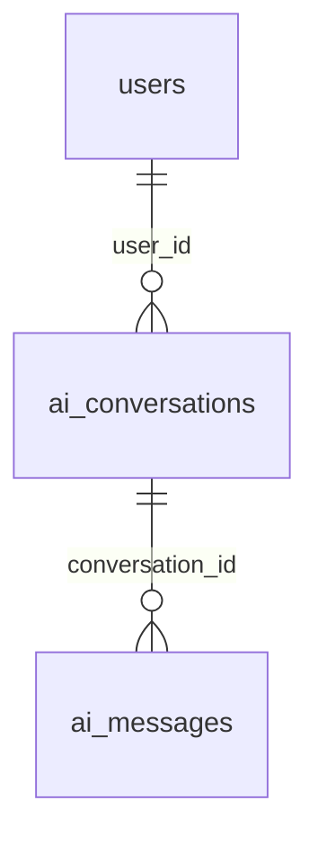

# AI 추천 개발 청사진·진행 현황

## 2026-11-09 STEP 6A 작업 통합·커밋

- 사용자 요청으로 `feat/gemini-recommend`의 지금까지 구현한 6A·인원 미정 대화·주석 정리와 이번 중복 질문/프로젝트 이동 보완을 함께 커밋한다. 푸시는 요청 범위가 아니며 6B를 시작하지 않는다. 아래 커밋 미실행 기록은 각 작업 당시 이력이다.
- `AiAnalysisMergePolicy`에서 기존 모델 인원 질문이 있는 직군의 서버 보완 질문을 생략하고, 답변 본문에 포함된 동일 질문을 확인 목록에 재출력하지 않는다. `analysis-instruction.txt`는 질문을 questions에 한 번만 작성하도록 안내한다. `AiMessageAnalysisTests`에 본문·모델 질문·두 직군 보완 질문의 중복 방지 회귀 검증을 추가했다.
- `RecommendationCards.tsx`의 프로젝트 모달을 `/projects/{recommendedProjectId}` 링크로 교체했다. 기존 상세 페이지는 Mock 전용이어서 숫자 ID를 `PublicProjectDetail.tsx`로 연결하고 기존 공개 API의 제목·요약·설명·스택·모집 직군을 표시한다. 로딩/실패와 AI 추천 복귀 링크를 제공하며 기존 문자열 Mock ID는 유지한다. 새 프로젝트 백엔드/API/DB·지원/관리 기능은 추가하지 않았다. `FollowingMatching.test.tsx`에 상세 링크·모달 미사용·실제 조회 로딩 표시 회귀 검증을 추가했다.
- 프론트 `npm test -- --maxWorkers=2`: 전체61개 파일·683개 중682개 통과, 기존 `projectService.test.ts`의 공고 생성→메인 목록 반영1개 실패. 해당 fixture 마감일은 2026-11-05인데 `sortProjects`가 실제 현재 날짜로 모집 중 여부를 검사해 제외하는 날짜 의존 검증이다. 해당 테스트·projectService·homeService가 HEAD와 동일함을 확인했으며 이번 범위에서 수정하지 않았다. `npm run build`는 성공(50개 페이지)했다. 자동 생성 next-env.d.ts 변화만 복원한다.
- 백엔드 `DEBUG=false ./gradlew test --no-daemon` 성공(3분26초): 총455개 중454개 통과·1개 스킵·실패/오류0, AI 대화25개 모두 통과. 스킵은 별도 PostgreSQL URL이 필요한 기존 운영 DDL 검증이다. 변경 제품 파일 3개의 ESLint 및 `git diff --check` 통과. 로그는 `/tmp/devmozip-6a-commit-{backend,frontend-tests,frontend-build,eslint}.log`다. 실제 Gemini·공유 DB 신규 추천·브라우저 수동 검증은 별도로 수행하지 않았다. 기존 AI 문서 3개와 설계 기록을 함께 보존한다.

## 2026-11-09 인원 미정 대화 흐름 보완

- 사용자 화면의 ‘명시되지 않은 인원은 질문해야 합니다’ 분석 오류 원인을 확인했다. GeminiAnalysis.Change 생성자가 roles ADD/SET의 count:null을 거부하면서 대화 저장·응답까지 실패하던 경로였다.
- GeminiAnalysis DTO는 인원 미정 제안을 허용하고 AiAnalysisMergePolicy가 해당 제안만 정형 조건에서 제외한다. 직군·근거는 OTHER 인원 미정 사실로 보존하고 원하는 인원을 묻는 질문을 ASSISTANT에 포함한다. 다른 유효한 조건은 적용하며 기존 직군 인원을 덮어쓰거나 기본 인원을 생성하지 않는다.
- 후속 인원 답변을 기존 질문·사실 문맥에서 해석하도록 analysis-instruction.txt를 보완했다. 확인된 직군 인원 적용 후 미정 사실은 서버에서 제거한다. AiMessageAnalysisTests에 두 직군 인원 누락→각각 1명 답변→대화 4개 저장·추천 미실행과 기존 인원 보존·다른 조건 적용 회귀 검증을 추가했다. DB 스키마·공통 도메인·실제 추천 검증·점수 정책·6B는 변경하지 않았다.
- 검증: 프론트 `npm test -- --maxWorkers=2 tests/screens/FollowingMatching.test.tsx lib/state/homeStore.test.tsx` 2개 파일 40개 테스트 통과. `npm run build` 성공(50개 페이지), 자동 생성 next-env.d.ts 변화만 작업 전으로 복원했다. 최종 소스에서 `DEBUG=false ./gradlew test --no-daemon` 성공(3분 10초), 전체454개 중453개 통과·1개 스킵·실패/오류0, AI 대화24개 모두 통과. 별도 PostgreSQL URL이 필요한 기존 검증1개는 스킵이다. 최초 DEBUG 로그 환경의 실행은 기존 KakaoClientTest의 인증 코드 로그 차단 검증1개가 실패했으며, 기존 검증 방식대로 DEBUG=false를 해당 명령에만 지정해 재실행했다. 영구 설정·카카오 코드는 바꾸지 않았다. 로그는 `/tmp/devmozip-role-count-tests-final.log`, `/tmp/devmozip-role-count-build.log`, `/tmp/devmozip-role-count-frontend-tests.log`. 실제 Gemini·브라우저 수동 검증은 수행하지 않았다. 커밋·푸시는 하지 않는다.

## 2026-11-09 로컬 Compose 실행 오류 복구

- 후속 Gradle 캐시 잠금 오류의 Owner PID 38은 Docker 백엔드 내부 Java 프로세스로 확인했다. 컨테이너와 호스트가 backend 바인드 마운트의 `.gradle` 캐시를 공유한 상태에서 동시에 실행한 충돌이었다. `docker compose stop backend frontend`로 앱 컨테이너만 중지한 뒤 `backend`에서 `./gradlew help --no-daemon` 성공(14초)을 확인했다. 잠금 파일·캐시를 삭제하지 않았으며 PostgreSQL·Redis는 healthy로 유지된다. 실제 백엔드 기동은 사용자 셸에서 기존 명령으로 재실행해야 한다.
- `dev-postgres.py backend`의 Compose 설정 해석 실패를 재현했다. 개인 `compose.override.yaml`의 DB_HOST 변수 참조에 백틱이 들어가 `${DB`_HOST:-postgres}`가 된 오타가 원인이었다. `${DB_HOST:-postgres}`로 한 글자만 수정했다. Gemini 키·공통 Compose·스크립트·DB 설정값은 변경하지 않았다.
- `docker compose --env-file .env config --quiet` 성공, 기존 스크립트의 읽기 전용 `SELECT 1` DB 연결 성공. 컨테이너 상태 확인 시 backend/frontend도 8080/3000 포트를 사용 중이므로 직접 실행 방식으로 돌아갈 때 해당 앱 컨테이너만 정지해야 한다. Redis/PostgreSQL·볼륨·데이터는 변경하지 않았다. 백엔드 JVM을 대신 시작하거나 사용자 셸의 Gemini 키를 읽지 않았다. 이번 실행 설정 복구에서는 기능 테스트·프론트 빌드를 새로 실행하지 않았으며 기동 전체 성공으로 보고하지 않는다.

## 2026-11-09 AI 주석·문자 점검

- 사용자 지적에 따라 AI 코드·테스트·프롬프트·문서·SQL/스크립트 등 텍스트116개를 검사했다. 초기 작성 중 일본어를 혼입한 작성 오류가 있었으며 현재 디스크에는 해당 부분이 이미 한국어로 수정되어 있었다. 일본어/한자/깨진 문자/방향 제어 문자는0건이었다. 이번에는 평가 서비스의 한국어 설명을 정확히 정리하고 Gemini 클라이언트에서 생성자 위에 잘못 남은 스키마 주석을 제거했다.
- 추가 문자 검사에서 AI 화면 브랜드 문구의 불필요한 U+200C 한 개를 발견해 제거했다. 영문 모델 프롬프트·기술 식별자는 의도된 내용이라 유지했다. 기능 로직·점수·정책은 변경하지 않았다. 기존6A 미커밋 변경을 보존한다.
- 변경 파일: `backend/.../service/AiRequirementEvaluationService.java`, `client/GeminiAnalysisClient.java`, `frontend/app/ai/matching/page.tsx`, 이 문서. 주석·문자 정리용 새 테스트는 만들지 않았다. 당시 시작한 검증은 완료 결과를 확보하지 못했으며, 이후 인원 미정 대화 보완 절의 전체 백엔드 테스트·프론트 빌드 성공에 해당 변경이 포함된다. 커밋·푸시는 하지 않는다.

## 2026-11-09 STEP 6A 구현 — 자연어 요구사항 기반 추천

- 범위: 사용자 요청으로 `feat/gemini-recommend`에서 6A 본체 구현·자동 검증을 완료했다. 시작 HEAD `556fe84`, 작업 트리 깨끗함, 로컬 develop이 HEAD의 조상임을 확인했다. fetch·main 병합·커밋·푸시는 없다. 기존 부분 UI sync·일반 채팅/추천 분리·인증/소유권·실패 재시도를 보존한다.
- 최종 사용자 정책: 기본80%+요구20%, 요구 없으면 기존 점수. 요구별 충족100/부분50/미확인0/명시적 불일치0 동일 비중 평균. 필수 표현은 표시하되 후보 탈락 없음. 전체 필터 통과 후보 배치 평가, 분석 실패는 FAILED이며 기본 결과로 대체하지 않는다. 최신 요청의 공개/열람 가능 정보 제한을 앞선 무료 본문 내부 활용 허용보다 우선한다.
- 구현: 요청 conditions JSONB에 정형 조건+서버 facts/sources/버전/메시지 범위 텍스트 스냅샷 저장. 본인 기술/수준·추론·PURPOSE를 보존하되 대상 요구로 채점하지 않는다. 정형 stacks 중복 기술, 명시적 면제 요구·주제 제한 없음은 별도 가산하지 않는다. 현재 대화 변경과 분리해 과거 평가를 유지한다.
- 후보: 기존 공개·협업 가능·직군·경력 필터와 기본 계산을 재사용하고 전체 후보를 200건씩 읽는다. 후보4×요구8 배치로 Gemini 근거를 추출·검증한 뒤 상위10건을 유지한다. 세부 요구가 있을 때 프로젝트 원문 Jaccard 항목은 제외해 삭제 요구·본인 기술 중복 반영을 피한다. 요구가 없으면 기존 텍스트 비교를 유지한다.
- 근거: 공개 개발자의 기술/직군/경력/요약 및 공개 프로젝트 제목/설명/기술만 전송한다. 필드별 HTML 제거·개인정보 마스킹 후 3000자 제한. 후보·요구 ID/중복·상태·source 소속·정확 인용 검증, 위조 출처·인용은 UNKNOWN으로 제외한다. 기술/경력 목록만으로 실제 구현 경험을 인정하지 않는다. 자료 부재는 경험 부재가 아니다. 인용 검증이 내용 진위/의미 판단의 완벽한 정확성을 보장하지는 않는다.
- 저장/표시: 기본 이유 TEXT를 버전 있는 공개 평가 JSON으로 재사용하며 과거 일반 문자열도 읽는다. DTO·카드에 기본 적합도/요구 충족도/최종 점수·네 상태·공개 출처를 분리한다. detailed_reason은 생성·노출하지 않는다. 새 DDL·공통 도메인·배포/인증 변경·사용량 구현은 없다.
- 실행/재시도: 독립 PENDING 저장 → 트랜잭션 밖 후보 평가/Gemini → 전체 결과+SUCCESS 원자 저장. 실패는 결과 없이 FAILED. 선택 replay=true는 소유한 동일 키·메시지의 저장 요청을 현재 조건과 무관하게 재사용하며 새 실행은 하지 않는다(없는 요청/다른 메시지 409). 프론트는 facts 변경 시 재추천 허용, 미완료 분석 차단, 메타데이터 있는 응답 유실 재시도는 GET+replay로 보존한다. BFF 추천 POST 제한은 300초로 조정했다.
- 실제 환경 재확인: Java21/Boot4.1.2/Gradle9.8.2/JPA 유지. 개발 DB 읽기 전용 메타데이터에서 conditions JSONB·basic_reason/detailed_reason TEXT 확인. 이전 기록과 달리 현재 public에 subscriptions 테이블이 있으나 이 브랜치에 구독 판정 엔티티/API·도메인은 없다. portfolios 본문 테이블·엔티티/API도 없어 실제 경험·권한을 Mock으로 대체하거나 스키마를 추가하지 않았다. 원본 ERD는 없어 저장소 전사/실제 메타데이터/엔티티를 대조했다. DB 쓰기·실제 Gemini·브라우저 전체 통합은 이번에 실행하지 않았다.
- 변경 파일: 백엔드 신규 `dto/ai/RequirementEvaluation`, `service/AiRequirementSnapshot`·`AiRequirementEvaluationService`·`AiStoredEvaluation`, `resources/ai/requirements-{instruction.txt,schema.json}`, 신규 `ai/engine/AiRequirementEvaluationTest`. 기존 GeminiAnalysisClient·AI 후보 읽기 Repository/개발자 공개 요약 projection·추천 Controller/요청·응답/내부 DTO·조건 문서·추천 인터페이스/실행/엔진·분석 API/엔진 테스트 수정. 프론트 AI 타입/대화 타입·aiApi·homeStore·추천 카드·BFF·관련 테스트 수정. 문서는 `ai-matching.md`, `ai-api-spec.md`, `ai-progress.md`, `ai-step6-design.md` 갱신.
- 최종 검증: `backend`의 `DEBUG=false ./gradlew test --no-daemon` 성공(종료0, BUILD SUCCESSFUL). 이번 JUnit은 **442개 중425개 통과·17개 스킵·실패/오류0**이며 평가8개·엔진9개·분석 API22개 모두 통과했다. 스킵은 Docker/Ryuk 연결이 필요한 기존 프로젝트/컨텍스트16개와 별도 PostgreSQL URL이 필요한 운영 DDL1개다. 앞선 실행과 Docker 가용성·파라미터 테스트 실행 수가 달라 총수가 달라질 수 있으며 최종 XML을 기준으로 기록한다. `frontend` 관련4개 파일63개 통과, 제품6개 파일 ESLint 통과. `npm run build`는 최초 샌드박스 TypeScript --showConfig 출력 오류 후 권한 확장 재실행 성공(종료0, 50개 페이지). Linux Node24.22.1의 기존 설치 경로를 명령 PATH에 지정했고 의존성·영구 실행 설정은 변경하지 않았다. 로그 `/tmp/devmozip-6a-backend-final-source.log`, `/tmp/devmozip-6a-frontend-verified.log`, `/tmp/devmozip-6a-build-retry.log`, `/tmp/devmozip-6a-eslint.log`.
- 검증 이력/한계: 백엔드 최초 실행의 종전 ‘분석 사실은 엔진과 분리’ 테스트1개와 최초 프론트 재시도 테스트2개는 새 6A 스냅샷/GET+replay 계약에 맞게 갱신한 뒤 통과했다. 신규 검증은 기본/요구 점수 분리·50점 부분 충족·위조 근거/ID·기술만으로 경험 인정 금지·면제 요구 보존·상위10건 밖 후보 역전·공개 요약 근거/민감 필드 미전송·실패 시 기본 대체 없음·과거 스냅샷/replay·요구만 변경한 재추천·화면 표시를 포함한다. Gemini는 가짜 응답 기반이며 실제 호출/정확도·무료 할당량·브라우저 전체 통합·공유 DB 쓰기는 미검증이다. `users.summary TEXT`도 읽기 전용 메타데이터로 확인했고 새 컬럼은 없다. 빌드 생성 next-env.d.ts만 작업 전으로 복원했으며 `git diff --check`·AI 문서 상대 링크 대상 점검 통과. 커밋·푸시·배포는 하지 않았다.
- 한계/6B 준비: 공개 요약의 자기서술 외 실제 개발자 구현 경험·멘토링 근거는 부족해 미확인이 많을 수 있다. 필드3000자 밖 정보도 미확인이다. 전체 후보 배치 호출량·지연에 유의하며 중간429/장애는 전체 실패, 자동 모델/유료 전환·배치 재시도·PENDING 복구 작업은 없다. 6B는 유효 구독·현재 포트폴리오 열람권/변경 버전/비공개·삭제·회수/만료 차단·캐시/동시 중복 호출 계약을 갖춘 뒤 별도 사용자 지시로 진행한다. 6A 완료 후 6B·7단계를 자동 시작하지 않는다.

## 2026-11-09 PR 준비 — AI 미사용 코드·로그 점검

- 요청 범위: 5단계 Gemini·프론트 연동과 부분 조건 전달 변경의 불필요한 코드·로그 정리. 시작 시 `feat/gemini-api`, HEAD `717da56`, 작업 트리 깨끗함. 로컬 develop이 HEAD의 조상임을 확인했다. 새로운 기능·6A/6B·DB·권한·배포 설정 변경은 없다.
- 제거: 부분 초안을 항상 sync하는 현재 흐름에서 도달하지 않는 이전 USER 개별 저장 분기·반복문과 전용 `saveAiMessage`/`applySavedUserMessage`를 제거했다. `analyzeAiMessage`는 분석 전용 타입으로 직접 호출하여 불필요한 공용 래퍼·타입 단언도 제거했다. `homeStore.test.tsx`의 미사용 `loadHomeState` import를 삭제했다. sync의 전체 메시지 저장·마지막 메시지만 분석·동일 키 재시도 동작은 유지한다.
- 로그: AI/Gemini 백엔드·채팅/BFF 제품 및 관련 테스트에서 임시 console/System.out/printStackTrace 출력을 발견하지 않았다. 기존 추천 실행 실패 로그와 허용 목록의 상태만 출력하는 `gemini-diagnose.py`는 진단에 필요하여 유지했다. 다른 도메인의 로그·레거시 Mock 호환 코드는 수정하지 않았다.
- 변경 파일: `frontend/lib/matching/aiApi.ts`, `frontend/lib/state/homeStore.ts`, `frontend/lib/state/homeStore.test.tsx`, 이 문서. 제품 API·저장 구조·기능 정책은 유지하므로 API/정책 문서의 계약은 변경하지 않는다.
- 검증: Linux Node 24.22.1의 기존 설치 경로를 PATH에 지정하여 관련 프론트 4개 파일·62개 테스트 통과. 변경 제품 2개 파일 ESLint 오류·경고 0. 사전 검사에서 확인한 테스트 Probe의 기존 `react-hooks/globals` 오류는 테스트 구조 개편 범위가 아니므로 유지하고, 미사용 import 경고만 제거했다. 새 기능이 없는 정리이므로 새 테스트는 추가하지 않았다. 로그 `/tmp/devmozip-step5-cleanup-tests.log`, `/tmp/devmozip-step5-cleanup-eslint.log`. `npm run build`는 최초 샌드박스에서 TypeScript --showConfig 출력 해석 오류로 실패했고 권한 확장 재실행은 종료 0·50개 페이지 생성으로 성공했다. 로그 `/tmp/devmozip-step5-cleanup-build.log`, `/tmp/devmozip-step5-cleanup-build-retry.log`. 생성 next-env.d.ts만 작업 전 상태로 복원했으며 `git diff --check` 통과.
- 백엔드는 읽기 점검만 했으므로 Gradle 테스트는 실행하지 않았다. 실제 브라우저·Gemini·DB 쓰기 검증, 커밋·푸시·병합은 수행하지 않는다.

## 2026-11-09 6A 전 선행 작업 — 부분 선택값 대화 분석 전달

- 이번 범위: 사용자 ‘대화 분석에는 일부 선택값도 전달하고, 실제 추천 버튼을 눌렀을 때만 필수 조건을 검증. 6A 구현 전 작업’에 따라 부분 초안 전달만 구현한다. 6A 의미 분석·점수 고도화·포트폴리오 연결·6B·7단계는 시작하지 않는다.
- 최종 정책 답변 반영(확정·6A 본체 미구현): 무료/프리미엄 모두 개발자·유사 프로젝트에 적용, 허용된 후보 자료를 Gemini가 의미 대조하고 서버가 검증·계산. 요구사항 있으면 기존 80%+요구사항 20%, 없으면 기존 점수 유지. 미확인 요구도 0점으로 포함하며 요구가 모두 미확인이어도 80:20. 필터 통과 전체 후보 배치 분석, 분석 실패는 추천 실패이며 새 성공 결과를 만들지 않음. 본인 기술·수준을 상대 요구로 바꾸지 않고 목적별 새 필터·관심 제한 없음 실행 정책은 보류.
- 기존 정책 변경: 무료도 허용된 포트폴리오 본문을 내부 점수 분석에 사용하되 원문·상세 근거를 숨긴다. 현재 확인한 DB public에 본문 테이블이 없어 실제 자료/서비스 읽기 계약은 남아 있다. 새 포트폴리오 도메인·비공개 자료 임의 접근·Mock 연결은 추가하지 않는다. 6B 프리미엄 상세 열람과 구분한다.
- 완료 기능: `SyncDraftRequest.conditions`를 부분 초안 DTO로 분리. 빈/부분 조건도 전체 초안으로 저장하고 생략/null/빈 목록은 선택 해제한다. 전달된 값의 타입·허용값·길이/개수·직군 인원·기간 범위는 기존 검증을 공유한다. 수동 교체에서 facts 보존, 기존 완전 조건 PUT·추천 실행 필수 검증 유지. 새 API·DB 컬럼·배포 설정은 없다.
- 프론트: 분석 전 sync가 부분 선택값도 전달하며, 미선택 경력·기간을 빈 문자열/0으로 보내지 않는다. 실패 후 pendingAnalysisKey 재시도에서는 다시 sync하지 않아 최초 저장 초안·동일 메시지 키를 유지한다. 기존 계정별 로컬 상태·BFF 인증·소유권·추천 결과 처리는 보존한다.
- 변경 파일: 신규 `backend/.../dto/ai/DraftConditionsRequest.java`; 기존 `dto/ai/UpdateConditionsRequest.java`·`SyncDraftRequest.java`, `service/AiConditionsDocument.java`·`AiDraftService.java`, `ai/controller/AiMessageAnalysisTests.java`; 프론트 `types/aiRecommendation.ts`, `lib/matching/aiApi.ts`·테스트, `lib/state/homeStore.ts`·테스트; AI 문서 4개(`ai-step6-design.md` 포함).
- 백엔드 새 검증 4개: 부분 선택의 Gemini 문맥 전달·수동 선택 보호, 빈 초안 선택 해제·facts 보존·추천 버튼 누락 검증, 잘못된 값/메타데이터 주입 거절·쓰기 없음, 제공자 실패 후 부분 초안·동일 메시지 재시도. 기존 인증/소유권·동시 편집/동일 키·전체 조건 검증 회귀도 전체 테스트에 포함한다. Gemini는 가짜 응답이며 실제 모델 품질 검증을 뜻하지 않는다.
- 검증 완료: `frontend`의 관련 테스트 4개 파일·62개 통과. `backend`의 `DEBUG=false ./gradlew test --no-daemon`은 BUILD SUCCESSFUL, JUnit 441개 중 440개 통과·1개 스킵·실패/오류 0(분석 API 21개 모두 통과, 신규 4개 포함). 스킵은 별도 PostgreSQL URL이 필요한 기존 운영 DDL 검증이다. `frontend`의 `npm run build`도 성공했다. 최초 Gradle 캐시 잠금 쓰기 제한과 Next TypeScript --showConfig 출력 오류 후 각각 권한 확장 재실행으로 확인했다. 테스트 파일을 포함한 ESLint는 기존 homeStore.test.tsx의 Probe 전역 대입 오류·미사용 import 경고로 실패했으며 이번 작업에서 해당 기존 테스트 구조는 변경하지 않았다. 실제 DB 쓰기·Gemini·브라우저 통합은 미검증이다. 로그는 `/tmp/devmozip-partial-conditions-{frontend-tests,backend-retry,build-retry,eslint}.log`이며 빌드 생성 파일·임시 ESLint 원본 비교 사본은 정리했다.
- 환경·한계: 기존 `feat/gemini-api`의 문서 미커밋 변경을 보존했고 로컬 develop이 HEAD의 조상인 것을 재확인했다. 원격 fetch·브랜치 전환·병합·공유 DB 쓰기/DDL·앱 재시작·외부 Gemini 호출은 없다. Java 21/Boot 4.1.2/Gradle 9.8.2/JPA·PostgreSQL 17/H2 구성은 직전 파일 대조 이후 변경하지 않았다. ERD 원본은 없어 직전 문서 전사·메타데이터 비교 기록을 따른다.
- 문서 기록 후속 점검: 검증 대기 문구를 실제 완료 결과로 갱신했다. `git diff --check`·AI 문서 상대 링크 대상 점검 통과. 이번 문서 갱신 후 `frontend`의 `npm run build` 재실행은 실패(종료 1)했다. 현재 셸에 Linux node가 없고 Windows npm이 선택되어 CMD의 WSL UNC 작업 경로 오류와 next 미발견이 발생했다. 앞선 기능 구현 빌드 성공과 구분하며 실행 환경·의존성은 변경하지 않았다. 로그 `/tmp/devmozip-ai-record-build.log`.
- 다음 작업: 선행 단계 결과 검토 후 6A 본체의 요청 스냅샷·재추천/재시도·서버 부분 부합 계산과 실제 포트폴리오 읽기 계약을 구체화한다. 6A·6B를 자동 시작하지 않는다. 커밋·푸시·배포는 없다.

## 2026-11-09 STEP 6A 정책 답변 반영 — 일부 확정·구현 전

- 사용자 확정: 허용된 공개 후보 정보를 Gemini에 보내 의미상 부합 근거를 추출하고 서버가 검증해 최종 점수를 계산한다. 세부 요구사항이 있으면 기존 환산점수 80% + 요구사항 점수 20%, 없으면 기존 점수를 유지하는 선호 방식이다.
- 추가 요청: 포트폴리오 본문이 있는 경우 분석에 사용 가능하도록 한다. 기존 개발 DB에 본문이 없고 무료/프리미엄별 사용 자격·열람권·실제 저장소 계약은 답변되지 않아, 본문 사용 전체 승인이나 새 도메인 구현 승인으로 해석하지 않는다.
- 6A 전 선행 요구: 대화 분석에 부분 선택값도 전달하고 추천 버튼에서만 필수 조건의 완성을 검증한다. 부분 값을 임의로 채우지 않는다. 부분 전달 API·수정/삭제 의미 등 구현 계약은 아직 검토 단계다.
- 남은 질문: 앞 질문 중 미응답 적용 범위, 포트폴리오 자격/출처, 미확인 점수 처리, 분석 후보 범위·Gemini 실패 처리. 스냅샷·재추천/재시도 제안 전체도 이번 부분 조건 답변만으로 일괄 승인 처리하지 않는다. 사용자에게 추가 질문을 제시했다.
- 변경 파일: `docs/ai-step6-design.md`, `docs/ai-matching.md`, `docs/ai-api-spec.md`, `docs/ai-progress.md`. 확정 답변과 미확정을 분리해 문서만 수정했다. 6A·6B·선행 기능 코드·SQL·인증·배포·DB 데이터 변경은 없다. 이번에는 DB 조회·외부 Gemini 호출도 재실행하지 않았다.
- 검증: 문서만 변경해 새 기능 테스트·백엔드 테스트·프론트 단위/브라우저 테스트는 실행하지 않는다. `frontend`의 `npm run build` 최초 실행은 샌드박스 TypeScript --showConfig 출력 해석 오류로 실패(종료 1), 동일 명령 권한 확장 재실행은 성공(종료 0)했다. 로그 `/tmp/devmozip-step6-policy-build.log`, `/tmp/devmozip-step6-policy-build-retry.log`. 생성 next-env.d.ts 변화만 작업 전 내용으로 복원했다. `git diff --check`와 AI 문서 상대 링크 대상 점검 통과. 다음 작업은 남은 정책·선행 작업 계약 확정이며 6B를 자동 시작하지 않는다. 커밋·푸시는 없다.

## 2026-11-09 STEP 6A·6B 사전 분석 — 정책 답변 대기

- 최신 요청: 종전 6단계를 6A 자연어 세부 요구사항의 실제 추천 반영과 6B 프리미엄 포트폴리오 기반 상세 분석으로 분리한다. 이번에는 설계·확인 질문까지만 진행하며 구현하지 않는다. 정책 확정 후 6A부터 착수하고 6B를 자동 시작하지 않는다.
- 변경 파일: 신규 `docs/ai-step6-design.md`, 기존 `docs/ai-matching.md`, `docs/ai-api-spec.md`, `docs/ai-progress.md`. 신규 문서의 배점·범위·API/저장 방향은 제안이며 미승인이다. 기능 코드·SQL·인증·다른 도메인 변경은 없다.
- 확인: `_analysis.facts`가 추천 입력/요청 스냅샷에서 제외되고 프론트 중복 방지가 정형 조건만 비교한다. 부분 UI 조건 전달도 기존 미완료 항목이다. 6A는 엔진 연결뿐 아니라 스냅샷·이력·재추천·재시도 계약의 정비가 필요하다.
- 환경: 파일의 Java 21/Boot 4.1.2/Gradle 9.8.2/JPA와 PostgreSQL 17 설정 유지. 작업 시작 `feat/gemini-api`, `81fc0c6`, 깨끗한 작업 트리였으며 로컬 develop의 조상 관계만 확인했다. fetch·브랜치 변경·병합은 없다.
- 실제 개발 DB 읽기 전용 메타데이터 조회: PostgreSQL 17.11, 대화/요청 conditions JSONB·결과 detailed_reason TEXT 존재. analysis_level 없음. public의 portfolios/subscriptions 없고 관련 이름 검색에는 본문 없는 project_application_portfolios 연관 테이블만 있다. 서버 소스에도 포트폴리오 본문·구독 도메인/열람권 판정 구현이 없어 6B는 해당 팀 계약이 선행되어야 한다. 원본 ERD 이미지는 없어 저장소 전사와 대조했으며 실제 행 데이터·전체 제약은 검증하지 않았다.
- 미확정: 6A의 규칙/의미 대조 방식·외부 후보 정보 전송, 점수·필수/선호·미확인 처리, 평가 종류·목적/제한 없음 정책, 스냅샷·부분 UI 전달 범위. 6B의 자격 원천·포트폴리오 읽기/전송/열람권·수정/삭제/구독 만료·캐시 정책은 별도 착수 전 확인한다. 사용자에게 6A 선택 질문을 제시했다.
- 이번 검증: DB 첫 조회는 샌드박스 DNS 실패(종료 2), 권한 확장한 동일 읽기 조회 및 후속 메타데이터 조회는 성공(종료 0). DB 쓰기/DDL·Gemini 호출·앱 재시작은 없다. 문서만 변경해 새 기능 테스트·백엔드 테스트는 실행하지 않는다. `frontend`에서 `npm run build` 최초 실행은 TypeScript --showConfig 출력 해석 오류로 실패(종료 1), 동일 명령의 권한 확장 재실행은 성공(종료 0, 50개 페이지)했다. 로그는 `/tmp/devmozip-step6-design-build.log`, `/tmp/devmozip-step6-design-build-retry.log`다. 빌드가 변경한 next-env.d.ts만 작업 전 내용으로 복원했다. `git diff --check`와 AI 문서 상대 링크 대상 점검 통과. 프론트 단위/브라우저 테스트는 문서만 변경해 재실행하지 않았다.
- 다음 작업: 사용자 정책 답변을 반영하고 6A 범위·계약을 확정한다. 6A·6B·7단계 기능 구현, 커밋·푸시·배포는 아직 수행하지 않았다. 아래 과거의 단일 6단계 표기는 당시 이력이며 최신 구분은 이 절을 따른다.

## 2026-11-09 최신 상태·커밋 범위

- 사용자 요청으로 Gemini 백엔드와 Cursor 프론트/BFF 연동·오류 보완 현황 및 키 설정 안내를 정리한다. 이번 커밋에는 기존 미커밋 프론트 구현·회귀 테스트와 AI 문서 3개를 함께 포함한다. 커밋 제목은 `feat: Gemini AI 채팅 프론트 연동 및 오류 처리 보완`으로 하며 푸시는 요청되지 않았다.
- 완료: 자연어 분석·의도/세부 요구사항 보존, USER/ASSISTANT 저장, 로그인 채팅 분석 호출·응답/조건 표시, 조건 삭제 반영, 실패 재시도 키 보존, 추천 실행과 분석 분리. 실제 Gemini 성공은 사용자 Postman 확인이며 브라우저 전체 경로의 실제 성공을 대신하지 않는다.
- 남은 항목: 부분 UI 조건의 서버 전달 계약, 실제 브라우저 통합·대화 품질 검증, 6단계 상세 분석·7단계 사용량. 이번에는 새 기능·실행 설정·키 저장 방식을 변경하지 않는다.
- 키 설정: resources의 gemini.properties에는 환경변수 참조만 유지한다. 현재 `.env`에 Gemini 키를 적는 것만으로는 자동 적용되지 않으며, 같은 실행 터미널에서 export 후 백엔드를 시작한다. 실제 키는 코드·문서·커밋에 넣지 않는다. 자세한 안내는 [API 설정](ai-api-spec.md#gemini-설정무료-티어검증-경계)을 따른다.
- 직전 동일 프론트 코드 검증: 관련 58개 통과·빌드 성공, 전체 677개 중 676개 통과·날짜 의존 프로젝트 테스트 1개 실패. 아래 점검 절의 실행 기록을 따른다. 이번 문서 갱신의 `frontend` → `npm run build` 재실행 성공(종료 0, 50개 페이지). 로그 `/tmp/devmozip-ai-docs-commit-build.log`. 생성 next-env.d.ts 변화는 복원했다. 문서 상대 링크 대상·`git diff --check` 통과. 새 기능 테스트·백엔드 테스트·외부 Gemini 호출은 실행하지 않았다.

## 2026-11-09 Cursor 프론트 연동 점검·보완

- 최신 상태: 사용자가 이전 Postman 실행에서 실제 Gemini 분석 성공을 확인했다. 아래 과거의 ‘실제 Gemini 미검증’은 당시 에이전트 환경 기준이며, 이번에 외부 호출을 다시 실행한 결과는 아니다. 프론트 연동은 Cursor 구현을 유지하고 확인된 오류만 보완했다.
- 화면의 `자연어 분석이 설정되지 않았습니다`는 Gemini 클라이언트의 API 키 공백 분기(503)다. USER를 먼저 저장하므로 DB 메시지 저장과 분석 실패가 함께 발생할 수 있고, 추천 엔진은 Gemini와 분리되어 수동 조건 추천도 가능하다. 사용자는 `python3 scripts/dev-postgres.py backend`로 실행한다. 이 스크립트는 실행 터미널 환경을 상속하므로 키를 export한 같은 터미널에서 백엔드를 재시작해야 한다. 루트 `.env`에 키를 쓰는 것만으로 현재 Compose 설정을 거쳐 전달되지는 않는다. 사용자 실행 프로세스의 키 값은 읽거나 변경하지 않았다.
- 보완: 첫 메시지 전송 시 생성된 대화 ID로 로딩/오류를 표시한다. 서버 CLEAR로 JSON 키가 사라진 조건은 분석 출처를 확인해 화면에서도 비운다. 분석 직전 `pendingAnalysisKey`를 기존 v1 로컬 저장소에 보존하고, 실패·새로고침·서버 이력 복원 후에도 동일 메시지 키로 재시도한다. 미완료 분석 중 새 메시지는 재시도를 안내한다. 일반 대화마다 필수 조건 목록을 강제로 띄우지 않고 추천 버튼 검증 시 안내한다.
- UI 조건: 필수값이 완성된 UI 조건은 기존 sync API로 분석 전에 전달한다. **기존 sync는 전체 필수 조건만 수락하므로 부분 UI 선택값을 서버 분석에 전달하는 계약은 남아 있다.** 부분 조건을 임의 기본값으로 채우거나 새 API/DB 필드를 추가하지 않았다. 서버가 모르는 로컬 조건은 응답에서 키가 없다는 이유만으로 지우지 않는다.
- 변경 파일(추가 보완): `frontend/lib/matching/aiApi.ts`·테스트, `frontend/lib/state/homeStore.ts`·테스트, `frontend/types/matchingChat.ts`, `frontend/app/ai/matching/page.tsx`, AI 문서 3개. 기존 Cursor 변경은 보존한다. 백엔드·DB·추천 엔진·공통 인증·배포 설정은 변경하지 않았고 6~7단계·커밋·푸시를 진행하지 않는다.
- 검증: 관련 4개 파일 **58개 테스트 모두 통과** (`npm test -- --maxWorkers=2 lib/matching/aiApi.test.ts lib/state/homeStore.test.tsx 'app/api/ai/[...path]/route.test.ts' tests/screens/FollowingMatching.test.tsx`). 전체 `npm test -- --maxWorkers=2`는 **677개 중 676개 통과·1개 실패**. 실패는 변경하지 않은 `lib/projects/projectService.test.ts:18`로, 2026-11-05 마감 fixture가 현재 날짜 기반 메인 목록에서 제외되기 때문이다. 관련 없는 프로젝트 코드는 수정하지 않았다. 로그 `/tmp/devmozip-ai-review-tests.log`, `/tmp/devmozip-ai-review-all-tests.log`. 최초 루트에서 npm 명령을 실행해 package.json 부재로 실패했고 frontend에서 정상 재실행했다. 실제 브라우저·Gemini·공유 DB 쓰기는 이번에 재실행하지 않았다. 백엔드 미변경으로 Gradle 테스트는 실행하지 않았다. `frontend`의 `npm run build`는 최초 샌드박스에서 TypeScript 하위 프로세스 출력을 읽지 못해 실패했고 권한 확장 재실행은 종료 0으로 성공했다(50개 페이지). 로그 `/tmp/devmozip-ai-review-build.log`. 생성된 next-env.d.ts만 작업 전 상태로 복원했으며 `git diff --check` 통과.

## 2026-11-09 프론트 분석 연동

- 로그인 사용자의 `/ai/matching` 전송은 서버 대화가 없으면 만든 뒤, 아직 저장되지 않은 USER는 저장만 하고 마지막 메시지만 `analyze:true`로 보낸다. ASSISTANT와 정형 조건을 화면에 반영한다. 추천 버튼의 sync·실행과 개발자·유사 프로젝트 결과 표시는 유지한다. 분석은 추천과 사용량을 실행하지 않는다. 비로그인 입력은 서버에 저장하지 않는다.
- BFF에 `POST /api/ai/conversations`와 `POST /api/ai/conversations/{id}/messages`를 추가했다. 분석 오류 400/401/403/404/409/429/502/503/504는 안전한 message만 전달한다.
- 6·7단계는 미완료다. 실제 Gemini 성공은 이후 사용자 확인으로 갱신됐으며 이번 프론트 경로의 브라우저 검증과 구분한다. 아래 날짜별 절의 “5단계 미구현”은 그 시점의 기록이다. 현재 단계 상태는 1절 표를 따른다.

## 2026-11-09 STEP 5 — Google 400 INVALID_ARGUMENT 스키마 복잡도 대응

- 현재 상태(사용자 인수인계 반영): **Cursor의 대응 코드 반영과 자동 테스트 성공 보고를 확인했으며, 실제 Gemini 호출 성공·기존 400의 원인 확정은 아직 아니다.** 이번 요청은 문서 갱신만 수행한다. 아래 코드 변경은 파일로 대조했고 테스트 수치는 Cursor 실행 결과를 사용자가 전달한 기록으로 구분한다.
- 사용자 제보: 대화 8번 analyze POST가 앱 502로 변환된 `Google HTTP 400 / INVALID_ARGUMENT`를 반환. 허용된 ErrorInfo.reason은 없었고, 키 인증 실패만으로 단정하지 않았다. 이 환경에는 `GEMINI_API_KEY`가 없어 실제 Google 호출 진단은 실행하지 못했다.
- 근거: 공식 structured output 문서는 스키마를 출력 문법 상태 기계로 컴파일하며, `maxItems`/`minimum`/`maximum` 등이 상태 공간을 키워 `400 INVALID_ARGUMENT`를 유발할 수 있다고 안내한다. 기존 `analysis-schema.json`은 객체 배열 `maxItems` 30·50과 수치 한계를 Google에 그대로 보내고 있었다.
- 변경: `GeminiAnalysisClient`가 전송용 `wireSchema`에서 `maxItems`/`minItems`/`minimum`/`maximum` 등 한계 키만 제거하고, 앱 검증용 전체 스키마는 유지한다. BadRequest `fieldViolations`의 허용된 필드 경로만 오류 메시지에 포함한다. 원문 message/description·키·사용자 입력은 노출하지 않는다. 자동 재시도·모델 교체·유료 전환 없음.
- 진단 도구: `scripts/gemini-diagnose.py`는 프로세스 환경의 키로 최소 텍스트·JSON MIME·작은 스키마·전체 스키마·단순화 스키마를 비교하고 HTTP/status/reason/허용 필드만 출력한다. 키·본문·자유 텍스트는 출력하지 않는다. 이번 에이전트 셸에는 키가 없어 스크립트 실행을 건너뛰었다.
- 변경 파일: `client/GeminiAnalysisClient.java`, `client/GeminiAnalysisClientTest.java`, `scripts/gemini-diagnose.py`, AI 문서 3개. 기존 미커밋 STEP 5 변경은 보존했다.
- Cursor 검증 기록(사용자 전달, 이번 문서 작업에서 백엔드 재실행 안 함): `backend`에서 `DEBUG=false ./gradlew test --no-daemon` 성공(종료 0), **437개 중 436개 통과·1개 스킵·실패/오류 0**. Gemini 호출부 **15개 모두 통과**(와이어 스키마에서 한계 제거·로컬 maxItems 검증 유지, fieldViolations 허용 목록 포함). 스킵은 기존 PostgreSQL 운영 DDL 검증이다. `frontend`에서 `npm run build` 성공(종료 0, 50개 페이지). 당시 로그 `/tmp/devmozip-step5-schema-backend.log`, `/tmp/devmozip-step5-schema-frontend.log`, `/tmp/devmozip-step5-schema-client.log`. 생성 next-env.d.ts만 복원. 당시 `git diff --check` 통과.
- 한계: 가짜 응답 테스트 성공이며 **실제 Gemini 분석 성공은 아직 확인되지 않았다**. 사용자가 키를 export한 터미널에서 `python3 scripts/gemini-diagnose.py`로 full vs simplified를 비교하고, 변경 코드로 백엔드를 재시작한 뒤 같은 clientKey·본문으로 analyze를 재시도해야 한다. 커밋·푸시·배포·다음 단계는 없다.

### 재확인 순서와 완료 판단

1. 키를 export한 프로젝트 루트 터미널에서 `python3 scripts/gemini-diagnose.py`를 실행한다. 합성 입력으로 다섯 요청을 비교하며 실제 사용자 대화·DB를 사용하지 않는다. 키/본문/오류 자유 텍스트는 출력하지 않는다.
2. `full_schema_current_file`이 400이고 `simplified_wire_schema`가 200이면 전송 스키마의 한계 제거가 효과 있다는 가설을 지지한다. 최소 요청부터 실패하거나 두 스키마가 모두 실패하면 그 결과의 HTTP/status/reason/허용 필드를 기준으로 추가 진단한다. 이 비교 결과 자체는 아직 전달받지 않았다.
3. 스크립트는 한 case라도 비성공이면 종료 코드 1을 반환한다. 원본 스키마만 실패하는 비교 실험에서는 종료 코드 1 자체를 단순화 스키마 실패로 해석하지 않는다. 각 case의 HTTP 결과를 읽는다.
4. 기존 백엔드를 종료하고 같은 환경에서 `python3 scripts/dev-postgres.py backend`로 변경 코드를 실행한다. 같은 clientKey·본문으로 기존 analyze POST를 재시도한다.
5. 진단 스크립트의 HTTP 200은 모델 호출 수락 여부만 의미한다. 실제 API의 검증된 분석 응답·ASSISTANT·조건 저장까지 확인한 뒤 실제 5단계 연동 검증 성공을 기록한다. 프론트 연결과 6~7단계는 이번 범위가 아니다.

- 이번 문서 변경·검증: `docs/ai-progress.md`, `docs/ai-api-spec.md`, `docs/ai-matching.md`만 보완했다. Cursor 코드·테스트·진단 스크립트·기존 미커밋 변경은 보존했다. 이번 `frontend`의 `npm run build` 성공(종료 0), 로그 `/tmp/devmozip-step5-cursor-handoff-docs-build.log`. 생성 next-env.d.ts만 작업 전 내용으로 복원했다. `git diff --check`·AI 문서 상대 링크 대상·재확인 절 제목 확인 통과. 문서만 변경했으므로 새 기능 테스트·Gradle·실제 Gemini/DB 검증은 실행하지 않았다. 커밋·푸시·후속 단계는 진행하지 않았다.

## 2026-11-09 STEP 5 — 백엔드 구현·자동 검증, 실제 Gemini 미검증

- 최신 승인: STEP 5 요청으로 Gemini Developer API 연결을 승인했다. 후속 답변은 백엔드 API/테스트만 구현, 기존 current_conditions JSON에 `_analysis` 확장이다. 프론트/BFF·공통 회원/인증·추천 점수식·배포 설정·6~7단계는 변경하지 않는다. 첫 질문의 사용자 최종 답변(2026-11-09): 기존 필수 조건/엔진 유지, 일반 AI 대화는 필수 조건 없이 자유롭게 허용, 실제 추천 실행 시 필수 검증·누락 질문 안내, ‘주제 상관없음’ 의도 보존이다. 질문 대기는 해소됐다.
- 작업 전 확인: 브랜치 feat/frontend-run-ai-recommendation, HEAD c4582b5, 시작 시 작업 트리 깨끗함. 로컬 develop의 모든 커밋을 포함하고 9커밋 앞선 기존 feature 브랜치를 유지한다. Java 21/Boot 4.1.2/Gradle 9.8.2/JPA/compose PostgreSQL 17을 파일로 재확인했다. 신규 브랜치 통합·커밋·푸시는 하지 않는다.
- DB: 기존 읽기 전용 도구로 실제 개발 DB의 ai_conversations.current_conditions **jsonb**와 ai_messages의 role/content/client_key를 조회했다. 최초 샌드박스 DNS 실패 후 권한 확장한 동일 읽기 조회에 성공했다. 후속 읽기 조회에서 USER/ASSISTANT 역할 CHECK·메시지→대화 FK·대화/메시지 client_key 복합 UNIQUE 인덱스도 확인했다. 실제 테이블/데이터 쓰기는 없으며 새 DDL도 없다. 원본 ERD 이미지는 없어 문서 전사·기존 엔티티/SQL과 대조했다.
- 구현: 기존 POST messages의 명시적 analyze 모드, 자연어 분석 DTO/JSON Schema/프롬프트, 출처·근거·보유/학습/대상 기술 구분, 정형 조건 ADD/SET/REMOVE/CLEAR, facts 영속 보존, 수동 선택 충돌 질문, 명시적 변경, ASSISTANT 저장, 키 재전송·실패 재시도·분석 중 변경 보호. 후보/점수·사용량 API와 분리했다. 부분 조건의 엔진 필수값을 임의로 채우지 않는다.
- 저장 호환: 기존 조건 키와 DTO JSON 형식을 유지한다. PUT/sync는 `_analysis` 보존, 추천 실행은 예약 키만 제외하고 기존 DTO·엔진·정형 조건 스냅샷을 사용한다. 기존 저장 전용 메시지 호출은 Gemini를 호출하지 않는다. 기존 프론트 입력 정책/코드는 변경하지 않는다.
- 변경 파일: backend의 `client/GeminiAnalysisClient`, `config/GeminiProperties`·`GeminiConfiguration`, `dto/ai/GeminiAnalysis`·`MessageAnalysisResponse`·`CreateMessageRequest`, `service/AiConditionsDocument`·`AiAnalysisMergePolicy`·`AiMessageAnalysisService`, `utils/AiInputPrivacy`·`StrictBooleanDeserializer`, `controller/AiConversationController`, `entity/AiMessage`, `service/AiDraftService`·`impl/AiConversationServiceImpl`·`impl/AiRecommendationExecutionServiceImpl`, `resources/ai/`의 설정/프롬프트/스키마, `resources/application.yaml`의 AI 설정 import, `.env.example`; 신규 테스트 `GeminiAnalysisClientTest`·`AiInputPrivacyTest`·`AiMessageAnalysisTests`; AI 문서 3개.
- Gemini 무료 모델: Google 공식 가격/모델/REST 문서를 확인해 gemini-3.5-flash-lite를 기본 설정했다. 검색 도구가 공식 Markdown 문서 형식을 열지 못해 공식 URL 원문을 직접 읽었다. 키는 환경변수·인증 헤더만 사용하며 원문 로그·자동 재시도·모델 대체·결제 전환은 없다. 현재 Gemini 키가 없어 실제 호출은 미검증이다. 설정 방법과 과금/데이터 처리 경계는 API 문서 최신 절을 따른다.
- 최초 5단계 자동 검증(아래 필수 정책 최종 보완 전): `backend`에서 `DEBUG=false ./gradlew test --no-daemon` 성공(종료 0, BUILD SUCCESSFUL). JUnit XML **427개 중 426개 통과·1개 스킵·실패/오류 0**. 신규 5단계 **23개 모두 통과**(호출부 7·개인정보 제외 1·분석 API 통합 15). 사용자 정보/대상 조건 분리, 부분 조건, 사실 보존/문맥/모집 목적, 명시적 추가·수정·삭제, UI 충돌, 모델 JSON 타입/추가 필드/차단·잘림/429/장애/타임아웃, 실패 재시도·동시 동일 키 상대 인원 변경 1회 적용, 인증·소유권, 분석 중 수동 변경 보호, 기존 엔진 분리를 검증했다. 스킵은 `AiRecommendationExecutionTests.postgresProductionSchemaEnforcesUniqueRanksAndNumericBounds`이며 별도 PostgreSQL URL이 필요하다. `/tmp/devmozip-step5-final-backend.log`. 초기 새 통합 테스트 10개 중 재시도 fixture 재설정 1건이 실패해 Mockito 재설정을 수정했고 후속 실행에 통과했다. 제품 오류 수정으로 오인하지 않는다.
- 프론트 검증: `frontend`에서 `npm run build` 성공(종료 0, 50개 페이지), `/tmp/devmozip-step5-frontend-build.log`. 프론트 코드 변경이 없어 단위·브라우저 테스트는 이번에 실행하지 않았다. 최초 Gradle 실행은 캐시 잠금 파일 쓰기 제한, 최초 Next 빌드는 TypeScript --showConfig 하위 프로세스 출력 문제로 실패했고 각각 권한 확장 후 성공했다. 빌드 생성 next-env.d.ts 변화만 작업 전 내용으로 복원했으며 최종 frontend 추적 변경은 없다. `git diff --check`, AI 문서 3개의 상대 링크 대상 존재·신규 제목 앵커 확인 통과.
- 남은 항목: 실제 Gemini 키/무료 프로젝트 할당량·실제 모델 추출/정정/대화 품질, 실제 PostgreSQL 분석 쓰기/다중 사용자 통합은 미검증이다. 현재 분석 테스트는 모델 응답을 가짜로 제공한 H2/HTTP client 격리 검증이며 실제 Gemini 정확도를 뜻하지 않는다. 필수 조건 정책은 사용자 답변으로 확정됐으며 일반 대화와 추천 실행 검증을 분리했다. 새 프론트 연결과 6~7단계는 다음 사용자 요청을 기다린다. 사용자 앱 재시작·공유 DB 변경·배포·커밋·푸시는 수행하지 않았다.

### 필수 조건 최종 답변 반영 (2026-11-09)

- 변경 이유: 일반 대화에 필수 조건이 없어도 자유롭게 대화하고 실제 추천 실행 시 검증하라는 사용자 답변을 반영했다. 기존 미커밋 5단계 변경을 보존했다.
- 변경 파일: `AiAnalysisMergePolicy`의 매 대화 필수 질문 자동 추가 제거, `AiConditionsDocument`의 누락 항목별 질문 안내, `AiMessageAnalysisService`의 대화 수락과 무관한 선택 상태 안내, `AiRecommendationExecutionServiceImpl`의 누락 시 질문형 400 메시지, `analysis-instruction.txt`의 자유 대화/추천 준비 질문 정책, `AiMessageAnalysisTests`의 회귀 2개, AI 문서 3개.
- 일반 대화는 빈 조건·부분 조건을 허용하고 누락만으로 차단하거나 필수 질문 목록을 강제하지 않는다. 추천 준비 시 AI의 자연스러운 추가 질문은 유지한다. ‘주제 상관없음’은 facts로 유지하며 관심 분야를 임의로 채우지 않는다.
- 추천 실행은 기존 DTO/필수 정책을 유지하고 누락 항목만 기존 ErrorResponse.message에 질문형으로 안내한다. 추가 Gemini 호출·ASSISTANT/추천 요청·사용량 저장은 없다. 기존 PUT/sync 완전 DTO·프론트/BFF·DB/엔진/점수식·6~7단계는 변경하지 않는다.
- 이번 최종 검증: `backend`에서 `DEBUG=false ./gradlew test --no-daemon` 성공(종료 0), **429개 중 428개 통과·1개 스킵·실패/오류 0**, 신규 5단계 **25개 모두 통과**(호출부 7·개인정보 제외 1·분석 API 통합 17). 자유 대화에서 필수 질문 자동 추가 없음, 주제 제한 없음의 다음 대화 보존·임의 분야 미지정, 실제 추천 실행 시 누락 항목만 질문형 400 안내·추천/추가 Gemini 호출 없음까지 검증했다. 스킵은 직전과 같은 PostgreSQL 운영 DDL 검증이다. `/tmp/devmozip-step5-required-policy-backend.log`. 위 427개 결과는 직전 구현 기준으로 구분한다.
- 프론트 `npm run build` 성공(종료 0, 50개 페이지), `/tmp/devmozip-step5-required-policy-frontend.log`. 프론트 소스 변경 없음·생성 next-env.d.ts만 원상 복원했다. `git diff --check`·AI 문서 상대 링크 확인 통과. 실제 Gemini 키 미설정·모델 품질과 PostgreSQL 분석 쓰기는 미검증 상태를 유지한다. 커밋·푸시·다음 단계 진행은 없다.

### Gemini 설정 503·키 형식 호환 보완 (2026-11-09)

- 사용자 제보: `자연어 분석 설정을 확인해 주세요.` 503 응답. 이 메시지는 외부 호출 전 설정 검사에서만 발생한다. 키 미설정과는 다른 분기다. 이 환경에 대응하는 사용자 Java 프로세스는 없어 실제 키/실행 설정의 어느 항목이 실패했는지는 확정하지 못했다. 키 원문·프로세스 환경값은 출력하지 않았다.
- 코드 결함: 이전 `[A-Za-z0-9_-]{10,256}` 키 정규식이 점 포함 키 등 발급 형식을 불필요하게 제한했다. Google 공식 키 문서의 Auth key 전환을 확인하고 키를 opaque credential로 취급하도록 수정했다. 공백/제어문자/비 ASCII·4096자 초과는 로컬에서 차단하고, 키 유효성은 Google에서 판정한다. 사용자 오류의 실제 원인 확정이나 실제 키 호출 성공을 의미하지 않는다.
- 변경 파일: `client/GeminiAnalysisClient.java`, `client/GeminiAnalysisClientTest.java`, AI 문서 3개. 모델·타임아웃·토큰 설정 오류를 개별 503 안내로 분리하고 값을 노출하지 않는다. 인증·DB·프론트·기타 미커밋 작업은 유지한다.
- 검증: `backend`에서 `DEBUG=false ./gradlew test --no-daemon` 성공(종료 0), **432개 중 431개 통과·1개 스킵·실패/오류 0**. 키 형식/헤더 전달·안전하지 않은 키 차단·설정 항목별 안내 신규 3개를 포함한 Gemini 호출부 10개 모두 통과했다. 스킵은 기존 PostgreSQL 운영 DDL 검증이다. `frontend`에서 `npm run build` 성공(종료 0, 50개 페이지). 로그 `/tmp/devmozip-step5-key-format-backend.log`, `/tmp/devmozip-step5-key-format-frontend.log`. 생성 next-env.d.ts만 원상 복원했다. `git diff --check` 통과. 실제 사용자 키·Gemini 호출은 미검증이며 키를 채팅/로그로 받지 않는다. 키를 입력한 동일 터미널에서 변경 코드로 백엔드를 재시작해야 수정이 적용된다. 사용자 앱/공유 DB/커밋/푸시는 변경하지 않았다.

### Google 거절 응답 502 진단 보완 (2026-11-09)

- 사용자 제보: 올바른 POST `/api/v1/ai/conversations/8/messages` 호출에서 `AI 분석 서버가 요청을 완료하지 못했습니다.` 502. 기존 코드에서 이 메시지는 Google 비성공 HTTP 응답(429 제외) 분기다. 실제 upstream HTTP 코드가 버려져 인증/모델/요청 형식 등을 확정할 수 없었다. 로컬 키 형식 오류 503과 구분하며, 실제 사용자 환경의 원인은 아직 미확정이다.
- 확인: 키 없이 Google 공개 REST discovery 정의를 읽어 GenerateContentRequest의 systemInstruction/contents/generationConfig 및 GenerationConfig의 responseMimeType/responseJsonSchema 지원을 확인했다. 이 확인만으로 실제 요청/계정/모델의 동작 성공을 주장하지 않는다. 공식 API 오류 문서도 대조했다.
- 변경 파일: `client/GeminiAnalysisClient.java`, `client/GeminiAnalysisClientTest.java`, AI 문서 3개. Google HTTP 코드와 허용 목록의 표준 status/ErrorInfo.reason만 기존 ErrorResponse.message에 제공한다. 임의 message/metadata/알 수 없는 코드·키·입력 원문은 반환/로그하지 않는다. 외부 429는 앱 429, 그 밖의 비성공 응답은 앱 502를 유지하고 상태/원인별 안내를 구분한다. 모델 자동 교체·유료 전환·재시도·공통 인증/DB 변경은 없다.
- 검증: `backend`에서 `DEBUG=false ./gradlew test --no-daemon` 성공(종료 0), **435개 중 434개 통과·1개 스킵·실패/오류 0**. 외부 400/401/403/404/500/503 상태 구분·개인 정보가 담긴 원문/알 수 없는 코드 제외, 허용된 사유별 안내, HTML 오류 처리 신규 3개를 포함한 Gemini 호출부 13개 모두 통과했다. 스킵은 기존 PostgreSQL 운영 DDL 검증이다. `frontend`에서 `npm run build` 성공(종료 0, 50개 페이지). 로그 `/tmp/devmozip-step5-upstream-errors-backend.log`, `/tmp/devmozip-step5-upstream-errors-frontend.log`. 생성 next-env.d.ts만 복원했다. `git diff --check` 통과. 실제 사용자 키·외부 호출은 미검증이다. 재시작 후 같은 키/본문 재시도의 안전한 오류 코드가 필요하며, 이번 변경을 원래 502 원인의 해결 완료로 표시하지 않는다. 사용자 앱·공유 DB·커밋·푸시는 변경하지 않았다.

아래는 2026-11-08 이전 구현·검증 이력이다. 현재 5단계 계약은 이 절과 API 문서의 2026-11-09 절을 우선한다.

기준일: 2026-11-08. 현재 작업 브랜치는 `feat/frontend-run-ai-recommendation`이다. 백엔드 1~4단계를 유지하고 사용자 승인으로 프론트 동기화·추천 실행·저장 결과 조회 코드를 구현했다. 사용자가 공유 DB 적용 성공과 실제 연동 검토 완료를 확인했다. 이번 사용자 요청으로 채팅 UI/UX를 재구성했으며 새 화면의 사용자 최종 검토는 별도다. 공유 DB 신규 스키마 적용과 실제 계정 통합 검증은 아래 최신 기록에서 구분한다. 5~7단계는 시작하지 않는다. 과거 기록의 미완료·실행 상태는 당시 기준이다.

## PR 전 미사용 코드·로그 점검 (2026-11-08, 최신)

- 미사용 import 제거: `matchingChatService.ts`의 matchingUsage/MatchingState, `homeService.ts`의 mockDataEnabled/interestOptions. 어디에서도 참조하지 않는 구형 `RecommendationPanel.tsx`와 전용 CSS를 삭제했다.
- 누적 메시지 처리 전환 후 호출되지 않는 `AiRecommendationRequest.getMessageContent()`를 제거했다. DB/HTTP 계약·점수식·인증은 변경하지 않았다. 기존 Mock 이력 조회 및 회귀 테스트가 사용하는 함수는 유지했다.
- 추천 화면/상태/API 및 AI 백엔드에서 불필요한 console/System.out/디버그 출력은 발견되지 않았다. `AiRecommendationExecutionServiceImpl`의 요청 ID/예외 기반 실행 실패 로그는 운영 진단에 필요해 유지한다.
- 관련 프론트 테스트 4개 파일·61개 통과. 변경/추천 제품 파일을 대상으로 한 ESLint 오류/경고 0. 전체 matching 폴더의 기존 `matchingService.ts` Mock 파서에는 explicit-any 오류 5개가 있으며, 타입 구조 변경은 이번 정리 범위에서 제외했다. 로그 `/tmp/devmozip-ai-cleanup-tests.log`, `devmozip-ai-cleanup-eslint-final.log`, `devmozip-ai-cleanup-eslint.log`.
- `npm run build` 성공(50개 페이지), `git diff --check` 통과. `./gradlew test`는 404개 중 402개 통과·1개 실패·1개 스킵이다. AI 테스트는 69개 통과·PostgreSQL 운영 DDL 전용 1개 스킵으로 실패가 없다. 실패는 이전에도 발생한 범위 밖 `KakaoClientTest`의 DEBUG 로그 검증이며 인증/로깅 설정은 변경하지 않았다. `/tmp/devmozip-ai-cleanup-build.log`, `devmozip-ai-cleanup-backend.log`.
- 실제 브라우저/공유 DB 검증은 미실행이며, 커밋·푸시는 요청되지 않아 진행하지 않는다.

## 요청 조건과 현재 프로필에 공통인 기술 안내 (2026-11-08, 이전 기록)

- 사용자 요청으로 기술 이유를 `제시하신 조건 중 React, Java 기술 스택이 현재 프로필에 등록되어 있습니다.` 형태로 수정했다. 각 결과의 저장된 조건과 현재 공개 프로필의 공통 기술만 안내하며, 미요청 기술은 제외한다. 일치 기술이 없거나 프로필을 확인할 수 없으면 확인 불가로 안내한다.
- 화면 표현만 수정했다. 기존 개수/기술명 이유 모두 요청 조건과 현재 프로필 기준으로 표시하며, DB 원문·점수·백엔드 API·추천 엔진은 변경하지 않는다. 이 규칙이 앞선 기술명 스냅샷 표시 정책을 대체한다.
- 변경: frontend `RecommendationCards.tsx`, `SavedRecommendations.tsx`, `lib/matching/recommendationPresentation.ts`·테스트, `FollowingMatching.test.tsx`; AI 문서 3개. 프로젝트 추천/다른 도메인은 수정하지 않았다.
- 검증: 관련 프론트 테스트 2개 파일·20개 통과, 변경 제품 파일 ESLint 오류/경고 0, `npm run build` 성공(50개 페이지), `git diff --check` 통과. `/tmp/devmozip-reason-match-tests.log`, `devmozip-reason-match-eslint.log`, `devmozip-reason-match-build.log`. 백엔드 미변경으로 Gradle은 재실행하지 않았으며 실제 브라우저/공유 DB 검증은 미실행이다.
- 요청에 따라 `fix: 요청 조건에 맞춘 추천 이유 표현 개선` 제목으로 별도 커밋한다. 푸시·추가 단계는 진행하지 않는다.

## 누적 작업 커밋 정리 (2026-11-08)

- 사용자 요청으로 현재 브랜치의 미커밋 추천 기능 후속 변경을 하나의 커밋으로 정리한다. 범위는 대화/결과 누적·새 대화 정렬, 실제 공개 개발자 정보/경력/협업 상태/온도, 누적 사용자 메시지와 길이 제한, 관심 분야 통합, 같은 성공 조건 재추천 방지, 추천 이유 표현 및 관련 테스트·문서다.
- 기능/정책/API 변경과 단계별 테스트 결과는 아래 기록을 유지한다. 최신 백엔드 전체 검증은 404개 중 403개 통과·1개 스킵이며, 마지막 프론트 관련 검증은 19개 통과다. 앞선 전체 프론트 실행의 날짜 의존 실패와 각 브라우저 검증 범위는 당시 기록으로 구분한다.
- 커밋 전 `frontend`의 `npm run build` 성공(50개 페이지), `git diff --check` 통과를 재확인했다. 로그 `/tmp/devmozip-before-commit-build.log`. 이번 문서/커밋 단계에서는 기능 테스트·공유 DB 검증을 새로 실행하지 않았다.
- 이번 정리는 문서/커밋만 수행하며 기능 코드를 추가 수정하지 않는다. 외부 AI 연결·5~7단계·공유 DB 변경·푸시는 포함하지 않는다. 커밋 제목은 `feat: 추천 대화 흐름과 개발자 카드 개선`으로 정한다.

## 추천 이유 표현·닉네임 옆 신뢰 온도 (2026-11-08, 최신)

- 요청 범위만 수정하고 기존 미커밋 변경을 보존했다. 새 개발자 추천 이유에서 직군 일치/신뢰 온도 문구를 제거하고 실제 일치한 기술명을 `Java, Spring Boot 기술 스택을 활용할 수 있습니다.` 형태로 저장한다. 점수·배점·필터·프로젝트 이유는 유지한다.
- 공개 developer에 기존 회원의 trustScore를 추가해 닉네임 옆에 현재 온도를 표시한다. null/누락은 온도 미등록으로 표시하고 36.5도를 임의 주입하지 않는다. 공개 여부 검증·DB 스키마·공통 프로필 API는 변경하지 않았다.
- 과거 저장 이유/점수는 DB에서 갱신하지 않는다. 화면에서 기존 직군/온도 문구를 숨기고 기술 개수 문장은 현재 공개 프로필의 기술 목록 안내로 대체한다. 당시 일치 기술명을 복원했다고 표시하지 않는다. 새 추천의 기술명 문장은 현재 프로필이 바뀌어도 유지한다.
- 변경 파일: backend `RecommendationResponse.java`, `AiRecommendationScoringServiceImpl.java`, `AiRecommendationScoringTest.java`, `AiRecommendationExecutionTests.java`; frontend `RecommendationCards.tsx`, `SavedRecommendations.tsx`·CSS, `types/aiRecommendation.ts`, 신규 `lib/matching/recommendationPresentation.ts`·테스트, `FollowingMatching.test.tsx`; AI 문서 3개.
- 검증: `./gradlew test` **404개 중 403개 통과·1개 스킵, 실패/오류 0**(AI 70개 중 69개 통과·PostgreSQL 운영 DDL 전용 1개 스킵). 기존 정확 점수 64.29 유지·기술명 이유·제외 문구·공개 온도 응답을 확인했다. `/tmp/devmozip-ai-reason-backend.log`.
- 프론트 관련 테스트 **2개 파일·19개 통과**, 변경 제품 파일 ESLint 오류/경고 0, `npm run build` 성공(50개 페이지), `git diff --check` 통과. 과거 문구 정리·현재/당시 기술 구분·미등록 값·이름 옆 실제 온도를 검증했다. `/tmp/devmozip-ai-reason-tests.log`, `devmozip-ai-reason-eslint.log`, `devmozip-ai-reason-build.log`.
- 실제 브라우저/공유 DB 재검증은 미실행이다. 이전 임시 Playwright/Chromium·하네스가 없어 이번 단계는 렌더링 테스트와 빌드로 검증했다. 백엔드를 변경 코드로 재시작해야 추가 온도 필드와 새 이유 생성이 적용된다. 새 SQL·커밋·푸시·5~7단계 진행은 없다.

## 동일 조건 추천 중복 클릭 방지 (2026-11-08, 이전 기록)

- 같은 대화의 마지막 성공 조건과 같으면 중앙/조건 패널의 추천 버튼을 비활성화하고 실행 함수에서도 신규 sync/추천 POST를 차단한다. 배열 순서·기술 대소문자/공백은 무시한다. 조건 변경 시 해제되며 메시지 추가만으로는 해제되지 않는다.
- 성공 조건은 기존 계정별 로컬 저장에 보존하고 history/결과 GET으로 복원한다. 이력 복원 전 클릭도 GET 확인 후 차단한다. FAILED·기존 pending의 같은 키 재시도·계정 분리는 유지한다. 백엔드 API/점수식/DB는 변경하지 않았다.
- 변경: frontend `lib/matching/aiApi.ts`, `lib/state/homeStore.ts`, `types/matchingChat.ts`, `app/ai/matching/page.tsx`, `_components/ChatConditions.tsx`, `SavedRecommendations.tsx`; 관련 `aiApi.test.ts`, `homeStore.test.tsx`, `FollowingMatching.test.tsx`; AI 문서 3개. 기존 미커밋 변경은 보존했다.
- 검증: 관련 프론트 테스트 3개 파일·40개 통과, 변경 제품 파일 ESLint 오류/경고 0, `npm run build` 성공(50개 페이지), `git diff --check` 통과. 로그 `/tmp/devmozip-ai-duplicate-tests.log`, `devmozip-ai-duplicate-eslint.log`, `devmozip-ai-duplicate-build.log`. 백엔드 미변경으로 Gradle은 재실행하지 않았다.
- Chromium + production Next/BFF + 가짜 백엔드 10개 시나리오 통과·pageerror 0: 두 버튼 차단, 조건 변경/원복, 메시지 추가, 실제 변경 후 1회 실행, 새로고침, 로컬 정보 없는 이력 복원, FAILED 새 키 재시도, 응답 유실 같은 키/범위 유지, 모바일 패널. `/tmp/devmozip-ai-browser/report-duplicate.json`. 임시 13004/18084는 종료했으며 실제 공유 DB 검증은 아니다.
- 한계/후속: 사용자 실수 방지용 프론트 차단이다. 직접 API의 새 키 요청까지 금지하는 서버 정책/사용량 제어는 추가하지 않았다. 커밋·푸시 및 다음 단계 진행 없음.

## 추천 카드 경력·직군·협업 상태 보강 (2026-11-08, 이전 기록)

- 기존 미커밋 변경을 보존하고 추천 개발자 카드만 보강했다. 직군·경력을 라벨/굵은 값으로 표시하고, 현재 협업 상태를 배지로 구분한다. AVAILABLE만 초록색, 제안 검토는 별도 색, 그 밖의 상태는 중립색이며 미입력 경력/상태를 추정하지 않는다.
- AI 결과의 공개 developer에 기존 회원 `career`·`collaborationStatus`를 추가했다. 기존 공개 프로필 검증을 유지하고 DB 컬럼·공통 프로필/인증·추천 필터/점수식은 바꾸지 않았다. 현재 상태가 BUSY로 바뀌어도 과거 추천 점수는 유지한다.
- 적합도는 실제 DB 후보를 규칙 기반 엔진으로 계산·저장한 스냅샷이다. Gemini 점수/성공 확률이 아니다. 경력·협업 상태는 후보 필터이며 직군·기술·신뢰 온도 등을 평가한다. 포트폴리오 경험은 미평가이고 평가 가능한 항목을 100점으로 환산하는 기존 정책을 유지한다. 이번에 첨부 화면의 특정 수치를 공유 DB에서 재조회·역산하지는 않았다.
- 변경 파일: backend `dto/ai/RecommendationResponse.java`, `AiRecommendationExecutionTests.java`; frontend `RecommendationCards.tsx`, `SavedRecommendations.module.css`, `types/aiRecommendation.ts`, `FollowingMatching.test.tsx`; 문서 이 파일·`ai-matching.md`·`ai-api-spec.md`.
- 검증: 프론트 관련 화면 테스트 15개 통과, 해당 제품 파일 ESLint 오류/경고 0, `npm run build` 성공(50개 페이지). backend `./gradlew test`는 404개 중 402개 통과·1개 실패·1개 스킵이다. 실패는 이전에도 발생한 범위 밖 `KakaoClientTest`의 DEBUG 로그 검증이며 수정하지 않았다. AI 70개는 69개 통과·PostgreSQL 운영 DDL 전용 1개 스킵으로 실패가 없다. 로그: `/tmp/devmozip-ai-profile-tests.log`, `/tmp/devmozip-ai-profile-eslint.log`, `/tmp/devmozip-ai-profile-build.log`, `/tmp/devmozip-ai-profile-backend.log`.
- 실제 Chromium + production Next/BFF + 가짜 백엔드 17개 시나리오 통과·pageerror 0. 기존 회귀에 경력/직군/협업 배지 및 현재 상태 갱신 후 저장 점수 유지 검증을 추가했다. 임시 13004/18084를 사용하고 종료했으며 실제 공유 DB/외부 AI 검증은 아니다. 보고서/화면: `/tmp/devmozip-ai-browser/report-profile.json`, `profile-desktop.png`, `profile-mobile.png`.
- 후속: 새 공개 필드를 보려면 백엔드도 변경 코드로 실행해야 한다. 신규 SQL은 없고 공유 DB/기존 앱 실행 상태는 변경하지 않는다. 커밋·푸시 및 5~7단계 진행 없음.

## 추천 대화·실제 프로필 후속 개선 (2026-11-08, 이전 기록)

- 범위: 사용자가 승인한 1~6번 후속 수정과 누적 메시지 한도 구현. 브랜치 `feat/frontend-run-ai-recommendation`, 시작 시 작업 트리는 깨끗했다. 기존 API 경로·인증·권한·점수식·동기화 시점은 유지했다. 5~7단계는 시작하지 않았다.
- 완료: 메시지/모든 추천 결과를 대화 흐름에 누적, 선택 드롭다운 제거, 재진입 시 history/개별 GET 복원, 각 결과의 개발자/프로젝트 탭 유지. 새 메시지는 이전 결과 뒤에 표시한다. 기존 NULL 연결 결과도 서버 저장 시각으로 배치한다.
- 완료: 개발자 카드에 현재 공개 가능한 실제 회원 닉네임·사진·직군·기술·tag 프로필 링크를 연결했다. AI 응답에 공개 필드만 추가하며 ACTIVE/직군/tag 조건 미충족 시 정보를 숨긴다. 저장 점수/이유는 유지하고 Mock 매핑·회원 생성·비공개 정보 노출은 하지 않는다.
- 완료: 새 로컬 대화를 목록 맨 위에 배치하며, 서버/로컬 날짜 문자열은 서로 비교하지 않는다. DB/백엔드 날짜 형식·기준 시간대는 임의로 바꾸지 않았다. 관심 분야는 통합 12개 선택지를 한 그룹으로 표시하며 최소 1개 필수를 유지한다.
- 완료: 추천의 messageId는 해당 USER ID까지의 누적 사용자 메시지 범위다. 프론트 pending에 최초 범위 키를 보존하고 sync 응답의 서버 ID를 전달한다. 응답 유실/재시도 중 새 메시지가 생겨도 기존 키·조건·범위를 유지한다. 과거 범위 키 없는 pending은 종전 조건 전용 요청으로 호환한다. 통합 내용은 기존 프로젝트 텍스트 비교에만 사용한다.
- 완료: 1건 1500자·누적 10000자(UTF-16, 메시지 구분 두 줄바꿈 포함)를 프론트 전송과 서버 messages/sync/신규 추천에서 검증한다. 글자 수·남은 용량을 표시하고 초과 전송을 막는다. 과거 초과 기록은 보존·조회하며 신규 전송/추천은 새 대화를 안내한다. 중복 sync는 길이를 다시 더하지 않고 실패 배치는 롤백한다.

### 변경 파일

- 프론트: `app/ai/matching/page.tsx`, `_components/ChatComposer.tsx`, `ChatConditions.tsx`, `RecommendationCards.tsx`, `SavedRecommendations.tsx`·CSS; `lib/matching/aiApi.ts`, `matchingChatService.ts`, 신규 `chatTimeline.ts`; `lib/state/homeStore.ts`; `types/aiRecommendation.ts`, `matchingChat.ts`.
- 백엔드: AI 전용 `dto/ai/RecommendationResponse.java`, `entity/AiRecommendation.java`, `repository/AiRecommendationRepository.java`, `service/AiDraftService.java`, `service/impl/AiConversationServiceImpl.java`, `AiRecommendationExecutionServiceImpl.java`, 신규 `utils/AiMessageLimits.java`. 기존 Member/프로필 서비스·공통 인증·SQL·DB 설정은 변경하지 않았다.
- 테스트: 프론트 `chatTimeline.test.ts`(신규), `matchingChatService.test.ts`, `homeStore.test.tsx`, `FollowingMatching.test.tsx`; 백엔드 `AiConversationTests.java`, `AiRecommendationExecutionTests.java`.
- 문서: 이 문서·`ai-matching.md`·`ai-api-spec.md`. 기존 엔티티/DDL의 연결 컬럼을 재사용하므로 신규 마이그레이션은 없다.

### 검증 결과

- backend `./gradlew test`: **404개 중 403개 통과·1개 스킵, 실패/오류 0**. AI 테스트는 70개 중 69개 통과·1개 스킵. 스킵은 별도 PostgreSQL URL이 필요한 운영 DDL 부분 인덱스 검증이다. 누적 범위/재시도, 실제 프로필/비공개 상태, 초과 이력 보존, 저장/sync 한도 및 기존 회귀를 확인했다. `/tmp/devmozip-ai-followup-backend-final.log`.
- frontend `npm test -- --maxWorkers=2`: **662개 중 661개 통과·1개 실패**. 실패는 기존 `lib/projects/projectService.test.ts:18`의 날짜 의존 모집 목록 기대값이며 관련 도메인은 수정하지 않았다. `/tmp/devmozip-ai-followup-frontend-final.log`.
- frontend `npm run build`: 성공, 50개 페이지. `npm run typecheck`: 성공. 변경 제품 TS/TSX ESLint: 오류 0, 기존 matchingChatService의 미사용 import 경고 2개. `git diff --check` 통과. `/tmp/devmozip-ai-followup-build-final.log`, `/tmp/devmozip-ai-followup-typecheck.log`, `/tmp/devmozip-ai-followup-eslint.log`.
- 중간 실행: 첫 백엔드 전체 실행에서 카카오 DEBUG 로그 검증 1건이 실패했으나 최종 전체 재실행은 성공했다. 프론트 병행 검증 중 FeedPage 5초 타임아웃이 있었으나 전체 재실행에서는 통과했다. 샌드박스에서 Next의 분리 실행 TypeScript 출력이 비어 빌드가 중단되어 정상 프로세스 환경에서 동일 빌드로 성공을 확인했다. 관련 제품/공통 설정은 바꾸지 않았다.
- 마지막 점검에서 빈 환영 화면에 조건 안내가 나타나는 회귀를 수정했다. 최종 `FollowingMatching.test.tsx` 15개 통과, 빌드/타입 검사/브라우저 검증도 수정 후 다시 확인했다.
- 실제 Chromium + production Next/BFF + 가짜 백엔드에서 **15개 시나리오 통과, pageerror 0**: 닉네임/tag 연결·기존 결과 사이 메시지 복원·관심 분야 단일 그룹·새 메시지 위치·여러 메시지 sync/범위 전달·결과별 탭·재진입 GET만 사용·응답 유실/추가 입력 후 동일 키/범위·메인 새 대화 최상단·새 대화 추천·390px/고정 입력창·모바일 패널/Escape·누적 한도 초과 차단·빈 비로그인 환영 화면. 임시 포트 13004/18084와 `/tmp/devmozip-ai-browser`만 사용했으며 검증 후 프로세스는 종료했다. 공유 DB/실제 인증/외부 AI 재검증은 아니다.

### 미해결·다음 작업 주의

- 실제 공유 DB 적용·이전 연동 검토 완료라는 사용자 확인 기록은 유지한다. 이번 변경은 공유 DB를 조회/변경하거나 실제 회원으로 UI 통합 검증하지 않았다. 새 developer 응답·누적 메시지 의미를 사용하려면 백엔드도 현재 코드로 재시작/배포해야 한다. 실행 방식·실행 중 포트는 다시 확인하고 프론트 로컬 직접 실행 정책을 유지한다.
- 5단계 조건 추출·추가 질문·발언 정정 해석, 6단계 상세 분석/포트폴리오, 7단계 사용량은 미구현이다. 오래 남는 PENDING 자동 복구도 기존과 같이 없다. 관심 분야/경력/기간은 직접 선택한다.
- 기존 ai_message_id NULL 행은 갱신하지 않는다. 기존 점수/이유는 그대로 보존하며 새 요청부터 누적 범위를 연결한다. 부분 결과 조회 실패는 재조회 안내와 이미 불러온 결과를 유지한다. 현재 history는 페이지 구분 없이 각 요청을 GET하므로 대규모 이력은 후속 최적화 대상이다.
- 요청 밖 코드·공통 설정·배포/DB 스키마·브랜치는 수정하지 않았으며 커밋·푸시는 하지 않았다.

## AI 추천 화면 개선 (2026-11-07, 이전 기록)

### 요청 범위·완료 기능

- 사용자 요청에 따라 `/ai/matching`을 대화 사이드바·중앙 채팅·오른쪽 조건 패널의 3열 SaaS UI로 재구성했다. 기존 헤더·브랜드 색·공통 Modal/Button을 유지하며 백엔드·SQL·DB·기존 추천 엔진/DTO는 변경하지 않았다. 시작 시 있던 `ai-api-spec.md`·이 문서의 미커밋 수정도 보존했다.
- 화면 분석 후 구조와 기존 기능에 영향을 주는 범위를 먼저 안내했다. 페이지 전용 ChatSidebar/ChatComposer/RecommendationCards로 분리하고 기존 homeStore의 생성·전송·동기화·실행·삭제·조회 함수를 재사용했다. 메시지 영역만 스크롤하고 입력창은 하단에 유지한다. 환영 문구·입력 예시·빈 상태·실행 중·오류·재시도를 표시하며 가짜 ASSISTANT 응답이나 자연어 분석은 만들지 않는다.
- PC 패널 접기/펼치기, 모바일/태블릿 패널 열기·Escape 닫기·포커스 이동, Enter 전송/Shift+Enter 줄바꿈/한글 조합 방지, 결과 개발자/프로젝트 탭과 키보드 이동, 과거 요청 선택·최신 조회·삭제를 제공한다. 실제 요청 중 입력/중복 추천을 막으며 기존 멱등성 키 처리도 보존한다.
- 프로젝트 분야/관심 분야를 화면에서 구분하되 같은 `interests` 배열을 편집한다. 기존 기술 직접 입력·직군/인원·경력·기간 검증을 재사용한다. 조건 안내는 수동 입력 안내이며 대화에서 조건을 추출했다고 주장하지 않는다.
- 프로젝트 카드는 기존 공개 GET `/api/v1/projects/{id}`의 정보를 읽기 전용 AI BFF로 가져와 제목·소개·기술·모집 직군을 보강한다. 추천 점수·기본 이유는 저장 스냅샷이다. 기존 Mock 상세 페이지에 실제 ID를 억지로 연결하지 않고 공개 API 정보의 상세 창을 사용한다. 비공개 응답·불일치 ID·불필요한 개인정보는 전달하지 않는다.

### 사용자 요청에 따른 정책 변경

- 이전 로그인 필수 화면·로그인 전 입력 미인계 정책을 최신 요청에 맞춰 변경했다. `/ai/matching`의 환영/입력은 비로그인 공개이고 서버 조회/저장/추천은 로그인 필수다. 다른 보호 경로·쿠키·백엔드 인증·소유권은 유지한다.
- 메인/AI 입력은 비로그인 컴포넌트 메모리에 두며 명시적인 로그인 시작 때만 v1 sessionStorage에 최대 1500자·10분의 일회성 입력을 저장한다. next에는 입력 텍스트 대신 resume 토큰을 넣는다. 로그인 후 실제 계정의 로컬 USER 메시지로 한 번 저장·소비하며, 저장 실패 시 보존한다. 기존 guest 기록을 인계하거나 서버 저장·추천을 자동 실행하지 않는다.
- 이 변경은 “로그인 전 입력한 프롬프트가 로그인 후 메시지로 반영” 요청이 근거이며 기능 정책·API 명세도 일치시켰다. 처음 추천한 대화만 서버 동기화, 이후 편집은 다음 추천 시 반영, 응답 유실 시 기존 키/조건 재사용 정책은 그대로다.

### 변경 파일

- 페이지/전용 UI: `frontend/app/ai/matching/page.tsx`·`page.module.css`, `_components/ChatConditions.tsx`·CSS, `SavedRecommendations.tsx`·CSS, 신규 `ChatSidebar.tsx`·CSS, `ChatComposer.tsx`·CSS, `RecommendationCards.tsx`.
- 인계/상태/인증: `frontend/lib/matching/loginPrompt.ts`·테스트, `lib/state/homeStore.ts`·테스트, `lib/auth/paths.ts`·`proxy.test.ts`, `app/_components/MatchingStart.tsx`.
- 표시 데이터/BFF: `frontend/lib/matching/aiApi.ts`, `types/aiRecommendation.ts`, `mocks/matchingChat.ts`, `app/api/ai/[...path]/route.ts`·테스트, `tests/screens/FollowingMatching.test.tsx`.
- 문서: `docs/ai-matching.md`, `docs/ai-api-spec.md`, `docs/ai-progress.md`. 백엔드 코드·SQL·의존성·공통 헤더/배포 설정은 수정하지 않았다.

### 검증 결과

- frontend `npm run typecheck` 성공. 변경 제품 파일·인계/BFF 테스트 대상 ESLint 성공. 기존 미사용 RecommendationPanel의 경고는 수정 범위 밖이다.
- frontend `npm test -- --maxWorkers=2`: 59개 파일 중 58개 통과, 654개 중 653개 통과·1개 실패. 유일한 실패는 이전에 변경 전 재현한 `lib/projects/projectService.test.ts:18`의 날짜 의존 모집 목록 기대값이다. 이번 작업에서 해당 도메인/테스트는 수정하지 않았다. 인계 토큰/만료/저장 실패/한 번만 소비·계정 분리·프록시 공개 입력·프로젝트 공개 필드 제한 및 기존 재시도 회귀는 통과했다. 로그 `/tmp/devmozip-ai-ui-tests.log`.
- frontend `npm run build` 성공(50개 페이지). 로그 `/tmp/devmozip-ai-ui-build.log`. 백엔드 미변경으로 Gradle 테스트는 재실행하지 않았다.
- 실제 Chromium + production Next/BFF + 가짜 백엔드에서 14개 시나리오 통과: guest AI 저장 API 미호출, URL에 본문 없는 로그인 인계, 실제 Next 로그인 액션 후 메시지 1회 복원/자동 추천 없음, sync 응답 유실 재시도, 실제 실행 중 표시·중복 방지·기본 이유/점수, 필수 조건 오류의 실시간 갱신·해제, 프로젝트 탭/공개 정보/상세 창, 긴 대화에서 입력창 고정, 조건 재추천·과거 조회, PC 사이드바, 재로딩 미실행, 모바일 조건 패널/Escape, 390px 카드/가로 넘침 없음, 서버/로컬 삭제. pageerror 0. 임시 포트는 13002/18083이며 기존 3000/8080·공유 DB를 재시작/변경하지 않았다.
- 브라우저에서 실행 응답 도착 시 결과 컴포넌트를 다시 만들어 선택 탭이 초기화되는 문제를 찾아 chatKey 기반으로 상태를 보존했다. 빈 대화의 불필요한 하단 자동 스크롤도 수정했다. 브라우저 검증은 가짜 백엔드/인증 응답이므로 실제 외부 AI·공유 DB 재검증이나 실제 로그인 성공으로 표시하지 않는다.
- Playwright/Chromium 및 스크립트·화면은 `/tmp/devmozip-ui-browser`에만 둔다. 프로젝트 의존성을 추가하지 않았고 결과는 `report.json`, `welcome-1440.png`, `results-1440.png`, `results-390.png`다. 최종 정적 점검은 아래 완료 기록을 따른다.

### UI 단계 최종 점검

- 최종 코드 기준 빌드 성공·변경 제품 파일/새 인계 및 BFF 테스트 ESLint 성공·전체 테스트 653/654 통과(기존 날짜 의존 실패 1개)를 확인했다. 최종 브라우저 14개 시나리오도 통과했다. 빈 대화 자동 스크롤·서버 저장 시각 표시·모바일 프로젝트 커버/소개 길이까지 반영한 화면을 재확인했다.
- AI 문서 상대 파일 링크와 `git diff --check` 통과. 빌드가 변경한 `frontend/next-env.d.ts`만 작업 전 내용으로 복원했다. backend 파일 변경 없음, npm 의존성 변경 없음. 기존 문서 미커밋 수정은 유지했다.
- 임시 Next/가짜 백엔드·Chromium은 검증 후 종료했으며 커밋·푸시는 하지 않았다. 현재 브라우저 검증은 실제 DB/외부 AI 결과가 아니다.

### 남은 문제·백엔드 후속 계약

- Gemini 자연어 분석/추가 질문은 아직 없다. 이번 UI는 입력·수동 조건 설정·기존 규칙 엔진 추천을 제공한다. 대화 분석으로 조건이 자동 채워지거나 가짜 고정 AI 답변을 생성하지 않는다.
- 서버 월 사용량/성공 추천 차감 API가 없어 `— / 5회` 또는 `— / 100회`와 집계 준비 상태를 표시한다. 임의의 사용/잔여 횟수·로컬 차감·클라이언트 프리미엄 차단으로 대체하지 않았다. 실제 사용량은 7단계 후속 작업이다.
- 개발자 응답은 대상 ID만 있어 공개 프로필 tag/사진/닉네임/직군/스택을 연결할 계약이 필요하다. 기본 카드에 실제 저장 ID·점수·이유만 표시하고 프로필 상세 버튼은 비활성화했다. 프리미엄 상세 분석/포트폴리오도 미연결이며 기본 추천 이유는 무료에도 보인다. 실제 사용자 ID를 Mock 프로필 ID로 매핑하거나 존재하지 않는 URL을 만들지 않았다.
- 실제 프로젝트 상세 화면은 여전히 Mock 도메인이다. 이번 공개 정보 상세 창과 향후 실제 프로젝트 페이지 연결은 구분한다. 공개 정보가 변경/비공개/삭제돼 조회 실패하면 기존 추천 스냅샷을 보존하고 안내한다.
- 기존 공유 DB 적용·실제 연동 검토 완료는 사용자 확인 기록을 유지한다. 이번 UI/새 프로젝트 표시/로그인 인계는 별도 사용자 검토 대상이며 이번에 실제 DB 쓰기·삭제 검증을 반복하지 않았다. UI 후속 수정에서도 인증·계정 분리·재시도·스냅샷 계약을 보존한다. 5~7단계·백엔드 계약 변경·커밋/푸시는 자동 진행하지 않는다.

## 프론트 AI 연동 (2026-11-07, 최신)

### 사용자 검토·실행 상태 갱신 (2026-11-07)

- 최신 사용자 정정: “DB 적용 성공 확인했고 실제 연동도 검토 됨.” 이에 따라 DB 적용·실제 연동 검토를 완료로 갱신했다. 자동 테스트 수치나 세부 시나리오별 결과를 새로 추가하지 않으며, UI 개선 요청은 유지한다. 이번 정정은 문서만 수정한다. 정정 후 `frontend`의 `npm run build`는 성공(50개 페이지), `git diff --check`는 통과했다. 기능 테스트와 DB/실제 연동은 에이전트가 재실행하지 않았다. 최초 빌드 실행의 자동 승인 검토는 시간 초과됐으나 1회 재시도로 실행에 성공했다.

- 최신 요청은 구현·테스트 결과를 확인해 문서만 갱신하는 것이다. 기능 코드·테스트 코드·SQL·설정·공유 DB는 이번 문서 정리에서 변경하지 않는다. UI 개선이나 실제 연동 검증도 자동 시작하지 않는다.
- 상태 구분: **연동 코드 구현 및 아래 자동/격리 검증 수행**, **프론트 UI 개선 필요**, **공유 DB 적용 성공·실제 연동 검토 완료(사용자 확인)**다. UI 개선 필요 상태는 유지한다.
- 사용자가 로컬에서 `python3 scripts/dev-postgres.py backend`를 실행한 뒤 `Schema validation: missing column [client_key] in table [ai_conversations]`로 기동 실패한 로그를 제공했다. 이 로그 시점에는 DB 접속 뒤 스키마 검증이 실패했다. Redis 시작만으로 해결되는 문제가 아니며, 앞서 준비한 `docs/sql/ai-draft-sync.sql` 적용이 필요하다.
- 공유 DB 주소는 `cloud.newlecture.com:5442/devmozip`, 서버 DB 컨테이너 이름은 `devmozip-postgres-dev`다. 노트북의 동명/유사명 컨테이너와 구분한다. 이후 사용자가 DB 적용 성공과 실제 연동 검토 완료를 명시적으로 확인했다. 이는 사용자 확인 기록이며, 에이전트가 이번에 DB에 접속하거나 개별 인덱스·헬스·모든 시나리오를 재검증한 결과는 아니다. 이전의 “공유 DB 미적용”과 기동 실패는 해결 전 이력으로 보존한다.
- 기존 기록의 JVM/Next/Redis 기동 상태는 구현 당시 관찰이다. 다음 실행 전 실제 프로세스·포트·Docker/WSL Integration·DB 대상을 재확인한다. 프론트 직접 로컬 실행 정책은 유지한다.

### 승인 범위와 구현

- 사용자 승인: `feat/frontend-run-ai-recommendation`에서 프론트 연동만 진행하며 불필요한 변경·다른 도메인 수정·복잡한 구조 확장은 피한다. 추천 실행한 대화만 서버 저장, 이후 변경은 다음 추천 시 동기화, 실패 시 초안/키 보존·중복 없는 재시도, 최신/과거 결과 조회, 서버 저장 시각 표시를 확정했다.
- 작업 시작 시 같은 이름의 브랜치였고 추적·미추적 변경이 없었다. 현재 서버를 과거 기록으로 추정하지 않았다. Compose ps에는 Redis만 실행 중이며 3000/8080 포트와 로컬 Next dev·Spring Boot JVM을 확인했다. 기존 프로세스·컨테이너·공유 DB는 재시작/변경하지 않았다.
- AI BFF(`/api/ai/*`)는 기존 backendFetch·HttpOnly 쿠키를 재사용한다. 경로/메서드/쿼리 허용 목록·동일 Origin 변경 요청·no-store·내부 오류 비노출을 적용했다. 공통 인증/프록시/배포 설정은 수정하지 않는다.
- 최초 추천 시 선택 대화의 USER 메시지·조건을 원자적으로 동기화한 뒤 기존 추천 POST를 호출한다. 미전송 입력·로컬 편집은 유지하며 기존 단건 API·Mock 기록 호환을 보존한다. 실행 응답 유실 시 같은 키·조건을 보존하고 UI에서 이전 요청 확인/재시도를 안내한다. SUCCESS/FAILED 확인 후 새 실행은 새 키다.
- 서버 대화 목록·상세를 계정별 로컬 초안과 병합하고 최신 결과·과거 요청 선택·결과 새로고침·빈 후보·PENDING/FAILED·서버 삭제를 연결했다. 계정 전환 후 늦은 응답은 저장/후속 실행하지 않으며 삭제 실패 시 로컬 기록을 유지한다.
- 기존 생성 API에는 중복 방지가 없어 필요한 계약·영향을 먼저 보고한 뒤 AI 전용 POST sync와 GET recommendation history를 추가했다. 기존 ERD에는 client_key가 없어 두 AI 테이블에만 nullable 키와 복합 UNIQUE를 추가하는 SQL을 준비했다. 다른 테이블·공통 설정은 변경하지 않는다.
- 결과 UI는 현재 서버 DTO에 있는 대상 ID·점수·기본 이유만 표시한다. 이름·프로필 tag·상세 페이지 연결은 현재 응답으로 보장할 수 없어 Mock 조회로 대체하지 않는다. Gemini·상세 분석·포트폴리오·사용량은 미구현 범위를 유지한다.

### 변경 파일

- frontend: `app/api/ai/[...path]/route.ts`와 테스트, `lib/matching/aiApi.ts`와 테스트, `types/aiRecommendation.ts`, `types/matchingChat.ts`, `lib/state/homeStore.ts`와 테스트, `mocks/matchingChat.ts`의 환영 문구, `app/ai/matching/page.tsx`·`page.module.css`, `_components/ChatConditions.tsx`·`SavedRecommendations.tsx`·해당 CSS Module, `tests/screens/FollowingMatching.test.tsx`.
- backend: `controller/AiDraftController.java`, `service/AiDraftService.java`, `dto/ai/SyncDraftRequest.java`·`RecommendationRequestSummary.java`, `dto/ai/ConversationResponse.java`·`ConversationDetailResponse.java`·`MessageResponse.java`의 clientKey 필드, `entity/AiConversation.java`·`AiMessage.java`, `repository/AiConversationRepository.java`·`AiMessageRepository.java`·`AiRecommendationRequestRepository.java`, `service/impl/AiConversationServiceImpl.java`의 응답 필드, `AiConversationTests.java`·AI H2 fixture. Java 기본 경로는 기존 소스/테스트 루트를 따른다.
- 문서/SQL: `docs/sql/ai-draft-sync.sql`, `docs/ai-matching.md`, `docs/ai-api-spec.md`, `docs/ai-progress.md`, `docs/postgresql-development.md`.

### 구현 단계 검증 기록

- backend `DEBUG=false ./gradlew test --no-daemon`: 최종 성공. JUnit XML 399개 중 398개 통과·1개 스킵·실패/오류 0. 새 테스트는 동기화 재전송·동시 최초 업로드·내용 충돌·인증/소유권·요청 이력 정렬을 포함한다. 최초 샌드박스 실행은 Gradle 캐시 쓰기 제한으로 실패했으며 권한 확장 후 실행했다. 로그: `/tmp/devmozip-frontend-ai-backend-tests.log`.
- 격리 PostgreSQL 17: 이번 작업 전용 `devmozip-ai-sync-test-20261107`에서 추가 SQL 두 번 적용·기존 NULL-key 행 유지·사용자/대화별 키 UNIQUE를 확인했다. 공유 개발 DB 또는 노트북의 기존 DB 컨테이너가 아니다.
- frontend `npm test -- --maxWorkers=2`: 647개 중 646개 통과·1개 실패(58개 파일 중 57개 통과). 실패는 기존 `lib/projects/projectService.test.ts:18`의 마감일 2026-11-05인 공고를 현재 시각의 sortProjects가 모집 중으로 찾을 것이라는 기대다. HEAD를 `/tmp/devmozip-ai-baseline`에 별도로 추출해 변경 전 코드에서도 같은 테스트·위치의 실패를 재현했다. 해당 도메인/테스트는 수정하지 않았다. 로그: `/tmp/devmozip-frontend-ai-tests.log`.
- 연동 관련 실행: `npm test -- lib/state/homeStore.test.tsx lib/matching/aiApi.test.ts app/api/ai/ tests/screens/FollowingMatching.test.tsx --maxWorkers=2` 4개 파일·40개 통과. 통신 실패·재로딩 후 키 보존, 미저장 메시지만 전송, 계정 전환 응답 무시, 삭제 실패 보존, 저장 공간 실패 시 서버 미실행을 포함한다.
- `npm run typecheck` 성공. 최종 `npm run build` 성공(50개 페이지). 중간 빌드는 Next TypeScript CLI 출력이 샌드박스에서 비어 실패했으며 권한 확장으로 재실행했다. 그 과정에서 결과 조회 컴포넌트의 optional ID 타입 오류를 확인·수정한 뒤 같은 빌드가 성공했다. 공통 Next/TypeScript 설정은 변경하지 않았다. 브라우저 결과는 아래 후속 기록을 따른다. 일부 npm 명령의 최초 실행은 저장소 루트에서 package.json이 없어 ENOENT였고 frontend에서 다시 실행했다.
- 변경 제품 파일 및 새 API/매핑 테스트의 ESLint는 성공했다. 기존 `homeStore.test.tsx`의 전역 snapshot 재할당 fixture까지 포함한 실행은 기존 react-hooks/globals 오류와 미사용 import 경고로 실패했다. fixture 부분은 이번에 수정하지 않았다.

- 실제 Chromium + production Next BFF + 가짜 백엔드(임시 13000/18081)에서 9개 시나리오 통과: 추천 전 로컬 유지, 서버 저장 후 응답 유실 재시도 중복 없음, 기본 이유/점수, 다음 추천 시 조건 동기화, 빈 후보, 과거 선택, 새로고침/재로딩 미실행, PC 1440/모바일 390 레이아웃, 서버/로컬 삭제. pageerror 0·모바일 가로 넘침 없음. 최초 브라우저 실행에서 정상 Origin과 Next 내부 URL의 Host 차이로 요청이 차단되는 문제를 찾아 AI BFF에서 실제 Host 기준으로 수정했고 회귀 테스트를 추가했다. 기존 고정 채팅 높이가 결과를 가리는 것을 시각 확인해 저장된 대화에만 높이를 자동 적용했다.
- 브라우저 산출물은 `/tmp/devmozip-ai-browser/verify.mjs`, `report.json`, `desktop.png`, `mobile.png`다. Playwright/Chromium은 `/tmp`에만 설치했고 프로젝트 의존성은 변경하지 않았다. 가짜 인증/백엔드 검증이므로 실제 로그인·DB·서버 API 통합 성공으로 해석하지 않는다. 임시 서버와 이번 작업 전용 PostgreSQL 컨테이너/익명 볼륨은 종료·정리했다. 기존 3000/8080 프로세스와 컨테이너/볼륨은 삭제하지 않았다.
- `git diff --check` 통과. AI 정책/API/진행 문서의 상대 파일 링크는 정상이다. 기존 `postgresql-development.md`의 Postman 컬렉션 링크 대상은 현재 체크아웃에 없으며 HEAD 문서에도 동일한 링크가 있었다. 이번 범위에서 컬렉션을 새로 만들지 않았다. 빌드가 생성한 `frontend/next-env.d.ts` 변화는 작업 전 내용으로 복원했다.

### 이번 문서 정리의 확인·검증

- 현재 `git status`와 동기화/재시도 관련 소스·추가 SQL을 읽기 전용으로 대조했다. 기능 구현의 미커밋/미추적 파일은 그대로 보존한다.
- 현재 남아 있는 backend JUnit XML 합계는 399개·실패/오류 0·스킵 1로 기존 보고 수치와 일치한다. 보고서 열람이며 이번에 `./gradlew test`를 새로 실행한 결과가 아니다.
- 기존 `/tmp/devmozip-frontend-ai-tests.log`, `/tmp/devmozip-frontend-ai-build.log`, 브라우저 report 및 backend 실행 로그는 이번 확인 시 남아 있지 않았다. 이전 대화와 당시 기록의 테스트 수치는 유지하되 이번 재실행/산출물 재확인으로 표시하지 않는다. `/tmp` 자료는 영구 검증 증거가 아니다.
- 문서만 변경하므로 기능 테스트·브라우저 검증·DB 적용/조회는 재실행하지 않으며 새 테스트도 만들지 않는다. 이번 frontend `npm run build`와 문서 정적 점검 결과는 아래 문서 검증 결과에 기록한다.

### 이번 문서 검증 결과

- `frontend`의 `npm run build`: 최종 성공, 50개 페이지 생성. 최초 샌드박스 실행은 `Could not parse output from TypeScript's --showConfig`로 실패했으며 설정 수정 없이 권한 확장 후 같은 명령으로 성공했다. 이번 실행 로그는 `/tmp/devmozip-ai-docs-build.log`다.
- `git diff --check` 통과. AI 정책·API·진행 문서의 상대 파일 링크를 확인했다. 개발 DB 문서의 기존 Postman 링크 대상 부재는 유지되는 미해결 항목이다.
- 작업 전후 변경 중인 비문서 파일 30개의 SHA-256과 변경 파일 집합이 동일함을 확인했다. 빌드 생성물 중 추적 파일인 `frontend/next-env.d.ts`는 작업 시작 시 내용으로 복원했다. 이번 갱신 파일은 AI 문서 3개와 개발 DB 안내 문서뿐이다.
- 이번 요청으로 기존 확정 정책을 바꾸지 않았다. 이미 승인·구현된 동기화/재시도 계약과 UI 개선 필요 상태를 유지하며, 최신 사용자 확인에 따라 DB 적용 성공·실제 연동 검토 완료를 관련 명세에 반영했다. 커밋·푸시·PR 변경은 하지 않았다.

### 다음 작업 순서와 주의점

1. 사용자 요청으로 UI를 개선할 때에는 먼저 화면 구성과 표시 정보를 정하고, 승인된 저장 시점·계정 분리·중복 방지·재시도·스냅샷 정책을 보존한다. 이번 문서 요청은 UI 구현 승인이 아니다.
2. 공유 개발 DB 적용은 사용자 확인으로 완료했다. 다른 환경에 적용하거나 재검증할 때에는 대상 DB와 적용 권한을 먼저 확인하고 `ai-draft-sync.sql`의 컬럼 두 개·UNIQUE 인덱스를 확인한다. `dev-postgres.py db`는 읽기 전용이므로 스키마 적용에 사용하지 않는다. `ddl-auto=update/create`로 우회하지 않는다.
3. 실제 연동 검토는 사용자 확인으로 완료했다. UI 수정 후에는 backend 실행 방식을 재확인하고 프론트를 직접 로컬 실행해 최초 추천·조건 변경 후 재추천·과거 조회·새로고침·삭제·실패/재시도·계정 분리가 유지되는지 회귀 검증한다. 공유 데이터 삭제 검증은 전용 테스트 대화로 범위를 제한한다.
4. 통합 검토에서 확인된 오류는 재현 절차와 영향부터 기록하고 필요한 범위만 수정한다. 기본 이유·점수·대상 ID 외의 이름/프로필 링크가 필요하면 실제 서버 조회 계약을 먼저 확인하며 Mock 데이터로 보강하지 않는다.
5. 기존 날짜 의존 프로젝트 테스트 실패와 테스트 fixture ESLint 문제는 별도 범위로 남긴다. 다음 변경의 실패와 혼동하지 않도록 이번 baseline을 비교한다. 커밋·푸시·PR 변경은 명시적 요청 전 수행하지 않으며 5~7단계도 시작하지 않는다.

### 남은 작업·실행 경계

- 구현 당시 공유 `cloud.newlecture.com:5442/devmozip`에는 신규 `ai-draft-sync.sql`을 적용하지 않았다. 이후 기동 실패 로그가 있었고, 최신 사용자 확인으로 DB 적용 성공·실제 연동 검토 완료를 기록했다. 다른 환경에서 새 백엔드를 실행할 때에는 적용 여부를 확인하며 `ddl-auto=update/create`로 우회하지 않는다. 공유 DB의 실제 계정·BFF·다중 사용자·실패/삭제 통합 검증은 이번 자동/격리 검증과 구분한다.
- 사용자 실행 방식은 프론트 직접 로컬 실행이다. 구현 당시 backend는 로컬 JVM이었다. 이후 기동 실패 로그가 있으므로 현재 실행 중이라고 가정하지 않고 재기동 전에 포트·프로필·DB 연결 대상을 재확인한다. 이번 문서 정리에서 서버를 실행하거나 재시작하지 않았다.
- 백엔드 프로세스 종료 후 남은 PENDING 자동 복구, 도메인 탈퇴/대상 물리 삭제 계약, 앱/DB 기준 시간대 미확정은 유지한다. 과거 localStorage 전체를 서버로 이전하거나 오래된 Mock 결과를 DB에 저장하지 않는다.
- 커밋·푸시·PR 수정·다음 단계는 수행하지 않는다.

## 현재 AI 상태·검증 (2026-11-06)

- 완료: 1단계 대화·USER 메시지·실사용자 인증/소유권, 2단계 조건 전체 교체·검증, 3단계 실제 DB 후보 기반 내부 추천 엔진을 유지했다. 4단계 POST/GET `/api/v1/ai/conversations/{id}/recommendations`, 요청 조건 스냅샷, PENDING/SUCCESS/FAILED, 결과 점수·기본 이유·대상별 순위 저장, 최신/특정 과거 요청 조회를 추가했다. GET은 재계산하지 않는다.
- 중복/무결성: 필수 Idempotency-Key를 대화별 UNIQUE로 보존하고 같은 키·같은 입력은 재실행하지 않는다. 조건 스냅샷·메시지 ID를 직접 비교하므로 input_hash는 없다. 같은 대화 USER 메시지만 연결하며 버튼 실행은 NULL이다. 결과 대상 FK는 정확히 하나, detailed_reason은 NULL, analysis_level은 6단계로 보류한다. 서비스 삭제는 결과 → 요청 → 메시지 → 대화 한 트랜잭션이다. 사용량은 변경하지 않는다.
- 변경 파일: 신규 `controller/AiRecommendationController.java`, `service/AiRecommendationExecutionService.java`·`service/impl/AiRecommendationExecutionServiceImpl.java`, `entity/AiRecommendationRequest.java`·`AiRecommendation.java`, 각각의 Repository, `dto/ai/CreateRecommendationRequest.java`·`RecommendationResponse.java`, `utils/StrictLongDeserializer.java`. 기존 `AiMessageRepository.java`·`AiConversationDeletionRepository.java`, AI 대화 테스트/fixture를 갱신했다. 통합 테스트 `ai/controller/AiRecommendationExecutionTests.java`, 생성 SQL `docs/sql/ai-recommendations.sql`, AI 정책·API 문서를 추가/갱신했다. Java 경로는 `backend/src/main/java/com/devmozip/backend`, 테스트는 `backend/src/test/java/com/devmozip/backend` 기준이다.
- 최종 코드 검증(7fcd747): backend `DEBUG=false ./gradlew test --no-daemon` 성공(총 384개, 367개 통과·17개 스킵·실패/오류 0). 스킵은 기존 Docker 필요 16개와 PostgreSQL 전용 1개다. 격리 PostgreSQL 18.6에서 생성 SQL을 직접 적용한 `AiRecommendationExecutionTests` 13개 전부 통과(실제 엔진 저장·조회, FK/점수/순위 제약, 동시 중복 실행, 실패·삭제 롤백 포함). frontend `npm run build` 성공(50개 페이지). 프론트 추적 파일 변경 없음. `git diff --check`·문서 상대 파일 링크·기존 기록 보존 확인. 커밋 전 fetch한 origin/develop `67bff78` 전체 포함·변경 전체를 포함한 가상 병합 충돌 없음. 프론트 단위/브라우저 테스트와 팀 PostgreSQL 17 적용 검증은 미실행.
- API 문서: `docs/ai-api-spec.md`에 구현된 HTTP API 8개 목록, 1~4단계 순서, 2·4단계 요청/응답/오류 표, 3단계 내부 입출력, 4단계 응답 JSON 예시·최신/과거 조회·실패 응답 구분을 정리했다. API 계약·기능 코드는 변경하지 않았다.
- 최종 문서 검증: frontend `npm run build` 재실행 성공(50개 페이지). API 문서 JSON 예시 파싱·상대 파일 링크·`git diff --check` 통과. 문서만 변경하여 백엔드/프론트 기능 테스트는 재실행하지 않았다. 이전 코드 검증 수치는 위 7fcd747 실행 결과이며 이번 실행으로 표시하지 않는다.
- 팀 DB 스키마: 사용자 요청으로 개발 PostgreSQL 17.11의 devmozip/public에 `docs/sql/ai-recommendations.sql`을 적용해 ai_recommendation_requests·ai_recommendations를 생성했다. 적용 후 17개 컬럼·FK/CHECK/UNIQUE·인덱스를 읽기 전용으로 확인했다. 같은 DB에 읽기 전용 JDBC 연결·ddl-auto=validate·SQL 초기화 never로 임시 백엔드를 기동해 JPA 초기화와 헬스 200 UP을 확인하고 종료했다. 기존 테이블·데이터는 변경하지 않았다. frontend `npm run build` 재실행 성공(50개 페이지), 문서 링크·JSON 예시·`git diff --check` 통과. 백엔드 제품 코드 미변경으로 Gradle 테스트는 재실행하지 않았다. 당시 Docker 데몬 연결 불가로 기존 컨테이너 재시작은 하지 않았다. 추천 쓰기 API의 현재 검증 범위는 아래 데모 검증을 따른다.
- 데모 데이터·최종 검증: `docs/sql/ai-recommendations-demo.sql`을 추가했다. 개발 PostgreSQL 17.11의 기존 `member@devmozip.demo`에 전용 대화 1개(id=1)·USER 메시지 1개(id=1)·SUCCESS 요청 2건(id=1,2)·추천 결과 28건을 저장했다. 실제 엔진이 각 요청에서 개발자 6명·프로젝트 8건을 계산했으며 조건 버튼(NULL 메시지)과 메시지 연결 실행의 스냅샷을 보존한다. 실제 POST 성공·최신/과거 GET·같은 키 재전송 200·SQL 삽입 경로의 롤백 검증·SQL 정상 재실행 중복 없음·대상/점수 무결성 및 detailed_reason NULL을 확인했다. frontend `npm run build` 성공. 제품 코드·기존 회원/프로젝트는 변경하지 않아 Gradle 테스트는 재실행하지 않았다. 이 검증은 임시 백엔드·테스트용 JWT를 사용했으며 실제 로그인·Redis·프론트 연결 검증은 아니다.
- WSL 실행·조회 도구: `scripts/dev-postgres.py`에 Compose로 해석한 루트 .env → 직접 bootRun 환경 전달, default/validate/초기화 never·호스트 Redis 연결, 읽기 전용 PostgreSQL check/db 명령을 추가했다. `docs/postman/devmozip-ai.postman_collection.json`과 `docs/postgresql-development.md`에 실제 로그인·데모 결과 조회를 정리했다. 개인 Git 제외 compose.override.yaml에 127.0.0.1 Redis 포트를 추가했다. 공통 Java 인증·DB·배포 설정과 회원 비밀번호는 변경하지 않았다.
- WSL/Compose 최종 검증(2026-11-07): Linux Docker CLI와 Windows Docker Desktop이 같은 정지 컨테이너를 조회하는 것을 확인했다. 개발 compose.yaml+개인 override로 생성된 postgres-1은 로컬 서비스이며 백엔드는 .env의 cloud.newlecture.com:5442/devmozip(PostgreSQL17.11)을 사용한다. Redis를 healthy까지 시작한 후 `docker compose up -d --no-deps backend frontend`로 개발 앱만 복구했고 로컬 postgres는 Exited 상태로 유지했다. 백엔드/프론트 헬스200·실제 데모 로그인200·최신 요청2/과거 요청1 조회200(각 개발자6·프로젝트8), DB 요청2·결과28 보존을 확인했다. 개발 실행 안내를 서비스 지정 방식과 ps -a 설명으로 보완했다. frontend npm run build·git diff --check·문서 링크/기존 기록 보존 확인 성공. 제품 Java 미변경으로 Gradle test는 재실행하지 않았다. 기존 컨테이너·볼륨·데이터는 삭제하지 않았다.
- 미완료: 팀 PostgreSQL 17의 전체 공개 계약·실제 다중 사용자/실패·삭제 통합 검증, 포트폴리오 연동, AI BFF/로컬 초안 동기화·프론트 버튼 연결, 5~7단계. 프로세스 강제 종료·DB 장애로 남는 PENDING의 자동 복구/만료는 없다. FK NO ACTION으로 참조 대상 물리 삭제를 차단하므로 탈퇴·다른 도메인의 삭제 계약은 후속 조율 대상이다. 앱/DB 기준 시간대는 기존과 같이 미확정이다.

## 2026-11-05 Mock 데이터만 비우도록 정정

- 사용자 정정: API 연결 화면만 남기는 동작을 제거하고 기존 페이지·필터·버튼·폼은 유지한다. OFF는 빈 작업 공간에서 시작하고 직접 작성한 데이터는 별도 키에 저장한다. ON의 원래 샘플·수정 데이터 및 서버 인증 세션은 보존한다.
- 상태 초기화·샘플 주입·모드별 저장을 도메인 서비스에 반영했다. AI/백엔드 API 추가는 없다. 변경 파일·검증 한계는 [Mock 전환](mock-visibility.md)에 기록했다.
- frontend 테스트 50개 파일·533개 및 빌드, Chromium 화면·빈 데이터·복원·1440/390px 검증 통과. 실제 로그인 후 모든 작성 흐름은 브라우저에서 검증하지 않았다.

## 2026-11-04 develop 기준 CI 실패 수정 (최신 검증)

최신 요청은 **PR 리뷰에 따른 AI enum·역직렬화 클래스 배치와 직군 요청 DTO 이름 정리**다. RequiredCareer는 entity/enums, StrictIntegerDeserializer·StrictStringDeserializer는 utils로 이동하며 RecruitmentRoleCondition은 RecruitmentRoleConditionDto로 바꾼다. API JSON·입력 제약·저장 동작은 유지한다. 회원 실제 경력과 요구 경력 비교 방식 및 미사용 Mock 계산 코드 위치는 설명만 하며 회원/프로젝트·프론트 코드는 변경하지 않는다.

### 현재 완료 상태·최근 커밋

| 항목 | 현재 상태 |
|---|---|
| 2단계 구현 | 서버 조건 PUT·DTO 검증·전체 교체·직접 입력·본인 조건 비공개 완료. 구현 커밋 `0f7dc87`은 origin/feat/ai-conditions에 푸시 완료 |
| 필수/선택 | interests 통합 12개 선택지 중 1개 이상·경력·기간 필수. 기술·직군 선택, 직군 자유 입력 허용. 최대 직군 12개·이름 30자·인원 1~20명. 공통 Enum은 변경하지 않음 |
| 최근 별도 변경 | `fcd0b4c`: 프론트 Mock 무료 한도 15→5. 2단계 구현과 별도 커밋·푸시 완료 |
| 이전 구현 검증 | 백엔드 35개 중 34개 통과·Docker 필요 1개 스킵, 프론트 관련 26개 통과·빌드 성공. 당시 15회 기대값 불일치는 이번에 5회로 정리했다. 이번 검증 결과는 마지막 절 참조 |
| 이전 통합 검증 | 백엔드 213개 중 197개 통과·Docker 필요 16개 스킵·실패/오류 0(AI 27개 모두 통과), 프론트 49개 파일·536개 통과, 최종 빌드 성공. 실제 PostgreSQL·브라우저 검증은 미실행 |
| 남은 작업 | 팀 PostgreSQL 17 DDL/데이터 대조, 프론트 UI/BFF 연결·초안 동기화, 4~7단계 미구현 |

아래 날짜별 ‘미커밋·푸시 없음’과 이전 정책은 당시 작업 기록이다. 현재 상태는 이 요약과 마지막 기록을 우선하며 과거 실행 결과를 이번 검증 성공으로 사용하지 않는다.

## 1. 전체 기능과 단계

목표는 프로젝트 조건에 맞는 개발자와 유사 프로젝트를 실제 DB에서 찾아 함께 추천하는 것이다. 점수·순위는 백엔드가 계산한다. Gemini는 후속 단계에서 자연어 조건 분석과 상세 이유 생성을 담당한다.

| 단계 | 주요 기능 | 완료 기준 개요 | 현재 상태 |
|---|---|---|---|
| 1. 대화 CRUD·메시지 | 서버 대화 생성/목록/상세/삭제, USER 메시지 저장. 로그인 필수 로컬 초안 | 비로그인 저장 차단, 로그인 계정 로컬 보존 및 서버 인증·소유권 보호 | **로컬·실사용자 인증 연결 완료**. 로그인 필수 전환 자동 테스트·빌드 통과. 실제 PostgreSQL 통합 검증 대기 |
| 2. 조건 관리 | 통합 관심 분야·기술·직군별 인원·경력·기간 DTO, 조건 전체 교체 PUT, 검증 | 화면 입력과 서버 저장 검증 일치 | **서버 PUT·프론트 조건 변환·추천 시 sync 코드 구현**. interests·경력·기간 필수, 직군 선택/직접 입력 허용. 공유 DB의 신규 sync 적용 성공·실제 연동 검토 완료(사용자 확인) |
| 3. 추천 엔진 | 실제 DB 후보 조회·필터링, 개발자/프로젝트 적합도·순위·기본 이유 계산 | 동일 입력·데이터로 일관된 0~100점·순위 산출 | **내부 엔진 구현 완료**. H2·격리 PostgreSQL 18 검증, 팀 DB 17 대조 미완료 |
| 4. 추천 실행·결과 저장 | 로그인·소유권 확인, 추천 요청/결과 저장·조회, 성공/실패 상태, 과거 결과 조회 | 생성한 결과를 재계산 없이 다시 조회 | **백엔드 및 프론트 연동 코드 구현**. 신규 sync 스키마 적용 성공·실제 연동 검토 완료(사용자 확인). UI 개선은 남음 |
| 5. Gemini 조건 분석 | 자연어 조건 추출·변경·병합, 추가 질문, 응답 저장, 장애 처리 | 검증된 조건 JSON을 선택 UI와 동기화 | **백엔드·프론트/BFF 분석 연동 구현**. Postman 실제 Gemini 성공 사용자 확인. 관련 프론트 58개 통과·빌드 성공. 부분 UI 조건 전달·브라우저 전체 통합 검증은 남음 |
| 6A. 자연어 요구사항 추천 반영 | 확정된 세부 요구사항을 실제 후보 대조·점수/순위·기본 이유에 연결 | 스냅샷·재추천·재시도 일관성, 기존 필터 보존 | 사전 설계만 수행, 정책 답변 대기·미구현 |
| 6B. 프리미엄 상세 분석 | 서버 권한·포트폴리오 열람권 확인, 실제 경험 기반 상세 이유 저장·재사용 | 무료 노출 차단, 프리미엄에 허용된 분석 제공 | 사전 설계만 수행·미구현, 6A 후 자동 착수하지 않음 |
| 7. 사용량·동시성 | 무료 월 5회/프리미엄 월 100회, 한국 시간 월 경계, 성공 시 차감, 중복·동시 요청 제어 | 동시 요청에도 초과 사용·중복 차감 없음 | 미구현 |

2단계는 초기 빈 조건과 PUT 전체 교체를 유지하고 최신 사용자 확정으로 분야를 interests에 통합했다. 현재 입력 계약과 후속 후보 데이터 비교 규칙은 API 명세에서 구분한다. 3단계의 종전 예시 배점은 2026-11-06 정책으로 대체한다. 직군 30/기술 30/경험 20/신뢰 온도 10이며 협업 배점·후기는 제거한다. 포트폴리오 연동 전 경험은 미산정으로 표시하고 평가 가능한 배점으로 100점 환산한다. 기본 추천에서 상세 포트폴리오는 사용하지 않는다.

4단계부터 중복 요청을 구분할 수 있게 설계하고, 사용량 제한과 동시성 처리는 7단계에서 완성한다. 5단계의 직접 선택 조건 우선 원칙, 6단계의 상세 분석 미차감, 7단계의 성공한 신규 추천만 차감하는 정책은 [기능 정책](ai-matching.md)에 모았다. 후속 단계 DTO·DDL·오류 코드·구현 방식은 지금 임의로 확정하지 않는다.

정책 갱신 근거는 2026-11-04 사용자 요청·첨부와 2026-11-05 로그인 필수 전환 요청이다. 로그인 사용자도 추천 전까지 로컬 처리하고 비로그인은 저장하지 않는 흐름, 한국 시간 월 경계, 직접 선택 조건 우선, 4단계부터 중복 요청 식별 방향을 반영했다. 대화 type/status 미사용은 유지한다. 삭제 범위는 사용자 최신 요청에 따라 본인 대화와 그 메시지로 한정한다.

## 2. 1단계: 확인한 완료 기능

### 서버 API

| 구현 완료 | 동작 |
|---|---|
| POST `/api/v1/ai/conversations` | 선택 제목(null 허용, 최대 255자), 서버에서 사용자·생성/수정 시각 지정, 201 + Location |
| GET `/api/v1/ai/conversations` | 내 대화만 `createdAt DESC, id DESC` |
| GET `/api/v1/ai/conversations/{id}` | 내 대화·저장 조건·메시지 조회, 메시지 `createdAt ASC, id ASC` |
| DELETE `/api/v1/ai/conversations/{id}` | 소유권 확인, 연관 데이터와 대화를 한 트랜잭션에서 물리 삭제, 204 |
| POST `/api/v1/ai/conversations/{id}/messages` | 공백이 아닌 `content`를 USER로 저장, 대화 연결·수정 시각 갱신, 201 |

- 타인·미존재 대화는 동일한 404, 잘못된 ID·입력은 400, 익명 서버 접근은 401이다. DB/FK 오류는 현재 공통 처리에 따라 500이며 삭제 전체를 롤백한다.
- 삭제 순서는 해당 대화의 메시지 → 본인 대화다. 추천 요청·결과·사용량 테이블은 참조하거나 삭제하지 않는다. 추천 기능 도입 후 FK·삭제 정책은 별도 확정한다.
- 메시지 역할은 USER/ASSISTANT지만 저장 API는 USER만 만든다. 이미 저장된 ASSISTANT는 조회 가능하다. **Gemini 호출·임시 AI 답변 자동 생성은 없다.**
- `current_conditions`는 2단계 PUT으로 전체 교체할 수 있다. 신규 `{}` 저장·기존 NULL 조회 정규화를 적용하며 메시지 입력으로 변경하지 않는다.
- 대화 `type/status`는 현재 엔티티에 없다. 첨부의 “기존 ERD 기준” 문구로 다시 추가하지 않는다. 앞서 확정한 한 대화 내 두 종류 추천·MVP 종료/보관 미제공 정책을 유지한다.

### 프론트·인증의 실제 상태

| 확인 위치 | 현재 코드 | 판단 |
|---|---|---|
| `frontend/app/ai/matching/page.tsx`, `lib/auth/paths.ts` | `/ai/matching`은 보호 경로, 비로그인 입력 UI 숨김 | 메인부터 로그인 필수 |
| `frontend/lib/state/homeStore.ts`, `lib/matching/homeService.ts` | 로그인 계정별 로컬 대화, 메시지·조건 저장, `devmozip:home:v1` localStorage | 기존 저장 구조 재사용, 전송 전 draft 필드 추가·이전 데이터 호환 |
| `frontend/lib/matching/matchingChatService.ts` | USER 메시지만 추가, 선택 조건은 유지, 자연어 추출·ASSISTANT·추천·차감 없음 | 로컬 입력 흐름 보완 완료 |
| `frontend/lib/state/homeStore.ts` | guest 인계 제거. 일반 계정은 이메일별 키로 분리 | 기존 guest 기록은 숨기고 로그인 계정 기록은 보존 |
| 프론트 AI 흐름 | 로컬 대화·조건·입력문만 저장, 메인 비로그인 추천 시작은 로그인 이동, 로그인 대화 추천은 준비 중 안내 | 서버 동기화는 후속 계약으로 유보 |
| `backend/.../security/ai/` | 기본/local/운영은 인증 이메일 → 실제 users PK. dev/test + 명시적 옵션일 때만 고정 ID | 실사용자 어댑터 구현·H2 실제 로그인 JWT 소유권 검증 완료 |
| `backend/.../config/SecurityConfig.java`, `security/jwt/JwtAuthenticationFilter.java` | users 기반 이메일 로그인, JWT principal은 이메일 문자열 | 기존 인증을 보존하고 AI 어댑터에서 principal → `users.id` 연결 완료 |

`CurrentUserProvider`의 기본 구현은 `AuthenticatedCurrentUserProvider`다. 검증된 인증 이메일로 MemberRepository를 조회하고 익명·미인증·삭제 계정은 401, 정지 계정은 403으로 거절한다. 고정 ID는 명시적인 dev/test 개발 설정에만 남겼다. H2에서 실제 로그인 JWT로 A/B의 소유권 분리를 검증했지만 프론트 AI API 연결·실제 PostgreSQL 통합 완료를 뜻하지 않는다.

## 3. 1단계: 로컬 구현 범위와 남은 통합 요구사항

2026-11-05 사용자 요청으로 이전 비로그인 초안 정책을 대체한다. 서버 API 호출·추천 실행은 추가하지 않는다.

### 입력·보존·로그인 흐름

| 기능 | 비로그인 | 로그인 |
|---|---|---|
| 메인 입력 | 메모리에서만 작성, 저장·인계 없음 | 소유 계정이 일치하는 입력 복원 |
| 추천 시작·이전 대화 열기 | `/login?next=%2Fai%2Fmatching` 이동 | 대화 시작·기존 기록 열기 |
| 대화 URL·메시지·조건 | 진입 및 로컬 변경 차단 | 계정별 로컬 저장·복원 |
| 추천 실행 | 제공하지 않음 | 준비 중 안내, 자동 추천·차감 없음 |

- guest 초안 이어받기를 제거한다. 기존 guest 저장 데이터는 일괄 삭제하지 않지만 화면에 노출·인계하지 않는다.
- `inputOwner`가 없는 과거 공용 메인 입력은 복원하지 않는다. 로그인 계정의 대화·메시지·조건·과거 결과는 보존한다.
- 저장 실패 시 로그인 사용자의 입력·기존 대화를 유지하며 재시도할 수 있다. 일반 draft 저장 실패는 세션 보존·오류 안내를 유지한다.

### 서버 저장·인증 연결 경계

- 기존 서버 API 5개의 인증·소유권·정렬·삭제 계약을 보존했다. 로그인 직후 DB에 자동 저장하지 않는다. 첫 추천 실행 시 필요한 서버 전송은 4단계 후속 계약이며, 구체적인 저장/추천 트랜잭션·재시도·중복 방지 방식은 미확정이다.
- 실제 인증 정보의 이메일을 `users.id`로 연결하는 `CurrentUserProvider`를 AI 인증 패키지 안에서 구현했다. 기존 MemberRepository를 재사용하며 클라이언트 userId나 Mock 프로필 ID를 신뢰하지 않는다. 공통 인증·사용자 코드 변경은 없다.
- 현재 API로 대화 생성과 USER 메시지 개별 저장은 가능하지만, 초안 일괄 전송·멱등성·원래 작성 시각 보존 계약은 없다. 별도 API를 지금 확정하거나 만들어 두지 않는다.
- 조건 서버 저장은 2단계, 추천 전 최종 초안 동기화·추천 실행은 4단계와 연결된다. 1단계에서는 로컬 조건 보존과 후속 인계에 필요한 계약을 기록하고, 후속 기능을 구현한 것으로 표시하지 않는다.

### 1단계 완료 확인 항목

- [x] 서버 API 5개 및 실사용자 인증·소유권 연결 코드 확인.
- [x] 기존 로그인 계정 로컬 대화·조건·메시지·draft 저장 구조 보존.
- [x] 비로그인 UI 접근·로컬 변경 차단과 guest 인계 제거 코드 반영.
- [ ] 팀 PostgreSQL에서 CRUD·연관 삭제·FK 충돌 롤백 검증.

이전 H2·브라우저 실행 결과는 6절의 당시 기록이며 이번 실행 결과는 마지막 기록으로 구분한다.

## 4. 필요한 API·ERD·팀 정보

### 현재 파일로 확인한 환경

| 항목 | 확인 결과 |
|---|---|
| Java / Spring Boot / Gradle | Java 21 / Boot 4.1.2 / Gradle 9.8.2, Spring Data JPA |
| 기본 실행·배포 DB | `application.yaml`은 PostgreSQL, compose 이미지는 PostgreSQL 17 |
| 로컬 DB | H2 `runtimeOnly` 의존성 있음. `application-local.yml`은 메모리 H2, `bootRun`은 별도 환경변수가 없으면 local 프로필 |
| dev 프로필 | `application-dev.yaml`은 AI 고정 사용자 옵션만 설정. dev 활성화만으로 H2가 선택되지는 않음 |
| AI 테스트 | PostgreSQL 호환 모드 H2 + 격리 `backend/src/test/resources/ai/schema.sql` |
| 현재 엔티티 | `Member`(users), `AiConversation`, `AiMessage`, develop의 `Project`, `ProjectMember` 등. `ProjectRecruitmentSlot`은 JSONB 원소 record이며 별도 엔티티가 아님. 포트폴리오·AI 추천 요청/결과·사용량 엔티티는 없음. 공통 Enum 3개는 develop과 동일 |

기존 문서의 “H2는 testRuntimeOnly, local 설정 없음, 로그인은 InMemoryUserDetailsManager” 설명은 현재 코드와 달라 제거했다. 팀의 H2 사용 방침과 로컬 H2 설정은 확인되지만 실제 팀 DB의 스키마·기동 결과를 검증한 것은 아니다.

### ERD 대조 상태와 필요한 자료

과거 기록에 따르면 **2026-11-04 사용자 제공 ERD 이미지의 AI 테이블 5개를 판독하고 당시 엔티티·삭제 쿼리·참고 DDL·테스트 fixture와 대조했다.** 컬럼·타입 전사와 차이는 [API 명세의 ERD 판독 내용](ai-api-spec.md#제공-erd-판독-내용-2026-11-04)에 있다. 이번 통합에서는 원본 ERD 이미지를 직접 확보하지 못해 문서 전사와 코드만 대조했다. 전체 적용 DDL과 실제 DB 상태는 아직 미확인이다.

그림은 현재 엔티티의 관계 요약이다. 제공 ERD에는 추천 요청·추천 결과·사용량도 있으며 이들 엔티티/API는 아직 미구현이다. 대화 `current_conditions`와 요청 `conditions`는 JSONB, 점수는 DECIMAL(5,2), 사용 월은 추가 이미지 기준 CHAR(7)이다(이전 VARCHAR(7) 판독 정정). 대화 type/status와 메시지 updated_at은 ERD에도 없다.

`user_id`는 JPA 사용자 연관관계가 아닌 숫자 필드다. 실제 FK는 팀 DDL로 재확인해야 한다. 컬럼·요청/응답은 [API 명세](ai-api-spec.md), 이전 참고 DDL은 [PostgreSQL 검토용 SQL](sql/ai-conversations-proposal.sql)에 있다. 이 SQL과 H2 fixture는 승인된 팀 마이그레이션이 아니다. 오른쪽의 잘린 외부 테이블과 NULL·기본값·UNIQUE·CHECK·삭제 제약·Enum 값은 사진만으로 확정하지 않았다.

| 필요한 자료·계약 | 필요한 이유 | 필요 시점 |
|---|---|---|
| 실제 테이블/컬럼·FK·NULL·삭제 제약 DDL, 적용 DB·초기화 방식 | AI 영역 ERD는 확보·대조 완료. 실제 DB 적용 상태·제약 확인은 남음 | 1단계 마무리 전 |
| 추천 요청·결과 테이블의 실제 FK·삭제/보존 정책 | 1단계 삭제에서는 참조하지 않음. 추천 이력이 생기는 시점에 정책과 FK를 함께 확정 | 4단계 요청 시 |
| 실제 PostgreSQL 계정 A/B와 AI API BFF/프록시 전달 계약 | 실사용자 Provider·H2 A/B 검증은 완료. 실제 DB 검증과 BFF 계약은 남음 | PostgreSQL 전환/4단계 서버 연결 시 |
| 로그인 계정 초안 서버 저장 시점 계약 | 로그인 복귀 경로·계정 혼합 방지는 구현됨. 서버 전송 시점·재시도는 미확정 | 4단계 서버 연결 시 |
| 통합 관심 분야·기술·직군·경력·기간의 추천 데이터 매핑 | 2단계 저장 DTO·필수 여부는 구현됨. 임시 기준과 실제 후보 데이터 비교 규칙은 구분 | 3단계 요청 시 |
| 프로젝트·공개 프로필·기술·기본 경험·협업 상태·후기 데이터 계약 | 실제 후보 검색과 점수 설계. 없는 데이터는 먼저 보고 | 3단계 요청 시 |
| 추천 요청·결과·사용량 DDL, 포트폴리오 공개 범위, 구독 판정 원천 | 결과 FK·상세 분석 권한·사용량 연동 | 각 후속 단계 요청 시 |

이전 텍스트의 `conversation_id/message_id`는 추천 요청의 논리 관계 설명이다. 이번 ERD의 실제 표기는 현재 코드와 같은 `ai_conversation_id/ai_message_id`이므로 임의로 이름을 바꾸지 않는다. `recommended_user_id`/`recommended_project_id`는 둘 다 ERD에 있고 `recommendation_type`은 없다. 두 FK 중 정확히 하나만 사용한다는 요구의 DB 제약 적용 여부는 4단계에서 실제 DDL과 대조한다.

추가 API 표의 화면·10개 API 항목을 [기존 명세](ai-api-spec.md)에 대조·반영했다. 무료 한도는 최신 표에 따라 월 15회에서 **5회**로 갱신하고 프리미엄 100회는 유지한다. `detailed-analysi`는 마지막 s가 빠진 표기로 기록하고 기존 확정 `detailed-analysis`를 유지한다. 추가로 필요한 것은 로그인 계정 초안 저장 시점·재시도/중복 방지·BFF 인증 전달·후속 DTO 계약이며, 후속 단계 구현은 시작하지 않는다.

2026-11-05 최신 develop 통합 후 Member는 career String(길이 30), contactHours, jobCategories·skills·interests를 제공한다. 과거 브랜치의 Integer 경력·누락 필드 설명은 현재 코드 상태가 아니다. 실제 PostgreSQL 적용 DDL은 미검증이며 사용자·프로필 코드는 수정하지 않는다. 프로젝트 JSON과 AI 조건 간 변환·추천 데이터 계약은 후속 단계에서 확인한다.

## PostgreSQL 개발 DB 연결 (2026-11-05)

- 현재 브랜치 `refactor/db-h2-to-postgres`, 기준 develop `67bff78`. 앱은 로컬 Docker, DB는 팀 서버의 개발 PostgreSQL을 사용하는 방향으로 정리했다. 개인 .env의 잘못된 DB명을 수정하고 DB_HOST·DB_PORT를 설정했다. 비밀값·개인 설정은 Git 제외를 유지한다.
- 읽기 전용 psql 연결 성공: PostgreSQL 17.11, devmozip/public. AI 대화·메시지 테이블과 current_conditions JSONB, 메시지→대화 FK를 확인했다. 대화의 user_id→users FK는 없으며 현재 숫자 필드 매핑과 구분한다. 추천 요청/결과·사용량 테이블은 현재 DB에 없고 추가하지 않는다. 원본 ERD 이미지는 직접 대조하지 못했다.
- 로컬 backend는 Hibernate validate·SQL 초기화 never·실사용자 식별을 유지해 연결을 확인한다. 서버 DB의 스키마·데이터를 변경하는 검증은 하지 않으며 실제 AI 쓰기 API·삭제·Redis 인증 왕복은 별도 검증이다. 프론트 AI 대화는 여전히 로컬 초안이며 BFF 동기화·3~7단계는 미구현이다.
- 정리: 배포용 compose.prod.yaml의 이번 범위 밖 환경변수 삭제를 복원했다. 중복 SQL 점검 파일·임시 테스트·별도 설정 예제는 제거하고 실행 안내 `docs/postgresql-development.md`만 유지한다. 기존 로컬 DB 컨테이너·볼륨은 보존한다.
- 이번 검증: 로컬 backend 재생성 후 서버 JDBC URL·PostgreSQL 17.11·JPA 초기화/기동 성공과 `/actuator/health` UP을 확인했다. frontend에서 `npm run build` 성공(50개 페이지), 생성된 next-env.d.ts만 복원했다. 백엔드 제품 코드는 바꾸지 않아 Gradle 테스트는 이번에 재실행하지 않았다. 문서 링크·git diff --check를 확인했다. 과거 H2/격리 PostgreSQL 테스트를 서버 DB 검증으로 대체하지 않는다. 커밋·푸시·실제 배포는 하지 않는다.

## 5. 추가로 정해야 할 사항

### 1단계 마무리에 필요한 결정

| 미확정 사항 | 결정할 내용 |
|---|---|
| 초안의 보존 범위 | 기존 devmozip:home:v1과 계정별 대화 구조 유지. 이전 draft 없는 데이터 호환. 보존 기간·전체 저장 상한은 미확정 |
| 로그인 후 이어받기 | 로그인 후 새로 입력. guest 인계 제거, 기존 계정 대화 유지 |
| 서버 최초 저장 시점 | 로그인 후에도 추천 전까지 로컬 유지. 추천 실행 시 서버 동기화의 구체 계약은 4단계에서 결정 |
| 초안 전달 계약 | 기존 5개 API 조합/별도 계약 필요 여부, 중복·부분 실패·재시도·로컬 ID ↔ 서버 ID 연결, 원래 작성 시각·순서 보존 |
| 인증·BFF 담당 경계 | 실사용자 Provider는 AI 인증 패키지에서 구현 완료. AI API용 HttpOnly 쿠키 → Bearer 전달 방식은 후속 계약 |
| 실제 DB·시간 기준 | 팀 H2/배포 PostgreSQL의 적용 범위·DDL, LocalDateTime의 앱/DB 기준 시간대 |

### 추가 테이블 설계 정리 반영

2026-11-04 사용자 정리를 [API 명세의 5개 테이블 설계 정책·권장 제약](ai-api-spec.md#5개-테이블-설계-정책권장-제약-2026-11-04-추가-정리)에 반영했다. 컬럼별 확정 정책·권장·미확정을 구분하고 시간 설계 표기는 DATETIME으로 통일했다. 실제 DB DDL은 여전히 미확인이다.

- 확정: 추천 요청 조건은 변경 불가 스냅샷, 메시지 연결 선택, 두 추천 대상 FK 중 정확히 하나, 점수 0~100, 연관 삭제·월 사용량 유지, 무료 5회/프리미엄 100회·성공 시만 차감.
- 권장: 조건 NOT NULL·빈 객체 기본값, ID 자동 생성, 시각 NOT NULL, role/점수/대상 FK CHECK, rank 양수, 멱등성 키·UNIQUE, 메시지 단독 삭제 시 SET NULL. 사용자·월별 유일성 및 사용량 음수 금지를 위한 UNIQUE/CHECK도 실제 적용 여부를 확인해야 한다.
- 미확정: 제목 NULL 정책, call_logs 최종 삭제, analysis_level·status의 타입/값, 멱등성 키 계약, 대상별 순위 구분, 사용자 탈퇴·추천 대상 삭제 시 처리.
- 현재 구현과 구분: DB의 제목·조건은 NULL 허용이며 DB 조건 기본값 미설정. 2단계 앱에서는 신규 `{}` 저장·기존 NULL 조회 정규화를 적용했다. 메시지 created_at은 이미 존재하고 call_logs는 현재 매핑에 없다. 연관 삭제는 서비스의 명시적 쿼리로 처리하며 DB CASCADE/SET NULL을 적용한 것은 아니다. PostgreSQL 물리 시각 타입·SQL 파일은 이번 요청에서 바꾸지 않는다.

### 후속 단계에서 정할 항목

2단계 조건 스키마·필수 입력은 API 명세의 최신 구현 계약을 따른다. 조건 기간은 개월 수, 프로젝트 기간은 예정일 차이로 자동 환산하는 방향을 확정했다. 실제 계산과 월말/잔여 일수·누락 날짜·허용 오차 및 팀 데이터 비교는 후속 추천 단계에서 다룬다. 필수 필터·가중치·후보 수·동점·정보 부족 처리(3), 동기/비동기·과거 요청 조회 계약·멱등성·0건/부분 실패의 성공 기준(4), Gemini 모델·JSON 검증·삭제/충돌 병합·타임아웃·전송 데이터 범위(5), 구독 판정·열람권·분석 캐시와 비공개 전환 처리(6), 한도 오류·락/트랜잭션·중복 차감 방지·요금제 변경 세부 처리(7)는 해당 프롬프트를 받은 단계에서 정한다.

## 6. 검증과 이번 문서 변경

### 이전 검증 기록 — 이번 실행 결과가 아님

2026-11-04의 직전 보고에서 현재 브랜치 `./gradlew test --no-daemon --rerun-tasks`는 19개 중 18개 통과·1개 스킵·실패 0이었다. 스킵은 Docker가 필요한 `BackendApplicationTests.contextLoads`다. 이는 실제 팀 DB·비로그인 이어받기·외부 AI 검증을 뜻하지 않으며 이번 작업에서 재실행하지 않았다.

반복된 import/경로 수정 이력과 이미 정정된 503 기대·빌드 실패 기록은 제거했다. 현재 DB/FK 오류 계약은 500이다. 과거 브랜치·스테이징·임시 검증 디렉터리를 현재 작업 상태로 사용하지 않는다.

### 이번 변경·검증

| 구분 | 내용 |
|---|---|
| 변경 파일 | `docs/ai-progress.md`: 청사진·1단계 상세·남은 작업·자료/결정 목록으로 재작성 |
| 관련 문서 | `docs/ai-matching.md`: 공통 정책 정리. `docs/ai-api-spec.md`: 현재 5개 API와 후속 API 구분. `docs/ai-development.md`: 청사진 참조 안내 정리 |
| 문서 정리 방식 | 중요한 정책·API·개발 규칙 파일은 유지하고 역할별로 분리. 중복 이력·오래된 설정 설명·후속 단계의 반복 TODO는 정리 |
| 코드 변경 | 없음. 프론트·백엔드·SQL·인증/DB/배포 설정 변경 없음 |
| 프론트 빌드 | `frontend`에서 `npm run build`: 샌드박스에서는 TypeScript `--showConfig` 파싱 실패. 승인 후 제한 밖에서 동일 명령 재실행 성공(종료 코드 0) |
| 관련 테스트 | `frontend`에서 `npm test -- lib/matching/matchingChatService.test.ts lib/matching/homeService.test.ts`: 2개 파일·24개 테스트 통과(종료 코드 0). 기존 Mock 동작 검증이며 목표 비로그인/서버 통합의 완료 증거가 아님. 새 테스트 추가 없음 |
| 백엔드 테스트 | 미실행: 문서만 변경했으며 코드와 기존 테스트를 읽어 구현 범위를 확인 |
| 문서 검증 | 변경 문서의 상대 링크·`git diff --check`·비문서 파일 해시 비교로 변경 범위 확인 |

위 기록은 이전 문서 정리 당시 상태다. 최신 인증 연결·브라우저 검증은 아래 마지막 기록을 따른다. 남은 작업은 **실제 PostgreSQL 통합 검증 및 추천 실행 시 서버 전송 계약**이며 2단계는 시작하지 않는다.

### 2026-11-04 ERD 이미지 반영

- 변경 파일: `docs/ai-api-spec.md`, `docs/ai-progress.md`. 제공 이미지의 AI 테이블 5개 컬럼·타입을 전사하고 현재 엔티티·삭제 쿼리·참고 SQL·H2 fixture와 대조했다. ERD 미확보 안내를 갱신하고 API 명세의 추가 필요 범위를 정리했다.
- 남은 확인: 실제 DB DDL·NULL/기본값·UNIQUE/CHECK/삭제 제약·Enum 값·잘린 외부 테이블 관계. 사진 대조는 실제 DB 검증을 뜻하지 않는다.
- 검증: `frontend`에서 `npm run build` 성공(종료 코드 0), 문서 상대 링크·`git diff --check` 통과, 변경 파일이 위 문서 2개뿐임을 확인했다. 문서만 변경하여 기능/백엔드 테스트는 재실행하지 않았다.
- 코드·SQL·DB 변경과 후속 단계 구현은 하지 않았다. 이번 문서 변경은 커밋·푸시하지 않았다.

### 2026-11-04 추가 API 표·users ERD 반영

- 변경 파일: `docs/ai-api-spec.md`, `docs/ai-matching.md`, `docs/ai-progress.md`. API 10개 항목 대조, 무료 월 5회로 정책 갱신, 상세 분석 URL 오타 기록, 사용 월 CHAR(7) 판독 정정, users의 AI 관련 필드와 Member 차이를 기록했다.
- 미완료: 경력 타입·직군 구조·누락 기술/관심 필드의 실제 DB/담당자 계약, 초안 인계·BFF·후속 API 상세 계약. 기존 Mock 무료 15회 동작은 이번 문서 변경으로 수정되지 않았다.
- 검증: `frontend`에서 `npm run build` 성공(종료 코드 0), 상대 문서 링크·`git diff --check` 통과, 변경 범위는 AI 문서 3개. 문서만 변경하여 기능/백엔드 테스트는 재실행하지 않았다. 코드·SQL·다른 담당 영역 수정, 커밋·푸시는 하지 않았다.

### 2026-11-04 컬럼·제약·삭제 정책 정리 반영

- 변경 파일: `docs/ai-api-spec.md`, `docs/ai-matching.md`, `docs/ai-progress.md`. 5개 테이블의 컬럼별 설계 타입·확정 정책·권장 제약·미확정 사항과 관계별 삭제 정책을 정리했다. 시간 설계 표기는 DATETIME으로 통일하고 현재 구현·실제 DDL 미확인 상태를 구분했다.
- 검증: `frontend`에서 `npm run build` 성공(종료 코드 0), 문서 상대 링크·절 링크·`git diff --check` 통과, 변경 파일은 AI 문서 3개뿐임을 확인했다. 문서만 변경하여 기능/백엔드 테스트는 재실행하지 않았다.
- 미완료: 권장 제약의 최종 선택·실제 DB 적용 확인, 사용자/추천 대상 삭제 정책, Enum·순위 등 추가 결정. 코드·SQL·DB·다른 담당 영역 변경과 후속 단계 구현, 커밋·푸시는 하지 않았다.

### 2026-11-04 1단계 로컬 대화·초안 이어받기 구현

- 완료: 비로그인/로그인 로컬 대화 생성·조회·삭제·조건 선택·USER 저장, 전송 전 입력문 보존, 로그인 후 확인을 통한 활성 guest 초안 하나 이동, 저장 실패 시 원본 유지·재시도, 계정별 분리. 일반 계정은 로그인 이메일별로 구분하고 기존 데모 계정의 저장 키는 유지한다.
- 제거: 메시지 전송의 자연어 추출·임시 ASSISTANT·자동 Mock 추천·차감. 추천 버튼은 비로그인 로그인 안내/로그인 준비 중 안내로 분리했다. 과거 저장된 Mock 기록은 조회 호환을 보존하며 다른 화면의 샘플·한도 정책은 수정하지 않았다.
- 프론트 제품 코드 변경(6개): `app/ai/matching/page.tsx`(입력 보존·로그인 안내·이어받기 UI), 같은 경로 `_components/ChatConditions.tsx`(추천 버튼 분리), `lib/state/homeStore.ts`(로컬 저장·계정 인계), `lib/matching/matchingChatService.ts`(USER 저장만 수행·draft 복원), `types/matchingChat.ts`(선택 draft 필드), `mocks/matchingChat.ts`(현재 동작에 맞는 정적 안내). 기존 CSS·화면 구조를 재사용했다.
- 테스트 변경(3개): `lib/matching/matchingChatService.test.ts`, `tests/screens/FollowingMatching.test.tsx`, 신규 `lib/state/homeStore.test.tsx`. 비로그인/계정 전환·저장소 재로드·초안 이동·이메일 구분·ID 충돌·저장 실패·미차감·AI 네트워크 호출 없음과 기존 화면 회귀를 검증한다. 경로는 모두 frontend 기준이다.
- 문서 변경(3개): `docs/ai-progress.md`, `docs/ai-matching.md`, `docs/ai-api-spec.md`. 최신 구현 상태와 로컬 인계 계약·추천 실행 시 서버 동기화의 후속 계약을 반영했다.
- Mock 위치: 초기 대화·조건 옵션·안내는 `frontend/mocks/matchingChat.ts`, 기존 추천 초기 상태/점수 관련 옵션은 `frontend/mocks/matching.ts`, 개발자·프로젝트 샘플은 `frontend/mocks/home.ts`다. 원본 샘플과 사용자가 입력한 localStorage 데이터는 다르며, 후자는 `devmozip:home:v1`에 저장된다.
- 검증: 최초 테스트 명령은 저장소 루트에서 실행해 package.json 부재(ENOENT)로 실패했다. frontend에서 관련 4개 파일·39개 테스트 통과 후, 최종 `npm test`는 **40개 파일·436개 테스트 통과**(종료 코드 0). 최종 `npm run build`도 성공(종료 코드 0). `git diff --check`·문서 링크/절 링크 확인 통과.
- 검증 한계: 테스트는 로컬 상태·세션 상태 주입·SSR 화면 기준이다. 실제 브라우저/실계정의 로그인 성공·실패 왕복은 이번에 수행하지 않았다. 백엔드 코드를 변경하지 않아 이번 구현에서 Gradle 테스트는 재실행하지 않았다. 서버 인증 어댑터·실제 DB 삭제 연동은 완료로 표시하지 않는다.
- 범위 보존: 기존 서버 API·백엔드·SQL·공통 인증/로그인·배포·다른 팀원 영역·AGENTS.md는 수정하지 않았다. 서버 동기화·조건 PUT 등 2단계 이후 기능은 구현하지 않았다. 커밋·푸시하지 않았다.

### 2026-11-04 로컬 H2 개발 계정 자동 초기화 연결·재확인

- 사용자 요청: 로컬 H2를 시작할 때 기존 개발 계정 SQL이 자동 실행되도록 연결하고 중단 후 결과를 재확인했다. 로그인 검증을 위해 필요한 로컬 설정의 SQL 경로만 수정했으며 사용자/인증 Java 코드·운영 설정·SQL 원본은 변경하지 않았다.
- 변경: 개인 로컬 설정 `backend/src/main/resources/application-local.yml`의 data-locations를 `file:../docs/sql/members_data.sql`로 연결했다. 기존 local의 init.mode=always, JPA 초기화 지연 설정은 유지했다. **backend 디렉터리에서 `./gradlew bootRun`으로 실행**한다. 파일은 Git 제외 대상이므로 다른 환경에 자동 공유되지는 않는다.
- 실제 기동/로그인: 임시 18080 서버에서 H2 `jdbc:h2:mem:security`·헬스 200 UP, member/premium/admin 로그인 200 및 /api/v1/users/me의 USER/PREMIUM/ADMIN 권한을 확인했다. suspended는 403, 잘못된 비밀번호는 401이었다. 개발 계정 비밀번호는 기존 SQL의 `Devmozip123!`이며 토큰은 출력하지 않았다.
- 범위 한계: local만으로 AI CurrentUserProvider를 활성화하지 않는다. 일반 계정의 로그인 토큰으로 AI 대화 API 호출은 여전히 401임을 확인했다. 이번 연결은 로그인/로컬 초안 확인을 위한 것이며 AI 서버 인증 연결·추천 관련 테이블·서버 동기화 완료를 뜻하지 않는다.
- 중단/재확인: 첫 경로 수정 시 작업 디렉터리 착오를 정정했다. 최초 기동은 샌드박스 Gradle 캐시 쓰기 제한으로 실패해 승인 후 재실행했다. 동시 컴파일 중 devtools 재시작으로 빈 DB/테이블 오류와 로그인 시간 초과가 있었으며, 최종 정상 기동에서 위 실제 로그인 결과를 다시 확인했다. 검증용 서버는 종료했다.
- 프론트 빌드: `npm run build` 성공(종료 코드 0). 일부 정적 페이지는 시간 초과 후 빌드 내부 재시도로 완료되었다. 기존 next-env.d.ts 변경은 작업 전 상태로 보존했다.
- 백엔드 테스트: 중단된 실행 결과를 성공으로 간주하지 않고 `./gradlew test --no-daemon --rerun-tasks`를 독립 재실행해 성공(종료 코드 0)했다. JUnit XML 기준 19개 중 18개 통과·1개 스킵·실패/오류 0이며 스킵은 Docker가 필요한 BackendApplicationTests다. 새 테스트는 추가하지 않았다. `git diff --check` 통과, 커밋·푸시는 하지 않았다.

### 2026-11-04 1단계 실사용자 인증 연결·브라우저 초안 검증

- 요청 범위: 사용자가 승인한 1번(실사용자 인증 연결)·2번(실제 브라우저 초안 검증)만 진행했다. “AI 서버”는 별도 서비스가 아니라 기존 Spring Boot의 `/api/v1/ai` 영역이다. PostgreSQL 변경·2~7단계·AI API BFF·초안 서버 동기화·외부 AI는 구현하지 않았다.
- 제품 코드 변경(2개): `backend/src/main/java/com/devmozip/backend/security/ai/AuthenticatedCurrentUserProvider.java` 신규, 같은 경로 `CurrentUserConfiguration.java` 수정. 인증된 이메일을 기존 `MemberRepository.findByEmail`로 조회해 users PK를 얻는다. 미인증/익명/삭제 계정은 401, 정지 계정은 기존 LockedException 처리로 403이다. dev/test opt-in 고정 ID와 커스텀 Provider 교체 지점은 보존했다.
- 테스트 변경(2개): `backend/src/test/java/com/devmozip/backend/ai/CurrentUserConfigurationTests.java`, 같은 테스트 루트 `controller/AiAuthenticatedConversationTests.java` 신규. 운영/local에서 개발 ID 무시·익명/미인증 거절, 실제 로그인으로 발급한 JWT의 A/B 대화 목록/상세/메시지/삭제 분리, 본문 userId 무시, 삭제/정지 계정 거절을 검증했다. 기존 H2 fixture만 사용하며 팀 스키마를 적용한 것이 아니다.
- 브라우저 검증 파일: `scripts/verify-ai-local-draft.mjs` 신규. 로컬 테스트 계정 비밀번호는 `DEVMOZIP_VERIFY_PASSWORD`로 받고 토큰·쿠키 값은 출력하지 않는다. 기존 자동 Mock 추천을 전제로 한 과거 검증 스크립트는 수정하지 않았다.
- 문서 변경(3개): `docs/ai-matching.md`, `docs/ai-api-spec.md`, `docs/ai-progress.md`의 현재 인증 상태·완료 체크·남은 과제를 갱신했다. 과거 검증 기록의 당시 401/미완료 설명은 이 최신 기록과 구분한다.
- 브랜치/보존: develop(820a178)을 조상으로 포함한 기존 `feat/ai-message-non-login`에서 검증했다. 기존 스테이징 `frontend/next-env.d.ts` 변경은 그대로 보존한다. 공통 인증/JWT/Member/DB·배포 설정·SQL·프론트 제품 코드는 수정하지 않았다. 커밋·푸시·main 병합 없음.

#### 이번 실행 결과

| 검증 | 명령·결과 |
|---|---|
| 백엔드 전체 | `backend`에서 `./gradlew test --no-daemon --rerun-tasks`: 최종 성공(종료 코드 0). JUnit XML **24개 중 23개 통과·1개 스킵·실패/오류 0**. Docker가 필요한 BackendApplicationTests만 스킵. 최초 샌드박스 실행은 Gradle 캐시 읽기 전용 오류로 실패해 승인 후 제한 밖에서 실행했다. |
| 프론트 관련 회귀 | `frontend`에서 `npm test -- lib/state/homeStore.test.tsx lib/matching/matchingChatService.test.ts tests/screens/FollowingMatching.test.tsx lib/auth/actions.test.ts`: **4개 파일·37개 테스트 통과**, 종료 코드 0. |
| 프론트 빌드 | `frontend`에서 `npm run build`: 샌드박스 TypeScript --showConfig 파싱 실패 후 승인 재실행 성공, 종료 코드 0. |
| 실제 브라우저 | 기존 local H2 백엔드 18080 + production 프론트 14173 + Chromium 1440×1000, member/premium 실제 로그인. **6개 시나리오 전부 통과**, 종료 코드 0. 입력/조건/메시지 새로고침 복원, 로그인 취소/실패 후 보존, HttpOnly 쿠키, 확인 전 자동 인계 없음, 인계 저장 실패 후 재시도, 추천 미실행·미차감, 로그아웃/실계정 전환 분리 확인. AI API 요청·pageerror 0. |
| 실행 환경·재시도 | Playwright/Chromium은 승인 후 `/tmp`에만 설치했다. npm 설치 DNS, 프론트 포트 열기, Chromium 실행의 샌드박스 제한은 승인 후 재실행했다. 첫 브라우저 시도는 검사 스크립트가 낙관적 로그아웃 UI만 기다려 후속 이동을 너무 일찍 수행해 실패했고, 서버 액션 응답·쿠키 삭제 완료 대기로 보완한 최종 실행이 통과했다. |
| 재실행 방법 | `DEVMOZIP_VERIFY_PASSWORD` 설정 후 `node scripts/verify-ai-local-draft.mjs`. 필요하면 `DEVMOZIP_PLAYWRIGHT_MODULE`, `PLAYWRIGHT_BROWSERS_PATH`, `DEVMOZIP_BASE_URL`, `DEVMOZIP_VERIFY_OUTPUT` 지정. 이번 결과는 `/tmp/devmozip-ai-phase1-verification/report.json`, 화면은 같은 경로 `resumed-draft-1440.png`. |

#### 남은 작업·검증 한계

- 실제 WSL/SSH PostgreSQL 연결 전환, 팀 DDL·FK·제약 확인과 실제 DB에서의 CRUD/연관 삭제/롤백 검증은 미완료다. 이전 검증 당시 local에서는 추천 테이블 부재로 삭제가 실패했다. 아래 최신 수정에서 해당 의존성을 제거했으며 후속 테이블을 추가하지 않았다.
- 서버 테스트는 격리 H2에서 실제 인증 코드를 통과한 결과다. 브라우저는 기존 local H2 개발 계정으로 인증하고 로컬 초안을 검증했으며, 브라우저에서 AI 서버 API를 호출한 것이 아니다. PostgreSQL·Redis 통합 검증의 증거로 사용하지 않는다.
- 검증용 백엔드 18080·프론트 14173 프로세스는 검증 후 종료했다.
- 로그인 후에도 추천 전까지 프론트 로컬 저장을 유지한다. 추천 실행 시 서버 저장·BFF·재시도/멱등성 계약은 4단계 후속 작업이며 다음 단계는 자동 시작하지 않는다.

### 2026-11-04 1단계 대화·메시지 삭제 범위 수정

- 변경 근거: 사용자가 대화 삭제 시 그 대화의 메시지만 함께 삭제하도록 명시했다. 이전 문서의 추천 결과 → 추천 요청 → 메시지 → 대화 삭제 정책을 최신 요청으로 대체한다. 추천 실행 기능·테이블은 별도 후속 단계이며 1단계에서 추가하지 않는다.
- 변경 파일: `backend/src/main/java/com/devmozip/backend/repository/AiConversationDeletionRepository.java`의 추천 결과/요청 삭제 SQL 제거. 기존 서비스의 본인 확인·비관적 잠금·트랜잭션·대화 삭제 순서는 보존했다.
- 테스트 변경: `backend/src/test/resources/ai/schema.sql`에서 추천 요청·결과·사용량 fixture를 제거했다. `AiConversationTests.java`는 해당 테이블이 없는 상태에서 여러 메시지 동반 삭제·빈 대화 삭제·타 대화/메시지 유지·익명/타인/반복 삭제 차단·FK 실패 시 메시지/대화 롤백을 검증한다. `AiAuthenticatedConversationTests.java`도 후속 테이블 없는 fixture로 실제 로그인 JWT의 CRUD를 검증한다.
- 문서 변경: `docs/ai-matching.md`, `docs/ai-api-spec.md`, `docs/ai-progress.md`. 현재 삭제 정책과 미래 추천 FK 정책을 분리했다. 과거 테스트 수치·브라우저 검증 기록은 당시 결과이며 이번 실행 결과는 아래에 별도로 기록한다.
- 범위 보존: 현재 브랜치 유지, 이전 인증 연결·브라우저 초안 구현 및 기존 미커밋 변경 유지. AI 외 제품 코드·DB 설정·실제 DDL·운영/배포·다른 팀원 코드는 수정하지 않는다. 커밋·푸시·되돌리기·후속 단계 구현 없음.

#### 이번 삭제 수정의 최종 검증 결과

- `backend`에서 `./gradlew test --no-daemon --rerun-tasks`: 성공(종료 코드 0), JUnit XML **25개 중 24개 통과·1개 스킵·실패/오류 0**. 스킵은 Docker가 필요한 BackendApplicationTests. 최초 샌드박스 Gradle 캐시 읽기 전용 오류 후 승인하여 제한 밖에서 재실행했다. 추천·사용량 테이블 없는 H2 fixture에서 삭제·롤백 및 1단계 API·실사용자 인증을 검증했다.
- `frontend`에서 `npm test`: 성공(종료 코드 0), **40개 파일·436개 테스트 통과**. 이번에는 브라우저 자동화 시나리오를 재실행하지 않았다.
- `frontend`에서 `npm run build`: 샌드박스 TypeScript --showConfig 파싱 실패, 승인 후 재실행 성공(종료 코드 0). 실행 중 사용자 중단이 있었으므로 완료를 확인한 최종 실행만 성공으로 기록한다. 빌드가 생성한 next-env.d.ts의 추가 변화는 작업 전 스테이징 내용으로 복원했다.
- 실제 HTTP 검증: 임시 local H2 18080 서버는 정상 기동했으나, 검증 명령의 실행 승인이 거절되어 API 호출 검증은 **미실행**이다. 테스트용 서버는 종료 대상으로 정리한다. 현재 사용자의 8080 서버나 데이터는 검증 요청으로 변경하지 않았다.
- 남은 검증: 실행 중인 8080 서버에 수정 코드를 반영한 후 로그인 accessToken으로 DELETE 204·삭제 후 상세 404를 재확인할 수 있다. 실제 PostgreSQL DDL·FK 및 통합 검증은 별도 대기 상태다. 자동 테스트 성공을 실제 PostgreSQL 검증 완료로 표시하지 않는다.
- 추가 오류 분석: `/ai/matching`의 instant-unrendered-segment는 상위 ClientReady가 서버 초기 렌더링에서 children 대신 로딩만 반환하는 구조와 관련된다. AI layout 자체는 children을 반환한다. Next.js 공식 안내·설치된 16.4.3 문서와 코드를 대조했으며 인증/삭제 API와 별개다. 이 오류의 코드 수정은 하지 않았다.

### 2026-11-04 메인 초안 재제출로 인한 중복 대화 방지

- 요청 범위: 메인 대화 저장 성공 후 입력 비우기, 실패 시 보존, 연속 제출 차단. 기존 대화 열기·guest 확인 인계·사용자 직접 삭제를 유지한다. 기존 중복 자동 정리와 후속 단계 구현은 하지 않는다.
- 변경 파일: `frontend/lib/state/homeStore.ts`에 `startHomeChat` 추가. 최신 메인 설명으로 대화를 만들고 설명 초기화와 함께 저장한 뒤 메모리 상태를 갱신한다. 저장 실패 시 기존 상태와 입력을 유지한다. `frontend/app/_components/MatchingStart.tsx`에서 성공 후 이동하며 ref 잠금·버튼 비활성화로 반복 제출을 차단한다.
- 테스트: `frontend/lib/state/homeStore.test.tsx`에 guest/로그인 초안 복원·소비·반복 호출 차단·동일 내용 새 작성 허용·기존 기록 보존·저장 실패 재시도 검증 3개 추가. 정책 문서 `docs/ai-matching.md`, API 문서 `docs/ai-api-spec.md` 갱신.
- 실행 결과: frontend에서 `npm test` 성공(종료 코드 0), 40개 파일·439개 테스트 통과. `npm run build` 최초 샌드박스 실행은 TypeScript --showConfig 파싱 실패(종료 코드 1); 승인 후 제한 밖 재실행 성공(종료 코드 0). 빌드가 생성한 next-env.d.ts 변화만 작업 전 내용으로 복원. `git diff --check` 통과.
- 검증 한계: 실제 브라우저 클릭·로그인 왕복은 이번에 재실행하지 않았다. 저장/계정 동작 검증은 자동 테스트 기준이며 서버 DB·AI API 검증이 아니다. 백엔드 미변경으로 Gradle 테스트 미실행.
- 브랜치: develop을 조상으로 포함한 기존 `feat/ai-message-non-login`에서 작업. 커밋·푸시·main 병합 없음. 다음 작업은 필요 시 실제 브라우저에서 연속 클릭과 저장 실패 안내 확인이며 자동 시작하지 않는다.

### 2026-11-04 메인 복귀 후 추천 시작 잠금 수정

- 원인: 앞선 수정의 제출 성공 경로가 submitting state/ref를 해제하지 않았다. cacheComponents의 Activity는 이전 페이지 상태를 보존하므로 홈 링크/뒤로가기 복귀 시 버튼 잠금이 남았다.
- 변경 파일: `frontend/app/_components/MatchingStart.tsx`의 영구 제출 state를 `useTransition`의 pending으로 교체하고 동기 저장 ref는 finally에서 해제한다. 저장 후 메인 입력 소비와 최신 입력 기반 중복 방지는 유지한다. API·정책 변경 없음.
- 회귀 검증: `scripts/verify-home-matching-return.mjs` 추가. production 프론트 14174 + 실제 Chromium에서 메인 → 대화 → 홈 링크/뒤로가기 3회 왕복, 입력 초기화·재입력 후 버튼 활성화·연속 requestSubmit 두 번당 대화 1개 생성을 확인해 성공(종료 코드 0)했다. 비로그인 로컬 동작 검증이며 실제 로그인/DB 검증은 이번에 재실행하지 않았다.
- `frontend`의 `npm test`: 40개 파일·439개 테스트 통과(종료 코드 0). 최초 루트 npm test는 package.json 부재로 실패해 올바른 디렉터리에서 재실행했다. `npm run build`: 샌드박스 TypeScript --showConfig 파싱 실패 후 승인 재실행 성공(종료 코드 0). 임시 서버 포트·Chromium도 샌드박스 차단 후 승인 실행했다. 빌드 생성 next-env.d.ts는 작업 전으로 복원했다. `git diff --check` 통과.
- 범위: 기존 미커밋 변경 유지. 백엔드 미변경으로 Gradle 테스트 미실행. 임시 검증 서버는 종료하며 사용자 서버는 변경하지 않는다. 커밋·푸시·다음 단계 구현 없음.

### 2026-11-05 AI 대화 로그인 필수 전환

- 변경 근거·범위: 사용자 승인에 따라 비로그인 대화·조건·메시지 저장과 guest 초안 인계를 제거했다. users ERD/Member 차이는 다른 브랜치에서 해결되었다는 사용자 확인으로 제외했다. 로그인 계정의 로컬 저장·기존 대화와 백엔드 인증·API는 보존했다.
- 화면 변경: `frontend/app/_components/MatchingStart.tsx`에 로그인 필수·비로그인 입력 미저장 안내를 표시한다. guest 입력은 컴포넌트 메모리만 사용하며 추천 시작 시 입력 길이와 저장소 상태에 관계없이 `/login?next=%2Fai%2Fmatching`으로 이동한다. 로그인 후 입력을 인계하지 않고 대화 화면에서 새로 작성한다. 이전 대화 링크도 로그인으로 연결한다.
- 접근 제한: `frontend/lib/auth/paths.ts`에 `/ai/matching`을 보호 경로로 추가했다. `frontend/app/ai/matching/page.tsx`도 비로그인 UI를 숨기고 로그인으로 이동하며 guest 인계 UI를 제거한다. `frontend/lib/state/homeStore.ts`의 변경 함수는 매 호출마다 로그인 상태를 검사하므로 로그아웃 전 얻은 함수도 비로그인 저장을 할 수 없다.
- 저장 호환: `frontend/types/home.ts`, `frontend/lib/matching/homeService.ts`에 선택 필드 `inputOwner`를 추가했다. 메인 입력은 소유 계정이 일치할 때만 복원하며 소유자가 없는 과거 공용 메인 입력은 복원하지 않는다. 기존 guest 기록은 일괄 삭제하지 않지만 노출·인계하지 않고 기존 로그인 계정 대화는 유지한다.
- 테스트 변경: `frontend/lib/state/homeStore.test.tsx`, `frontend/lib/auth/proxy.test.ts`, `frontend/tests/screens/FollowingMatching.test.tsx`. 비로그인 변경 무효·기존 데이터 보존·로그아웃 후 저장 차단·계정 분리·입력 복원/소비·저장 실패 재시도·직접 접근 로그인 이동·로그인 후 접근 허용·안내 및 폼 노출을 검증한다.
- 문서 변경: `docs/ai-matching.md`, `docs/ai-api-spec.md`, `docs/ai-progress.md`. 현재 정책을 갱신하고 과거 실행 이력은 당시 기록으로 유지한다. 기존 guest 허용을 전제로 한 `scripts/verify-ai-local-draft.mjs`, `scripts/verify-home-matching-return.mjs`는 과거 시나리오이며 이번 정책의 회귀 검증으로 사용하지 않았다.
- 이번 실행: `npm test --prefix frontend` 성공(종료 코드 0), **40개 파일·437개 테스트 통과**. `frontend`에서 `npm run build` 성공(종료 코드 0), TypeScript·44개 페이지 생성 완료. `git diff --check` 통과. 빌드가 생성한 `frontend/next-env.d.ts` 변경은 작업 전 내용으로 복원했다.
- 검증 한계·미완료: 이번에는 실제 브라우저 클릭·실계정 로그인 왕복을 실행하지 않았다. 테스트는 상태/SSR/프록시 단위 검증이며 실제 DB·AI 서버 연결 검증이 아니다. 백엔드 미변경으로 Gradle 테스트 미실행. AI API BFF·서버 동기화·PostgreSQL 통합 및 2~7단계는 기존 미완료 상태로 유지한다.
- 브랜치: `develop`을 조상으로 포함한 기존 `feat/ai-message-non-login`에서 검증했다. 커밋·푸시·main 병합 없음. 다음 작업은 필요 시 실제 브라우저에서 새 로그인 진입/복귀 흐름 검증이며 자동 시작하지 않는다.

### 2026-11-05 로그인 성공 후 화면 잔류 수정

- 사용자 증상: 인증 후 헤더는 로그인 상태지만 로그인 폼에 머무름. 기존 폼은 이벤트 핸들러에서 전환 없이 서버 액션을 호출하고 서버 redirect에 이동을 맡겼다. AI 화면은 이전 익명 세션이 남으면 다시 로그인으로 연결하므로 로그인 성공 후 클라이언트 세션·화면 캐시를 재사용하지 않도록 수정했다. 실제 브라우저의 원인 재현은 이번에 실행하지 않았다.
- 변경 파일: `frontend/app/login/page.tsx`, `frontend/lib/auth/actions.ts`, `frontend/lib/auth/actions.test.ts`, `docs/team-auth-deployment.md`, `docs/ai-progress.md`. 기존 로그인 필수 전환 변경은 보존했다.
- 변경 동작: 로그인 액션은 HttpOnly 쿠키 설정 후 `{redirectTo}` 또는 오류를 반환한다. 폼은 `startTransition`에서 호출하고 성공 응답 후 `window.location.replace`로 새 문서를 요청한다. 일반 로그인은 메인 `/`, 추천 진입은 `/ai/matching` 등 안전한 next 경로로 이동하며 `/login` 자기 복귀는 메인으로 대체한다. 실패 시 폼과 오류·재시도를 유지하고 성공 후 이동 전까지 제출 잠금을 유지한다. 토큰은 클라이언트에 반환하지 않는다.
- 테스트: `npm test --prefix frontend` 성공(종료 코드 0), 40개 파일·442개 테스트 통과. 이후 폼의 React 전환 적용 후 `frontend`에서 `npm test -- lib/auth/actions.test.ts lib/auth/proxy.test.ts` 성공(종료 코드 0), 2개 파일·17개 테스트 통과. 기본 메인 이동·추천 복귀·내부 쿼리 보존·외부 URL 차단·로그인 자기 복귀 방지·인증/연결 실패 쿠키 미설정 검증을 포함한다.
- 검증 한계: 실제 브라우저 로그인·리다이렉트 왕복은 미실행이다. 백엔드 코드는 변경하지 않아 Gradle 테스트 미실행. AI API·DB·다음 단계·users ERD는 작업하지 않았으며 커밋·푸시·main 병합 없음.
- 최종 빌드: 폼 전환 적용 후 `frontend`에서 `npm run build` 재실행 성공(종료 코드 0), TypeScript·44개 페이지 생성 완료. `git diff --check` 통과. 빌드 생성 `next-env.d.ts`는 작업 전 내용으로 복원했다.

### 2026-11-05 develop 통합 후 CI 인증 테스트·프론트 문법 오류 수정

- 사용자 첨부 CI 로그는 전체 205개 중 `AiAuthenticatedConversationTests`의 3개가 공통 로그인 준비 단계(63행)에서 실패한 기록이다. 최신 원격 작업 브랜치 `c854226`을 fast-forward한 뒤 실제 Controller·SecurityConfig와 대조했다. 로그인 API는 `/api/v1/auth/login`으로 변경됐지만 AI 테스트는 `/api/auth/login`을 호출하고 있었다.
- 변경 파일: `backend/src/test/java/com/devmozip/backend/ai/controller/AiAuthenticatedConversationTests.java`의 로그인 URL 한 줄을 최신 경로로 수정. 제품 API·인증·DB·테스트 기대 상태는 바꾸지 않았다.
- 추가 빌드 오류: 충돌 해결된 `frontend/lib/auth/actions.ts`에 불필요한 닫는 중괄호가 남아 최초 `npm run build`가 `Expression expected`로 실패했다. 중괄호 하나와 더 이상 쓰지 않는 redirect import만 제거했다. 회원가입 startSession 구조·이메일 정규화·로그인 redirectTo 반환을 보존했다.
- 프론트 검증: `frontend`에서 `npm test` 성공(종료 코드 0), **49개 파일·536개 테스트 통과**. 수정 후 `npm run build` 성공(종료 코드 0), TypeScript·48개 페이지 생성 완료. 빌드 생성 next-env.d.ts 변경은 작업 전으로 복원했다.
- 검증 범위: 실제 브라우저·PostgreSQL 통합·원격 CI 재실행은 수행하지 않았다. 다음 AI 단계·다른 팀원 도메인 구현·커밋·푸시·develop/main 병합은 하지 않았다. 원격 작업 브랜치에 이미 병합된 develop 변경을 로컬에 fast-forward한 것이다.
- 백엔드 최종 검증: `backend`에서 `./gradlew test --no-daemon` 성공(종료 코드 0). 최초 샌드박스 실행은 Gradle 캐시 잠금 파일 쓰기 제한으로 실패해 승인 후 재실행했다. JUnit XML 기준 **195개 중 187개 통과·8개 스킵·실패/오류 0**이며 문제의 AI 실사용자 인증 테스트 3개도 모두 통과했다. `git diff --check` 통과.

### 2026-11-04 2단계 준비 문서 갱신

- 근거: 사용자 제공 users DDL을 최신 방향으로 채택하고 빈 조건을 `{}`로 단순화한다. AGENTS.md의 `auth` 패키지 언급은 이번 AI 작업에서 적용하지 않는다.
- 변경 파일: docs/ai-api-spec.md, docs/ai-matching.md, docs/ai-development.md, docs/ai-progress.md. 진행 문서 상단의 브랜치·최신 요청도 현재 상태로 정정했다.
- 완료: users 전체 컬럼·CHECK·UNIQUE 방향 및 Member 차이 기록. 초기 조건 `{}`·기존 NULL 조회 정규화·PUT 전체 교체/초기화·부분 조건 저장 방향 기록. 기능 구현 완료가 아니다.
- 보존: 사용자 수정 frontend/mocks/matching.ts는 수정하지 않는다. Member·SQL·인증·배포·AI 기능 코드 변경, 커밋·푸시 없음.
- 미완료·다음 작업: 단계별 구현 프롬프트 수신 후 2단계 DTO·허용 코드·검증 계약을 확정한다. 실제 DB 적용·JSONB 내부 형식·경력 문자열 변환은 별도 확인한다. 다음 단계는 자동 시작하지 않는다.
- 검증: 문서만 변경하여 새 기능 테스트·Gradle 테스트는 실행하지 않는다. 빌드·문서 검증 결과는 아래에 기록한다.
- 이번 실행 결과: `frontend`에서 `npm run build` 최초 실행은 TypeScript `--showConfig` 파싱 실패(종료 코드 1), 승인 후 동일 명령 재실행 성공(종료 코드 0). 문서 상대 파일 링크·`git diff --check` 통과. 빌드가 생성한 next-env.d.ts 변화는 작업 전으로 복원했다. 문서 편집 최초 명령은 frontend 경로에서 실행해 파일을 찾지 못했고 파일 변경 없이 실패했으며 저장소 루트에서 재실행했다.

- 원격 추가 확인: GitHub develop `10c3fbc`의 공통 계층 구조와 최신 Member·JobCategory/Skill/Interest를 읽기 전용 조회했다. 로컬과 원격 차이는 API 명세에 구분 기록했다. 원격은 career 문자열·직군/기술/관심 목록·연락 시간을 이미 매핑한다. 이번 문서 커밋은 사용자 요청에 따라 수행하며 프론트 Mock 변경은 제외한다. 2단계의 프로젝트 분야 코드·경력/기간 표현·추천 필수 조건은 구현 전 확인 대상이다.

### 2026-11-04 2단계 확정·임시·후속 수정 구분

- 요청 범위: 문서 기록만. 기능 구현·원격 develop 병합·DDL 적용·커밋·푸시는 수행하지 않는다.
- 변경 파일: docs/ai-api-spec.md, docs/ai-matching.md, docs/ai-progress.md. 상세 계약은 API 명세의 2단계 확정 요구사항과 임시 기준 절에 모으고 정책 문서에서 참조한다.
- 완료: 확정 요구사항(전체 교체·인증/소유권·인원 검증·수정 시각·빈/부분 조건 저장)과 임시 기준(분야 목록·공통 Enum 재사용 방향·직군 중복 거절·단일 경력·기간 1~36개월), 미확정 세부 계약을 분리했다.
- 이후 수정: 프로젝트 JSON/단위·분야 의미·추천 필수 조건·실제 DDL을 확인한 뒤 DTO·검증·테스트·문서를 함께 갱신한다. 기존 저장 조건·프론트 입력의 호환 영향도 확인한다.
- 구현 상태: 2단계 API·DTO·검증·테스트는 미구현이다. Gemini·추천 엔진·사용량은 시작하지 않는다. 사용자 frontend/mocks/matching.ts 변경은 보존한다.
- 검증: 문서만 변경하여 새 기능 테스트·백엔드 테스트는 미실행. 이번 빌드·문서 점검 결과는 아래 기록한다.
- 이번 실행 결과: frontend에서 `npm run build` 최초 실행은 TypeScript `--showConfig` 파싱 실패(종료 코드 1), 승인 후 동일 명령 재실행 성공(종료 코드 0). 상대 문서 파일 링크·`git diff --check` 통과. 빌드 생성 next-env.d.ts 변화는 작업 전으로 복원했다. 실제 DB·API·브라우저 검증은 미실행이다.

### 2026-11-05 2단계 조건 관리 최초 구현 — 필수화 후속 기록 우선

- 요청 범위: 조건 전체 교체 PUT·DTO·검증·관련 테스트·문서 갱신만 진행한다. 프론트/BFF 연결, Gemini·추천·차감·3단계 구현은 하지 않는다.
- 브랜치: feat/ai-conditions, 시작 HEAD 208e503. 로컬 develop 820a178을 조상으로 포함한다. 2026-11-05 원격 develop은 10c3fbc7b5f4293ec9f22191e25b35cc0de3d076이었다. 로컬 미푸시 커밋은 GitHub compare에서 404여서 공통 develop 820a178 기준으로 원격 변경 목록을 확인했다. 수정 대상 AI Controller·ServiceImpl·Entity는 원격과 동일했다. 자동 병합·커밋·푸시 없음.
- 환경: Java 21 / Spring Boot 4.1.2 / Gradle 9.8.2 / Spring Data JPA를 파일로 재확인했고 실행 JVM은 OpenJDK 21.0.12.1이다. 기본 DB PostgreSQL·compose PostgreSQL 17, local H2, ddl-auto update 설정을 보존했다. ERD 전사와 엔티티는 비교했으나 실제 DB DDL·JSONB/FK/제약은 여전히 미검증이다.
- 최소 공통 변경의 이유: 조건 값이 기존 DB/Enum label과 호환되어야 하나 현재 브랜치에는 공통 Enum이 없다. entity/enums/Interest.java·Skill.java·JobCategory.java 3개만 원격 develop 원본과 바이트 단위 동일하게 추가해 재사용했다. 회원·프로필·인증·공통 오류·Gradle 의존성·SQL·배포 설정은 수정하지 않았다.
- 제품 변경: controller/AiConversationController.java에 PUT 1개, service/AiConversationService.java와 service/impl/AiConversationServiceImpl.java에 교체 메서드 추가. 기존 본인 확인·비관적 잠금·트랜잭션을 재사용한다. entity/AiConversation.java에 초기 `{}`·NULL 조회 정규화·교체 메서드 추가. 모두 backend/src/main/java/com/devmozip/backend 아래다.
- 신규 AI DTO: dto/ai/UpdateConditionsRequest.java, RecruitmentRoleCondition.java, RequiredCareer.java, ConversationConditionsResponse.java. 별도 검증 라이브러리 없이 생성 시 검증한다. dto/ai/StrictIntegerDeserializer.java는 인원/기간의 소수·문자열 자동 변환을 AI 조건 DTO에서만 차단하기 위해 추가했다.
- 완료 기능: PUT 전체 저장/교체·`{}` 초기화·부분 조건·공통 Enum label·직군 중복 및 인원 검증·단일 경력/기간 검증·수정 시각 갱신·인증/소유권. 응답은 200 및 id/currentConditions/updatedAt. null/빈 배열/누락은 미선택으로 정규화한다. 새로운 JSON 키·응답·검증과 임시 기준을 API 명세에 기록했다.
- 테스트 변경: backend/src/test/java/com/devmozip/backend/ai/controller/AiConversationTests.java에 6개 추가. 전체 저장·DB JSON/응답·updated_at·미전송 조건 제거·빈/부분 조건·기존 NULL·정규화·다양한 잘못된 타입/Enum/인원·타인/미존재/잘못된 ID를 검증한다. AiAuthenticatedConversationTests.java 기존 3개 시나리오에 실제 로그인 JWT A/B 조건 수정 분리·익명/삭제/정지 계정 거절을 추가했다. 기존 H2 fixture를 재사용하며 추천/사용량 테이블·새 스키마는 추가하지 않는다.
- 문서 변경: docs/ai-api-spec.md, docs/ai-matching.md, docs/ai-progress.md. 과거 기록은 당시 결과로 보존하고 현재 상태·API 계약·임시 기준을 갱신했다.
- 보존: 작업 전 frontend/mocks/matching.ts의 무료 15→5 변경을 수정하지 않았다. 빌드 생성 next-env.d.ts 변화는 작업 전으로 복원했다. 프론트 제품/테스트 파일 변경 없음.

#### 이번 실행 결과

| 검증 | 이번 실행 결과 |
|---|---|
| 백엔드 전체 | `backend`에서 `./gradlew test --no-daemon --rerun-tasks` 최종 성공(종료 코드 0). JUnit XML **31개 중 30개 통과·1개 스킵·실패/오류 0**. Docker가 필요한 BackendApplicationTests.contextLoads만 스킵 |
| 백엔드 재시도 | 최초 `./gradlew test --no-daemon`은 샌드박스 Gradle 캐시 읽기 전용 오류로 실패해 승인 후 성공. 새 테스트 추가 후 전체 실행에서는 응답 나노초와 DB 마이크로초 차이로 1개 실패. 조건 갱신 시각을 마이크로초로 생성하도록 수정한 뒤 위 전체 재실행이 통과 |
| 프론트 관련 회귀 | `frontend`에서 `npm test -- lib/state/homeStore.test.tsx lib/matching/matchingChatService.test.ts tests/screens/FollowingMatching.test.tsx`: 종료 코드 1, **36개 중 35개 통과·1개 실패**, 3개 파일 중 2개 통과·1개 실패. FollowingMatching의 한도 표시 기대가 `/ 15회`인데 작업 전 사용자 Mock 변경은 5회여서 실패. AI 백엔드와 무관한 기존 불일치로 프론트/테스트를 수정하거나 실패를 성공으로 표시하지 않음 |
| 프론트 빌드 | `frontend`에서 `npm run build`: 최초 샌드박스 TypeScript `--showConfig` 파싱 실패(종료 코드 1), 승인 후 동일 명령 재실행 성공(종료 코드 0) |
| 문서·변경 범위 | 문서 상대 파일 링크·`git diff --check` 통과. 공통 Enum 3개는 조회한 원격 원본과 바이트 단위 동일. 생성된 next-env.d.ts만 작업 전으로 복원 |

신규 조건 기능은 H2 격리 통합 테스트로 검증했다. 실제 PostgreSQL/Redis·Gemini·프론트 AI API 통합 검증의 성공을 뜻하지 않는다.

#### 미완료·후속 확인

- 실제 PostgreSQL 적용 DDL·JSONB·CRUD/FK 통합 검증, 프론트/BFF와 초안 동기화는 미완료다. H2 테스트를 실제 PostgreSQL 또는 외부 AI 검증으로 간주하지 않는다. 이번에는 실제 HTTP 서버/브라우저 검증을 실행하지 않았다.
- 프로젝트 분야 의미·recruitment_slots/tech_stacks/interests 실제 JSON·경력 단위·기간 비교와 추천 필수 조건은 팀 확인 후 DTO·검증·테스트·문서·기존 조건 호환 영향을 함께 수정한다.
- 공통 Enum 원본 3개 외 develop 회원/프로필 변경은 가져오지 않았다. develop PR 통합 시 팀 코드와 함께 빌드/인증 회귀를 확인해야 한다. 사용자 요청 없이 자동 병합하거나 3단계를 시작하지 않는다.

### 2026-11-05 요구 경력·프로젝트 기간 필수화

- 변경 근거: 최신 사용자 요청으로 조건 저장 시 경력·기간을 필수로 변경한다. 종전 모든 항목 선택/빈 PUT 초기화 정책을 대체한다.
- 변경 파일: backend/src/main/java/com/devmozip/backend/dto/ai/UpdateConditionsRequest.java, backend/src/test/java/com/devmozip/backend/ai/controller/AiConversationTests.java, AiAuthenticatedConversationTests.java, docs/ai-api-spec.md, docs/ai-matching.md, docs/ai-progress.md.
- 완료: DTO 생성 시 career·durationMonths 누락/null을 거절한다. 선택 경력·기간 1~36개월·정수 타입 검증은 유지한다. 초기 `{}` 생성/기존 NULL 조회는 유지하며 PUT `{}`는 400이다. 필수 두 값만 보내면 선택 조건을 제거할 수 있다. DB·엔티티·인증·프론트는 이번 수정에서 변경하지 않았다.
- 테스트: 필수값 누락·각각 null·둘 다 null·빈 PUT 거절과 저장 조건/updated_at 유지 검증 1개 추가. 기존 전체 교체/선택 조건 초기화·정규화·잘못된 값·소유권/실제 JWT 테스트 요청에도 유효한 필수값을 넣어 검증이 다른 이유로 통과하지 않도록 보완했다. 기존 초기 빈 대화 조회 테스트는 유지한다.
- 보존: 기존 2단계 미커밋 변경 유지. Mock 한도 변경은 이미 fcd0b4c로 별도 커밋돼 있으며 이번에 수정하지 않는다. 코드 커밋·푸시·추가 단계 구현 없음.
- 검증: 이번 실행 종료 후 아래 기록한다. 실제 PostgreSQL/프론트 API 통합·브라우저 검증은 수행하지 않으며 이전 사용자 수동 API 확인을 이번 필수화 검증으로 간주하지 않는다.

#### 필수화 수정의 이번 실행 결과

- backend에서 `./gradlew test --no-daemon --rerun-tasks`: 최초 샌드박스 Gradle 캐시 읽기 전용 오류(종료 코드 1) 후 승인 재실행 성공(종료 코드 0). JUnit XML **32개 중 31개 통과·1개 스킵·실패/오류 0**. 스킵은 Docker가 필요한 BackendApplicationTests.contextLoads다. H2 격리 테스트로 필수 경력/기간 및 기존 API·실제 JWT 소유권 회귀를 검증했다.
- frontend에서 `npm test -- lib/state/homeStore.test.tsx lib/matching/matchingChatService.test.ts`: **2개 파일·26개 테스트 통과**, 종료 코드 0. 기존 15회 기대값을 가진 FollowingMatching 테스트는 이번에 재실행하지 않았다. 이전 실패를 수정하거나 성공으로 표시하지 않는다.
- frontend에서 `npm run build`: 최초 샌드박스 TypeScript `--showConfig` 파싱 오류(종료 코드 1) 후 승인 재실행 성공(종료 코드 0). 빌드가 생성한 next-env.d.ts 변경만 작업 전으로 복원했다.
- 상대 문서 파일 링크·`git diff --check` 통과. frontend 파일 diff 없음. 실제 PostgreSQL·HTTP·브라우저 검증은 미실행이며 H2 성공과 구분한다. 커밋·푸시는 하지 않았다.

### 2026-11-05 분야 필수·기술 직접 입력·조건 비공개

- 근거: 사용자가 추천한 설정을 승인하고, 저장한 조건은 본인만 볼 수 있도록 명시했다. 분야 선택/직접 입력 합쳐 1개 이상·경력·기간 필수, 기술은 선택/직접 입력 가능으로 정책을 갱신한다.
- 변경 파일: backend/src/main/java/com/devmozip/backend/dto/ai/UpdateConditionsRequest.java, 같은 경로 StrictStringDeserializer.java 신규, backend/src/test/java/com/devmozip/backend/ai/controller/AiConversationTests.java·AiAuthenticatedConversationTests.java, docs/ai-api-spec.md·ai-matching.md·ai-progress.md.
- 제품 변경: 분야 1~10개·항목당 30자, 기술 최대 30개·항목당 50자. 공백/중복 제거·알려진 기술 대소문자 표기 통일, 목록 밖 값 허용. 배열 개수는 중복 제거 전 제출 개수 기준이다. 숫자·boolean이 자유 입력 문자열로 자동 변환되지 않게 AI DTO 한정 문자열 역직렬화 파일 1개를 추가했다. 공통 Skill·회원·프로젝트·DB·인증·Service·Repository는 이번에 수정하지 않았다.
- 비공개: 기존 본인 대화 조회/수정 조건을 유지한다. 관리자를 포함한 다른 계정은 조건 상세 404·수정 404이며 목록에 다른 사람 대화를 받지 못한다. 공개·공유 API나 Enum 자동 등록을 추가하지 않았다.
- 테스트: 직접 입력 저장/조회·알려진 기술 정규화, 분야 필수/빈 값/타입/개수/길이와 기술 입력 제한·경계값·실패 시 조건/시각 보존, 실제 JWT 일반 사용자/관리자의 비공개 조건 조회/수정 차단 테스트 총 3개 추가. 기존 경력/기간·소유권 테스트에는 필수 분야를 넣어 검증 목적을 유지했다. 초기 `{}`/과거 NULL 조회는 유지한다.
- 문서: API 필수/선택·직접 입력·정규화·비공개·임시/후속 계약을 최신 정책으로 정리했다. 기능 정책의 상충하는 단계별 절은 현재 정책 하나로 통합하고 이전 변경 이력은 진행 현황에 당시 기록으로 보존한다. 추천 실행 시 직군 필수 방향은 기록만 하며 실제 엔진·Gemini·사용량·프론트 API 연결은 구현하지 않는다.
- 검증: 이번 실행 종료 후 아래 기록한다. 실제 PostgreSQL/브라우저/HTTP 검증은 실행하지 않는다. 커밋·푸시는 하지 않는다.

#### 직접 입력·비공개 수정의 이번 실행 결과

- backend에서 `./gradlew test --no-daemon --rerun-tasks`: 최초 샌드박스 Gradle 캐시 읽기 전용 오류(종료 코드 1) 후 승인 실행. 추가 테스트 JSON의 문자열 이스케이프 오류로 compileTestJava가 실패했고 해당 JSON을 text block으로 고친 최종 전체 재실행이 성공(종료 코드 0)했다. JUnit XML **35개 중 34개 통과·1개 스킵·실패/오류 0**. Docker가 필요한 BackendApplicationTests.contextLoads만 스킵. H2에서 직접 입력/필수·제한/경계/저장·조회 및 실제 JWT 일반 사용자·관리자의 비공개 접근 차단을 검증했다.
- frontend에서 `npm test -- lib/state/homeStore.test.tsx lib/matching/matchingChatService.test.ts`: **2개 파일·26개 테스트 통과**, 종료 코드 0. 기존 15회 기대값 테스트는 이번에 재실행하지 않았고 별도로 수정하지 않았다.
- frontend에서 `npm run build`: 최초 샌드박스 TypeScript `--showConfig` 파싱 실패(종료 코드 1) 후 승인 재실행 성공(종료 코드 0). 생성된 next-env.d.ts 변화는 작업 전으로 복원했고 frontend 파일 diff는 없다.
- 문서 상대 파일 링크·`git diff --check` 통과. 실제 PostgreSQL·HTTP·브라우저 실행은 미검증이다. 프론트 UI/BFF 미연결과 후속 엔진 계약을 완료로 표시하지 않는다. 커밋·푸시 없음.

### 2026-11-05 현재 상태 요약·커밋 기록 보완

- 요청 범위: AI 문서 4개만 갱신·검증한 뒤 커밋·푸시한다. 기능 코드·SQL·설정 변경, PR 생성·develop/main 병합·후속 구현은 하지 않는다.
- 변경 파일: docs/ai-progress.md의 현재 요약·2단계 상태·커밋/푸시 기록, docs/ai-matching.md의 Mock 5회 반영 상태, docs/ai-api-spec.md의 구현 커밋/필수 테스트 요약, docs/ai-development.md의 단계 범위 표현.
- 확인한 커밋: `0f7dc870b2e673294ca066ded3ebcdf3d0539ead` — feat(ai): 추천 조건 저장·검증 및 직접 입력 지원. `fcd0b4c` — fix(mock): 무료 추천 한도를 월 5회로 변경. 두 커밋은 origin/feat/ai-conditions에 포함돼 있다. 이 기록을 추가하는 문서 커밋의 SHA는 Git 이력으로 확인한다.
- 과거 기록 보존: 이전 단계의 미구현/미커밋 문장은 당시 이력으로 남기고 상단 현재 요약과 구분했다. 기존 테스트·빌드 수치는 당시 결과이며 이번에 재실행한 성공으로 표시하지 않는다.
- 검증: 문서만 변경하여 새 기능 테스트·Gradle 테스트는 실행하지 않는다. 이번 프론트 빌드·문서 점검 결과는 아래에 기록한다.
- 이번 문서 보완 실행 결과: frontend에서 `npm run build` 성공(종료 코드 0). 문서 상대 파일 링크·제목 앵커·`git diff --check` 통과. 생성된 next-env.d.ts 변화는 작업 전으로 복원했고 제품 코드 변경 없음. 문서만 변경하여 기능/백엔드 테스트는 재실행하지 않았다.

### 2026-11-05 최신 develop과 2단계 조건 API 통합

- 요청 범위: 최신 develop의 동작을 보존하면서 기존 2단계 조건 저장 구현을 유지한다. 3~7단계·AI BFF·서버 동기화·실제 DB 변경·외부 AI 연결은 진행하지 않는다.
- 브랜치: 작업 시작은 깨끗한 develop `47a1942`였다. 일반 `git fetch origin`은 샌드박스 메타데이터 쓰기 제한, 승인 재실행은 HTTPS 인증 부재로 실패했다. 연결 GitHub 도구도 저장소를 조회하지 못해, 기존 Windows GitHub CLI 인증을 이번 fetch 명령에만 사용했다. 원격 develop이 프로젝트 조회까지 병합한 `f6ce13e`로 갱신된 것을 확인했다. 인증 설정·토큰을 저장하거나 출력하지 않았다.
- 통합: `feat/ai-conditions`의 `e1f6568`에서 `git merge --no-commit --no-ff origin/develop`을 실행했다. AI 문서 3개의 충돌은 로그인 필수 정책과 2단계 조건 계약을 모두 보존하도록 해결했다. 커밋하지 않았으므로 병합 확정 전 상태이며, 로컬 develop/main과 원격 브랜치는 변경하지 않는다.
- 코드 보존: AI Controller·DTO·Service·AiConversation의 2단계 제품 코드는 기존 조건 브랜치와 동일하다. 실사용자 인증 테스트는 조건 비공개·수정 검증을 유지하고 develop의 `/api/v1/auth/login` 경로 수정을 함께 반영했다. 공통 인증·회원·프로필·프로젝트·DB/배포 코드는 최신 origin/develop을 그대로 사용한다.
- 문서 변경: `docs/ai-progress.md`, `docs/ai-matching.md`, `docs/ai-api-spec.md`. 현재 브랜치·1/2단계 상태·guest 제거·Member/Project 매핑·미완료 통합 범위를 정리했다. 두 브랜치의 날짜별 과거 검증 이력은 모두 유지한다. 기존 `docs/ai-development.md`의 2단계 범위 안내도 유지했다.
- 프론트 한도 정합성: 기존 `fcd0b4c`의 Mock 무료 5회를 유지한다. `frontend/lib/matching/matchingService.test.ts`, `frontend/tests/screens/FollowingMatching.test.tsx`의 한도·월 경계·복원 기대값을 5회로 맞췄다. 전체 회귀에서 추가로 확인된 `frontend/lib/administration/administrationService.test.ts`, `frontend/tests/screens/AdministrationPage.test.tsx`의 무료 전환 기대값도 수정했다. `frontend/mocks/administration.ts`, `frontend/app/subscription/page.tsx`, `frontend/app/ai/matching/_components/RecommendationPanel.tsx`에서는 15회 안내 문구만 5회로 변경했다. 구독·결제 동작이나 서버 사용량 기능은 추가하지 않았다.

#### 이번 통합의 실행 결과

- 프론트 전체: `frontend`에서 `npm test` 최초 실행은 536개 중 534개 통과·2개 실패(구독 관련 테스트에 남은 15회 기대값)였다. 해당 기대값과 안내 문구를 정리한 후 동일 명령 재실행 **49개 파일·536개 테스트 모두 통과**, 종료 코드 0.
- 프론트 빌드: `frontend`에서 `npm run build` 성공 후, 안내 문구 수정까지 포함해 같은 명령을 재실행했다. 최종 실행도 **종료 코드 0, TypeScript·48개 페이지 생성 성공**. 빌드가 생성한 `frontend/next-env.d.ts` 변화만 작업 전 내용으로 복원했다.
- 백엔드 전체: `backend`에서 `./gradlew test --no-daemon --rerun-tasks` 최초 샌드박스 실행은 Gradle 캐시 잠금 파일 쓰기 제한으로 실패했다. 승인 후 같은 명령을 재실행해 **종료 코드 0, BUILD SUCCESSFUL**. 이번 JUnit XML 기준 **213개 중 197개 통과·16개 스킵·실패/오류 0**이다. AI의 CurrentUserConfigurationTests 5개·AiAuthenticatedConversationTests 4개·AiConversationTests 18개는 모두 통과했다. Docker가 필요한 BackendApplicationTests 1개·ProjectCreationIntegrationTest 7개·ProjectQueryIntegrationTest 8개는 스킵됐다.
- 문서·Git 점검: AI 문서 4개의 상대 파일 링크가 모두 존재하고 충돌 마커가 없다. 두 브랜치 진행 문서의 날짜별 이력 제목 누락이 없음을 확인했다. 해결 파일을 스테이징한 뒤 `git diff --check`, `git diff --cached --check` 모두 통과했고 `git diff --name-only --diff-filter=U`는 빈 결과였다. 생성 파일을 복원해 미스테이징 변경도 없다. HEAD는 기존 `e1f6568`, MERGE_HEAD는 최신 develop `f6ce13e`이며 커밋 전 병합 상태를 유지한다.

#### 남은 작업·검증 한계

- 실제 PostgreSQL 접속·DDL/JSONB/FK·CRUD/롤백, Redis 통합 및 실제 브라우저 로그인 왕복은 이번에 실행하지 않았다. H2/MockMvc·프론트 회귀 테스트를 실제 DB나 브라우저 검증으로 간주하지 않는다.
- 원본 ERD 이미지는 이번 작업에서 확보하지 못했다. 저장소의 ERD 전사와 엔티티/SQL 초안만 비교했으며 실제 적용 스키마를 확인한 것으로 표시하지 않는다.
- AI 프론트/BFF 연결·초안 서버 동기화, 프로젝트 코드와 AI 조건의 변환·추천 비교 계약, 3~7단계는 미완료다. 다음 사용자 프롬프트 없이 시작하지 않는다.
- 커밋·푸시는 수행하지 않는다. 병합 내용 확정은 사용자의 별도 커밋 요청이 있을 때 진행한다.

### 2026-11-05 2단계 관심 분야 통합·직군 자유 입력 보완

- 사용자 확정: 프로젝트 분야는 interests다. 별도 프로젝트 분야 필드셋/직접 입력을 제거하고 기존 생산성·핀테크·교육·커뮤니티·AI와 웹·모바일·AI / 머신러닝·데이터·게임·보안·클라우드 / 인프라 총 12개를 관심 분야에 함께 표시한다. 공통 회원/프로젝트 Interest enum은 수정하지 않고 AI 전용 허용 목록만 확장한다.
- 프론트 변경: `frontend/app/ai/matching/_components/ChatConditions.tsx`, `frontend/mocks/matchingChat.ts`, `frontend/lib/matching/matchingChatService.ts`, `frontend/types/matchingChat.ts`. 필수 안내를 관심 분야·경력·기간 3개로 맞추고 설명·기술·직군 미선택을 허용한다. 기존 경력/기간 선택지·직군 입력 UI·로그인 필수 동작은 유지한다. 추천 버튼은 필수 조건을 확인한 뒤 기존 준비 중 안내만 제공한다.
- 로컬 호환: 버전 1 저장소는 유지한다. 복원 시 과거 fields 기본 선택값을 interests로 이동/중복 제거하며 fields에서는 옮긴 값만 제거한다. 통합 관심 분야에서 삭제한 값이 새로고침 후 다시 살아나지 않게 한다. 과거 자유 입력 fields와 메시지·추천 결과 스냅샷은 호환 데이터로 보존한다. 서버 JSON은 일괄 수정하지 않고 조회 호환을 유지하며 다음 PUT은 fields 대신 interests를 사용한다.
- 백엔드 변경: `backend/src/main/java/com/devmozip/backend/dto/ai/UpdateConditionsRequest.java`, `RecruitmentRoleCondition.java`. 신규 fields 요청을 제거하고 interests·career·durationMonths 필수 전체 교체로 변경한다. 직군은 화면과 동일하게 선택/직접 입력 허용·최대 12개·이름 1~30자·인원 1~20명 정수, 공백 정리/중복 거절·문자열/정수 타입 검증을 적용한다. 기술 스택의 기존 서버 직접 입력·정규화는 보존한다. 공통 Enum·Controller·Service·Repository·엔티티·인증·DB/배포 설정은 수정하지 않는다.
- 기간 정책: 조건은 개월 수로 입력하며 화면의 1·2·3·6·12개월 선택지와 기존 서버 1~36개월 범위를 유지한다. 프로젝트는 기존 시작·종료 예정일을 그대로 쓰고 후속 추천 엔진에서 자동 환산해 비교한다. 프로젝트 도메인과 추천 엔진 코드는 이번 범위에 포함하지 않는다. 월말·잔여 일수·누락 날짜·비교 허용 오차는 아직 결정하지 않았다.
- 테스트 변경: `backend/src/test/java/com/devmozip/backend/ai/controller/AiConversationTests.java`, `AiAuthenticatedConversationTests.java`, `frontend/lib/matching/matchingChatService.test.ts`, `frontend/tests/screens/FollowingMatching.test.tsx`. 통합 목록·필수값·직군 직접 입력/경계/잘못된 타입·본인 데이터 보호·과거 JSON 조회·선택값 삭제 후 재복원 방지·필수 3개 안내를 검증한다.
- 문서 변경: `docs/ai-progress.md`, `docs/ai-matching.md`, `docs/ai-api-spec.md`. 상단의 커밋 전 병합 상태는 실제 `61a0318` 커밋/푸시 완료로 갱신했다. 과거 실행 기록은 당시 상태로 보존하며 현재 정책은 상단과 이 마지막 기록을 우선한다.

#### 이번 보완의 검증 결과

- 프론트 관련 최초 실행: `frontend`에서 `npm test -- lib/matching/matchingChatService.test.ts tests/screens/FollowingMatching.test.tsx lib/state/homeStore.test.tsx`는 37개 중 31개 통과·6개 실패였다. 통합 목록을 위해 mocks/home을 역참조하면서 생긴 순환 import로 초기 상태가 비어 있었다. AI Mock 파일 안에 목록을 두어 의존성을 제거했다.
- 프론트 최종 전체: `frontend`에서 `npm test` 성공(종료 코드 0), **49개 파일·540개 테스트 모두 통과**. 필수 3개 안내·통합 선택지·기존 로컬 데이터 이동과 재복원·로그인/계정 회귀를 포함한다.
- 백엔드: `backend`에서 `./gradlew test --no-daemon` 최초 샌드박스 실행은 Gradle 캐시 잠금 파일 쓰기 제한으로 실패했다. 승인 재실행에서는 신규 과거 JSON 테스트 1개가 H2에 JSON 문자열로 삽입된 테스트 데이터 때문에 실패했다. 제품 코드는 바꾸지 않고 해당 fixture의 SQL에 `FORMAT JSON`을 지정했다. 최종 같은 명령 재실행은 **종료 코드 0, BUILD SUCCESSFUL**. 이번 JUnit XML은 **214개 중 198개 통과·16개 스킵·실패/오류 0**이며 AI 테스트 **28개 모두 통과**(사용자 식별 5·실사용자 JWT 4·대화/조건 19). Docker가 필요한 BackendApplicationTests 1개·ProjectCreationIntegrationTest 7개·ProjectQueryIntegrationTest 8개는 스킵됐다.
- 프론트 빌드: `frontend`에서 `npm run build` 성공(종료 코드 0), TypeScript·48개 페이지 생성 완료. 생성된 `frontend/next-env.d.ts` 변화만 작업 전 내용으로 복원했다.
- 정적 점검: AI 문서 4개의 상대 파일 링크·제목 앵커와 `git diff --check` 통과. 변경 파일은 위에 기록한 AI 프론트/DTO·회귀 테스트·AI 문서에 한정된다. 실제 브라우저·실제 DB·외부 AI 실행 결과로 표시하지 않는다.

#### 미완료·범위

- AI API BFF·실제 서버 호출/동기화·실제 PostgreSQL DDL/JSONB/FK·Redis·실제 브라우저 클릭/로그인 검증은 이번 범위 밖이다. 원본 ERD 이미지는 직접 확보하지 못했으며 저장소 전사·기존 엔티티/SQL만 확인했다.
- 추천 엔진·프로젝트 예정일 기간 계산·직군 코드/자유 입력 매칭·Gemini·상세 분석·사용량 제어는 미구현이다. 날짜 환산 세부 규칙과 다른 후보 비교 정책은 후속 요청을 기다린다.
- 작업 브랜치는 feat/ai-conditions, 기준 커밋은 61a0318이다. 기존 develop 병합 이력을 유지하며 커밋·푸시·develop/main 병합은 하지 않는다.

### 2026-11-05 기술 스택 직접 입력·필수 안내 및 이동

- 요청 범위: 기존 a437c7e 커밋 위에서 AI 조건 입력 영역을 보완한다. 시작 시 feat/ai-conditions는 origin보다 1커밋 앞서 있고 작업 트리는 깨끗했다. 이번에는 원격 통합·커밋·푸시를 하지 않는다.
- 변경 파일: `frontend/app/ai/matching/_components/ChatConditions.tsx`, 같은 경로 `ChatConditions.module.css`, `frontend/lib/matching/matchingChatService.ts`, `frontend/lib/matching/matchingChatService.test.ts`, `frontend/tests/screens/FollowingMatching.test.tsx`, `docs/ai-matching.md`, `docs/ai-api-spec.md`, `docs/ai-progress.md`.
- 기술 스택: 기존 기본 선택 버튼을 유지하며 직접 입력·추가 버튼/Enter·사용자 입력 태그 삭제를 제공한다. 한글 조합 Enter는 추가하지 않는다. 빈 값·중복·최대 30개·항목당 50자 제한과 알려진 기술 대소문자 표기 정규화(java → Java)를 AI 로컬 서비스에서 처리한다. 목록 밖 기술도 메시지/조건 저장과 새로고침 복원을 허용한다. 서버 DTO는 이미 같은 입력을 지원하므로 변경하지 않는다. 개인 조건 문자열을 기존 current_conditions JSONB에 저장하는 계약을 유지하며 공통 enum에 등록하지 않는다.
- 필수 안내: 관심 분야·요구 경력·예상 프로젝트 기간에만 빨간색 (필수)를 표시한다. 추천 버튼을 누르면 실제 누락 항목만 안내하고 첫 누락 순서(관심 분야 → 경력 → 기간)의 입력으로 부드럽게 스크롤한 뒤 포커스를 이동한다. 관심 분야는 첫 선택 버튼, 경력/기간은 select에 포커스를 둔다. 안내는 누락 목록에서 계산하므로 값을 채우면 갱신/해제한다. aria-required/required·aria-invalid와 오류 설명 연결을 적용한다.
- 보존: 기술은 선택 사항이며 프로젝트 설명·직군도 선택을 유지한다. USER만 저장·로그인 필수·계정별 버전 1 로컬 보존·이전 결과 조회와 원격 develop 통합 이력은 유지한다. 새 추천·AI API 호출·차감·자연어 분석·외부 AI는 추가하지 않는다.

#### 이번 입력 UX 변경의 검증 결과

- 프론트 전체: `frontend`에서 `npm test` 성공(종료 코드 0), **49개 파일·542개 테스트 통과**. 직접 입력 기술의 정규화·중복/개수/길이 제한과 메시지/저장소 재복원, 기존 로그인·계정 분리·화면 회귀를 포함한다.
- 프론트 빌드: `frontend`에서 `npm run build` 성공(종료 코드 0), TypeScript·48개 페이지 생성 완료. 생성된 `frontend/next-env.d.ts` 변화는 작업 전 내용으로 복원했다.
- 실제 브라우저 UI: production 프론트 임시 포트 14176 + Chromium에서 **8개 시나리오 모두 통과**, 종료 코드 0. 첫 누락 관심 분야의 포커스/스크롤, 경력/기간 포커스·누락 항목별 문구 갱신/해제, 필수 3개 빨간색 표시, 기술 Enter/버튼 추가·정규화·중복 차단·한글 조합 방지·삭제·새로고침 복원, 조건 완료 후 기존 준비 중 안내, 1440/390px 가로 넘침 없음·pageerror 0·AI API 요청 0을 확인했다.
- 브라우저 검증 경계: 로컬 테스트 전용 쿠키/세션 fixture를 사용하고 브라우저의 모든 백엔드 API 요청을 가로채 차단했다. 실제 사용자 로그인·JWT 서명 검증·실제 DB·AI 서버 연결 결과가 아니다. 사용자 8080 서버/데이터는 건드리지 않았다. 임시 프론트는 검증 후 종료했다.
- 검증 도구/산출물: Playwright와 Chromium은 승인 후 `/tmp/devmozip-ai-condition-ui`에만 설치했다. npm 설치 DNS·기본 브라우저 캐시 경로·프론트 포트 열기·Chromium 프로세스 실행은 샌드박스에서 실패해 필요한 실행만 승인 후 재시도했다. 프로젝트 의존성·공통 설정 변경은 없다. 실행 스크립트는 `/tmp/devmozip-ai-condition-ui/verify.mjs`, 결과는 같은 경로 `report.json`, 화면은 `conditions-1440.png`, `conditions-390.png`다.
- 정적 점검: `git diff --check`와 AI 문서 상대 파일 링크·제목 앵커 확인. 변경 파일은 위 8개로 한정한다. 백엔드 미변경으로 Gradle 테스트는 이번에 실행하지 않았다. 커밋·푸시·후속 단계 구현은 하지 않는다.

### 2026-11-05 직접 추가한 기술 태그 위치 변경

- 요청: 직접 추가한 기술 태그를 입력창 위에 배치한다. 추천 실행 때 대화·메시지·조건을 서버로 보내는 기존 정책을 유지한다.
- 변경 파일: `frontend/app/ai/matching/_components/ChatConditions.tsx`, `docs/ai-matching.md`, `docs/ai-progress.md`. 기술 스택의 표시 순서를 기본 선택 버튼 → 직접 추가한 기술 태그 → 직접 입력창/추가 버튼으로 변경했다. 조건 배열·추가/삭제·검증·저장·포커스 이동과 백엔드/API 계약은 변경하지 않았다.
- 일시적 입력 불가 제보: 코드의 선택/추가 경로를 읽었으나 사용자 재현 절차가 없고, 사용자가 다음에 확인하기로 하여 브라우저 재현 검증은 유보했다. 원인 미확정·수정 미실시로 기록한다. 이를 해결 완료로 표시하지 않는다.
- 이번 검증: frontend에서 `npm test` 성공(종료 코드 0), **49개 파일·542개 테스트 모두 통과**. `npm run build` 성공(종료 코드 0), TypeScript·48개 페이지 생성 완료. 생성된 next-env.d.ts 변화만 작업 전으로 복원했다. 태그/입력 블록 순서 외 컴포넌트 내용이 기존 HEAD와 동일하고 이벤트 핸들러가 바뀌지 않았음을 비교했다. `git diff --check`·문서 링크/앵커 확인 통과. 새 동작이 없는 배치 변경이므로 새 기능 테스트는 추가하지 않았다. 초기 임시 프론트 기동 시도는 샌드박스 포트 열기 EPERM으로 실패했으며 실제 브라우저 검증은 미실행이다. 백엔드 미변경으로 Gradle 테스트는 실행하지 않았다. 사용자 서버·원격 브랜치·기존 79dc907 커밋은 유지하며 커밋·푸시는 하지 않는다.

### 2026-11-05 PR 리뷰: enum·역직렬화 클래스 배치와 DTO 이름 정리

- 요청 범위: 현재 깨끗한 feat/ai-conditions의 63276fc 기준으로 AI 전용 타입 배치를 정리한다. 회원 실제 경력 수정·추천 비교 구현·프론트 Service 삭제/이동·Mock 제거는 진행하지 않는다.
- 변경 파일: `backend/src/main/java/com/devmozip/backend/dto/ai/RequiredCareer.java` → `entity/enums/RequiredCareer.java`; 같은 DTO 폴더의 `StrictIntegerDeserializer.java`, `StrictStringDeserializer.java` → 각각 `utils`로 이동; `RecruitmentRoleCondition.java` → `RecruitmentRoleConditionDto.java` 이름 변경; `dto/ai/UpdateConditionsRequest.java`의 import·참조 타입 갱신. 문서는 `docs/ai-development.md`, `docs/ai-api-spec.md`, `docs/ai-progress.md`를 갱신한다. 과거 변경 기록의 파일명/경로는 당시 이력으로 유지한다.
- 역직렬화 파일 분리 유지: Integer와 String은 서로 다른 Jackson 타입을 처리한다. 하나로 합치려면 중첩 클래스/래퍼가 필요하므로 각각 단일 public 클래스를 유지한다. utils로 옮겨도 기존 AI DTO 애너테이션에서만 사용하며 전역 Jackson 자동 변환 정책은 바꾸지 않는다.
- DTO 설명: roles 배열의 한 항목인 `{ "name": "백엔드", "count": 2 }`를 HTTP JSON에서 Java 객체로 전달받는 타입이다. DB 행을 매핑하는 엔티티가 아니라 요청 데이터의 모양을 표현하므로 dto/ai에 유지하고 이름에 Dto를 명시한다. 이름·인원 검증은 해당 요청의 입력 검증이며 값·JSON 계약은 이전과 같다.
- 경력 구분: 현재 Member.career는 String(예: 3년 차)이며 RequiredCareer는 경력 무관/1·2·3·5년 이상이라는 추천 요구 하한이다. 추천은 실제 회원 경력과 같은 년·개월 기준으로 환산해 비교해야 한다. 두 값의 의미가 달라 회원 실제 경력을 요구 조건 enum으로 강제 변환하지 않는다. 3년 차 등의 해석·비교/환산 규칙은 후속 추천 단계에서 팀 데이터와 확인하며 이번에는 필드/허용값을 바꾸지 않는다.
- Mock 코드 위치 확인: `frontend/lib/matching/matchingChatService.ts`의 inferChatRequirements·buildChatResult, `frontend/lib/matching/matchingService.ts`의 consumeMatching, `frontend/lib/matching/homeService.ts`의 recommend는 현재 제품 화면에서 호출하지 않는 Mock 계산 진입점이다. roleMatches·analyzeMatching·buildMatchingResult는 이 Mock 경로 내부에서 사용되며 analyzeMatching을 사용하는 RecommendationPanel도 현재 페이지 import/렌더 경로가 없다. 이들은 과거 회귀 테스트/결과 fixture에서 사용한다. 원본 Mock 데이터는 `frontend/mocks/home.ts`, `frontend/mocks/matching.ts`, `frontend/mocks/matchingChat.ts` 등에 있다. 현재 사용하는 로컬 저장·복원·검증·이전 결과 파싱과 구분하며 이번에는 삭제하지 않는다.
- 환경 재확인: Java 21·Spring Boot 4.1.2·Gradle 9.8.2·Spring Data JPA 유지. 기본 DB PostgreSQL·compose PostgreSQL 17, bootRun 기본 local H2. AI 엔티티/스키마·회원/프로젝트·인증·배포 설정 변경 없음. 원본 ERD·실제 적용 DB는 이번에 직접 대조하지 못했으며 단순 타입 이동으로 새 컬럼/관계를 추가하지 않는다.

#### 이번 패키지 정리의 실행 결과

- 백엔드: `backend`에서 `./gradlew test --no-daemon` 최초 샌드박스 실행은 Gradle 캐시 잠금 파일 쓰기 제한으로 실패했다. 승인 후 같은 명령 재실행 성공(종료 코드 0, BUILD SUCCESSFUL). 이번 JUnit XML은 **214개 중 198개 통과·16개 스킵·실패/오류 0**이며 AI 테스트 **28개 모두 통과**다. 스킵은 Docker가 필요한 기존 BackendApplicationTests 1개·ProjectCreationIntegrationTest 7개·ProjectQueryIntegrationTest 8개다.
- 프론트: `frontend`에서 `npm test` 최초 전체 실행은 **542개 중 541개 통과·1개 시간 초과 실패**였다. 실패는 기존 Mock 결과 복원 테스트의 기본 5초 제한이었다. 제품/테스트 코드를 바꾸지 않고 백엔드·빌드 종료 후 동시 작업 수를 줄여 `npm test -- --maxWorkers=2`로 재실행해 **49개 파일·542개 모두 통과**, 종료 코드 0을 확인했다. 시간 초과 원인을 제품 결함으로 단정하거나 최초 실패를 숨기지 않는다.
- 프론트 빌드: `frontend`에서 `npm run build` 성공(종료 코드 0), TypeScript·48개 페이지 생성 완료. 생성된 next-env.d.ts 변화는 작업 전 내용으로 복원했고 프론트 제품/테스트 코드 변경은 없다.
- 정적 비교: RequiredCareer와 두 역직렬화 클래스는 package 선언 외 본문이 원본과 동일하다. 직군 DTO도 이름·utils import 외 JSON 필드/애너테이션·검증 본문이 동일하다. 이전 Java 타입 참조는 남아 있지 않다. `git diff --check`·AI 문서 상대 링크/앵커 점검을 수행했다.
- 검증 한계: 실제 PostgreSQL·Redis·실제 브라우저·외부 AI는 이번에 검증하지 않았다. 패키지 이동이므로 새 기능 테스트는 추가하지 않고 기존 API/직렬화/인증 회귀를 사용했다. 커밋·푸시·다음 단계는 수행하지 않는다.
## 프로필 작업 이력 보존

자기소개 PR #53에서 develop 7cf0b1b를 반영했다. 변경 파일은 backend/build.gradle과 공통 Member.java의 충돌 해결 및 docs/profile-introduction-api.md의 기록이다. 최신 회원가입의 직군 목록·경력 문자열 구조와 자기소개 컬럼을 함께 보존했다. 프론트 npm test 520개 및 npm run build, 백엔드 ./gradlew build가 통과했다. AI 기능·외부 연결·DB 스키마는 변경하지 않았고, 실제 PostgreSQL 반영과 PR CI·팀원 리뷰는 남아 있다. 다음 AI 단계를 시작하지 않았다.

## 프로필 기술 스택·관심 분야 단계

- 사용자 요청에 따라 병합 완료된 `origin/develop`(10c3fbc)에서 `feat/profile-skills-interests`를 생성했다. AI 기능 구현은 포함하지 않는다.
- 기존 Member의 skills/interests JSON과 Skill/Interest enum을 재사용하는 ProfileTagsController → ProfileTagsService → MemberRepository 조회·수정, 요청/응답 record DTO를 추가했다. Member에는 해당 두 필드만 바꾸는 메서드를 추가했다.
- SecurityConfig에 공개 GET 및 본인 GET 인증 우선순위를 추가하고, ProfileExceptionHandler의 적용 대상에 새 Controller를 포함했다.
- ApiProfileTabs의 기존 사이드 영역을 ApiProfileTags·ApiProfileTagsEditor와 연결했다. profileTagsApi, 타입, 공개/본인 BFF 경로를 추가하고 기존 ProfileTagEditor에 선택적 직접 입력 비활성화를 추가했다. 회원가입 선택지 조회를 재사용한다.
- 검증: 프론트 npm test 543개 통과, npm run build 통과. 백엔드 ./gradlew test 194개 중 193개 통과·Docker/PostgreSQL 컨텍스트 1개 건너뜀. 신규 통합 테스트 14개 및 프론트 테스트 18개 포함.
- 상세 계약과 검증 범위: docs/profile-tags-api.md. 신규 스키마·ERD 변경 없음. 실제 PostgreSQL·브라우저 수동 동작은 미검증. 커밋·푸시·PR은 이번 단계에서 수행하지 않았다.
- 다음 작업은 사용자 검토 및 요청에 따라 진행한다. 외부 링크·포트폴리오 등 다음 기능을 자동 시작하지 않는다.

## 프로필 선택 정보 명칭 정리

- 팀 리뷰 및 사용자 요청에 따라 ProfileTagsRequest/Response/Service/Controller/IntegrationTest를 ProfileOptionsRequest/Response/Service/Controller/IntegrationTest로 변경했다. Member.updateProfileOptions와 예외 처리 대상, import·테스트 참조를 함께 맞췄다.
- 사용자 아이디(tag)와 기술 스택·관심 분야를 구분하기 위한 명칭 정리다. 오해로 적용했던 사용자 아이디 optional 변경은 폐기하고 기존 필수 입력 정책으로 복구했다. API 경로 /tags, 프론트 호출, DB 컬럼과 동작은 유지한다.
- 검증: frontend npm test 543개 통과, npm run build 통과. backend ./gradlew test 194개 중 193개 통과·Docker/PostgreSQL 컨텍스트 테스트 1개 건너뜀. 이번 명칭 변경의 실제 PostgreSQL·브라우저 수동 검증은 미실행.
- 커밋·푸시는 아직 수행하지 않았다. 다음 기능은 자동 진행하지 않는다.

## 프로필 options API 경로 통일

- 사용자 추가 요청에 따라 백엔드 GET /api/v1/users/{slug}/options, GET·PUT /api/v1/users/me/options 및 인증 우선순위를 options로 통일했다. 이전 /tags 경로는 제거했다.
- 프론트 BFF도 /api/profiles/{slug}/options, /api/profiles/me/options로 이동하고 호출 함수·타입·화면 컴포넌트 및 테스트를 ProfileOptions 명칭으로 정리했다. 기술 스택·관심 분야 저장 구조와 사용자 아이디(tag) 정책은 유지한다.
- 초기 검증에서 테스트용 tags-user 식별자까지 경로 치환된 2건을 발견해 수정했다. 프론트 빌드는 손상된 자동 생성 .next/dev/types 캐시 때문에 실패하여 개발 서버를 잠시 종료하고 해당 생성 캐시만 정리한 뒤 재실행했다. 추적 소스 설정 변경은 없다.
- 최종 검증: frontend npm test 543개 통과, npm run build 통과. backend ./gradlew test 194개 중 193개 통과·Docker/PostgreSQL 컨텍스트 테스트 1개 건너뜀. 실제 PostgreSQL·이번 경로 변경의 브라우저 수동 검증은 미실행.
- 로컬 프론트는 127.0.0.1:5173, BACKEND_URL=http://localhost:18080으로 복구했다. 상세 API 문서는 docs/profile-tags-api.md에 반영했다. 커밋·푸시는 아직 수행하지 않았다.

## 최신 develop 충돌·통합 점검

- origin/develop 650de14(프로젝트 생성 PR #58 병합)을 가져왔다. 현재 미커밋 options 변경까지 포함해 가상 병합했으며 충돌은 없었다. 실제 작업 브랜치에는 develop을 병합하지 않았다.
- 최신 develop과 options 변경을 합친 임시 복사본에서 ./gradlew test 실행: 총 203개 중 195개 통과, 8개 건너뜀, 실패·오류 0. Docker/PostgreSQL 관련 테스트는 검증 범위에 포함되지 않았다.
- 작업 브랜치의 프론트 테스트 543개 및 빌드는 직전 단계 통과 결과이며 이번에는 재실행하지 않았다. 새 develop 변경은 백엔드·문서에 한정된다.
- 소스의 이전 ProfileTags/profileTags 이름 및 /tags API 경로 잔존 없음 확인. 사용자 아이디 tag와 테스트용 tags-user 식별자는 유지한다. 실제 PostgreSQL 검증은 미실행이며 변경은 미커밋·미푸시 상태다.

## 로컬 options 조회 404 실행 환경 복구

- 프론트는 /options로 갱신됐으나 실행 중인 백엔드가 이전 /tags 매핑만 가진 프로세스여서 본인 options 요청이 404였다. 코드 추가 수정 없이 기존 테스트 계정 입력을 임시 보관한 뒤 최신 백엔드로 재시작하고 기본 정보·기술 스택·관심 분야·자기소개를 복원했다.
- 새 로컬 서버에서 options PUT·본인 GET·공개 GET 모두 HTTP 200 확인. Safari 재로그인 후 /profile/me에서 Java·Spring Boot, AI·생산성 및 각 수정 버튼이 정상 표시됨을 확인했다. 실제 PostgreSQL은 사용하지 않았다.

## PR #60 develop 충돌 해결

- origin/develop 09a438b를 feat/profile-skills-interests에 병합했다. 충돌 파일은 docs/ai-progress.md 한 개이며, 같은 위치에 프로필 이력과 AI 작업 기록이 서로 추가·수정되어 발생했다. develop의 최신 기록 전체를 유지하고 프로필 이력을 별도 절에 보존했다.
- 기능 코드의 텍스트 충돌은 없었다. 자동 병합된 SecurityConfig의 공개 프로젝트 조회 규칙과 프로필 options 인증 우선순위, AppLayout의 Mock 표시 기능 및 OwnProfileProvider를 함께 확인했다.
- 이번 검증: frontend npm test 562개 통과, npm run build 통과. backend ./gradlew test 217개 중 201개 통과·16개 건너뜀·실패/오류 0. 실제 PostgreSQL 및 이번 병합의 브라우저 수동 검증은 미실행. 외부 링크 기능은 별도 feat/64-profile-external-links에 보존했다.
