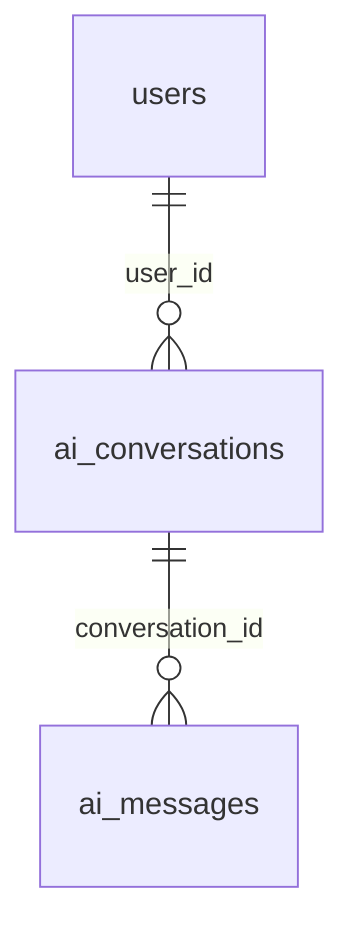

# AI 추천 개발 청사진·진행 현황

기준일: 2026-11-04. **이번 요청의 1단계 로컬 보완 구현을 완료했다.** 서버 대화·메시지 API 5개는 기존 구현을 유지하며, 비로그인 로컬 대화·전송 전 입력 보존·로그인 후 확인을 통한 초안 이어받기를 추가했다. 현재 브랜치는 `feat/ai-message-non-login`이다. 서버 동기화·실사용자 인증 연결·실제 팀 DB 통합 검증은 이번 범위 밖으로 남는다.

이 문서를 전체 단계와 현재 작업의 출발점으로 사용한다. [기능 정책](ai-matching.md)은 공통 정책, [API 명세](ai-api-spec.md)는 서버 계약, [개발 안내](ai-development.md)는 코드 배치를 담당한다. 인증·브랜치 운영은 [팀 안내](team-auth-deployment.md)를 따른다.

최신 요청은 **비로그인 로컬 대화·로그인 후 초안 이어받기 구현**이다. 로그인 후에도 추천 전까지 로컬에서 유지한다. 서버 동기화는 구현하지 않고 후속 계약으로 남긴다. 2~7단계는 개요이며 이번에 시작하지 않는다.

## 1. 전체 기능과 단계

목표는 프로젝트 조건에 맞는 개발자와 유사 프로젝트를 실제 DB에서 찾아 함께 추천하는 것이다. 점수·순위는 백엔드가 계산한다. Gemini는 후속 단계에서 자연어 조건 분석과 상세 이유 생성을 담당한다.

| 단계 | 주요 기능 | 완료 기준 개요 | 현재 상태 |
|---|---|---|---|
| 1. 대화 CRUD·메시지 | 서버 대화 생성/목록/상세/삭제, USER 메시지 저장. 비로그인·추천 전 로컬 초안과 로그인 후 보존 흐름 | 로컬 입력이 로그인 전후 유지되고, 서버 데이터는 인증·소유권으로 보호됨 | **로컬 보완 완료**·기존 서버 API 구현. 실제 인증/DB 통합은 별도 미완료 |
| 2. 조건 관리 | 분야·관심 분야·기술·직군별 인원·경력·기간 DTO, 조건 전체 교체 PUT, 검증 | 실제 DB 코드와 호환되는 조건 저장·수정 | 미구현 |
| 3. 추천 엔진 | 실제 DB 후보 조회·필터링, 개발자/프로젝트 적합도·순위·기본 이유 계산 | 동일 입력·데이터로 일관된 0~100점·순위 산출 | 미구현 |
| 4. 추천 실행·결과 저장 | 로그인·소유권 확인, 추천 요청/결과 저장·조회, 성공/실패 상태, 과거 결과 조회 | 생성한 결과를 재계산 없이 다시 조회 | 미구현 |
| 5. Gemini 조건 분석 | 자연어 조건 추출·변경·병합, 추가 질문, 응답 저장, 장애 처리 | 검증된 조건 JSON을 선택 UI와 동기화 | 미구현·외부 AI 연결 별도 요청 필요 |
| 6. 프리미엄 상세 분석 | 서버 권한·포트폴리오 열람권 확인, 실제 경험 기반 상세 이유 저장·재사용 | 무료 노출 차단, 프리미엄에 허용된 분석 제공 | 미구현 |
| 7. 사용량·동시성 | 무료 월 5회/프리미엄 월 100회, 한국 시간 월 경계, 성공 시 차감, 중복·동시 요청 제어 | 동시 요청에도 초과 사용·중복 차감 없음 | 미구현 |

2단계는 빈 초기 조건과 PUT 전체 교체를 다루며 필수/선택 항목·Enum·상한은 실제 DB 계약을 확인해 정한다. 3단계의 직군 30/기술 30/경험 20/협업 상태 10/신뢰·후기 10 가중치는 첨부의 **예시**다. 확정 알고리즘으로 사용하지 않는다. 기본 추천에서 상세 포트폴리오는 사용하지 않는다.

4단계부터 중복 요청을 구분할 수 있게 설계하고, 사용량 제한과 동시성 처리는 7단계에서 완성한다. 5단계의 직접 선택 조건 우선 원칙, 6단계의 상세 분석 미차감, 7단계의 성공한 신규 추천만 차감하는 정책은 [기능 정책](ai-matching.md)에 모았다. 후속 단계 DTO·DDL·오류 코드·구현 방식은 지금 임의로 확정하지 않는다.

정책 갱신 근거는 2026-11-04 사용자 요청과 첨부다. 로그인 사용자도 추천 전까지 로컬 처리한다는 흐름, 한국 시간 월 경계, 직접 선택 조건 우선, 4단계부터 중복 요청 식별 방향을 반영했다. 기존의 대화 type/status 미사용·연관 물리 삭제 정책은 유지한다.

## 2. 1단계: 확인한 완료 기능

### 서버 API

| 구현 완료 | 동작 |
|---|---|
| POST `/api/v1/ai/conversations` | 선택 제목(null 허용, 최대 255자), 서버에서 사용자·생성/수정 시각 지정, 201 + Location |
| GET `/api/v1/ai/conversations` | 내 대화만 `createdAt DESC, id DESC` |
| GET `/api/v1/ai/conversations/{id}` | 내 대화·저장 조건·메시지 조회, 메시지 `createdAt ASC, id ASC` |
| DELETE `/api/v1/ai/conversations/{id}` | 소유권 확인, 연관 데이터와 대화를 한 트랜잭션에서 물리 삭제, 204 |
| POST `/api/v1/ai/conversations/{id}/messages` | 공백이 아닌 `content`를 USER로 저장, 대화 연결·수정 시각 갱신, 201 |

- 타인·미존재 대화는 동일한 404, 잘못된 ID·입력은 400, 익명 서버 접근은 401이다. DB/FK 오류는 현재 공통 처리에 따라 500이며 삭제 전체를 롤백한다.
- 삭제 순서는 추천 결과 → 추천 요청 → 메시지 → 대화다. 메시지 FK로 연결된 추천 요청도 포함하고 월 사용량은 유지한다.
- 메시지 역할은 USER/ASSISTANT지만 저장 API는 USER만 만든다. 이미 저장된 ASSISTANT는 조회 가능하다. **Gemini 호출·임시 AI 답변 자동 생성은 없다.**
- `current_conditions`는 기존 값 조회만 가능하다. 조건 변경 API는 2단계다.
- 대화 `type/status`는 현재 엔티티에 없다. 첨부의 “기존 ERD 기준” 문구로 다시 추가하지 않는다. 앞서 확정한 한 대화 내 두 종류 추천·MVP 종료/보관 미제공 정책을 유지한다.

### 프론트·인증의 실제 상태

| 확인 위치 | 현재 코드 | 판단 |
|---|---|---|
| `frontend/app/ai/matching/page.tsx`, `lib/auth/paths.ts` | `/ai/matching`은 공개 화면, 대화·조건 UI 존재 | 비로그인 화면 자체는 이미 있음 |
| `frontend/lib/state/homeStore.ts`, `lib/matching/homeService.ts` | `guest`/계정별 로컬 대화, 메시지·조건 저장, `devmozip:home:v1` localStorage | 기존 저장 구조 재사용, 전송 전 draft 필드 추가·이전 데이터 호환 |
| `frontend/lib/matching/matchingChatService.ts` | USER 메시지만 추가, 선택 조건은 유지, 자연어 추출·ASSISTANT·추천·차감 없음 | 로컬 입력 흐름 보완 완료 |
| `frontend/lib/state/homeStore.ts` | 로그인 후 사용자가 확인한 활성 guest 초안 하나를 현재 계정으로 이동. 일반 계정은 이메일별 키로 분리 | 로컬 이어받기 완료, 공통 인증 코드는 보존 |
| 프론트 AI 흐름 | 로컬 대화·조건·입력문만 저장, 추천 버튼은 로그인 안내 또는 준비 중 안내 | 서버 동기화는 후속 계약으로 유보 |
| `backend/.../security/ai/` | dev/test + 명시적 옵션일 때만 기존 users의 고정 ID, 나머지는 거부 | 실사용자 인증 어댑터 미구현 |
| `backend/.../config/SecurityConfig.java`, `security/jwt/JwtAuthenticationFilter.java` | users 기반 이메일 로그인, JWT principal은 이메일 문자열 | 인증 자체는 존재. principal → `users.id`를 AI에 연결해야 함 |

`CurrentUserProvider` 고정 ID는 AI 로직의 개발·테스트용 교체 지점이다. 로그인한 A/B 계정의 실제 분리를 증명하지 않는다. 기본/운영 환경에서는 실제 어댑터가 없으면 AI 요청을 거부하므로 “로그인하면 서버 AI 사용 가능”으로 완료 처리하지 않는다.

## 3. 1단계: 로컬 구현 범위와 남은 통합 요구사항

아래 로컬 요구사항은 이번 구현에 반영했다. 사용자 확인으로 활성 초안 하나만 이어받으며 서버 API 호출은 하지 않는다. 실제 브라우저·실계정 연동 검증과 서버 전송 계약은 별도로 구분한다.

### 입력·보존·로그인 흐름

| 기능 | 비로그인 | 로그인 |
|---|---|---|
| 새 대화·사용자 메시지·조건 선택 | 프론트 로컬 처리 | 추천 전까지 로컬 처리 |
| 로컬 대화 목록·상세·삭제 | 해당 브라우저 초안만 처리 | 현재 계정의 로컬 초안만 처리. 서버 기록은 아직 연결하지 않음 |
| 대화·메시지·조건 DB 접근 | 차단 | 인증·소유권 검증 후 허용 |
| 추천 버튼 | 초안 보존 후 로그인 안내 | 추천 구현 이후 서버 실행·저장 |

1. 기존 UI와 버전 있는 localStorage를 활용해 대화·메시지·선택 조건을 보존한다. 새로고침·화면 이동·로그인 왕복에도 내용이 남아야 한다. 자연어 분석은 1단계 범위가 아니다.
2. 비로그인 입력을 허용하기 위해 서버 대화/메시지 API를 `permitAll`로 바꾸거나 익명 사용자 ID를 DB에 만들지 않는다. 로그인 사용자도 추천 전에는 로컬에서 작업한다는 최신 요청을 적용한다.
3. 로그인 후 이어갈 초안을 복원하고 대상 계정에 안전하게 인계한다. 로그아웃·다른 계정 로그인 시 이전 계정의 서버 기록이나 초안을 섞지 않는다. 공용 브라우저에서는 로그인만으로 자동 인계하지 않고, 화면에 표시된 현재 계정을 확인한 뒤 활성 초안 하나를 이어받는다. 다른 guest 초안과 기존 계정 기록은 유지한다.
4. 로컬 메시지 전송은 USER 메시지 기록만 한다. 기존 자동 Mock 답변·자동 추천·사용량 증가 분기를 제거했다. 일반 화면 안내와 저장되는 ASSISTANT 메시지는 구별한다.
5. 추천 버튼의 비로그인 동작은 로그인 안내·초안 보존·복귀까지만 다룬다. 1단계에서 실제 추천 엔진·Gemini·월 한도를 구현하지 않는다.
6. 저장 실패 시 사용자에게 알리고 현재 입력을 유지한다. 로그인 이동 직전 저장에 실패하면 이동을 중단한다. 계정 인계 저장 실패 시 guest 원본을 유지하며 재시도할 수 있다. 저장소를 사용할 수 없으면 일반 입력은 현재 세션에만 남을 수 있다.

### 서버 저장·인증 연결 경계

- 기존 서버 API 5개의 인증·소유권·정렬·삭제 계약을 보존했다. 로그인 직후 DB에 자동 저장하지 않는다. 첫 추천 실행 시 필요한 서버 전송은 4단계 후속 계약이며, 구체적인 저장/추천 트랜잭션·재시도·중복 방지 방식은 미확정이다.
- 실제 인증 정보의 이메일을 `users.id`로 연결하는 `CurrentUserProvider` 계약을 인증 담당자와 확인한다. 클라이언트 userId나 Mock 프로필 ID를 신뢰하지 않는다. 공통 인증 코드 변경이 필요하면 영향과 범위를 먼저 보고한다.
- 현재 API로 대화 생성과 USER 메시지 개별 저장은 가능하지만, 초안 일괄 전송·멱등성·원래 작성 시각 보존 계약은 없다. 별도 API를 지금 확정하거나 만들어 두지 않는다.
- 조건 서버 저장은 2단계, 추천 전 최종 초안 동기화·추천 실행은 4단계와 연결된다. 1단계에서는 로컬 조건 보존과 후속 인계에 필요한 계약을 기록하고, 후속 기능을 구현한 것으로 표시하지 않는다.

### 1단계 완료 확인 항목

- [x] 서버 대화 생성·목록·상세·삭제·USER 메시지 저장 코드 확인.
- [x] 소유권·정렬·연관 삭제/롤백·사용량 유지 테스트 코드 확인.
- [x] 비로그인 생성·메시지·조건·조회/삭제의 로컬 저장을 상태/서비스 테스트로 검증.
- [x] 저장소 재로드·비로그인 유지·로그인 상태 변경 후 입력/조건 보존을 자동 테스트로 검증.
- [x] 확인 후 활성 초안 하나 인계·원본 이동·기존 계정 기록 보존·계정 전환/로그아웃·저장 실패 재시도를 자동 테스트로 검증.
- [x] 일반 메시지·추천 문구·조건 입력이 ASSISTANT/추천/차감을 생성하지 않으며 네트워크를 호출하지 않음을 자동 테스트로 검증.
- [ ] 실제 브라우저에서 로그인 성공/실패/취소·왕복을 통한 사용자 검증(서버 인증 데이터 준비 필요).
- [ ] 실제 인증 사용자 A/B와 서버 API 소유권 연결 검증.
- [ ] 팀 DB에서 생성·메시지 조회·연관 삭제·FK 충돌 롤백 검증.

## 4. 필요한 API·ERD·팀 정보

### 현재 파일로 확인한 환경

| 항목 | 확인 결과 |
|---|---|
| Java / Spring Boot / Gradle | Java 21 / Boot 4.1.2 / Gradle 9.8.2, Spring Data JPA |
| 기본 실행·배포 DB | `application.yaml`은 PostgreSQL, compose 이미지는 PostgreSQL 17 |
| 로컬 DB | H2 `runtimeOnly` 의존성 있음. `application-local.yml`은 메모리 H2, `bootRun`은 별도 환경변수가 없으면 local 프로필 |
| dev 프로필 | `application-dev.yaml`은 AI 고정 사용자 옵션만 설정. dev 활성화만으로 H2가 선택되지는 않음 |
| AI 테스트 | PostgreSQL 호환 모드 H2 + 격리 `backend/src/test/resources/ai/schema.sql` |
| 현재 엔티티 | `Member`(users), `AiConversation`, `AiMessage`. 프로젝트·포트폴리오·추천 요청/결과·사용량 엔티티는 현재 브랜치에 없음 |

기존 문서의 “H2는 testRuntimeOnly, local 설정 없음, 로그인은 InMemoryUserDetailsManager” 설명은 현재 코드와 달라 제거했다. 팀의 H2 사용 방침과 로컬 H2 설정은 확인되지만 실제 팀 DB의 스키마·기동 결과를 검증한 것은 아니다.

### ERD 대조 상태와 필요한 자료

**2026-11-04 사용자 제공 ERD 이미지의 AI 테이블 5개를 판독하고 현재 엔티티·삭제 쿼리·참고 DDL·테스트 fixture와 대조했다.** 컬럼·타입 전사와 차이는 [API 명세의 ERD 판독 내용](ai-api-spec.md#제공-erd-판독-내용-2026-11-04)에 기록했다. 이전의 “원본 ERD 미확보·직접 대조 불가” 상태를 갱신한다. 전체 DDL과 실제 DB 적용 상태는 아직 미확인이다.

그림은 현재 엔티티의 관계 요약이다. 제공 ERD에는 추천 요청·추천 결과·사용량도 있으며 이들 엔티티/API는 아직 미구현이다. 대화 `current_conditions`와 요청 `conditions`는 JSONB, 점수는 DECIMAL(5,2), 사용 월은 추가 이미지 기준 CHAR(7)이다(이전 VARCHAR(7) 판독 정정). 대화 type/status와 메시지 updated_at은 ERD에도 없다.

`user_id`는 JPA 사용자 연관관계가 아닌 숫자 필드다. 실제 FK는 팀 DDL로 재확인해야 한다. 컬럼·요청/응답은 [API 명세](ai-api-spec.md), 이전 참고 DDL은 [PostgreSQL 검토용 SQL](sql/ai-conversations-proposal.sql)에 있다. 이 SQL과 H2 fixture는 승인된 팀 마이그레이션이 아니다. 오른쪽의 잘린 외부 테이블과 NULL·기본값·UNIQUE·CHECK·삭제 제약·Enum 값은 사진만으로 확정하지 않았다.

| 필요한 자료·계약 | 필요한 이유 | 필요 시점 |
|---|---|---|
| 실제 테이블/컬럼·FK·NULL·삭제 제약 DDL, 적용 DB·초기화 방식 | AI 영역 ERD는 확보·대조 완료. 실제 DB 적용 상태·제약 확인은 남음 | 1단계 마무리 전 |
| `ai_recommendation_requests.ai_conversation_id/ai_message_id`, `ai_recommendations.recommended_request_id`의 실제 테이블·FK | ERD 철자는 삭제 쿼리와 일치. 실제 테이블이 없으면 삭제는 500·전체 롤백 | 1단계 마무리 전 |
| 인증 principal → users PK 계약, 실제 계정 A/B, AI API BFF/프록시 전달 계약 | 고정 사용자 대체와 쿠키 기반 서버 API 연결 검증 | 1단계 통합 전 |
| 로그인 복귀 경로·guest 초안 인계/서버 저장 시점 계약 | 로그인 전후 보존·중복 저장·계정 혼합 방지 | 1단계 로컬 보완 전 |
| 분야·관심·기술·직군·경력·기간의 DB 코드/Enum 및 필수 여부 | 조건 DTO를 Mock 문자열로 임의 확정하지 않기 위함 | 2단계 요청 시 |
| 프로젝트·공개 프로필·기술·기본 경험·협업 상태·후기 데이터 계약 | 실제 후보 검색과 점수 설계. 없는 데이터는 먼저 보고 | 3단계 요청 시 |
| 추천 요청·결과·사용량 DDL, 포트폴리오 공개 범위, 구독 판정 원천 | 결과 FK·상세 분석 권한·사용량 연동 | 각 후속 단계 요청 시 |

이전 텍스트의 `conversation_id/message_id`는 추천 요청의 논리 관계 설명이다. 이번 ERD의 실제 표기는 현재 코드와 같은 `ai_conversation_id/ai_message_id`이므로 임의로 이름을 바꾸지 않는다. `recommended_user_id`/`recommended_project_id`는 둘 다 ERD에 있고 `recommendation_type`은 없다. 두 FK 중 정확히 하나만 사용한다는 요구의 DB 제약 적용 여부는 4단계에서 실제 DDL과 대조한다.

추가 API 표의 화면·10개 API 항목을 [기존 명세](ai-api-spec.md)에 대조·반영했다. 무료 한도는 최신 표에 따라 월 15회에서 **5회**로 갱신하고 프리미엄 100회는 유지한다. `detailed-analysi`는 마지막 s가 빠진 표기로 기록하고 기존 확정 `detailed-analysis`를 유지한다. 추가로 필요한 것은 초안 인계·저장 시점·재시도/중복 방지·BFF 인증 전달·후속 DTO 계약이며, 후속 단계 구현은 시작하지 않는다.

추가 users ERD에서 AI가 참조할 경력·직군·기술·관심 필드를 확인했다. **career는 ERD VARCHAR(20)/현재 Integer, 직군은 ERD job_categories JSONB/현재 job_category_id Long으로 불일치하며 skills·interests 등은 Member에 없다.** 상세 차이는 API 명세에 기록했다. 실제 DB와 담당자 계약을 먼저 확인하며 다른 팀원 코드를 임의로 수정하지 않는다.

## 5. 추가로 정해야 할 사항

### 1단계 마무리에 필요한 결정

| 미확정 사항 | 결정할 내용 |
|---|---|
| 초안의 보존 범위 | 기존 devmozip:home:v1과 계정별 대화 구조 유지. 이전 draft 없는 데이터 호환. 보존 기간·전체 저장 상한은 미확정 |
| 로그인 후 이어받기 | 결정/구현: 사용자 확인 후 활성 guest 초안 하나만 이동. 기존 계정 대화 유지, 로그인 취소/실패 시 guest 원본 유지 |
| 서버 최초 저장 시점 | 로그인 후에도 추천 전까지 로컬 유지. 추천 실행 시 서버 동기화의 구체 계약은 4단계에서 결정 |
| 초안 전달 계약 | 기존 5개 API 조합/별도 계약 필요 여부, 중복·부분 실패·재시도·로컬 ID ↔ 서버 ID 연결, 원래 작성 시각·순서 보존 |
| 인증·BFF 담당 경계 | 실사용자 Provider 제공 주체와 허용 변경 파일, HttpOnly 쿠키 → Bearer 전달 방식 |
| 실제 DB·시간 기준 | 팀 H2/배포 PostgreSQL의 적용 범위·DDL, LocalDateTime의 앱/DB 기준 시간대 |

### 추가 테이블 설계 정리 반영

2026-11-04 사용자 정리를 [API 명세의 5개 테이블 설계 정책·권장 제약](ai-api-spec.md#5개-테이블-설계-정책권장-제약-2026-11-04-추가-정리)에 반영했다. 컬럼별 확정 정책·권장·미확정을 구분하고 시간 설계 표기는 DATETIME으로 통일했다. 실제 DB DDL은 여전히 미확인이다.

- 확정: 추천 요청 조건은 변경 불가 스냅샷, 메시지 연결 선택, 두 추천 대상 FK 중 정확히 하나, 점수 0~100, 연관 삭제·월 사용량 유지, 무료 5회/프리미엄 100회·성공 시만 차감.
- 권장: 조건 NOT NULL·빈 객체 기본값, ID 자동 생성, 시각 NOT NULL, role/점수/대상 FK CHECK, rank 양수, 멱등성 키·UNIQUE, 메시지 단독 삭제 시 SET NULL. 사용자·월별 유일성 및 사용량 음수 금지를 위한 UNIQUE/CHECK도 실제 적용 여부를 확인해야 한다.
- 미확정: 제목 NULL 정책, call_logs 최종 삭제, analysis_level·status의 타입/값, 멱등성 키 계약, 대상별 순위 구분, 사용자 탈퇴·추천 대상 삭제 시 처리.
- 현재 구현과 구분: 제목·조건은 NULL 허용이며 조건 기본값 미설정. 메시지 created_at은 이미 존재하고 call_logs는 현재 매핑에 없다. 연관 삭제는 서비스의 명시적 쿼리로 처리하며 DB CASCADE/SET NULL을 적용한 것은 아니다. PostgreSQL 물리 시각 타입·SQL 파일은 이번 요청에서 바꾸지 않는다.

### 후속 단계에서 정할 항목

조건 스키마·빈 값 처리(2), 필수 필터·가중치·후보 수·동점·정보 부족 처리(3), 동기/비동기·과거 요청 조회 계약·멱등성·0건/부분 실패의 성공 기준(4), Gemini 모델·JSON 검증·삭제/충돌 병합·타임아웃·전송 데이터 범위(5), 구독 판정·열람권·분석 캐시와 비공개 전환 처리(6), 한도 오류·락/트랜잭션·중복 차감 방지·요금제 변경 세부 처리(7)는 해당 프롬프트를 받은 단계에서 정한다.

## 6. 검증과 이번 문서 변경

### 이전 검증 기록 — 이번 실행 결과가 아님

2026-11-04의 직전 보고에서 현재 브랜치 `./gradlew test --no-daemon --rerun-tasks`는 19개 중 18개 통과·1개 스킵·실패 0이었다. 스킵은 Docker가 필요한 `BackendApplicationTests.contextLoads`다. 이는 실제 팀 DB·비로그인 이어받기·외부 AI 검증을 뜻하지 않으며 이번 작업에서 재실행하지 않았다.

반복된 import/경로 수정 이력과 이미 정정된 503 기대·빌드 실패 기록은 제거했다. 현재 DB/FK 오류 계약은 500이다. 과거 브랜치·스테이징·임시 검증 디렉터리를 현재 작업 상태로 사용하지 않는다.

### 이번 변경·검증

| 구분 | 내용 |
|---|---|
| 변경 파일 | `docs/ai-progress.md`: 청사진·1단계 상세·남은 작업·자료/결정 목록으로 재작성 |
| 관련 문서 | `docs/ai-matching.md`: 공통 정책 정리. `docs/ai-api-spec.md`: 현재 5개 API와 후속 API 구분. `docs/ai-development.md`: 청사진 참조 안내 정리 |
| 문서 정리 방식 | 중요한 정책·API·개발 규칙 파일은 유지하고 역할별로 분리. 중복 이력·오래된 설정 설명·후속 단계의 반복 TODO는 정리 |
| 코드 변경 | 없음. 프론트·백엔드·SQL·인증/DB/배포 설정 변경 없음 |
| 프론트 빌드 | `frontend`에서 `npm run build`: 샌드박스에서는 TypeScript `--showConfig` 파싱 실패. 승인 후 제한 밖에서 동일 명령 재실행 성공(종료 코드 0) |
| 관련 테스트 | `frontend`에서 `npm test -- lib/matching/matchingChatService.test.ts lib/matching/homeService.test.ts`: 2개 파일·24개 테스트 통과(종료 코드 0). 기존 Mock 동작 검증이며 목표 비로그인/서버 통합의 완료 증거가 아님. 새 테스트 추가 없음 |
| 백엔드 테스트 | 미실행: 문서만 변경했으며 코드와 기존 테스트를 읽어 구현 범위를 확인 |
| 문서 검증 | 변경 문서의 상대 링크·`git diff --check`·비문서 파일 해시 비교로 변경 범위 확인 |

현재 요청의 로컬 구현은 완료했다. 남은 작업은 **실제 브라우저 로그인 왕복 검증·실사용자 인증/DB 통합 및 추천 실행 시 서버 전송 계약**이며 2단계는 시작하지 않는다.

### 2026-11-04 ERD 이미지 반영

- 변경 파일: `docs/ai-api-spec.md`, `docs/ai-progress.md`. 제공 이미지의 AI 테이블 5개 컬럼·타입을 전사하고 현재 엔티티·삭제 쿼리·참고 SQL·H2 fixture와 대조했다. ERD 미확보 안내를 갱신하고 API 명세의 추가 필요 범위를 정리했다.
- 남은 확인: 실제 DB DDL·NULL/기본값·UNIQUE/CHECK/삭제 제약·Enum 값·잘린 외부 테이블 관계. 사진 대조는 실제 DB 검증을 뜻하지 않는다.
- 검증: `frontend`에서 `npm run build` 성공(종료 코드 0), 문서 상대 링크·`git diff --check` 통과, 변경 파일이 위 문서 2개뿐임을 확인했다. 문서만 변경하여 기능/백엔드 테스트는 재실행하지 않았다.
- 코드·SQL·DB 변경과 후속 단계 구현은 하지 않았다. 이번 문서 변경은 커밋·푸시하지 않았다.

### 2026-11-04 추가 API 표·users ERD 반영

- 변경 파일: `docs/ai-api-spec.md`, `docs/ai-matching.md`, `docs/ai-progress.md`. API 10개 항목 대조, 무료 월 5회로 정책 갱신, 상세 분석 URL 오타 기록, 사용 월 CHAR(7) 판독 정정, users의 AI 관련 필드와 Member 차이를 기록했다.
- 미완료: 경력 타입·직군 구조·누락 기술/관심 필드의 실제 DB/담당자 계약, 초안 인계·BFF·후속 API 상세 계약. 기존 Mock 무료 15회 동작은 이번 문서 변경으로 수정되지 않았다.
- 검증: `frontend`에서 `npm run build` 성공(종료 코드 0), 상대 문서 링크·`git diff --check` 통과, 변경 범위는 AI 문서 3개. 문서만 변경하여 기능/백엔드 테스트는 재실행하지 않았다. 코드·SQL·다른 담당 영역 수정, 커밋·푸시는 하지 않았다.

### 2026-11-04 컬럼·제약·삭제 정책 정리 반영

- 변경 파일: `docs/ai-api-spec.md`, `docs/ai-matching.md`, `docs/ai-progress.md`. 5개 테이블의 컬럼별 설계 타입·확정 정책·권장 제약·미확정 사항과 관계별 삭제 정책을 정리했다. 시간 설계 표기는 DATETIME으로 통일하고 현재 구현·실제 DDL 미확인 상태를 구분했다.
- 검증: `frontend`에서 `npm run build` 성공(종료 코드 0), 문서 상대 링크·절 링크·`git diff --check` 통과, 변경 파일은 AI 문서 3개뿐임을 확인했다. 문서만 변경하여 기능/백엔드 테스트는 재실행하지 않았다.
- 미완료: 권장 제약의 최종 선택·실제 DB 적용 확인, 사용자/추천 대상 삭제 정책, Enum·순위 등 추가 결정. 코드·SQL·DB·다른 담당 영역 변경과 후속 단계 구현, 커밋·푸시는 하지 않았다.

### 2026-11-04 1단계 로컬 대화·초안 이어받기 구현

- 완료: 비로그인/로그인 로컬 대화 생성·조회·삭제·조건 선택·USER 저장, 전송 전 입력문 보존, 로그인 후 확인을 통한 활성 guest 초안 하나 이동, 저장 실패 시 원본 유지·재시도, 계정별 분리. 일반 계정은 로그인 이메일별로 구분하고 기존 데모 계정의 저장 키는 유지한다.
- 제거: 메시지 전송의 자연어 추출·임시 ASSISTANT·자동 Mock 추천·차감. 추천 버튼은 비로그인 로그인 안내/로그인 준비 중 안내로 분리했다. 과거 저장된 Mock 기록은 조회 호환을 보존하며 다른 화면의 샘플·한도 정책은 수정하지 않았다.
- 프론트 제품 코드 변경(6개): `app/ai/matching/page.tsx`(입력 보존·로그인 안내·이어받기 UI), 같은 경로 `_components/ChatConditions.tsx`(추천 버튼 분리), `lib/state/homeStore.ts`(로컬 저장·계정 인계), `lib/matching/matchingChatService.ts`(USER 저장만 수행·draft 복원), `types/matchingChat.ts`(선택 draft 필드), `mocks/matchingChat.ts`(현재 동작에 맞는 정적 안내). 기존 CSS·화면 구조를 재사용했다.
- 테스트 변경(3개): `lib/matching/matchingChatService.test.ts`, `tests/screens/FollowingMatching.test.tsx`, 신규 `lib/state/homeStore.test.tsx`. 비로그인/계정 전환·저장소 재로드·초안 이동·이메일 구분·ID 충돌·저장 실패·미차감·AI 네트워크 호출 없음과 기존 화면 회귀를 검증한다. 경로는 모두 frontend 기준이다.
- 문서 변경(3개): `docs/ai-progress.md`, `docs/ai-matching.md`, `docs/ai-api-spec.md`. 최신 구현 상태와 로컬 인계 계약·추천 실행 시 서버 동기화의 후속 계약을 반영했다.
- Mock 위치: 초기 대화·조건 옵션·안내는 `frontend/mocks/matchingChat.ts`, 기존 추천 초기 상태/점수 관련 옵션은 `frontend/mocks/matching.ts`, 개발자·프로젝트 샘플은 `frontend/mocks/home.ts`다. 원본 샘플과 사용자가 입력한 localStorage 데이터는 다르며, 후자는 `devmozip:home:v1`에 저장된다.
- 검증: 최초 테스트 명령은 저장소 루트에서 실행해 package.json 부재(ENOENT)로 실패했다. frontend에서 관련 4개 파일·39개 테스트 통과 후, 최종 `npm test`는 **40개 파일·436개 테스트 통과**(종료 코드 0). 최종 `npm run build`도 성공(종료 코드 0). `git diff --check`·문서 링크/절 링크 확인 통과.
- 검증 한계: 테스트는 로컬 상태·세션 상태 주입·SSR 화면 기준이다. 실제 브라우저/실계정의 로그인 성공·실패 왕복은 이번에 수행하지 않았다. 백엔드 코드를 변경하지 않아 이번 구현에서 Gradle 테스트는 재실행하지 않았다. 서버 인증 어댑터·실제 DB 삭제 연동은 완료로 표시하지 않는다.
- 범위 보존: 기존 서버 API·백엔드·SQL·공통 인증/로그인·배포·다른 팀원 영역·AGENTS.md는 수정하지 않았다. 서버 동기화·조건 PUT 등 2단계 이후 기능은 구현하지 않았다. 커밋·푸시하지 않았다.

### 2026-11-04 로컬 H2 개발 계정 자동 초기화 연결·재확인

- 사용자 요청: 로컬 H2를 시작할 때 기존 개발 계정 SQL이 자동 실행되도록 연결하고 중단 후 결과를 재확인했다. 로그인 검증을 위해 필요한 로컬 설정의 SQL 경로만 수정했으며 사용자/인증 Java 코드·운영 설정·SQL 원본은 변경하지 않았다.
- 변경: 개인 로컬 설정 `backend/src/main/resources/application-local.yml`의 data-locations를 `file:../docs/sql/members_data.sql`로 연결했다. 기존 local의 init.mode=always, JPA 초기화 지연 설정은 유지했다. **backend 디렉터리에서 `./gradlew bootRun`으로 실행**한다. 파일은 Git 제외 대상이므로 다른 환경에 자동 공유되지는 않는다.
- 실제 기동/로그인: 임시 18080 서버에서 H2 `jdbc:h2:mem:security`·헬스 200 UP, member/premium/admin 로그인 200 및 /api/v1/users/me의 USER/PREMIUM/ADMIN 권한을 확인했다. suspended는 403, 잘못된 비밀번호는 401이었다. 개발 계정 비밀번호는 기존 SQL의 `Devmozip123!`이며 토큰은 출력하지 않았다.
- 범위 한계: local만으로 AI CurrentUserProvider를 활성화하지 않는다. 일반 계정의 로그인 토큰으로 AI 대화 API 호출은 여전히 401임을 확인했다. 이번 연결은 로그인/로컬 초안 확인을 위한 것이며 AI 서버 인증 연결·추천 관련 테이블·서버 동기화 완료를 뜻하지 않는다.
- 중단/재확인: 첫 경로 수정 시 작업 디렉터리 착오를 정정했다. 최초 기동은 샌드박스 Gradle 캐시 쓰기 제한으로 실패해 승인 후 재실행했다. 동시 컴파일 중 devtools 재시작으로 빈 DB/테이블 오류와 로그인 시간 초과가 있었으며, 최종 정상 기동에서 위 실제 로그인 결과를 다시 확인했다. 검증용 서버는 종료했다.
- 프론트 빌드: `npm run build` 성공(종료 코드 0). 일부 정적 페이지는 시간 초과 후 빌드 내부 재시도로 완료되었다. 기존 next-env.d.ts 변경은 작업 전 상태로 보존했다.
- 백엔드 테스트: 중단된 실행 결과를 성공으로 간주하지 않고 `./gradlew test --no-daemon --rerun-tasks`를 독립 재실행해 성공(종료 코드 0)했다. JUnit XML 기준 19개 중 18개 통과·1개 스킵·실패/오류 0이며 스킵은 Docker가 필요한 BackendApplicationTests다. 새 테스트는 추가하지 않았다. `git diff --check` 통과, 커밋·푸시는 하지 않았다.
