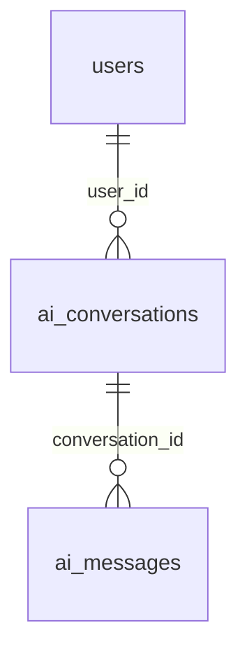

# AI 추천 개발 청사진·진행 현황

기준일: 2026-11-05. **1단계 서버 API·실사용자 인증 연결을 유지하고 프론트 로그인 필수 전환을 반영했다.** 이전 브라우저 초안 검증은 guest 허용 당시 기록이며 이번 실행 결과는 마지막 절을 따른다. 현재 브랜치는 develop을 기반으로 한 `feat/ai-message-non-login`이다. 실제 PostgreSQL 스키마 확인·통합 검증은 남아 있으며 서버 동기화는 4단계 후속 계약이다.

이 문서를 전체 단계와 현재 작업의 출발점으로 사용한다. [기능 정책](ai-matching.md)은 공통 정책, [API 명세](ai-api-spec.md)는 서버 계약, [개발 안내](ai-development.md)는 코드 배치를 담당한다. 인증·브랜치 운영은 [팀 안내](team-auth-deployment.md)를 따른다.

최신 요청은 **메인부터 AI 대화 로그인 필수 전환**이다. 비로그인 메인 입력은 저장·인계하지 않고 추천 시작 시 로그인으로 이동한다. guest 대화·조건·메시지 저장과 인계 기능을 제거한다. 로그인 계정은 추천 전까지 로컬 저장을 유지한다. users ERD와 Member 차이는 사용자가 다른 브랜치에서 해결되었다고 확인했으므로 이번 범위에서 제외한다. 2~7단계는 시작하지 않는다.

## 1. 전체 기능과 단계

목표는 프로젝트 조건에 맞는 개발자와 유사 프로젝트를 실제 DB에서 찾아 함께 추천하는 것이다. 점수·순위는 백엔드가 계산한다. Gemini는 후속 단계에서 자연어 조건 분석과 상세 이유 생성을 담당한다.

| 단계 | 주요 기능 | 완료 기준 개요 | 현재 상태 |
|---|---|---|---|
| 1. 대화 CRUD·메시지 | 서버 대화 생성/목록/상세/삭제, USER 메시지 저장. 로그인 필수 로컬 초안 | 비로그인 저장 차단, 로그인 계정 로컬 보존 및 서버 인증·소유권 보호 | **로컬·실사용자 인증 연결 완료**. 로그인 필수 전환 자동 테스트·빌드 통과. 실제 PostgreSQL 통합 검증 대기 |
| 2. 조건 관리 | 분야·관심 분야·기술·직군별 인원·경력·기간 DTO, 조건 전체 교체 PUT, 검증 | 실제 DB 코드와 호환되는 조건 저장·수정 | 미구현 |
| 3. 추천 엔진 | 실제 DB 후보 조회·필터링, 개발자/프로젝트 적합도·순위·기본 이유 계산 | 동일 입력·데이터로 일관된 0~100점·순위 산출 | 미구현 |
| 4. 추천 실행·결과 저장 | 로그인·소유권 확인, 추천 요청/결과 저장·조회, 성공/실패 상태, 과거 결과 조회 | 생성한 결과를 재계산 없이 다시 조회 | 미구현 |
| 5. Gemini 조건 분석 | 자연어 조건 추출·변경·병합, 추가 질문, 응답 저장, 장애 처리 | 검증된 조건 JSON을 선택 UI와 동기화 | 미구현·외부 AI 연결 별도 요청 필요 |
| 6. 프리미엄 상세 분석 | 서버 권한·포트폴리오 열람권 확인, 실제 경험 기반 상세 이유 저장·재사용 | 무료 노출 차단, 프리미엄에 허용된 분석 제공 | 미구현 |
| 7. 사용량·동시성 | 무료 월 5회/프리미엄 월 100회, 한국 시간 월 경계, 성공 시 차감, 중복·동시 요청 제어 | 동시 요청에도 초과 사용·중복 차감 없음 | 미구현 |

2단계는 빈 초기 조건과 PUT 전체 교체를 다루며 필수/선택 항목·Enum·상한은 실제 DB 계약을 확인해 정한다. 3단계의 직군 30/기술 30/경험 20/협업 상태 10/신뢰·후기 10 가중치는 첨부의 **예시**다. 확정 알고리즘으로 사용하지 않는다. 기본 추천에서 상세 포트폴리오는 사용하지 않는다.

4단계부터 중복 요청을 구분할 수 있게 설계하고, 사용량 제한과 동시성 처리는 7단계에서 완성한다. 5단계의 직접 선택 조건 우선 원칙, 6단계의 상세 분석 미차감, 7단계의 성공한 신규 추천만 차감하는 정책은 [기능 정책](ai-matching.md)에 모았다. 후속 단계 DTO·DDL·오류 코드·구현 방식은 지금 임의로 확정하지 않는다.

정책 갱신 근거는 2026-11-04 사용자 요청·첨부와 2026-11-05 로그인 필수 전환 요청이다. 로그인 사용자도 추천 전까지 로컬 처리하고 비로그인은 저장하지 않는 흐름, 한국 시간 월 경계, 직접 선택 조건 우선, 4단계부터 중복 요청 식별 방향을 반영했다. 대화 type/status 미사용은 유지한다. 삭제 범위는 사용자 최신 요청에 따라 본인 대화와 그 메시지로 한정한다.

## 2. 1단계: 확인한 완료 기능

### 서버 API

| 구현 완료 | 동작 |
|---|---|
| POST `/api/v1/ai/conversations` | 선택 제목(null 허용, 최대 255자), 서버에서 사용자·생성/수정 시각 지정, 201 + Location |
| GET `/api/v1/ai/conversations` | 내 대화만 `createdAt DESC, id DESC` |
| GET `/api/v1/ai/conversations/{id}` | 내 대화·저장 조건·메시지 조회, 메시지 `createdAt ASC, id ASC` |
| DELETE `/api/v1/ai/conversations/{id}` | 소유권 확인, 연관 데이터와 대화를 한 트랜잭션에서 물리 삭제, 204 |
| POST `/api/v1/ai/conversations/{id}/messages` | 공백이 아닌 `content`를 USER로 저장, 대화 연결·수정 시각 갱신, 201 |

- 타인·미존재 대화는 동일한 404, 잘못된 ID·입력은 400, 익명 서버 접근은 401이다. DB/FK 오류는 현재 공통 처리에 따라 500이며 삭제 전체를 롤백한다.
- 삭제 순서는 해당 대화의 메시지 → 본인 대화다. 추천 요청·결과·사용량 테이블은 참조하거나 삭제하지 않는다. 추천 기능 도입 후 FK·삭제 정책은 별도 확정한다.
- 메시지 역할은 USER/ASSISTANT지만 저장 API는 USER만 만든다. 이미 저장된 ASSISTANT는 조회 가능하다. **Gemini 호출·임시 AI 답변 자동 생성은 없다.**
- `current_conditions`는 기존 값 조회만 가능하다. 조건 변경 API는 2단계다.
- 대화 `type/status`는 현재 엔티티에 없다. 첨부의 “기존 ERD 기준” 문구로 다시 추가하지 않는다. 앞서 확정한 한 대화 내 두 종류 추천·MVP 종료/보관 미제공 정책을 유지한다.

### 프론트·인증의 실제 상태

| 확인 위치 | 현재 코드 | 판단 |
|---|---|---|
| `frontend/app/ai/matching/page.tsx`, `lib/auth/paths.ts` | `/ai/matching`은 보호 경로, 비로그인 입력 UI 숨김 | 메인부터 로그인 필수 |
| `frontend/lib/state/homeStore.ts`, `lib/matching/homeService.ts` | 로그인 계정별 로컬 대화, 메시지·조건 저장, `devmozip:home:v1` localStorage | 기존 저장 구조 재사용, 전송 전 draft 필드 추가·이전 데이터 호환 |
| `frontend/lib/matching/matchingChatService.ts` | USER 메시지만 추가, 선택 조건은 유지, 자연어 추출·ASSISTANT·추천·차감 없음 | 로컬 입력 흐름 보완 완료 |
| `frontend/lib/state/homeStore.ts` | guest 인계 제거. 일반 계정은 이메일별 키로 분리 | 기존 guest 기록은 숨기고 로그인 계정 기록은 보존 |
| 프론트 AI 흐름 | 로컬 대화·조건·입력문만 저장, 메인 비로그인 추천 시작은 로그인 이동, 로그인 대화 추천은 준비 중 안내 | 서버 동기화는 후속 계약으로 유보 |
| `backend/.../security/ai/` | 기본/local/운영은 인증 이메일 → 실제 users PK. dev/test + 명시적 옵션일 때만 고정 ID | 실사용자 어댑터 구현·H2 실제 로그인 JWT 소유권 검증 완료 |
| `backend/.../config/SecurityConfig.java`, `security/jwt/JwtAuthenticationFilter.java` | users 기반 이메일 로그인, JWT principal은 이메일 문자열 | 기존 인증을 보존하고 AI 어댑터에서 principal → `users.id` 연결 완료 |

`CurrentUserProvider`의 기본 구현은 `AuthenticatedCurrentUserProvider`다. 검증된 인증 이메일로 MemberRepository를 조회하고 익명·미인증·삭제 계정은 401, 정지 계정은 403으로 거절한다. 고정 ID는 명시적인 dev/test 개발 설정에만 남겼다. H2에서 실제 로그인 JWT로 A/B의 소유권 분리를 검증했지만 프론트 AI API 연결·실제 PostgreSQL 통합 완료를 뜻하지 않는다.

## 3. 1단계: 로컬 구현 범위와 남은 통합 요구사항

2026-11-05 사용자 요청으로 이전 비로그인 초안 정책을 대체한다. 서버 API 호출·추천 실행은 추가하지 않는다.

### 입력·보존·로그인 흐름

| 기능 | 비로그인 | 로그인 |
|---|---|---|
| 메인 입력 | 메모리에서만 작성, 저장·인계 없음 | 소유 계정이 일치하는 입력 복원 |
| 추천 시작·이전 대화 열기 | `/login?next=%2Fai%2Fmatching` 이동 | 대화 시작·기존 기록 열기 |
| 대화 URL·메시지·조건 | 진입 및 로컬 변경 차단 | 계정별 로컬 저장·복원 |
| 추천 실행 | 제공하지 않음 | 준비 중 안내, 자동 추천·차감 없음 |

- guest 초안 이어받기를 제거한다. 기존 guest 저장 데이터는 일괄 삭제하지 않지만 화면에 노출·인계하지 않는다.
- `inputOwner`가 없는 과거 공용 메인 입력은 복원하지 않는다. 로그인 계정의 대화·메시지·조건·과거 결과는 보존한다.
- 저장 실패 시 로그인 사용자의 입력·기존 대화를 유지하며 재시도할 수 있다. 일반 draft 저장 실패는 세션 보존·오류 안내를 유지한다.

### 서버 저장·인증 연결 경계

- 기존 서버 API 5개의 인증·소유권·정렬·삭제 계약을 보존했다. 로그인 직후 DB에 자동 저장하지 않는다. 첫 추천 실행 시 필요한 서버 전송은 4단계 후속 계약이며, 구체적인 저장/추천 트랜잭션·재시도·중복 방지 방식은 미확정이다.
- 실제 인증 정보의 이메일을 `users.id`로 연결하는 `CurrentUserProvider`를 AI 인증 패키지 안에서 구현했다. 기존 MemberRepository를 재사용하며 클라이언트 userId나 Mock 프로필 ID를 신뢰하지 않는다. 공통 인증·사용자 코드 변경은 없다.
- 현재 API로 대화 생성과 USER 메시지 개별 저장은 가능하지만, 초안 일괄 전송·멱등성·원래 작성 시각 보존 계약은 없다. 별도 API를 지금 확정하거나 만들어 두지 않는다.
- 조건 서버 저장은 2단계, 추천 전 최종 초안 동기화·추천 실행은 4단계와 연결된다. 1단계에서는 로컬 조건 보존과 후속 인계에 필요한 계약을 기록하고, 후속 기능을 구현한 것으로 표시하지 않는다.

### 1단계 완료 확인 항목

- [x] 서버 API 5개 및 실사용자 인증·소유권 연결 코드 확인.
- [x] 기존 로그인 계정 로컬 대화·조건·메시지·draft 저장 구조 보존.
- [x] 비로그인 UI 접근·로컬 변경 차단과 guest 인계 제거 코드 반영.
- [ ] 팀 PostgreSQL에서 CRUD·연관 삭제·FK 충돌 롤백 검증.

이전 H2·브라우저 실행 결과는 6절의 당시 기록이며 이번 실행 결과는 마지막 기록으로 구분한다.

## 4. 필요한 API·ERD·팀 정보

### 현재 파일로 확인한 환경

| 항목 | 확인 결과 |
|---|---|
| Java / Spring Boot / Gradle | Java 21 / Boot 4.1.2 / Gradle 9.8.2, Spring Data JPA |
| 기본 실행·배포 DB | `application.yaml`은 PostgreSQL, compose 이미지는 PostgreSQL 17 |
| 로컬 DB | H2 `runtimeOnly` 의존성 있음. `application-local.yml`은 메모리 H2, `bootRun`은 별도 환경변수가 없으면 local 프로필 |
| dev 프로필 | `application-dev.yaml`은 AI 고정 사용자 옵션만 설정. dev 활성화만으로 H2가 선택되지는 않음 |
| AI 테스트 | PostgreSQL 호환 모드 H2 + 격리 `backend/src/test/resources/ai/schema.sql` |
| 현재 엔티티 | `Member`(users), `AiConversation`, `AiMessage`. 프로젝트·포트폴리오·추천 요청/결과·사용량 엔티티는 현재 브랜치에 없음 |

기존 문서의 “H2는 testRuntimeOnly, local 설정 없음, 로그인은 InMemoryUserDetailsManager” 설명은 현재 코드와 달라 제거했다. 팀의 H2 사용 방침과 로컬 H2 설정은 확인되지만 실제 팀 DB의 스키마·기동 결과를 검증한 것은 아니다.

### ERD 대조 상태와 필요한 자료

**2026-11-04 사용자 제공 ERD 이미지의 AI 테이블 5개를 판독하고 현재 엔티티·삭제 쿼리·참고 DDL·테스트 fixture와 대조했다.** 컬럼·타입 전사와 차이는 [API 명세의 ERD 판독 내용](ai-api-spec.md#제공-erd-판독-내용-2026-11-04)에 기록했다. 이전의 “원본 ERD 미확보·직접 대조 불가” 상태를 갱신한다. 전체 DDL과 실제 DB 적용 상태는 아직 미확인이다.

그림은 현재 엔티티의 관계 요약이다. 제공 ERD에는 추천 요청·추천 결과·사용량도 있으며 이들 엔티티/API는 아직 미구현이다. 대화 `current_conditions`와 요청 `conditions`는 JSONB, 점수는 DECIMAL(5,2), 사용 월은 추가 이미지 기준 CHAR(7)이다(이전 VARCHAR(7) 판독 정정). 대화 type/status와 메시지 updated_at은 ERD에도 없다.

`user_id`는 JPA 사용자 연관관계가 아닌 숫자 필드다. 실제 FK는 팀 DDL로 재확인해야 한다. 컬럼·요청/응답은 [API 명세](ai-api-spec.md), 이전 참고 DDL은 [PostgreSQL 검토용 SQL](sql/ai-conversations-proposal.sql)에 있다. 이 SQL과 H2 fixture는 승인된 팀 마이그레이션이 아니다. 오른쪽의 잘린 외부 테이블과 NULL·기본값·UNIQUE·CHECK·삭제 제약·Enum 값은 사진만으로 확정하지 않았다.

| 필요한 자료·계약 | 필요한 이유 | 필요 시점 |
|---|---|---|
| 실제 테이블/컬럼·FK·NULL·삭제 제약 DDL, 적용 DB·초기화 방식 | AI 영역 ERD는 확보·대조 완료. 실제 DB 적용 상태·제약 확인은 남음 | 1단계 마무리 전 |
| 추천 요청·결과 테이블의 실제 FK·삭제/보존 정책 | 1단계 삭제에서는 참조하지 않음. 추천 이력이 생기는 시점에 정책과 FK를 함께 확정 | 4단계 요청 시 |
| 실제 PostgreSQL 계정 A/B와 AI API BFF/프록시 전달 계약 | 실사용자 Provider·H2 A/B 검증은 완료. 실제 DB 검증과 BFF 계약은 남음 | PostgreSQL 전환/4단계 서버 연결 시 |
| 로그인 복귀 경로·로그인 계정 초안 서버 저장 시점 계약 | 로그인 필수 진입·계정 혼합 방지 | 1단계 로컬 보완 전 |
| 분야·관심·기술·직군·경력·기간의 DB 코드/Enum 및 필수 여부 | 조건 DTO를 Mock 문자열로 임의 확정하지 않기 위함 | 2단계 요청 시 |
| 프로젝트·공개 프로필·기술·기본 경험·협업 상태·후기 데이터 계약 | 실제 후보 검색과 점수 설계. 없는 데이터는 먼저 보고 | 3단계 요청 시 |
| 추천 요청·결과·사용량 DDL, 포트폴리오 공개 범위, 구독 판정 원천 | 결과 FK·상세 분석 권한·사용량 연동 | 각 후속 단계 요청 시 |

이전 텍스트의 `conversation_id/message_id`는 추천 요청의 논리 관계 설명이다. 이번 ERD의 실제 표기는 현재 코드와 같은 `ai_conversation_id/ai_message_id`이므로 임의로 이름을 바꾸지 않는다. `recommended_user_id`/`recommended_project_id`는 둘 다 ERD에 있고 `recommendation_type`은 없다. 두 FK 중 정확히 하나만 사용한다는 요구의 DB 제약 적용 여부는 4단계에서 실제 DDL과 대조한다.

추가 API 표의 화면·10개 API 항목을 [기존 명세](ai-api-spec.md)에 대조·반영했다. 무료 한도는 최신 표에 따라 월 15회에서 **5회**로 갱신하고 프리미엄 100회는 유지한다. `detailed-analysi`는 마지막 s가 빠진 표기로 기록하고 기존 확정 `detailed-analysis`를 유지한다. 추가로 필요한 것은 로그인 계정 초안 저장 시점·재시도/중복 방지·BFF 인증 전달·후속 DTO 계약이며, 후속 단계 구현은 시작하지 않는다.

과거 브랜치의 추가 users ERD 대조 기록이다. 사용자는 2026-11-05 다른 브랜치에서 차이를 해결했다고 확인했으며 이번 작업에서 재검토·수정하지 않는다. **career는 ERD VARCHAR(20)/현재 Integer, 직군은 ERD job_categories JSONB/현재 job_category_id Long으로 불일치하며 skills·interests 등은 Member에 없다.** 상세 차이는 API 명세에 기록했다. 실제 DB와 담당자 계약을 먼저 확인하며 다른 팀원 코드를 임의로 수정하지 않는다.

## 5. 추가로 정해야 할 사항

### 1단계 마무리에 필요한 결정

| 미확정 사항 | 결정할 내용 |
|---|---|
| 초안의 보존 범위 | 기존 devmozip:home:v1과 계정별 대화 구조 유지. 이전 draft 없는 데이터 호환. 보존 기간·전체 저장 상한은 미확정 |
| 로그인 후 이어받기 | 로그인 후 새로 입력. guest 인계 제거, 기존 계정 대화 유지 |
| 서버 최초 저장 시점 | 로그인 후에도 추천 전까지 로컬 유지. 추천 실행 시 서버 동기화의 구체 계약은 4단계에서 결정 |
| 초안 전달 계약 | 기존 5개 API 조합/별도 계약 필요 여부, 중복·부분 실패·재시도·로컬 ID ↔ 서버 ID 연결, 원래 작성 시각·순서 보존 |
| 인증·BFF 담당 경계 | 실사용자 Provider는 AI 인증 패키지에서 구현 완료. AI API용 HttpOnly 쿠키 → Bearer 전달 방식은 후속 계약 |
| 실제 DB·시간 기준 | 팀 H2/배포 PostgreSQL의 적용 범위·DDL, LocalDateTime의 앱/DB 기준 시간대 |

### 추가 테이블 설계 정리 반영

2026-11-04 사용자 정리를 [API 명세의 5개 테이블 설계 정책·권장 제약](ai-api-spec.md#5개-테이블-설계-정책권장-제약-2026-11-04-추가-정리)에 반영했다. 컬럼별 확정 정책·권장·미확정을 구분하고 시간 설계 표기는 DATETIME으로 통일했다. 실제 DB DDL은 여전히 미확인이다.

- 확정: 추천 요청 조건은 변경 불가 스냅샷, 메시지 연결 선택, 두 추천 대상 FK 중 정확히 하나, 점수 0~100, 연관 삭제·월 사용량 유지, 무료 5회/프리미엄 100회·성공 시만 차감.
- 권장: 조건 NOT NULL·빈 객체 기본값, ID 자동 생성, 시각 NOT NULL, role/점수/대상 FK CHECK, rank 양수, 멱등성 키·UNIQUE, 메시지 단독 삭제 시 SET NULL. 사용자·월별 유일성 및 사용량 음수 금지를 위한 UNIQUE/CHECK도 실제 적용 여부를 확인해야 한다.
- 미확정: 제목 NULL 정책, call_logs 최종 삭제, analysis_level·status의 타입/값, 멱등성 키 계약, 대상별 순위 구분, 사용자 탈퇴·추천 대상 삭제 시 처리.
- 현재 구현과 구분: 제목·조건은 NULL 허용이며 조건 기본값 미설정. 메시지 created_at은 이미 존재하고 call_logs는 현재 매핑에 없다. 연관 삭제는 서비스의 명시적 쿼리로 처리하며 DB CASCADE/SET NULL을 적용한 것은 아니다. PostgreSQL 물리 시각 타입·SQL 파일은 이번 요청에서 바꾸지 않는다.

### 후속 단계에서 정할 항목

조건 스키마·빈 값 처리(2), 필수 필터·가중치·후보 수·동점·정보 부족 처리(3), 동기/비동기·과거 요청 조회 계약·멱등성·0건/부분 실패의 성공 기준(4), Gemini 모델·JSON 검증·삭제/충돌 병합·타임아웃·전송 데이터 범위(5), 구독 판정·열람권·분석 캐시와 비공개 전환 처리(6), 한도 오류·락/트랜잭션·중복 차감 방지·요금제 변경 세부 처리(7)는 해당 프롬프트를 받은 단계에서 정한다.

## 6. 검증과 이번 문서 변경

### 이전 검증 기록 — 이번 실행 결과가 아님

2026-11-04의 직전 보고에서 현재 브랜치 `./gradlew test --no-daemon --rerun-tasks`는 19개 중 18개 통과·1개 스킵·실패 0이었다. 스킵은 Docker가 필요한 `BackendApplicationTests.contextLoads`다. 이는 실제 팀 DB·비로그인 이어받기·외부 AI 검증을 뜻하지 않으며 이번 작업에서 재실행하지 않았다.

반복된 import/경로 수정 이력과 이미 정정된 503 기대·빌드 실패 기록은 제거했다. 현재 DB/FK 오류 계약은 500이다. 과거 브랜치·스테이징·임시 검증 디렉터리를 현재 작업 상태로 사용하지 않는다.

### 이번 변경·검증

| 구분 | 내용 |
|---|---|
| 변경 파일 | `docs/ai-progress.md`: 청사진·1단계 상세·남은 작업·자료/결정 목록으로 재작성 |
| 관련 문서 | `docs/ai-matching.md`: 공통 정책 정리. `docs/ai-api-spec.md`: 현재 5개 API와 후속 API 구분. `docs/ai-development.md`: 청사진 참조 안내 정리 |
| 문서 정리 방식 | 중요한 정책·API·개발 규칙 파일은 유지하고 역할별로 분리. 중복 이력·오래된 설정 설명·후속 단계의 반복 TODO는 정리 |
| 코드 변경 | 없음. 프론트·백엔드·SQL·인증/DB/배포 설정 변경 없음 |
| 프론트 빌드 | `frontend`에서 `npm run build`: 샌드박스에서는 TypeScript `--showConfig` 파싱 실패. 승인 후 제한 밖에서 동일 명령 재실행 성공(종료 코드 0) |
| 관련 테스트 | `frontend`에서 `npm test -- lib/matching/matchingChatService.test.ts lib/matching/homeService.test.ts`: 2개 파일·24개 테스트 통과(종료 코드 0). 기존 Mock 동작 검증이며 목표 비로그인/서버 통합의 완료 증거가 아님. 새 테스트 추가 없음 |
| 백엔드 테스트 | 미실행: 문서만 변경했으며 코드와 기존 테스트를 읽어 구현 범위를 확인 |
| 문서 검증 | 변경 문서의 상대 링크·`git diff --check`·비문서 파일 해시 비교로 변경 범위 확인 |

위 기록은 이전 문서 정리 당시 상태다. 최신 인증 연결·브라우저 검증은 아래 마지막 기록을 따른다. 남은 작업은 **실제 PostgreSQL 통합 검증 및 추천 실행 시 서버 전송 계약**이며 2단계는 시작하지 않는다.

### 2026-11-04 ERD 이미지 반영

- 변경 파일: `docs/ai-api-spec.md`, `docs/ai-progress.md`. 제공 이미지의 AI 테이블 5개 컬럼·타입을 전사하고 현재 엔티티·삭제 쿼리·참고 SQL·H2 fixture와 대조했다. ERD 미확보 안내를 갱신하고 API 명세의 추가 필요 범위를 정리했다.
- 남은 확인: 실제 DB DDL·NULL/기본값·UNIQUE/CHECK/삭제 제약·Enum 값·잘린 외부 테이블 관계. 사진 대조는 실제 DB 검증을 뜻하지 않는다.
- 검증: `frontend`에서 `npm run build` 성공(종료 코드 0), 문서 상대 링크·`git diff --check` 통과, 변경 파일이 위 문서 2개뿐임을 확인했다. 문서만 변경하여 기능/백엔드 테스트는 재실행하지 않았다.
- 코드·SQL·DB 변경과 후속 단계 구현은 하지 않았다. 이번 문서 변경은 커밋·푸시하지 않았다.

### 2026-11-04 추가 API 표·users ERD 반영

- 변경 파일: `docs/ai-api-spec.md`, `docs/ai-matching.md`, `docs/ai-progress.md`. API 10개 항목 대조, 무료 월 5회로 정책 갱신, 상세 분석 URL 오타 기록, 사용 월 CHAR(7) 판독 정정, users의 AI 관련 필드와 Member 차이를 기록했다.
- 미완료: 경력 타입·직군 구조·누락 기술/관심 필드의 실제 DB/담당자 계약, 초안 인계·BFF·후속 API 상세 계약. 기존 Mock 무료 15회 동작은 이번 문서 변경으로 수정되지 않았다.
- 검증: `frontend`에서 `npm run build` 성공(종료 코드 0), 상대 문서 링크·`git diff --check` 통과, 변경 범위는 AI 문서 3개. 문서만 변경하여 기능/백엔드 테스트는 재실행하지 않았다. 코드·SQL·다른 담당 영역 수정, 커밋·푸시는 하지 않았다.

### 2026-11-04 컬럼·제약·삭제 정책 정리 반영

- 변경 파일: `docs/ai-api-spec.md`, `docs/ai-matching.md`, `docs/ai-progress.md`. 5개 테이블의 컬럼별 설계 타입·확정 정책·권장 제약·미확정 사항과 관계별 삭제 정책을 정리했다. 시간 설계 표기는 DATETIME으로 통일하고 현재 구현·실제 DDL 미확인 상태를 구분했다.
- 검증: `frontend`에서 `npm run build` 성공(종료 코드 0), 문서 상대 링크·절 링크·`git diff --check` 통과, 변경 파일은 AI 문서 3개뿐임을 확인했다. 문서만 변경하여 기능/백엔드 테스트는 재실행하지 않았다.
- 미완료: 권장 제약의 최종 선택·실제 DB 적용 확인, 사용자/추천 대상 삭제 정책, Enum·순위 등 추가 결정. 코드·SQL·DB·다른 담당 영역 변경과 후속 단계 구현, 커밋·푸시는 하지 않았다.

### 2026-11-04 1단계 로컬 대화·초안 이어받기 구현

- 완료: 비로그인/로그인 로컬 대화 생성·조회·삭제·조건 선택·USER 저장, 전송 전 입력문 보존, 로그인 후 확인을 통한 활성 guest 초안 하나 이동, 저장 실패 시 원본 유지·재시도, 계정별 분리. 일반 계정은 로그인 이메일별로 구분하고 기존 데모 계정의 저장 키는 유지한다.
- 제거: 메시지 전송의 자연어 추출·임시 ASSISTANT·자동 Mock 추천·차감. 추천 버튼은 비로그인 로그인 안내/로그인 준비 중 안내로 분리했다. 과거 저장된 Mock 기록은 조회 호환을 보존하며 다른 화면의 샘플·한도 정책은 수정하지 않았다.
- 프론트 제품 코드 변경(6개): `app/ai/matching/page.tsx`(입력 보존·로그인 안내·이어받기 UI), 같은 경로 `_components/ChatConditions.tsx`(추천 버튼 분리), `lib/state/homeStore.ts`(로컬 저장·계정 인계), `lib/matching/matchingChatService.ts`(USER 저장만 수행·draft 복원), `types/matchingChat.ts`(선택 draft 필드), `mocks/matchingChat.ts`(현재 동작에 맞는 정적 안내). 기존 CSS·화면 구조를 재사용했다.
- 테스트 변경(3개): `lib/matching/matchingChatService.test.ts`, `tests/screens/FollowingMatching.test.tsx`, 신규 `lib/state/homeStore.test.tsx`. 비로그인/계정 전환·저장소 재로드·초안 이동·이메일 구분·ID 충돌·저장 실패·미차감·AI 네트워크 호출 없음과 기존 화면 회귀를 검증한다. 경로는 모두 frontend 기준이다.
- 문서 변경(3개): `docs/ai-progress.md`, `docs/ai-matching.md`, `docs/ai-api-spec.md`. 최신 구현 상태와 로컬 인계 계약·추천 실행 시 서버 동기화의 후속 계약을 반영했다.
- Mock 위치: 초기 대화·조건 옵션·안내는 `frontend/mocks/matchingChat.ts`, 기존 추천 초기 상태/점수 관련 옵션은 `frontend/mocks/matching.ts`, 개발자·프로젝트 샘플은 `frontend/mocks/home.ts`다. 원본 샘플과 사용자가 입력한 localStorage 데이터는 다르며, 후자는 `devmozip:home:v1`에 저장된다.
- 검증: 최초 테스트 명령은 저장소 루트에서 실행해 package.json 부재(ENOENT)로 실패했다. frontend에서 관련 4개 파일·39개 테스트 통과 후, 최종 `npm test`는 **40개 파일·436개 테스트 통과**(종료 코드 0). 최종 `npm run build`도 성공(종료 코드 0). `git diff --check`·문서 링크/절 링크 확인 통과.
- 검증 한계: 테스트는 로컬 상태·세션 상태 주입·SSR 화면 기준이다. 실제 브라우저/실계정의 로그인 성공·실패 왕복은 이번에 수행하지 않았다. 백엔드 코드를 변경하지 않아 이번 구현에서 Gradle 테스트는 재실행하지 않았다. 서버 인증 어댑터·실제 DB 삭제 연동은 완료로 표시하지 않는다.
- 범위 보존: 기존 서버 API·백엔드·SQL·공통 인증/로그인·배포·다른 팀원 영역·AGENTS.md는 수정하지 않았다. 서버 동기화·조건 PUT 등 2단계 이후 기능은 구현하지 않았다. 커밋·푸시하지 않았다.

### 2026-11-04 로컬 H2 개발 계정 자동 초기화 연결·재확인

- 사용자 요청: 로컬 H2를 시작할 때 기존 개발 계정 SQL이 자동 실행되도록 연결하고 중단 후 결과를 재확인했다. 로그인 검증을 위해 필요한 로컬 설정의 SQL 경로만 수정했으며 사용자/인증 Java 코드·운영 설정·SQL 원본은 변경하지 않았다.
- 변경: 개인 로컬 설정 `backend/src/main/resources/application-local.yml`의 data-locations를 `file:../docs/sql/members_data.sql`로 연결했다. 기존 local의 init.mode=always, JPA 초기화 지연 설정은 유지했다. **backend 디렉터리에서 `./gradlew bootRun`으로 실행**한다. 파일은 Git 제외 대상이므로 다른 환경에 자동 공유되지는 않는다.
- 실제 기동/로그인: 임시 18080 서버에서 H2 `jdbc:h2:mem:security`·헬스 200 UP, member/premium/admin 로그인 200 및 /api/v1/users/me의 USER/PREMIUM/ADMIN 권한을 확인했다. suspended는 403, 잘못된 비밀번호는 401이었다. 개발 계정 비밀번호는 기존 SQL의 `Devmozip123!`이며 토큰은 출력하지 않았다.
- 범위 한계: local만으로 AI CurrentUserProvider를 활성화하지 않는다. 일반 계정의 로그인 토큰으로 AI 대화 API 호출은 여전히 401임을 확인했다. 이번 연결은 로그인/로컬 초안 확인을 위한 것이며 AI 서버 인증 연결·추천 관련 테이블·서버 동기화 완료를 뜻하지 않는다.
- 중단/재확인: 첫 경로 수정 시 작업 디렉터리 착오를 정정했다. 최초 기동은 샌드박스 Gradle 캐시 쓰기 제한으로 실패해 승인 후 재실행했다. 동시 컴파일 중 devtools 재시작으로 빈 DB/테이블 오류와 로그인 시간 초과가 있었으며, 최종 정상 기동에서 위 실제 로그인 결과를 다시 확인했다. 검증용 서버는 종료했다.
- 프론트 빌드: `npm run build` 성공(종료 코드 0). 일부 정적 페이지는 시간 초과 후 빌드 내부 재시도로 완료되었다. 기존 next-env.d.ts 변경은 작업 전 상태로 보존했다.
- 백엔드 테스트: 중단된 실행 결과를 성공으로 간주하지 않고 `./gradlew test --no-daemon --rerun-tasks`를 독립 재실행해 성공(종료 코드 0)했다. JUnit XML 기준 19개 중 18개 통과·1개 스킵·실패/오류 0이며 스킵은 Docker가 필요한 BackendApplicationTests다. 새 테스트는 추가하지 않았다. `git diff --check` 통과, 커밋·푸시는 하지 않았다.

### 2026-11-04 1단계 실사용자 인증 연결·브라우저 초안 검증

- 요청 범위: 사용자가 승인한 1번(실사용자 인증 연결)·2번(실제 브라우저 초안 검증)만 진행했다. “AI 서버”는 별도 서비스가 아니라 기존 Spring Boot의 `/api/v1/ai` 영역이다. PostgreSQL 변경·2~7단계·AI API BFF·초안 서버 동기화·외부 AI는 구현하지 않았다.
- 제품 코드 변경(2개): `backend/src/main/java/com/devmozip/backend/security/ai/AuthenticatedCurrentUserProvider.java` 신규, 같은 경로 `CurrentUserConfiguration.java` 수정. 인증된 이메일을 기존 `MemberRepository.findByEmail`로 조회해 users PK를 얻는다. 미인증/익명/삭제 계정은 401, 정지 계정은 기존 LockedException 처리로 403이다. dev/test opt-in 고정 ID와 커스텀 Provider 교체 지점은 보존했다.
- 테스트 변경(2개): `backend/src/test/java/com/devmozip/backend/ai/CurrentUserConfigurationTests.java`, 같은 테스트 루트 `controller/AiAuthenticatedConversationTests.java` 신규. 운영/local에서 개발 ID 무시·익명/미인증 거절, 실제 로그인으로 발급한 JWT의 A/B 대화 목록/상세/메시지/삭제 분리, 본문 userId 무시, 삭제/정지 계정 거절을 검증했다. 기존 H2 fixture만 사용하며 팀 스키마를 적용한 것이 아니다.
- 브라우저 검증 파일: `scripts/verify-ai-local-draft.mjs` 신규. 로컬 테스트 계정 비밀번호는 `DEVMOZIP_VERIFY_PASSWORD`로 받고 토큰·쿠키 값은 출력하지 않는다. 기존 자동 Mock 추천을 전제로 한 과거 검증 스크립트는 수정하지 않았다.
- 문서 변경(3개): `docs/ai-matching.md`, `docs/ai-api-spec.md`, `docs/ai-progress.md`의 현재 인증 상태·완료 체크·남은 과제를 갱신했다. 과거 검증 기록의 당시 401/미완료 설명은 이 최신 기록과 구분한다.
- 브랜치/보존: develop(820a178)을 조상으로 포함한 기존 `feat/ai-message-non-login`에서 검증했다. 기존 스테이징 `frontend/next-env.d.ts` 변경은 그대로 보존한다. 공통 인증/JWT/Member/DB·배포 설정·SQL·프론트 제품 코드는 수정하지 않았다. 커밋·푸시·main 병합 없음.

#### 이번 실행 결과

| 검증 | 명령·결과 |
|---|---|
| 백엔드 전체 | `backend`에서 `./gradlew test --no-daemon --rerun-tasks`: 최종 성공(종료 코드 0). JUnit XML **24개 중 23개 통과·1개 스킵·실패/오류 0**. Docker가 필요한 BackendApplicationTests만 스킵. 최초 샌드박스 실행은 Gradle 캐시 읽기 전용 오류로 실패해 승인 후 제한 밖에서 실행했다. |
| 프론트 관련 회귀 | `frontend`에서 `npm test -- lib/state/homeStore.test.tsx lib/matching/matchingChatService.test.ts tests/screens/FollowingMatching.test.tsx lib/auth/actions.test.ts`: **4개 파일·37개 테스트 통과**, 종료 코드 0. |
| 프론트 빌드 | `frontend`에서 `npm run build`: 샌드박스 TypeScript --showConfig 파싱 실패 후 승인 재실행 성공, 종료 코드 0. |
| 실제 브라우저 | 기존 local H2 백엔드 18080 + production 프론트 14173 + Chromium 1440×1000, member/premium 실제 로그인. **6개 시나리오 전부 통과**, 종료 코드 0. 입력/조건/메시지 새로고침 복원, 로그인 취소/실패 후 보존, HttpOnly 쿠키, 확인 전 자동 인계 없음, 인계 저장 실패 후 재시도, 추천 미실행·미차감, 로그아웃/실계정 전환 분리 확인. AI API 요청·pageerror 0. |
| 실행 환경·재시도 | Playwright/Chromium은 승인 후 `/tmp`에만 설치했다. npm 설치 DNS, 프론트 포트 열기, Chromium 실행의 샌드박스 제한은 승인 후 재실행했다. 첫 브라우저 시도는 검사 스크립트가 낙관적 로그아웃 UI만 기다려 후속 이동을 너무 일찍 수행해 실패했고, 서버 액션 응답·쿠키 삭제 완료 대기로 보완한 최종 실행이 통과했다. |
| 재실행 방법 | `DEVMOZIP_VERIFY_PASSWORD` 설정 후 `node scripts/verify-ai-local-draft.mjs`. 필요하면 `DEVMOZIP_PLAYWRIGHT_MODULE`, `PLAYWRIGHT_BROWSERS_PATH`, `DEVMOZIP_BASE_URL`, `DEVMOZIP_VERIFY_OUTPUT` 지정. 이번 결과는 `/tmp/devmozip-ai-phase1-verification/report.json`, 화면은 같은 경로 `resumed-draft-1440.png`. |

#### 남은 작업·검증 한계

- 실제 WSL/SSH PostgreSQL 연결 전환, 팀 DDL·FK·제약 확인과 실제 DB에서의 CRUD/연관 삭제/롤백 검증은 미완료다. 이전 검증 당시 local에서는 추천 테이블 부재로 삭제가 실패했다. 아래 최신 수정에서 해당 의존성을 제거했으며 후속 테이블을 추가하지 않았다.
- 서버 테스트는 격리 H2에서 실제 인증 코드를 통과한 결과다. 브라우저는 기존 local H2 개발 계정으로 인증하고 로컬 초안을 검증했으며, 브라우저에서 AI 서버 API를 호출한 것이 아니다. PostgreSQL·Redis 통합 검증의 증거로 사용하지 않는다.
- 검증용 백엔드 18080·프론트 14173 프로세스는 검증 후 종료했다.
- 로그인 후에도 추천 전까지 프론트 로컬 저장을 유지한다. 추천 실행 시 서버 저장·BFF·재시도/멱등성 계약은 4단계 후속 작업이며 다음 단계는 자동 시작하지 않는다.

### 2026-11-04 1단계 대화·메시지 삭제 범위 수정

- 변경 근거: 사용자가 대화 삭제 시 그 대화의 메시지만 함께 삭제하도록 명시했다. 이전 문서의 추천 결과 → 추천 요청 → 메시지 → 대화 삭제 정책을 최신 요청으로 대체한다. 추천 실행 기능·테이블은 별도 후속 단계이며 1단계에서 추가하지 않는다.
- 변경 파일: `backend/src/main/java/com/devmozip/backend/repository/AiConversationDeletionRepository.java`의 추천 결과/요청 삭제 SQL 제거. 기존 서비스의 본인 확인·비관적 잠금·트랜잭션·대화 삭제 순서는 보존했다.
- 테스트 변경: `backend/src/test/resources/ai/schema.sql`에서 추천 요청·결과·사용량 fixture를 제거했다. `AiConversationTests.java`는 해당 테이블이 없는 상태에서 여러 메시지 동반 삭제·빈 대화 삭제·타 대화/메시지 유지·익명/타인/반복 삭제 차단·FK 실패 시 메시지/대화 롤백을 검증한다. `AiAuthenticatedConversationTests.java`도 후속 테이블 없는 fixture로 실제 로그인 JWT의 CRUD를 검증한다.
- 문서 변경: `docs/ai-matching.md`, `docs/ai-api-spec.md`, `docs/ai-progress.md`. 현재 삭제 정책과 미래 추천 FK 정책을 분리했다. 과거 테스트 수치·브라우저 검증 기록은 당시 결과이며 이번 실행 결과는 아래에 별도로 기록한다.
- 범위 보존: 현재 브랜치 유지, 이전 인증 연결·브라우저 초안 구현 및 기존 미커밋 변경 유지. AI 외 제품 코드·DB 설정·실제 DDL·운영/배포·다른 팀원 코드는 수정하지 않는다. 커밋·푸시·되돌리기·후속 단계 구현 없음.

#### 이번 삭제 수정의 최종 검증 결과

- `backend`에서 `./gradlew test --no-daemon --rerun-tasks`: 성공(종료 코드 0), JUnit XML **25개 중 24개 통과·1개 스킵·실패/오류 0**. 스킵은 Docker가 필요한 BackendApplicationTests. 최초 샌드박스 Gradle 캐시 읽기 전용 오류 후 승인하여 제한 밖에서 재실행했다. 추천·사용량 테이블 없는 H2 fixture에서 삭제·롤백 및 1단계 API·실사용자 인증을 검증했다.
- `frontend`에서 `npm test`: 성공(종료 코드 0), **40개 파일·436개 테스트 통과**. 이번에는 브라우저 자동화 시나리오를 재실행하지 않았다.
- `frontend`에서 `npm run build`: 샌드박스 TypeScript --showConfig 파싱 실패, 승인 후 재실행 성공(종료 코드 0). 실행 중 사용자 중단이 있었으므로 완료를 확인한 최종 실행만 성공으로 기록한다. 빌드가 생성한 next-env.d.ts의 추가 변화는 작업 전 스테이징 내용으로 복원했다.
- 실제 HTTP 검증: 임시 local H2 18080 서버는 정상 기동했으나, 검증 명령의 실행 승인이 거절되어 API 호출 검증은 **미실행**이다. 테스트용 서버는 종료 대상으로 정리한다. 현재 사용자의 8080 서버나 데이터는 검증 요청으로 변경하지 않았다.
- 남은 검증: 실행 중인 8080 서버에 수정 코드를 반영한 후 로그인 accessToken으로 DELETE 204·삭제 후 상세 404를 재확인할 수 있다. 실제 PostgreSQL DDL·FK 및 통합 검증은 별도 대기 상태다. 자동 테스트 성공을 실제 PostgreSQL 검증 완료로 표시하지 않는다.
- 추가 오류 분석: `/ai/matching`의 instant-unrendered-segment는 상위 ClientReady가 서버 초기 렌더링에서 children 대신 로딩만 반환하는 구조와 관련된다. AI layout 자체는 children을 반환한다. Next.js 공식 안내·설치된 16.4.3 문서와 코드를 대조했으며 인증/삭제 API와 별개다. 이 오류의 코드 수정은 하지 않았다.

### 2026-11-04 메인 초안 재제출로 인한 중복 대화 방지

- 요청 범위: 메인 대화 저장 성공 후 입력 비우기, 실패 시 보존, 연속 제출 차단. 기존 대화 열기·guest 확인 인계·사용자 직접 삭제를 유지한다. 기존 중복 자동 정리와 후속 단계 구현은 하지 않는다.
- 변경 파일: `frontend/lib/state/homeStore.ts`에 `startHomeChat` 추가. 최신 메인 설명으로 대화를 만들고 설명 초기화와 함께 저장한 뒤 메모리 상태를 갱신한다. 저장 실패 시 기존 상태와 입력을 유지한다. `frontend/app/_components/MatchingStart.tsx`에서 성공 후 이동하며 ref 잠금·버튼 비활성화로 반복 제출을 차단한다.
- 테스트: `frontend/lib/state/homeStore.test.tsx`에 guest/로그인 초안 복원·소비·반복 호출 차단·동일 내용 새 작성 허용·기존 기록 보존·저장 실패 재시도 검증 3개 추가. 정책 문서 `docs/ai-matching.md`, API 문서 `docs/ai-api-spec.md` 갱신.
- 실행 결과: frontend에서 `npm test` 성공(종료 코드 0), 40개 파일·439개 테스트 통과. `npm run build` 최초 샌드박스 실행은 TypeScript --showConfig 파싱 실패(종료 코드 1); 승인 후 제한 밖 재실행 성공(종료 코드 0). 빌드가 생성한 next-env.d.ts 변화만 작업 전 내용으로 복원. `git diff --check` 통과.
- 검증 한계: 실제 브라우저 클릭·로그인 왕복은 이번에 재실행하지 않았다. 저장/계정 동작 검증은 자동 테스트 기준이며 서버 DB·AI API 검증이 아니다. 백엔드 미변경으로 Gradle 테스트 미실행.
- 브랜치: develop을 조상으로 포함한 기존 `feat/ai-message-non-login`에서 작업. 커밋·푸시·main 병합 없음. 다음 작업은 필요 시 실제 브라우저에서 연속 클릭과 저장 실패 안내 확인이며 자동 시작하지 않는다.

### 2026-11-04 메인 복귀 후 추천 시작 잠금 수정

- 원인: 앞선 수정의 제출 성공 경로가 submitting state/ref를 해제하지 않았다. cacheComponents의 Activity는 이전 페이지 상태를 보존하므로 홈 링크/뒤로가기 복귀 시 버튼 잠금이 남았다.
- 변경 파일: `frontend/app/_components/MatchingStart.tsx`의 영구 제출 state를 `useTransition`의 pending으로 교체하고 동기 저장 ref는 finally에서 해제한다. 저장 후 메인 입력 소비와 최신 입력 기반 중복 방지는 유지한다. API·정책 변경 없음.
- 회귀 검증: `scripts/verify-home-matching-return.mjs` 추가. production 프론트 14174 + 실제 Chromium에서 메인 → 대화 → 홈 링크/뒤로가기 3회 왕복, 입력 초기화·재입력 후 버튼 활성화·연속 requestSubmit 두 번당 대화 1개 생성을 확인해 성공(종료 코드 0)했다. 비로그인 로컬 동작 검증이며 실제 로그인/DB 검증은 이번에 재실행하지 않았다.
- `frontend`의 `npm test`: 40개 파일·439개 테스트 통과(종료 코드 0). 최초 루트 npm test는 package.json 부재로 실패해 올바른 디렉터리에서 재실행했다. `npm run build`: 샌드박스 TypeScript --showConfig 파싱 실패 후 승인 재실행 성공(종료 코드 0). 임시 서버 포트·Chromium도 샌드박스 차단 후 승인 실행했다. 빌드 생성 next-env.d.ts는 작업 전으로 복원했다. `git diff --check` 통과.
- 범위: 기존 미커밋 변경 유지. 백엔드 미변경으로 Gradle 테스트 미실행. 임시 검증 서버는 종료하며 사용자 서버는 변경하지 않는다. 커밋·푸시·다음 단계 구현 없음.

### 2026-11-05 AI 대화 로그인 필수 전환

- 변경 근거·범위: 사용자 승인에 따라 비로그인 대화·조건·메시지 저장과 guest 초안 인계를 제거했다. users ERD/Member 차이는 다른 브랜치에서 해결되었다는 사용자 확인으로 제외했다. 로그인 계정의 로컬 저장·기존 대화와 백엔드 인증·API는 보존했다.
- 화면 변경: `frontend/app/_components/MatchingStart.tsx`에 로그인 필수·비로그인 입력 미저장 안내를 표시한다. guest 입력은 컴포넌트 메모리만 사용하며 추천 시작 시 입력 길이와 저장소 상태에 관계없이 `/login?next=%2Fai%2Fmatching`으로 이동한다. 로그인 후 입력을 인계하지 않고 대화 화면에서 새로 작성한다. 이전 대화 링크도 로그인으로 연결한다.
- 접근 제한: `frontend/lib/auth/paths.ts`에 `/ai/matching`을 보호 경로로 추가했다. `frontend/app/ai/matching/page.tsx`도 비로그인 UI를 숨기고 로그인으로 이동하며 guest 인계 UI를 제거한다. `frontend/lib/state/homeStore.ts`의 변경 함수는 매 호출마다 로그인 상태를 검사하므로 로그아웃 전 얻은 함수도 비로그인 저장을 할 수 없다.
- 저장 호환: `frontend/types/home.ts`, `frontend/lib/matching/homeService.ts`에 선택 필드 `inputOwner`를 추가했다. 메인 입력은 소유 계정이 일치할 때만 복원하며 소유자가 없는 과거 공용 메인 입력은 복원하지 않는다. 기존 guest 기록은 일괄 삭제하지 않지만 노출·인계하지 않고 기존 로그인 계정 대화는 유지한다.
- 테스트 변경: `frontend/lib/state/homeStore.test.tsx`, `frontend/lib/auth/proxy.test.ts`, `frontend/tests/screens/FollowingMatching.test.tsx`. 비로그인 변경 무효·기존 데이터 보존·로그아웃 후 저장 차단·계정 분리·입력 복원/소비·저장 실패 재시도·직접 접근 로그인 이동·로그인 후 접근 허용·안내 및 폼 노출을 검증한다.
- 문서 변경: `docs/ai-matching.md`, `docs/ai-api-spec.md`, `docs/ai-progress.md`. 현재 정책을 갱신하고 과거 실행 이력은 당시 기록으로 유지한다. 기존 guest 허용을 전제로 한 `scripts/verify-ai-local-draft.mjs`, `scripts/verify-home-matching-return.mjs`는 과거 시나리오이며 이번 정책의 회귀 검증으로 사용하지 않았다.
- 이번 실행: `npm test --prefix frontend` 성공(종료 코드 0), **40개 파일·437개 테스트 통과**. `frontend`에서 `npm run build` 성공(종료 코드 0), TypeScript·44개 페이지 생성 완료. `git diff --check` 통과. 빌드가 생성한 `frontend/next-env.d.ts` 변경은 작업 전 내용으로 복원했다.
- 검증 한계·미완료: 이번에는 실제 브라우저 클릭·실계정 로그인 왕복을 실행하지 않았다. 테스트는 상태/SSR/프록시 단위 검증이며 실제 DB·AI 서버 연결 검증이 아니다. 백엔드 미변경으로 Gradle 테스트 미실행. AI API BFF·서버 동기화·PostgreSQL 통합 및 2~7단계는 기존 미완료 상태로 유지한다.
- 브랜치: `develop`을 조상으로 포함한 기존 `feat/ai-message-non-login`에서 검증했다. 커밋·푸시·main 병합 없음. 다음 작업은 필요 시 실제 브라우저에서 새 로그인 진입/복귀 흐름 검증이며 자동 시작하지 않는다.

### 2026-11-05 로그인 성공 후 화면 잔류 수정

- 사용자 증상: 인증 후 헤더는 로그인 상태지만 로그인 폼에 머무름. 기존 폼은 이벤트 핸들러에서 전환 없이 서버 액션을 호출하고 서버 redirect에 이동을 맡겼다. AI 화면은 이전 익명 세션이 남으면 다시 로그인으로 연결하므로 로그인 성공 후 클라이언트 세션·화면 캐시를 재사용하지 않도록 수정했다. 실제 브라우저의 원인 재현은 이번에 실행하지 않았다.
- 변경 파일: `frontend/app/login/page.tsx`, `frontend/lib/auth/actions.ts`, `frontend/lib/auth/actions.test.ts`, `docs/team-auth-deployment.md`, `docs/ai-progress.md`. 기존 로그인 필수 전환 변경은 보존했다.
- 변경 동작: 로그인 액션은 HttpOnly 쿠키 설정 후 `{redirectTo}` 또는 오류를 반환한다. 폼은 `startTransition`에서 호출하고 성공 응답 후 `window.location.replace`로 새 문서를 요청한다. 일반 로그인은 메인 `/`, 추천 진입은 `/ai/matching` 등 안전한 next 경로로 이동하며 `/login` 자기 복귀는 메인으로 대체한다. 실패 시 폼과 오류·재시도를 유지하고 성공 후 이동 전까지 제출 잠금을 유지한다. 토큰은 클라이언트에 반환하지 않는다.
- 테스트: `npm test --prefix frontend` 성공(종료 코드 0), 40개 파일·442개 테스트 통과. 이후 폼의 React 전환 적용 후 `frontend`에서 `npm test -- lib/auth/actions.test.ts lib/auth/proxy.test.ts` 성공(종료 코드 0), 2개 파일·17개 테스트 통과. 기본 메인 이동·추천 복귀·내부 쿼리 보존·외부 URL 차단·로그인 자기 복귀 방지·인증/연결 실패 쿠키 미설정 검증을 포함한다.
- 검증 한계: 실제 브라우저 로그인·리다이렉트 왕복은 미실행이다. 백엔드 코드는 변경하지 않아 Gradle 테스트 미실행. AI API·DB·다음 단계·users ERD는 작업하지 않았으며 커밋·푸시·main 병합 없음.
- 최종 빌드: 폼 전환 적용 후 `frontend`에서 `npm run build` 재실행 성공(종료 코드 0), TypeScript·44개 페이지 생성 완료. `git diff --check` 통과. 빌드 생성 `next-env.d.ts`는 작업 전 내용으로 복원했다.

### 2026-11-05 develop 통합 후 CI 인증 테스트·프론트 문법 오류 수정

- 사용자 첨부 CI 로그는 전체 205개 중 `AiAuthenticatedConversationTests`의 3개가 공통 로그인 준비 단계(63행)에서 실패한 기록이다. 최신 원격 작업 브랜치 `c854226`을 fast-forward한 뒤 실제 Controller·SecurityConfig와 대조했다. 로그인 API는 `/api/v1/auth/login`으로 변경됐지만 AI 테스트는 `/api/auth/login`을 호출하고 있었다.
- 변경 파일: `backend/src/test/java/com/devmozip/backend/ai/controller/AiAuthenticatedConversationTests.java`의 로그인 URL 한 줄을 최신 경로로 수정. 제품 API·인증·DB·테스트 기대 상태는 바꾸지 않았다.
- 추가 빌드 오류: 충돌 해결된 `frontend/lib/auth/actions.ts`에 불필요한 닫는 중괄호가 남아 최초 `npm run build`가 `Expression expected`로 실패했다. 중괄호 하나와 더 이상 쓰지 않는 redirect import만 제거했다. 회원가입 startSession 구조·이메일 정규화·로그인 redirectTo 반환을 보존했다.
- 프론트 검증: `frontend`에서 `npm test` 성공(종료 코드 0), **49개 파일·536개 테스트 통과**. 수정 후 `npm run build` 성공(종료 코드 0), TypeScript·48개 페이지 생성 완료. 빌드 생성 next-env.d.ts 변경은 작업 전으로 복원했다.
- 검증 범위: 실제 브라우저·PostgreSQL 통합·원격 CI 재실행은 수행하지 않았다. 다음 AI 단계·다른 팀원 도메인 구현·커밋·푸시·develop/main 병합은 하지 않았다. 원격 작업 브랜치에 이미 병합된 develop 변경을 로컬에 fast-forward한 것이다.
- 백엔드 최종 검증: `backend`에서 `./gradlew test --no-daemon` 성공(종료 코드 0). 최초 샌드박스 실행은 Gradle 캐시 잠금 파일 쓰기 제한으로 실패해 승인 후 재실행했다. JUnit XML 기준 **195개 중 187개 통과·8개 스킵·실패/오류 0**이며 문제의 AI 실사용자 인증 테스트 3개도 모두 통과했다. `git diff --check` 통과.
