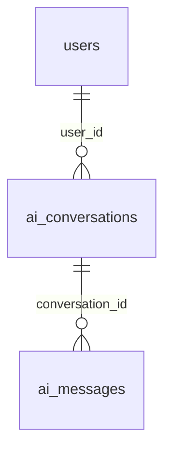

# AI 추천 개발 청사진·진행 현황

기준일: 2026-11-06. 현재 작업 브랜치는 `feat/run-ai-recommendation`이다. 3단계 엔진을 포함한 상태에서 **4단계 백엔드 추천 실행·요청/결과 저장·조회**를 구현했다. 프론트 연결과 5~7단계는 시작하지 않는다. 아래 과거 기록은 당시 상태이며 현재 완료 범위·미완료·최종 검증은 이 절을 우선한다. 다른 도메인·팀원 기록은 보존한다.

## 2026-11-09 PR #93 최신 develop 충돌 해결

- 사용자 요청으로 `feat/56-project-bookmarks`에 최신 develop a04608f를 병합했다. `ApiProjectDetail.tsx`는 지원자 관리와 좋아요/공유/북마크 import를 모두 유지했고, 청사진은 #48 및 공통 좋아요 설명을 함께 보존했다. 공통 테이블명은 likes를 유지하며 이름 변경 취소 상태를 보존한다.
- AI 테스트 입력 2곳을 문자열 모집 직군 생성자에 맞췄다. 공통 likes를 함께 사용하는 `LikedPostsIntegrationTest`는 필수 updated_at과 유효 프로젝트 FK를 갖춘 데이터로 보완했다. 업무 코드·공유 DB 스키마는 변경하지 않았다.
- 최종 backend 전체: 642개 중 630개 통과·12개 스킵·실패 0. 게시글 좋아요 통합 14개 및 프로젝트 북마크/좋아요 통합 8개 통과. 첫 실행의 updated_at 누락 오류를 수정했으며 기존 카카오 로그 검증도 최종 재실행에서 통과했다.
- frontend 전체 804개 테스트, 빌드·TypeScript 통과. git diff --check 및 unmerged 파일 없음 확인. develop 대비 YAML 추가 변경 없음. 실제 팀 DB·서버·브라우저는 이번 통합에서 변경/재검증하지 않았다.
- 검증된 병합 내용을 기존 #93 브랜치에 커밋·푸시하고 PR 본문을 현재 결과와 의존성에 맞춰 갱신한다.

## 2026-11-09 PR #86 최신 develop 충돌 해결

- 사용자 요청으로 기존 `feat/50-project-reviews` 작업 폴더에 최신 `origin/develop` a04608f를 `--no-commit`으로 병합했다. GitHub의 f47ca029 기준 15개 충돌과 달리 로컬 다중 기준 병합에서는 진행 문서 한 파일의 3구간만 충돌했다. 양쪽 기록을 모두 보존하고 자동 병합된 지원·리뷰·키워드·BFF 코드를 확인했다.
- 통합 과정에서 AI 테스트 2곳이 과거 enum을 문자열 모집 직군 생성자에 전달해 컴파일 실패했다. `AiRecommendationExecutionTests`·`AiRecommendationDatabaseTest`의 테스트 입력만 BACKEND.name()으로 맞췄으며 AI/리뷰 업무 코드는 수정하지 않았다.
- backend `./backend/gradlew -p backend test --no-daemon --max-workers=1 -Dorg.gradle.jvmargs=-Xmx384m`: 644개 중 631개 통과·12개 스킵·기존 `KakaoClientTest.java:153` 로그 검증 1개 실패. 프로젝트 114개 중 103개 통과·11개 스킵·실패 없음, 리뷰 통합 10개 통과.
- frontend `npm test -- --maxWorkers=1`: 72개 파일 795개 통과. `npm run build -- --webpack`: 빌드·TypeScript 성공. 충돌 표시와 unmerged 파일 없음, git diff --check 통과. develop 대비 YAML 추가 변경 없음.
- 실제 팀 DB·실행 서버·브라우저는 변경/재검증하지 않았다. 기존 리뷰 30일·키워드 0~5개·토큰·재알림 정책과 미연동 사항을 유지한다. 현재는 로컬 충돌 해결만 완료했으며 병합 커밋·푸시·GitHub PR 수정은 하지 않았다. 따라서 원격 #86의 충돌 표시는 아직 남을 수 있다.

## 현재 AI 상태·검증 (2026-11-06)

- 완료: 1단계 대화·USER 메시지·실사용자 인증/소유권, 2단계 조건 전체 교체·검증, 3단계 실제 DB 후보 기반 내부 추천 엔진을 유지했다. 4단계 POST/GET `/api/v1/ai/conversations/{id}/recommendations`, 요청 조건 스냅샷, PENDING/SUCCESS/FAILED, 결과 점수·기본 이유·대상별 순위 저장, 최신/특정 과거 요청 조회를 추가했다. GET은 재계산하지 않는다.
- 중복/무결성: 필수 Idempotency-Key를 대화별 UNIQUE로 보존하고 같은 키·같은 입력은 재실행하지 않는다. 조건 스냅샷·메시지 ID를 직접 비교하므로 input_hash는 없다. 같은 대화 USER 메시지만 연결하며 버튼 실행은 NULL이다. 결과 대상 FK는 정확히 하나, detailed_reason은 NULL, analysis_level은 6단계로 보류한다. 서비스 삭제는 결과 → 요청 → 메시지 → 대화 한 트랜잭션이다. 사용량은 변경하지 않는다.
- 변경 파일: 신규 `controller/AiRecommendationController.java`, `service/AiRecommendationExecutionService.java`·`service/impl/AiRecommendationExecutionServiceImpl.java`, `entity/AiRecommendationRequest.java`·`AiRecommendation.java`, 각각의 Repository, `dto/ai/CreateRecommendationRequest.java`·`RecommendationResponse.java`, `utils/StrictLongDeserializer.java`. 기존 `AiMessageRepository.java`·`AiConversationDeletionRepository.java`, AI 대화 테스트/fixture를 갱신했다. 통합 테스트 `ai/controller/AiRecommendationExecutionTests.java`, 생성 SQL `docs/sql/ai-recommendations.sql`, AI 정책·API 문서를 추가/갱신했다. Java 경로는 `backend/src/main/java/com/devmozip/backend`, 테스트는 `backend/src/test/java/com/devmozip/backend` 기준이다.
- 최종 코드 검증(7fcd747): backend `DEBUG=false ./gradlew test --no-daemon` 성공(총 384개, 367개 통과·17개 스킵·실패/오류 0). 스킵은 기존 Docker 필요 16개와 PostgreSQL 전용 1개다. 격리 PostgreSQL 18.6에서 생성 SQL을 직접 적용한 `AiRecommendationExecutionTests` 13개 전부 통과(실제 엔진 저장·조회, FK/점수/순위 제약, 동시 중복 실행, 실패·삭제 롤백 포함). frontend `npm run build` 성공(50개 페이지). 프론트 추적 파일 변경 없음. `git diff --check`·문서 상대 파일 링크·기존 기록 보존 확인. 커밋 전 fetch한 origin/develop `67bff78` 전체 포함·변경 전체를 포함한 가상 병합 충돌 없음. 프론트 단위/브라우저 테스트와 팀 PostgreSQL 17 적용 검증은 미실행.
- API 문서: `docs/ai-api-spec.md`에 구현된 HTTP API 8개 목록, 1~4단계 순서, 2·4단계 요청/응답/오류 표, 3단계 내부 입출력, 4단계 응답 JSON 예시·최신/과거 조회·실패 응답 구분을 정리했다. API 계약·기능 코드는 변경하지 않았다.
- 최종 문서 검증: frontend `npm run build` 재실행 성공(50개 페이지). API 문서 JSON 예시 파싱·상대 파일 링크·`git diff --check` 통과. 문서만 변경하여 백엔드/프론트 기능 테스트는 재실행하지 않았다. 이전 코드 검증 수치는 위 7fcd747 실행 결과이며 이번 실행으로 표시하지 않는다.
- 팀 DB 스키마: 사용자 요청으로 개발 PostgreSQL 17.11의 devmozip/public에 `docs/sql/ai-recommendations.sql`을 적용해 ai_recommendation_requests·ai_recommendations를 생성했다. 적용 후 17개 컬럼·FK/CHECK/UNIQUE·인덱스를 읽기 전용으로 확인했다. 같은 DB에 읽기 전용 JDBC 연결·ddl-auto=validate·SQL 초기화 never로 임시 백엔드를 기동해 JPA 초기화와 헬스 200 UP을 확인하고 종료했다. 기존 테이블·데이터는 변경하지 않았다. frontend `npm run build` 재실행 성공(50개 페이지), 문서 링크·JSON 예시·`git diff --check` 통과. 백엔드 제품 코드 미변경으로 Gradle 테스트는 재실행하지 않았다. 당시 Docker 데몬 연결 불가로 기존 컨테이너 재시작은 하지 않았다. 추천 쓰기 API의 현재 검증 범위는 아래 데모 검증을 따른다.
- 데모 데이터·최종 검증: `docs/sql/ai-recommendations-demo.sql`을 추가했다. 개발 PostgreSQL 17.11의 기존 `member@devmozip.demo`에 전용 대화 1개(id=1)·USER 메시지 1개(id=1)·SUCCESS 요청 2건(id=1,2)·추천 결과 28건을 저장했다. 실제 엔진이 각 요청에서 개발자 6명·프로젝트 8건을 계산했으며 조건 버튼(NULL 메시지)과 메시지 연결 실행의 스냅샷을 보존한다. 실제 POST 성공·최신/과거 GET·같은 키 재전송 200·SQL 삽입 경로의 롤백 검증·SQL 정상 재실행 중복 없음·대상/점수 무결성 및 detailed_reason NULL을 확인했다. frontend `npm run build` 성공. 제품 코드·기존 회원/프로젝트는 변경하지 않아 Gradle 테스트는 재실행하지 않았다. 이 검증은 임시 백엔드·테스트용 JWT를 사용했으며 실제 로그인·Redis·프론트 연결 검증은 아니다.
- WSL 실행·조회 도구: `scripts/dev-postgres.py`에 Compose로 해석한 루트 .env → 직접 bootRun 환경 전달, default/validate/초기화 never·호스트 Redis 연결, 읽기 전용 PostgreSQL check/db 명령을 추가했다. `docs/postman/devmozip-ai.postman_collection.json`과 `docs/postgresql-development.md`에 실제 로그인·데모 결과 조회를 정리했다. 개인 Git 제외 compose.override.yaml에 127.0.0.1 Redis 포트를 추가했다. 공통 Java 인증·DB·배포 설정과 회원 비밀번호는 변경하지 않았다.
- WSL/Compose 최종 검증(2026-11-07): Linux Docker CLI와 Windows Docker Desktop이 같은 정지 컨테이너를 조회하는 것을 확인했다. 개발 compose.yaml+개인 override로 생성된 postgres-1은 로컬 서비스이며 백엔드는 .env의 cloud.newlecture.com:5442/devmozip(PostgreSQL17.11)을 사용한다. Redis를 healthy까지 시작한 후 `docker compose up -d --no-deps backend frontend`로 개발 앱만 복구했고 로컬 postgres는 Exited 상태로 유지했다. 백엔드/프론트 헬스200·실제 데모 로그인200·최신 요청2/과거 요청1 조회200(각 개발자6·프로젝트8), DB 요청2·결과28 보존을 확인했다. 개발 실행 안내를 서비스 지정 방식과 ps -a 설명으로 보완했다. frontend npm run build·git diff --check·문서 링크/기존 기록 보존 확인 성공. 제품 Java 미변경으로 Gradle test는 재실행하지 않았다. 기존 컨테이너·볼륨·데이터는 삭제하지 않았다.
- 미완료: 팀 PostgreSQL 17의 전체 공개 계약·실제 다중 사용자/실패·삭제 통합 검증, 포트폴리오 연동, AI BFF/로컬 초안 동기화·프론트 버튼 연결, 5~7단계. 프로세스 강제 종료·DB 장애로 남는 PENDING의 자동 복구/만료는 없다. FK NO ACTION으로 참조 대상 물리 삭제를 차단하므로 탈퇴·다른 도메인의 삭제 계약은 후속 조율 대상이다. 앱/DB 기준 시간대는 기존과 같이 미확정이다.

## 2026-11-09 북마크·좋아요 PR 준비

- 사용자 요청으로 `feat/56-project-bookmarks`의 현재 변경을 커밋·푸시하고 develop 대상 PR을 준비한다. 이 브랜치는 미병합 PR #81을 기반으로 하므로 선행 의존성을 PR에 명시한다. YAML·실제 환경 설정은 이번 변경에 포함하지 않는다.
- 푸시 대상 작업 폴더에서 `npm run build -- --webpack` 및 TypeScript 성공, 프론트 전체 테스트 70개 파일 736개 통과. `./backend/gradlew -p backend test --tests '*ProjectBookmarkIntegrationTest' --tests '*ProjectLikeIntegrationTest' --no-daemon --max-workers=1 -Dorg.gradle.jvmargs=-Xmx384m`으로 PostgreSQL/JWT 통합 테스트 8개 통과. 실행 폴더에서 기록했던 프로필 테스트 실패와 구분한 결과다. 이전 1440px Mock/API 화면 캡처와 측정 결과를 `docs/artifacts/project-bookmarks`에 첨부한다.
- 실계정 로그인 401로 팀 DB 인증 후 저장·취소는 미검증이며 개발 서버의 테스트 브라우저 초기화 대기도 기존 기록대로 남긴다. 백엔드 전체 테스트의 기존 카카오 로그 검증 실패를 이번 PR에서 수정하지 않는다.

## 2026-11-09 프로젝트 카드·상세 액션 배치 정리

- 기능 변경 없이 카드 북마크를 제목 옆에서 커버 오른쪽 위(상단·우측 12px)로 이동했다. 제목은 20px/750 굵기, 한 줄 소개는 14px로 구분했다. 상세는 제목과 소개를 왼쪽, 좋아요·공유·북마크를 같은 헤더 오른쪽 끝으로 배치했다. Mock·API에 동일하게 반영했다.
- 변경 파일: `RecruitmentCard.tsx/module.css`, `ProjectSummaryCard.tsx/module.css`, `app/projects/[projectId]/page.tsx/module.css`, `ProjectActions.module.css`, `ApiProjectDetail.tsx`. 실행 폴더와 북마크 작업 브랜치에 함께 반영했다. 백엔드·DB 스키마·API 코드는 수정하지 않았다.
- `npm run build -- --webpack` 및 TypeScript 성공. 프로젝트 화면·Mock 동작·북마크/좋아요 공통 상태 관련 테스트 4개 파일 40개 통과. 기능이 바뀌지 않아 백엔드 테스트는 재실행하지 않았다.
- 실제 Chrome 1440×1100에서 빌드 프리뷰(임시 3101)로 Mock/API 목록과 상세를 확인했다. 두 모드 모두 제목20px/소개14px, 북마크 커버 내부 우측·상단12px, 상세 그룹 우측 여백0px·컨트롤3개·가로 넘침 없음을 측정하고 캡처를 확인했다. 개발 서버(3000)는 테스트 브라우저에서 초기화 대기가 지속돼 프론트만 재시작했으며, 해당 개발 서버의 시각 검증 성공으로 보고하지 않는다.
- 임시 프리뷰와 검증 브라우저는 검증 후 종료한다. 커밋·푸시는 하지 않았다.

## 2026-11-09 프로젝트 좋아요·공유·북마크 아이콘

- 상세 화면의 좋아요·공유·북마크를 아이콘 그룹으로 묶고 북마크 크기를 확대했다. Mock 좋아요는 기존 모집 상태에 계정별로 보존하며, Mock 끄기는 실제 좋아요 API·공통 상태를 사용한다. 사용자 승인대로 bookmarks와 같은 `likes` 공통 테이블을 팀 DB에 생성하고 컬럼·FK·중복·대상 CHECK를 확인했다. 변경 파일·API는 [프로젝트 아이콘 액션](project-icon-actions.md)을 참조한다.
- 실행 폴더에서 `npm run build -- --webpack` 및 TypeScript 검사 성공. 프론트 전체 테스트 682개 중 681개 통과·1개 실패. 실패는 기존 `ProfilePage.test.tsx`의 리뷰 버블 개수 기대 4/실제 14 불일치다. 첫 실행의 CSS 코로케이션 실패는 공통 ProjectIconActions 컴포넌트로 정리해 재실행에서 해결했다.
- 임시 Gradle 설정으로 기존 테스트의 직군 타입 컴파일 오류와 실행 서버 잠금을 분리하고 좋아요·북마크 PostgreSQL/JWT 통합 테스트 8개를 실행해 모두 통과했다. 실행 서버 프로젝트 페이지 200, 프론트/백 좋아요 목록 비로그인 401을 확인했다. 계정 로그인 401로 팀 DB 인증 후 좋아요 저장·취소는 검증하지 못했다. 브라우저 시각 검증·커밋·푸시는 하지 않았다.

## 2026-11-09 실행 화면의 프로젝트 북마크 누락 수정

- Docker 실행 소스는 이 브랜치가 아닌 `.worktrees/project-api`여서 화면에 북마크가 없었다. 실행 폴더에 북마크 변경만 반영하고 백엔드를 재시작했다. 기존 지원·리뷰 및 YAML은 유지한다.
- 해당 실행 소스에서 프론트 빌드·TypeScript와 관련 테스트 26개, 분리 실행한 북마크 통합 테스트 4개 통과. 기존 프로젝트 테스트 직군 타입 컴파일 오류 6건 및 실제 로그인 401은 남아 있다. 상세는 [프로젝트 북마크](project-bookmarks.md)를 참조한다. 커밋·푸시는 하지 않았다.

## 2026-11-09 프로젝트 북마크 #56

- `feat/56-project-bookmarks`의 별도 worktree에서 작업했다. 기존 Mock 화면과 실제 API 전환을 유지하며 공통 `bookmarks` 엔티티·저장소·서비스·컨트롤러·응답 record, BFF와 공통 화면 상태를 추가했다. 상세·탐색·내 북마크함에 저장·해제를 연결했다. 변경 파일은 [프로젝트 북마크](project-bookmarks.md)를 참조한다.
- 사용자 승인으로 `docs/sql/project-bookmarks.sql`을 팀 PostgreSQL에 실행했다. 컬럼 6개, 사용자/프로젝트 FK, 두 중복 제약과 대상 CHECK를 확인했다. 회원·프로젝트 데이터를 변경하거나 별도 프로젝트 북마크 테이블을 만들지 않았다.
- `frontend`: `npm test -- --maxWorkers=1` 68개 파일·728개 통과. `npm run build -- --webpack` 성공(TypeScript 포함). 제한 환경의 최초 빌드는 TypeScript --showConfig 파싱 오류로 실패해 일반 실행 환경에서 재검증했다.
- `backend`: `./backend/gradlew -p backend test --no-daemon --max-workers=1 -Dorg.gradle.jvmargs=-Xmx384m` 567개 중 555개 통과·11개 스킵·1개 실패. 북마크 PostgreSQL/JWT 통합 테스트 4개(동시 저장 포함)는 통과했다. 실패는 기존 `KakaoClientTest.java:153` 로그 검증이며 이번 변경에서 수정하지 않았다.
- 임시 18081 서버를 DDL 자동 변경 없이 팀 DB에 연결하고 프로젝트 목록 HTTP 200을 확인했다. 실제 데모 로그인은 401이므로 팀 DB의 인증 후 저장·해제는 검증하지 못했다. 계정·비밀번호는 수정하지 않았고 임시 서버는 종료했다.
- 브라우저 시각 검증은 실행하지 않았다. 게시글 실제 북마크 API와 post_id FK는 공통 SNS 담당 범위다. 커밋·푸시·PR과 다음 이슈는 진행하지 않았다.

## 2026-11-08 PR #81 충돌 해결

- 사용자 요청으로 .worktrees/pr81-conflicts의 feat/project-api-integration-no-yaml에서 develop 058397e를 반영했다. 프로젝트 초기/후속 구현이 겹친 24개 충돌을 비교하고 직군 직접 입력·실제 DB 조회·생성 권한·Mock 디자인을 보존했다. 최신 인증/프로필 변경과 양쪽 문서 기록도 유지한다.
- backend 563개 중 551개 통과·11개 스킵·기존 카카오 로그 검증 1개 실패. 프로젝트 93개 중 82개 통과·11개 스킵·실패 없음. frontend 빌드/TypeScript·721개 테스트 통과. YAML은 develop 대비 차이 0개다.
- 실제 DB/브라우저/실행 서버와 기존 root 미커밋 작업·다른 PR은 변경하지 않았다. 검증 상세는 [프로젝트 API 통합](project-api-integration.md)을 참조한다. 기존 PR #81에 반영하며 develop/main에 직접 푸시하지 않는다.

## 2026-11-05 PR #63 충돌 해결

- develop `09a438b`를 #46 브랜치에 반영하고 조회/조회수와 수정/삭제를 모두 보존했다. 충돌 파일은 ProjectController, Project, ProjectMemberRepository, 이 문서 4개다.
- 삭제 공고의 HTTP 조회 비노출과 수정 후 조회수 보존 통합 테스트 2개를 추가했다. backend 238개, frontend 51개 파일·544개 및 빌드 통과. Docker 생성물 소유권 복구 후 백엔드 재실행 결과이며 [상세 기록](project-update-delete.md)을 참조한다.

## 2026-11-05 프로젝트 #46 공고 수정·삭제

- 최신 develop `650de14`에서 프로젝트 전체 PUT 수정·모집 중 논리 삭제를 구현했다. 기존 프로젝트 구조·BaseEntity·개발 사용자 경계를 재사용하고 기간 공통 검증을 분리했다. AI·인증·배포·프론트 코드는 변경하지 않았다.
- backend 신규 PostgreSQL 통합 테스트 23개 및 전체 222개 통과(스킵 0). frontend 48개 파일·525개 테스트와 빌드 성공. 상세 변경 파일·계약·최초 컴파일 실패 수정과 재실행 결과는 [프로젝트 수정·삭제](project-update-delete.md)를 참조한다.
- #48 실제 지원자 직군 제한 연결, #47 기간/상태 API 연결, #45 병합 후 HTTP 비노출 검증 및 프론트 수정 페이지·API 연결은 후속 범위다. 실제 팀 DB에 접속하거나 커밋·푸시하지 않았다.

## 2026-11-06 #50 PR 준비 및 develop 통합

- 사용자 요청으로 feat/50-project-reviews의 리뷰/키워드 구현을 e879f41로 커밋했다. 최신 develop 0719b2f 프로필 변경을 통합하고 문서 충돌은 양쪽 기록을 보존했다. 선행 PR #81/#85는 미병합 상태다.
- 통합 후 frontend 빌드/TypeScript와 704개 테스트 통과. backend 466개 중 454개 통과·11개 스킵·기존 카카오 로그 검증 1개 실패. 프로젝트 110개 중 99개 통과·11개 스킵·실패 없음. 이번 PR 준비에서 실제 DB/브라우저 재검증·데이터 변경은 수행하지 않았다.

## 2026-11-06 리뷰 변경 잔재 정리

- DB 미연결 시 임시 ProjectReviewKeywords/ProjectReviewConfiguration을 제거하고 실제 Repository만 사용한다. 활성 키워드 중복 조회/검증·미사용 import·지원 목록의 오래된 501 안내를 정리했다. API·권한·트랜잭션·디자인·기존 DB는 유지한다.
- 리뷰 문서를 최신 연결 구조 중심으로 정리하고 과거 JSONB 보존 안내를 제거했다. 다른 DB에 필요한 이관 SQL 및 Mock 기능은 보존한다.
- 이번 backend ./gradlew test는 449개 중 438개 통과·11개 스킵·실패 0개다. 이전에 실패하던 카카오 테스트도 이번 실행에서는 통과했으며 카카오 코드를 변경하지 않았다. 프론트 빌드/674개 테스트 통과. 실제 DB를 사용하는 1440px 조회/권한 확인에 오류 없음. 변경 파일은 [리뷰 기록](project-reviews.md)에 기록했다. 커밋·푸시는 하지 않았다.

## 2026-11-06 리뷰 테이블 중복 키워드 컬럼 제거

- 최신 사용자 요청으로 reviews.selected_keywords를 실제 DB와 엔티티에서 제거했다. 선택 관계와 기존 리뷰 조회/집계는 review_keyword_selections 및 review_keywords 조인만 사용한다.
- 기존 9개 리뷰의 12개 연결과 원본 배열 일치를 검증한 뒤 컬럼을 삭제했다. 신규 생성/샘플/기존 DB 이관 SQL과 청사진을 함께 정리했다. 원본 키워드명 변경은 기존 리뷰 표시에도 반영한다. 리뷰 통합 10개·frontend 빌드/674개 테스트 통과. backend 전체 449개 중 기존 카카오 로그 검증 1개 실패·11개 스킵. 실제 DB 리뷰 조회/권한 확인 완료. 상세 검증 결과는 [리뷰 기록](project-reviews.md)에 기록했다. 커밋·푸시는 하지 않았다.

## 2026-11-06 리뷰 키워드 연결 테이블·최대 5개

- 사용자 요청으로 review_keyword_selections 연결 테이블을 생성하고 FK/UNIQUE로 선택 관계를 관리한다. 리뷰마다 등록된 활성 긍정 키워드 0~5개만 허용하고 자유 입력은 제공하지 않는다. 기본 4개에 10개를 추가해 총 14개다.
- 기존 리뷰 9건·선택값 12개를 내용 변경 없이 이관했다. 실제 PostgreSQL 리뷰 통합 테스트 9개 통과. backend 448개 중 기존 카카오 로그 검증 1개 실패·11개 스킵, 프로젝트 영역 실패 없음. 프론트 빌드·674개 테스트 통과. 실제 DB 14개 반환 및 1440px 응답 대역 UI에서 5개 선택/6번째 차단/해제 확인. 변경 파일·검증 한계는 [리뷰 기록](project-reviews.md)에 기록했다. 커밋·푸시는 하지 않았다.

## 2026-11-06 리뷰 키워드 DB 원본 연결

- 사용자 요청으로 ERD의 review_keywords 테이블을 팀 DB에 생성했다. 기본 키워드 4개를 넣고 기존 리뷰 9건을 보존했다. 활성 DB 목록을 조회·제출 검증에 연결하며 기존 이름 JSONB 저장과 Mock 디자인을 유지한다.
- [청사진](project-backend-blueprint.md), [DDL](sql/review-keywords.sql), [리뷰 기록](project-reviews.md)을 갱신했다. 실제 Repository 기반 리뷰 통합 테스트 8개 통과. 이번 전체 backend 447개 중 435개 통과·11개 스킵·기존 카카오 로그 검증 1개 실패. frontend 빌드·672개 테스트 통과, 실제 API의 DB 키워드 4개 반환 확인. 상세 결과는 리뷰 기록에 기재한다. 커밋·푸시는 수행하지 않았다.

## 2026-11-06 프로젝트 #50 종료 후 리뷰

- 사용자 요청으로 #49 투표를 보류하고 #50을 구현했다. 기존 리뷰 Mock 디자인을 재사용하고 종료 시 요청 생성·30일 기한·전체 제출·링크 재발급·3일 재알림을 연결했다.
- frontend 빌드와 672개 테스트 통과, 신규 리뷰 통합 7개 통과. backend 전체 446개 중 기존 카카오 로그 검증 1개 실패, 11개 스킵. 프로젝트 107개 중 96개 통과·11개 스킵. 1440px 실제 DB 리뷰 조회/권한 확인 완료.
- 당시 키워드 원본 미연결은 후속 요청으로 해소했다. 알림 발송·프로필 신뢰 계산 연결은 남았다. 변경 파일·계약·검증 한계는 [프로젝트 리뷰](project-reviews.md)를 참조한다. 커밋·푸시·다음 단계는 진행하지 않았다.

## 2026-11-06 프로젝트 #48 지원·승인·팀원 관리

- 기존 프로젝트 구조와 Mock 디자인을 재사용하여 지원/승인/거절/취소·팀원 목록·지원 중 목록을 연결했다. 실제 포트폴리오 테이블이 없어 신규 지원은 안전하게 차단하며 실제 어댑터 연결이 남았다.
- 신규 PostgreSQL 통합 테스트 7개, 프론트 668개 및 빌드 통과. 백엔드 전체 439개 중 기존 KakaoClientTest 로그 검증 1개 실패, 11개 스킵. 알림·채팅·신뢰 계산기는 이벤트 경계만 제공한다.
- 변경 파일·정책·검증 및 미완료 내용은 [프로젝트 지원·승인](project-applications.md)을 참조한다. 커밋·푸시·다음 이슈는 진행하지 않았다.

## 2026-11-05 PR #63 충돌 해결

- develop `09a438b`를 #46 브랜치에 반영하고 조회/조회수와 수정/삭제를 모두 보존했다. 충돌 파일은 ProjectController, Project, ProjectMemberRepository, 이 문서 4개다.
- 삭제 공고의 HTTP 조회 비노출과 수정 후 조회수 보존 통합 테스트 2개를 추가했다. backend 238개, frontend 51개 파일·544개 및 빌드 통과. Docker 생성물 소유권 복구 후 백엔드 재실행 결과이며 [상세 기록](project-update-delete.md)을 참조한다.

## 2026-11-05 프로젝트 #46 공고 수정·삭제

- 최신 develop `650de14`에서 프로젝트 전체 PUT 수정·모집 중 논리 삭제를 구현했다. 기존 프로젝트 구조·BaseEntity·개발 사용자 경계를 재사용하고 기간 공통 검증을 분리했다. AI·인증·배포·프론트 코드는 변경하지 않았다.
- backend 신규 PostgreSQL 통합 테스트 23개 및 전체 222개 통과(스킵 0). frontend 48개 파일·525개 테스트와 빌드 성공. 상세 변경 파일·계약·최초 컴파일 실패 수정과 재실행 결과는 [프로젝트 수정·삭제](project-update-delete.md)를 참조한다.
- #48 실제 지원자 직군 제한 연결, #47 기간/상태 API 연결, #45 병합 후 HTTP 비노출 검증 및 프론트 수정 페이지·API 연결은 후속 범위다. 실제 팀 DB에 접속하거나 커밋·푸시하지 않았다.

## 2026-11-05 Mock 데이터만 비우도록 정정

- 사용자 정정: API 연결 화면만 남기는 동작을 제거하고 기존 페이지·필터·버튼·폼은 유지한다. OFF는 빈 작업 공간에서 시작하고 직접 작성한 데이터는 별도 키에 저장한다. ON의 원래 샘플·수정 데이터 및 서버 인증 세션은 보존한다.
- 상태 초기화·샘플 주입·모드별 저장을 도메인 서비스에 반영했다. AI/백엔드 API 추가는 없다. 변경 파일·검증 한계는 [Mock 전환](mock-visibility.md)에 기록했다.
- frontend 테스트 50개 파일·533개 및 빌드, Chromium 화면·빈 데이터·복원·1440/390px 검증 통과. 실제 로그인 후 모든 작성 흐름은 브라우저에서 검증하지 않았다.

## 2026-11-04 develop 기준 CI 실패 수정 (최신 검증)

최신 요청은 **PR 리뷰에 따른 AI enum·역직렬화 클래스 배치와 직군 요청 DTO 이름 정리**다. RequiredCareer는 entity/enums, StrictIntegerDeserializer·StrictStringDeserializer는 utils로 이동하며 RecruitmentRoleCondition은 RecruitmentRoleConditionDto로 바꾼다. API JSON·입력 제약·저장 동작은 유지한다. 회원 실제 경력과 요구 경력 비교 방식 및 미사용 Mock 계산 코드 위치는 설명만 하며 회원/프로젝트·프론트 코드는 변경하지 않는다.

### 현재 완료 상태·최근 커밋

| 항목 | 현재 상태 |
|---|---|
| 2단계 구현 | 서버 조건 PUT·DTO 검증·전체 교체·직접 입력·본인 조건 비공개 완료. 구현 커밋 `0f7dc87`은 origin/feat/ai-conditions에 푸시 완료 |
| 필수/선택 | interests 통합 12개 선택지 중 1개 이상·경력·기간 필수. 기술·직군 선택, 직군 자유 입력 허용. 최대 직군 12개·이름 30자·인원 1~20명. 공통 Enum은 변경하지 않음 |
| 최근 별도 변경 | `fcd0b4c`: 프론트 Mock 무료 한도 15→5. 2단계 구현과 별도 커밋·푸시 완료 |
| 이전 구현 검증 | 백엔드 35개 중 34개 통과·Docker 필요 1개 스킵, 프론트 관련 26개 통과·빌드 성공. 당시 15회 기대값 불일치는 이번에 5회로 정리했다. 이번 검증 결과는 마지막 절 참조 |
| 이전 통합 검증 | 백엔드 213개 중 197개 통과·Docker 필요 16개 스킵·실패/오류 0(AI 27개 모두 통과), 프론트 49개 파일·536개 통과, 최종 빌드 성공. 실제 PostgreSQL·브라우저 검증은 미실행 |
| 남은 작업 | 팀 PostgreSQL 17 DDL/데이터 대조, 프론트 UI/BFF 연결·초안 동기화, 4~7단계 미구현 |

아래 날짜별 ‘미커밋·푸시 없음’과 이전 정책은 당시 작업 기록이다. 현재 상태는 이 요약과 마지막 기록을 우선하며 과거 실행 결과를 이번 검증 성공으로 사용하지 않는다.

## 1. 전체 기능과 단계

목표는 프로젝트 조건에 맞는 개발자와 유사 프로젝트를 실제 DB에서 찾아 함께 추천하는 것이다. 점수·순위는 백엔드가 계산한다. Gemini는 후속 단계에서 자연어 조건 분석과 상세 이유 생성을 담당한다.

| 단계 | 주요 기능 | 완료 기준 개요 | 현재 상태 |
|---|---|---|---|
| 1. 대화 CRUD·메시지 | 서버 대화 생성/목록/상세/삭제, USER 메시지 저장. 로그인 필수 로컬 초안 | 비로그인 저장 차단, 로그인 계정 로컬 보존 및 서버 인증·소유권 보호 | **로컬·실사용자 인증 연결 완료**. 로그인 필수 전환 자동 테스트·빌드 통과. 실제 PostgreSQL 통합 검증 대기 |
| 2. 조건 관리 | 통합 관심 분야·기술·직군별 인원·경력·기간 DTO, 조건 전체 교체 PUT, 검증 | 화면 입력과 서버 저장 검증 일치 | **기존 서버 PUT 구현·푸시 완료, 이번 입력 계약 보완 완료**. interests·경력·기간 필수, 직군 선택/직접 입력 허용. 프론트 로컬 조건 정합성 보완. 실제 PostgreSQL·AI BFF/서버 연결은 미완료 |
| 3. 추천 엔진 | 실제 DB 후보 조회·필터링, 개발자/프로젝트 적합도·순위·기본 이유 계산 | 동일 입력·데이터로 일관된 0~100점·순위 산출 | **내부 엔진 구현 완료**. H2·격리 PostgreSQL 18 검증, 팀 DB 17 대조 미완료 |
| 4. 추천 실행·결과 저장 | 로그인·소유권 확인, 추천 요청/결과 저장·조회, 성공/실패 상태, 과거 결과 조회 | 생성한 결과를 재계산 없이 다시 조회 | **백엔드 구현 완료**, 팀 DB 적용·프론트 연결 미완료 |
| 5. Gemini 조건 분석 | 자연어 조건 추출·변경·병합, 추가 질문, 응답 저장, 장애 처리 | 검증된 조건 JSON을 선택 UI와 동기화 | 미구현·외부 AI 연결 별도 요청 필요 |
| 6. 프리미엄 상세 분석 | 서버 권한·포트폴리오 열람권 확인, 실제 경험 기반 상세 이유 저장·재사용 | 무료 노출 차단, 프리미엄에 허용된 분석 제공 | 미구현 |
| 7. 사용량·동시성 | 무료 월 5회/프리미엄 월 100회, 한국 시간 월 경계, 성공 시 차감, 중복·동시 요청 제어 | 동시 요청에도 초과 사용·중복 차감 없음 | 미구현 |

2단계는 초기 빈 조건과 PUT 전체 교체를 유지하고 최신 사용자 확정으로 분야를 interests에 통합했다. 현재 입력 계약과 후속 후보 데이터 비교 규칙은 API 명세에서 구분한다. 3단계의 종전 예시 배점은 2026-11-06 정책으로 대체한다. 직군 30/기술 30/경험 20/신뢰 온도 10이며 협업 배점·후기는 제거한다. 포트폴리오 연동 전 경험은 미산정으로 표시하고 평가 가능한 배점으로 100점 환산한다. 기본 추천에서 상세 포트폴리오는 사용하지 않는다.

4단계부터 중복 요청을 구분할 수 있게 설계하고, 사용량 제한과 동시성 처리는 7단계에서 완성한다. 5단계의 직접 선택 조건 우선 원칙, 6단계의 상세 분석 미차감, 7단계의 성공한 신규 추천만 차감하는 정책은 [기능 정책](ai-matching.md)에 모았다. 후속 단계 DTO·DDL·오류 코드·구현 방식은 지금 임의로 확정하지 않는다.

정책 갱신 근거는 2026-11-04 사용자 요청·첨부와 2026-11-05 로그인 필수 전환 요청이다. 로그인 사용자도 추천 전까지 로컬 처리하고 비로그인은 저장하지 않는 흐름, 한국 시간 월 경계, 직접 선택 조건 우선, 4단계부터 중복 요청 식별 방향을 반영했다. 대화 type/status 미사용은 유지한다. 삭제 범위는 사용자 최신 요청에 따라 본인 대화와 그 메시지로 한정한다.

## 2. 1단계: 확인한 완료 기능

### 서버 API

| 구현 완료 | 동작 |
|---|---|
| POST `/api/v1/ai/conversations` | 선택 제목(null 허용, 최대 255자), 서버에서 사용자·생성/수정 시각 지정, 201 + Location |
| GET `/api/v1/ai/conversations` | 내 대화만 `createdAt DESC, id DESC` |
| GET `/api/v1/ai/conversations/{id}` | 내 대화·저장 조건·메시지 조회, 메시지 `createdAt ASC, id ASC` |
| DELETE `/api/v1/ai/conversations/{id}` | 소유권 확인, 연관 데이터와 대화를 한 트랜잭션에서 물리 삭제, 204 |
| POST `/api/v1/ai/conversations/{id}/messages` | 공백이 아닌 `content`를 USER로 저장, 대화 연결·수정 시각 갱신, 201 |

- 타인·미존재 대화는 동일한 404, 잘못된 ID·입력은 400, 익명 서버 접근은 401이다. DB/FK 오류는 현재 공통 처리에 따라 500이며 삭제 전체를 롤백한다.
- 삭제 순서는 해당 대화의 메시지 → 본인 대화다. 추천 요청·결과·사용량 테이블은 참조하거나 삭제하지 않는다. 추천 기능 도입 후 FK·삭제 정책은 별도 확정한다.
- 메시지 역할은 USER/ASSISTANT지만 저장 API는 USER만 만든다. 이미 저장된 ASSISTANT는 조회 가능하다. **Gemini 호출·임시 AI 답변 자동 생성은 없다.**
- `current_conditions`는 2단계 PUT으로 전체 교체할 수 있다. 신규 `{}` 저장·기존 NULL 조회 정규화를 적용하며 메시지 입력으로 변경하지 않는다.
- 대화 `type/status`는 현재 엔티티에 없다. 첨부의 “기존 ERD 기준” 문구로 다시 추가하지 않는다. 앞서 확정한 한 대화 내 두 종류 추천·MVP 종료/보관 미제공 정책을 유지한다.

### 프론트·인증의 실제 상태

| 확인 위치 | 현재 코드 | 판단 |
|---|---|---|
| `frontend/app/ai/matching/page.tsx`, `lib/auth/paths.ts` | `/ai/matching`은 보호 경로, 비로그인 입력 UI 숨김 | 메인부터 로그인 필수 |
| `frontend/lib/state/homeStore.ts`, `lib/matching/homeService.ts` | 로그인 계정별 로컬 대화, 메시지·조건 저장, `devmozip:home:v1` localStorage | 기존 저장 구조 재사용, 전송 전 draft 필드 추가·이전 데이터 호환 |
| `frontend/lib/matching/matchingChatService.ts` | USER 메시지만 추가, 선택 조건은 유지, 자연어 추출·ASSISTANT·추천·차감 없음 | 로컬 입력 흐름 보완 완료 |
| `frontend/lib/state/homeStore.ts` | guest 인계 제거. 일반 계정은 이메일별 키로 분리 | 기존 guest 기록은 숨기고 로그인 계정 기록은 보존 |
| 프론트 AI 흐름 | 로컬 대화·조건·입력문만 저장, 메인 비로그인 추천 시작은 로그인 이동, 로그인 대화 추천은 준비 중 안내 | 서버 동기화는 후속 계약으로 유보 |
| `backend/.../security/ai/` | 기본/local/운영은 인증 이메일 → 실제 users PK. dev/test + 명시적 옵션일 때만 고정 ID | 실사용자 어댑터 구현·H2 실제 로그인 JWT 소유권 검증 완료 |
| `backend/.../config/SecurityConfig.java`, `security/jwt/JwtAuthenticationFilter.java` | users 기반 이메일 로그인, JWT principal은 이메일 문자열 | 기존 인증을 보존하고 AI 어댑터에서 principal → `users.id` 연결 완료 |

`CurrentUserProvider`의 기본 구현은 `AuthenticatedCurrentUserProvider`다. 검증된 인증 이메일로 MemberRepository를 조회하고 익명·미인증·삭제 계정은 401, 정지 계정은 403으로 거절한다. 고정 ID는 명시적인 dev/test 개발 설정에만 남겼다. H2에서 실제 로그인 JWT로 A/B의 소유권 분리를 검증했지만 프론트 AI API 연결·실제 PostgreSQL 통합 완료를 뜻하지 않는다.

## 3. 1단계: 로컬 구현 범위와 남은 통합 요구사항

2026-11-05 사용자 요청으로 이전 비로그인 초안 정책을 대체한다. 서버 API 호출·추천 실행은 추가하지 않는다.

### 입력·보존·로그인 흐름

| 기능 | 비로그인 | 로그인 |
|---|---|---|
| 메인 입력 | 메모리에서만 작성, 저장·인계 없음 | 소유 계정이 일치하는 입력 복원 |
| 추천 시작·이전 대화 열기 | `/login?next=%2Fai%2Fmatching` 이동 | 대화 시작·기존 기록 열기 |
| 대화 URL·메시지·조건 | 진입 및 로컬 변경 차단 | 계정별 로컬 저장·복원 |
| 추천 실행 | 제공하지 않음 | 준비 중 안내, 자동 추천·차감 없음 |

- guest 초안 이어받기를 제거한다. 기존 guest 저장 데이터는 일괄 삭제하지 않지만 화면에 노출·인계하지 않는다.
- `inputOwner`가 없는 과거 공용 메인 입력은 복원하지 않는다. 로그인 계정의 대화·메시지·조건·과거 결과는 보존한다.
- 저장 실패 시 로그인 사용자의 입력·기존 대화를 유지하며 재시도할 수 있다. 일반 draft 저장 실패는 세션 보존·오류 안내를 유지한다.

### 서버 저장·인증 연결 경계

- 기존 서버 API 5개의 인증·소유권·정렬·삭제 계약을 보존했다. 로그인 직후 DB에 자동 저장하지 않는다. 첫 추천 실행 시 필요한 서버 전송은 4단계 후속 계약이며, 구체적인 저장/추천 트랜잭션·재시도·중복 방지 방식은 미확정이다.
- 실제 인증 정보의 이메일을 `users.id`로 연결하는 `CurrentUserProvider`를 AI 인증 패키지 안에서 구현했다. 기존 MemberRepository를 재사용하며 클라이언트 userId나 Mock 프로필 ID를 신뢰하지 않는다. 공통 인증·사용자 코드 변경은 없다.
- 현재 API로 대화 생성과 USER 메시지 개별 저장은 가능하지만, 초안 일괄 전송·멱등성·원래 작성 시각 보존 계약은 없다. 별도 API를 지금 확정하거나 만들어 두지 않는다.
- 조건 서버 저장은 2단계, 추천 전 최종 초안 동기화·추천 실행은 4단계와 연결된다. 1단계에서는 로컬 조건 보존과 후속 인계에 필요한 계약을 기록하고, 후속 기능을 구현한 것으로 표시하지 않는다.

### 1단계 완료 확인 항목

- [x] 서버 API 5개 및 실사용자 인증·소유권 연결 코드 확인.
- [x] 기존 로그인 계정 로컬 대화·조건·메시지·draft 저장 구조 보존.
- [x] 비로그인 UI 접근·로컬 변경 차단과 guest 인계 제거 코드 반영.
- [ ] 팀 PostgreSQL에서 CRUD·연관 삭제·FK 충돌 롤백 검증.

이전 H2·브라우저 실행 결과는 6절의 당시 기록이며 이번 실행 결과는 마지막 기록으로 구분한다.

## 4. 필요한 API·ERD·팀 정보

### 현재 파일로 확인한 환경

| 항목 | 확인 결과 |
|---|---|
| Java / Spring Boot / Gradle | Java 21 / Boot 4.1.2 / Gradle 9.8.2, Spring Data JPA |
| 기본 실행·배포 DB | `application.yaml`은 PostgreSQL, compose 이미지는 PostgreSQL 17 |
| 로컬 DB | H2 `runtimeOnly` 의존성 있음. `application-local.yml`은 메모리 H2, `bootRun`은 별도 환경변수가 없으면 local 프로필 |
| dev 프로필 | `application-dev.yaml`은 AI 고정 사용자 옵션만 설정. dev 활성화만으로 H2가 선택되지는 않음 |
| AI 테스트 | PostgreSQL 호환 모드 H2 + 격리 `backend/src/test/resources/ai/schema.sql` |
| 현재 엔티티 | `Member`(users), `AiConversation`, `AiMessage`, develop의 `Project`, `ProjectMember` 등. `ProjectRecruitmentSlot`은 JSONB 원소 record이며 별도 엔티티가 아님. 포트폴리오·AI 추천 요청/결과·사용량 엔티티는 없음. 공통 Enum 3개는 develop과 동일 |

기존 문서의 “H2는 testRuntimeOnly, local 설정 없음, 로그인은 InMemoryUserDetailsManager” 설명은 현재 코드와 달라 제거했다. 팀의 H2 사용 방침과 로컬 H2 설정은 확인되지만 실제 팀 DB의 스키마·기동 결과를 검증한 것은 아니다.

### ERD 대조 상태와 필요한 자료

과거 기록에 따르면 **2026-11-04 사용자 제공 ERD 이미지의 AI 테이블 5개를 판독하고 당시 엔티티·삭제 쿼리·참고 DDL·테스트 fixture와 대조했다.** 컬럼·타입 전사와 차이는 [API 명세의 ERD 판독 내용](ai-api-spec.md#제공-erd-판독-내용-2026-11-04)에 있다. 이번 통합에서는 원본 ERD 이미지를 직접 확보하지 못해 문서 전사와 코드만 대조했다. 전체 적용 DDL과 실제 DB 상태는 아직 미확인이다.

그림은 현재 엔티티의 관계 요약이다. 제공 ERD에는 추천 요청·추천 결과·사용량도 있으며 이들 엔티티/API는 아직 미구현이다. 대화 `current_conditions`와 요청 `conditions`는 JSONB, 점수는 DECIMAL(5,2), 사용 월은 추가 이미지 기준 CHAR(7)이다(이전 VARCHAR(7) 판독 정정). 대화 type/status와 메시지 updated_at은 ERD에도 없다.

`user_id`는 JPA 사용자 연관관계가 아닌 숫자 필드다. 실제 FK는 팀 DDL로 재확인해야 한다. 컬럼·요청/응답은 [API 명세](ai-api-spec.md), 이전 참고 DDL은 [PostgreSQL 검토용 SQL](sql/ai-conversations-proposal.sql)에 있다. 이 SQL과 H2 fixture는 승인된 팀 마이그레이션이 아니다. 오른쪽의 잘린 외부 테이블과 NULL·기본값·UNIQUE·CHECK·삭제 제약·Enum 값은 사진만으로 확정하지 않았다.

| 필요한 자료·계약 | 필요한 이유 | 필요 시점 |
|---|---|---|
| 실제 테이블/컬럼·FK·NULL·삭제 제약 DDL, 적용 DB·초기화 방식 | AI 영역 ERD는 확보·대조 완료. 실제 DB 적용 상태·제약 확인은 남음 | 1단계 마무리 전 |
| 추천 요청·결과 테이블의 실제 FK·삭제/보존 정책 | 1단계 삭제에서는 참조하지 않음. 추천 이력이 생기는 시점에 정책과 FK를 함께 확정 | 4단계 요청 시 |
| 실제 PostgreSQL 계정 A/B와 AI API BFF/프록시 전달 계약 | 실사용자 Provider·H2 A/B 검증은 완료. 실제 DB 검증과 BFF 계약은 남음 | PostgreSQL 전환/4단계 서버 연결 시 |
| 로그인 계정 초안 서버 저장 시점 계약 | 로그인 복귀 경로·계정 혼합 방지는 구현됨. 서버 전송 시점·재시도는 미확정 | 4단계 서버 연결 시 |
| 통합 관심 분야·기술·직군·경력·기간의 추천 데이터 매핑 | 2단계 저장 DTO·필수 여부는 구현됨. 임시 기준과 실제 후보 데이터 비교 규칙은 구분 | 3단계 요청 시 |
| 프로젝트·공개 프로필·기술·기본 경험·협업 상태·후기 데이터 계약 | 실제 후보 검색과 점수 설계. 없는 데이터는 먼저 보고 | 3단계 요청 시 |
| 추천 요청·결과·사용량 DDL, 포트폴리오 공개 범위, 구독 판정 원천 | 결과 FK·상세 분석 권한·사용량 연동 | 각 후속 단계 요청 시 |

이전 텍스트의 `conversation_id/message_id`는 추천 요청의 논리 관계 설명이다. 이번 ERD의 실제 표기는 현재 코드와 같은 `ai_conversation_id/ai_message_id`이므로 임의로 이름을 바꾸지 않는다. `recommended_user_id`/`recommended_project_id`는 둘 다 ERD에 있고 `recommendation_type`은 없다. 두 FK 중 정확히 하나만 사용한다는 요구의 DB 제약 적용 여부는 4단계에서 실제 DDL과 대조한다.

추가 API 표의 화면·10개 API 항목을 [기존 명세](ai-api-spec.md)에 대조·반영했다. 무료 한도는 최신 표에 따라 월 15회에서 **5회**로 갱신하고 프리미엄 100회는 유지한다. `detailed-analysi`는 마지막 s가 빠진 표기로 기록하고 기존 확정 `detailed-analysis`를 유지한다. 추가로 필요한 것은 로그인 계정 초안 저장 시점·재시도/중복 방지·BFF 인증 전달·후속 DTO 계약이며, 후속 단계 구현은 시작하지 않는다.

2026-11-05 최신 develop 통합 후 Member는 career String(길이 30), contactHours, jobCategories·skills·interests를 제공한다. 과거 브랜치의 Integer 경력·누락 필드 설명은 현재 코드 상태가 아니다. 실제 PostgreSQL 적용 DDL은 미검증이며 사용자·프로필 코드는 수정하지 않는다. 프로젝트 JSON과 AI 조건 간 변환·추천 데이터 계약은 후속 단계에서 확인한다.

## PostgreSQL 개발 DB 연결 (2026-11-05)

- 현재 브랜치 `refactor/db-h2-to-postgres`, 기준 develop `67bff78`. 앱은 로컬 Docker, DB는 팀 서버의 개발 PostgreSQL을 사용하는 방향으로 정리했다. 개인 .env의 잘못된 DB명을 수정하고 DB_HOST·DB_PORT를 설정했다. 비밀값·개인 설정은 Git 제외를 유지한다.
- 읽기 전용 psql 연결 성공: PostgreSQL 17.11, devmozip/public. AI 대화·메시지 테이블과 current_conditions JSONB, 메시지→대화 FK를 확인했다. 대화의 user_id→users FK는 없으며 현재 숫자 필드 매핑과 구분한다. 추천 요청/결과·사용량 테이블은 현재 DB에 없고 추가하지 않는다. 원본 ERD 이미지는 직접 대조하지 못했다.
- 로컬 backend는 Hibernate validate·SQL 초기화 never·실사용자 식별을 유지해 연결을 확인한다. 서버 DB의 스키마·데이터를 변경하는 검증은 하지 않으며 실제 AI 쓰기 API·삭제·Redis 인증 왕복은 별도 검증이다. 프론트 AI 대화는 여전히 로컬 초안이며 BFF 동기화·3~7단계는 미구현이다.
- 정리: 배포용 compose.prod.yaml의 이번 범위 밖 환경변수 삭제를 복원했다. 중복 SQL 점검 파일·임시 테스트·별도 설정 예제는 제거하고 실행 안내 `docs/postgresql-development.md`만 유지한다. 기존 로컬 DB 컨테이너·볼륨은 보존한다.
- 이번 검증: 로컬 backend 재생성 후 서버 JDBC URL·PostgreSQL 17.11·JPA 초기화/기동 성공과 `/actuator/health` UP을 확인했다. frontend에서 `npm run build` 성공(50개 페이지), 생성된 next-env.d.ts만 복원했다. 백엔드 제품 코드는 바꾸지 않아 Gradle 테스트는 이번에 재실행하지 않았다. 문서 링크·git diff --check를 확인했다. 과거 H2/격리 PostgreSQL 테스트를 서버 DB 검증으로 대체하지 않는다. 커밋·푸시·실제 배포는 하지 않는다.

## 5. 추가로 정해야 할 사항

### 1단계 마무리에 필요한 결정

| 미확정 사항 | 결정할 내용 |
|---|---|
| 초안의 보존 범위 | 기존 devmozip:home:v1과 계정별 대화 구조 유지. 이전 draft 없는 데이터 호환. 보존 기간·전체 저장 상한은 미확정 |
| 로그인 후 이어받기 | 로그인 후 새로 입력. guest 인계 제거, 기존 계정 대화 유지 |
| 서버 최초 저장 시점 | 로그인 후에도 추천 전까지 로컬 유지. 추천 실행 시 서버 동기화의 구체 계약은 4단계에서 결정 |
| 초안 전달 계약 | 기존 5개 API 조합/별도 계약 필요 여부, 중복·부분 실패·재시도·로컬 ID ↔ 서버 ID 연결, 원래 작성 시각·순서 보존 |
| 인증·BFF 담당 경계 | 실사용자 Provider는 AI 인증 패키지에서 구현 완료. AI API용 HttpOnly 쿠키 → Bearer 전달 방식은 후속 계약 |
| 실제 DB·시간 기준 | 팀 H2/배포 PostgreSQL의 적용 범위·DDL, LocalDateTime의 앱/DB 기준 시간대 |

### 추가 테이블 설계 정리 반영

2026-11-04 사용자 정리를 [API 명세의 5개 테이블 설계 정책·권장 제약](ai-api-spec.md#5개-테이블-설계-정책권장-제약-2026-11-04-추가-정리)에 반영했다. 컬럼별 확정 정책·권장·미확정을 구분하고 시간 설계 표기는 DATETIME으로 통일했다. 실제 DB DDL은 여전히 미확인이다.

- 확정: 추천 요청 조건은 변경 불가 스냅샷, 메시지 연결 선택, 두 추천 대상 FK 중 정확히 하나, 점수 0~100, 연관 삭제·월 사용량 유지, 무료 5회/프리미엄 100회·성공 시만 차감.
- 권장: 조건 NOT NULL·빈 객체 기본값, ID 자동 생성, 시각 NOT NULL, role/점수/대상 FK CHECK, rank 양수, 멱등성 키·UNIQUE, 메시지 단독 삭제 시 SET NULL. 사용자·월별 유일성 및 사용량 음수 금지를 위한 UNIQUE/CHECK도 실제 적용 여부를 확인해야 한다.
- 미확정: 제목 NULL 정책, call_logs 최종 삭제, analysis_level·status의 타입/값, 멱등성 키 계약, 대상별 순위 구분, 사용자 탈퇴·추천 대상 삭제 시 처리.
- 현재 구현과 구분: DB의 제목·조건은 NULL 허용이며 DB 조건 기본값 미설정. 2단계 앱에서는 신규 `{}` 저장·기존 NULL 조회 정규화를 적용했다. 메시지 created_at은 이미 존재하고 call_logs는 현재 매핑에 없다. 연관 삭제는 서비스의 명시적 쿼리로 처리하며 DB CASCADE/SET NULL을 적용한 것은 아니다. PostgreSQL 물리 시각 타입·SQL 파일은 이번 요청에서 바꾸지 않는다.

### 후속 단계에서 정할 항목

2단계 조건 스키마·필수 입력은 API 명세의 최신 구현 계약을 따른다. 조건 기간은 개월 수, 프로젝트 기간은 예정일 차이로 자동 환산하는 방향을 확정했다. 실제 계산과 월말/잔여 일수·누락 날짜·허용 오차 및 팀 데이터 비교는 후속 추천 단계에서 다룬다. 필수 필터·가중치·후보 수·동점·정보 부족 처리(3), 동기/비동기·과거 요청 조회 계약·멱등성·0건/부분 실패의 성공 기준(4), Gemini 모델·JSON 검증·삭제/충돌 병합·타임아웃·전송 데이터 범위(5), 구독 판정·열람권·분석 캐시와 비공개 전환 처리(6), 한도 오류·락/트랜잭션·중복 차감 방지·요금제 변경 세부 처리(7)는 해당 프롬프트를 받은 단계에서 정한다.

## 6. 검증과 이번 문서 변경

### 이전 검증 기록 — 이번 실행 결과가 아님

2026-11-04의 직전 보고에서 현재 브랜치 `./gradlew test --no-daemon --rerun-tasks`는 19개 중 18개 통과·1개 스킵·실패 0이었다. 스킵은 Docker가 필요한 `BackendApplicationTests.contextLoads`다. 이는 실제 팀 DB·비로그인 이어받기·외부 AI 검증을 뜻하지 않으며 이번 작업에서 재실행하지 않았다.

반복된 import/경로 수정 이력과 이미 정정된 503 기대·빌드 실패 기록은 제거했다. 현재 DB/FK 오류 계약은 500이다. 과거 브랜치·스테이징·임시 검증 디렉터리를 현재 작업 상태로 사용하지 않는다.

### 이번 변경·검증

| 구분 | 내용 |
|---|---|
| 변경 파일 | `docs/ai-progress.md`: 청사진·1단계 상세·남은 작업·자료/결정 목록으로 재작성 |
| 관련 문서 | `docs/ai-matching.md`: 공통 정책 정리. `docs/ai-api-spec.md`: 현재 5개 API와 후속 API 구분. `docs/ai-development.md`: 청사진 참조 안내 정리 |
| 문서 정리 방식 | 중요한 정책·API·개발 규칙 파일은 유지하고 역할별로 분리. 중복 이력·오래된 설정 설명·후속 단계의 반복 TODO는 정리 |
| 코드 변경 | 없음. 프론트·백엔드·SQL·인증/DB/배포 설정 변경 없음 |
| 프론트 빌드 | `frontend`에서 `npm run build`: 샌드박스에서는 TypeScript `--showConfig` 파싱 실패. 승인 후 제한 밖에서 동일 명령 재실행 성공(종료 코드 0) |
| 관련 테스트 | `frontend`에서 `npm test -- lib/matching/matchingChatService.test.ts lib/matching/homeService.test.ts`: 2개 파일·24개 테스트 통과(종료 코드 0). 기존 Mock 동작 검증이며 목표 비로그인/서버 통합의 완료 증거가 아님. 새 테스트 추가 없음 |
| 백엔드 테스트 | 미실행: 문서만 변경했으며 코드와 기존 테스트를 읽어 구현 범위를 확인 |
| 문서 검증 | 변경 문서의 상대 링크·`git diff --check`·비문서 파일 해시 비교로 변경 범위 확인 |

위 기록은 이전 문서 정리 당시 상태다. 최신 인증 연결·브라우저 검증은 아래 마지막 기록을 따른다. 남은 작업은 **실제 PostgreSQL 통합 검증 및 추천 실행 시 서버 전송 계약**이며 2단계는 시작하지 않는다.

### 2026-11-04 ERD 이미지 반영

- 변경 파일: `docs/ai-api-spec.md`, `docs/ai-progress.md`. 제공 이미지의 AI 테이블 5개 컬럼·타입을 전사하고 현재 엔티티·삭제 쿼리·참고 SQL·H2 fixture와 대조했다. ERD 미확보 안내를 갱신하고 API 명세의 추가 필요 범위를 정리했다.
- 남은 확인: 실제 DB DDL·NULL/기본값·UNIQUE/CHECK/삭제 제약·Enum 값·잘린 외부 테이블 관계. 사진 대조는 실제 DB 검증을 뜻하지 않는다.
- 검증: `frontend`에서 `npm run build` 성공(종료 코드 0), 문서 상대 링크·`git diff --check` 통과, 변경 파일이 위 문서 2개뿐임을 확인했다. 문서만 변경하여 기능/백엔드 테스트는 재실행하지 않았다.
- 코드·SQL·DB 변경과 후속 단계 구현은 하지 않았다. 이번 문서 변경은 커밋·푸시하지 않았다.

### 2026-11-04 추가 API 표·users ERD 반영

- 변경 파일: `docs/ai-api-spec.md`, `docs/ai-matching.md`, `docs/ai-progress.md`. API 10개 항목 대조, 무료 월 5회로 정책 갱신, 상세 분석 URL 오타 기록, 사용 월 CHAR(7) 판독 정정, users의 AI 관련 필드와 Member 차이를 기록했다.
- 미완료: 경력 타입·직군 구조·누락 기술/관심 필드의 실제 DB/담당자 계약, 초안 인계·BFF·후속 API 상세 계약. 기존 Mock 무료 15회 동작은 이번 문서 변경으로 수정되지 않았다.
- 검증: `frontend`에서 `npm run build` 성공(종료 코드 0), 상대 문서 링크·`git diff --check` 통과, 변경 범위는 AI 문서 3개. 문서만 변경하여 기능/백엔드 테스트는 재실행하지 않았다. 코드·SQL·다른 담당 영역 수정, 커밋·푸시는 하지 않았다.

### 2026-11-04 컬럼·제약·삭제 정책 정리 반영

- 변경 파일: `docs/ai-api-spec.md`, `docs/ai-matching.md`, `docs/ai-progress.md`. 5개 테이블의 컬럼별 설계 타입·확정 정책·권장 제약·미확정 사항과 관계별 삭제 정책을 정리했다. 시간 설계 표기는 DATETIME으로 통일하고 현재 구현·실제 DDL 미확인 상태를 구분했다.
- 검증: `frontend`에서 `npm run build` 성공(종료 코드 0), 문서 상대 링크·절 링크·`git diff --check` 통과, 변경 파일은 AI 문서 3개뿐임을 확인했다. 문서만 변경하여 기능/백엔드 테스트는 재실행하지 않았다.
- 미완료: 권장 제약의 최종 선택·실제 DB 적용 확인, 사용자/추천 대상 삭제 정책, Enum·순위 등 추가 결정. 코드·SQL·DB·다른 담당 영역 변경과 후속 단계 구현, 커밋·푸시는 하지 않았다.

### 2026-11-04 1단계 로컬 대화·초안 이어받기 구현

- 완료: 비로그인/로그인 로컬 대화 생성·조회·삭제·조건 선택·USER 저장, 전송 전 입력문 보존, 로그인 후 확인을 통한 활성 guest 초안 하나 이동, 저장 실패 시 원본 유지·재시도, 계정별 분리. 일반 계정은 로그인 이메일별로 구분하고 기존 데모 계정의 저장 키는 유지한다.
- 제거: 메시지 전송의 자연어 추출·임시 ASSISTANT·자동 Mock 추천·차감. 추천 버튼은 비로그인 로그인 안내/로그인 준비 중 안내로 분리했다. 과거 저장된 Mock 기록은 조회 호환을 보존하며 다른 화면의 샘플·한도 정책은 수정하지 않았다.
- 프론트 제품 코드 변경(6개): `app/ai/matching/page.tsx`(입력 보존·로그인 안내·이어받기 UI), 같은 경로 `_components/ChatConditions.tsx`(추천 버튼 분리), `lib/state/homeStore.ts`(로컬 저장·계정 인계), `lib/matching/matchingChatService.ts`(USER 저장만 수행·draft 복원), `types/matchingChat.ts`(선택 draft 필드), `mocks/matchingChat.ts`(현재 동작에 맞는 정적 안내). 기존 CSS·화면 구조를 재사용했다.
- 테스트 변경(3개): `lib/matching/matchingChatService.test.ts`, `tests/screens/FollowingMatching.test.tsx`, 신규 `lib/state/homeStore.test.tsx`. 비로그인/계정 전환·저장소 재로드·초안 이동·이메일 구분·ID 충돌·저장 실패·미차감·AI 네트워크 호출 없음과 기존 화면 회귀를 검증한다. 경로는 모두 frontend 기준이다.
- 문서 변경(3개): `docs/ai-progress.md`, `docs/ai-matching.md`, `docs/ai-api-spec.md`. 최신 구현 상태와 로컬 인계 계약·추천 실행 시 서버 동기화의 후속 계약을 반영했다.
- Mock 위치: 초기 대화·조건 옵션·안내는 `frontend/mocks/matchingChat.ts`, 기존 추천 초기 상태/점수 관련 옵션은 `frontend/mocks/matching.ts`, 개발자·프로젝트 샘플은 `frontend/mocks/home.ts`다. 원본 샘플과 사용자가 입력한 localStorage 데이터는 다르며, 후자는 `devmozip:home:v1`에 저장된다.
- 검증: 최초 테스트 명령은 저장소 루트에서 실행해 package.json 부재(ENOENT)로 실패했다. frontend에서 관련 4개 파일·39개 테스트 통과 후, 최종 `npm test`는 **40개 파일·436개 테스트 통과**(종료 코드 0). 최종 `npm run build`도 성공(종료 코드 0). `git diff --check`·문서 링크/절 링크 확인 통과.
- 검증 한계: 테스트는 로컬 상태·세션 상태 주입·SSR 화면 기준이다. 실제 브라우저/실계정의 로그인 성공·실패 왕복은 이번에 수행하지 않았다. 백엔드 코드를 변경하지 않아 이번 구현에서 Gradle 테스트는 재실행하지 않았다. 서버 인증 어댑터·실제 DB 삭제 연동은 완료로 표시하지 않는다.
- 범위 보존: 기존 서버 API·백엔드·SQL·공통 인증/로그인·배포·다른 팀원 영역·AGENTS.md는 수정하지 않았다. 서버 동기화·조건 PUT 등 2단계 이후 기능은 구현하지 않았다. 커밋·푸시하지 않았다.

### 2026-11-04 로컬 H2 개발 계정 자동 초기화 연결·재확인

- 사용자 요청: 로컬 H2를 시작할 때 기존 개발 계정 SQL이 자동 실행되도록 연결하고 중단 후 결과를 재확인했다. 로그인 검증을 위해 필요한 로컬 설정의 SQL 경로만 수정했으며 사용자/인증 Java 코드·운영 설정·SQL 원본은 변경하지 않았다.
- 변경: 개인 로컬 설정 `backend/src/main/resources/application-local.yml`의 data-locations를 `file:../docs/sql/members_data.sql`로 연결했다. 기존 local의 init.mode=always, JPA 초기화 지연 설정은 유지했다. **backend 디렉터리에서 `./gradlew bootRun`으로 실행**한다. 파일은 Git 제외 대상이므로 다른 환경에 자동 공유되지는 않는다.
- 실제 기동/로그인: 임시 18080 서버에서 H2 `jdbc:h2:mem:security`·헬스 200 UP, member/premium/admin 로그인 200 및 /api/v1/users/me의 USER/PREMIUM/ADMIN 권한을 확인했다. suspended는 403, 잘못된 비밀번호는 401이었다. 개발 계정 비밀번호는 기존 SQL의 `Devmozip123!`이며 토큰은 출력하지 않았다.
- 범위 한계: local만으로 AI CurrentUserProvider를 활성화하지 않는다. 일반 계정의 로그인 토큰으로 AI 대화 API 호출은 여전히 401임을 확인했다. 이번 연결은 로그인/로컬 초안 확인을 위한 것이며 AI 서버 인증 연결·추천 관련 테이블·서버 동기화 완료를 뜻하지 않는다.
- 중단/재확인: 첫 경로 수정 시 작업 디렉터리 착오를 정정했다. 최초 기동은 샌드박스 Gradle 캐시 쓰기 제한으로 실패해 승인 후 재실행했다. 동시 컴파일 중 devtools 재시작으로 빈 DB/테이블 오류와 로그인 시간 초과가 있었으며, 최종 정상 기동에서 위 실제 로그인 결과를 다시 확인했다. 검증용 서버는 종료했다.
- 프론트 빌드: `npm run build` 성공(종료 코드 0). 일부 정적 페이지는 시간 초과 후 빌드 내부 재시도로 완료되었다. 기존 next-env.d.ts 변경은 작업 전 상태로 보존했다.
- 백엔드 테스트: 중단된 실행 결과를 성공으로 간주하지 않고 `./gradlew test --no-daemon --rerun-tasks`를 독립 재실행해 성공(종료 코드 0)했다. JUnit XML 기준 19개 중 18개 통과·1개 스킵·실패/오류 0이며 스킵은 Docker가 필요한 BackendApplicationTests다. 새 테스트는 추가하지 않았다. `git diff --check` 통과, 커밋·푸시는 하지 않았다.

### 2026-11-04 1단계 실사용자 인증 연결·브라우저 초안 검증

- 요청 범위: 사용자가 승인한 1번(실사용자 인증 연결)·2번(실제 브라우저 초안 검증)만 진행했다. “AI 서버”는 별도 서비스가 아니라 기존 Spring Boot의 `/api/v1/ai` 영역이다. PostgreSQL 변경·2~7단계·AI API BFF·초안 서버 동기화·외부 AI는 구현하지 않았다.
- 제품 코드 변경(2개): `backend/src/main/java/com/devmozip/backend/security/ai/AuthenticatedCurrentUserProvider.java` 신규, 같은 경로 `CurrentUserConfiguration.java` 수정. 인증된 이메일을 기존 `MemberRepository.findByEmail`로 조회해 users PK를 얻는다. 미인증/익명/삭제 계정은 401, 정지 계정은 기존 LockedException 처리로 403이다. dev/test opt-in 고정 ID와 커스텀 Provider 교체 지점은 보존했다.
- 테스트 변경(2개): `backend/src/test/java/com/devmozip/backend/ai/CurrentUserConfigurationTests.java`, 같은 테스트 루트 `controller/AiAuthenticatedConversationTests.java` 신규. 운영/local에서 개발 ID 무시·익명/미인증 거절, 실제 로그인으로 발급한 JWT의 A/B 대화 목록/상세/메시지/삭제 분리, 본문 userId 무시, 삭제/정지 계정 거절을 검증했다. 기존 H2 fixture만 사용하며 팀 스키마를 적용한 것이 아니다.
- 브라우저 검증 파일: `scripts/verify-ai-local-draft.mjs` 신규. 로컬 테스트 계정 비밀번호는 `DEVMOZIP_VERIFY_PASSWORD`로 받고 토큰·쿠키 값은 출력하지 않는다. 기존 자동 Mock 추천을 전제로 한 과거 검증 스크립트는 수정하지 않았다.
- 문서 변경(3개): `docs/ai-matching.md`, `docs/ai-api-spec.md`, `docs/ai-progress.md`의 현재 인증 상태·완료 체크·남은 과제를 갱신했다. 과거 검증 기록의 당시 401/미완료 설명은 이 최신 기록과 구분한다.
- 브랜치/보존: develop(820a178)을 조상으로 포함한 기존 `feat/ai-message-non-login`에서 검증했다. 기존 스테이징 `frontend/next-env.d.ts` 변경은 그대로 보존한다. 공통 인증/JWT/Member/DB·배포 설정·SQL·프론트 제품 코드는 수정하지 않았다. 커밋·푸시·main 병합 없음.

#### 이번 실행 결과

| 검증 | 명령·결과 |
|---|---|
| 백엔드 전체 | `backend`에서 `./gradlew test --no-daemon --rerun-tasks`: 최종 성공(종료 코드 0). JUnit XML **24개 중 23개 통과·1개 스킵·실패/오류 0**. Docker가 필요한 BackendApplicationTests만 스킵. 최초 샌드박스 실행은 Gradle 캐시 읽기 전용 오류로 실패해 승인 후 제한 밖에서 실행했다. |
| 프론트 관련 회귀 | `frontend`에서 `npm test -- lib/state/homeStore.test.tsx lib/matching/matchingChatService.test.ts tests/screens/FollowingMatching.test.tsx lib/auth/actions.test.ts`: **4개 파일·37개 테스트 통과**, 종료 코드 0. |
| 프론트 빌드 | `frontend`에서 `npm run build`: 샌드박스 TypeScript --showConfig 파싱 실패 후 승인 재실행 성공, 종료 코드 0. |
| 실제 브라우저 | 기존 local H2 백엔드 18080 + production 프론트 14173 + Chromium 1440×1000, member/premium 실제 로그인. **6개 시나리오 전부 통과**, 종료 코드 0. 입력/조건/메시지 새로고침 복원, 로그인 취소/실패 후 보존, HttpOnly 쿠키, 확인 전 자동 인계 없음, 인계 저장 실패 후 재시도, 추천 미실행·미차감, 로그아웃/실계정 전환 분리 확인. AI API 요청·pageerror 0. |
| 실행 환경·재시도 | Playwright/Chromium은 승인 후 `/tmp`에만 설치했다. npm 설치 DNS, 프론트 포트 열기, Chromium 실행의 샌드박스 제한은 승인 후 재실행했다. 첫 브라우저 시도는 검사 스크립트가 낙관적 로그아웃 UI만 기다려 후속 이동을 너무 일찍 수행해 실패했고, 서버 액션 응답·쿠키 삭제 완료 대기로 보완한 최종 실행이 통과했다. |
| 재실행 방법 | `DEVMOZIP_VERIFY_PASSWORD` 설정 후 `node scripts/verify-ai-local-draft.mjs`. 필요하면 `DEVMOZIP_PLAYWRIGHT_MODULE`, `PLAYWRIGHT_BROWSERS_PATH`, `DEVMOZIP_BASE_URL`, `DEVMOZIP_VERIFY_OUTPUT` 지정. 이번 결과는 `/tmp/devmozip-ai-phase1-verification/report.json`, 화면은 같은 경로 `resumed-draft-1440.png`. |

#### 남은 작업·검증 한계

- 실제 WSL/SSH PostgreSQL 연결 전환, 팀 DDL·FK·제약 확인과 실제 DB에서의 CRUD/연관 삭제/롤백 검증은 미완료다. 이전 검증 당시 local에서는 추천 테이블 부재로 삭제가 실패했다. 아래 최신 수정에서 해당 의존성을 제거했으며 후속 테이블을 추가하지 않았다.
- 서버 테스트는 격리 H2에서 실제 인증 코드를 통과한 결과다. 브라우저는 기존 local H2 개발 계정으로 인증하고 로컬 초안을 검증했으며, 브라우저에서 AI 서버 API를 호출한 것이 아니다. PostgreSQL·Redis 통합 검증의 증거로 사용하지 않는다.
- 검증용 백엔드 18080·프론트 14173 프로세스는 검증 후 종료했다.
- 로그인 후에도 추천 전까지 프론트 로컬 저장을 유지한다. 추천 실행 시 서버 저장·BFF·재시도/멱등성 계약은 4단계 후속 작업이며 다음 단계는 자동 시작하지 않는다.

### 2026-11-04 1단계 대화·메시지 삭제 범위 수정

- 변경 근거: 사용자가 대화 삭제 시 그 대화의 메시지만 함께 삭제하도록 명시했다. 이전 문서의 추천 결과 → 추천 요청 → 메시지 → 대화 삭제 정책을 최신 요청으로 대체한다. 추천 실행 기능·테이블은 별도 후속 단계이며 1단계에서 추가하지 않는다.
- 변경 파일: `backend/src/main/java/com/devmozip/backend/repository/AiConversationDeletionRepository.java`의 추천 결과/요청 삭제 SQL 제거. 기존 서비스의 본인 확인·비관적 잠금·트랜잭션·대화 삭제 순서는 보존했다.
- 테스트 변경: `backend/src/test/resources/ai/schema.sql`에서 추천 요청·결과·사용량 fixture를 제거했다. `AiConversationTests.java`는 해당 테이블이 없는 상태에서 여러 메시지 동반 삭제·빈 대화 삭제·타 대화/메시지 유지·익명/타인/반복 삭제 차단·FK 실패 시 메시지/대화 롤백을 검증한다. `AiAuthenticatedConversationTests.java`도 후속 테이블 없는 fixture로 실제 로그인 JWT의 CRUD를 검증한다.
- 문서 변경: `docs/ai-matching.md`, `docs/ai-api-spec.md`, `docs/ai-progress.md`. 현재 삭제 정책과 미래 추천 FK 정책을 분리했다. 과거 테스트 수치·브라우저 검증 기록은 당시 결과이며 이번 실행 결과는 아래에 별도로 기록한다.
- 범위 보존: 현재 브랜치 유지, 이전 인증 연결·브라우저 초안 구현 및 기존 미커밋 변경 유지. AI 외 제품 코드·DB 설정·실제 DDL·운영/배포·다른 팀원 코드는 수정하지 않는다. 커밋·푸시·되돌리기·후속 단계 구현 없음.

#### 이번 삭제 수정의 최종 검증 결과

- `backend`에서 `./gradlew test --no-daemon --rerun-tasks`: 성공(종료 코드 0), JUnit XML **25개 중 24개 통과·1개 스킵·실패/오류 0**. 스킵은 Docker가 필요한 BackendApplicationTests. 최초 샌드박스 Gradle 캐시 읽기 전용 오류 후 승인하여 제한 밖에서 재실행했다. 추천·사용량 테이블 없는 H2 fixture에서 삭제·롤백 및 1단계 API·실사용자 인증을 검증했다.
- `frontend`에서 `npm test`: 성공(종료 코드 0), **40개 파일·436개 테스트 통과**. 이번에는 브라우저 자동화 시나리오를 재실행하지 않았다.
- `frontend`에서 `npm run build`: 샌드박스 TypeScript --showConfig 파싱 실패, 승인 후 재실행 성공(종료 코드 0). 실행 중 사용자 중단이 있었으므로 완료를 확인한 최종 실행만 성공으로 기록한다. 빌드가 생성한 next-env.d.ts의 추가 변화는 작업 전 스테이징 내용으로 복원했다.
- 실제 HTTP 검증: 임시 local H2 18080 서버는 정상 기동했으나, 검증 명령의 실행 승인이 거절되어 API 호출 검증은 **미실행**이다. 테스트용 서버는 종료 대상으로 정리한다. 현재 사용자의 8080 서버나 데이터는 검증 요청으로 변경하지 않았다.
- 남은 검증: 실행 중인 8080 서버에 수정 코드를 반영한 후 로그인 accessToken으로 DELETE 204·삭제 후 상세 404를 재확인할 수 있다. 실제 PostgreSQL DDL·FK 및 통합 검증은 별도 대기 상태다. 자동 테스트 성공을 실제 PostgreSQL 검증 완료로 표시하지 않는다.
- 추가 오류 분석: `/ai/matching`의 instant-unrendered-segment는 상위 ClientReady가 서버 초기 렌더링에서 children 대신 로딩만 반환하는 구조와 관련된다. AI layout 자체는 children을 반환한다. Next.js 공식 안내·설치된 16.4.3 문서와 코드를 대조했으며 인증/삭제 API와 별개다. 이 오류의 코드 수정은 하지 않았다.

### 2026-11-04 메인 초안 재제출로 인한 중복 대화 방지

- 요청 범위: 메인 대화 저장 성공 후 입력 비우기, 실패 시 보존, 연속 제출 차단. 기존 대화 열기·guest 확인 인계·사용자 직접 삭제를 유지한다. 기존 중복 자동 정리와 후속 단계 구현은 하지 않는다.
- 변경 파일: `frontend/lib/state/homeStore.ts`에 `startHomeChat` 추가. 최신 메인 설명으로 대화를 만들고 설명 초기화와 함께 저장한 뒤 메모리 상태를 갱신한다. 저장 실패 시 기존 상태와 입력을 유지한다. `frontend/app/_components/MatchingStart.tsx`에서 성공 후 이동하며 ref 잠금·버튼 비활성화로 반복 제출을 차단한다.
- 테스트: `frontend/lib/state/homeStore.test.tsx`에 guest/로그인 초안 복원·소비·반복 호출 차단·동일 내용 새 작성 허용·기존 기록 보존·저장 실패 재시도 검증 3개 추가. 정책 문서 `docs/ai-matching.md`, API 문서 `docs/ai-api-spec.md` 갱신.
- 실행 결과: frontend에서 `npm test` 성공(종료 코드 0), 40개 파일·439개 테스트 통과. `npm run build` 최초 샌드박스 실행은 TypeScript --showConfig 파싱 실패(종료 코드 1); 승인 후 제한 밖 재실행 성공(종료 코드 0). 빌드가 생성한 next-env.d.ts 변화만 작업 전 내용으로 복원. `git diff --check` 통과.
- 검증 한계: 실제 브라우저 클릭·로그인 왕복은 이번에 재실행하지 않았다. 저장/계정 동작 검증은 자동 테스트 기준이며 서버 DB·AI API 검증이 아니다. 백엔드 미변경으로 Gradle 테스트 미실행.
- 브랜치: develop을 조상으로 포함한 기존 `feat/ai-message-non-login`에서 작업. 커밋·푸시·main 병합 없음. 다음 작업은 필요 시 실제 브라우저에서 연속 클릭과 저장 실패 안내 확인이며 자동 시작하지 않는다.

### 2026-11-04 메인 복귀 후 추천 시작 잠금 수정

- 원인: 앞선 수정의 제출 성공 경로가 submitting state/ref를 해제하지 않았다. cacheComponents의 Activity는 이전 페이지 상태를 보존하므로 홈 링크/뒤로가기 복귀 시 버튼 잠금이 남았다.
- 변경 파일: `frontend/app/_components/MatchingStart.tsx`의 영구 제출 state를 `useTransition`의 pending으로 교체하고 동기 저장 ref는 finally에서 해제한다. 저장 후 메인 입력 소비와 최신 입력 기반 중복 방지는 유지한다. API·정책 변경 없음.
- 회귀 검증: `scripts/verify-home-matching-return.mjs` 추가. production 프론트 14174 + 실제 Chromium에서 메인 → 대화 → 홈 링크/뒤로가기 3회 왕복, 입력 초기화·재입력 후 버튼 활성화·연속 requestSubmit 두 번당 대화 1개 생성을 확인해 성공(종료 코드 0)했다. 비로그인 로컬 동작 검증이며 실제 로그인/DB 검증은 이번에 재실행하지 않았다.
- `frontend`의 `npm test`: 40개 파일·439개 테스트 통과(종료 코드 0). 최초 루트 npm test는 package.json 부재로 실패해 올바른 디렉터리에서 재실행했다. `npm run build`: 샌드박스 TypeScript --showConfig 파싱 실패 후 승인 재실행 성공(종료 코드 0). 임시 서버 포트·Chromium도 샌드박스 차단 후 승인 실행했다. 빌드 생성 next-env.d.ts는 작업 전으로 복원했다. `git diff --check` 통과.
- 범위: 기존 미커밋 변경 유지. 백엔드 미변경으로 Gradle 테스트 미실행. 임시 검증 서버는 종료하며 사용자 서버는 변경하지 않는다. 커밋·푸시·다음 단계 구현 없음.

### 2026-11-05 AI 대화 로그인 필수 전환

- 변경 근거·범위: 사용자 승인에 따라 비로그인 대화·조건·메시지 저장과 guest 초안 인계를 제거했다. users ERD/Member 차이는 다른 브랜치에서 해결되었다는 사용자 확인으로 제외했다. 로그인 계정의 로컬 저장·기존 대화와 백엔드 인증·API는 보존했다.
- 화면 변경: `frontend/app/_components/MatchingStart.tsx`에 로그인 필수·비로그인 입력 미저장 안내를 표시한다. guest 입력은 컴포넌트 메모리만 사용하며 추천 시작 시 입력 길이와 저장소 상태에 관계없이 `/login?next=%2Fai%2Fmatching`으로 이동한다. 로그인 후 입력을 인계하지 않고 대화 화면에서 새로 작성한다. 이전 대화 링크도 로그인으로 연결한다.
- 접근 제한: `frontend/lib/auth/paths.ts`에 `/ai/matching`을 보호 경로로 추가했다. `frontend/app/ai/matching/page.tsx`도 비로그인 UI를 숨기고 로그인으로 이동하며 guest 인계 UI를 제거한다. `frontend/lib/state/homeStore.ts`의 변경 함수는 매 호출마다 로그인 상태를 검사하므로 로그아웃 전 얻은 함수도 비로그인 저장을 할 수 없다.
- 저장 호환: `frontend/types/home.ts`, `frontend/lib/matching/homeService.ts`에 선택 필드 `inputOwner`를 추가했다. 메인 입력은 소유 계정이 일치할 때만 복원하며 소유자가 없는 과거 공용 메인 입력은 복원하지 않는다. 기존 guest 기록은 일괄 삭제하지 않지만 노출·인계하지 않고 기존 로그인 계정 대화는 유지한다.
- 테스트 변경: `frontend/lib/state/homeStore.test.tsx`, `frontend/lib/auth/proxy.test.ts`, `frontend/tests/screens/FollowingMatching.test.tsx`. 비로그인 변경 무효·기존 데이터 보존·로그아웃 후 저장 차단·계정 분리·입력 복원/소비·저장 실패 재시도·직접 접근 로그인 이동·로그인 후 접근 허용·안내 및 폼 노출을 검증한다.
- 문서 변경: `docs/ai-matching.md`, `docs/ai-api-spec.md`, `docs/ai-progress.md`. 현재 정책을 갱신하고 과거 실행 이력은 당시 기록으로 유지한다. 기존 guest 허용을 전제로 한 `scripts/verify-ai-local-draft.mjs`, `scripts/verify-home-matching-return.mjs`는 과거 시나리오이며 이번 정책의 회귀 검증으로 사용하지 않았다.
- 이번 실행: `npm test --prefix frontend` 성공(종료 코드 0), **40개 파일·437개 테스트 통과**. `frontend`에서 `npm run build` 성공(종료 코드 0), TypeScript·44개 페이지 생성 완료. `git diff --check` 통과. 빌드가 생성한 `frontend/next-env.d.ts` 변경은 작업 전 내용으로 복원했다.
- 검증 한계·미완료: 이번에는 실제 브라우저 클릭·실계정 로그인 왕복을 실행하지 않았다. 테스트는 상태/SSR/프록시 단위 검증이며 실제 DB·AI 서버 연결 검증이 아니다. 백엔드 미변경으로 Gradle 테스트 미실행. AI API BFF·서버 동기화·PostgreSQL 통합 및 2~7단계는 기존 미완료 상태로 유지한다.
- 브랜치: `develop`을 조상으로 포함한 기존 `feat/ai-message-non-login`에서 검증했다. 커밋·푸시·main 병합 없음. 다음 작업은 필요 시 실제 브라우저에서 새 로그인 진입/복귀 흐름 검증이며 자동 시작하지 않는다.

### 2026-11-05 로그인 성공 후 화면 잔류 수정

- 사용자 증상: 인증 후 헤더는 로그인 상태지만 로그인 폼에 머무름. 기존 폼은 이벤트 핸들러에서 전환 없이 서버 액션을 호출하고 서버 redirect에 이동을 맡겼다. AI 화면은 이전 익명 세션이 남으면 다시 로그인으로 연결하므로 로그인 성공 후 클라이언트 세션·화면 캐시를 재사용하지 않도록 수정했다. 실제 브라우저의 원인 재현은 이번에 실행하지 않았다.
- 변경 파일: `frontend/app/login/page.tsx`, `frontend/lib/auth/actions.ts`, `frontend/lib/auth/actions.test.ts`, `docs/team-auth-deployment.md`, `docs/ai-progress.md`. 기존 로그인 필수 전환 변경은 보존했다.
- 변경 동작: 로그인 액션은 HttpOnly 쿠키 설정 후 `{redirectTo}` 또는 오류를 반환한다. 폼은 `startTransition`에서 호출하고 성공 응답 후 `window.location.replace`로 새 문서를 요청한다. 일반 로그인은 메인 `/`, 추천 진입은 `/ai/matching` 등 안전한 next 경로로 이동하며 `/login` 자기 복귀는 메인으로 대체한다. 실패 시 폼과 오류·재시도를 유지하고 성공 후 이동 전까지 제출 잠금을 유지한다. 토큰은 클라이언트에 반환하지 않는다.
- 테스트: `npm test --prefix frontend` 성공(종료 코드 0), 40개 파일·442개 테스트 통과. 이후 폼의 React 전환 적용 후 `frontend`에서 `npm test -- lib/auth/actions.test.ts lib/auth/proxy.test.ts` 성공(종료 코드 0), 2개 파일·17개 테스트 통과. 기본 메인 이동·추천 복귀·내부 쿼리 보존·외부 URL 차단·로그인 자기 복귀 방지·인증/연결 실패 쿠키 미설정 검증을 포함한다.
- 검증 한계: 실제 브라우저 로그인·리다이렉트 왕복은 미실행이다. 백엔드 코드는 변경하지 않아 Gradle 테스트 미실행. AI API·DB·다음 단계·users ERD는 작업하지 않았으며 커밋·푸시·main 병합 없음.
- 최종 빌드: 폼 전환 적용 후 `frontend`에서 `npm run build` 재실행 성공(종료 코드 0), TypeScript·44개 페이지 생성 완료. `git diff --check` 통과. 빌드 생성 `next-env.d.ts`는 작업 전 내용으로 복원했다.

### 2026-11-05 develop 통합 후 CI 인증 테스트·프론트 문법 오류 수정

- 사용자 첨부 CI 로그는 전체 205개 중 `AiAuthenticatedConversationTests`의 3개가 공통 로그인 준비 단계(63행)에서 실패한 기록이다. 최신 원격 작업 브랜치 `c854226`을 fast-forward한 뒤 실제 Controller·SecurityConfig와 대조했다. 로그인 API는 `/api/v1/auth/login`으로 변경됐지만 AI 테스트는 `/api/auth/login`을 호출하고 있었다.
- 변경 파일: `backend/src/test/java/com/devmozip/backend/ai/controller/AiAuthenticatedConversationTests.java`의 로그인 URL 한 줄을 최신 경로로 수정. 제품 API·인증·DB·테스트 기대 상태는 바꾸지 않았다.
- 추가 빌드 오류: 충돌 해결된 `frontend/lib/auth/actions.ts`에 불필요한 닫는 중괄호가 남아 최초 `npm run build`가 `Expression expected`로 실패했다. 중괄호 하나와 더 이상 쓰지 않는 redirect import만 제거했다. 회원가입 startSession 구조·이메일 정규화·로그인 redirectTo 반환을 보존했다.
- 프론트 검증: `frontend`에서 `npm test` 성공(종료 코드 0), **49개 파일·536개 테스트 통과**. 수정 후 `npm run build` 성공(종료 코드 0), TypeScript·48개 페이지 생성 완료. 빌드 생성 next-env.d.ts 변경은 작업 전으로 복원했다.
- 검증 범위: 실제 브라우저·PostgreSQL 통합·원격 CI 재실행은 수행하지 않았다. 다음 AI 단계·다른 팀원 도메인 구현·커밋·푸시·develop/main 병합은 하지 않았다. 원격 작업 브랜치에 이미 병합된 develop 변경을 로컬에 fast-forward한 것이다.
- 백엔드 최종 검증: `backend`에서 `./gradlew test --no-daemon` 성공(종료 코드 0). 최초 샌드박스 실행은 Gradle 캐시 잠금 파일 쓰기 제한으로 실패해 승인 후 재실행했다. JUnit XML 기준 **195개 중 187개 통과·8개 스킵·실패/오류 0**이며 문제의 AI 실사용자 인증 테스트 3개도 모두 통과했다. `git diff --check` 통과.

### 2026-11-04 2단계 준비 문서 갱신

- 근거: 사용자 제공 users DDL을 최신 방향으로 채택하고 빈 조건을 `{}`로 단순화한다. AGENTS.md의 `auth` 패키지 언급은 이번 AI 작업에서 적용하지 않는다.
- 변경 파일: docs/ai-api-spec.md, docs/ai-matching.md, docs/ai-development.md, docs/ai-progress.md. 진행 문서 상단의 브랜치·최신 요청도 현재 상태로 정정했다.
- 완료: users 전체 컬럼·CHECK·UNIQUE 방향 및 Member 차이 기록. 초기 조건 `{}`·기존 NULL 조회 정규화·PUT 전체 교체/초기화·부분 조건 저장 방향 기록. 기능 구현 완료가 아니다.
- 보존: 사용자 수정 frontend/mocks/matching.ts는 수정하지 않는다. Member·SQL·인증·배포·AI 기능 코드 변경, 커밋·푸시 없음.
- 미완료·다음 작업: 단계별 구현 프롬프트 수신 후 2단계 DTO·허용 코드·검증 계약을 확정한다. 실제 DB 적용·JSONB 내부 형식·경력 문자열 변환은 별도 확인한다. 다음 단계는 자동 시작하지 않는다.
- 검증: 문서만 변경하여 새 기능 테스트·Gradle 테스트는 실행하지 않는다. 빌드·문서 검증 결과는 아래에 기록한다.
- 이번 실행 결과: `frontend`에서 `npm run build` 최초 실행은 TypeScript `--showConfig` 파싱 실패(종료 코드 1), 승인 후 동일 명령 재실행 성공(종료 코드 0). 문서 상대 파일 링크·`git diff --check` 통과. 빌드가 생성한 next-env.d.ts 변화는 작업 전으로 복원했다. 문서 편집 최초 명령은 frontend 경로에서 실행해 파일을 찾지 못했고 파일 변경 없이 실패했으며 저장소 루트에서 재실행했다.

- 원격 추가 확인: GitHub develop `10c3fbc`의 공통 계층 구조와 최신 Member·JobCategory/Skill/Interest를 읽기 전용 조회했다. 로컬과 원격 차이는 API 명세에 구분 기록했다. 원격은 career 문자열·직군/기술/관심 목록·연락 시간을 이미 매핑한다. 이번 문서 커밋은 사용자 요청에 따라 수행하며 프론트 Mock 변경은 제외한다. 2단계의 프로젝트 분야 코드·경력/기간 표현·추천 필수 조건은 구현 전 확인 대상이다.

### 2026-11-04 2단계 확정·임시·후속 수정 구분

- 요청 범위: 문서 기록만. 기능 구현·원격 develop 병합·DDL 적용·커밋·푸시는 수행하지 않는다.
- 변경 파일: docs/ai-api-spec.md, docs/ai-matching.md, docs/ai-progress.md. 상세 계약은 API 명세의 2단계 확정 요구사항과 임시 기준 절에 모으고 정책 문서에서 참조한다.
- 완료: 확정 요구사항(전체 교체·인증/소유권·인원 검증·수정 시각·빈/부분 조건 저장)과 임시 기준(분야 목록·공통 Enum 재사용 방향·직군 중복 거절·단일 경력·기간 1~36개월), 미확정 세부 계약을 분리했다.
- 이후 수정: 프로젝트 JSON/단위·분야 의미·추천 필수 조건·실제 DDL을 확인한 뒤 DTO·검증·테스트·문서를 함께 갱신한다. 기존 저장 조건·프론트 입력의 호환 영향도 확인한다.
- 구현 상태: 2단계 API·DTO·검증·테스트는 미구현이다. Gemini·추천 엔진·사용량은 시작하지 않는다. 사용자 frontend/mocks/matching.ts 변경은 보존한다.
- 검증: 문서만 변경하여 새 기능 테스트·백엔드 테스트는 미실행. 이번 빌드·문서 점검 결과는 아래 기록한다.
- 이번 실행 결과: frontend에서 `npm run build` 최초 실행은 TypeScript `--showConfig` 파싱 실패(종료 코드 1), 승인 후 동일 명령 재실행 성공(종료 코드 0). 상대 문서 파일 링크·`git diff --check` 통과. 빌드 생성 next-env.d.ts 변화는 작업 전으로 복원했다. 실제 DB·API·브라우저 검증은 미실행이다.

### 2026-11-05 2단계 조건 관리 최초 구현 — 필수화 후속 기록 우선

- 요청 범위: 조건 전체 교체 PUT·DTO·검증·관련 테스트·문서 갱신만 진행한다. 프론트/BFF 연결, Gemini·추천·차감·3단계 구현은 하지 않는다.
- 브랜치: feat/ai-conditions, 시작 HEAD 208e503. 로컬 develop 820a178을 조상으로 포함한다. 2026-11-05 원격 develop은 10c3fbc7b5f4293ec9f22191e25b35cc0de3d076이었다. 로컬 미푸시 커밋은 GitHub compare에서 404여서 공통 develop 820a178 기준으로 원격 변경 목록을 확인했다. 수정 대상 AI Controller·ServiceImpl·Entity는 원격과 동일했다. 자동 병합·커밋·푸시 없음.
- 환경: Java 21 / Spring Boot 4.1.2 / Gradle 9.8.2 / Spring Data JPA를 파일로 재확인했고 실행 JVM은 OpenJDK 21.0.12.1이다. 기본 DB PostgreSQL·compose PostgreSQL 17, local H2, ddl-auto update 설정을 보존했다. ERD 전사와 엔티티는 비교했으나 실제 DB DDL·JSONB/FK/제약은 여전히 미검증이다.
- 최소 공통 변경의 이유: 조건 값이 기존 DB/Enum label과 호환되어야 하나 현재 브랜치에는 공통 Enum이 없다. entity/enums/Interest.java·Skill.java·JobCategory.java 3개만 원격 develop 원본과 바이트 단위 동일하게 추가해 재사용했다. 회원·프로필·인증·공통 오류·Gradle 의존성·SQL·배포 설정은 수정하지 않았다.
- 제품 변경: controller/AiConversationController.java에 PUT 1개, service/AiConversationService.java와 service/impl/AiConversationServiceImpl.java에 교체 메서드 추가. 기존 본인 확인·비관적 잠금·트랜잭션을 재사용한다. entity/AiConversation.java에 초기 `{}`·NULL 조회 정규화·교체 메서드 추가. 모두 backend/src/main/java/com/devmozip/backend 아래다.
- 신규 AI DTO: dto/ai/UpdateConditionsRequest.java, RecruitmentRoleCondition.java, RequiredCareer.java, ConversationConditionsResponse.java. 별도 검증 라이브러리 없이 생성 시 검증한다. dto/ai/StrictIntegerDeserializer.java는 인원/기간의 소수·문자열 자동 변환을 AI 조건 DTO에서만 차단하기 위해 추가했다.
- 완료 기능: PUT 전체 저장/교체·`{}` 초기화·부분 조건·공통 Enum label·직군 중복 및 인원 검증·단일 경력/기간 검증·수정 시각 갱신·인증/소유권. 응답은 200 및 id/currentConditions/updatedAt. null/빈 배열/누락은 미선택으로 정규화한다. 새로운 JSON 키·응답·검증과 임시 기준을 API 명세에 기록했다.
- 테스트 변경: backend/src/test/java/com/devmozip/backend/ai/controller/AiConversationTests.java에 6개 추가. 전체 저장·DB JSON/응답·updated_at·미전송 조건 제거·빈/부분 조건·기존 NULL·정규화·다양한 잘못된 타입/Enum/인원·타인/미존재/잘못된 ID를 검증한다. AiAuthenticatedConversationTests.java 기존 3개 시나리오에 실제 로그인 JWT A/B 조건 수정 분리·익명/삭제/정지 계정 거절을 추가했다. 기존 H2 fixture를 재사용하며 추천/사용량 테이블·새 스키마는 추가하지 않는다.
- 문서 변경: docs/ai-api-spec.md, docs/ai-matching.md, docs/ai-progress.md. 과거 기록은 당시 결과로 보존하고 현재 상태·API 계약·임시 기준을 갱신했다.
- 보존: 작업 전 frontend/mocks/matching.ts의 무료 15→5 변경을 수정하지 않았다. 빌드 생성 next-env.d.ts 변화는 작업 전으로 복원했다. 프론트 제품/테스트 파일 변경 없음.

#### 이번 실행 결과

| 검증 | 이번 실행 결과 |
|---|---|
| 백엔드 전체 | `backend`에서 `./gradlew test --no-daemon --rerun-tasks` 최종 성공(종료 코드 0). JUnit XML **31개 중 30개 통과·1개 스킵·실패/오류 0**. Docker가 필요한 BackendApplicationTests.contextLoads만 스킵 |
| 백엔드 재시도 | 최초 `./gradlew test --no-daemon`은 샌드박스 Gradle 캐시 읽기 전용 오류로 실패해 승인 후 성공. 새 테스트 추가 후 전체 실행에서는 응답 나노초와 DB 마이크로초 차이로 1개 실패. 조건 갱신 시각을 마이크로초로 생성하도록 수정한 뒤 위 전체 재실행이 통과 |
| 프론트 관련 회귀 | `frontend`에서 `npm test -- lib/state/homeStore.test.tsx lib/matching/matchingChatService.test.ts tests/screens/FollowingMatching.test.tsx`: 종료 코드 1, **36개 중 35개 통과·1개 실패**, 3개 파일 중 2개 통과·1개 실패. FollowingMatching의 한도 표시 기대가 `/ 15회`인데 작업 전 사용자 Mock 변경은 5회여서 실패. AI 백엔드와 무관한 기존 불일치로 프론트/테스트를 수정하거나 실패를 성공으로 표시하지 않음 |
| 프론트 빌드 | `frontend`에서 `npm run build`: 최초 샌드박스 TypeScript `--showConfig` 파싱 실패(종료 코드 1), 승인 후 동일 명령 재실행 성공(종료 코드 0) |
| 문서·변경 범위 | 문서 상대 파일 링크·`git diff --check` 통과. 공통 Enum 3개는 조회한 원격 원본과 바이트 단위 동일. 생성된 next-env.d.ts만 작업 전으로 복원 |

신규 조건 기능은 H2 격리 통합 테스트로 검증했다. 실제 PostgreSQL/Redis·Gemini·프론트 AI API 통합 검증의 성공을 뜻하지 않는다.

#### 미완료·후속 확인

- 실제 PostgreSQL 적용 DDL·JSONB·CRUD/FK 통합 검증, 프론트/BFF와 초안 동기화는 미완료다. H2 테스트를 실제 PostgreSQL 또는 외부 AI 검증으로 간주하지 않는다. 이번에는 실제 HTTP 서버/브라우저 검증을 실행하지 않았다.
- 프로젝트 분야 의미·recruitment_slots/tech_stacks/interests 실제 JSON·경력 단위·기간 비교와 추천 필수 조건은 팀 확인 후 DTO·검증·테스트·문서·기존 조건 호환 영향을 함께 수정한다.
- 공통 Enum 원본 3개 외 develop 회원/프로필 변경은 가져오지 않았다. develop PR 통합 시 팀 코드와 함께 빌드/인증 회귀를 확인해야 한다. 사용자 요청 없이 자동 병합하거나 3단계를 시작하지 않는다.

### 2026-11-05 요구 경력·프로젝트 기간 필수화

- 변경 근거: 최신 사용자 요청으로 조건 저장 시 경력·기간을 필수로 변경한다. 종전 모든 항목 선택/빈 PUT 초기화 정책을 대체한다.
- 변경 파일: backend/src/main/java/com/devmozip/backend/dto/ai/UpdateConditionsRequest.java, backend/src/test/java/com/devmozip/backend/ai/controller/AiConversationTests.java, AiAuthenticatedConversationTests.java, docs/ai-api-spec.md, docs/ai-matching.md, docs/ai-progress.md.
- 완료: DTO 생성 시 career·durationMonths 누락/null을 거절한다. 선택 경력·기간 1~36개월·정수 타입 검증은 유지한다. 초기 `{}` 생성/기존 NULL 조회는 유지하며 PUT `{}`는 400이다. 필수 두 값만 보내면 선택 조건을 제거할 수 있다. DB·엔티티·인증·프론트는 이번 수정에서 변경하지 않았다.
- 테스트: 필수값 누락·각각 null·둘 다 null·빈 PUT 거절과 저장 조건/updated_at 유지 검증 1개 추가. 기존 전체 교체/선택 조건 초기화·정규화·잘못된 값·소유권/실제 JWT 테스트 요청에도 유효한 필수값을 넣어 검증이 다른 이유로 통과하지 않도록 보완했다. 기존 초기 빈 대화 조회 테스트는 유지한다.
- 보존: 기존 2단계 미커밋 변경 유지. Mock 한도 변경은 이미 fcd0b4c로 별도 커밋돼 있으며 이번에 수정하지 않는다. 코드 커밋·푸시·추가 단계 구현 없음.
- 검증: 이번 실행 종료 후 아래 기록한다. 실제 PostgreSQL/프론트 API 통합·브라우저 검증은 수행하지 않으며 이전 사용자 수동 API 확인을 이번 필수화 검증으로 간주하지 않는다.

#### 필수화 수정의 이번 실행 결과

- backend에서 `./gradlew test --no-daemon --rerun-tasks`: 최초 샌드박스 Gradle 캐시 읽기 전용 오류(종료 코드 1) 후 승인 재실행 성공(종료 코드 0). JUnit XML **32개 중 31개 통과·1개 스킵·실패/오류 0**. 스킵은 Docker가 필요한 BackendApplicationTests.contextLoads다. H2 격리 테스트로 필수 경력/기간 및 기존 API·실제 JWT 소유권 회귀를 검증했다.
- frontend에서 `npm test -- lib/state/homeStore.test.tsx lib/matching/matchingChatService.test.ts`: **2개 파일·26개 테스트 통과**, 종료 코드 0. 기존 15회 기대값을 가진 FollowingMatching 테스트는 이번에 재실행하지 않았다. 이전 실패를 수정하거나 성공으로 표시하지 않는다.
- frontend에서 `npm run build`: 최초 샌드박스 TypeScript `--showConfig` 파싱 오류(종료 코드 1) 후 승인 재실행 성공(종료 코드 0). 빌드가 생성한 next-env.d.ts 변경만 작업 전으로 복원했다.
- 상대 문서 파일 링크·`git diff --check` 통과. frontend 파일 diff 없음. 실제 PostgreSQL·HTTP·브라우저 검증은 미실행이며 H2 성공과 구분한다. 커밋·푸시는 하지 않았다.

### 2026-11-05 분야 필수·기술 직접 입력·조건 비공개

- 근거: 사용자가 추천한 설정을 승인하고, 저장한 조건은 본인만 볼 수 있도록 명시했다. 분야 선택/직접 입력 합쳐 1개 이상·경력·기간 필수, 기술은 선택/직접 입력 가능으로 정책을 갱신한다.
- 변경 파일: backend/src/main/java/com/devmozip/backend/dto/ai/UpdateConditionsRequest.java, 같은 경로 StrictStringDeserializer.java 신규, backend/src/test/java/com/devmozip/backend/ai/controller/AiConversationTests.java·AiAuthenticatedConversationTests.java, docs/ai-api-spec.md·ai-matching.md·ai-progress.md.
- 제품 변경: 분야 1~10개·항목당 30자, 기술 최대 30개·항목당 50자. 공백/중복 제거·알려진 기술 대소문자 표기 통일, 목록 밖 값 허용. 배열 개수는 중복 제거 전 제출 개수 기준이다. 숫자·boolean이 자유 입력 문자열로 자동 변환되지 않게 AI DTO 한정 문자열 역직렬화 파일 1개를 추가했다. 공통 Skill·회원·프로젝트·DB·인증·Service·Repository는 이번에 수정하지 않았다.
- 비공개: 기존 본인 대화 조회/수정 조건을 유지한다. 관리자를 포함한 다른 계정은 조건 상세 404·수정 404이며 목록에 다른 사람 대화를 받지 못한다. 공개·공유 API나 Enum 자동 등록을 추가하지 않았다.
- 테스트: 직접 입력 저장/조회·알려진 기술 정규화, 분야 필수/빈 값/타입/개수/길이와 기술 입력 제한·경계값·실패 시 조건/시각 보존, 실제 JWT 일반 사용자/관리자의 비공개 조건 조회/수정 차단 테스트 총 3개 추가. 기존 경력/기간·소유권 테스트에는 필수 분야를 넣어 검증 목적을 유지했다. 초기 `{}`/과거 NULL 조회는 유지한다.
- 문서: API 필수/선택·직접 입력·정규화·비공개·임시/후속 계약을 최신 정책으로 정리했다. 기능 정책의 상충하는 단계별 절은 현재 정책 하나로 통합하고 이전 변경 이력은 진행 현황에 당시 기록으로 보존한다. 추천 실행 시 직군 필수 방향은 기록만 하며 실제 엔진·Gemini·사용량·프론트 API 연결은 구현하지 않는다.
- 검증: 이번 실행 종료 후 아래 기록한다. 실제 PostgreSQL/브라우저/HTTP 검증은 실행하지 않는다. 커밋·푸시는 하지 않는다.

#### 직접 입력·비공개 수정의 이번 실행 결과

- backend에서 `./gradlew test --no-daemon --rerun-tasks`: 최초 샌드박스 Gradle 캐시 읽기 전용 오류(종료 코드 1) 후 승인 실행. 추가 테스트 JSON의 문자열 이스케이프 오류로 compileTestJava가 실패했고 해당 JSON을 text block으로 고친 최종 전체 재실행이 성공(종료 코드 0)했다. JUnit XML **35개 중 34개 통과·1개 스킵·실패/오류 0**. Docker가 필요한 BackendApplicationTests.contextLoads만 스킵. H2에서 직접 입력/필수·제한/경계/저장·조회 및 실제 JWT 일반 사용자·관리자의 비공개 접근 차단을 검증했다.
- frontend에서 `npm test -- lib/state/homeStore.test.tsx lib/matching/matchingChatService.test.ts`: **2개 파일·26개 테스트 통과**, 종료 코드 0. 기존 15회 기대값 테스트는 이번에 재실행하지 않았고 별도로 수정하지 않았다.
- frontend에서 `npm run build`: 최초 샌드박스 TypeScript `--showConfig` 파싱 실패(종료 코드 1) 후 승인 재실행 성공(종료 코드 0). 생성된 next-env.d.ts 변화는 작업 전으로 복원했고 frontend 파일 diff는 없다.
- 문서 상대 파일 링크·`git diff --check` 통과. 실제 PostgreSQL·HTTP·브라우저 실행은 미검증이다. 프론트 UI/BFF 미연결과 후속 엔진 계약을 완료로 표시하지 않는다. 커밋·푸시 없음.

### 2026-11-05 현재 상태 요약·커밋 기록 보완

- 요청 범위: AI 문서 4개만 갱신·검증한 뒤 커밋·푸시한다. 기능 코드·SQL·설정 변경, PR 생성·develop/main 병합·후속 구현은 하지 않는다.
- 변경 파일: docs/ai-progress.md의 현재 요약·2단계 상태·커밋/푸시 기록, docs/ai-matching.md의 Mock 5회 반영 상태, docs/ai-api-spec.md의 구현 커밋/필수 테스트 요약, docs/ai-development.md의 단계 범위 표현.
- 확인한 커밋: `0f7dc870b2e673294ca066ded3ebcdf3d0539ead` — feat(ai): 추천 조건 저장·검증 및 직접 입력 지원. `fcd0b4c` — fix(mock): 무료 추천 한도를 월 5회로 변경. 두 커밋은 origin/feat/ai-conditions에 포함돼 있다. 이 기록을 추가하는 문서 커밋의 SHA는 Git 이력으로 확인한다.
- 과거 기록 보존: 이전 단계의 미구현/미커밋 문장은 당시 이력으로 남기고 상단 현재 요약과 구분했다. 기존 테스트·빌드 수치는 당시 결과이며 이번에 재실행한 성공으로 표시하지 않는다.
- 검증: 문서만 변경하여 새 기능 테스트·Gradle 테스트는 실행하지 않는다. 이번 프론트 빌드·문서 점검 결과는 아래에 기록한다.
- 이번 문서 보완 실행 결과: frontend에서 `npm run build` 성공(종료 코드 0). 문서 상대 파일 링크·제목 앵커·`git diff --check` 통과. 생성된 next-env.d.ts 변화는 작업 전으로 복원했고 제품 코드 변경 없음. 문서만 변경하여 기능/백엔드 테스트는 재실행하지 않았다.

### 2026-11-05 최신 develop과 2단계 조건 API 통합

- 요청 범위: 최신 develop의 동작을 보존하면서 기존 2단계 조건 저장 구현을 유지한다. 3~7단계·AI BFF·서버 동기화·실제 DB 변경·외부 AI 연결은 진행하지 않는다.
- 브랜치: 작업 시작은 깨끗한 develop `47a1942`였다. 일반 `git fetch origin`은 샌드박스 메타데이터 쓰기 제한, 승인 재실행은 HTTPS 인증 부재로 실패했다. 연결 GitHub 도구도 저장소를 조회하지 못해, 기존 Windows GitHub CLI 인증을 이번 fetch 명령에만 사용했다. 원격 develop이 프로젝트 조회까지 병합한 `f6ce13e`로 갱신된 것을 확인했다. 인증 설정·토큰을 저장하거나 출력하지 않았다.
- 통합: `feat/ai-conditions`의 `e1f6568`에서 `git merge --no-commit --no-ff origin/develop`을 실행했다. AI 문서 3개의 충돌은 로그인 필수 정책과 2단계 조건 계약을 모두 보존하도록 해결했다. 커밋하지 않았으므로 병합 확정 전 상태이며, 로컬 develop/main과 원격 브랜치는 변경하지 않는다.
- 코드 보존: AI Controller·DTO·Service·AiConversation의 2단계 제품 코드는 기존 조건 브랜치와 동일하다. 실사용자 인증 테스트는 조건 비공개·수정 검증을 유지하고 develop의 `/api/v1/auth/login` 경로 수정을 함께 반영했다. 공통 인증·회원·프로필·프로젝트·DB/배포 코드는 최신 origin/develop을 그대로 사용한다.
- 문서 변경: `docs/ai-progress.md`, `docs/ai-matching.md`, `docs/ai-api-spec.md`. 현재 브랜치·1/2단계 상태·guest 제거·Member/Project 매핑·미완료 통합 범위를 정리했다. 두 브랜치의 날짜별 과거 검증 이력은 모두 유지한다. 기존 `docs/ai-development.md`의 2단계 범위 안내도 유지했다.
- 프론트 한도 정합성: 기존 `fcd0b4c`의 Mock 무료 5회를 유지한다. `frontend/lib/matching/matchingService.test.ts`, `frontend/tests/screens/FollowingMatching.test.tsx`의 한도·월 경계·복원 기대값을 5회로 맞췄다. 전체 회귀에서 추가로 확인된 `frontend/lib/administration/administrationService.test.ts`, `frontend/tests/screens/AdministrationPage.test.tsx`의 무료 전환 기대값도 수정했다. `frontend/mocks/administration.ts`, `frontend/app/subscription/page.tsx`, `frontend/app/ai/matching/_components/RecommendationPanel.tsx`에서는 15회 안내 문구만 5회로 변경했다. 구독·결제 동작이나 서버 사용량 기능은 추가하지 않았다.

#### 이번 통합의 실행 결과

- 프론트 전체: `frontend`에서 `npm test` 최초 실행은 536개 중 534개 통과·2개 실패(구독 관련 테스트에 남은 15회 기대값)였다. 해당 기대값과 안내 문구를 정리한 후 동일 명령 재실행 **49개 파일·536개 테스트 모두 통과**, 종료 코드 0.
- 프론트 빌드: `frontend`에서 `npm run build` 성공 후, 안내 문구 수정까지 포함해 같은 명령을 재실행했다. 최종 실행도 **종료 코드 0, TypeScript·48개 페이지 생성 성공**. 빌드가 생성한 `frontend/next-env.d.ts` 변화만 작업 전 내용으로 복원했다.
- 백엔드 전체: `backend`에서 `./gradlew test --no-daemon --rerun-tasks` 최초 샌드박스 실행은 Gradle 캐시 잠금 파일 쓰기 제한으로 실패했다. 승인 후 같은 명령을 재실행해 **종료 코드 0, BUILD SUCCESSFUL**. 이번 JUnit XML 기준 **213개 중 197개 통과·16개 스킵·실패/오류 0**이다. AI의 CurrentUserConfigurationTests 5개·AiAuthenticatedConversationTests 4개·AiConversationTests 18개는 모두 통과했다. Docker가 필요한 BackendApplicationTests 1개·ProjectCreationIntegrationTest 7개·ProjectQueryIntegrationTest 8개는 스킵됐다.
- 문서·Git 점검: AI 문서 4개의 상대 파일 링크가 모두 존재하고 충돌 마커가 없다. 두 브랜치 진행 문서의 날짜별 이력 제목 누락이 없음을 확인했다. 해결 파일을 스테이징한 뒤 `git diff --check`, `git diff --cached --check` 모두 통과했고 `git diff --name-only --diff-filter=U`는 빈 결과였다. 생성 파일을 복원해 미스테이징 변경도 없다. HEAD는 기존 `e1f6568`, MERGE_HEAD는 최신 develop `f6ce13e`이며 커밋 전 병합 상태를 유지한다.

#### 남은 작업·검증 한계

- 실제 PostgreSQL 접속·DDL/JSONB/FK·CRUD/롤백, Redis 통합 및 실제 브라우저 로그인 왕복은 이번에 실행하지 않았다. H2/MockMvc·프론트 회귀 테스트를 실제 DB나 브라우저 검증으로 간주하지 않는다.
- 원본 ERD 이미지는 이번 작업에서 확보하지 못했다. 저장소의 ERD 전사와 엔티티/SQL 초안만 비교했으며 실제 적용 스키마를 확인한 것으로 표시하지 않는다.
- AI 프론트/BFF 연결·초안 서버 동기화, 프로젝트 코드와 AI 조건의 변환·추천 비교 계약, 3~7단계는 미완료다. 다음 사용자 프롬프트 없이 시작하지 않는다.
- 커밋·푸시는 수행하지 않는다. 병합 내용 확정은 사용자의 별도 커밋 요청이 있을 때 진행한다.

### 2026-11-05 2단계 관심 분야 통합·직군 자유 입력 보완

- 사용자 확정: 프로젝트 분야는 interests다. 별도 프로젝트 분야 필드셋/직접 입력을 제거하고 기존 생산성·핀테크·교육·커뮤니티·AI와 웹·모바일·AI / 머신러닝·데이터·게임·보안·클라우드 / 인프라 총 12개를 관심 분야에 함께 표시한다. 공통 회원/프로젝트 Interest enum은 수정하지 않고 AI 전용 허용 목록만 확장한다.
- 프론트 변경: `frontend/app/ai/matching/_components/ChatConditions.tsx`, `frontend/mocks/matchingChat.ts`, `frontend/lib/matching/matchingChatService.ts`, `frontend/types/matchingChat.ts`. 필수 안내를 관심 분야·경력·기간 3개로 맞추고 설명·기술·직군 미선택을 허용한다. 기존 경력/기간 선택지·직군 입력 UI·로그인 필수 동작은 유지한다. 추천 버튼은 필수 조건을 확인한 뒤 기존 준비 중 안내만 제공한다.
- 로컬 호환: 버전 1 저장소는 유지한다. 복원 시 과거 fields 기본 선택값을 interests로 이동/중복 제거하며 fields에서는 옮긴 값만 제거한다. 통합 관심 분야에서 삭제한 값이 새로고침 후 다시 살아나지 않게 한다. 과거 자유 입력 fields와 메시지·추천 결과 스냅샷은 호환 데이터로 보존한다. 서버 JSON은 일괄 수정하지 않고 조회 호환을 유지하며 다음 PUT은 fields 대신 interests를 사용한다.
- 백엔드 변경: `backend/src/main/java/com/devmozip/backend/dto/ai/UpdateConditionsRequest.java`, `RecruitmentRoleCondition.java`. 신규 fields 요청을 제거하고 interests·career·durationMonths 필수 전체 교체로 변경한다. 직군은 화면과 동일하게 선택/직접 입력 허용·최대 12개·이름 1~30자·인원 1~20명 정수, 공백 정리/중복 거절·문자열/정수 타입 검증을 적용한다. 기술 스택의 기존 서버 직접 입력·정규화는 보존한다. 공통 Enum·Controller·Service·Repository·엔티티·인증·DB/배포 설정은 수정하지 않는다.
- 기간 정책: 조건은 개월 수로 입력하며 화면의 1·2·3·6·12개월 선택지와 기존 서버 1~36개월 범위를 유지한다. 프로젝트는 기존 시작·종료 예정일을 그대로 쓰고 후속 추천 엔진에서 자동 환산해 비교한다. 프로젝트 도메인과 추천 엔진 코드는 이번 범위에 포함하지 않는다. 월말·잔여 일수·누락 날짜·비교 허용 오차는 아직 결정하지 않았다.
- 테스트 변경: `backend/src/test/java/com/devmozip/backend/ai/controller/AiConversationTests.java`, `AiAuthenticatedConversationTests.java`, `frontend/lib/matching/matchingChatService.test.ts`, `frontend/tests/screens/FollowingMatching.test.tsx`. 통합 목록·필수값·직군 직접 입력/경계/잘못된 타입·본인 데이터 보호·과거 JSON 조회·선택값 삭제 후 재복원 방지·필수 3개 안내를 검증한다.
- 문서 변경: `docs/ai-progress.md`, `docs/ai-matching.md`, `docs/ai-api-spec.md`. 상단의 커밋 전 병합 상태는 실제 `61a0318` 커밋/푸시 완료로 갱신했다. 과거 실행 기록은 당시 상태로 보존하며 현재 정책은 상단과 이 마지막 기록을 우선한다.

#### 이번 보완의 검증 결과

- 프론트 관련 최초 실행: `frontend`에서 `npm test -- lib/matching/matchingChatService.test.ts tests/screens/FollowingMatching.test.tsx lib/state/homeStore.test.tsx`는 37개 중 31개 통과·6개 실패였다. 통합 목록을 위해 mocks/home을 역참조하면서 생긴 순환 import로 초기 상태가 비어 있었다. AI Mock 파일 안에 목록을 두어 의존성을 제거했다.
- 프론트 최종 전체: `frontend`에서 `npm test` 성공(종료 코드 0), **49개 파일·540개 테스트 모두 통과**. 필수 3개 안내·통합 선택지·기존 로컬 데이터 이동과 재복원·로그인/계정 회귀를 포함한다.
- 백엔드: `backend`에서 `./gradlew test --no-daemon` 최초 샌드박스 실행은 Gradle 캐시 잠금 파일 쓰기 제한으로 실패했다. 승인 재실행에서는 신규 과거 JSON 테스트 1개가 H2에 JSON 문자열로 삽입된 테스트 데이터 때문에 실패했다. 제품 코드는 바꾸지 않고 해당 fixture의 SQL에 `FORMAT JSON`을 지정했다. 최종 같은 명령 재실행은 **종료 코드 0, BUILD SUCCESSFUL**. 이번 JUnit XML은 **214개 중 198개 통과·16개 스킵·실패/오류 0**이며 AI 테스트 **28개 모두 통과**(사용자 식별 5·실사용자 JWT 4·대화/조건 19). Docker가 필요한 BackendApplicationTests 1개·ProjectCreationIntegrationTest 7개·ProjectQueryIntegrationTest 8개는 스킵됐다.
- 프론트 빌드: `frontend`에서 `npm run build` 성공(종료 코드 0), TypeScript·48개 페이지 생성 완료. 생성된 `frontend/next-env.d.ts` 변화만 작업 전 내용으로 복원했다.
- 정적 점검: AI 문서 4개의 상대 파일 링크·제목 앵커와 `git diff --check` 통과. 변경 파일은 위에 기록한 AI 프론트/DTO·회귀 테스트·AI 문서에 한정된다. 실제 브라우저·실제 DB·외부 AI 실행 결과로 표시하지 않는다.

#### 미완료·범위

- AI API BFF·실제 서버 호출/동기화·실제 PostgreSQL DDL/JSONB/FK·Redis·실제 브라우저 클릭/로그인 검증은 이번 범위 밖이다. 원본 ERD 이미지는 직접 확보하지 못했으며 저장소 전사·기존 엔티티/SQL만 확인했다.
- 추천 엔진·프로젝트 예정일 기간 계산·직군 코드/자유 입력 매칭·Gemini·상세 분석·사용량 제어는 미구현이다. 날짜 환산 세부 규칙과 다른 후보 비교 정책은 후속 요청을 기다린다.
- 작업 브랜치는 feat/ai-conditions, 기준 커밋은 61a0318이다. 기존 develop 병합 이력을 유지하며 커밋·푸시·develop/main 병합은 하지 않는다.

### 2026-11-05 기술 스택 직접 입력·필수 안내 및 이동

- 요청 범위: 기존 a437c7e 커밋 위에서 AI 조건 입력 영역을 보완한다. 시작 시 feat/ai-conditions는 origin보다 1커밋 앞서 있고 작업 트리는 깨끗했다. 이번에는 원격 통합·커밋·푸시를 하지 않는다.
- 변경 파일: `frontend/app/ai/matching/_components/ChatConditions.tsx`, 같은 경로 `ChatConditions.module.css`, `frontend/lib/matching/matchingChatService.ts`, `frontend/lib/matching/matchingChatService.test.ts`, `frontend/tests/screens/FollowingMatching.test.tsx`, `docs/ai-matching.md`, `docs/ai-api-spec.md`, `docs/ai-progress.md`.
- 기술 스택: 기존 기본 선택 버튼을 유지하며 직접 입력·추가 버튼/Enter·사용자 입력 태그 삭제를 제공한다. 한글 조합 Enter는 추가하지 않는다. 빈 값·중복·최대 30개·항목당 50자 제한과 알려진 기술 대소문자 표기 정규화(java → Java)를 AI 로컬 서비스에서 처리한다. 목록 밖 기술도 메시지/조건 저장과 새로고침 복원을 허용한다. 서버 DTO는 이미 같은 입력을 지원하므로 변경하지 않는다. 개인 조건 문자열을 기존 current_conditions JSONB에 저장하는 계약을 유지하며 공통 enum에 등록하지 않는다.
- 필수 안내: 관심 분야·요구 경력·예상 프로젝트 기간에만 빨간색 (필수)를 표시한다. 추천 버튼을 누르면 실제 누락 항목만 안내하고 첫 누락 순서(관심 분야 → 경력 → 기간)의 입력으로 부드럽게 스크롤한 뒤 포커스를 이동한다. 관심 분야는 첫 선택 버튼, 경력/기간은 select에 포커스를 둔다. 안내는 누락 목록에서 계산하므로 값을 채우면 갱신/해제한다. aria-required/required·aria-invalid와 오류 설명 연결을 적용한다.
- 보존: 기술은 선택 사항이며 프로젝트 설명·직군도 선택을 유지한다. USER만 저장·로그인 필수·계정별 버전 1 로컬 보존·이전 결과 조회와 원격 develop 통합 이력은 유지한다. 새 추천·AI API 호출·차감·자연어 분석·외부 AI는 추가하지 않는다.

#### 이번 입력 UX 변경의 검증 결과

- 프론트 전체: `frontend`에서 `npm test` 성공(종료 코드 0), **49개 파일·542개 테스트 통과**. 직접 입력 기술의 정규화·중복/개수/길이 제한과 메시지/저장소 재복원, 기존 로그인·계정 분리·화면 회귀를 포함한다.
- 프론트 빌드: `frontend`에서 `npm run build` 성공(종료 코드 0), TypeScript·48개 페이지 생성 완료. 생성된 `frontend/next-env.d.ts` 변화는 작업 전 내용으로 복원했다.
- 실제 브라우저 UI: production 프론트 임시 포트 14176 + Chromium에서 **8개 시나리오 모두 통과**, 종료 코드 0. 첫 누락 관심 분야의 포커스/스크롤, 경력/기간 포커스·누락 항목별 문구 갱신/해제, 필수 3개 빨간색 표시, 기술 Enter/버튼 추가·정규화·중복 차단·한글 조합 방지·삭제·새로고침 복원, 조건 완료 후 기존 준비 중 안내, 1440/390px 가로 넘침 없음·pageerror 0·AI API 요청 0을 확인했다.
- 브라우저 검증 경계: 로컬 테스트 전용 쿠키/세션 fixture를 사용하고 브라우저의 모든 백엔드 API 요청을 가로채 차단했다. 실제 사용자 로그인·JWT 서명 검증·실제 DB·AI 서버 연결 결과가 아니다. 사용자 8080 서버/데이터는 건드리지 않았다. 임시 프론트는 검증 후 종료했다.
- 검증 도구/산출물: Playwright와 Chromium은 승인 후 `/tmp/devmozip-ai-condition-ui`에만 설치했다. npm 설치 DNS·기본 브라우저 캐시 경로·프론트 포트 열기·Chromium 프로세스 실행은 샌드박스에서 실패해 필요한 실행만 승인 후 재시도했다. 프로젝트 의존성·공통 설정 변경은 없다. 실행 스크립트는 `/tmp/devmozip-ai-condition-ui/verify.mjs`, 결과는 같은 경로 `report.json`, 화면은 `conditions-1440.png`, `conditions-390.png`다.
- 정적 점검: `git diff --check`와 AI 문서 상대 파일 링크·제목 앵커 확인. 변경 파일은 위 8개로 한정한다. 백엔드 미변경으로 Gradle 테스트는 이번에 실행하지 않았다. 커밋·푸시·후속 단계 구현은 하지 않는다.

### 2026-11-05 직접 추가한 기술 태그 위치 변경

- 요청: 직접 추가한 기술 태그를 입력창 위에 배치한다. 추천 실행 때 대화·메시지·조건을 서버로 보내는 기존 정책을 유지한다.
- 변경 파일: `frontend/app/ai/matching/_components/ChatConditions.tsx`, `docs/ai-matching.md`, `docs/ai-progress.md`. 기술 스택의 표시 순서를 기본 선택 버튼 → 직접 추가한 기술 태그 → 직접 입력창/추가 버튼으로 변경했다. 조건 배열·추가/삭제·검증·저장·포커스 이동과 백엔드/API 계약은 변경하지 않았다.
- 일시적 입력 불가 제보: 코드의 선택/추가 경로를 읽었으나 사용자 재현 절차가 없고, 사용자가 다음에 확인하기로 하여 브라우저 재현 검증은 유보했다. 원인 미확정·수정 미실시로 기록한다. 이를 해결 완료로 표시하지 않는다.
- 이번 검증: frontend에서 `npm test` 성공(종료 코드 0), **49개 파일·542개 테스트 모두 통과**. `npm run build` 성공(종료 코드 0), TypeScript·48개 페이지 생성 완료. 생성된 next-env.d.ts 변화만 작업 전으로 복원했다. 태그/입력 블록 순서 외 컴포넌트 내용이 기존 HEAD와 동일하고 이벤트 핸들러가 바뀌지 않았음을 비교했다. `git diff --check`·문서 링크/앵커 확인 통과. 새 동작이 없는 배치 변경이므로 새 기능 테스트는 추가하지 않았다. 초기 임시 프론트 기동 시도는 샌드박스 포트 열기 EPERM으로 실패했으며 실제 브라우저 검증은 미실행이다. 백엔드 미변경으로 Gradle 테스트는 실행하지 않았다. 사용자 서버·원격 브랜치·기존 79dc907 커밋은 유지하며 커밋·푸시는 하지 않는다.

### 2026-11-05 PR 리뷰: enum·역직렬화 클래스 배치와 DTO 이름 정리

- 요청 범위: 현재 깨끗한 feat/ai-conditions의 63276fc 기준으로 AI 전용 타입 배치를 정리한다. 회원 실제 경력 수정·추천 비교 구현·프론트 Service 삭제/이동·Mock 제거는 진행하지 않는다.
- 변경 파일: `backend/src/main/java/com/devmozip/backend/dto/ai/RequiredCareer.java` → `entity/enums/RequiredCareer.java`; 같은 DTO 폴더의 `StrictIntegerDeserializer.java`, `StrictStringDeserializer.java` → 각각 `utils`로 이동; `RecruitmentRoleCondition.java` → `RecruitmentRoleConditionDto.java` 이름 변경; `dto/ai/UpdateConditionsRequest.java`의 import·참조 타입 갱신. 문서는 `docs/ai-development.md`, `docs/ai-api-spec.md`, `docs/ai-progress.md`를 갱신한다. 과거 변경 기록의 파일명/경로는 당시 이력으로 유지한다.
- 역직렬화 파일 분리 유지: Integer와 String은 서로 다른 Jackson 타입을 처리한다. 하나로 합치려면 중첩 클래스/래퍼가 필요하므로 각각 단일 public 클래스를 유지한다. utils로 옮겨도 기존 AI DTO 애너테이션에서만 사용하며 전역 Jackson 자동 변환 정책은 바꾸지 않는다.
- DTO 설명: roles 배열의 한 항목인 `{ "name": "백엔드", "count": 2 }`를 HTTP JSON에서 Java 객체로 전달받는 타입이다. DB 행을 매핑하는 엔티티가 아니라 요청 데이터의 모양을 표현하므로 dto/ai에 유지하고 이름에 Dto를 명시한다. 이름·인원 검증은 해당 요청의 입력 검증이며 값·JSON 계약은 이전과 같다.
- 경력 구분: 현재 Member.career는 String(예: 3년 차)이며 RequiredCareer는 경력 무관/1·2·3·5년 이상이라는 추천 요구 하한이다. 추천은 실제 회원 경력과 같은 년·개월 기준으로 환산해 비교해야 한다. 두 값의 의미가 달라 회원 실제 경력을 요구 조건 enum으로 강제 변환하지 않는다. 3년 차 등의 해석·비교/환산 규칙은 후속 추천 단계에서 팀 데이터와 확인하며 이번에는 필드/허용값을 바꾸지 않는다.
- Mock 코드 위치 확인: `frontend/lib/matching/matchingChatService.ts`의 inferChatRequirements·buildChatResult, `frontend/lib/matching/matchingService.ts`의 consumeMatching, `frontend/lib/matching/homeService.ts`의 recommend는 현재 제품 화면에서 호출하지 않는 Mock 계산 진입점이다. roleMatches·analyzeMatching·buildMatchingResult는 이 Mock 경로 내부에서 사용되며 analyzeMatching을 사용하는 RecommendationPanel도 현재 페이지 import/렌더 경로가 없다. 이들은 과거 회귀 테스트/결과 fixture에서 사용한다. 원본 Mock 데이터는 `frontend/mocks/home.ts`, `frontend/mocks/matching.ts`, `frontend/mocks/matchingChat.ts` 등에 있다. 현재 사용하는 로컬 저장·복원·검증·이전 결과 파싱과 구분하며 이번에는 삭제하지 않는다.
- 환경 재확인: Java 21·Spring Boot 4.1.2·Gradle 9.8.2·Spring Data JPA 유지. 기본 DB PostgreSQL·compose PostgreSQL 17, bootRun 기본 local H2. AI 엔티티/스키마·회원/프로젝트·인증·배포 설정 변경 없음. 원본 ERD·실제 적용 DB는 이번에 직접 대조하지 못했으며 단순 타입 이동으로 새 컬럼/관계를 추가하지 않는다.

#### 이번 패키지 정리의 실행 결과

- 백엔드: `backend`에서 `./gradlew test --no-daemon` 최초 샌드박스 실행은 Gradle 캐시 잠금 파일 쓰기 제한으로 실패했다. 승인 후 같은 명령 재실행 성공(종료 코드 0, BUILD SUCCESSFUL). 이번 JUnit XML은 **214개 중 198개 통과·16개 스킵·실패/오류 0**이며 AI 테스트 **28개 모두 통과**다. 스킵은 Docker가 필요한 기존 BackendApplicationTests 1개·ProjectCreationIntegrationTest 7개·ProjectQueryIntegrationTest 8개다.
- 프론트: `frontend`에서 `npm test` 최초 전체 실행은 **542개 중 541개 통과·1개 시간 초과 실패**였다. 실패는 기존 Mock 결과 복원 테스트의 기본 5초 제한이었다. 제품/테스트 코드를 바꾸지 않고 백엔드·빌드 종료 후 동시 작업 수를 줄여 `npm test -- --maxWorkers=2`로 재실행해 **49개 파일·542개 모두 통과**, 종료 코드 0을 확인했다. 시간 초과 원인을 제품 결함으로 단정하거나 최초 실패를 숨기지 않는다.
- 프론트 빌드: `frontend`에서 `npm run build` 성공(종료 코드 0), TypeScript·48개 페이지 생성 완료. 생성된 next-env.d.ts 변화는 작업 전 내용으로 복원했고 프론트 제품/테스트 코드 변경은 없다.
- 정적 비교: RequiredCareer와 두 역직렬화 클래스는 package 선언 외 본문이 원본과 동일하다. 직군 DTO도 이름·utils import 외 JSON 필드/애너테이션·검증 본문이 동일하다. 이전 Java 타입 참조는 남아 있지 않다. `git diff --check`·AI 문서 상대 링크/앵커 점검을 수행했다.
- 검증 한계: 실제 PostgreSQL·Redis·실제 브라우저·외부 AI는 이번에 검증하지 않았다. 패키지 이동이므로 새 기능 테스트는 추가하지 않고 기존 API/직렬화/인증 회귀를 사용했다. 커밋·푸시·다음 단계는 수행하지 않는다.
## 프로필 작업 이력 보존

자기소개 PR #53에서 develop 7cf0b1b를 반영했다. 변경 파일은 backend/build.gradle과 공통 Member.java의 충돌 해결 및 docs/profile-introduction-api.md의 기록이다. 최신 회원가입의 직군 목록·경력 문자열 구조와 자기소개 컬럼을 함께 보존했다. 프론트 npm test 520개 및 npm run build, 백엔드 ./gradlew build가 통과했다. AI 기능·외부 연결·DB 스키마는 변경하지 않았고, 실제 PostgreSQL 반영과 PR CI·팀원 리뷰는 남아 있다. 다음 AI 단계를 시작하지 않았다.

## 프로필 기술 스택·관심 분야 단계

- 사용자 요청에 따라 병합 완료된 `origin/develop`(10c3fbc)에서 `feat/profile-skills-interests`를 생성했다. AI 기능 구현은 포함하지 않는다.
- 기존 Member의 skills/interests JSON과 Skill/Interest enum을 재사용하는 ProfileTagsController → ProfileTagsService → MemberRepository 조회·수정, 요청/응답 record DTO를 추가했다. Member에는 해당 두 필드만 바꾸는 메서드를 추가했다.
- SecurityConfig에 공개 GET 및 본인 GET 인증 우선순위를 추가하고, ProfileExceptionHandler의 적용 대상에 새 Controller를 포함했다.
- ApiProfileTabs의 기존 사이드 영역을 ApiProfileTags·ApiProfileTagsEditor와 연결했다. profileTagsApi, 타입, 공개/본인 BFF 경로를 추가하고 기존 ProfileTagEditor에 선택적 직접 입력 비활성화를 추가했다. 회원가입 선택지 조회를 재사용한다.
- 검증: 프론트 npm test 543개 통과, npm run build 통과. 백엔드 ./gradlew test 194개 중 193개 통과·Docker/PostgreSQL 컨텍스트 1개 건너뜀. 신규 통합 테스트 14개 및 프론트 테스트 18개 포함.
- 상세 계약과 검증 범위: docs/profile-tags-api.md. 신규 스키마·ERD 변경 없음. 실제 PostgreSQL·브라우저 수동 동작은 미검증. 커밋·푸시·PR은 이번 단계에서 수행하지 않았다.
- 다음 작업은 사용자 검토 및 요청에 따라 진행한다. 외부 링크·포트폴리오 등 다음 기능을 자동 시작하지 않는다.

## 프로필 선택 정보 명칭 정리

- 팀 리뷰 및 사용자 요청에 따라 ProfileTagsRequest/Response/Service/Controller/IntegrationTest를 ProfileOptionsRequest/Response/Service/Controller/IntegrationTest로 변경했다. Member.updateProfileOptions와 예외 처리 대상, import·테스트 참조를 함께 맞췄다.
- 사용자 아이디(tag)와 기술 스택·관심 분야를 구분하기 위한 명칭 정리다. 오해로 적용했던 사용자 아이디 optional 변경은 폐기하고 기존 필수 입력 정책으로 복구했다. API 경로 /tags, 프론트 호출, DB 컬럼과 동작은 유지한다.
- 검증: frontend npm test 543개 통과, npm run build 통과. backend ./gradlew test 194개 중 193개 통과·Docker/PostgreSQL 컨텍스트 테스트 1개 건너뜀. 이번 명칭 변경의 실제 PostgreSQL·브라우저 수동 검증은 미실행.
- 커밋·푸시는 아직 수행하지 않았다. 다음 기능은 자동 진행하지 않는다.

## 프로필 options API 경로 통일

- 사용자 추가 요청에 따라 백엔드 GET /api/v1/users/{slug}/options, GET·PUT /api/v1/users/me/options 및 인증 우선순위를 options로 통일했다. 이전 /tags 경로는 제거했다.
- 프론트 BFF도 /api/profiles/{slug}/options, /api/profiles/me/options로 이동하고 호출 함수·타입·화면 컴포넌트 및 테스트를 ProfileOptions 명칭으로 정리했다. 기술 스택·관심 분야 저장 구조와 사용자 아이디(tag) 정책은 유지한다.
- 초기 검증에서 테스트용 tags-user 식별자까지 경로 치환된 2건을 발견해 수정했다. 프론트 빌드는 손상된 자동 생성 .next/dev/types 캐시 때문에 실패하여 개발 서버를 잠시 종료하고 해당 생성 캐시만 정리한 뒤 재실행했다. 추적 소스 설정 변경은 없다.
- 최종 검증: frontend npm test 543개 통과, npm run build 통과. backend ./gradlew test 194개 중 193개 통과·Docker/PostgreSQL 컨텍스트 테스트 1개 건너뜀. 실제 PostgreSQL·이번 경로 변경의 브라우저 수동 검증은 미실행.
- 로컬 프론트는 127.0.0.1:5173, BACKEND_URL=http://localhost:18080으로 복구했다. 상세 API 문서는 docs/profile-tags-api.md에 반영했다. 커밋·푸시는 아직 수행하지 않았다.

## 최신 develop 충돌·통합 점검

- origin/develop 650de14(프로젝트 생성 PR #58 병합)을 가져왔다. 현재 미커밋 options 변경까지 포함해 가상 병합했으며 충돌은 없었다. 실제 작업 브랜치에는 develop을 병합하지 않았다.
- 최신 develop과 options 변경을 합친 임시 복사본에서 ./gradlew test 실행: 총 203개 중 195개 통과, 8개 건너뜀, 실패·오류 0. Docker/PostgreSQL 관련 테스트는 검증 범위에 포함되지 않았다.
- 작업 브랜치의 프론트 테스트 543개 및 빌드는 직전 단계 통과 결과이며 이번에는 재실행하지 않았다. 새 develop 변경은 백엔드·문서에 한정된다.
- 소스의 이전 ProfileTags/profileTags 이름 및 /tags API 경로 잔존 없음 확인. 사용자 아이디 tag와 테스트용 tags-user 식별자는 유지한다. 실제 PostgreSQL 검증은 미실행이며 변경은 미커밋·미푸시 상태다.

## 로컬 options 조회 404 실행 환경 복구

- 프론트는 /options로 갱신됐으나 실행 중인 백엔드가 이전 /tags 매핑만 가진 프로세스여서 본인 options 요청이 404였다. 코드 추가 수정 없이 기존 테스트 계정 입력을 임시 보관한 뒤 최신 백엔드로 재시작하고 기본 정보·기술 스택·관심 분야·자기소개를 복원했다.
- 새 로컬 서버에서 options PUT·본인 GET·공개 GET 모두 HTTP 200 확인. Safari 재로그인 후 /profile/me에서 Java·Spring Boot, AI·생산성 및 각 수정 버튼이 정상 표시됨을 확인했다. 실제 PostgreSQL은 사용하지 않았다.

## PR #60 develop 충돌 해결

- origin/develop 09a438b를 feat/profile-skills-interests에 병합했다. 충돌 파일은 docs/ai-progress.md 한 개이며, 같은 위치에 프로필 이력과 AI 작업 기록이 서로 추가·수정되어 발생했다. develop의 최신 기록 전체를 유지하고 프로필 이력을 별도 절에 보존했다.
- 기능 코드의 텍스트 충돌은 없었다. 자동 병합된 SecurityConfig의 공개 프로젝트 조회 규칙과 프로필 options 인증 우선순위, AppLayout의 Mock 표시 기능 및 OwnProfileProvider를 함께 확인했다.
- 이번 검증: frontend npm test 562개 통과, npm run build 통과. backend ./gradlew test 217개 중 201개 통과·16개 건너뜀·실패/오류 0. 실제 PostgreSQL 및 이번 병합의 브라우저 수동 검증은 미실행. 외부 링크 기능은 별도 feat/64-profile-external-links에 보존했다.

## #75 내 좋아요한 글 목록 조회·화면 연동

- feat/75-liked-posts에서 인증 이메일 → 기존 MemberRepository → 읽기 전용 LikedPostsQueryRepository로 연결했다. GET /api/v1/users/me/liked-posts 및 BFF GET /api/profiles/me/liked-posts를 추가하고 기존 /profile/me/likes의 Mock 목록을 API 목록으로 교체했다. 기존 사이드바·개인 화면 틀을 보존했다.
- 사용자가 ERD를 제공하고 값은 추정해서 진행하도록 요청하여 PUBLIC, POST, REPOST 및 한국 시각 DATETIME을 가정했다. 공개 여부 미확정·삭제·제재 작성자·열람 불가 원본·중첩 퍼가기는 제외한다. 실제 SNS 값 확정 시 조정이 필요하다. 상세 계약: docs/liked-posts-api.md.
- 공유 개발 DB에는 확인 당시 posts/post_likes가 없어 실데이터 목록은 미확인이다. 운영 Entity·DDL·테스트 데이터·좋아요 추가/취소 API는 생성하지 않았다. 테이블 미준비/조회 실패를 503으로 표시하고 빈 목록으로 숨기지 않는다. 테스트용 DDL·샘플은 격리된 PostgreSQL Testcontainers 안에서만 사용했다.
- 검증: backend 전체 테스트 374개 통과(건너뜀·실패·오류 0), 이 중 신규 PostgreSQL 통합 테스트 12개. frontend 신규 테스트 26개 통과, 전체는 653개 중 652개 통과·기존 프로젝트 모집 테스트 1개 실패. 실패는 11월 5일 마감인 고정 fixture를 현재 날짜로 모집 중 필터에 넣는 기존 테스트의 날짜 의존성이다. 해당 프로젝트 소스/테스트는 수정하지 않았다. npm run build 및 git diff --check 통과.
- 빌드 중 중지한 프론트 개발 서버 3000/5173을 다시 실행했다. 실제 공유 DB 데이터를 사용한 브라우저 수동 검증 및 SNS 상세/좋아요 변경 연동은 미실행이다. 현재 변경은 미커밋·미푸시다.

### 2026-11-09 좋아요 조회의 실제 피드 스키마 정합성
- feeds/feed_likes/feed_id/original_feed_id, VISIBLE/HIDDEN 기준으로 SQL 변경. 외부 liked-posts/originalPost 계약은 유지. 카테고리 코드를 한국어로 표시.
- PostgreSQL 17 통합 테스트 13개 통과(의견 NULL인 퍼가기 포함), 프론트 관련 테스트 32개 통과, 수정 프론트 파일 ESLint 통과, diff check 통과.
- npm run build는 worktree node_modules 외부 심볼릭 링크를 Turbopack이 허용하지 않아 실패. 동일 소스로 next build --webpack은 TypeScript 포함 완료. 전체 테스트 재실행 및 실제 공유 SNS 데이터 화면 검증은 미실행.
- 공유 개발 DB 테이블 생성은 root feat/88-portfolio-crud의 docs/sql에 기록. 기존 공유 데이터 변경 및 샘플 삽입 없음. 이 worktree 변경은 미커밋·미푸시.

### 2026-11-09 공통 likes 조회로 변경
- 팀의 likes 통일 요청 및 새 ERD SQL 대조. 첨부는 아직 posts/post_likes/Key 복합 키로 실제 공유 DB와 다름을 확인했다.
- 실제 공유 DB의 likes(id PK,user_id,project_id,post_id,created_at,updated_at)를 기준으로 likes.post_id → feeds.id를 조회하고 project_id IS NULL 조건으로 프로젝트 좋아요를 제외한다. 기존 API 경로·응답 계약은 유지한다.
- 실제 likes.post_id에는 피드 FK가 없으므로 테스트도 FK를 가정하지 않고 잘못된 피드 참조와 프로젝트 좋아요 제외를 검증한다.
- 공유 DB는 읽기 전용 확인만 수행. 기존 feed_likes 삭제·데이터 이관·스키마 변경 없음. 피드 좋아요 쓰기 담당도 같은 likes.post_id 계약으로 맞춰야 한다.
- 검증: 백엔드 전체 376개, 실패 0, 오류 0, 건너뜀 0. 프론트 npm run build -- --webpack 및 git diff --check 통과. 실제 공유 데이터 브라우저 검증은 미실행. 이번 변경은 미커밋·미푸시.
## #84 포트폴리오 목록·상세 조회 및 기존 화면 연결

- 사용자 요청으로 origin/develop에서 feat/84-portfolio-query를 생성했다. PortfolioQueryController → PortfolioQueryService → PortfolioQueryRepository(JDBC 조회 전용) 및 record 응답 DTO를 추가했다. GET /api/v1/users/me/portfolios, /api/v1/users/{slug}/portfolios, /api/v1/portfolios/{id}와 대응 BFF를 구현했다.
- 기본 목록에는 공개 요약만, 상세에는 소유권·현재 DB 역할 확인 후 설명·첨부파일을 제공한다. 익명은 공개 목록, 본인은 PUBLIC/PRIVATE 상세, PREMIUM/ADMIN은 ACTIVE 작성자의 PUBLIC 상세만 허용한다. 공개 범위 PUBLIC/PRIVATE·첨부 JSON(name/url)·DATETIME 한국 시각은 기존 화면/ERD에 따른 잠정 계약이며 담당자 확인이 필요하다. 실제 구독 테이블·만료 판정은 구현하지 않았다.
- ApiPortfolioTab과 ApiPortfolioDetail에서 기존 카드·상세 디자인을 재사용한다. 등록·수정·삭제·AI 피드백은 실연결하지 않았다. 문자열 ID의 기존 Mock 상세는 PrototypePortfolioDetail로 보존하고 숫자 ID의 실제 API 응답과 구분했다. 실제 API 오류를 Mock으로 대체하지 않는다. ERD에 없는 기간·팀 규모·자유형 blocks는 생성하지 않는다.
- 공유 PostgreSQL 메타데이터를 읽기 전용으로 확인했으며 portfolios/subscriptions 테이블이 없었다. 공유 DB·ERD는 수정하지 않았고 별도 PostgreSQL 17 Testcontainers에만 ERD 기반 테스트 테이블/데이터를 생성했다. 실제 공유 DB 정상 목록·브라우저 시각 확인은 미실행이다. 테이블 미준비는 빈 목록 대신 503 처리한다.
- 검증: 신규 PostgreSQL 통합 테스트 18개 통과, backend 전체 380개 통과(실패·오류·스킵 0). frontend 신규 테스트 31개 통과, 전체 658개 중 657개 통과·기존 프로젝트 모집 날짜 의존 테스트 1개 실패. 신규 API 연결에 따른 기존 프로필 portfolio 탭 테스트를 갱신했다. 최초 빌드에서 새 분기 이후 불필요한 portfolio 비교의 TypeScript 오류를 수정했고 재실행 npm run build 통과, git diff --check 통과.
- 상세 계약·필드 매핑·AI #32/#35/#83 및 프로젝트 #48 결합 지점·미병합 외부 링크 PR #66과 ApiProfileTabs 충돌 가능성을 docs/portfolio-query-api.md에 기록했다. AI 엔진·프로젝트 지원·Member Entity는 수정하지 않았다. 개발 프론트 서버를 검증 전 상태로 복구하고 /login 200, 본인 목록·상세 API의 비로그인 401을 확인했다. 최종 수정 후 관련 프론트 3개 파일 46개 테스트를 재실행해 통과했다. 현재 변경은 미커밋·미푸시다.
### 2026-11-05 사용자 요청: 프로젝트 청사진의 팀 DB 테이블 생성

- 범위: 프로젝트 담당 사용자의 명시적 요청으로 프로젝트 청사진 테이블 7개만 팀 PostgreSQL에 생성. AI·인증·회원·포트폴리오 API와 엔티티는 변경하지 않았다.
- 변경 파일: `docs/sql/project-schema.sql`, `docs/project-backend-blueprint.md`, 본 문서. 기존 사용자 application.yaml 수정 유지.
- 실 DB 검증: 단일 트랜잭션 CREATE TABLE 7개 및 COMMIT 성공. 사후 카탈로그에서 테이블 7개, PK 7개, 내부 FK 11개, 유일 제약 5개 확인. JSONB·boolean·timestamp without time zone 타입 확인. 모든 테이블 0행.
- 미완료: 외부 FK 결합, 미구현 도메인 엔티티/API, Spring Boot 전체 스키마 검증. 백엔드 소스 변경 없음으로 Gradle 테스트 미실행. 최신 ERDCloud 직접 대조는 미실행. 다음 이슈 구현·커밋·푸시 없음.
- 프론트 빌드: `frontend`에서 `npm run build` 실행. 번들 컴파일 성공 후 `Could not parse output from TypeScript's --showConfig.` 오류로 종료 코드 1. 프론트 소스 변경은 없으며 이번 범위에서 원인 수정은 하지 않았다. `git diff --check` 통과.

### 2026-11-05 프로젝트 Mock 데이터의 팀 DB 삽입

- 사용자 요청: 다른 테이블을 건드리지 않고 프로젝트 청사진 테이블에만 데모 데이터 삽입.
- 변경 파일: `docs/sql/project-demo-data.sql`, `docs/project-demo-db.md`, 본 문서. 기존 사용자 설정과 다른 미커밋 변경은 유지했다.
- 실제 DB 적용: 프로젝트 8개·팀원 21개·지원서 6개·리뷰 9개, 총 44행 INSERT/COMMIT 성공. 제출 연결·강퇴 투표·개인 투표는 0행 유지. 다른 도메인 테이블 변경 없음.
- 검증: 사후 건수 일치, 주최자 멤버 누락·리뷰 소속/자기평가·지원 직군·리뷰 제출 값 오류 모두 0건.
- 한계: 회원 참조는 음수 임시 ID이며 실제 로그인 계정 연결 없음. 이미지·종료 시각·거절 사유 등 원본 누락 보완 기준은 프로젝트 데모 DB 문서에 기록. 실제 포트폴리오 연결·유효 리뷰 링크 발급 없음.
- 제품 소스 변경 없음. Gradle 테스트 미실행. 직전 npm run build의 TypeScript --showConfig 파싱 오류는 남아 있으며 이번 데이터 삽입에서는 재실행하지 않았다. 커밋·푸시 없음.

### 2026-11-05 기본 데이터 ID 양수 전환

- 사용자는 샘플을 실제 기본 데이터로 사용할 것이므로 프로젝트 관련 ID의 음수 처리를 정정 요청했다.
- 프로젝트 1~8, 멤버 1~21, 지원서 1~6, 리뷰 1~9로 자동 생성 시퀀스를 사용해 전환했다. 44행 유지, 내부 FK 연결 유지, 리뷰 소속 불일치 0건, 시퀀스 마지막 값 8/21/6/9 확인. 없는 외부 회원 참조 ID만 임시 음수 유지.
- 변경: `docs/sql/project-positive-ids.sql` 신규, `docs/sql/project-demo-data.sql` 양수 ID/시퀀스 보정, `docs/project-demo-db.md` 정정, 본 문서. 다른 업무 테이블과 애플리케이션 코드는 변경하지 않았다.
- SQL 단일 트랜잭션 실행 및 사후 DB 조회 검증 완료. 프론트/백엔드 소스 변경이 없어 빌드·Gradle 재실행 없음. 직전 프론트 빌드 오류는 미해결. 커밋·푸시 없음.

### 2026-11-05 #44 프로젝트 생성의 팀 PostgreSQL 연결 검증

- 범위: 사용자 요청으로 #44부터 팀 DB 연결 확인. 기존 JPA 생성 저장 코드는 유지했다. 변경 파일은 `backend/src/test/java/com/devmozip/backend/project/ProjectTeamDatabaseIntegrationTest.java`, `docs/project-creation.md`, 본 문서다. 기존 미커밋 자료·application 설정 유지.
- 프로젝트 엔티티만 관리하는 opt-in 테스트 구성 추가. 실제 생성 컨트롤러·서비스·Repository로 팀 DB 저장 검증, validate 전용·다른 도메인 DDL/데이터 변경 없음. TestConfiguration으로 일반 애플리케이션 스캔과 격리.
- 실 DB 테스트 1개 성공: 201/Location, 양수 ID, JSONB 직군/기술/분야, HOST/ACTIVE·직군 NULL·총 정원 저장 확인. 테스트 트랜잭션 롤백과 이후 생성 행 없음 확인. 기본 프로젝트 8개·멤버 21개 유지. 시퀀스 번호는 롤백되지 않는다.
- 최종 backend 전체 테스트 성공: 239개 중 238개 통과·opt-in 1개 스킵, 실패/오류 0. `./gradlew test --no-daemon --max-workers=1 -Dorg.gradle.jvmargs=-Xmx384m` 사용.
- frontend npm run build 실패: 번들 컴파일 후 기존 TypeScript --showConfig 출력 파싱 오류. 생성 next-env.d.ts 복원, 프론트 제품 변경 없음. git diff --check 통과.
- 미완료: 실제 JWT 필터/회원 ID/구독 인가·프론트 API 연결·전체 서버 기동. 팀 DB의 users/AI 두 테이블 부재를 조회로 확인했으며 타 도메인 테이블을 임의 생성하지 않았다. standalone MVC + 실제 프로젝트 JPA 검증을 전체 서비스 연동 완료로 보고하지 않는다. 다음 이슈·커밋·푸시 없음.

### 2026-11-05 #44 프론트 생성 연동의 사전 준비

- 사용자 요청: 회원 테이블 준비 전 가능한 프론트 연결 코드까지만 작성. 실제 API 활성화·다른 도메인 테이블 변경·다음 이슈는 진행하지 않는다.
- 변경: `frontend/app/projects/new/page.tsx`, 새 `_components/CreateProjectPage.tsx`, 공통 CreateProjectForm, `app/api/projects/route.ts` 및 테스트, `lib/projects/projectCreationApi.ts` 및 테스트, `types/projectApi.ts`, `frontend/.env.example`, 프로젝트 화면 테스트, `docs/project-creation.md`, 본 문서.
- 기본 false인 서버 전용 PROJECT_CREATION_API_ENABLED로 기존 Mock 동작 유지. 활성화 시에만 이미지/공개 입력과 생성 DTO 변환·동일 출처 BFF·실제 PREMIUM 세션 확인·기존 토큰 전달 사용. 클라이언트 주최자/상태 제거, 중복 클릭 방지, 오류 시 입력 유지/Mock 대체 없음, 성공 ID 별도 표시. 미연결 Mock 상세로 이동하지 않는다.
- 프론트 API 연결의 필수 선행 작업은 전체 DB 스키마 준비, 백엔드 실제 회원 ID 공급, 백엔드 프리미엄 인가다. 회원 테이블 생성만으로 이 작업이 자동 완료되지 않는다.
- 최초 전체 테스트는 async 서버 페이지를 동기 렌더링하던 기존 화면 테스트 1개가 실패했다. 클라이언트 화면을 직접 검증하도록 갱신하고 API 입력 분기 테스트를 추가했다.
- 빌드의 기존 --showConfig 파싱 오류는 샌드박스 자식 프로세스 stdout이 비는 현상으로 확인. 정상 프로세스 환경에서는 빌드 성공. 제품 빌드 설정이나 TypeScript 검사를 우회하지 않았다.
- 최종 검증: frontend `npm test -- --maxWorkers=2` 성공(53개 파일·566개 테스트), `npm run build` 성공(TypeScript 및 페이지 생성 포함). 빌드 생성 next-env.d.ts만 실행 전 경로로 복원, git diff --check 통과. 실제 브라우저 인증/팀 DB 생성 왕복은 미실행이다. 이번 변경에서 백엔드 코드는 수정하지 않아 Gradle 테스트는 재실행하지 않았다. 커밋·푸시 없음.

### 2026-11-05 #44 후속 PR 준비 (최신 develop a331121 기준)

- 기존 #44 PR #58은 병합되어 후속 브랜치 feat/44-project-db-integration을 최신 develop에서 분리했다. 원래 작업 디렉터리의 미커밋 변경은 유지하고 별도 worktree에서 준비했다. #46 코드는 포함하지 않으며 프로젝트 전용 DB 테스트에서 #46 전용 정책/지원 포트 의존성을 제거했다.
- 팀 DB opt-in 테스트 1개 성공(롤백). 프론트 전체 58개 파일·643개 테스트 통과. `npm run build -- --webpack` 성공(TypeScript 포함). 별도 worktree에서 기존 의존성을 심볼릭 링크로 공유하므로 webpack을 사용했고 제품 빌드 설정은 변경하지 않았다.
- 백엔드 전체는 352개 중 350개 통과·1개 스킵·1개 실패. 실패는 KakaoClientTest의 오류 코드 로그 포함 검증(153행)이다. 해당 코드 변경 없음. 같은 카카오 테스트 및 프로젝트 테스트를 분리 재실행하면 성공하여 실행 순서/로그 설정 영향 가능성이 남아 있다. 전체 실행의 실패를 성공으로 보고하지 않는다.
- 개인 application 설정·비밀값은 PR에서 제외했다. SQL 파일은 이미 실행한 적용 기록이고 자동 마이그레이션에 연결하지 않았다. 실제 서비스 연결 플래그는 false이며 회원 ID·구독 인가·전체 서버 테이블 통합은 후속이다.

### 2026-11-05 #45 팀 DB 재확인

- 사용자 요청에 따라 조회 기능을 재검증했다. 제품 조회 코드는 변경하지 않고 ProjectQueryTeamDatabaseIntegrationTest를 추가했다. docs/project-query.md와 본 문서에 결과를 기록했다.
- #44 후속 f925f0a 기반 별도 검증 환경에서 실제 팀 PostgreSQL 3개 테스트 통과: 기존 공개 공고 정렬, JSONB/직군/상태/페이지, 비공개·조회수·삭제·내 목록·관리. 임시 데이터와 조회수 변경은 롤백했고 기본 8개 공고·21개 멤버·조회수 합 2215·임시 공고 0개 확인.
- 기존 생성/조회 테스트 25개 통과. 프론트 npm run build -- --webpack 성공(TypeScript 포함), 생성 next-env.d.ts 복원. git diff --check 통과.
- 남은 범위는 실제 회원/서버 전체 스키마, 프론트 조회 API 연결, #48 지원 중 목록(현 501), 인덱스/대량 성능·브라우저 왕복이다. 테스트 추가 이외 API 구현 없음. 커밋·푸시·새 PR 없음.

### 2026-11-05 #46 팀 DB 재확인

- 사용자 요청으로 #46 수정·삭제를 재검증. 기존 PR #63 head 5101872와 현재 로컬 프로젝트 코드 기준이며 #44/#45 프로젝트 전용 DB 검증 구성을 사용했다.
- 변경 파일: ProjectUpdateDeleteTeamDatabaseIntegrationTest.java, docs/project-update-delete.md, 본 문서. 제품 수정·삭제 API/지원 어댑터/프론트 코드는 변경하지 않았다.
- 실제 팀 DB 테스트 4개 통과: JSONB/일반 필드 교체와 생성일·조회수·HOST 보존, 논리 삭제·조회 제외·이력 보존, 비주최자/종료 공고 거절, 현재 인원 미만 정원 변경 거절. 전부 임시 데이터 롤백.
- 사후 확인: 프로젝트 8개·멤버 21개·지원서 6개·조회수 합 2215 유지, 임시 공고 0개.
- backend 전체 246개 중 238개 통과·팀 DB opt-in 8개 스킵·실패/오류 0. 현재 #46 기반에서 실행했으며 최신 develop의 별도 카카오 변경 통합 결과를 뜻하지 않는다. frontend npm run build 성공(TypeScript 포함), 생성 next-env.d.ts 복원. git diff --check 통과.
- 미완료: 실제 지원 데이터에 대한 ProjectApplicationUsage(현재 빈 집합), 인증 회원 ID, 프론트 PUT/DELETE·브라우저, 알림·채팅 후처리. 서비스/JPA 팀 DB 검증을 JWT/실계정 HTTP 통합으로 보고하지 않는다. 커밋·푸시·PR 갱신 없음.

### 2026-11-05 #46 후속 PR 준비

- test/46-project-db-verification에서 #63 구현과 #70/#72 검증을 통합. 현재 작업 디렉터리의 미커밋 변경은 보존했다.
- 팀 DB opt-in 총 8개 성공. 프로젝트 패키지 52개 통과·8개 opt-in 스킵. 전체 백엔드 384개 중 375개 통과·8개 스킵·1개 실패(KakaoClientTest 153행 로그 포함 검증, #70에서도 관찰). 전체 실패를 통과로 보고하지 않는다.
- 프론트 npm run build -- --webpack 성공(TypeScript 포함), 생성 next-env.d.ts 복원. 개인 설정·비밀값 제외, git diff --check 통과. 실제 회원/프론트 수정·삭제/지원 포트 연결은 미완료로 유지.

### 2026-11-05 #47 상태·기간·과반수 종료 구현

- 사용자 요청: 다음 이슈 #47 개발. 종료 정책은 추가 답변으로 진행 중에만 요청·종료 확정 전 취소 허용으로 확정했다. 선행 #63/#70/#72/#73을 포함하는 8368e6b에서 feat/47-project-lifecycle worktree로 분리했고 원래 미커밋 작업과 원격 PR은 유지했다.
- 변경: ProjectLifecycleController, ProjectLifecycleRequest/Response record, ProjectLifecycleService/impl, ProjectLifecycleRepository, ProjectLifecycleChanged 이벤트, Project/ProjectMember 메서드, ProjectMemberRepository 현재 ACTIVE 조회/집계. 테스트 2개 클래스와 지원 스키마 fixture·그 파일만 backend/.gitignore 예외. 문서는 docs/project-lifecycle.md, 청사진·API 후보·본 문서 갱신.
- WBS PATCH /api/v1/projects/{id}/update에 CHANGE_STATUS/EXTEND_PERIOD/REQUEST_END/CANCEL_END_REQUEST를 구분. 주최자 상태/기간 인가, 모집 기간 내 재개, 실제 PENDING 지원서 존재 시 시작 거절, 단축/무변경 연장 거절, 현재 ACTIVE 과반수·동의 취소·중복 방지·행 잠금·종료 시각 저장. 커밋 후 상태/기간/종료 이벤트 소비 계약만 제공하고 실제 외부 처리는 하지 않는다.
- 독립 PostgreSQL 신규 15개 통과(4/5인 과반수, 팀원 변동, 동시 요청 종료 이벤트 1회, 롤백 등). 실제 팀 DB 3개 통과하며 임시 데이터 롤백. 기본 프로젝트 8·멤버 21·지원서 6·조회수 합 2215 유지, 임시 공고 0.
- 전체 백엔드 402개 중 390개 통과·11개 opt-in 스킵·1개 실패(KakaoClientTest 153행 기존 로그 검증). 프로젝트 패키지는 67개 통과·11개 스킵·실패 0. 다른 도메인/인증 코드를 변경하거나 전체 실패를 숨기지 않았다.
- frontend npm run build -- --webpack 성공(TypeScript 포함), 공유 의존성 worktree에서 실행. 프론트 제품 수정 없음, 생성 next-env.d.ts 복원. git diff --check 통과.
- 남은 범위: 실제 인증 회원·프론트 연결, #48 지원/승인/취소와 같은 잠금·팀원 변경 즉시 종료 재집계, 알림·채팅·리뷰 소비자, 영속 outbox·재시도 및 모집 만료 배치/스케줄러. 새 테이블/컬럼이나 실제 외부 API 연결 없음. 커밋·푸시·PR/이슈 수정 없음. #48 자동 시작 없음.

### 2026-11-05 실제 로그인 회원 ID를 프로젝트에 연결

- 사용자 요청으로 fix/project-authenticated-user에서 기존 #47 코드와 PR을 보존하며 프로젝트 ID 공급만 수정했다. 공통 인증·회원·AI 코드는 변경하지 않았다.
- 변경 파일: security/project/AuthenticatedProjectCurrentUserProvider.java 신규, ProjectConfiguration 기본값을 실제 인증 방식으로 변경. 관련 단위 테스트·ProjectConfigurationTest와 실제 로그인 통합 테스트 추가. docs/project-authenticated-user.md와 프로젝트 생성/조회/수정삭제/상태 문서에 현재 계약 안내, 본 문서 갱신.
- JWT 필터가 검증한 이메일로 MemberRepository에서 users.id 조회. ACTIVE/WARNED 허용, 정지/미확인 상태 403, 삭제/익명/미인증/유효하지 않은 ID 401. 개발 고정 ID는 local/dev/test 명시적 opt-in에서만 유지, 운영 환경에서는 항상 실제 계정 사용.
- 관련 테스트 10개 통과. 최초 설정 테스트는 Mock 빈 중복 등록으로 1개 실패했고 수정 후 재실행 성공. 전체 410개 중 398개 통과·11개 스킵·1개 실패(기존 KakaoClientTest 153행 로그 검증). 프로젝트 관련은 75개 통과·11개 스킵·실패 0.
- 실제 읽기 전용 팀 DB 서버에서 validate/health UP, 데모 7계정 로그인/me 200, 일반·프리미엄 내 프로젝트 각각 200/4개, 프리미엄 주최 2개·본인 관리 200, 일반 타인 관리 403. 임시 서버 종료. 실제 DB 생성/수정/삭제는 수행하지 않았다.
- frontend npm run build -- --webpack 성공(TypeScript 포함), 생성 next-env.d.ts 복원, git diff --check 통과.
- 남은 범위: 백엔드 신규 생성 프리미엄 인가·프론트 API 활성화/조회 연동·상시 서버 재시작/배포. 회원/프로젝트 ID 또는 DB 기본 데이터 변경 없음. 커밋·푸시 없음.
- 사용자 실행 요청으로 실제 회원 연결 worktree의 백엔드 8080(local, 팀 PostgreSQL, validate/no SQL init, 개발 고정 ID 비활성화), 프론트 3000(backend URL 8080, 생성 API 플래그 false)을 실행했다. 이전 승인에 따라 3000을 사용하던 ncafe-frontend만 중지했다. localhost의 backend health/공개 목록, frontend 홈/로그인/health 모두 HTTP 200 확인. 로그인 경로에는 기존 Next.js instant-navigation 검증 경고가 출력된다. 경고 수정·커밋·푸시는 하지 않았다.

### 2026-11-06 프로젝트 #44–#47 실제 회원·프론트 연결

- 사용자 확정: Mock 켜기=기존 시연, 끄기=실제 프로젝트 DB/API. feat/project-api-integration worktree(`/home/luvsuna/DevMozip/.worktrees/project-api`)에서 선행 PR 코드를 보존하며 연결했다. 원래 작업 디렉터리의 미커밋 파일은 변경하지 않았다. AI 업무·#48 지원 구현은 시작하지 않았다.
- 백엔드: ProjectCreationPolicy 신규 생성 PREMIUM 인가, ProjectServiceImpl 연결, ProjectApplicationUsageConfiguration 실제 PENDING/APPROVED 직군 조회. ProjectDetailResponse/ProjectQueryServiceImpl/ProjectQueryRepository에 현재 참여자 종료 동의 정보와 주최자 공개 정보 추가. 기존 회원·인증·DB 스키마는 변경하지 않았다.
- 프론트: app/api/projects의 목록/내 목록/선택지/신원/상세/관리/PUT/DELETE/PATCH BFF, lib/projects의 API 계약·검증·요청 훅, app/projects/_components/api의 목록·폼·상세/관리 UI 추가. 기존 프로젝트·내 프로젝트·메인 미리보기·탐색 페이지는 모드에 따라 분기하고 기존 Mock 기능을 유지한다. 독립 edit 경로와 보호 규칙 추가. 기술·분야 다중 입력/자동완성, 실제 권한·오류·빈 결과·페이지네이션·정렬 제공. 개인 API 데이터는 localStorage에 저장하지 않는다.
- BFF는 생성/수정에서 신원·상태를 제거한다. 정상 브라우저 요청이 Next 내부 호스트 정규화로 차단되는 오류를 실제 브라우저에서 발견해 Origin과 실제 Host를 비교하도록 수정하고 회귀 테스트를 추가했다. 서버 오류를 Mock 데이터로 덮어쓰지 않고, 쓰기 요청 자동 재시도는 하지 않는다.
- frontend npm test -- --maxWorkers=2: 653개 통과. 처음 발견한 기존 Mock 테스트의 날짜 의존성은 해당 테스트 시간을 고정해 수정했다. npm run build -- --webpack 성공(TypeScript 포함). 샌드박스 실행은 TypeScript --showConfig 출력 읽기 오류로 실패했고 권한 승인 후 실제 빌드로 검증했다.
- backend ./gradlew test --no-daemon --max-workers=1 -Dorg.gradle.jvmargs=-Xmx384m: 413개 중 401개 통과·11개 opt-in 스킵·1개 실패. 실패는 기존 KakaoClientTest 153행 로그 검증으로 그대로 남겨두었다. 프로젝트 패키지 별도 실행은 85개 중 74개 통과·11개 opt-in 스킵·실패 0. 신규 실제 로그인 테스트에서 무료 생성 차단, 프리미엄 생성, 공개 상세의 참여 정보 비노출, 실제 지원서 직군 보호를 확인했다. Testcontainers PostgreSQL은 팀 DB와 별도다.
- Chromium 실제 검증: Mock ON 유지/OFF 실제 목록(기본 8개), 1440/390 목록 가로 넘침 없음, JS pageerror 없음. 프리미엄 로그인 후 임시 공고 생성→상세→수정→논리 삭제, 실제 내 프로젝트 200, 일반 회원 생성 403/작성 제한 UI/내 목록 200 확인. 임시 공고 36·37은 논리 삭제했고 공개 목록 8개 복원. 논리 삭제 이력은 정책대로 DB에 남는다. 기존 공고·회원은 수정하지 않았다. 전체 페이지·모든 해상도·종료 전체 브라우저 흐름을 검증했다고 주장하지 않는다.
- README.md, frontend/.env.example, docs/project-api-integration.md 갱신. 문서에 #44–#47 체크리스트 점검과 미연결 범위를 기록했다. 이번 작업은 커밋·푸시·PR 및 GitHub 이슈 수정 없이 유지한다.
- 남은 범위: #48 지원·승인·취소와 지원 중 조회(501), 알림/채팅/리뷰 소비자, 관리자 배치·팀원 변경 즉시 종료 재집계. 기존 카카오 테스트 실패도 미해결이다. 다음 이슈는 자동 시작하지 않는다.

### 2026-11-06 연결 중단 후 복구·최종 검증

- 작업 환경 재연결 후 /tmp worktree와 실행 로그가 사라져, 보존된 Git 커밋과 세션의 코드 변경 기록으로 동일 변경을 `.worktrees/project-api`에 복구했다. 원래 브랜치의 미커밋 변경을 유지했으며 원격 작업은 하지 않았다. 작업 폴더는 로컬 Git 제외 목록에만 등록했다.
- 복구 후 프론트 653개 테스트 및 npm run build -- --webpack(TypeScript 포함) 재실행 성공. 백엔드 전체 재실행 413개 중 401개 통과·11개 opt-in 스킵·기존 카카오 로그 검증 1개 실패. 그중 프로젝트 패키지는 74개 통과·11개 스킵·실패 0.
- 복구한 프로덕션 빌드의 Chromium 검증: Mock ON/OFF, 실제 목록 8개, 1440/390 가로 넘침 없음, 프리미엄 생성→상세→수정→논리 삭제 및 내 목록 200 재확인. 임시 공고 38도 논리 삭제했고 pageerror 0. 전체 종료 흐름·지원 기능은 브라우저 완료 항목으로 표시하지 않는다.
- 개발 모드에서 프로젝트 layout의 instant-navigation 검증 경고가 화면 확인을 방해해, 설치된 Next.js 문서를 확인하고 프로젝트 layout에만 instant=false를 명시했다. 기존 클라이언트 세션·Mock 모드 로딩 구조는 유지한다. 변경 후 테스트·빌드를 다시 통과했다.
- 프론트 3000·백엔드 8080 실행. 3000을 다시 점유한 ncafe-frontend만 기존 승인대로 중지했으며 다른 컨테이너는 유지했다. DB 스키마·기본 공고·회원 데이터는 변경하지 않았다.
- 최종 개발 서버 Chromium 검사에서도 실제 토글 버튼으로 Mock OFF 전환 후 실제 프로젝트 8개 표시·pageerror 0을 확인했다. frontend /projects와 backend /actuator/health는 HTTP 200이다. 검증용 3100 서버는 종료하고 3000/8080만 유지했다.
- 개발 로그에는 layout 설정 보완 이후에도 app/projects/page.tsx에 대한 기존 Next instant-navigation 검증 경고가 남는다. 프로덕션 흐름 통과와 개발 로그 무경고를 혼동하지 않는다. 클라이언트 페이지를 서버 셸로 재구성하는 작업은 이번 범위에서 진행하지 않았다.

### 2026-11-06 Docker에서 프로젝트 목록 미표시 수정

- 원인: 루트 chore/postgresql-only의 이전 프론트 코드가 Docker에 마운트되어 GET /api/projects가 405였다. 백엔드 DB 조회는 8개로 정상이었으며 최신 API 연동 코드는 별도 worktree에 있었다.
- compose.override.yaml에서 빌드 context와 소스 bind 경로를 모두 ${DEVMOZIP_SOURCE_DIR:-.} 기준으로 통일했다. 루트 비공개 .env에는 `./.worktrees/project-api`를 지정했고 .env.example에는 기본 `.`와 설명만 추가했다. PROJECT_API_ENABLED=true 명시. README 실행 경로 설명 수정. 기존 원래 폴더의 미커밋 제품 코드는 덮어쓰지 않았다.
- 최신 backend worktree에도 직전 PostgreSQL 설정 단계의 H2 testRuntimeOnly와 관련 주석을 반영했다. 실제 런타임은 PostgreSQL, Compose ddl-auto=validate/sql.init=never를 유지한다.
- DOCKER_BUILDKIT=0 docker compose build 성공 후 frontend/backend 재생성. frontend의 호스트 node_modules 외부 심볼릭 링크 때문에 Turbopack이 Next.js를 찾지 못하는 추가 문제가 발생해 해당 링크만 제거하고 npm ci로 독립 설치했다. 기존 공용 의존성 폴더는 유지했다. 이후 프론트 개발용 익명 볼륨만 새로 생성했으며 PostgreSQL/Redis 명명 볼륨은 유지했다.
- 최신 frontend 독립 의존성 기준 npm test -- --maxWorkers=2 653개 통과, npm run build -- --webpack TypeScript 포함 성공. 최신 backend ./gradlew test --no-daemon --max-workers=1 -Dorg.gradle.jvmargs=-Xmx384m 413개 중 402개 통과·11개 opt-in 스킵·실패 0. 이전 카카오 로그 테스트를 수정한 것은 아니며 이번 실행 결과만 기록한다.
- 실제 Docker GET /api/projects 200·totalElements=8, frontend /api/health 200 UP, backend /actuator/health 200 UP. Chromium에서 실제 Mock 끄기 클릭→프로젝트 8개 표시, 1440/390 가로 넘침 없음, 카드 클릭→/projects/7 실제 이동 및 상세 h1 표시, pageerror 0 확인. 상세 열람에 따른 기존 조회수 집계 외 신규 데이터/스키마 변경은 하지 않았다.
- 프론트 3000·백엔드 8080 Docker 실행 상태 유지. 커밋·푸시 없음. 현재 로컬은 .env의 소스 경로를 통해 worktree를 실행하며 일반 팀 환경의 기본값은 현재 폴더다.

### 2026-11-06 사용자 추가 환경 파일 PostgreSQL 점검

- 대상은 현재 열린 원래 작업 디렉터리(/home/luvsuna/DevMozip, chore/postgresql-only)다. 별도 프로젝트 API worktree의 기존 변경은 유지했다. Spring Boot 4.1.2/Java 21/Gradle 9.8.2/JPA 및 PostgreSQL 드라이버를 파일로 재확인했다.
- application-local.yml은 H2가 활성화돼 있었고 주석 PostgreSQL 주소는 다른 ncafe 프로젝트용이었다. 해당 예제를 제거하고 팀 DB cloud.newlecture.com:5442/devmozip으로 연결하도록 DB_* 환경변수와 root .env/.env.local import를 구성했다. 비밀번호/JWT 비밀값은 직접 기록하지 않았다. 개인 local 파일은 기존 gitignore 대상이다.
- local SQL init=never로 H2 전용 *_data.sql 자동 실행을 끄고 ddl-auto=validate로 공유 스키마 자동 변경을 막았다. 기본 application.yaml·dev 프로필의 기존 의미와 사용자가 추가한 compose 환경 설정은 보존했다. dev 파일의 CRLF만 정리했다.
- build.gradle의 H2는 기존 회원/AI 테스트가 사용하므로 testRuntimeOnly로 이동했다. 실제 runtime은 PostgreSQL을 사용한다. bootRun, compose.override.yaml, InMemoryRefreshTokenStore, README 및 team-auth-deployment의 local(H2) 설명을 현재 동작에 맞게 수정했다. 메모리 리프레시 토큰 정책은 유지했다.
- DB 정보를 명령줄로 덮어쓰지 않고 backend에서 ./gradlew bootRun --args='--server.address=127.0.0.1 --server.port=18089'로 실행했다. local 프로필, 실제 PostgreSQL JDBC URL·드라이버·서버 17.11, Hibernate 스키마 검증 및 기동 성공. /actuator/health HTTP 200·UP 확인 후 검증용 서버 종료. 데이터 삽입·DDL 실행은 하지 않았다.
- 현재 디렉터리 ./gradlew test --no-daemon --max-workers=1 -Dorg.gradle.jvmargs=-Xmx384m 성공: 246개 중 238개 통과·8개 opt-in 스킵·실패 0. 다른 worktree의 413개 테스트 결과와 구분한다. frontend npm run build -- --webpack 성공(TypeScript 포함), 생성 next-env.d.ts 복원. git diff --check 통과. 커밋·푸시 없음.

### 2026-11-06 수정된 Compose 실행 검증

- 사용자 요청으로 현재 원래 작업 폴더의 compose.yaml + compose.override.yaml을 확인했다. 합성 설정은 dev 이미지 타깃, frontend 3000/backend 8080, default 프로필, 팀 PostgreSQL cloud.newlecture.com:5442/devmozip, Redis 서비스 연결이다. 별도 project-api worktree 변경을 합치지 않았다.
- docker compose config --quiet 통과. 최초 docker compose build는 호스트의 docker-buildx 실행 파일 누락으로 실패했다. 호스트 설치 변경 없이 DOCKER_BUILDKIT=0 docker compose build로 동일 이미지를 빌드해 성공했다.
- 최초 실행 요청은 ddl-auto=update가 공유 DB 스키마를 바꿀 수 있어 자동 승인 검토가 거절했다. 우회하지 않고 compose.override.yaml에 SPRING_JPA_HIBERNATE_DDL_AUTO=validate, SPRING_SQL_INIT_MODE=never를 명시해 위험을 제거했다. 합성 환경 확인 후 docker compose up -d --no-build 실행 승인·기동 성공.
- devmozip frontend/backend/postgres/redis 4개 실행, postgres/redis healthy. backend PostgreSQL 연결·스키마 검증·기동 성공. /actuator/health 200 UP, frontend /api/health 200 UP로 프론트→백엔드 연결 확인. 기본 local postgres 컨테이너도 실행되지만 현재 backend 접속 대상은 .env의 원격 팀 DB다. 기존 ncafe 컨테이너와 볼륨은 변경하지 않았다.
- frontend npm run build -- --webpack 성공(TypeScript 포함). 설정 외 제품 코드 변경은 없으며 이번 단계에서 백엔드 테스트는 재실행하지 않았다(직전 단계의 238개 통과·8개 스킵과 구분). 커밋·푸시 없음. 개발 컨테이너는 실행 상태로 유지한다.

### 2026-11-06 통합 브랜치 푸시 준비

- 사용자 요청으로 feat/project-api-docker-integration 브랜치를 생성했다. #44~#47의 API 실연동과 실행 환경 보완을 두 커밋으로 분리한다. 개인 .env/application-local.yml, Zone.Identifier 파일과 원래 폴더의 중복·미완료 변경은 포함하지 않는다. 신규 API·실행 설정은 선행 PR #63/#70/#72/#73/#74/#76 이후 변경이며 자동 이슈 종료/PR 생성은 하지 않는다.

### 2026-11-06 YAML 제외 PR 재작성

- 사용자 요청으로 PR #79를 닫고 최신 origin/develop(67bff78) 기준 feat/project-api-integration-no-yaml 브랜치를 별도 폴더에 생성했다. 이전 프로젝트 구현을 YAML 제외 패치로 적용했으며 충돌은 없었다. 현재 Docker가 사용하는 원래 작업 폴더·로컬 YAML·DB 볼륨은 유지한다.
- .gitignore의 *.yaml/*.yml 규칙을 유지하고 기존 YAML 예외를 제거했다. 기존 추적 파일을 삭제하는 대신 이번 PR에서 YAML 변경·추가·삭제를 모두 제외한다. Windows Zone.Identifier도 제외한다. 로컬 전용 Compose 옵션 안내를 README에서 구분하고 지원하지 않는 DEVMOZIP_SOURCE_DIR 예시는 공유 .env.example에서 제외했다.
- 과거 기록의 YAML 변경·Docker 실행 결과는 로컬 설정에 대한 기록이며 이번 PR에 해당 YAML 파일이 포함된다는 뜻이 아니다. 이 브랜치의 Git diff로 YAML 0개를 최종 확인한다.

- 새 브랜치 검증: frontend npm run build -- --webpack 성공(TypeScript 포함). 최초 병렬 검증은 프로필 BFF 1개가 기본 5초 제한으로 실패했고, 다른 빌드 종료 후 npm test -- --maxWorkers=1 재실행에서 659개 모두 통과했다.
- backend 전체 실행은 417개 중 404개 통과·11개 스킵·2개 실패였다. 실패는 기존 KakaoClientTest 로그 검증과 ProjectQueryIntegrationTest의 PostgreSQL 테스트 컨테이너 기동 실패다. 프로젝트 조회 클래스는 별도 재실행으로 통과했고 카카오 실패는 그대로 보고한다. 전체 백엔드 성공으로 표시하지 않는다. YAML 미포함 상태의 새로운 Docker 실행은 하지 않았으며 기존 로컬 Docker는 유지한다.

### 2026-11-06 기본 Mock 디자인으로 API 프론트 정리

- 사용자 요청: 기존 Mock 디자인으로 화면을 복원하고 연결된 API는 변경하지 않는다. feat/project-api-integration-no-yaml의 로컬 변경으로 진행했으며 커밋·푸시하지 않았다. 현재 Docker가 사용하는 project-api 작업 폴더에도 동일한 UI 7개 파일만 반영했다. YAML/백엔드/BFF/요청 훅/응답 계약/도메인 타입은 변경하지 않았다.
- 변경 파일: ApiProjectList.tsx, ApiProjectDetail.tsx, ApiProjectForm.tsx, ApiCommon.tsx/ApiCommon.module.css, 신규 components/projects/ProjectSummaryCard.tsx/동일 디렉터리 CSS Module. 기존 RecruitmentCard·ProjectPreview·목록/상세/작성/내 프로젝트/관리 CSS Module과 Card/Input/Button을 재사용한다.
- 목록은 기본 Mock의 제목·폭·검색창·필터·정렬 탭·4열 카드로 맞췄다. 메인 미리보기, 내 프로젝트 카드, 상세 본문/사이드바, 관리 지표, 작성/수정 패널 및 무료 회원 안내도 기존 스타일로 맞췄다. 유효한 실제 이미지는 유지하고 기본 이미지·로드 실패는 제목 기반 문자 표지를 사용한다. 제공되지 않는 직군별 참여 인원은 추정하지 않고 모집 인원과 실제 전체 참여 인원을 표시한다.
- 복수 분야·기술 입력은 기존 요청 값을 유지하는 접이식 필터로 표시하며 외부 클릭/Escape 닫기를 제공한다. 서버 권한·신청 미연결 안내·기간/종료 동의·수정/삭제 명령과 요청 경로/페이로드는 유지한다. git diff의 backend/app/api/lib/types 변경 0개 및 기존 주요 API 파일 SHA-256 일치를 확인했다.
- frontend npm run build -- --webpack 성공(TypeScript 포함), npm test -- --maxWorkers=1 659개 통과. git diff --check 통과. 백엔드 변경이 없어 backend 테스트는 이번 UI 단계에서 재실행하지 않았다.
- 실제 Docker Chromium 검증: Mock/API 모두 1440px 제목 x=48·카드 폭=315px·8개 목록, 검색 1개 결과·인기순·초기화·상세 이동 정상. 1440/390 목록 가로 넘침 없음. React+TypeScript 복수 필터 요청/결과 3개, 외부 클릭 닫기 및 메인 미리보기 확인. pageerror 0.
- 실제 프리미엄 로그인으로 내 프로젝트·작성·관리·수정 값 복원 확인, 390px 수정 화면 가로 넘침 없음. 일반 회원 작성 제한 표시 확인. 프로젝트 생성/수정/상태 변경은 실제 제출하지 않았다. 전체 해상도/모든 상태 변경/종료 흐름을 브라우저 검증한 것으로 표시하지 않는다. 상세 조회수와 로그인 세션의 정상 처리 외 프로젝트 데이터를 변경하지 않았다.

### 2026-11-06 공통 후보 선택·직접 입력 구현 (PC)

- 사용자 확정: 모집 직군·분야·기술 스택은 같은 기본 후보/직접 입력 선택 방식, 상태는 기존 4개만 유지. 추가 지시에 따라 이번 단계는 PC만 검증했다.
- 프론트: TagsInput의 datalist 대신 기본 후보 버튼과 선택 상태 표시를 제공한다. 직접 입력도 동일 목록에서 선택/해제하며 중복 표시를 없앴다. 검색 필터와 Mock/API 작성 화면에 적용. 비로그인 기본 기술/분야는 기존 signupOptionsAction의 서버 enum 후보를 재사용한다. 직군·분야·기술의 문자열 정규화/검증은 projectChoices.ts에서 공통 처리하고 타입·Mock 검증·생성 어댑터를 맞췄다.
- 새 직군 저장에는 기존 enum 제한 확장이 필요하므로 프로젝트 범위에서만 roleCode 및 jobRole을 문자열로 처리했다. ProjectJobRole enum은 기본 후보 제공용으로 유지한다. 기존 코드·API 주소·JSON 필드명·권한·상태 규칙은 유지한다. 새 직군은 1~30자/NFKC/공백 정리/대소문자 중복 방지, 기본 라벨은 기존 코드로 정규화한다. 지원·팀원 직군 보호도 문자열 키로 유지한다.
- 실제 팀 DB 메타데이터 읽기 비교: projects.recruitment_slots JSONB, project_members/project_applications.job_role VARCHAR(50), 관련 CHECK 제약 없음. 신규 테이블·컬럼·DDL 없이 수용 가능함을 확인했다. YAML 파일 변경 없음.
- 변경: ProjectRoleValues 신규, CreateProjectRequest/ProjectSearchRequest/ProjectRecruitmentSlot/ProjectMember/ProjectApplicationUsage 및 프로젝트 생성·수정·검색의 문자열 처리, 관련 테스트. 프론트 공통 선택기/목록/작성 폼·projectChoices·타입/검증/Mock 어댑터 및 테스트. 회원·AI 등 다른 도메인 코드는 수정하지 않았다.
- frontend npm run build -- --webpack 성공(TypeScript 포함), npm test -- --maxWorkers=1 663개 통과. backend 전체 432개 중 420개 통과·11개 opt-in 스킵·기존 KakaoClientTest 153행 1개 실패. 추가 지원서 보호 검증을 포함한 프로젝트 재실행은 93개 중 82개 통과·11개 스킵·실패 0.
- PC Chromium: 기본 후보 표시, 직접 입력 SRE 필터 200, 상태 전체+4개 확인. 프리미엄으로 SRE/공공서비스/Rust를 직접 선택해 실제 저장 후 직군을 보안 엔지니어로 수정·검색(1개) 확인. pageerror 0. 검증 공고 39는 논리 삭제했고 기본 공개 목록 8개 복원. 프로젝트 데이터의 실제 사용 이외 스키마 변경은 하지 않았다. 모바일 검증·구현은 진행하지 않았다.
- Docker 실행 소스에 이번 프로젝트 코드/프론트 변경을 반영하고 backend만 재시작했다. DB validate/초기화 비활성화와 볼륨은 유지한다. 커밋·푸시 없음. API 계약 변경은 이번 직접 입력 요구에 필요한 모집 직군 값 확장에 한정한다.
## 프로필 외부 링크 #64

- 사용자 요청으로 feat/64-profile-external-links를 선행 options 브랜치(7a369cc)에서 분리했다. PR #60은 확인 당시 open·미병합. 최신 origin/develop은 47a1942였으며 새 브랜치의 base는 선행 브랜치다. AI 기능은 변경하지 않았다.
- ProfileLinksRequest/Response, ProfileLinksPolicy/Service/Controller를 추가했다. 기존 Member.externalLinks JSON 문자열 매핑을 유지하고 해당 필드 갱신 메서드만 추가했다. SecurityConfig의 공개·본인 links GET 우선순위와 예외 처리 Controller 범위를 추가했다.
- 기존 프론트의 GitHub·블로그·추가 링크 10개 구성에 맞춰 JSON 계약과 URL 검증을 구현했다. NULL은 미등록, 알려지지 않은 기존 JSON은 조회 오류로 처리해 자동 삭제·변환을 방지한다. 상세 계약은 docs/profile-external-links-api.md에 기록했다.
- ApiProfileLinks·ApiProfileLinksEditor, profileLinksApi, ProfileLinksDetail, 공개·본인 BFF를 추가하고 ApiProfileTabs에 연결했다. 기존 사이드바·소개 탭·편집 폼 CSS를 재사용하며 options·introduction·기본 정보 동작을 유지한다.
- 검증: frontend npm test 569개 및 npm run build 통과. backend ./gradlew test 211개 중 210개 통과·1개 건너뜀. 신규 외부 링크 통합 테스트 17개 포함. 초기 테스트에서 URL 길이 경계 테스트값과 연결 전 안내를 기대하던 기존 테스트를 수정한 후 전체 통과했다.
- 로컬 H2 HTTP 서버에서 저장·본인 재조회·공개 조회 200, 위험 URL 400·값 보존, 전체 삭제 확인. Safari UI 조작은 페이지 재로드·자동화 오류로 미완료이며 실제 PostgreSQL·운영 데이터 호환성은 미검증. 새 DDL·ERD 변경 없음.
- 로컬 서버는 backend 18080, frontend 5173으로 복구했다. 이번 단계의 커밋·푸시·PR 생성은 수행하지 않았다. 다음 기능은 자동 진행하지 않는다.

## PR #66 develop 충돌 해결

- PR #60 병합 후 외부 링크 PR #66의 대상이 develop으로 변경된 상태에서 origin/develop a331121을 병합했다. docs/ai-progress.md의 같은 위치에 추가된 PR #60 병합 기록과 외부 링크 #64 기록이 충돌했으며 양쪽을 보존했다. 기능 코드의 텍스트 충돌은 없었다.
- 자동 병합된 Member의 최신 카카오·비밀번호 관련 변경과 외부 링크 갱신 메서드, options·links 인증 경로를 함께 확인했다. 실제 카카오 API 연결은 수행하지 않았다.
- frontend npm test 647개 및 npm run build 통과. backend 최초 실행은 도구 환경의 DEBUG 변수로 HTTP 요청 로그가 켜져 로그 보안 테스트 1개가 실패했다. 제품 코드는 변경하지 않고 env -u DEBUG ./gradlew test로 재실행하여 총 358개 중 342개 통과·16개 건너뜀·실패/오류 0을 확인했다.
- 실제 PostgreSQL 및 이번 병합의 브라우저 수동 검증은 미실행. 병합 충돌 해결 커밋 97222c7을 원격 외부 링크 브랜치에 반영했다.

## 프로필 소개 탭 중복 key 수정

- 사용자 화면의 React 중복 key 오류 원인은 ApiProfileTabs에서 같은 Card의 형제인 ApiProfileOptions·ApiProfileLinks에 동일한 slug key를 지정한 것이었다. API 미연결·북마크 기능과는 별개다.
- 각 key를 options:slug, links:slug로 구분해 사용자 변경 시 재마운트 동작을 유지했다. 데이터·API 경로·레이아웃은 변경하지 않았다.
- frontend npm test 647개와 npm run build 통과. 이번 수정의 브라우저 콘솔 수동 검증은 미실행. 백엔드 코드 변경이 없어 백엔드 테스트는 재실행하지 않았다. 아직 커밋·푸시하지 않았다.

## 신규 가입자 내 프로필 BFF 502 보완

- 사용자 보고에 따라 확인한 결과, 현재 가입 Service는 tag를 저장하지 않고 본인 조회는 tag=null로 200을 반환한다. 공개 프로필용 파서는 tag를 필수로 요구해 BFF에서 502를 만들었다. 일회용 로컬 H2 계정으로 backend 200/tag=NULL → BFF 502를 실제 재현했다. 사용자 팀원의 환경도 같은 원인인지는 해당 환경의 백엔드 응답 확인이 필요하다.
- OwnProfileDetail·parseOwnProfileDetail을 분리해 본인 GET에만 명시적 tag=null을 허용했다. 본인 Provider·헤더·수정 폼·사이드바·소개 탭 연결을 보완해 최초 아이디 설정이 가능하다. 공개 응답 및 수정 시 유효 아이디 필수 검증, 인증·DB·회원가입 생성 정책은 유지했다. 임시 내부 키를 공개 사용자 주소로 사용하지 않는다.
- BFF 접속 실패와 응답 형식 오류 메시지를 구분했다. 기존 중복 key 수정도 함께 미커밋 상태로 유지한다.
- 변경 파일: types/profileDetail, profileDetail/profileUpdate/profileProxy, 본인 profile BFF, OwnProfileProvider·AccountLayout, ApiProfileContent/Header/Editor와 관련 파서·BFF·화면 테스트, profile-edit-integration 문서.
- 검증: frontend npm test 651개·npm run build 통과. 로컬 HTTP: tag=NULL 본인 BFF 200, 최초 아이디 설정 PUT 200, 공개 BFF GET 200, 빈 아이디 거절 400, 재조회 값 유지 확인. 백엔드 변경이 없어 백엔드 테스트는 재실행하지 않았다. 실제 PostgreSQL·브라우저 수동 UI 검증은 미실행.
- 아직 커밋·푸시는 하지 않았다. 프론트는 기존 5173 포트와 backend 18080 연결로 복구했다.

## #50 PR #86 추가 develop 충돌 해결

- PR 생성 도중 #63이 develop에 병합되어 f47ca02를 추가 반영했다. 충돌 파일을 비교하고 직접 입력 직군·프리미엄 생성 인가·상태/기간·실제 지원 직군 보호·확장 테스트 및 양쪽 문서 이력을 보존했다. 해결 직후 파일 트리는 이전 검증 상태와 동일하며 프론트 704개/빌드 결과를 유지한다. 추가 백엔드 검증 결과는 리뷰 문서/PR에 기록한다.

- #50 PR #86 최종 확인: f47ca02 통합 후 backend 466개 중 455개 통과·11개 스킵·실패 없음. frontend 704개 및 빌드 성공. GitHub 충돌 없음 확인. develop에 병합하지 않았다.
## PR #87 최신 develop 병합 및 충돌 해결

- 포트폴리오 PR #87 생성 후, 외부 링크 PR #66·프로젝트 수정/삭제 PR #63이 반영된 origin/develop f47ca02와 충돌을 확인했다. SecurityConfig의 추가 인증 경로, ApiProfileTabs의 외부 링크/포트폴리오 연결 안내, 화면 테스트, docs/ai-progress의 같은 위치 추가 기록이 원인이다.
- 양쪽 인증 규칙과 기능·문서 이력을 보존해 해결했다. 외부 링크·NULL 태그 본인 조회 보완·중복 key 수정과 포트폴리오 목록·상세가 함께 유지된다. 공유 DB·ERD 및 AI 엔진은 변경하지 않았다.
- 병합 후 frontend 전체 688개 중 687개 통과, 기존 프로젝트 모집의 날짜 의존 테스트 1개 실패. npm run build 및 git diff --check 통과. backend 최초 실행은 PostgreSQL 테스트 컨테이너 시작 시간 초과로 422개 중 1개 실패했다. 개발 백엔드를 잠시 중지해 자원을 확보한 뒤 전체 재실행했고 최종 422개 통과(실패·오류·스킵 0)를 확인했다.
- API 정상 실데이터·브라우저 수동 확인은 여전히 미실행이며 portfolios 테이블 및 잠정 데이터/권한 계약 확인은 필요하다. 기존 개발 서버는 검증 후 복구한다.

### 2026-11-09 PR #82 최신 develop 충돌 해결
- origin/develop 5b3719b 병합. SecurityConfig에서 좋아요 인증 경로와 포트폴리오·외부 링크 경로가 같은 위치에 추가되어 충돌했고, 모든 규칙을 유지했다. 진행 문서도 양쪽 기록을 보존했다.
- 공통 likes.post_id → feeds.id 조회와 프로젝트 좋아요 제외 조건 유지. 공유 DB 변경 없음.
- 백엔드 전체 616개, 실패 0·오류 0·건너뜀 12. 프론트 전체 770개 중 769 통과, 기존 projectService.test.ts의 날짜 의존 모집 테스트 1개 실패.
- npm run build -- --webpack 및 git diff --check 통과. 별도 worktree의 외부 node_modules 심볼릭 링크 제한 때문에 Webpack 사용. 공유 DB 실데이터 브라우저 검증은 미실행.

### 2026-11-10 PR #86 리뷰 DTO·알림 이벤트 명명 정리

- 사용자 요청 범위: 팀의 Request/Response record 규칙에 맞춰 리뷰 응답을 정리하고, 요청 DTO와 혼동되던 이벤트 이름을 변경했다. 작업 브랜치는 기존 `feat/50-project-reviews`이며 후속 사용자 요청에 따라 해당 변경만 커밋·푸시한다.
- `ProjectReviewView`를 `ProjectReviewResponse`로 변경하고 링크·요청 현황·통계를 각각 ProjectReviewLinkResponse / ProjectReviewRequestStatusResponse / ProjectReviewSummaryResponse로 분리했다. 응답에 종속된 Target·Keyword·Received는 해당 응답 안의 record로 유지한다.
- 재알림의 임의 Map 응답은 ProjectReviewReminderResponse record로 교체했다. 기존 JSON 필드 requested는 유지하여 클라이언트 계약을 변경하지 않았다. 입력 DTO SubmitProjectReviewsRequest는 그대로다.
- `ProjectReviewRequested`는 `ProjectReviewNotificationEvent`로 변경하고 서비스 발행·통합 테스트·docs/project-reviews.md의 참조를 함께 수정했다. 최초 요청 및 재알림용 알림 연동 이벤트이며 HTTP 요청이나 실제 발송 완료를 뜻하지 않는다. 링크/이벤트 toString의 토큰 숨김 처리는 유지했다.
- ProjectReviewController는 공통 @RequestMapping과 탭 들여쓰기로 정리했다. API 전체 경로·메서드·응답 필드·권한·트랜잭션 정책은 동일하다. DB·프론트 소스·실행 중 Docker 서버 변경 없음.
- 관련 PostgreSQL 통합 테스트: `./backend/gradlew -p backend test --tests '*ProjectReviewIntegrationTest' --tests '*ProjectLifecycleIntegrationTest' --tests '*ProjectApplicationIntegrationTest' --no-daemon --max-workers=1 -Dorg.gradle.jvmargs=-Xmx384m` 성공(32개: 리뷰 10·상태 15·지원 7). 이후 컨트롤러 공통 경로 정리를 포함한 최종 전체 테스트를 실행한다.
- 최종 `./backend/gradlew -p backend test --no-daemon --max-workers=1 -Dorg.gradle.jvmargs=-Xmx384m`: 644개 중 631 통과·1 실패·12 건너뜀. 실패는 기존 KakaoClientTest.java:153의 DEBUG HTTP 폼 로그 비밀값 포함 여부 검사이며 이번 범위에서 수정하지 않았다. 최종 리뷰/상태/지원 통합 테스트 32개는 모두 통과했다.
- 프론트 `npx vitest run lib/projects/projectReviewRoutes.test.ts`: 4개 통과. DB와 실제 알림 서비스·브라우저 시연은 검증하지 않았다.
- 프론트 `npm run build -- --webpack`: 성공(TypeScript 검사·57개 페이지 생성 포함). 자동 생성 next-env.d.ts는 원복했고 `git diff --check` 통과. 후속 사용자 요청에 따라 기존 PR #86 브랜치에 푸시한다. 실제 실행 서버 반영과 PR 병합은 수행하지 않는다.

### 2026-11-10 PR #93 리뷰 병합 후 충돌 해결

- 사용자 요청으로 feat/56-project-bookmarks에 최신 origin/develop 9d6f307(PR #86 병합)을 통합했다. 충돌은 docs/ai-progress.md와 frontend/app/projects/_components/api/ApiProjectDetail.tsx 두 곳이다.
- 양쪽 진행 기록을 보존하고, 상세 화면에서 좋아요·공유·북마크 액션과 지원·승인·리뷰 요청 현황 import 및 렌더링을 모두 유지했다. 리뷰 Response record와 ProjectReviewNotificationEvent 명명 정리도 그대로 보존했다.
- 기존 공통 likes·bookmarks와 프리미엄/인증 정책을 유지하며 팀 DB·실행 중 Docker 서버·YAML 설정 내용은 변경하지 않았다. 새로운 기능 구현 없이 검증 후 기존 PR #93 브랜치에 충돌 해결 커밋을 푸시한다.
- 백엔드 전체 `./backend/gradlew -p backend test --no-daemon --max-workers=1 -Dorg.gradle.jvmargs=-Xmx384m`: 652개 중 639 통과·1 실패·12 건너뜀. 북마크 4개·좋아요 4개·리뷰 10개 통합 테스트는 모두 통과했다. 실패는 기존 KakaoClientTest.java:153의 DEBUG HTTP 폼 로그 검사이며 관련 없는 카카오 코드는 변경하지 않았다.
- 프론트 `npm test -- --maxWorkers=2`: 810개 모두 통과. 실제 계정 브라우저 시연 및 팀 DB 실데이터 왕복은 이번 충돌 해결 범위에서 미실행이다.
- 프론트 `npm run build -- --webpack`: 성공(TypeScript 검사·59개 페이지 생성 포함). 생성된 next-env.d.ts는 병합 인덱스 기준으로 복구했다. 충돌 마커·미해결 파일 없음, git diff --check / git diff --cached --check 통과.
