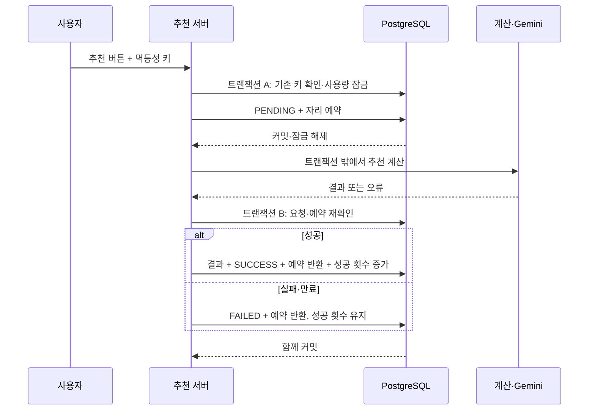

# STEP 7 학습·트러블슈팅 기록

2026-11-10. 확정 정책·전체 API·DDL·트랜잭션은 [구현 계약](ai-usage-api.md), 최종 실행 증거는 [진행 기록](ai-progress.md)을 따른다. 설계와 실행한 검증을 구분한다.

최종 증거는 [7단계 종료 점검](ai-progress.md#2026-11-10-step-7-종료-점검--현재-구현-기준)에 묶었다. 격리 PG33개와 CHAR 수정 후17개는 사용량16개가 겹친다. 최종 백엔드731개 통과/12개 스킵, 프론트897개 통과는 서로 다른 실행 기록이며 이번 문서 정리의 신규 테스트 결과로 제시하지 않는다.

## 쉽게 보는 문제와 해법

무료 회원이4회를 사용했을 때 요청A와B가 동시에 used=4를 읽으면 둘 다 마지막1회가 있다고 판단할 수 있다. 단순 조회 뒤 증가는 실제 두 번 성공하거나 카운터 하나가 덮이는 문제를 만들 수 있다. 이것은 재현할 경쟁 가설이며 이번 프로젝트에서 운영 사고가 있었다는 뜻은 아니다.

접수는 추천 버튼의 요청을 서버가 기록하는 것, PENDING은 추천을 만드는 중, 예약은 그 요청을 위해 자리 하나를 확보하는 것이다. 구독 신청과 다르다. used=4/pending=1/limit=5이면 남은 횟수는1이지만 지금 새로 실행 가능한 횟수는0이다. 성공하면 used=5/pending=0, 실패하면 used=4/pending=0이다.

선택한 방식은 사용자·월 행의 **짧은 DB 잠금 + 처리 중 예약**이다. 여러 대화도 같은 행에서 실행 자리를 조정한다.



## 선택 이유와 공부할 개념

| 개념·대안 | 프로젝트에서 배울 점 |
|---|---|
| 원자성·롤백 | 결과 저장·SUCCESS·사용량 중 하나만 성공하는 상태를 막는다 |
| 행 잠금 | 서로 다른 대화에서 같은 사용자의 마지막 자리를 동시에 얻지 못하게 한다 |
| UNIQUE | 최초 월 행·같은 실행 키의 중복 생성을 막는 마지막 DB 보장 |
| 멱등성 | 응답을 잃고 재전송해도 기존 요청을 돌려준다 |
| 상태 전이 | PENDING의 성공·실패·만료 중 한 경로만 정산한다 |
| 트랜잭션 전파 | 기존 REQUIRES_NEW로 접수/완료/실패 커밋을 분리한다 |
| 낙관적 잠금 | 대안이지만 충돌 재시도 때 외부 AI까지 중복 실행하지 않도록 경계를 나눠야 한다 |
| 호출 내내 잠금 | 긴 지연 동안 커넥션·잠금을 점유하므로 채택하지 않았다 |
| Java synchronized | 여러 서버 사이에 공통 잠금이 되지 않으므로 DB 보장을 대체하지 못한다 |
| Redis 잠금 | 결과·사용량을 PostgreSQL 트랜잭션에 함께 반영할 수 있어 이번에는 추가하지 않았다 |
| 임대·회복 | 서버가 중단돼도 다음 접근에서 만료 예약을 반환한다 |
| 시간 모델 | KST 수신 월과 완료 월을 구분하고 테스트 Clock으로 경계를 고정한다 |

SERIALIZABLE로 설정만 바꿔도 외부 호출·멱등성·회복이 모두 해결되는 것은 아니다. 이번은 기존 격리 수준과 명시적 행 잠금을 사용한다.

## 실제 구현 중 발견한 문제

### 1. Spring Data 조회가 연결된 ID 대신 계산용 getter를 선택

- 증상: 추천 실행이400으로 실패했다. 로그의 JPQL이 r.usageId를 조회했으나 엔티티의 영속 필드는 usage 연관관계였다.
- 원인: findByUsageId... 이름과 getUsageId() 편의 메서드가 겹쳐 경로가 의도와 다르게 해석됐다.
- 수정: findByUsage_Id...로 연관관계 경계를 명시했다.
- 교훈: Java 편의 getter와 JPA 영속 경로는 같지 않다. HTTP 코드만 보지 말고 실제 조회 경로를 확인한다.

### 2. PostgreSQL DO 블록을 테스트 실행기가 세미콜론으로 분리

- 증상: 마이그레이션 통합 테스트에서 Unterminated dollar quote 오류가 발생했다.
- 원인: SQL 자체의 DO $$...$$ 블록을 ResourceDatabasePopulator의 기본 구분자가 중간에서 잘랐다.
- 수정: PostgreSQL 테스트에서 파일을 EOF_STATEMENT_SEPARATOR로 전달해 전체 스크립트를 실행한다. 공유 DB에는 실행하지 않았다.
- 교훈: psql 실행 문법과 테스트 SQL 실행기의 분리 규칙을 구분한다.

### 3. native DELETE 후 남은 JPA 요청 참조가 부모 삭제를 방해

- 증상: 생성 중 대화 삭제 테스트가500, TransientPropertyValueException으로 실패했다.
- 원인: 예약 정산을 위해 읽은 요청 엔티티가 영속성 컨텍스트에 남았다. 기존 native DELETE는 DB 요청 행만 지웠고 이후 부모 대화 삭제 시 Hibernate가 남은 자식 참조를 검사했다.
- 수정: 예약 정산을 flush한 뒤 삭제할 요청들을 detach하고 기존 native 삭제 순서를 유지했다. 사용량 엔티티는 유지해 변경을 같은 트랜잭션에 반영한다.
- 검증 방향: 생성 중 대화 삭제→예약 반환, 뒤늦은 계산 결과404, 성공 사용량 보존, FK 차단 시 삭제·예약 반환 롤백을 확인한다. 최종 실행 결과는 진행 문서를 참조한다.

위1~3번은 개발 중 격리 테스트에서 관찰한 문제이며 운영 장애나 성능 개선 실험으로 소개하지 않는다.4번은 사용자 환경 기동 실패 보고를 출발점으로 격리 DB에서 같은 오류를 재현한 사례다. 실제 사용자 서버의 수정 후 기동 완료까지 검증했다고 표현하지 않는다.

### 4. CHAR(7) SQL 정의와 Hibernate JDBC 타입 불일치

- 실제 증상: 사용자 SQL 적용 후 `ddl-auto=validate` 기동에서 usage_month의 실제 타입은 bpchar/CHAR인데 Hibernate가 VARCHAR를 기대해 기동이 중단됐다.
- 원인: Java String의 기본 JDBC 매핑은 VARCHAR다. 기존 `columnDefinition="char(7)"`은 DDL 타입을 지정했지만 JDBC 매핑을 CHAR로 바꾸지 않았다.
- 기존 검증의 빈틈: create-drop 기반 통합 테스트와 마이그레이션 실행만으로는 기존 DB에 대한 validate의 타입 비교를 검증하지 못했다.
- 재현: 독립 스키마에 CHAR(7) 테이블을 SQL로 생성하고 Hibernate validate만 실행하는 `AiUsageSchemaValidationTest`를 추가했다. 수정 전 PostgreSQL에서 사용자가 보고한 것과 동일한 Types#CHAR/Types#VARCHAR 오류로 실패했다.
- 수정: AiUsage.usageMonth에 `@JdbcTypeCode(SqlTypes.CHAR)`와 `length=7`을 명시했다. DB 타입·정책·DDL은 변경하지 않았다.
- 교훈: 엔티티로 스키마를 생성하는 테스트와 배포 SQL로 생성된 스키마를 검증하는 테스트를 구분한다. 재현·수정 후 실행 결과는 진행 기록의 CHAR 매핑 수정 절을 따른다.

## 테스트 증거를 읽는 법

- 잔여1회에 서로 다른8개 대화에서 동시에 실행: 성공1개·429 일곱 개·최종 used=5/pending=0을 확인한다.
- 월 행이 없는 상태에서8개 동시 실행: 월 행1개·성공5개·거절3개를 확인한다.
- 같은 키 처리 중 재전송: 추가 계산 없이202, 최종 성공 차감1회다.
- 만료와 완료·중복 정리 경쟁: 늦은 결과가 저장되지 않고 예약이 음수가 되지 않아야 한다.
- 저장 실패: 일부 결과와 성공 횟수를 모두 롤백하고 FAILED로 정산한다.
- 격리 PostgreSQL18.6 결과와 공유17.11의 읽기 전용 스키마 확인을 구분한다. 실제 Gemini·공유 DB 쓰기·여러 JVM 실험은 별도다.

## 포트폴리오 작성 양식

```text
문제: 어떤 요청 조합에서 사용량 정확성이 깨질 수 있었는가?
환경: 커밋, DB 버전, 격리 수준, 요청 수, 서버 수
재현: 시작 장벽, 독립 커넥션·트랜잭션, 초기 used/pending
원인: 조회/잠금/상태 전이의 정확한 경계와 로그
선택: 검토한 대안과 짧은 잠금·예약을 선택한 이유
변경: 사용량 ERD, 접수/성공/실패/만료/삭제 처리
검증: HTTP 성공/거절 수, 최종 DB 값, 명령, 로그 위치
한계: 테스트 대역 AI, 격리 DB, 단일 JVM 여부
```

최종 통과 로그를 확인한 뒤 쓰는 문장 예시:

> AI 추천 월 한도의 동시 요청 문제를 사용자·월 단위 DB 잠금과 처리 중 예약으로 제어했다. 추천 결과·상태·사용량을 같은 트랜잭션으로 반영하고, 멱등성 키와 만료 정산으로 중복 차감을 방지했다. 격리 PostgreSQL에서 잔여1회에8개 요청을 동시에 실행해1개 성공·7개 거절과 최종 카운터를 검증했다.

측정하지 않은 처리량 향상률·지연 감소율·운영 무장애·외부 호출 exactly-once 보장은 붙이지 않는다. 테스트 결과는 [진행 기록](ai-progress.md)의 실제 실행 수치와 함께 인용한다.
