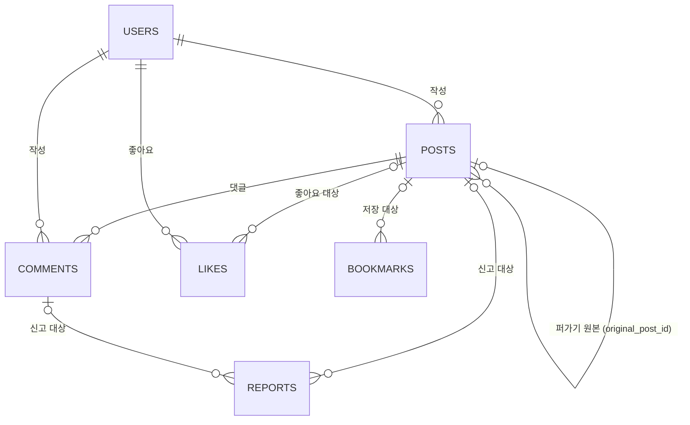

# SNS 피드 백엔드·연동 계획

WBS 8.0 SNS 피드/게시글(8.1~8.16)을 실제 백엔드에 연결하기 위한 단계별 계획이다. ERD의 `posts` 테이블을 기준으로 백엔드 구조, API, 프론트엔드 연결 순서를 정리한다.

- 각 단계는 사용자가 그 단계를 요청할 때만 시작한다. 한 단계가 끝나도 다음 단계를 자동으로 시작하지 않는다.
- 이 문서는 계획이며 구현 승인이 아니다. 피드 도메인 구현을 시작할 때 `AGENTS.md`의 승인 범위를 함께 갱신한다.
- API 경로와 메서드는 WBS를 따른다. WBS와 다르게 정한 항목은 1절에 적는다. 이전 API 초안(`docs/api-plan.md`의 `/posts`)은 사용하지 않는다.

## 1. 결정 사항

| 날짜 | 결정 |
|---|---|
| 2026-11-09 | 게시글 테이블은 ERD 원래 이름인 `posts`를 쓰고, 엔티티도 `Post`로 한다. `comments.post_id`, `posts.original_post_id`, 공통 테이블 `bookmarks.post_id`·`reports.post_id`도 원래 이름을 쓴다. 2026-11-08의 `feeds`·`feed_id` 이름 변경 결정을 되돌렸다. API 경로(`/api/v1/feeds`)는 WBS대로 둔다. |
| 2026-11-09 | 좋아요는 공통 테이블 `likes`(`id`·`user_id`·`project_id`·`post_id`·`created_at`·`updated_at`)를 쓴다(2절). 2026-11-09의 `feed_likes` 결정을 바꿨다. |
| 2026-11-09 | posts에 `title`·`tech_stacks`·`interests`·`image_urls`·`view_count`를 추가한다(2절). |
| 2026-11-09 | 값 목록: `type`은 `POST`(원본 글)·`REPOST`(퍼온 글), `category`는 `INFO`·`FEEDBACK`·`PROMO`·`COMMUNITY`, `visibility`는 `VISIBLE`·`HIDDEN`(작성자 숨김)·`RESTRICTED`(관리자 숨김). |
| 2026-11-09 | 작성자 숨김(`HIDDEN`)과 관리자 숨김(`RESTRICTED`)을 나눈다. 작성자는 `RESTRICTED`를 바꿀 수 없다. 목업은 둘을 같은 `hidden` 값으로 처리했다. |
| 2026-11-09 | local 프로필의 H2에서는 JSON 컬럼을 `JSON` 타입으로 만든다. PostgreSQL은 `JSONB`다(3절 "H2 호환"). |
| 2026-11-09 | posts 데모 데이터 INSERT문은 2단계에서 엔티티와 컬럼이 정해진 뒤 보여 준다(3절 "데모 데이터"). |
| 2026-11-08 | bookmarks의 외래 키는 모두 NULL 허용이다. reports의 `project_id`·`post_id`·`comment_id`·`handled_by`는 NULL 허용 외래 키다. |
| 2026-11-08 | reports `status` 초기값은 `AWATING`이다. |
| 2026-11-09 | 공통 `Report` 엔티티의 초기 상태를 `AWATING`으로 바꾸고, 이후 Report 작업 담당자에게 알린다. |
| 2026-11-08 | 8.6 수정은 `PUT /api/v1/feeds/{id}`, 삭제는 `POST /api/v1/feeds/{id}/delete`(논리 삭제)로 나눈다. WBS 8.6 행에는 `PUT`만 있다. |
| 2026-11-08 | 8.7 좋아요와 좋아요 취소는 `PATCH /api/v1/feeds/{id}/likes` 하나로 토글한다. WBS에는 `POST`로 적혀 있다. |
| 2026-11-08 | 목록은 다음 페이지를 기존 목록 뒤에 이어 붙인다. 화면에 다음 페이지 표시 버튼을 둔다. |
| 2026-11-09 | 8.3의 필터(카테고리·검색어)와 정렬을 8.1 전체 피드와 8.2 추천·팔로잉 목록 모두에 적용한다. 2026-11-08의 "8.2에는 정렬만 적용" 결정을 바꿨다. |
| 2026-11-08 | 같은 원본을 여러 사람이 각각 퍼갈 수 있고, 한 사람은 같은 원본을 한 번만 퍼간다. 퍼간 글은 자기 id를 가진 posts 행이며 `original_post_id`에 원본, `content`에 의견을 둔다. |
| 2026-11-08 | 퍼간 글의 의견은 `PUT /api/v1/feeds/{id}`(퍼간 글의 id)로 수정한다. |
| 2026-11-09 | 조회수는 상세 페이지 접속 시 집계한다. 서버는 방문 기록을 저장하지 않고 집계 요청마다 1 올린다(프로젝트 상세와 같은 방식). 화면은 localStorage에 읽은 글을 기록해 처음 읽을 때만 집계를 요청한다. 작성자 본인 조회는 세지 않는다. 2026-11-08의 "같은 브라우저 세션에서 한 번" 결정을 바꿨다. |
| 2026-11-09 | 게시글 이미지는 프로젝트 폴더 루트의 `public/images`에 `feed_{id}_{YYYYMMDDHHmmSS}_{image_url_no}.{extension}` 이름으로 저장하고 nginx가 제공한다. 저장 폴더는 환경 변수 `IMAGE_STORAGE`로 지정하며, 다른 기능도 이미지 저장에 같은 변수를 쓸 수 있다. |
| 2026-11-08 | 신고 사유와 중복 신고 처리는 프론트엔드 목업 기준을 따른다(4절). |

## 2. ERD 변경

출처는 사용자가 제공한 ERD 일부 이미지(posts·likes·comments·bookmarks·reports·sanctions)와 1절의 결정이다. 이미지에는 NULL 여부가 표시되지 않아, 따로 확인했거나 새로 추가하는 컬럼에만 NULL을 적는다. DATETIME은 기존 기준대로 Java `LocalDateTime`, PostgreSQL `timestamp without time zone`으로 읽는다.

### posts — 게시글·퍼가기

| 필드 | 타입 | NULL | 기본값 | 의미 | 변경 |
|---|---|---|---|---|---|
| id | BIGINT / PK | | | 게시글 ID | |
| author_id | BIGINT / FK | | | 작성자 users.id | |
| original_post_id | BIGINT | | | 원본 게시글 ID. 퍼간 글이면 원본 posts.id | |
| type | VARCHAR(20) | | | `POST`·`REPOST` | |
| category | VARCHAR(30) | | | `INFO`·`FEEDBACK`·`PROMO`·`COMMUNITY` | |
| title | VARCHAR(150) | 허용 | 없음 | 제목. 원본 글은 1~150자 필수, 퍼간 글은 NULL | 추가 |
| content | TEXT | | | 내용. 퍼간 글이면 의견 | |
| tech_stacks | JSONB (H2: JSON) | 불가 | `'[]'` | 기술 스택 문자열 배열. 중복 없이 1~30자, 최대 30개 | 추가 |
| interests | JSONB (H2: JSON) | 불가 | `'[]'` | 관심 분야 문자열 배열. 제한은 위와 같다 | 추가 |
| image_urls | JSONB (H2: JSON) | 불가 | `'[]'` | 이미지 경로 배열(표시 순서). 최대 3개, 각 2048자 이내 | 추가 |
| view_count | BIGINT | 불가 | `0` | 조회수 | 추가 |
| visibility | VARCHAR(20) | | | `VISIBLE`·`HIDDEN`·`RESTRICTED` | |
| created_at | DATETIME | | | 생성 시각 | |
| updated_at | DATETIME | | | 수정 시각 | |
| deleted_at | DATETIME | | | 삭제 시각 | |

- 추가 컬럼의 제한은 현재 작성 화면의 검증 기준이고, JSONB 형식은 `projects.tech_stacks`·`interests`와 같다.
- 좋아요 수와 댓글 수는 컬럼을 두지 않고 `likes`(`post_id` 기준)·`comments`에서 센다.

### likes — 공통 좋아요 (기존 post_likes)

| 필드 | 타입 | 의미 |
|---|---|---|
| id | BIGINT / PK | 좋아요 ID |
| user_id | BIGINT / FK | 좋아요한 users.id |
| project_id | BIGINT / FK | 좋아요한 프로젝트 ID |
| post_id | BIGINT / FK | 좋아요한 게시글 posts.id |
| created_at | DATETIME | 생성 시각 |
| updated_at | DATETIME | 수정 시각 |

- 북마크처럼 프로젝트와 게시글이 함께 쓰는 공통 테이블이다. 게시글 좋아요는 `post_id`를 채우고 `project_id`는 비운다.
- 같은 사용자가 같은 게시글에 두 번 좋아요하지 않도록 `(user_id, post_id)` 중복을 막는다. 아래 PR #96의 `Like` 엔티티에 이 유니크 제약이 있다.

### comments — 댓글

| 필드 | 타입 | 의미 |
|---|---|---|
| id | BIGINT / PK | 댓글 ID |
| post_id | BIGINT / FK | 게시글 posts.id |
| author_id | BIGINT / FK | 작성자 users.id |
| content | TEXT | 댓글 내용 |
| created_at | DATETIME | 생성 시각 |
| updated_at | DATETIME | 수정 시각 |
| deleted_at | DATETIME | 삭제 시각 |

### bookmarks — 공통 북마크

| 필드 | 타입 | 의미 |
|---|---|---|
| id | BIGINT / PK | 북마크 ID |
| user_id | BIGINT / FK / NULL | 저장한 users.id |
| project_id | BIGINT / FK / NULL | 저장한 프로젝트 ID |
| post_id | BIGINT / FK / NULL | 저장한 게시글 ID |
| created_at | DATETIME | 생성 시각 |

### reports — 공통 신고

| 필드 | 타입 | 의미 |
|---|---|---|
| id | BIGINT / PK | 신고 ID |
| reporter_id | BIGINT / FK | 신고자 users.id |
| reported_user_id | BIGINT / FK | 대상 사용자 ID |
| project_id | BIGINT / FK / NULL | 대상 프로젝트 ID |
| post_id | BIGINT / FK / NULL | 대상 게시글 ID |
| comment_id | BIGINT / FK / NULL | 대상 댓글 ID |
| handled_by | BIGINT / FK / NULL | 처리 관리자 ID |
| reason | TEXT | 신고 사유 |
| status | VARCHAR(20) | 처리 상태. 초기값 `AWATING` |
| resolution | TEXT | 처리 결과 |
| created_at | DATETIME | 신고 시각 |
| handled_at | DATETIME | 처리 시각 |

`sanctions`(회원 제재 내역)는 `reports`를 참조하지만 관리자 범위라 이 계획에서 다루지 않는다. 바뀌는 컬럼은 없다.

### 관계



### 값 목록과 목업 대응

| 컬럼 | 값 | 목업 대응 |
|---|---|---|
| type | `POST` | 원본 글. 목업 `posts` 배열의 글 |
| type | `REPOST` | 퍼온 글. 목업 `reposts` 배열의 글 |
| category | `INFO` | 정보 |
| category | `FEEDBACK` | 피드백 |
| category | `PROMO` | 홍보 |
| category | `COMMUNITY` | 자유 |
| visibility | `VISIBLE` | `hidden: false` |
| visibility | `HIDDEN` | `hidden: true` 중 작성자가 숨긴 글(`post-hide`·`repost-hide`) |
| visibility | `RESTRICTED` | `hidden: true` 중 관리자가 숨긴 글(`lib/profiles/moderationService.ts`의 `post-visibility`) |

- 화면은 카테고리 코드를 기존 한글 문구로 바꿔 표시한다. 필터의 `전체`는 저장 값이 아니며 조건을 보내지 않는다는 뜻이다.
- `HIDDEN`·`RESTRICTED`는 목업의 `hidden` 동작을 따른다. 피드에 나오지 않고 상세는 작성자만 볼 수 있으며, 원본이면 퍼갈 수 없다.
- 작성자는 프로필 게시글 탭의 숨기기 버튼으로 `VISIBLE`과 `HIDDEN`을 오간다(WBS 3.8). `RESTRICTED`는 관리자만 정하고 풀며(WBS 14.7), 작성자의 숨김 버튼으로 바꿀 수 없다.

### 값 변경의 영향과 공통 엔티티

테이블 하나는 JPA 엔티티 클래스 하나로 매핑한다. 같은 테이블에 엔티티를 따로 만들면 클래스 이름이 겹치거나, `ddl-auto: update`가 서로 다른 정의로 테이블을 바꾼다. 그래서 공통 테이블은 엔티티 하나를 함께 쓴다. 확인일은 2026-11-09다.

- likes·bookmarks: 프로젝트 신고 PR #96(`feat/51-project-reports`, 미병합. 프로젝트 북마크·좋아요 작업 포함)의 `Like`·`Bookmark` 엔티티를 재사용한다. 두 엔티티는 `BaseEntity`를 상속하고, `project_id`는 `Project` 연관관계, `post_id`는 연관관계 없는 `Long` 값으로 둔다. `(user_id, project_id)`·`(user_id, post_id)` 중복도 막는다. `Like`는 ERD 이미지(likes)와 컬럼이 같다. `Bookmark`도 `BaseEntity`를 상속하므로 `updated_at`이 생기는데, ERD 이미지(bookmarks)에는 `updated_at`이 없다. 게시글용 조회 메서드는 #96의 `LikeRepository`·`BookmarkRepository`에 더하고, 프로젝트 담당자에게 공유한다.
- reports: 메신저 PR #90(`feat/78-messages`, 미병합)과 #96에 같은 `Report` 엔티티가 있다. #96에는 프로젝트 신고 생성 메서드가 더 있다. 이 엔티티는 `post_id` 컬럼과 초기 상태 `RECEIVED`(상태 값 `RECEIVED`·`REVIEWING`·`RESOLVED`·`REJECTED`)를 쓴다. 컬럼 이름은 ERD와 같으므로 그대로 쓴다. 두 PR이 develop에 병합된 뒤 피드 작업에서 초기 상태를 `AWATING`으로 바꾸고, 사용자·프로젝트 신고 코드와 테스트도 함께 맞춘다. 바뀐 내용은 이후 Report 작업 담당자에게 알린다.
- 좋아요한 글 목록 PR #82(`feat/75-liked-posts`, 미병합)는 2026-11-09에 `feeds`·`feed_likes`·`feed_id`·`original_feed_id`를 SQL로 직접 조회하도록 바뀌었다. 값(`VISIBLE`·`POST`·`REPOST`)은 이 계획과 같지만, 테이블이 `posts`·`likes`로 바뀌어 이 조회와 테스트가 다시 맞지 않는다. #75 담당자에게 공유한다.

## 3. 백엔드 구조

기존 계층형 패키지(`backend/src/main/java/com/devmozip/backend`)를 따른다. 탭 들여쓰기와 생성자 주입을 쓰고, 응답 DTO는 record로 만든다. 엔티티를 API 응답으로 직접 쓰지 않는다. Service는 프로젝트 기능처럼 인터페이스와 `service/impl` 구현으로 나눈다.

| 위치 | 파일 (예정) | 역할 |
|---|---|---|
| entity | Post, Comment | `BaseEntity` 상속, `deleted_at` 논리 삭제 |
| entity | Like, Bookmark, Report (재사용) | 공통 테이블. #96·#90의 엔티티를 쓴다(2절) |
| entity/enums | PostType, PostCategory, PostVisibility | 1절의 값 |
| repository | PostRepository, CommentRepository | 목록·검색·정렬, 삭제 제외 조회 |
| repository | LikeRepository, BookmarkRepository, ReportRepository (재사용) | 게시글용 조회 메서드를 더한다 |
| storage | FeedImageStorage | 게시글 이미지 저장·삭제 (아래 "이미지 저장") |
| service | FeedService | 작성·수정·삭제·퍼가기 (8.4, 8.6, 8.13) |
| service | FeedQueryService | 전체·추천·팔로잉 피드, 필터·정렬, 상세·조회수 (8.1~8.3, 8.5) |
| service | CommentService | 댓글 목록·작성·수정·삭제 (8.9~8.12) |
| service | FeedReactionService | 좋아요·북마크 (8.7, 8.8) |
| service | FeedReportService | 게시글·댓글 신고 (8.15, 8.16) |
| controller | FeedController | `/api/v1/feeds/**` |
| controller | CommentController | `/api/v1/comments/**` |
| dto/feed | 요청·응답 record | 목록 항목, 상세, 페이지, 작성·수정, 댓글, 퍼가기, 신고 |

엔티티·enum·Repository는 테이블 이름을 따라 `Post`로 짓는다. Service·Controller·DTO와 이미지 저장 구성요소는 API 경로(`/api/v1/feeds`)를 따라 `Feed`로 짓는다.

### 요청자 식별

- Spring Security 인증 정보(`Authentication.getName()`의 이메일)로 회원을 조회한다. 요청 본문·쿼리로 받은 사용자 ID는 신뢰하지 않는다.
- 프로젝트의 `ProjectCurrentUserProvider`는 프로젝트 담당 코드다. 고치거나 가져다 쓰지 않고, 같은 방식으로 피드용 구성요소를 둔다. 공통화는 담당자와 협의한다.

### 공개 경로

- 비로그인 사용자도 피드 목록·상세·댓글을 볼 수 있다(`/feeds` 화면이 공개). 팔로잉 피드와 쓰기 요청은 로그인이 필요하다.
- 공개 GET 경로를 열려면 공통 `SecurityConfig`를 바꿔야 한다. 공통 인증 설정이므로 바꾸기 전에 변경 내용을 팀에 공유한다.

### 이미지 저장

- 저장 폴더: 환경 변수 `IMAGE_STORAGE`. 지정하지 않으면 backend 폴더에서 실행할 때 기준으로 `../public/images`(프로젝트 폴더 루트의 `public/images`)를 쓴다. 다른 기능도 같은 폴더를 쓸 수 있으므로 파일 이름 접두어(`feed_`)로 구분한다.
- 파일 이름: `feed_{id}_{YYYYMMDDHHmmSS}_{image_url_no}.{extension}`
  - `{id}`: 게시글 id
  - `{YYYYMMDDHHmmSS}`: 업로드 시각(Asia/Seoul, 연월일시분초)
  - `{image_url_no}`: 저장할 때 `image_urls` 안의 순서(1부터)
  - `{extension}`: 파일 내용으로 확인한 형식(`png`·`jpg`·`webp`·`gif`). 업로드한 원래 파일 이름은 쓰지 않는다.
- 저장 값: `image_urls`에 `/images/{파일 이름}` 경로를 저장한다.
- 업로드 요청: 8.4 `POST /api/v1/feeds`와 8.6 `PUT /api/v1/feeds/{id}`를 `multipart/form-data`로 받는다. 글 내용은 JSON 파트, 이미지는 파일 파트로 보낸다.
  - 작성: 파일 이름에 게시글 id가 들어가므로 게시글을 먼저 저장해 id를 받은 뒤 파일을 쓰고 `image_urls`를 채운다. 파일 저장이 실패하면 트랜잭션을 되돌리고 이미 쓴 파일을 지운다.
  - 수정: 남길 기존 이미지 경로 목록과 새 파일을 함께 받는다. 기존 파일 이름은 바꾸지 않고, 빠진 이미지 파일은 저장이 끝난 뒤 지운다.
  - 삭제: 게시글 행은 논리 삭제로 남기고 이미지 파일은 지운다.
- 검증: 현재 목업 기준인 PNG·JPEG·WebP·GIF, 장당 512KB, 최대 3장.
- 제공: nginx가 `/images/` 경로로 이 폴더를 직접 제공한다. 권한 확인 없이 제공하므로, 숨긴 글의 이미지도 파일 주소를 알면 볼 수 있다.

| 환경 | 설정 | 상태 |
|---|---|---|
| 개발 compose (`compose.override.yaml`) | backend에 `./public:/public` 연결, `IMAGE_STORAGE=/public/images` | 2026-11-09 적용. Git 제외 로컬 파일이라 팀원은 각자 아래 설정을 추가한다 |
| 로컬 HTTPS nginx (`compose.yaml`의 `https` 프로필) | nginx에 `./public/images` 읽기 전용 연결, `nginx/local.conf`에 `location /images/` 추가 | 3단계 |
| 운영 (`compose.prod.yaml`, `nginx/server.conf`) | 서버 프로젝트 폴더(`~/DevMozip`)의 `public`을 연결한다. 아래 "운영 서버" 참고 | 3단계. 공통 배포 설정이므로 팀 공유 후 반영 |
| nginx 없이 실행 (compose 기본 실행으로 3000번 직접 접속, local 프로필) | 정해지지 않음 | 4절 남은 결정 |
| Git | 루트 `.gitignore`에 `/public/images/` 추가 | 3단계 |

팀원이 `compose.override.yaml`의 backend 서비스에 추가할 설정:

```yaml
    volumes:
      # 업로드 이미지는 프로젝트 폴더의 public/images에 저장한다 (docs/feed-plan.md)
      - ./public:/public
    environment:
      # 이미지 저장 폴더. 위에서 연결한 프로젝트 폴더의 public/images이며, 기능별 파일 이름 접두어로 구분한다
      IMAGE_STORAGE: /public/images
```

### 운영 서버

배포는 서버의 프로젝트 폴더 `~/DevMozip`에서 `git pull` 후 `deploy/blue-green.sh`가 `docker compose -f compose.prod.yaml`을 실행한다. 그래서 `compose.prod.yaml`의 `./public`은 서버의 `~/DevMozip/public`을 가리키고, 개발 환경과 같은 구조로 연결할 수 있다.

- `compose.prod.yaml`: 공통 backend 설정(`x-backend`)에 `./public:/public` 연결과 `IMAGE_STORAGE: /public/images`를 넣는다. blue·green이 같은 폴더를 쓰므로 배포 색이 바뀌어도 이미지가 남는다. 팀 nginx에는 `./public/images`를 읽기 전용으로 연결하고, `nginx/server.conf`에 `location /images/`를 `location /`보다 앞에 둔다.
- 폴더와 권한: 폴더가 없으면 Docker가 root 소유로 만든다. 운영 backend 이미지는 root가 아닌 `app` 사용자로 실행되므로(`backend/Dockerfile`) 서버 계정 소유 폴더에는 쓸 수 없다. `deploy/blue-green.sh`에서 `public/images`를 미리 만들고 `app` 사용자가 쓸 수 있게 권한을 맞춘다. 방법(이미지의 `app` UID로 소유자 변경 등)은 3단계에서 정한다. 개발 컨테이너는 root로 실행되어 이 문제가 없다.
- Git: `/public/images/`를 `.gitignore`에 넣는다. 배포의 `git pull --ff-only`는 Git이 추적하지 않는 파일을 지우지 않으므로 업로드 파일이 유지된다.
- 업로드 크기: 호스트 nginx(`deploy/setup-host.sh`가 만든 설정)와 팀 nginx에 `client_max_body_size`가 없어 기본값 1MB가 적용된다. 이미지 3장(최대 약 1.5MB)을 함께 올리려면 두 곳 모두 값을 늘려야 한다. `setup-host.sh`는 설정 파일이 없을 때만 만들므로, 이미 있는 호스트 nginx 설정은 서버에서 직접 고친다.
- 백업: 이미지 파일은 DB 백업에 들어가지 않는다.

### 오류 응답

- Service는 `ResponseStatusException`을 던지고, 기존 `GlobalExceptionHandler`가 `ErrorResponse`로 바꾼다.
- 400 입력 오류, 401 로그인 필요, 403 작성자 아님, 404 없거나 삭제된 대상, 409 중복 신고 등 현재 상태와 충돌.

### DB 반영 주의

- `ddl-auto: update`이므로 엔티티를 추가한 서버를 재시작하면 연결된 DB에 테이블이 생긴다. 공용 개발 DB에 연결된 경우 반영 시점을 팀과 맞춘다.
- DB에 `posts` 등이 이미 있으면 update는 없는 컬럼(`title`·`view_count` 등)만 추가하고, 기존 컬럼의 타입이나 제약은 바꾸지 않는다. 기존 테이블이나 데이터가 있으면 1단계 DB 확인 결과에 따라 반영 방법을 정한다.

### H2 호환 (local 프로필)

local 프로필은 H2 메모리 DB(`jdbc:h2:mem:security`)를 쓰므로, PostgreSQL에서만 되는 매핑과 SQL을 피한다.

- JSON 컬럼(`tech_stacks`·`interests`·`image_urls`)은 `@JdbcTypeCode(SqlTypes.JSON)`만 쓰고 `columnDefinition = "jsonb"`를 적지 않는다. 그러면 Hibernate가 PostgreSQL에서는 `jsonb`, H2에서는 `json`으로 만든다. 2단계에서 두 DB에 실제로 생긴 타입을 확인한다.
- 기본값 `'[]'`은 매핑에 넣지 않는다. H2는 `'[]'` 같은 문자열을 JSON 배열이 아닌 JSON 문자열로 바꾸기 때문이다. 엔티티가 항상 값을 채운다.
- 쿼리에 PostgreSQL 전용 함수·연산자(`jsonb_array_elements_text`, `@>`, `::jsonb`, `ILIKE`)를 쓰지 않는다. 프로젝트 목록 검색은 `jsonb_array_elements_text`를 써서 H2에서는 같은 방식이 동작하지 않으므로 따르지 않는다.
  - 태그 검색: JSON 값을 문자열로 바꿔 소문자로 비교한다. 두 DB의 변환 결과는 테스트로 확인한다.
  - 추천순: seed와 게시글 id로 만든 산술식으로 순서를 정한다.
  - 퍼가기 중복: 조건부 유일 인덱스 대신 원본 행을 잠그고 서비스에서 확인한다.
- 테스트: PostgreSQL(Testcontainers)과 H2 양쪽에서 목록·검색·정렬을 확인한다. #90의 `UserReportApiH2Test`처럼 H2 테스트를 둔다.

### 데모 데이터 (posts INSERT문)

- 2단계에서 엔티티와 컬럼이 정해진 뒤 INSERT문을 작성해 보여 준다. 실행 여부는 사용자가 정하며, 공유 DB에는 직접 실행하지 않는다.
- 내용: 기존 Mock 게시글(`mocks/home.ts`·`mocks/profile.ts`·`mocks/social.ts`)을 옮기고, 카테고리는 코드 값으로 바꾼다. 이미지 파일이 없으므로 `image_urls`는 비운다.
- 작성자: 고정 id 대신 `members_data.sql`의 회원을 이메일로 찾아 넣는다. Mock 작성자가 local 회원보다 많으므로 어느 회원에게 맞출지는 그때 정한다.
- H2(local): `backend/src/main/resources`의 `*_data.sql`은 서버 시작 때 파일 이름 순으로 실행된다(`application-local.yml`). 작성자 회원이 먼저 있어야 하므로 `members_data.sql`보다 뒤에 오는 이름을 쓴다. 기존 파일처럼 이미 있으면 넣지 않는 `INSERT ... SELECT ... WHERE NOT EXISTS` 형식으로 쓰고, JSON 값은 H2 문법(`JSON '[...]'`)으로 쓴다. 이 폴더의 `*.sql`은 Git에서 제외된다.
- PostgreSQL: JSON 값을 `'[...]'::jsonb`로 쓴 판을 따로 둔다. `docs/sql/project-demo-data.sql`처럼 `docs/sql`에 둘지는 그때 정한다.

## 4. API

WBS 기준이며 1절에서 바꾼 항목을 반영했다. "작성자"는 로그인한 작성자 본인만 가능하다는 뜻이다.

| 코드 | 메서드·경로 | 인증 | 동작 |
|---|---|---|---|
| 8.1 | `GET /api/v1/feeds` | 공개 | 전체 피드 목록 |
| 8.2 | `GET /api/v1/feeds/recommands` | 공개 | 추천 피드. 초기에는 랜덤 추천 |
| 8.2 | `GET /api/v1/feeds/following` | 로그인 | 팔로우한 사용자의 글 |
| 8.3 | 8.1·8.2 목록의 쿼리 | — | `category`·`q` 필터와 `sort` 정렬. 세 목록에 모두 적용 |
| 8.4 | `POST /api/v1/feeds` | 로그인 | 게시글 작성. `multipart/form-data` |
| 8.5 | `GET /api/v1/feeds/{id}` | 공개 | 게시글 상세. `view=true`이면 조회수 집계 |
| 8.6 | `PUT /api/v1/feeds/{id}` | 작성자 | 게시글 수정(`multipart/form-data`). 퍼간 글이면 의견(`content`)만 수정 |
| 8.6 | `POST /api/v1/feeds/{id}/delete` | 작성자 | 게시글 논리 삭제(`deleted_at`) |
| 8.7 | `PATCH /api/v1/feeds/{id}/likes` | 로그인 | 좋아요·취소 토글 |
| 8.8 | `POST` / `DELETE /api/v1/feeds/{id}/bookmark` | 로그인 | 북마크 추가·해제 |
| 8.9 | `GET /api/v1/feeds/{id}/comments` | 공개 | 댓글 목록 |
| 8.10 | `POST /api/v1/feeds/{id}/comments` | 로그인 | 댓글 작성 |
| 8.11 | `PUT /api/v1/comments/{id}` | 작성자 | 댓글 수정 |
| 8.12 | `DELETE /api/v1/comments/{id}` | 작성자 | 댓글 삭제 |
| 8.13 | `POST /api/v1/feeds/{id}/reposts` | 로그인 | 퍼가기. 의견 추가 가능 |
| 8.13 | `DELETE /api/v1/feeds/{id}/reposts` | 로그인 | 내가 퍼간 글 삭제 |
| 8.14 | 없음 | — | 외부 공유는 기존 URL 복사 화면 유지 |
| 8.15 | `POST /api/v1/feeds/{id}/reports` | 로그인 | 게시글 신고 |
| 8.16 | `POST /api/v1/comments/{id}/reports` | 로그인 | 댓글 신고 |

### 목록과 페이지

- 요청: `category`(`INFO`·`FEEDBACK`·`PROMO`·`COMMUNITY`, 없으면 전체), `q`(검색어), `sort`, `page`(0부터), `size`(기본 20, 최대 100. 프로젝트 목록과 같다). 세 목록이 같은 조건을 받는다.
- 화면의 추천·팔로잉 탭은 각각 8.2의 두 목록을 부르고, 카테고리·검색어·정렬은 두 탭 모두에 적용된다(목업과 같다).
- 응답: `items`, `page`, `size`, `hasNext`. 화면은 다음 페이지 표시 버튼으로 `page + 1`을 요청해 기존 목록 뒤에 붙이고, `hasNext`가 false면 버튼을 숨긴다.
- 정렬 네 가지에 같은 방식을 쓰려고 페이지 번호 방식을 쓴다. 그 사이 새 글이 생기면 다음 페이지에 이미 받은 글이 다시 올 수 있으므로, 화면은 이미 있는 id를 다시 넣지 않는다.
- `HIDDEN`·`RESTRICTED`·삭제된 글은 목록에 나오지 않는다.
- 팔로잉 목록은 `follows`의 `following_id`로 작성자를 거른다. `follows`는 팔로우 PR #107(`feat/94-follows`, 미병합)에 있으므로 병합 후 연결한다.

| 정렬 | 값 | 기준 (현재 목업과 같다) |
|---|---|---|
| 추천순 | `recommended` | seed로 섞은 순서. 화면이 세션마다 seed를 만들고 다음 페이지 요청에도 같은 값을 보낸다 |
| 인기순 | `popular` | 좋아요 수가 많은 순, 같으면 최신순 |
| 조회순 | `views` | 조회수가 많은 순, 같으면 최신순 |
| 최신순 | `latest` | 작성 시각 최신순 |

### 조회수

- 서버: `GET /api/v1/feeds/{id}?view=true`이면 조회수를 1 올리고 올린 값을 응답에 담는다. `view`가 없으면 올리지 않는다. 방문 기록은 저장하지 않으므로 집계 요청마다 오른다(프로젝트 상세와 같다).
- 로그인한 작성자 본인의 요청은 `view=true`여도 올리지 않는다. 볼 수 없는 글(없음·삭제·다른 사람의 `HIDDEN`·`RESTRICTED` 글)도 올리지 않는다.
- 동시 요청에서 증가가 빠지지 않도록 `view_count = view_count + 1` 갱신이나 행 잠금으로 처리한다.
- 화면: localStorage `devmozip:feed-views:v1`에 읽은 게시글 id 목록을 저장한다. 상세 페이지에서 목록에 id가 없으면 `view=true`로 요청하고, 성공하면 id를 추가한다. 이미 있으면 `view` 없이 요청한다. 수정 화면은 항상 `view` 없이 요청한다.
- 한계: localStorage는 브라우저를 닫아도 남으므로, 같은 브라우저에서는 저장소를 지우기 전까지 한 번만 센다. 같은 브라우저를 쓰는 다른 계정도 같은 기록을 쓴다. localStorage를 쓸 수 없는 환경에서는 들어올 때마다 센다.

### 숨김

- 작성자 숨김·해제는 WBS 3.8 내 글 숨김 `PATCH /api/v1/feeds/{id}/visibility`(프로필 담당)로 한다. 8.6 `PUT`으로는 `visibility`를 바꾸지 않는다.
- 3.8은 `VISIBLE`·`HIDDEN`만 받고, 글이 `RESTRICTED`면 거절해야 한다. 이 규칙을 3.8 담당자에게 공유한다.
- `RESTRICTED`로 바꾸고 푸는 것은 WBS 14.7 `PATCH /api/v1/admin/posts/{id}/visibility`(관리자 범위)이며 이 계획에 넣지 않는다.

### 좋아요

- 같은 토글 요청이 두 번 처리되면 원래 상태로 돌아간다. 응답에 최종 상태(`liked`, `likeCount`)를 담아 화면이 서버 값으로 맞추고, 요청 중에는 버튼을 막는다.

### 퍼가기

- `POST /api/v1/feeds/{id}/reposts`: 원본 `{id}`를 퍼간 새 posts 행을 만든다. `type`은 `REPOST`, `original_post_id`는 원본 id, `content`는 의견(선택, 목업 기준 1,000자 이내)이다. `title`·태그·이미지는 비운다.
- 같은 사람이 같은 원본을 이미 퍼갔으면 거절한다(409). 삭제되지 않은 퍼간 글만 중복으로 보므로, 목업처럼 취소한 뒤 다시 퍼갈 수 있다.
- 원본이 없거나 삭제·`HIDDEN`·`RESTRICTED` 상태면 퍼갈 수 없다(목업 기준).
- `DELETE /api/v1/feeds/{id}/reposts`: 원본 `{id}`에 대해 내가 퍼간 글을 삭제한다.
- 의견 수정: `PUT /api/v1/feeds/{id}`에 퍼간 글의 id를 쓴다. 퍼간 글은 `content`만 바꿀 수 있다.
- 원본이 삭제돼도 퍼간 글은 남고, 화면은 원본 삭제 안내를 표시한다(현재 화면 동작).

### 신고 (목업 기준)

출처: `components/posts/ReportDialog.tsx`, `mocks/social.ts`의 `socialReportReasons`, `lib/social/socialService.ts`의 `social-report` 처리.

- 사유는 선택지 5개 중 하나다: 스팸 또는 광고, 욕설 또는 혐오 표현, 허위 정보, 저작권 침해, 기타. 게시글·댓글 신고에는 추가 설명 입력이 없다(프로젝트 신고에는 1,000자 추가 설명이 있다).
- 같은 계정은 같은 게시글·댓글을 한 번만 신고한다. 다시 신고하면 거절한다(409, 목업 문구 "이미 신고한 내용입니다.").
- 본인이 쓴 게시글·댓글은 신고할 수 없다(목업 문구 "본인이 작성한 내용은 신고할 수 없습니다.").
- 저장: `Report` 엔티티에 `reporter_id`, 대상 `post_id` 또는 `comment_id`, `reason`을 채우고 `reported_user_id`는 비운다. `status` 초기값은 `AWATING`이다.
- 사유는 #90의 `UserReportReason`처럼 enum으로 허용 값을 정하고, 화면 문구(label)를 `reason`에 저장한다.

### 남은 결정 (1단계)

1. **nginx 없이 실행할 때 이미지 제공:** compose 기본 실행으로 3000번에 바로 접속하거나 local 프로필로 실행하면 `/images/...`를 제공하는 곳이 없다. 다음 방식을 제안한다. 백엔드가 `IMAGE_STORAGE` 폴더를 `/images/**`로 제공하고, Next.js가 `/images/:path*` 요청을 백엔드로 넘긴다. nginx가 있는 환경에서는 nginx가 먼저 처리하므로 이 경로를 쓰지 않는다. 공통 설정인 `next.config.ts`와 `SecurityConfig`를 바꿔야 하므로 팀 공유가 필요하다.

## 5. 프론트엔드 연결

현재 `/feeds` 화면은 Mock 상태로 동작한다. 게시글·퍼간 글·좋아요·댓글이 `lib/state/profileStore.ts`를 거쳐 localStorage `devmozip:profiles:v1`에 저장된다.

- BFF: `app/api/feeds/...` Route Handler. 기존 `app/api/projects/route.ts`처럼 `backendFetch`·`getSession`을 쓰고, 쓰기 요청은 같은 출처와 요청 형식(JSON 또는 `multipart/form-data`)을 확인한다. 사용자 ID는 백엔드로 전달하지 않는다.
- 응답 해석: `types/feedApi.ts`, `lib/social/feedApi.ts`. 프로젝트의 `types/projectApi.ts`, `lib/projects/projectCreationApi.ts` 방식을 따른다. 카테고리 코드는 한글 문구로 바꿔 표시한다.
- 연결 화면: `/feeds`, `/feeds/new`, `/feeds/[postId]`, `/feeds/[postId]/edit`, `app/feeds/_components`, `components/posts`. 화면 구조와 디자인을 유지하고, 경로 폴더 이름(`[postId]`)은 바꾸지 않는다.
- 목록 아래 다음 페이지 표시 버튼으로 다음 페이지를 이어 붙인다. 추천순은 세션 seed를 함께 보낸다.
- 작성·수정 화면은 이미지 파일을 `multipart/form-data`로 보낸다. 표시는 응답의 `/images/...` 경로를 쓴다.
- 상세 화면은 localStorage `devmozip:feed-views:v1`로 처음 읽는지 판단해 `view=true`를 붙인다(4절 조회수).
- 좋아요는 응답의 최종 상태로 화면을 맞춘다.
- 로딩·빈 목록·오류·재시도, 비로그인 안내, 중복 제출 방지, 저장 실패 시 입력 보존을 처리한다.

### 같은 게시글 상태를 쓰는 다른 화면

`/feeds`만 API로 바꾸면 아래 화면은 계속 Mock 게시글을 보여 준다. 화면 간 데이터가 어긋나지 않도록 처리 순서를 담당자와 정한다. 이 계획에서는 아래 화면 코드를 바꾸지 않는다.

| 화면 | 위치 | 비고 |
|---|---|---|
| 메인 SNS 미리보기 | `app/_components/FeedPreview.tsx` | WBS 1.6 `GET /api/v1/feeds/preview` |
| 프로필 게시글 탭 | `app/(user)/users/[userId]/_components/PostsTab.tsx` | WBS 3.7 내 글 목록, 3.8 내 글 숨김 |
| 북마크 | `app/(user)/bookmarks/page.tsx` | WBS 16.3·16.4 |
| 좋아요한 글 | `app/(user)/profile/me/likes/page.tsx` | #75 |
| 관리자 게시글 | `app/admin/posts/page.tsx` | WBS 14.6·14.7, 관리자 범위 |

## 6. 단계별 진행

모든 단계에서 `frontend`의 `npm run build`와 관련 테스트를 실행한다. 백엔드 코드를 바꾼 단계는 `backend`의 `./gradlew test`도 실행한다. 실행한 명령, 성공·실패, 실행하지 못한 이유를 7절에 기록한다.

### 선행·후속 WBS 작업

확인일은 2026-11-09다.

| 구분 | WBS | 피드와의 관계 | 상태 |
|---|---|---|---|
| 선행 | 9.1 팔로우·9.4 팔로잉 목록 | 8.2 팔로잉 피드가 `follows`를 쓴다 | PR #107 미병합 |
| 선행 | 7.15 프로젝트 신고·7.16 프로젝트 북마크 | 8.7·8.8·8.15·8.16이 #96의 `Like`·`Bookmark`·`Report`를 재사용한다 | PR #96 미병합 |
| 선행 | 11.4 메신저 사용자 신고 | 8.15·8.16이 #90의 `Report`를 재사용한다 | PR #90 미병합 |
| 완료 | 2.x 인증·회원가입, 3.1 공통 프로필 | 작성자 식별과 작성자 정보 표시 | develop |
| 후속 | 1.6 SNS 피드 미리보기 | posts 목록을 쓴다 | 담당 미정 |
| 후속 | 3.7 내 글 목록·3.8 내 글 숨김 | posts를 조회하고 `visibility`를 바꾼다. 3.8은 `RESTRICTED`를 거절해야 한다 | 프로필 담당 |
| 후속 | 14.6·14.7 게시글·댓글 관리, 14.8 신고 처리 | `RESTRICTED` 설정·해제, 게시글·댓글 신고 처리 | 관리자 범위 |
| 후속 | 16.3·16.4 북마크한 게시글 | bookmarks의 `post_id`와 8.8 해제 API를 쓴다 | 북마크 담당 |
| 후속 | #75 좋아요한 글 | likes의 `post_id`를 쓴다 | #75 담당 |

- 선행 작업이 끝나기 전에도 posts·comments와 8.1·8.3~8.6·8.9~8.12는 진행할 수 있다. 8.2 팔로잉 목록은 #107, 좋아요·북마크·신고는 #96·#90 병합 후 연결한다.
- 후속 작업 담당자에게는 posts 컬럼·값(1·2절)과 API 계약(4절)을 공유한다.

### 1단계 — ERD·정책 확정

- [x] API 요청 형식, 목록 페이지, 퍼가기 중복과 의견 수정 경로, 신고 기준, 공통 테이블 NULL 여부, 신고 초기 상태 결정 (2026-11-08)
- [x] 값 목록, 추가 컬럼, 필터 적용 범위, 조회수 방식, 이미지 저장 위치, Report 변경 결정 (2026-11-09)
- [x] 게시글 테이블·엔티티 이름을 `posts`·`Post`로 되돌리고, 좋아요를 공통 `likes`로 정함 (2026-11-09)
- [x] `compose.override.yaml`에 프로젝트 폴더의 `public` 연결과 `IMAGE_STORAGE` 지정 (2026-11-09, 로컬 파일)
- [ ] 4절 "남은 결정" 결정
- [ ] 2절의 변경을 ERDCloud에 반영 (posts 추가 컬럼)
- [ ] 실제 DB의 `posts`·`likes`·`comments`·`bookmarks`·`reports` 테이블과 데이터 유무 확인
- [ ] 공유: #75 담당자(#82의 테이블 이름), 프로젝트 담당자(#96의 `Like`·`Bookmark`에 게시글용 조회 추가, `Bookmark`의 `updated_at`), 이후 Report 작업 담당자(초기 상태)

완료 조건: 남은 결정이 정해지고 ERDCloud 반영과 DB 확인이 끝나 있다.

### 2단계 — 엔티티·Repository

- [ ] enum, `Post`·`Comment` 엔티티와 Repository
- [ ] JSON 컬럼이 PostgreSQL `jsonb`, H2 `json`으로 생기는지 확인
- [ ] posts 데모 데이터 INSERT문(H2용·PostgreSQL용)을 작성해 보여 주기 (3절 "데모 데이터")
- [ ] #96 병합 후 `LikeRepository`·`BookmarkRepository`에 게시글용 조회 추가
- [ ] #90·#96 병합 후 `Report`의 초기 상태 변경, 사용자·프로젝트 신고 코드와 테스트 수정
- [ ] Testcontainers PostgreSQL로 매핑·조회 테스트
- [ ] 개발 서버 재시작 전 DB 반영 시점 공유

완료 조건: `./gradlew test` 통과. Docker가 없으면 Testcontainers 테스트는 건너뛰므로 통과로 보고하지 않는다.

### 3단계 — 게시글 API (8.1~8.6)

- [ ] 요청자 식별 구성요소, DTO, `FeedService`·`FeedQueryService`, `FeedController`
- [ ] `FeedImageStorage`, multipart 작성·수정, 조회수 `view=true`
- [ ] 공개 GET 경로를 `SecurityConfig`에 반영 (팀 공유 후)
- [ ] 운영·로컬 HTTPS의 `public/images` 연결, nginx `/images/` 제공과 업로드 크기, 운영 폴더 권한, `.gitignore`의 `/public/images/` (팀 공유 후)
- [ ] 팔로잉 목록을 `follows`에 연결 (#107 병합 후)
- [ ] 작성자 권한, 입력 검증, 이미지 형식·크기·개수, 없거나 삭제·숨긴(`HIDDEN`·`RESTRICTED`) 게시글, 비로그인 접근, 조회수 테스트
- [ ] 목록·검색·정렬을 PostgreSQL과 H2 양쪽에서 테스트
- [ ] API 문서 `docs/feed-api.md` 작성

### 4단계 — 반응·댓글·퍼가기·신고 API (8.7~8.13, 8.15~8.16)

- [ ] 좋아요·북마크, 댓글, 퍼가기, 신고 Service와 Controller
- [ ] 중복 요청, 본인 대상 신고, 원본이 삭제된 퍼간 글, 삭제된 게시글의 댓글 테스트
- [ ] #75 담당자와 좋아요 데이터 사용 방식 확인
- [ ] API 문서 갱신

### 5단계 — 프론트엔드 연결

- [ ] BFF Route Handler, 응답 해석, 타입
- [ ] `/feeds` 목록·작성·상세·수정 화면과 댓글·반응·이미지 연결
- [ ] 조회수 localStorage 기록, 다음 페이지 표시 버튼
- [ ] 로딩·빈 목록·오류·비로그인 처리
- [ ] 5절의 다른 화면 처리 순서 공유
- [ ] 실제 백엔드·PostgreSQL로 작성 → 목록 → 상세 → 수정 → 삭제 확인

완료 조건: 빌드·테스트 결과와 실제 서버 연결 확인 여부를 따로 기록한다. Mock 테스트 통과는 실제 DB 검증이 아니다.

## 7. 진행 기록

| 날짜 | 단계 | 내용 |
|---|---|---|
| 2026-11-08 | 계획 | 이 문서 작성. ERD 이름 변경 방향 결정. 코드 변경 없음. |
| 2026-11-08 | 1단계 | API 요청 형식, 목록 페이지, 정렬·필터 적용 범위, 퍼가기 중복, 조회수 집계 시점 결정 반영. 신고 기준은 목업에서 가져옴. 코드 변경 없음. |
| 2026-11-08 | 1단계 | 퍼간 글 수정 경로, 조회수 중복 기준, 공통 테이블 NULL 여부, 신고 초기 상태 반영. #82·#90 영향 정리. 코드 변경 없음. |
| 2026-11-09 | 1단계 | 값 목록, 추가 컬럼, `feed_likes`, 필터를 세 목록에 적용, localStorage 기반 조회수, 이미지 저장 위치·이름·`IMAGE_STORAGE`, Report 변경 반영. 조회 기록 테이블 안은 뺐다. 로컬 `compose.override.yaml`에 `./public:/public`과 `IMAGE_STORAGE=/public/images` 추가(`docker compose config` 검증 통과, 컨테이너 재시작 안 함). 애플리케이션 코드 변경 없음. |
| 2026-11-09 | 1단계 | 운영 서버의 `~/DevMozip/public` 연결 방식 정리. 폴더 권한(`app` 사용자), `.gitignore`, nginx 업로드 크기(기본 1MB), 백업 주의 추가. 코드 변경 없음. |
| 2026-11-09 | 1단계 | 게시글 테이블 이름을 `posts`로 되돌림(`feeds`·`feed_id` 결정 철회). 엔티티는 `Post`, API 경로는 `/api/v1/feeds` 유지. 좋아요를 `feed_likes`에서 공통 `likes`로 바꿈. #96의 `Like`·`Bookmark`·`Report`를 재사용하도록 공통 엔티티 정리, #82 공유 내용 갱신. 개발 DB의 테이블은 `posts`·`likes`로 정리되어 있다. 코드 변경 없음. |
| 2026-11-09 | 1단계 | `visibility`에 관리자 숨김 `RESTRICTED` 추가(작성자 숨김은 `HIDDEN`), 작성자 숨김 변경 경로 정리. H2 local 프로필의 JSON 타입과 이식 가능한 쿼리 기준 추가. posts 데모 INSERT문을 2단계에서 보여 주기로 함. 팔로잉 목록은 #107 병합 후 `follows`에 연결. 코드 변경 없음. |
| 2026-11-09 | 1단계 | WBS 전체 대조로 선행·후속 작업 정리. 작성자 숨김을 8.6 `PUT`이 아닌 WBS 3.8 `PATCH /api/v1/feeds/{id}/visibility`(프로필 담당)로 바로잡음. 관리자 숨김은 WBS 14.7. 코드 변경 없음. |
