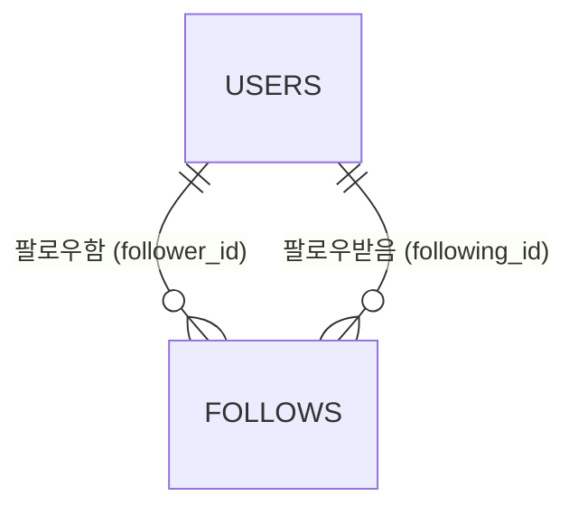

# 팔로우 백엔드·연동 계획

WBS 9.0 팔로우(9.1~9.5)를 실제 백엔드에 연결하기 위한 단계별 계획이다. ERD의 `follows` 테이블로 백엔드 구조와 API를 먼저 만들고, 그다음 프론트엔드 화면이 그 API를 쓰도록 연결한다.

- 각 단계는 사용자가 그 단계를 요청할 때만 시작한다. 한 단계가 끝나도 다음 단계를 자동으로 시작하지 않는다.
- 팔로우 도메인 구현은 2026-11-09 사용자 요청으로 시작했고 `AGENTS.md`의 승인 범위에 반영했다. 구현된 API 계약은 [팔로우 API](follow-api.md)를 따른다.
- API 경로와 메서드는 WBS를 따른다. WBS에 없는 API를 더하거나 WBS와 다르게 정한 항목은 1절에 적는다.

## 1. 결정 사항

| 날짜 | 결정 |
|---|---|
| 2026-11-09 | 백엔드 API를 먼저 구현하고, 프론트엔드가 그 API를 쓰도록 연결한다. |
| 2026-11-09 | `follows.follower_id`와 `following_id`는 모두 `users.id`를 참조한다. |
| 2026-11-09 | `/profile/me`에서 내 팔로워·팔로잉 목록을 열면 `/users/{내 tag}/follows`로 이동한다. 다른 사용자의 목록도 같은 `/users/{slug}/follows`를 쓴다(WBS 9.3·9.4). |
| 2026-11-09 | WBS에 없는 `GET /api/v1/users/{slug}/follow`를 추가한다. 팔로워·팔로잉 수와, 요청자가 그 사용자를 팔로우하는지·알림 설정을 응답한다(4절 "팔로우 상태"). |
| 2026-11-09 | 알림 설정은 `activity_notification_enabled` 하나로 둔다. 목업의 두 항목(새 게시글·새 프로젝트 모집)은 화면에서 나눠 보여 줄 필요가 없으므로, 체크박스 하나로 함께 켜고 끈다. |
| 2026-11-09 | 팔로워·팔로잉 목록과 수에는 별도 조건을 두지 않는다. 회원 상태나 태그 유무와 관계없이 `follows`의 관계를 모두 넣는다. |
| 2026-11-09 | 이미 팔로우한 상태의 POST와 팔로우하지 않은 상태의 DELETE는 오류 없이 현재 상태를 응답한다. |

## 2. ERD

출처는 사용자가 제공한 ERD 이미지(follows)다. 두 키 컬럼에 키 표시가 있으므로 `(follower_id, following_id)`를 복합 기본 키로 본다. 이미지에는 NULL 여부와 기본값이 없어서, 아래 표의 NULL·기본값은 제안이며 1단계에서 ERDCloud와 맞춘다. DATETIME은 기존 기준대로 Java `LocalDateTime`, PostgreSQL `timestamp without time zone`으로 매핑한다.

### follows — 팔로우 관계

| 필드 | 타입 | NULL | 기본값 | 의미 |
|---|---|---|---|---|
| follower_id | BIGINT / PK, FK | 불가 | | 팔로우하는 사용자 `users.id` |
| following_id | BIGINT / PK, FK | 불가 | | 팔로우받는 사용자 `users.id` |
| activity_notification_enabled | BOOLEAN | 불가(제안) | `false`(제안) | 팔로우하는 사용자가 상대의 활동(새 게시글·새 프로젝트 모집) 알림을 받을지 여부 |
| created_at | DATETIME | 불가(제안) | | 팔로우한 시각 |

- 기본 키가 같은 관계를 두 번 팔로우하지 못하게 막는다. 자기 자신을 팔로우하는 요청은 Service에서 거절한다.
- 알림 기본값 `false`는 목업을 따른다(`mocks/follow.ts`의 `defaultFollowPreferences`. 팔로우 직후 알림은 꺼져 있다).
- 언팔로우하면 행을 지운다. 알림 설정도 함께 사라지고, 다시 팔로우하면 `false`로 시작한다(목업 안내 문구 "언팔로우하면 설정이 해제됩니다."와 같다).
- `updated_at`이 없으므로 `BaseEntity`를 상속하지 않는다. 피드 계획의 `feed_likes`와 같은 방식이다.



### 현재 코드와 대조 (2026-11-09)

- `follows` 엔티티와 DDL은 develop과 원격 브랜치 어디에도 없다. `docs/sql`에도 없다.
- `users`는 `Member` 엔티티(`entity/Member.java`)가 매핑한다. `Member`는 인증 담당 코드이므로 고치지 않고 연관관계 대상으로만 쓴다.
- `users.tag`는 회원가입 때 저장되지 않고 프로필 수정(WBS 3.2)에서 정해진다. 그래서 태그가 없는 회원이 있을 수 있다. 태그는 영문·숫자·밑줄·하이픈 2~30자이고, `me`는 쓸 수 없으며, 대소문자를 구분하지 않고 중복을 막는다(`ProfileUpdateRequest`, `ProfileUpdateService`).

## 3. 백엔드 구조

기존 계층형 패키지(`backend/src/main/java/com/devmozip/backend`)를 따른다. 탭 들여쓰기와 생성자 주입을 쓰고, 응답 DTO는 record로 만든다. 엔티티를 API 응답으로 직접 쓰지 않는다. Service는 프로젝트 기능처럼 인터페이스와 `service/impl` 구현으로 나눈다.

| 위치 | 파일 | 역할 |
|---|---|---|
| entity | Follow, FollowId | `follows` 매핑. `FollowId`는 `(followerId, followingId)` 복합 키이고, `@MapsId`로 `Member` 두 개와 연결한다 |
| repository | FollowRepository | 관계 조회, 언팔로우·알림 설정 변경(바뀐 행 수 반환), 수 세기 |
| repository | FollowQueryRepository | 목록(검색·필터·페이지) SQL. 직군·기술 스택을 JSONB로 검색하므로 `LikedPostsQueryRepository`처럼 JDBC로 둔다 |
| security/member | CurrentMemberProvider | 요청자 식별. 피드·개발자 탐색 계획과 함께 쓴다 |
| service | FollowTargetFinder | `{slug}`로 대상 사용자 찾기(프로필 조회와 같은 조건) |
| service | FollowService, impl/FollowServiceImpl | 팔로우·언팔로우·알림 설정 (9.1, 9.2, 9.5) |
| service | FollowQueryService, impl/FollowQueryServiceImpl | 팔로워·팔로잉 목록과 팔로우 상태 (9.3, 9.4, 추가 API) |
| controller | FollowController, FollowExceptionHandler | `/api/v1/users/{slug}/follow`·`followers`·`following`·`notify`. 쿼리 형식 오류를 400으로 바꾼다 |
| dto/follow | 요청·응답 record | 팔로우 상태, 팔로우 결과, 목록 항목, 페이지, 알림 설정 |

`ProfileController`도 `/api/v1/users`를 쓰지만 하위 경로가 겹치지 않는다. `ProfileController`는 고치지 않는다.

### 요청자 식별

- Spring Security 인증 정보(`Authentication.getName()`의 이메일)로 회원을 찾는다. 요청 본문이나 쿼리로 받은 사용자 ID는 신뢰하지 않는다.
- [SNS 피드 계획](feed-plan.md) 3단계, 개발자 탐색 계획과 담당이 같으므로 하나를 함께 쓴다. 팔로우 3단계에서 `security/member/CurrentMemberProvider`로 먼저 만들었다(`find()`: 공개 조회용, `requireActive()`: 쓰기 요청용). 프로젝트의 `ProjectCurrentUserProvider`는 프로젝트 담당 코드이므로 고치거나 가져다 쓰지 않는다.
- 쓰기 요청은 `ACTIVE`·`WARNED` 회원만 할 수 있다(프로젝트와 같다). `SUSPENDED` 회원은 JWT 필터에서 이미 막힌다.
- 공개 GET 요청이라도 토큰이 있으면 JWT 필터가 인증 정보를 채운다. 그래서 로그인한 요청자가 각 사용자를 팔로우하는지(`followed`)를 목록 응답에 함께 담을 수 있다.

### 대상 사용자

- `{slug}`는 `users.tag` 원문이다(3.1 프로필 조회와 같다).
- 대상은 프로필 조회(`ProfileService.findBySlug`)와 같은 조건으로 찾는다. 즉 `status = ACTIVE`이고 직군이 있는 사용자만 대상이 되며, 아니면 404로 응답한다. `ProfileService`는 프로필 담당 코드이므로 고치지 않고, 같은 조건을 팔로우 쪽에서 적용한다.
- 이 조건은 `{slug}`로 대상을 찾을 때만 쓴다. 목록과 수에는 조건 없이 `follows`의 관계를 모두 넣는다(1절).

### 공개 경로

- 비로그인 사용자도 팔로워·팔로잉 목록을 볼 수 있다(`docs/frontend-pages.md`: 목록은 공개, 변경은 로그인 필요).
- 공개 GET을 열려면 공통 `SecurityConfig`에 `GET /api/v1/users/{slug}/follow`·`/followers`·`/following`을 `permitAll`로 추가해야 한다. 공통 인증 설정이므로 바꾸기 전에 팀에 공유한다. POST·DELETE·PUT은 지금의 `anyRequest().authenticated()`를 그대로 따른다.

### 오류 응답

- Service는 `ResponseStatusException`을 던지고, 기존 `GlobalExceptionHandler`가 `ErrorResponse`로 바꾼다. `ProfileExceptionHandler`는 프로필 Controller에만 적용되므로 팔로우 응답에는 쓰이지 않는다.
- 400 입력 오류·자기 자신 팔로우, 401 로그인 필요, 403 이용할 수 없는 계정 상태, 404 대상 사용자 없음, 409 팔로우하지 않은 사용자의 알림 설정.

### DB 반영 주의

- `ddl-auto: update`이므로 엔티티를 추가한 서버를 재시작하면 연결된 DB에 `follows` 테이블이 생긴다. 공용 개발 DB에 연결되어 있으면 반영 시점을 팀과 맞춘다.
- 기본 키가 `follower_id`부터 시작하므로 팔로잉 목록은 기본 키 인덱스로 빠르게 찾지만, 팔로워 목록은 `following_id`로 찾아야 한다. 그래서 `following_id` 인덱스를 두는 것을 제안한다. ERD에 없는 인덱스이므로 1단계에서 함께 확인한다.

## 4. API

WBS를 기준으로 한다. "로그인"은 로그인한 요청자 본인 기준으로 동작한다는 뜻이다.

| 코드 | 메서드·경로 | 인증 | 동작 |
|---|---|---|---|
| 9.1 | `POST /api/v1/users/{slug}/follow` | 로그인 | 팔로우 |
| 9.2 | `DELETE /api/v1/users/{slug}/follow` | 로그인 | 언팔로우. 알림 설정도 함께 지운다 |
| 9.3 | `GET /api/v1/users/{slug}/followers` | 공개 | 팔로워 목록 |
| 9.4 | `GET /api/v1/users/{slug}/following` | 공개 | 팔로잉 목록 |
| 9.5 | `PUT /api/v1/users/{slug}/notify` | 로그인 | 내가 팔로우한 `{slug}`의 활동 알림 켜기·끄기 |
| 추가 | `GET /api/v1/users/{slug}/follow` | 공개 | 팔로워·팔로잉 수와 내 팔로우 여부·알림 설정 (1절) |

WBS 6.6(개발자 탐색 카드의 팔로우·언팔로우)도 9.1·9.2와 같은 API를 쓴다.

### 팔로우·언팔로우 (9.1·9.2)

- 대상이 자기 자신이면 400으로 응답한다.
- 응답에는 최종 상태를 담는다: `{ "followed": true, "activityNotificationEnabled": false, "followerCount": 12 }`. 화면은 이 값으로 버튼과 수를 맞추고, 요청 중에는 버튼을 막는다.
- 이미 팔로우한 상태의 POST와 팔로우하지 않은 상태의 DELETE는 아무것도 바꾸지 않고 현재 상태를 200으로 응답한다(1절). 두 탭에서 누르거나 버튼을 두 번 눌러도 화면이 서버 상태로 맞춰진다.
- 같은 POST가 동시에 두 번 오면 기본 키가 충돌한다. 이 충돌도 이미 팔로우된 상태로 보고 현재 상태를 응답한다.

### 목록 (9.3·9.4)

- 요청: `q`(검색어, 100자 이내), `available`(`true`면 협업 가능한 사용자만), `page`(0부터), `size`(기본 20, 최대 100. 피드·프로젝트 목록과 같다).
- 검색: 입력한 문자열이 닉네임·태그·직군·기술 스택 중 하나에 포함된 사용자를 찾는다. 대소문자는 구분하지 않는다(목업의 검색 대상인 닉네임·핸들·직군·기술과 같다).
- `available=true`는 `collaboration_status = AVAILABLE`인 사용자만 남긴다. 프로필 상단의 "협업 가능" 표시 기준(`ApiProfileHeader`)과 같다.
- 정렬: 최근에 팔로우한 순서(`follows.created_at` 내림차순, 같으면 사용자 id 내림차순).
- 응답: `items`, `page`, `size`, `hasNext`, `totalCount`(검색·필터를 적용한 전체 수). 화면은 다음 페이지 표시 버튼으로 `page + 1`을 요청해 기존 목록 뒤에 붙인다(피드 목록과 같다). 그사이 목록이 바뀌어 같은 사용자가 다시 오면, 이미 있는 태그는 다시 넣지 않는다.
- 항목:

```json
{
  "tag": "dev-tag",
  "nickname": "개발자",
  "profileImage": null,
  "jobCategories": ["백엔드 개발자"],
  "career": "2년 차",
  "skills": ["Java", "Spring Boot"],
  "collaborationStatus": "AVAILABLE",
  "followed": true,
  "activityNotificationEnabled": false
}
```

- 목록과 수에는 별도 조건이 없다(1절). 태그가 없는 회원도 포함되며, 그 항목의 `tag`는 `null`이다. 그래서 검색·필터가 없을 때의 `totalCount`는 팔로우 상태 API의 수와 같다.
- `followed`와 `activityNotificationEnabled`는 요청자가 이 사용자를 팔로우하는지와 그 알림 설정이다. 비로그인이면 둘 다 `false`다.
- 이메일, 사용자 id, 결제 정보는 응답에 넣지 않는다. 내 항목인지는 화면이 내 프로필의 태그와 비교해 판단한다.

### 알림 설정 (9.5)

- 요청: `{ "activityNotificationEnabled": true }`. 응답도 같은 형태다.
- 이 값 하나로 상대의 새 게시글 알림과 새 프로젝트 모집 알림을 함께 켜고 끈다(1절).
- 내가 `{slug}`를 팔로우하지 않았으면 409로 응답한다(목업 문구 "팔로우한 개발자의 알림만 설정할 수 있습니다.").
- 9.5의 범위는 값을 저장하는 데까지다. 이 값을 보고 실제 알림을 만드는 처리는 WBS 12.0 알림에 해당 행이 없고, 알림 테이블과 API도 아직 없어 이 계획에 넣지 않는다. 나중에 알림을 만드는 쪽은 `follows`에서 작성자의 팔로워 중 `activity_notification_enabled = true`인 사용자를 읽으면 된다.

### 팔로우 상태 (추가 API)

WBS 9.x에는 프로필 상단과 목록 탭에 필요한 수와 팔로우 여부를 주는 API가 없고, 3.1 프로필 조회도 팔로우 수를 응답하지 않는다(`docs/profile-detail-api.md`). 그래서 9.1·9.2와 같은 경로에 GET을 추가한다(1절).

- `GET /api/v1/users/{slug}/follow` 응답: `{ "followerCount": 12, "followingCount": 8, "followed": false, "activityNotificationEnabled": false }`.
- `followed`와 `activityNotificationEnabled`는 요청자 기준이다. 비로그인이거나 본인 프로필이면 `false`다.

## 5. 프론트엔드 연결

현재 팔로우는 Mock 상태로 동작한다. 팔로우 관계는 `lib/state/profileStore.ts`를 거쳐 localStorage `devmozip:profiles:v1`의 `following`에, 알림 설정은 `followPreferences`에 저장된다. 사용자는 Mock 프로필 id(`yuna` 등)로 구분한다.

- BFF: `app/api/profiles/[slug]/...` Route Handler를 둔다. 기존 프로필 BFF(`app/api/profiles/[slug]/route.ts`)처럼 `backendFetch`를 쓰고, `validProfileSlug`로 경로 값을 확인한다. 쓰기 요청은 같은 출처인지 확인하고(`followRequestGuard`. 프로젝트 BFF처럼 브라우저가 보낸 `Host`와 비교한다), 사용자 ID를 백엔드로 보내지 않는다.

| BFF 경로 | 메서드 | 백엔드 |
|---|---|---|
| `/api/profiles/[slug]/follow` | GET·POST·DELETE | `/api/v1/users/{slug}/follow` |
| `/api/profiles/[slug]/followers` | GET | `/api/v1/users/{slug}/followers` |
| `/api/profiles/[slug]/following` | GET | `/api/v1/users/{slug}/following` |
| `/api/profiles/[slug]/notify` | PUT | `/api/v1/users/{slug}/notify` |

- 응답 해석: `types/followApi.ts`, `lib/profiles/followApi.ts`. BFF 공통 처리와 팔로우 오류 문구: `lib/profiles/followProxy.ts`. Mock 화면이 계속 쓰므로 `types/follow.ts`와 `lib/profiles/followService.ts`는 그대로 둔다. `lib/profiles/profileProxy.ts`의 오류 문구(예: 409 "닉네임 또는 태그가 이미 사용 중이에요.")는 프로필용이므로 팔로우 오류 문구는 따로 둔다.
- 팔로우 버튼은 `components/profile/FollowButton.tsx`에 두고 프로필 상단·목록이 함께 쓴다. 개발자 탐색 계획 5단계의 카드 버튼도 이것을 쓴다.

### 화면

| 화면 | 위치 | 연결 내용 |
|---|---|---|
| 팔로워·팔로잉 목록 `/users/{slug}/follows` | `app/(user)/users/[userId]/follows/page.tsx`와 같은 경로의 `_components` | 경로 값을 Mock 프로필 id가 아니라 `tag`로 읽는다(`/users/[userId]` 프로필 화면과 같다). 제목의 닉네임과 없는 사용자 처리는 3.1 프로필 조회를 쓴다. 탭·검색어·협업 가능 필터는 지금처럼 `?tab=followers\|following&q=&available=yes`로 유지하고, 서버 목록 요청에 그대로 넘긴다. 탭의 수는 팔로우 상태 API에서 받는다. 팔로우·언팔로우·알림 설정 버튼과 "내 프로필" 표시를 API로 바꾸고, 알림 요약은 "활동 알림 켜짐·꺼짐" 하나로 표시한다. 태그가 없는 사용자는 프로필 링크와 팔로우 버튼 없이 표시한다 |
| 알림 설정 창 | `app/(user)/users/[userId]/_components`에 API용 창 추가 | 9.5를 호출한다. 체크박스는 활동 알림(새 게시글·새 프로젝트 모집) 하나다. Mock `FollowSettings.tsx`는 그대로 둔다 |
| 내 프로필 `/profile/me` | `ApiProfileHeader.tsx`의 팔로워·팔로잉 버튼 | 지금은 "—"로 막혀 있다. 수를 표시하고, 누르면 `/users/{내 tag}/follows?tab=followers` 또는 `?tab=following`으로 이동한다. 태그가 없으면 버튼을 막고, 프로필 수정에서 태그를 정하면 볼 수 있다고 안내한다 |
| 다른 사용자 프로필 `/users/{slug}` | `ApiProfileHeader.tsx` | 수 표시와 목록 이동은 위와 같다. 로그인한 사용자에게는 팔로우·언팔로우 버튼을, 팔로우 중이면 알림 설정 버튼도 보인다. 비로그인이면 "로그인하고 팔로우" 버튼으로 로그인 화면에 보낸다. 본인 프로필에는 팔로우 버튼을 두지 않는다 |

- `ApiProfileHeader.tsx`는 프로필(WBS 3.x) 담당 코드다. 팔로우 표시는 별도 컴포넌트로 만들고, 헤더에서는 지금의 팔로워·팔로잉 버튼 자리만 그 컴포넌트로 바꾼다. 바꾸기 전에 프로필 담당자에게 공유한다.
- 목업 프로필 상단(`ProfileHeader.tsx`)은 수를 누르면 미리보기 창을 연다. API 화면은 1절 결정대로 목록 화면으로 바로 이동한다.
- Mock 목록 화면의 비공개 계정 처리(`canViewProfile`)는 `users`에 공개 여부 컬럼이 없어 API 화면으로 옮기지 않는다. 개인정보 설정(WBS 17.0)이 DB에 연결될 때 함께 맞춘다.
  - 2026-11-10 [개인정보 설정 계획](privacy-settings-plan.md) 4단계에서 맞췄다. `users.is_private`가 생겼고, 대상이 비공개 계정이면 본인 외에는 상태·목록·팔로우·언팔로우가 403 "비공개 계정입니다."다. 목록 항목에서는 비공개 계정을 빼고, 탭의 수는 기존처럼 모든 관계를 센다. 목록 화면은 403이면 Mock과 같은 비공개 안내를 보여 준다. 계약은 [follow-api.md](follow-api.md)와 [privacy-settings-api.md](privacy-settings-api.md)에 있다.
- 로딩·빈 목록·오류·재시도, 비로그인 안내, 중복 클릭 방지를 처리한다. 버튼 상태는 응답의 최종 상태로 맞춘다.
- 목록에서 언팔로우해도 그 항목은 바로 빼지 않고 버튼만 "팔로우"로 바꾼다. 다음 페이지를 붙이는 목록에서 항목을 빼면 페이지 위치가 어긋나기 때문이다. 다시 불러오면 목록에서 빠진다. 탭의 수는 팔로우를 바꿀 때마다 다시 받는다.

### 같은 팔로우 상태를 쓰는 다른 화면

아래 화면은 Mock 프로필과 Mock 팔로우 관계를 계속 쓴다. 표시 대상이 실제 회원이 아니라 Mock 프로필이므로 이 계획에서는 바꾸지 않는다. 각 기능이 실제 데이터로 바뀔 때 9.x API를 쓰도록 담당자에게 공유한다.

| 화면 | 위치 | 비고 |
|---|---|---|
| 개발자 탐색 카드의 팔로우, 팔로잉 탭 | `app/explore/page.tsx`, `app/explore/_components/DeveloperResults.tsx` | WBS 6.5·6.6. 6.6은 9.1·9.2와 같은 API를 쓴다. 6.5의 `following=true` 검색은 `follows`를 읽는다 |
| 피드 팔로잉 탭, 메인 SNS 미리보기 | `app/feeds`, `app/_components/FeedPreview.tsx`, `lib/social/socialService.ts` | WBS 8.2. [SNS 피드 계획](feed-plan.md)의 `GET /api/v1/feeds/following`이 `follows`를 읽으므로, 이 계획 2단계의 `Follow` 엔티티가 먼저 있어야 한다 |
| AI 매칭 추천 카드의 팔로우 | `app/ai/matching/_components/RecommendationPanel.tsx` | WBS 10.0 |
| 팔로잉 개발자 소식 | `app/notifications/_components/FollowNotices.tsx`, `lib/messaging/messagingService.ts` | WBS 12.0. 목업은 팔로우할 때 상대에게 "새 팔로워" 알림도 만든다. 알림 API가 없어 이 계획에서는 만들지 않는다(4절 알림 설정 참고) |

## 6. 단계별 진행

모든 단계에서 `frontend`의 `npm run build`와 관련 테스트를 실행한다. 백엔드 코드를 바꾼 단계는 `backend`의 `./gradlew test`도 실행한다. 실행한 명령, 성공·실패, 실행하지 못한 이유를 7절에 기록한다.

### 1단계 — ERD·정책 확정

- [x] API 연동 순서, `follows`의 참조 대상, `/profile/me`에서 여는 목록 경로 결정 (2026-11-09)
- [x] 팔로우 상태 API 추가, 알림 설정 하나, 목록·수 조건 없음, 중복 요청 처리 결정 (2026-11-09)
- [ ] ERDCloud의 `follows` NULL·기본값과 `following_id` 인덱스 확인 (구현은 2절 제안값으로 했다. 다르면 엔티티를 맞춘다)
- [x] 실제 DB의 `follows` 테이블과 데이터 유무 확인 (2026-11-09)
- [ ] 공유: 프로필 담당자(`ApiProfileHeader`의 팔로우 자리, `SecurityConfig` 공개 GET), 탐색 담당자(6.5·6.6이 쓸 API)

완료 조건: ERD와 DB 확인, 담당자 공유가 끝나 있다.

### 2단계 — 엔티티·Repository

- [x] `Follow`·`FollowId` 엔티티와 `FollowRepository`·`FollowQueryRepository`
- [x] Testcontainers PostgreSQL로 매핑, 복합 키, 목록 검색(JSONB 직군·기술 스택), 수 세기 테스트
- [ ] 개발 서버 재시작 전 DB 반영 시점 공유

완료 조건: `./gradlew test` 통과. Docker가 없으면 Testcontainers 테스트가 건너뛰어지므로 통과로 보고하지 않는다.

### 3단계 — 팔로우 API (9.1~9.5)

- [x] 요청자 식별 구성요소(피드와 공유), DTO, `FollowService`·`FollowQueryService`, `FollowController`
- [x] 공개 GET 경로를 `SecurityConfig`에 반영 (팀 공유는 남음)
- [x] 테스트: 자기 자신 팔로우, 없거나 조건에 맞지 않는 대상, 중복 요청과 동시 팔로우의 현재 상태 응답, 언팔로우 후 알림 설정 삭제, 태그가 없거나 `ACTIVE`가 아닌 회원의 목록·수 포함, 팔로우 상태 API의 수와 요청자 기준 값, 팔로우하지 않은 사용자의 알림 설정, 비로그인 목록 조회와 쓰기 요청, 요청자 기준 `followed`, 검색·필터·페이지
- [x] API 문서 `docs/follow-api.md` 작성

### 4단계 — 프론트엔드 연결

- [x] BFF Route Handler, 응답 해석, 타입과 테스트
- [x] `/users/{slug}/follows` 목록과 알림 설정 창
- [x] 프로필 상단의 팔로워·팔로잉 수와 팔로우 버튼 (프로필 담당자 공유는 남음)
- [x] 로딩·빈 목록·오류·비로그인 처리
- [x] 실제 백엔드·PostgreSQL로 팔로우 → 목록 → 알림 설정 → 언팔로우, `/profile/me` → 내 목록 이동 확인 (임시 PostgreSQL에 연결한 서버로 BFF 요청까지 확인. 브라우저 화면 조작은 하지 않음)

완료 조건: 빌드·테스트 결과와 실제 서버 연결 확인 여부를 따로 기록한다. Mock 테스트 통과는 실제 DB 검증이 아니다.

## 7. 진행 기록

| 날짜 | 단계 | 내용 |
|---|---|---|
| 2026-11-09 | 계획 | 이 문서 작성. WBS 9.1~9.5, ERD `follows`, 현재 Mock 화면과 백엔드 코드 대조. 코드 변경 없음. |
| 2026-11-09 | 1단계 | `GET /api/v1/users/{slug}/follow` 추가, 알림 설정을 체크박스 하나로 통합, 목록·수에 별도 조건 없음, 중복 팔로우·언팔로우 요청에 현재 상태 응답 결정 반영. 코드 변경 없음. |
| 2026-11-09 | 1단계 | 개발 DB 읽기 확인: `follows` 없음. `users` 10명 중 태그 없는 회원 1명, `ACTIVE`가 아닌 회원 1명. `job_categories`·`skills`는 `jsonb` 배열. ERDCloud 대조와 담당자 공유는 남음. |
| 2026-11-09 | 2단계 | `Follow`·`FollowId`·`FollowRepository`·`FollowQueryRepository` 추가. NULL·기본값·`following_id` 인덱스는 2절 제안값으로 반영했다. `FollowRepositoryTest` 6개를 Testcontainers PostgreSQL에서 실행해 통과(건너뜀 0). 개발 서버는 재시작하지 않아 공용 개발 DB에는 아직 `follows`가 없다. |
| 2026-11-09 | 3단계 | `CurrentMemberProvider`, `FollowTargetFinder`, `FollowService`·`FollowQueryService`와 구현, `FollowController`·`FollowExceptionHandler`, DTO, `SecurityConfig` 공개 GET 3개, `docs/follow-api.md`. `FollowApiIntegrationTest` 16개 실행·통과(건너뜀 0). 동시 팔로우 8건 중 7건이 기본 키 충돌을 거쳐 모두 `followed: true`로 응답했다. 백엔드 전체 `./gradlew test`(저장소 밖 복사본): 640개 중 629개 통과, 11개 건너뜀(팀 DB 설정이 필요한 프로젝트 테스트), 실패 0. develop에서 이미 컴파일되지 않는 AI 테스트 2개(`AiRecommendationDatabaseTest`, `AiRecommendationExecutionTests`. `ProjectRecruitmentSlot`의 `roleCode`가 `String`으로 바뀐 뒤 갱신되지 않음)는 복사본에서 빼고 실행했다. |
| 2026-11-09 | 4단계 | BFF 4개 경로(`follow`·`followers`·`following`·`notify`), `followApi`·`followProxy`, `FollowButton`, `ApiFollowSummary`(`ApiProfileHeader`의 팔로워·팔로잉 자리), `ApiFollowSettings`, `/users/{tag}/follows` API 화면. Mock 목록 화면을 검사하던 테스트 3개를 API 화면 테스트로 바꿨다. 저장소 밖 복사본에서 `npm run build` 성공, `npm run typecheck` 성공, vitest 74개 파일 849개 통과, 변경 파일 eslint 오류 0. 임시 PostgreSQL·Redis에 연결한 백엔드와 `next start`로 BFF를 거쳐 가입 → 태그 설정 → 팔로우(두 번) → 팔로워·팔로잉 목록과 검색·필터 → 알림 켜기 → 자기 자신·비로그인·다른 사이트·팔로우하지 않은 사용자의 알림 설정 거절 → 언팔로우(두 번) → 다시 팔로우 시 알림 꺼짐 → 내 프로필 태그와 목록 화면 응답 200을 확인했다. 브라우저에서 화면을 직접 조작한 확인은 하지 않았다. 담당자 공유는 남음. |
| 2026-11-09 | 4단계 확인 | 같은 임시 환경에서 헤드리스 Chromium(1440px)으로 확인했다. 목록에서 팔로우 → 언팔로우(항목 유지), 프로필에서 알림 켜고 저장 → 새로고침 후 유지 → 끄기, 언팔로우 시 팔로워 수 감소와 알림 설정 버튼 숨김, 다시 팔로우. 페이지 오류·실패한 API 호출 없음. |
| 2026-11-10 | 4단계 수정 | Docker 개발 서버(`next dev --hostname 0.0.0.0`)에서 팔로우·언팔로우·알림 설정이 403 "같은 사이트에서 요청해 주세요."로 막혔다. `profileRequestGuard`는 `Origin`을 Next 내부 URL(`request.url`)과 비교하는데, 이 환경에서는 내부 URL의 호스트가 브라우저 주소와 다르다. 팔로우 BFF는 `followProxy.ts`의 `followRequestGuard`로 바꿔 프로젝트 BFF(`projectGuard`)처럼 브라우저가 보낸 `Host`와 비교한다. 프로필 담당 코드인 `profileRequestGuard`는 바꾸지 않았다(같은 환경에서 프로필 수정 `PUT /api/profiles/me/profile`도 403). 실행 중인 개발 서버에서 같은 사이트 요청은 검사를 통과하고(쿠키 없이 401), 다른 사이트 요청은 403인 것을 확인했다. 저장소 밖 복사본에서 vitest 74개 파일 850개 통과, `npm run typecheck`·`npm run build` 성공, 변경 파일 eslint 오류 0. |
