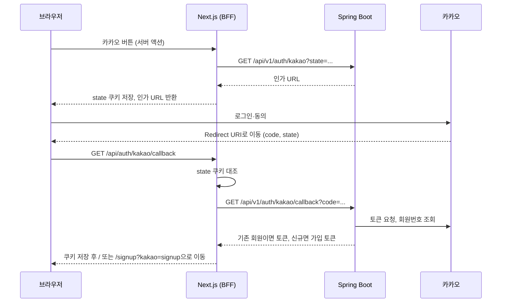

# 카카오 OAuth 연동 계획

회원가입·로그인·회원정보 수정에서 카카오 계정을 쓰기 위한 단계별 수행 계획이다.

- 상태: 7단계까지 완료했다. 단계별 상태는 6번, 진행 내용은 9번에 기록한다.
- 이 문서는 구현 승인이 아니다. 각 단계는 사용자 요청을 받아 시작하고, 완료 보고 후 다음 단계를 자동으로 시작하지 않는다.
- 작업은 develop 기준으로 검증한다. 커밋·푸시·main 병합·배포는 사용자가 요청할 때만 한다.

## 1. 범위

| 구분 | 내용 |
|---|---|
| 포함 | 카카오 신규 가입, 카카오 로그인, `/settings/privacy`의 연동·해제(비밀번호 유무와 관계없이 모든 회원), 비밀번호 없는 회원의 비밀번호 설정 |
| 제외 | ID 토큰(OIDC) 검증, 이메일 동의항목, 어드민 키, 연결 해제 웹훅, 비밀번호가 있는 회원의 비밀번호 변경(WBS 17.2), 비밀번호 재설정, 회원 탈퇴 |

## 2. 확정 사항

| 항목 | 결정 |
|---|---|
| 신규 가입 이메일 | 가입 폼에서 직접 입력받는다. 카카오 이메일 동의항목은 쓰지 않는다. |
| 기존 이메일과 겹칠 때 | 자동 연결하지 않는다. 기존 계정으로 로그인한 뒤 설정에서 연동하도록 안내한다. |
| 이미 등록된 카카오 계정으로 가입 시도 | OAuth 동의 화면 이후 일치하는 회원이 있으면 로그인 처리하지 않고 `/signup`으로 돌아와 "이미 등록된 회원입니다."를 표시한다. |
| 연동 대상 | 비밀번호 유무와 관계없이 모든 회원이 연동할 수 있다. OAuth 인증에는 비밀번호 해시를 쓰지 않는다. |
| 연동 후 로그인 | 카카오 로그인을 허용한다. |
| `kakao_id` | 카카오 회원번호(`https://kapi.kakao.com/v2/user/me` 응답의 `id`)를 저장한다. 카카오 Access·Refresh Token은 저장하지 않는다. |
| 가입 API | 이메일 가입과 카카오 가입 모두 `POST /api/v1/auth/signup` 하나로 처리한다. 비밀번호 저장 여부만 다르다. |
| 카카오 가입 입력 항목 | 비밀번호만 빼고 이메일, 닉네임, 직군, 경력, 기술 스택, 관심 분야, 협업 여부를 받는다. |
| 가입 폼의 카카오 회원번호 확인 | 회원번호를 서명한 JWT(가입 토큰)를 HttpOnly 쿠키에 두고 제출 때 검증한다. 브라우저가 보낸 회원번호는 믿지 않는다. |
| 서비스 주소 변수 | `DOMAINNAME`으로 읽는다. |
| 비밀번호 없는 회원의 연동 해제 | 로그인 수단이 없어지므로 차단한다. |
| `/settings/privacy`의 비밀번호 입력 | `kakao_id`가 있고 `password_hash`가 없으면 "현재 비밀번호"를 숨긴다. 입력한 새 비밀번호는 `password_hash`에 저장한다. |
| `KAKAO_ADMIN_KEY` | 추가하지 않는다. 연동을 해제할 때 카카오 인증을 다시 받아 새 액세스 토큰으로 처리한다. |

## 3. 환경변수

실제 값은 `.env`(운영)와 `.env.local`(로컬)에만 둔다. 이 문서와 Git에는 적지 않는다.

| 변수 | 용도 | 형식 |
|---|---|---|
| `KAKAO_REST_API` | REST API 키 | |
| `KAKAO_CLIENT_SECRET` | 토큰 요청용 시크릿 | |
| `KAKAO_REDIRECT_URI` | BFF 콜백 경로 `api/auth/kakao/callback` | 앞에 `/` 없음 |
| `DOMAINNAME` | 서비스 주소 | `http://` 또는 `https://`로 시작, 끝에 `/` 없음 |

백엔드는 `{DOMAINNAME}/{KAKAO_REDIRECT_URI}`로 Redirect URI를 만든다. 결과는 카카오 콘솔에 등록한 운영·로컬 값과 정확히 같아야 한다.

- compose는 네 값을 백엔드에만 전달한다.
- 백엔드는 `DOMAINNAME`이 `http://` 또는 `https://`로 시작할 때만 받는다. 그 외에는 미설정으로 처리해 카카오 API만 503으로 응답한다.
- 서비스 주소에 `HOSTNAME`을 쓰지 않는다. Git Bash가 PC 이름으로 export하고 Next 서버가 바인딩 주소로 쓰는 이름이라 값이 덮어써지거나 서버 기동에 영향을 줄 수 있다.

### 파일별 읽는 주체

- 루트 `.env`: compose가 읽어 백엔드 환경변수로 넘기고 `application.yaml`이 받는다. `DOMAINNAME`이 운영 주소이므로 로컬 compose로 띄우면 카카오 콜백이 운영으로 돌아간다. 로컬 카카오 시험은 `bootRun` + `next dev` 기준으로 한다.
- 루트 `.env.local`: 백엔드 local 프로필이 `application-local.yml`의 `spring.config.import: optional:file:../.env.local[.properties]`로 읽는다. 경로는 `backend` 폴더에서 실행하는 것을 기준으로 한다. `application-local.yml`은 Git에 없으므로 팀원마다 같은 설정을 넣어야 한다.
- 프론트엔드: 카카오 값을 쓰지 않는다. 카카오 통신은 모두 백엔드가 맡는다.

## 4. 동작 흐름

공개 요청은 [프론트엔드로만 전달](../nginx/server.conf)되고 백엔드는 포트를 공개하지 않는다. 그래서 카카오 콘솔에는 BFF 경로 `/api/auth/kakao/callback`을 Redirect URI로 등록하고, BFF가 내부에서 백엔드의 `/api/v1/auth/kakao/callback`을 호출한다.



- **신규 가입:** 가입 토큰은 HttpOnly 쿠키에 둔다. 가입 폼 제출 시 BFF가 쿠키 값을 `kakaoSignupToken`으로 붙여 `POST /api/v1/auth/signup`을 호출하고, 성공하면 바로 로그인 처리 후 `/onboarding`으로 이동한다.
- **연동:** 시작 지점이 설정 화면이고, 콜백에서 로그인한 회원의 토큰과 `code`로 연동 API를 호출한다.
- **해제:** 카카오 인증을 다시 받아 받은 회원번호가 `kakao_id`와 같은지 확인한 뒤, 새 Access Token으로 카카오 연결을 끊고 `kakao_id`를 비운다.

### 설계 기준

| 항목 | 기준 |
|---|---|
| 회원 식별 | 로그인할 때 받은 카카오 회원번호와 `kakao_id`가 일치하는 회원을 찾는다. 카카오 회원번호는 카카오가 앱별로 발급하는 값이며 서비스의 회원 ID(`users.id`)와 별개다. |
| 카카오 토큰 | 요청 처리 중에만 쓰고 저장하지 않는다. 로그에도 남기지 않는다. |
| 회원번호 조회 | 백엔드가 카카오 API `https://kapi.kakao.com/v2/user/me`를 호출해 `id`를 받는다. 이 앱의 `/api/v1/users/me`와는 다른 API다. 이 호출이 카카오의 가입 미완료 자동 연결 해제도 막아 준다. OIDC는 쓰지 않는다. |
| CSRF 방지 | `state`를 HttpOnly·SameSite=Lax 쿠키(10분)에 저장해 콜백에서 대조한다. |
| 시작 방식 | 서버 액션(POST)으로 시작한다. GET으로 시작하면 외부 페이지가 연동·해제를 유도할 수 있다. |
| 가입 토큰 | `type=kakao_signup`인 JWT(30분)다. 액세스·리프레시 토큰 검증을 통과하지 못한다. |
| 화면 이동 | 컨테이너 내부 주소가 섞이지 않도록 내부 경로는 상대 `Location`으로 이동한다. |
| 오류 표시 | URL에는 코드만 싣고 문구는 화면에서 결정한다. 임의 문구를 URL로 주입할 수 없게 한다. |
| 로그 | 상태 코드와 `KOE` 코드만 남긴다. 카카오 오류 설명에 인가 코드가 포함될 수 있어 본문은 남기지 않는다. |
| 응답 | `kakao_id`와 비밀번호 해시는 어떤 API 응답에도 넣지 않는다. |

## 5. API 계약

아래는 백엔드 API이며 경로는 팀 WBS 시트를 따른다. 브라우저는 BFF(`/api/auth/kakao/callback`과 서버 액션)만 호출한다. `providerId`는 카카오 회원번호가 아니라 제공자 이름 `kakao`다.

| 메서드·경로 | WBS | 인증 | 요청 | 성공 응답 |
|---|---|---|---|---|
| `GET /api/v1/auth/kakao` | 15.1 | 없음 | `state` | 200 `{authorizeUrl}` |
| `GET /api/v1/auth/kakao/callback` | 15.1 | 없음 | `code`, `intent`(`login`·`signup`) | 200 `{status: LOGIN, 토큰}`, `{status: SIGNUP_REQUIRED, kakaoSignupToken}` 또는 `{status: ALREADY_REGISTERED}` |
| `POST /api/v1/auth/signup` | 2.1 | 없음 | 가입 항목, 선택 `kakaoSignupToken` | 201 `{id, email, nickname}`, 카카오 가입은 토큰 추가 |
| `GET /api/v1/users/me/social-accounts` | 17.3 | 필요 | 없음 | 200 `{kakaoLinked, passwordSet}` |
| `POST /api/v1/users/me/social-accounts/{providerId}` | 17.3 | 필요 | `{code}` | 204 |
| `DELETE /api/v1/users/me/social-accounts/{providerId}` | 17.3 | 필요 | `code` | 204 |
| `PATCH /api/v1/users/me/password` | 17.2 | 필요 | `{newPassword, confirmPassword}` | 204 |

`POST /api/v1/auth/signup`은 `kakaoSignupToken` 유무로 다음과 같이 나뉜다. 그 외 항목의 검증과 저장은 같다.

| 구분 | 이메일 가입 (토큰 없음) | 카카오 가입 (토큰 있음) |
|---|---|---|
| 비밀번호 | 필수. 기존 규칙 유지 | 받지 않음. 함께 보내면 400 |
| `password_hash` | 저장 | 비움 |
| `kakao_id` | 비움 | 가입 토큰에서 확인한 카카오 회원번호 저장 |
| 응답 | `{id, email, nickname}` | 같은 값 + 액세스·리프레시 토큰 |

- 토큰이 없으면 비밀번호가 필수이므로, 카카오 인증 없이 비밀번호 없는 계정을 만들 수 없다.
- 카카오 회원번호는 요청 본문으로 받지 않고 서명된 가입 토큰으로만 확인한다.
- 카카오 가입 회원은 가입 직후 비밀번호로 로그인할 수 없어 응답에 토큰을 함께 돌려준다.

주요 실패 응답은 다음과 같다.

| 상태 | 상황 |
|---|---|
| 400 | 카카오가 인가 코드를 거절함, 입력 규칙 위반 |
| 401 | 가입 토큰 만료·위조, 로그인 필요 |
| 403 | 정지된 회원 |
| 404 | 지원하지 않는 `providerId` |
| 409 | 이메일·닉네임·카카오 계정 중복, 비밀번호 없는 회원의 해제, 비밀번호가 이미 있는 회원의 설정 요청 |
| 502 | 카카오 서버 연결 실패 |
| 503 | 카카오 환경변수 미설정 |

## 6. 단계별 수행 내용

| 단계 | 내용 | 수행 주체 | 상태 |
|---|---|---|---|
| 0 | 사전 확인 | 사용자 | 로컬 확인, 운영은 main 병합 후 확인 |
| 1 | 환경 설정 연결 | 구현 | 완료 |
| 2 | 회원·토큰 기반 수정 | 구현 | 완료 |
| 3 | 카카오 로그인·가입 API | 구현 | 완료 |
| 4 | 연동 관리·비밀번호 설정 API | 구현 | 완료 |
| 5 | BFF 콜백·서버 액션 | 구현 | 완료 |
| 6 | 화면 연결 | 구현 | 완료 |
| 7 | 통합 검증·문서 정리 | 구현 + 사용자 | 완료 |
| 8 | 운영 배포 | main 병합 후 별도 진행 | 이번 작업에서 제외 |

모든 단계의 공통 종료 조건은 다음과 같다.

- `frontend`에서 `npm run build`와 관련 테스트를 실행한다. 백엔드를 변경한 단계는 `backend`에서 `./gradlew test`도 실행한다.
- 실행 명령, 성공·실패, 실행하지 못한 이유를 보고한다. Mock 테스트 통과를 실제 카카오·DB 검증으로 보고하지 않는다.
- 이 문서의 상태 표와 9번 진행 기록을 갱신한다.

### 0단계: 사전 확인

- 아래 인가 주소를 브라우저로 열어 로컬·운영 Redirect URI를 각각 시험한다. 중괄호 부분은 환경별 실제 값으로 바꾼다.

  ```text
  https://kauth.kakao.com/oauth/authorize?response_type=code&client_id={KAKAO_REST_API}&redirect_uri={DOMAINNAME}/{KAKAO_REDIRECT_URI}
  ```

- 로그인 후 주소창에 `?code=...`가 붙으면 정상이다. 콜백 라우트는 5단계에서 만들기 때문에 화면에는 오류가 표시되어도 된다. `KOE004`는 카카오 로그인 OFF, `KOE006`은 Redirect URI 불일치를 뜻한다. 동의항목 없이도 로그인되는지 함께 확인한다.

**완료 기준:** 두 주소의 시험 결과를 확인했다.

### 1단계: 환경 설정 연결

- `config/KakaoProperties`를 추가해 값을 받고 Redirect URI를 조합·검사한다.
- [application.yaml](../backend/src/main/resources/application.yaml)은 환경변수로 값을 받는다. `application-local.yml`은 루트 `.env.local`을 선택적으로 import한다.
- [compose.yaml](../compose.yaml), [compose.prod.yaml](../compose.prod.yaml)의 백엔드에만 네 값을 전달한다. 값이 없어도 기동하도록 기본값을 빈 값으로 둔다.
- [.env.example](../.env.example)에 자리표시 값을 넣는다. [배포 검증](../.github/workflows/deploy.yml)이 이 파일을 쓴다.
- [AGENTS.md](../AGENTS.md)의 Kakao 연결 금지 규칙을 승인된 범위에 맞게 고치고 근거를 기록한다.

**완료 기준:** 값이 없는 환경에서도 백엔드가 기동하고 다른 인증 테스트가 통과한다. compose 설정 검증(`docker compose ... config --quiet`)이 통과한다. Docker를 쓸 수 없으면 미실행으로 기록한다.

### 2단계: 회원·토큰 기반 수정

- [Member](../backend/src/main/java/com/devmozip/backend/entity/Member.java): `kakao_id` 유니크 제약과 연동·해제·비밀번호 설정 메서드를 추가한다.
- [MemberRepository](../backend/src/main/java/com/devmozip/backend/repository/MemberRepository.java): `findByKakaoId`와 잠금 조회를 추가한다.
- [JwtProvider](../backend/src/main/java/com/devmozip/backend/security/jwt/JwtProvider.java): 가입 토큰 발급·검증을 추가한다.
- [AuthService](../backend/src/main/java/com/devmozip/backend/service/AuthService.java): 비밀번호 확인 없이 토큰을 발급하는 메서드를 추가한다. 재발급은 `UserDetailsService` 대신 회원 정보에서 역할을 읽는다. 현재 구조에서는 비밀번호 없는 회원의 재발급이 실패한다.

이 단계는 공통 인증 코드를 변경하므로 팀에 영향을 공유한다. 저장소 문서에 `kakao_id`를 다룬 ERD·DDL이 없어 유니크 제약은 대조하지 못했다.

**완료 기준:** 비밀번호 없는 회원의 토큰 재발급 성공, 가입 토큰으로 인증·재발급 불가, 비밀번호 있는 회원의 기존 로그인·재발급 유지를 테스트로 확인한다.

### 3단계: 카카오 로그인·가입 API

- `KakaoClient`: 인가 URL 생성, 토큰 요청, 카카오 회원번호 조회, 연결 끊기와 시간 제한·오류 변환을 맡는다.
- `KakaoAuthService`: 기존 회원이면 토큰을, 신규면 가입 토큰을 돌려준다. 가입에서 시작했는데 이미 등록된 회원이면 `ALREADY_REGISTERED`를 돌려준다.
- `KakaoAuthController`와 DTO: `/api/v1/auth/kakao`와 `/api/v1/auth/kakao/callback` 두 경로를 만든다.
- [SignupRequest](../backend/src/main/java/com/devmozip/backend/dto/auth/SignupRequest.java), [SignupResponse](../backend/src/main/java/com/devmozip/backend/dto/auth/SignupResponse.java), [AuthController](../backend/src/main/java/com/devmozip/backend/controller/AuthController.java), [MemberService](../backend/src/main/java/com/devmozip/backend/service/MemberService.java): 기존 회원가입을 5번의 규칙대로 확장한다. 직군·기술 스택·관심 분야는 기존 enum으로 검증한다.

**완료 기준:**

- 기존 이메일 가입 테스트가 그대로 통과하고, 토큰 없이 비밀번호를 뺀 가입은 400으로 거절된다.
- 요청 형식과 오류 변환을 `MockRestServiceServer`로 확인한다.
- 신규·기존·정지 회원, 이메일·닉네임·카카오 중복을 테스트로 확인한다.
- 실제 카카오 토큰 API에 가짜 코드를 보내 `KOE320`이 400으로 변환되는지 확인한다. 이 검증은 실제 로그인 성공을 뜻하지 않는다.

### 4단계: 연동 관리·비밀번호 설정 API

- `SocialAccountController`: 5번의 `social-accounts` 세 경로를 만든다.
- 연동: 비밀번호 유무와 관계없이 허용한다. 다른 회원이 쓰는 카카오 계정이거나 이미 연동된 회원이면 409로 거절한다.
- 해제: 비밀번호가 없으면 카카오를 호출하기 전에 409로 거절한다. 연동한 카카오 계정과 다르면 거절한다.
- [MemberController](../backend/src/main/java/com/devmozip/backend/controller/MemberController.java): `PATCH /me/password`를 추가한다. `kakao_id`가 있고 `password_hash`가 없는 회원만 허용하고, 규칙은 가입과 같다(영문·숫자 포함 8~64자, BCrypt 72바이트 이내).

**완료 기준:** 다른 회원의 값을 바꿀 수 없음, 비밀번호 설정 후 이메일 로그인 성공, 설정 후 해제 가능을 H2 통합 테스트로 확인한다.

### 5단계: BFF 콜백·서버 액션

- `frontend/app/api/auth/kakao/callback/route.ts`: `state`를 대조하고 의도(로그인·가입·연동·해제)에 맞는 백엔드 API를 호출한 뒤 쿠키를 저장하고 이동한다.
- [lib/auth/actions.ts](../frontend/lib/auth/actions.ts): 카카오 시작, 연동 상태 조회, 비밀번호 설정 액션을 추가한다. 기존 회원가입 액션은 카카오 가입일 때만 `kakaoSignupToken`을 붙이고 응답의 토큰으로 로그인 처리한다.
- [lib/auth/cookies.ts](../frontend/lib/auth/cookies.ts): `state`·가입 토큰 쿠키를 추가한다.
- 카카오 호출이 있는 요청은 기본 5초보다 긴 시간 제한을 쓴다.

**완료 기준:** `state` 불일치·누락, 카카오 취소, 의도별 성공·실패 이동을 Vitest로 확인한다. 로컬 서버에서 콜백을 호출해 쿠키와 이동 경로를 확인한다.

### 6단계: 화면 연결

- [/login](../frontend/app/login/page.tsx): 카카오 데모 모달 대신 실제 시작 버튼을 연결하고 오류 안내를 표시한다.
- [/signup](../frontend/app/signup/page.tsx): 카카오 시작 버튼을 추가한다. `?kakao=signup`이면 비밀번호 입력을 숨기고 같은 회원가입 API로 제출한다.
- [/settings/privacy](<../frontend/app/(user)/settings/privacy/page.tsx>):
  - 연동 상태를 서버 값으로 표시하고 연동·해제를 실제 흐름에 연결한다.
  - `kakao_id`가 있고 `password_hash`가 없으면 "현재 비밀번호"를 숨기고, 새 비밀번호를 서버에 저장한다.
  - 비밀번호가 없으면 연동 해제 버튼을 막고 이유를 표시한다.
- 비밀번호가 있는 회원의 입력 폼은 현재 동작을 유지한다.
- 카카오 연동·비밀번호 설정과 직접 관련 없는 화면 문구는 변경하지 않는다.
- 브라우저 저장소의 `kakaoLinked`는 표시에 쓰지 않는다. 기존 저장값을 그대로 읽을 수 있도록 저장 형식은 유지한다.

**완료 기준:** 검증 함수는 Vitest로 확인한다. 브라우저에서 로그인 화면의 버튼이 올바른 Redirect URI로 카카오에 이동하는지, 가입 폼과 설정 화면이 조건대로 표시되는지 확인한다.

### 7단계: 통합 검증·문서 정리

자동 검증으로 `./gradlew test`, `npm test`, `npm run build`를 다시 실행한다. 이어서 실제 카카오 계정으로 로컬에서 다음 시나리오를 확인한다. 계정 로그인이 필요하므로 사용자와 함께 진행한다.

| # | 시나리오 | 기대 결과 |
|---|---|---|
| 1 | 미가입 카카오 계정으로 시작 후 가입 | `/onboarding` 이동, DB에 `kakao_id` 저장, `password_hash` 비어 있음 |
| 2 | 같은 계정으로 재로그인 | 가입 폼 없이 바로 로그인 |
| 3 | 액세스 토큰 만료 후 화면 이동 | 비밀번호 없는 회원도 재발급되어 로그인 유지 |
| 4 | 카카오 가입에 기존 이메일 입력 | 409 안내, 계정 자동 연결 안 됨 |
| 5 | 이메일 회원이 설정에서 연동 후 카카오 로그인 | 같은 회원으로 로그인 |
| 6 | 다른 회원이 쓰는 카카오 계정으로 연동 | 409 안내, 기존 연동 유지 |
| 7 | 비밀번호 없는 회원의 설정 화면 | 현재 비밀번호 숨김, 설정 후 이메일 로그인 가능 |
| 8 | 비밀번호 없는 회원의 연동 해제 | 차단. 비밀번호 설정 후에는 해제되고 카카오 연결도 끊김 |
| 9 | 카카오 동의 취소, `state` 위조 | 로그인되지 않고 안내 표시 |
| 10 | 정지 회원의 카카오 로그인 | 차단 안내 |
| 11 | 이미 등록된 카카오 계정으로 `/signup`에서 시작 | 로그인되지 않고 `/signup`에서 "이미 등록된 회원입니다." 표시 |

문서는 실제 구현에 맞춰 [team-auth-deployment.md](team-auth-deployment.md), [setup-after-ai.md](setup-after-ai.md), [frontend-pages.md](frontend-pages.md), [decisions-pending.md](decisions-pending.md), [README](../README.md)를 갱신하고 [API 명세](kakao-auth-api.md)를 추가한다.

**완료 기준:** 시나리오 결과와 미검증 항목을 구분해 기록했다.

### 8단계: 운영 배포 (이번 작업에서 제외)

운영 확인은 main에 병합된 뒤에만 할 수 있어 develop PR에서 검증할 수 없다. 이번 작업에서 제외하고, main 병합 시 아래 목록으로 별도 진행한다.

[운영 안내](deployment-operations.md)의 develop → main 절차를 따른다. main에 push하면 곧바로 배포되므로 다음을 먼저 확인한다.

1. 서버의 `.env`에 네 값을 추가한다. `.env`는 Git에 없어 배포로 전달되지 않는다.
2. 서버 DB에 중복 `kakao_id`가 없는지 확인한다. 중복이 있으면 유니크 제약이 적용되지 않는다.
3. 백엔드에 전달될 `DOMAINNAME`이 운영 주소인지 서버에서 확인한다. 출력 값은 문서나 채팅에 옮기지 않는다.

   ```bash
   docker compose -f compose.prod.yaml --profile blue --profile green config | grep DOMAINNAME
   ```

배포 후 운영 주소로 Redirect URI 등록과 7단계의 1·2·5번 시나리오를 확인한다.

## 7. 알려진 제한

- 사용자가 카카오 계정 페이지에서 직접 연결을 끊어도 웹훅이 없어 `kakao_id`는 남는다. 다시 카카오로 로그인하면 재연결되며, 웹훅이 필요해지면 대표 어드민 키를 추가한다.
- 비밀번호 설정에 현재 비밀번호를 요구하지 않으므로, 유효한 액세스 토큰을 가진 쪽이 비밀번호를 설정할 수 있다. 토큰은 HttpOnly 쿠키로 보호되고 수명은 30분이다.
- 가입 폼에서 입력한 이메일은 메일 인증을 하지 않는다. 기존 이메일 가입과 신뢰 수준이 같다.
- 비밀번호 변경(WBS 17.2)은 범위 밖이므로, 카카오 회원도 비밀번호를 한 번 설정한 뒤에는 바꿀 수 없다.
- 카카오 회원번호는 개인정보이므로 회원 탈퇴를 구현할 때 함께 파기해야 한다.

## 8. 구현 후 확인 사항

실제 카카오 로그인으로 `https://kapi.kakao.com/v2/user/me`의 `id`를 받는 것을 로컬에서 확인했다. 운영 환경은 main 병합 후 8단계 목록으로 확인한다.

## 9. 진행 기록

### 2026-11-05 계획 문서 작성

- 변경 파일: `docs/kakao-oauth-plan.md`. 코드·설정·`.env`는 변경하지 않았고 구현은 시작하지 않았다.
- 검증: 문서의 링크 대상 존재와 `.env`·`.env.local` 실제 값 미포함을 확인했다. frontend `npm run build`는 성공했다. 문서만 변경하여 새 기능 테스트와 백엔드 테스트는 실행하지 않았다.
- 커밋·푸시는 하지 않았다.

### 2026-11-05 0~2단계

- 0단계: 로컬 Redirect URI에서 `?code=`를 받은 것을 사용자가 확인했다. 운영 주소는 미확인이다.
- 1단계: `KakaoProperties`, `application.yaml`, `compose.yaml`, `compose.prod.yaml`, `.env.example`을 변경했다. Git 제외 파일인 `application-local.yml`에 `.env.local` import를 추가했다.
- 변경 근거: 사용자 요청에 따라 `AGENTS.md`의 Kakao 연결 금지 규칙을 이 문서의 승인 범위로 고쳤다.
- 2단계: `Member`(`kakao_id` 유니크 제약, 연동·해제·비밀번호 변경 메서드), `MemberRepository`(`findByKakaoId`, 잠금 조회), `JwtProvider`(가입 토큰 발급·검증), `AuthService`(`issueTokens`, 회원 정보 기반 재발급)를 변경했다. 가입 토큰 방식은 사용자가 서명한 토큰으로 결정했다. 가입 토큰을 실제로 발급·소비하는 API는 3단계에서 만든다.
- 테스트 추가: `KakaoPropertiesTest`, `AuthServiceTest`, `KakaoMemberAuthIntegrationTest`, `JwtProviderTest`.
- backend `./gradlew test --no-daemon`: 실패. 191개 중 189개 통과, 1개 실패, 1개 스킵이며 새 테스트 31개는 모두 통과했다.
  - 실패: `LocalProfileImageStorageTest.doesNotFollowImageSymlinks`. 테스트의 심볼릭 링크 생성이 Windows 권한 오류로 중단되었다. 해당 테스트와 저장소 코드는 변경하지 않았고, 변경 전 코드에서 재현해 보지는 않았다.
  - 스킵: Docker가 없어 PostgreSQL을 쓰는 `BackendApplicationTests`가 실행되지 않았다.
- 일회용 테스트(실행 후 삭제): local 프로필에서 `.env.local`을 읽어 Redirect URI를 조합하는 것을 확인했다.
- 로컬 서버 실행(H2, local 프로필, `JwtProvider` 추가 전): 헬스 UP, 이메일 로그인 200, 재발급 200, `/api/v1/users/me` 200, 잘못된 리프레시 토큰 401.
- frontend `npm run build`: 성공. 빌드가 변경한 `next-env.d.ts`는 되돌렸다.
- compose: Docker가 없어 `docker compose config`는 미실행이다. YAML 파서로 카카오 값이 백엔드에만 있고 프론트에는 없음을 확인했다.
- 미검증: PostgreSQL에서의 `kakao_id` 유니크 제약 적용, 실제 카카오 토큰·`id` 수신, 운영 Redirect URI. 카카오 서버를 호출하는 코드는 아직 없다.
- 커밋·푸시는 하지 않았다.
- 이후 작업: 3단계 기록을 따른다.

### 2026-11-05 3단계

- 추가: `client/KakaoClient`, `service/KakaoAuthService`, `controller/KakaoAuthController`, `dto/auth/KakaoAuthorizeResponse`, `dto/auth/KakaoCallbackResponse`.
- 변경: `SignupRequest`(`kakaoSignupToken` 추가, 비밀번호 필수 검사를 서비스로 이동), `SignupResponse`(카카오 가입 시 토큰 포함), `AuthController`(토큰 유무로 가입 분기), `MemberService`(`signupWithKakao`).
- 테스트 추가·변경: `KakaoClientTest`, `KakaoAuthServiceTest`, `KakaoAuthControllerTest`, `KakaoMemberAuthIntegrationTest`, `MemberServiceTest`, `AuthControllerTest`.
- backend `./gradlew test --no-daemon`: 실패. 238개 중 236개 통과, 1개 실패, 1개 스킵이다. 실패와 스킵은 2단계 기록의 `doesNotFollowImageSymlinks`, `BackendApplicationTests`와 같다.
- frontend `npx vitest run lib/auth/actions.test.ts`: 성공(12개). `npm run build`: 성공. 빌드가 변경한 `next-env.d.ts`는 되돌렸다.
- 실제 카카오 호출(로컬 서버, local 프로필):
  - 백엔드가 만든 인가 주소의 `redirect_uri`가 등록한 로컬 값과 일치하고, 카카오가 로그인 화면으로 이동시켰다.
  - 가짜 인가 코드는 카카오가 `KOE320`으로 거절했고 API는 400으로 응답했다.
  - 서버 로그에는 코드·시크릿·REST API 키가 남지 않았다.
- 로컬 서버 HTTP 확인: 위조한 가입 토큰 401, 토큰과 비밀번호 없는 가입 400, 이메일 가입 201(토큰 없음), 이메일 로그인·재발급 200. Windows 셸은 명령줄의 한글을 깨뜨리므로 UTF-8 파일로 요청해 확인했다.
- 미검증: 실제 로그인 후 카카오 `id` 수신과 그 뒤의 가입·재로그인. 가입 흐름은 `KakaoClient`를 가짜로 바꾼 H2 통합 테스트로만 확인했다.
- 커밋·푸시는 하지 않았다.
- 다음 작업: 아래 기록을 따른다.

### 2026-11-05 서비스 주소 변수 변경

- 원인: `id` 확인 중 카카오 API가 503으로 응답했다. Git Bash가 `HOSTNAME`을 PC 이름으로 export해 `.env.local` 값을 덮어쓰는 조건을 재현해 같은 503을 확인했다.
- 변경: 사용자가 `.env`·`.env.local`의 변수를 `DOMAINNAME`으로 바꿨고, `KakaoProperties`, `KakaoClient`, `application.yaml`, compose 2개, `.env.example`, 관련 테스트를 맞췄다.
- 검증: `HOSTNAME`이 export된 조건에서 인가 주소 API 200, `redirect_uri` 일치, 카카오 로그인 화면 이동, 가짜 코드 400(`KOE320`)을 확인했다. compose는 Docker가 없어 YAML 파서로 값이 백엔드에만 전달됨을 확인했다.
- backend `./gradlew test --no-daemon`: 실패. 238개 중 236개 통과, 1개 실패, 1개 스킵이며 2단계 기록의 두 건과 같다. frontend `npm run build`: 성공.
- 미완료: 서버 `.env`의 `DOMAINNAME` 설정.

### 2026-11-05 카카오 `id` 수신 확인

- 사용자가 로컬 서버에서 실제 카카오 로그인 후 인가 코드로 콜백 API를 호출해 `status: SIGNUP_REQUIRED`와 `kakaoSignupToken`을 받았다. 응답에 `id`가 없으면 502로 끝나므로, 실제 `id`를 받아 가입 토큰까지 발급한 것을 확인했다.
- 미검증: 이 토큰으로 실제 가입한 뒤의 재로그인, 화면을 거친 전체 흐름, 운영 환경. 7·8단계에서 확인한다. 운영 Redirect URI는 아직 미확인이다.

### 2026-11-05 4단계

- 추가: `controller/SocialAccountController`, `dto/member/SocialAccountsResponse`, `dto/member/SocialAccountLinkRequest`, `dto/member/PasswordSetRequest`.
- 변경: `MemberController`(`PATCH /me/password`), `MemberService`(연동 상태 조회, 연동·해제, 비밀번호 설정), `KakaoAuthService`(`link`, `unlink`).
- 테스트 추가·변경: `KakaoAccountManagementIntegrationTest`, `SocialAccountControllerTest`, `MemberControllerTest`, `KakaoAuthServiceTest`, `MemberServiceTest`.
- backend `./gradlew test --no-daemon`: 실패. 284개 중 282개 통과, 1개 실패, 1개 스킵이며 2단계 기록의 두 건과 같다. frontend `npm run build`: 성공. 빌드가 변경한 `next-env.d.ts`는 되돌렸다.
- H2 통합 테스트로 확인(`KakaoClient`는 가짜): 토큰의 주인만 바뀜, 비밀번호 설정 후 이메일 로그인, 설정 후 연동 해제, 비밀번호 없는 회원의 해제 차단, 다른 카카오 계정의 해제·연동 거절.
- 로컬 서버 HTTP 확인: 토큰 없음 401, 연동 상태 조회 200, 비밀번호 있는 회원의 설정 요청 409(기존 비밀번호로 로그인 유지), 연동하지 않은 회원의 해제 409, 지원하지 않는 제공자 404. 가짜 코드로 연동하면 실제 카카오가 `KOE320`으로 거절해 400이고 로그에 코드가 남지 않았다.
- 미검증: 실제 카카오 계정의 연동·연결 끊기(`https://kapi.kakao.com/v1/user/unlink`), PostgreSQL에서의 잠금 조회. 7단계에서 확인한다.
- 커밋·푸시는 하지 않았다.

### 2026-11-05 5단계

- 추가: `app/api/auth/kakao/callback/route.ts`, `lib/auth/kakao.ts`, `lib/auth/sessionCookies.ts`.
- 변경: `lib/auth/actions.ts`(`startKakaoAction`, `kakaoAccountStatusAction`, `setPasswordAction`, 회원가입 액션의 카카오 가입), `lib/auth/cookies.ts`, `types/auth.ts`, `.env.example`.
- 경로 결정: 사용자 요청에 따라 BFF 콜백을 기존 BFF 구조에 맞춰 `/api/auth/kakao/callback`으로 두었다. 백엔드 API는 `/api/v1/auth/kakao/callback`을 유지한다. 카카오 콘솔의 Redirect URI와 `.env`·`.env.local`·서버 `.env`의 `KAKAO_REDIRECT_URI`를 이 경로로 바꿔야 한다.
- frontend `npx vitest run`: 성공(45개 파일, 541개). `npm run build`: 성공. 빌드가 변경한 `next-env.d.ts`는 되돌렸다.
- 실제 Next 서버(standalone) 확인:
  - 가짜 백엔드로 14개 시나리오: `state` 불일치·누락, 취소, 로그인, 외부 `next` 차단, 가입 이동, 이미 등록, 정지, 연동·해제와 충돌, 로그인 없는 연동. 이동 경로와 쿠키 속성(`HttpOnly`, `SameSite=lax`, 운영 빌드의 `Secure`)이 기대와 같았다.
  - 비로그인 요청에서 `proxy`가 지우는 쿠키와 콜백이 쓰는 쿠키가 함께 내려가도 브라우저 적용 순서상 로그인 쿠키가 남는 것을 확인했다.
  - 실제 백엔드로 5개 시나리오: 가짜 코드는 실제 카카오가 `KOE320`으로 거절해 시작 화면에 `failed`로 돌아왔고, 로그에 코드가 남지 않았다.
- 미검증: 서버 액션을 브라우저에서 호출하는 흐름, 실제 카카오 로그인 성공 후의 콜백. 화면 연결 후 6·7단계에서 확인한다.
- 커밋·푸시는 하지 않았다.
- 이후 작업: 6단계 기록을 따른다.

### 2026-11-05 6단계

- 사전 확인: 사용자가 Redirect URI를 BFF 경로로 바꾼 뒤 로컬에서 실제 로그인으로 콜백까지 돌아오는 것을 확인했다(`/login?kakao=invalid-state`).
- 추가: `app/_components/KakaoStartButton`, `app/_components/KakaoNotice`와 각 CSS Module, `lib/auth/kakao.test.ts`, `tests/screens/KakaoAuthScreens.test.tsx`.
- 변경: `/login`(데모 모달 대신 실제 시작 버튼, 결과 안내), `/signup`(카카오 가입 버튼, `?kakao=signup`이면 비밀번호 입력 숨김), `/settings/privacy`(서버 값 기준 연동 상태, 연동·해제, 첫 비밀번호 설정), `lib/auth/kakao.ts`, `lib/account/accountAreaService.ts`, `lib/account/authService.ts`, `lib/state/authStore.ts`.
- 비밀번호가 있는 회원의 입력 폼과 `/settings/privacy`의 범위 밖 안내 문구는 변경하지 않았다.
- frontend `npx vitest run`: 성공(47개 파일, 560개). `npm run typecheck`, 변경 파일 대상 `eslint`, `npm run build`: 성공. 빌드가 변경한 `next-env.d.ts`는 되돌렸다. 백엔드는 변경하지 않아 이번 단계에 다시 실행하지 않았다.
- 실제 Chrome으로 빌드한 앱 확인:
  - 가짜 백엔드로 50개 항목 통과: 로그인 버튼과 `next` 복귀, 위조 `state` 거절, 카카오 가입(비밀번호 미전송, 이메일 정규화, 토큰 쿠키 삭제), 이메일 가입 유지, 이미 등록된 회원 안내, 첫 비밀번호 설정 후 현재 비밀번호 표시와 해제 버튼 활성화, 연동·해제·충돌, 비밀번호 있는 회원의 기존 동작, 상태 조회 실패.
  - 실제 백엔드로 7개 항목 통과: 버튼이 실제 카카오 로그인 화면까지 이동하고, `redirect_uri`가 새 BFF 경로이며 URL에 시크릿이 없고, `state` 쿠키가 HttpOnly다.
- 미검증: 실제 카카오 계정으로 로그인한 뒤의 가입·재로그인·연동·해제, PostgreSQL 동작, 운영 환경. 7·8단계에서 확인한다.
- 커밋·푸시는 하지 않았다.
- 이후 작업: 7단계 기록을 따른다.

### 2026-11-05 7단계

- 시나리오 1·2: 사용자가 로컬에서 실제 카카오 계정으로 가입한 뒤 카카오로 다시 로그인했다. 재로그인은 저장된 `kakao_id`로 회원을 찾아야 되므로 `kakao_id` 저장도 함께 확인된 것으로 본다. `password_hash`가 비어 있는지는 시나리오 7에서 확인한다.
- 시나리오 6은 카카오 계정 1개와 DevMozip 회원 2명으로 확인할 수 있다.
- 시나리오 4에서 발견한 문제: 카카오 가입의 이메일 중복 확인이 "이미 사용 중입니다."만 표시했고, 중복 확인을 통과해야 제출할 수 있어 "로그인 후 연동" 안내를 사용자가 볼 수 없었다. 카카오 가입의 이메일 중복 확인에서 이 안내를 표시하도록 `app/signup/page.tsx`와 `lib/auth/kakao.ts`를 고쳤다. 이메일 가입의 문구는 그대로다.
- 수정 후 검증: frontend `npx vitest run` 성공(560개), `npm run build` 성공. 실제 Chrome과 가짜 백엔드로 새 안내, 이메일 가입 문구 유지, 비로그인 유지를 포함한 전체 항목을 다시 확인했다. 실제 카카오 계정의 재확인은 아직이다.
- 범위 변경: 운영 확인은 main 병합 후에만 할 수 있어 사용자 결정으로 8단계를 이번 작업에서 제외했다. 운영 Redirect URI, 서버 `.env`, PostgreSQL의 유니크 제약 적용은 이번 작업의 미검증 항목으로 남는다.
- 실제 카카오 계정 시나리오(로컬, 사용자 확인): 1~9, 11번 통과. 10번(정지 회원)은 DB를 직접 바꿔야 해 자동 테스트로만 확인했다.
- 전체 자동 검증: backend `./gradlew test --no-daemon`은 실패(284개 중 282개 통과, 1개 실패, 1개 스킵이며 2단계 기록의 두 건과 같다). frontend `npm test` 성공(47개 파일, 560개), `npm run typecheck`, `npm run build` 성공. `bash -n deploy/blue-green.sh deploy/setup-host.sh` 성공. Docker가 없어 PostgreSQL 테스트와 `docker compose config`는 실행하지 못했다.
- 문서 정리: [kakao-auth-api.md](kakao-auth-api.md)를 추가하고 `team-auth-deployment.md`, `setup-after-ai.md`, `frontend-pages.md`, `decisions-pending.md`, `demo-scenarios.md`, `mock-data.md`, `README.md`, `AGENTS.md`를 현재 동작에 맞췄다.
- 미검증: 10번의 실제 동작, 운영 Redirect URI, 서버 `.env`, PostgreSQL 동작. 운영 항목은 main 병합 후 8단계 목록으로 확인한다.
