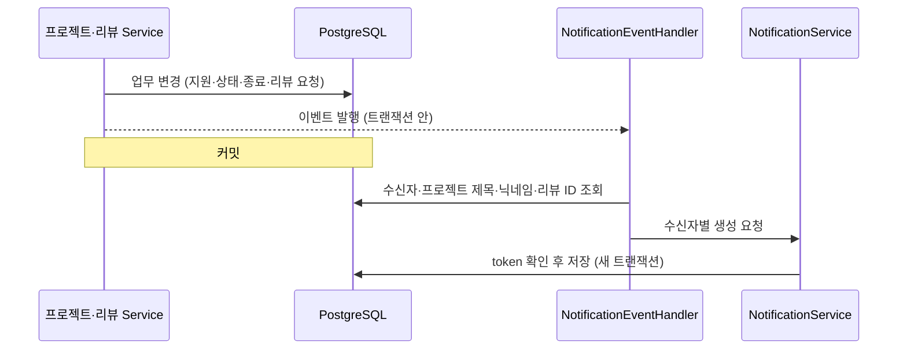
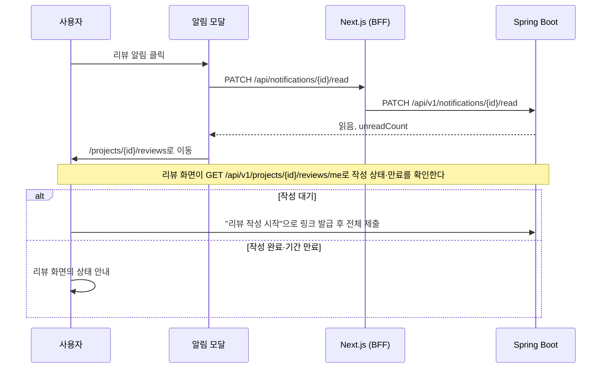

# 알림 백엔드·연동 계획

WBS 12.0 알림(12.1~12.5)을 실제 백엔드에 구현하고, 프론트엔드가 그 API를 쓰도록 연결하기 위한 단계별 계획이다. 알림 저장·조회·읽음 처리 구조를 먼저 만들고, 프로젝트·리뷰 도메인이 발행하는 내부 이벤트를 받아 알림을 만든 뒤, 공통 알림 모달과 헤더 배지를 API에 연결한다.

- 상태: 계획 작성. 구현은 시작하지 않았다. 2.2의 결정 항목은 아직 확정되지 않았다.
- 근거: WBS 12.1~12.5, 연관 항목 5.6~5.8·7.14·9.5.
- 이 문서는 구현 승인이 아니다. 각 단계는 사용자가 요청할 때만 시작하고, 한 단계가 끝나도 다음 단계를 자동으로 시작하지 않는다. 구현을 시작하는 단계에서 `AGENTS.md`의 승인 범위에 알림 도메인을 추가한다.
- 작업은 develop 기준으로 검증한다. 커밋·푸시·main 병합은 사용자가 요청할 때만 한다.
- API 경로와 메서드는 WBS를 따른다. WBS에 없는 API를 더하거나 WBS와 다르게 정하는 항목은 2절에 적는다.

## 1. 범위

### 1.1 WBS 항목

| 코드 | 작업 | 페이지 | API | WBS 메모 |
|---|---|---|---|---|
| 12.1 | 알림 목록 및 공통 알림 모달 | 공통 알림 모달 (`/notifications`) | `GET /api/v1/notifications` | 기존 알림과 팀원 리뷰 요청(12.4·12.5)을 함께 표시 |
| 12.2 | 알림 읽음 처리 | 공통 알림 모달 (`/notifications`) | `PATCH /api/v1/notifications/{id}/read` | 리뷰 알림의 읽음 상태와 리뷰 작성 완료 상태는 별도 관리 |
| 12.3 | 프로젝트 변경·지원 알림 | `/notifications` | 내부 이벤트 처리 | |
| 12.4 | 팀원 리뷰 임시링크 알림 발송 | 공통 알림 모달 | `GET /api/v1/notifications` (내부 이벤트 처리 → 알림 생성) | 서비스 알림 모달에 표시하며 1:1 메시지·단체 채팅방으로 발송하지 않음 |
| 12.5 | 리뷰 알림 표시 및 임시링크 이동 | `/projects/{id}/reviews?link={linkString}` | `GET /api/v1/notifications` | 클릭 시 읽음 처리 후 링크 검증, 만료·작성 완료 시 상태 안내 |

### 1.2 연관 항목

| 코드 | 작업 | 알림과의 관계 | 이 계획에서 |
|---|---|---|---|
| 5.6 | 팀원 리뷰 임시링크 발급 | 발급 이벤트를 12.4가 받는다 | 이벤트를 받기만 한다 |
| 5.7·5.8 | 임시링크 검증·만료·완료 처리 | 12.5가 이동하는 리뷰 화면의 검증 | 리뷰 화면과 API는 바꾸지 않는다 |
| 7.14 | 모집 기한 자동 처리 (자동 마감·관리자 알림) | 알림을 만드는 쪽은 프로젝트 배치 | 2.2 D2 |
| 9.5 | 팔로잉 활동 알림 설정 | 설정 값을 보고 팔로잉 소식 알림을 만든다 | 2.2 D2 |

### 1.3 현재 코드 (2026-11-09, develop a04608f)

| 위치 | 현재 |
|---|---|
| 백엔드 | 알림 엔티티·테이블·API가 없다. `/api/v1/notifications`는 [SecurityConfig](../backend/src/main/java/com/devmozip/backend/config/SecurityConfig.java)의 `anyRequest().authenticated()`에 해당하므로 보안 설정을 바꿀 필요가 없다. |
| 백엔드 이벤트 | [ProjectApplicationChanged](../backend/src/main/java/com/devmozip/backend/event/ProjectApplicationChanged.java)(지원·승인·거절·취소, `eventKey` 포함)와 [ProjectLifecycleChanged](../backend/src/main/java/com/devmozip/backend/event/ProjectLifecycleChanged.java)(상태 변경·기간 연장·종료)가 발행되지만 받는 쪽이 없다. 두 이벤트의 주석은 받는 쪽이 `AFTER_COMMIT`에서 처리하도록 정한다. |
| 리뷰 (develop 미병합) | `feat/50-project-reviews`에 `reviews` 테이블과 `ProjectReviewRequested`(프로젝트, 수신자, 토큰이 든 `href`, 재알림 여부, `eventKey`, 만료 시각) 이벤트가 있다. 프로젝트 종료 시 최초 요청을, 주최자가 재알림을 요청하면 재알림을 발행한다. 링크는 `/projects/{id}/reviews#token=...`이고, 재발급하면 이전 토큰은 무효가 된다. 브랜치 문서는 알림 연결을 "미연결"로 둔다. |
| 프론트 `/notifications` | [page.tsx](../frontend/app/notifications/page.tsx)가 Mock 알림을 전체·안 읽음·읽음 탭으로 보여 준다. 개별 읽음·안 읽음 전환, 모두 읽음, 내용 확인 링크, 알림별 동작 버튼(예: 팀원 리뷰 작성)이 있다. 모달은 없다. |
| 프론트 Mock 데이터 | [messagingService](../frontend/lib/messaging/messagingService.ts)의 `unifiedNotices`가 프로젝트 알림(`devmozip:recruitment:v1`)과 팔로잉 소식·SNS 반응(`devmozip:profiles:v1`)을 합친다. 읽음 상태는 `devmozip:messaging:v1`의 `notificationReads`에 있다. 처리 완료(`resolved`) 알림은 안 읽음 수에서 빠진다. 리뷰 알림은 작성 완료 또는 기간 만료 시 처리 완료가 된다. |
| 헤더 | [AppLayout](../frontend/app/_components/AppLayout.tsx)의 종 아이콘이 `/notifications`로 이동하고 Mock 안 읽음 수를 표시한다. |
| 프로젝트 관리 화면 | [ProjectNotices](../frontend/components/projects/ProjectNotices.tsx)는 Mock 관리 화면에서만 쓰인다. |

### 1.4 Mock 알림 종류와 서버 연결 가능 시점

| Mock 알림 | 수신자 (Mock) | 서버의 출처 | 연결 가능 시점 |
|---|---|---|---|
| 프로젝트 지원 도착·지원 취소 | 주최자 | `ProjectApplicationChanged` SUBMITTED·CANCELLED | 지금 |
| 지원 승인·지원 거절 | 지원자 | 같은 이벤트 APPROVED·REJECTED | 지금 |
| 프로젝트 상태 변경·기간 연장 | 지원자와 팀원(주최자 제외) | `ProjectLifecycleChanged` STATUS_CHANGED·PERIOD_EXTENDED | 지금 |
| 프로젝트 종료 | 팀원 | 같은 이벤트 COMPLETED | 지금 |
| 협업 리뷰 작성 요청·재알림 | 평가자 | `ProjectReviewRequested` | 리뷰 브랜치 병합 후 |
| 프로젝트 공고 수정·삭제 | 지원자와 팀원 | 없음. 공고 수정(7.4)·삭제(7.5)가 이벤트를 발행하지 않는다 | 프로젝트 쪽 이벤트 추가 후 |
| 모집 기한 경과, 종료 예정일 경과 | 관리자, 주최자 | 없음. 7.14 배치가 없다 | 프로젝트 쪽 배치 구현 후 |
| 강퇴 투표 결과 | 팀원 | 없음. 7.11 백엔드가 없다 | 프로젝트 쪽 구현 후 |
| 새 팔로워 | 팔로우받은 사용자 | 없음. 팔로우 API(`feat/94-follows`)가 이벤트를 발행하지 않는다 | 팔로우 쪽 이벤트 추가 후 |
| 팔로잉 개발자의 새 게시글·새 모집 공고 | 알림을 켠 팔로워 | 없음. 피드는 계획 문서만 있고, 프로젝트 생성(7.2)은 이벤트를 발행하지 않는다 | 피드·프로젝트 쪽 이벤트 추가 후 |
| 게시글 좋아요·새 댓글·퍼가기 | 작성자 | 없음. 피드 백엔드가 없다 | 피드 구현 후 |

## 2. 결정 사항

### 2.1 확정된 항목

| 항목 | 내용 | 근거 |
|---|---|---|
| API | `GET /api/v1/notifications`, `PATCH /api/v1/notifications/{id}/read` | WBS 12.1·12.2 |
| 생성 방식 | 내부 이벤트 처리. 외부에서 알림을 만드는 API는 두지 않는다. | WBS 12.3·12.4 |
| 리뷰 알림 전달 경로 | 서비스 알림으로만 표시하고 1:1 메시지·단체 채팅방으로 보내지 않는다. | WBS 12.4 |
| 상태 분리 | 리뷰 알림의 읽음 상태와 리뷰 작성 완료 상태를 따로 관리한다. | WBS 12.2 |
| 화면 | 공통 알림 모달, `/notifications` | WBS 12.1 |
| 테이블 | ERD의 `notifications`를 따른다(3.2). | ERD (2026-11-09) |
| 중복 방지 컬럼 | 이름은 `token`이다. `recipient_id`와 `token`이 같은 알림은 다시 만들지 않는다. | 사용자 결정 (2026-11-09) |
| `review_id` | `reviews.id`를 저장한다. 리뷰 알림은 그 행에서 해당하는 멤버에게 보내며, 12.4의 요청·재알림은 작성자(`reviewer_member_id`)에게 간다. | 사용자 결정 (2026-11-09) |

### 2.2 사용자가 확정할 항목

#### D1. 공통 알림 모달의 형태

| 안 | 내용 |
|---|---|
| A (제안) | Next.js의 Intercepting Routes와 Parallel Routes로 `/notifications`를 모달로 연다. 헤더 종을 누르면 보던 화면 위에 모달이 뜨고 주소가 `/notifications`가 된다. 주소로 직접 들어오거나 새로고침하면 전체 페이지로 보인다. 뒤로 가기로 모달이 닫힌다. 모달과 페이지는 같은 목록 컴포넌트를 쓴다. |
| B | 주소가 바뀌지 않는 헤더 모달과 별도의 `/notifications` 페이지를 둔다. |
| C | 지금처럼 페이지만 둔다. WBS의 "공통 알림 모달"과 다르다. |

A는 WBS 표기 "공통 알림 모달 (/notifications)"과 맞고, 사용 중인 Next.js 16.4.3 문서(`intercepting-routes.md`, `parallel-routes.md`)가 모달 예시로 안내하는 방식이다. 루트 레이아웃([app/layout.tsx](../frontend/app/layout.tsx))에 `@modal` 슬롯을 더해야 하므로 공통 코드가 바뀐다. 모달 틀은 기존 [Modal](../frontend/components/common/Modal.tsx)을 쓴다.

#### D2. 이번 계획에서 만드는 알림 종류

| 안 | 내용 |
|---|---|
| A (제안) | 1.4에서 "지금" 연결할 수 있는 프로젝트 지원·상태·기간·종료 알림과, 리뷰 요청·재알림만 만든다. 나머지 종류는 출처 도메인이 이벤트를 발행할 때 같은 생성 경계(4.4)에 연결하며, 이 문서에는 연결 방법만 적는다. |
| B | 팔로우·피드 작업이 develop에 병합된 뒤, 새 팔로워·팔로잉 소식·SNS 반응 알림도 이 계획의 단계로 추가한다. 해당 도메인 코드에 이벤트 발행을 넣어야 한다. |

WBS 12.3·12.4가 정한 종류는 A로 모두 포함된다. 나머지는 출처 기능이 아직 develop에 없다.

#### D3. 리뷰 알림 링크에 토큰을 저장할지

| 안 | 내용 |
|---|---|
| A (제안) | 알림에 토큰을 저장하지 않는다. 링크는 `/projects/{id}/reviews`다. 리뷰 화면은 토큰 없이 들어오면 로그인한 평가자에게 "리뷰 작성 시작" 버튼을 보여 주고, `POST /api/v1/projects/{id}/reviews/me/link`로 링크를 발급한다(리뷰 브랜치 구현). |
| B | 이벤트의 `href`(`/projects/{id}/reviews#token=...`)를 그대로 `action_url`에 저장한다. |

리뷰 구현은 DB에 토큰 해시만 저장한다. B는 원문 토큰을 알림 테이블에 남겨 그 정책과 어긋난다. 또 링크를 재발급하거나 재알림이 나가면 이전 토큰이 무효가 되어, 먼저 받은 알림의 링크는 쓸 수 없게 된다. A는 WBS 12.5의 `?link={linkString}` 진입과 다르지만, 리뷰 구현도 이미 `?link=` 대신 URL fragment(`#token=`)를 쓴다. 어느 안이든 제출에는 본인 로그인과 최신 토큰이 모두 필요하다.

#### D4. 리뷰 작성 완료·만료 상태를 알림에 반영하는 방식

| 안 | 내용 |
|---|---|
| A (제안) | 목록을 조회할 때 `review_id`로 `reviews`를 읽어 계산한다. 그 행의 작성자가 같은 프로젝트에서 가진 행이 모두 `SUBMITTED`면 작성 완료, `PENDING`이 남았고 만료 시각이 지났으면 기간 만료다. 리뷰 코드를 바꾸지 않는다. |
| B | 리뷰 담당자가 전체 제출 이벤트를 추가하고, 알림이 이를 받아 처리 완료 시각을 저장한다. 만료는 요청 이벤트의 `expiresAt`을 저장해 계산한다. |

A는 리뷰 브랜치가 병합되면 추가 계약 없이 동작하고 항상 현재 상태를 보여 준다. 대신 `reviews` 스키마가 바뀌면 알림 조회도 함께 고쳐야 한다. B는 리뷰 코드에 이벤트를 추가해야 하고, ERD에 없는 `resolved_at`·`expires_at` 컬럼이 필요하다. 어느 안이든 Mock과 같이 작성 완료·기간 만료 알림은 처리 완료로 보고 안 읽음 수에서 뺀다.

#### D5. 목업의 "안 읽음으로 변경"과 "모두 읽음"

WBS에는 개별 읽음 처리 API만 있다.

| 안 | 내용 |
|---|---|
| A (제안) | 둘 다 유지한다. `PATCH /{id}/read`의 본문으로 `{ "read": false }`도 받고, WBS에 없는 `PATCH /api/v1/notifications/read-all`을 추가한다. |
| B | 모두 읽음만 추가하고, 안 읽음 전환은 API 화면에서 뺀다. |
| C | WBS대로 개별 읽음만 두고, 두 버튼을 API 화면에서 뺀다. |

A는 현재 화면에서 동작하는 기능을 보존한다. `read-all` 경로는 이전 API 초안([api-plan.md](api-plan.md))의 후보와 같다.

#### D6. 프로젝트 변경 알림의 수신자

| 안 | 내용 |
|---|---|
| A (제안) | 상태 변경·기간 연장은 참여 중(`ACTIVE`) 팀원과 검토 대기(`PENDING`) 지원자, 종료는 참여 중 팀원이 받는다. 행위자 본인은 받지 않는다. |
| B | Mock과 같이 지원 상태와 관계없이 모든 지원자와 팀원이 받는다(주최자 제외). |

거절·취소된 지원자와 나간 팀원은 그 프로젝트의 변경과 더 관계가 없다. Mock의 SNS 알림도 본인 행위의 알림을 만들지 않는다([decisions-pending.md](decisions-pending.md)).

### 2.3 설계 기준

| 항목 | 기준 |
|---|---|
| 생성 경계 | 알림은 `NotificationService`의 생성 메서드로만 만든다. 다른 도메인은 알림 테이블에 직접 쓰지 않고 이벤트를 발행한다. 이벤트를 받는 처리는 알림 쪽에 둔다. |
| 처리 시점 | 기존 이벤트 계약대로 `@TransactionalEventListener(phase = AFTER_COMMIT)`에서 새 트랜잭션(`REQUIRES_NEW`)으로 저장한다. 원래 요청이 롤백되면 알림도 생기지 않는다. 알림 저장이 실패해도 원래 요청의 결과는 바뀌지 않아야 하며, 3단계에서 테스트로 확인한다. |
| 중복 방지 | `(recipient_id, token)` 유일 제약을 둔다. 이미 있으면 저장하지 않고, 동시에 들어와 제약에 걸려도 무시한다. local 프로필의 H2에서도 동작하도록 PostgreSQL 전용 구문(`ON CONFLICT`)은 쓰지 않는다. |
| `token` 값 | `ProjectApplicationChanged`·`ProjectReviewRequested`는 이벤트의 `eventKey`를 그대로 쓴다. `ProjectLifecycleChanged`에는 키가 없어 프로젝트 ID·종류·변경 후 상태·발생 시각으로 만든다. 리뷰 임시 링크의 토큰과는 관계없는 값이다. |
| 문구 | 제목·본문·링크는 생성 시점에 서버가 만들어 저장한다. 문구는 Mock을 따른다. 나중에 프로젝트 이름이 바뀌어도 이미 만든 알림은 그대로다(Mock과 같다). |
| 이동 URL | 서버가 만든 내부 경로만 `action_url`에 저장한다(`/`로 시작, `//`로 시작하지 않음). 화면도 이동 전에 같은 조건을 확인한다. |
| 접근 | 요청자는 Spring Security 인증 정보로 정한다. 본인 알림만 조회·변경한다. 다른 사람의 알림 ID는 404로 응답해 존재 여부를 드러내지 않는다. |
| 읽음 | `read_at`이 있으면 읽음이다. 같은 요청을 반복해도 결과가 같다. 처리 완료(D4)는 `read_at`과 따로 계산한다. |
| 목록 | 최신순(`created_at` 내림차순, 같으면 `id` 내림차순). `page`(0부터), `size`(기본 20, 최대 100. 피드·프로젝트·팔로우 목록과 같다). |
| 시각 | 서비스에 `Clock`을 주입해 만료 경계를 테스트한다(프로젝트 서비스와 같다). |
| 로그 | 알림 ID·종류·수신자 ID만 남긴다. 본문과 링크는 남기지 않는다. |

## 3. 데이터

### 3.1 ERD 대조 (2026-11-09)

- 사용자가 제공한 ERD 이미지(`notifications`, `reviews`)와 대조했다. develop의 엔티티와 `docs/sql`에는 알림 테이블이 없다.
- 처음 제안과 다른 점은 ERD를 따른다. 이동 경로 컬럼은 `action_url` VARCHAR(2048), `type`은 VARCHAR(50), `title`은 VARCHAR(255)이고, `review_id`가 있다.
- ERD 이미지의 `key`(식별값, 중복 방지)는 사용자 결정으로 이름을 `token`으로 바꾼다. ERDCloud에도 같은 이름으로 반영한다.
- 이미지에는 NULL 여부, 기본값, 유일 제약, 인덱스가 없다. 아래 표의 해당 값은 제안이며 0단계에서 ERDCloud와 맞춘다. FK의 참조 대상은 컬럼 이름 기준이다.

### 3.2 notifications

DATETIME은 기존 기준대로 Java `LocalDateTime`, PostgreSQL `timestamp without time zone`으로 매핑한다.

| 필드 | 타입 | NULL (제안) | 의미 |
|---|---|---|---|
| id | BIGINT / PK | 불가 | 알림 ID. 자동 증가 |
| recipient_id | BIGINT / FK `users.id` | 불가 | 수신 사용자 ID |
| project_id | BIGINT / FK `projects.id` | 가능 | 관련 프로젝트 ID. 프로젝트·리뷰 알림에만 있다 |
| review_id | BIGINT / FK `reviews.id` | 가능 | 리뷰 요청 ID. 리뷰 알림에만 있다 |
| token | VARCHAR(200) | 불가 | 식별값(중복 방지) |
| type | VARCHAR(50) | 불가 | 알림 유형(4.2) |
| title | VARCHAR(255) | 불가 | 알림 제목 |
| body | TEXT | 불가 | 알림 내용 |
| action_url | VARCHAR(2048) | 불가 | 이동 URL. 서버가 만든 내부 경로 |
| read_at | DATETIME | 가능 | 읽은 시각. 없으면 안 읽음 |
| created_at | DATETIME | 불가 | 생성 시각 |

- 제약·인덱스(제안): `UNIQUE (recipient_id, token)`, 목록 조회용 `(recipient_id, created_at, id)`.
- `token`은 알림 중복을 막는 식별값이다. 리뷰 임시 링크의 토큰과 관계없다.
- `review_id`: 리뷰 요청 이벤트(`ProjectReviewRequested`)에는 리뷰 ID가 없어 알림 쪽이 조회한다. 작성자 한 명은 한 프로젝트에서 대상 수만큼 `reviews` 행을 갖지만 알림은 작성자당 하나이므로, 그 프로젝트에서 작성자의 행 중 가장 작은 `id`를 저장한다. 작성 완료·만료(D4 A)는 이 행의 작성자와 프로젝트로 같은 작성자의 행 전체를 읽어 계산한다.
- `updated_at`이 없으므로 `BaseEntity`를 상속하지 않는다.
- `projects`는 논리 삭제만 하므로 FK를 두어도 프로젝트 삭제가 막히지 않는다.
- D3 B를 고르면 `action_url`에 원문 토큰이 들어간다.

### 3.3 DB 반영 주의

- `ddl-auto: update`이므로 엔티티를 추가한 서버를 재시작하면 연결된 DB에 `notifications`가 생긴다. 개발 서버가 공용 DB에 연결되어 있으면 반영 시점을 팀과 맞춘다.
- `reviews` 테이블과 엔티티는 리뷰 브랜치에만 있다. 그래서 1단계에서는 `review_id`를 값 컬럼으로만 두고, `reviews` FK와 리뷰 상태 계산(D4 A)은 리뷰 브랜치가 병합된 뒤 4단계에서 연결한다.

## 4. 백엔드 구조

### 4.1 패키지

기존 계층형 패키지(`backend/src/main/java/com/devmozip/backend`)를 따른다. 탭 들여쓰기와 생성자 주입을 쓰고, 응답 DTO는 record로 만든다. 엔티티를 API 응답으로 쓰지 않는다. Service는 프로젝트 기능처럼 인터페이스와 `service/impl` 구현으로 나눈다.

| 위치 | 파일 | 역할 |
|---|---|---|
| entity | Notification | `notifications` 매핑. 읽음·안 읽음 변경 |
| entity/enums | NotificationType | 4.2의 종류 |
| repository | NotificationRepository | 본인 알림 단건 조회, `token` 존재 확인, 모두 읽음 일괄 변경 |
| repository | NotificationQueryRepository | 목록과 안 읽음 수. 4단계에서 리뷰 상태를 `reviews`와 함께 계산하므로 [LikedPostsQueryRepository](../backend/src/main/java/com/devmozip/backend/repository/LikedPostsQueryRepository.java)처럼 JDBC로 둔다 |
| service | NotificationService, impl/NotificationServiceImpl | 생성(중복 무시), 목록, 읽음·안 읽음, 모두 읽음 |
| service | NotificationMessages | 종류별 제목·본문·링크 생성. 상태 없는 클래스로 두어 단위 테스트한다 |
| service | NotificationEventHandler | 프로젝트·리뷰 이벤트를 받아 수신자를 정하고 생성 메서드를 부른다 |
| controller | NotificationController | `/api/v1/notifications` |
| dto/notification | 요청·응답 record | 목록 항목, 페이지, 읽음 요청·응답 |

- 요청자 식별: 팔로우 브랜치의 `security/member/CurrentMemberProvider`가 develop에 병합되어 있으면 그것을 쓴다. 없으면 [MemberController](../backend/src/main/java/com/devmozip/backend/controller/MemberController.java)처럼 `Authentication.getName()`(이메일)으로 회원을 찾는다. 프로젝트의 `ProjectCurrentUserProvider`는 프로젝트 담당 코드이므로 쓰지 않는다.
- 수신자 조회: 기존 [ProjectMemberRepository](../backend/src/main/java/com/devmozip/backend/repository/ProjectMemberRepository.java)의 `findByProjectId`, [ProjectApplicationRepository](../backend/src/main/java/com/devmozip/backend/repository/ProjectApplicationRepository.java)의 `findByProjectIdOrderByAppliedAtDescIdDesc`를 읽기만 하고 상태로 거른다. 프로젝트 코드는 고치지 않는다.
- 오류: Service는 `ResponseStatusException`을 던지고 기존 `GlobalExceptionHandler`가 `ErrorResponse`로 바꾼다. 쿼리 형식 오류가 400이 되는지 2단계에서 확인하고, 아니면 Controller 전용 예외 처리기를 둔다.

### 4.2 알림 종류

| 종류 | 이벤트 | 수신자 | 제목 | 본문 | `action_url` |
|---|---|---|---|---|---|
| PROJECT_APPLICATION_SUBMITTED | `ProjectApplicationChanged` SUBMITTED | 주최자 | 프로젝트 지원 도착 | {지원자 닉네임}님이 지원했습니다. | `/projects/{id}` |
| PROJECT_APPLICATION_CANCELLED | 같은 이벤트 CANCELLED | 주최자 | 프로젝트 지원 취소 | {지원자 닉네임}님이 지원을 취소했습니다. | `/projects/{id}` |
| PROJECT_APPLICATION_APPROVED | 같은 이벤트 APPROVED | 지원자 | 지원 승인 | {프로젝트}: 팀원으로 등록되었습니다. | `/projects/{id}` |
| PROJECT_APPLICATION_REJECTED | 같은 이벤트 REJECTED | 지원자 | 지원 거절 | {프로젝트}: 지원이 거절되었습니다. | `/projects/{id}` |
| PROJECT_STATUS_CHANGED | `ProjectLifecycleChanged` STATUS_CHANGED | D6 | 프로젝트 상태 변경 | {프로젝트}: {변경된 상태} | `/projects/{id}` |
| PROJECT_PERIOD_EXTENDED | 같은 이벤트 PERIOD_EXTENDED | D6 | 프로젝트 기간 연장 | {프로젝트}: 변경된 모집 조건과 기간을 확인해 주세요. | `/projects/{id}` |
| PROJECT_COMPLETED | 같은 이벤트 COMPLETED | D6 | 프로젝트 종료 | {프로젝트} 프로젝트가 종료되었습니다. | `/projects/{id}` |
| PROJECT_REVIEW_REQUESTED | `ProjectReviewRequested` (재알림 아님) | 이벤트의 수신자 | 협업 리뷰 작성 요청 | {프로젝트}: {만료일}까지 본인을 제외한 팀원을 평가해 주세요. | D3 |
| PROJECT_REVIEW_REMINDED | 같은 이벤트 (재알림) | 이벤트의 수신자 | 협업 리뷰 작성 재알림 | {프로젝트}: 아직 평가하지 않은 팀원이 있습니다. | D3 |

- 상태 이름은 화면과 같은 한글(모집 중, 모집 완료, 프로젝트 진행 중, 프로젝트 종료)로 쓴다.
- 리뷰 요청 본문은 Mock의 "종료 후 30일 동안" 대신 이벤트의 `expiresAt`으로 만료일을 적는다. 기간은 리뷰 도메인이 정하므로 알림이 일수를 따로 갖지 않는다.
- 종료 이벤트는 두 곳에서 발행된다(`ProjectLifecycleServiceImpl`, `ProjectApplicationServiceImpl`의 종료 동의 과반). 리뷰 브랜치가 병합되면 종료 시 종료 알림과 리뷰 요청 알림이 따로 생긴다(Mock과 같다).
- 이동 URL은 Mock의 기본값(`/projects/{id}`)을 따른다.
- 리뷰 알림은 `project_id`와 `review_id`(3.2)를 함께 저장한다. 수신자는 그 행의 작성자이며, 이벤트의 수신자와 같다.

### 4.3 처리 흐름



### 4.4 다른 도메인의 연결 방법

D2 A를 고르면 1.4의 나머지 종류는 다음 순서로 연결한다.

1. 출처 도메인이 `event` 패키지에 이벤트 record를 만들고 커밋 전에 발행한다. 수신자를 정할 값과 `eventKey`를 담는다.
2. 알림 쪽에 종류(`NotificationType`), 문구(`NotificationMessages`), 이벤트 처리(`NotificationEventHandler`)를 추가한다.
3. 화면은 응답의 `type`만 새로 알면 되며, 목록 구조는 바뀌지 않는다.

## 5. API 계약

브라우저는 BFF만 호출한다. 요청자는 인증 정보로 정하며, 요청 값으로 사용자를 지정할 수 없다. 응답 시각 형식은 2단계에서 기존 프로젝트 API와 같게 맞춘다.

| 코드 | 메서드·경로 | 동작 |
|---|---|---|
| 12.1·12.4·12.5 | `GET /api/v1/notifications` | 본인 알림 목록과 안 읽음 수 |
| 12.2 | `PATCH /api/v1/notifications/{id}/read` | 읽음 처리. D5 A면 안 읽음 전환도 한다 |
| D5 A (WBS 외) | `PATCH /api/v1/notifications/read-all` | 본인 알림 모두 읽음 |

### 목록

- 요청: `status`(`all` 기본, `unread`, `read`), `page`, `size`.
- `unread`는 읽지 않았고 처리 완료가 아닌 알림이다. `read`는 그 밖의 알림이다(Mock 탭과 같다).
- 응답:

```json
{
  "items": [
    {
      "id": 31,
      "type": "PROJECT_REVIEW_REQUESTED",
      "title": "협업 리뷰 작성 요청",
      "body": "프로젝트 이름: 2026-12-09까지 본인을 제외한 팀원을 평가해 주세요.",
      "actionUrl": "/projects/12/reviews",
      "projectId": 12,
      "read": false,
      "resolved": false,
      "review": { "status": "PENDING", "expiresAt": "2026-12-09T18:00:00" },
      "createdAt": "2026-11-09T18:00:00"
    }
  ],
  "page": 0,
  "size": 20,
  "hasNext": false,
  "unreadCount": 3
}
```

- `actionUrl`은 `action_url` 값이다. `token`과 `review_id`는 응답에 넣지 않는다.
- `review`는 리뷰 알림에만 있고 다른 종류는 `null`이다. `status`는 `PENDING`(작성 대기), `COMPLETED`(작성 완료), `EXPIRED`(기간 만료)다.
- `resolved`는 리뷰 상태가 `COMPLETED`·`EXPIRED`이면 `true`다. 다른 종류는 `false`다.
- `unreadCount`는 탭·페이지와 관계없는 전체 안 읽음 수다. WBS에 알림 안 읽음 수 API가 없으므로 목록 응답에 담고, 헤더 배지도 이 값을 쓴다.

### 읽음

- 요청: 본문이 없거나 `{ "read": true }`이면 읽음, `{ "read": false }`이면 안 읽음(D5 A).
- 응답 200: `{ "id": 31, "read": true, "unreadCount": 2 }`.
- 리뷰 알림의 읽음은 리뷰 작성 상태를 바꾸지 않는다(12.2).

### 모두 읽음 (D5 A)

- 본인의 안 읽은 알림을 모두 읽음으로 바꾼다. 응답 200: `{ "unreadCount": 0 }`.

### 오류

| 상태 | 상황 |
|---|---|
| 400 | `status`·`page`·`size` 형식 오류, 읽음 요청 본문 형식 오류 |
| 401 | 로그인 필요 |
| 404 | 없거나 다른 사람의 알림 |

## 6. 프론트엔드 연결

Mock 토글이 ON이면 지금의 Mock 화면과 데이터를 그대로 쓰고, OFF이면 서버 API를 쓴다(프로젝트 화면 연동과 같다). 서버 알림은 서버가 원본이므로 localStorage에 저장하지 않는다. 구현 전 [frontend/AGENTS.md](../frontend/AGENTS.md)의 안내대로 `node_modules/next/dist/docs/`에서 Route Handler, Intercepting Routes, Parallel Routes 문서를 확인한다.

### 6.1 BFF

| BFF 경로 | 메서드 | 백엔드 |
|---|---|---|
| `/api/notifications` | GET | `/api/v1/notifications` (허용 쿼리: `status`, `page`, `size`) |
| `/api/notifications/[id]/read` | PATCH | `/api/v1/notifications/{id}/read` |
| `/api/notifications/read-all` | PATCH | `/api/v1/notifications/read-all` (D5 A) |

- [backendFetch](../frontend/lib/auth/backend.ts)로 액세스 토큰을 붙인다. 사용자 ID를 백엔드로 보내지 않는다.
- 쓰기 요청은 [projectProxy](../frontend/lib/projects/projectProxy.ts)의 `projectGuard`처럼 Origin을 요청의 `Host`와 비교하고 JSON 형식을 확인한다. `[id]`는 양의 정수만 받는다.
- 응답 필드는 허용한 것만 전달하고, 오류는 상태별 안내 문구로 바꾼다.
- 파일: `lib/notifications/notificationProxy.ts`(공통 처리·오류 문구), `lib/notifications/notificationApi.ts`(응답 해석·링크 검사), `types/notificationApi.ts`.

### 6.2 상태 저장소

- `lib/state/notificationStore.ts`: 안 읽음 수와 마지막으로 불러온 목록을 가진다. 로그인 상태이고 Mock 토글이 OFF일 때만 동작한다.
- 갱신 시점: 앱을 열 때, 60초마다([MessagingSync](../frontend/app/_components/MessagingSync.tsx)가 실행하는 Mock 동기화 주기와 같다), 모달·페이지를 열 때, 읽음을 바꾼 직후(응답의 `unreadCount`로 바로 반영). 배지만 갱신할 때는 `size=1`로 불러 `unreadCount`만 쓴다.
- 로그아웃하거나 토글을 ON으로 바꾸면 멈추고 비운다.

### 6.3 화면 (D1 A 기준)

| 화면 | 위치 | 내용 |
|---|---|---|
| 공통 알림 모달 | `app/@modal/(.)notifications/page.tsx`, `app/@modal/default.tsx`, `app/layout.tsx`의 `modal` 슬롯 | 헤더 종에서 연다. 기존 `Modal`로 감싸고, 닫기·Esc·바깥 클릭은 `router.back()`으로 닫는다. 내용은 토글을 따른다. |
| `/notifications` 페이지 | `app/notifications/page.tsx` | 토글 ON이면 지금의 Mock 화면(`_components/MockNotifications`로 옮기기만 한다), OFF이면 API 목록. 직접 접근·새로고침 시 전체 페이지로 보인다. |
| 알림 목록 | `components/notifications/NotificationList.tsx`와 CSS Module | 모달과 페이지가 함께 쓴다. 전체·안 읽음·읽음 탭, 안 읽음 수, 모두 읽음, 항목별 읽음 전환, 더 보기(`page + 1`을 요청해 뒤에 붙인다), 로딩·빈 목록·오류·재시도. 아이콘·시각·처리 완료 표시·안 읽음 점은 지금 Mock 화면의 형식을 따른다. |
| 헤더 배지 | `app/_components/AppLayout.tsx` | 토글 OFF는 서버 안 읽음 수, ON은 지금처럼 Mock 수를 표시한다. |

- 항목을 누르면 읽음 처리를 요청한 뒤 `actionUrl`로 이동한다. 읽음 요청이 실패해도 이동하며, 다음 갱신 때 서버 상태로 맞춘다. `actionUrl`이 내부 경로 조건을 통과하지 못하면 이동하지 않는다.
- 다음 페이지를 붙이는 목록에서 읽음을 바꿔도 항목을 빼지 않는다. 탭을 다시 열면 서버 기준으로 다시 불러온다.

### 6.4 리뷰 알림 (12.5)

- 작성 대기: 만료일과 "팀원 리뷰 작성" 버튼을 표시한다(Mock의 알림별 동작 버튼과 같다).
- 작성 완료·기간 만료: "처리 완료"와 상태 문구를 표시한다. 눌러도 리뷰 화면으로 이동하며, 리뷰 화면이 상태를 안내한다.



D3 B를 고르면 이동 주소에 `#token=`이 붙고, 리뷰 화면이 그 토큰을 읽는다.

### 6.5 바꾸지 않는 것

- Mock 알림의 생성·읽음 로직(`messagingService`, `projectNoticeService`, `activityNoticeService`, `followService`)과 Mock 관리 화면의 `ProjectNotices`. 토글 ON에서 지금처럼 동작한다.
- 리뷰 화면(`/projects/{id}/reviews`)과 리뷰 BFF.

## 7. 단계별 수행

| 단계 | 내용 | WBS | 선행 조건 | 상태 |
|---|---|---|---|---|
| 0 | 결정·사전 확인 | | | 대기 |
| 1 | 엔티티·Repository | 12.1, 12.2 | 0 | 대기 |
| 2 | 조회·읽음 API | 12.1, 12.2 | 1 | 대기 |
| 3 | 프로젝트 이벤트 알림 | 12.3 | 2 | 대기 |
| 4 | 리뷰 요청 알림 | 12.4 | 2, 리뷰 브랜치 develop 병합 | 대기 |
| 5 | BFF·상태 저장소 | 12.1, 12.2 | 2 | 대기 |
| 6 | 공통 알림 모달·페이지·헤더 배지 | 12.1, 12.2 | 5 | 대기 |
| 7 | 리뷰 알림 표시·이동 | 12.5 | 4, 6 | 대기 |
| 8 | 통합 검증·문서 정리 | 전체 | 1~7 | 대기 |

모든 단계의 공통 종료 조건은 다음과 같다.

- `frontend`에서 `npm run build`와 관련 테스트를 실행한다. 백엔드를 바꾼 단계는 `backend`에서 `./gradlew test`도 실행한다. 실행한 위치(저장소 또는 복사본), 명령, 성공·실패, 실행하지 못한 이유를 기록한다.
- Testcontainers 테스트가 Docker 없이 건너뛰어지면 통과로 보고하지 않는다. Mock 테스트 통과를 실제 DB 검증으로 보고하지 않는다.
- 이 문서의 상태 표와 10절 진행 기록을 갱신한다.

### 0단계: 결정·사전 확인

- [ ] 2.2의 D1~D6을 확정한다.
- [x] ERD의 알림 테이블과 3.2를 대조한다 (2026-11-09).
- [ ] ERDCloud에 `key` → `token` 이름 변경을 반영하고, NULL·기본값·유일 제약·인덱스를 확인한다.
- [ ] 개발 DB에 알림 테이블이 없는지 읽기로 확인한다.
- [ ] 리뷰 브랜치(`feat/50-project-reviews`)와 팔로우 브랜치(`CurrentMemberProvider`)의 develop 병합 여부를 확인한다. 리뷰 브랜치가 병합되지 않았으면 4·7단계는 대기한다.
- [ ] `AGENTS.md`의 구현 범위에 알림 도메인과 근거를 추가한다.
- [ ] 8절의 연결 사항을 공유한다.

**완료 기준:** 결정이 확정되고, ERD 대조 결과(또는 대조 불가)와 선행 브랜치 상태가 기록되어 있다.

### 1단계: 엔티티·Repository

- `Notification`, `NotificationType`, `NotificationRepository`, `NotificationQueryRepository`(목록·안 읽음 수. 리뷰 상태 계산은 4단계에서 추가).
- `review_id`는 값 컬럼으로 두고, `reviews` FK는 4단계에서 연결한다(3.3).
- 테스트(Testcontainers PostgreSQL): 매핑, 유일 제약, 정렬·페이지, 탭별 필터, 안 읽음 수, 수신자별 분리.
- 개발 서버를 재시작하기 전에 DB 반영 시점을 공유한다.

**완료 기준:** `./gradlew test` 통과, Testcontainers 테스트 건너뜀 0.

### 2단계: 조회·읽음 API (12.1·12.2)

- DTO, `NotificationService`(생성·목록·읽음·모두 읽음), `NotificationController`. 생성 메서드는 이 단계에서 만들고, 이벤트 처리는 3단계에서 붙인다.
- 테스트: 비로그인 401, 본인 알림만 조회, 다른 사람의 알림 읽음 요청 404, 읽음 반복, 안 읽음 전환·모두 읽음(D5 A), 탭 필터와 `unreadCount`, 잘못된 쿼리 400, 같은 `token`의 중복·동시 생성 무시.
- `docs/notification-api.md` 초안을 쓴다.

**완료 기준:** `./gradlew test` 통과.

### 3단계: 프로젝트 이벤트 알림 (12.3)

- `NotificationMessages`와 `NotificationEventHandler`의 `ProjectApplicationChanged`·`ProjectLifecycleChanged` 처리.
- 테스트: 지원·승인·거절·취소, 상태 변경·기간 연장·종료(두 발행 경로)별 수신자·문구·링크, 롤백된 요청은 알림 없음, 같은 이벤트 두 번은 알림 하나, 알림 저장 실패 시에도 원래 요청 성공.
- 기존 `ProjectApplicationIntegrationTest`, `ProjectLifecycleIntegrationTest`가 그대로 통과해야 한다.

**완료 기준:** `./gradlew test` 통과.

### 4단계: 리뷰 요청 알림 (12.4)

리뷰 브랜치가 develop에 병합된 뒤에 시작한다.

- `ProjectReviewRequested` 처리: 최초 요청·재알림 종류와 이동 URL(D3). 이벤트의 `href`를 로그에 남기지 않는다(이벤트의 `toString`도 숨긴다).
- `review_id` 조회(3.2)와 `reviews` FK 연결.
- D4 A: `NotificationQueryRepository`에 리뷰 상태를 계산해 `review`·`resolved`·탭·안 읽음 수에 반영한다.
- 테스트: 종료 시 평가자별 요청 알림, 재알림, 작성 완료 시 처리 완료와 안 읽음 수 감소, 기간 만료(Clock), 읽음과 작성 상태가 서로 바뀌지 않음(12.2). D3 A이면 저장된 링크에 토큰이 없음을 확인한다.

**완료 기준:** `./gradlew test` 통과. 리뷰 통합 테스트가 그대로 통과한다.

### 5단계: BFF·상태 저장소

- 6.1의 Route Handler, `notificationProxy`, `notificationApi`, `types/notificationApi.ts`, 6.2의 `notificationStore`.
- 테스트(Vitest): 허용 쿼리만 전달, 다른 출처의 쓰기 403, 비로그인 401, 오류 문구, 잘못된 응답 거절, 링크 검사(`//`·외부 주소 거절), 갱신 주기와 토글 ON 시 정지.

**완료 기준:** `npm run build`와 관련 테스트 통과.

### 6단계: 공통 알림 모달·페이지·헤더 배지 (12.1·12.2)

- 6.3의 화면. Mock 화면은 `_components`로 옮기기만 하고 동작을 바꾸지 않는다.
- `app/layout.tsx`와 `AppLayout.tsx`는 공통 코드이므로 바꾸기 전에 팀에 공유한다. 메신저 브랜치(`feat/78-messages`)도 두 파일을 바꾸므로 병합 순서에 맞춰 충돌을 확인한다.
- 테스트: 탭, 읽음 전환, 모두 읽음, 더 보기, 빈 목록·오류, 배지 수, 토글 ON의 기존 Mock 화면 회귀.
- 브라우저(1440px): 다른 화면 위에서 모달 열기·닫기·뒤로 가기, 주소 직접 접근과 새로고침 시 전체 페이지.

**완료 기준:** `npm run build`와 관련 테스트 통과, 브라우저 확인 결과 기록.

### 7단계: 리뷰 알림 표시·이동 (12.5)

- 6.4의 리뷰 알림 상태 표시, "팀원 리뷰 작성" 버튼, 클릭 시 읽음 후 이동.
- 테스트: 상태별 표시, 읽음 실패 시에도 이동, 링크 검사.
- 실제 서버: 프로젝트 종료 → 알림 → 클릭 → 리뷰 화면 → 링크 발급 → 전체 제출 → 알림이 처리 완료로 바뀜.

**완료 기준:** `npm run build`와 관련 테스트 통과, 실제 서버 확인 결과 기록.

### 8단계: 통합 검증·문서 정리

`./gradlew test`, `npm test`, `npm run build`를 다시 실행한다. 공용 개발 DB에 시험 데이터를 만들지 않도록 임시 PostgreSQL에 연결한 백엔드와 프론트로 다음 시나리오를 확인한다.

| # | 시나리오 | 기대 결과 |
|---|---|---|
| 1 | 지원자가 지원 | 주최자 배지 증가, "프로젝트 지원 도착" |
| 2 | 주최자가 승인·거절 | 지원자에게 해당 알림 |
| 3 | 지원 취소 | 주최자에게 알림 |
| 4 | 상태 변경·기간 연장 | D6 수신자만 받고 행위자는 받지 않음 |
| 5 | 프로젝트 종료 | 팀원에게 종료 알림과 리뷰 요청 알림이 따로 생김 |
| 6 | 리뷰 알림 클릭 | 읽음 처리, 리뷰 화면 이동, 작성 가능 |
| 7 | 리뷰 전체 제출 | 알림이 처리 완료, 안 읽음 수에서 빠짐 |
| 8 | 리뷰 기간 경과 | 기간 만료 표시 |
| 9 | 주최자 재알림 | 미완료 평가자에게 재알림 |
| 10 | 읽음·안 읽음 전환, 모두 읽음 | 배지와 탭 반영, 새로고침 후 유지 |
| 11 | 다른 사용자의 알림 ID로 읽음 요청 | 404, 변경 없음 |
| 12 | 헤더 종 → 모달 → 뒤로 가기, 주소 직접 접근 | 모달 닫힘, 직접 접근은 전체 페이지 |
| 13 | 토글 ON | 기존 Mock 알림 화면과 배지 그대로 |
| 14 | 같은 이벤트 반복 | 알림 하나 |

문서는 실제 구현에 맞춰 갱신한다.

- `docs/notification-api.md`: 확정 계약.
- [frontend-pages.md](frontend-pages.md)의 `/notifications`, [decisions-pending.md](decisions-pending.md)의 알림 항목, [api-plan.md](api-plan.md)의 후보 경로, [mock-data.md](mock-data.md)의 알림 Mock 범위.
- `AGENTS.md`: 구현 범위와 "새 채팅에서 먼저 읽을 문서".

**완료 기준:** 시나리오 결과와 미검증 항목을 구분해 기록했다.

## 8. 다른 작업과의 연결

| 대상 | 내용 |
|---|---|
| 리뷰 (WBS 5.x) | 알림이 `ProjectReviewRequested`를 `AFTER_COMMIT`으로 받는다. D3·D4 결과를 공유한다. WBS 5.6~5.8과 구현의 차이: 유효 기간(WBS 종료 후 7일, 구현 30일), 진입 주소(WBS `?link={linkString}`, 구현 `#token=`), 검증 API(WBS `GET .../review-invitations/{token}`, 구현 `GET .../reviews/me`). 알림은 구현을 따른다. 이벤트에 리뷰 ID가 없어 알림 쪽이 `review_id`를 조회하며, 이벤트에 리뷰 ID가 추가되면 그 값을 쓴다. D4 A를 고르면 `reviews` 스키마 변경이 알림 조회에 영향을 준다. |
| 프로젝트 (WBS 7.x) | 두 이벤트에 알림 쪽 처리가 붙는다. 공고 생성(7.2)·수정(7.4)·삭제(7.5)는 이벤트가 없어 해당 Mock 알림을 만들 수 없다. 7.14 배치가 없다. [project-applications.md](project-applications.md)·[project-lifecycle.md](project-lifecycle.md)의 "알림 미연결" 문구는 연결 후 담당자가 갱신한다. |
| 팔로우·피드 (WBS 8.x·9.x) | D2 결과에 따라 새 팔로워, 팔로잉 개발자의 새 게시글·새 모집 공고, 좋아요·댓글·퍼가기의 이벤트 계약을 정한다. 9.5의 `activity_notification_enabled`가 팔로잉 소식 알림의 조건이다. |
| 공통 프론트 | `app/layout.tsx`의 `@modal` 슬롯(D1 A)과 `AppLayout.tsx`의 배지. 메신저 브랜치도 두 파일을 바꾼다. |

## 9. 알려진 제한

- 커밋 후에 알림을 저장하므로, 커밋 직후 서버가 멈추면 그 알림은 생기지 않는다. 기존 이벤트 계약이 영속 outbox와 재시도를 후속 과제로 둔다.
- 헤더 배지는 최대 60초 늦게 바뀔 수 있다.
- 알림 문구는 생성 시점 기준이다.
- 토글 ON에서는 서버 알림을, OFF에서는 Mock 알림을 보여 주지 않는다.
- D2 A를 고르면 API 화면에는 프로젝트·리뷰 알림만 나온다. 나머지 종류는 출처 기능이 연결된 뒤에 나온다.

## 10. 진행 기록

| 날짜 | 단계 | 내용 |
|---|---|---|
| 2026-11-09 | 계획 | 이 문서 작성. WBS 12.1~12.5와 연관 항목(5.6~5.8, 7.14, 9.5), develop(a04608f)의 백엔드 이벤트와 프론트 Mock 알림, 리뷰·팔로우·피드·메신저 브랜치의 관련 내용을 대조했다. 코드 변경 없음. 문서만 작성해 빌드·테스트는 실행하지 않았다. |
| 2026-11-09 | 계획 | ERD(`notifications`, `reviews`) 대조 결과를 3.2에 반영했다(`action_url`, `type`·`title` 길이, `review_id`). 사용자 결정으로 중복 방지 컬럼 이름을 `token`으로 정하고, `review_id`는 `reviews.id`를 저장하기로 했다. 코드 변경 없음. 빌드·테스트는 실행하지 않았다. |
