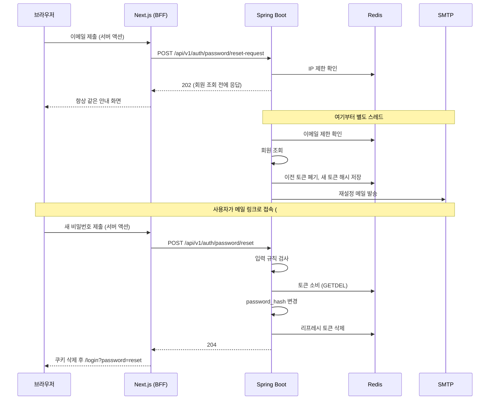

# 비밀번호 재설정 구현 계획

비밀번호를 모를 때 메일로 재설정하는 흐름(`/forgot-password`)과 로그인한 상태에서 비밀번호를 바꾸는 흐름(`/settings/privacy`)의 단계별 수행 계획이다.

- 상태: 0~8단계를 완료했다. 확정 계약은 [비밀번호 재설정·변경 API](password-reset-api.md)에 있다. 9단계 운영 배포가 남았다. 재설정·변경 기능은 아직 동작하지 않는다. 단계별 상태는 6번, 진행 내용은 8번에 기록한다.
- 근거: [이슈 #17](https://github.com/likelion-backendschool-9th/DevMozip/issues/17)의 2.7, WBS 17.2, 2026-11-05 사용자 요청.
- 이 문서는 구현 승인이 아니다. 각 단계는 사용자 요청을 받아 시작하고, 완료 보고 후 다음 단계를 자동으로 시작하지 않는다.
- 작업은 develop 기준으로 검증한다. 커밋·푸시·main 병합·배포는 사용자가 요청할 때만 한다.

## 1. 범위

| 구분 | 내용 |
|---|---|
| A. 비밀번호 재설정 (WBS 2.7) | `/forgot-password`에서 이메일 입력 → 메일 링크 → 새 비밀번호 저장. 로그인이 필요 없다. |
| B. 비밀번호 변경 (WBS 17.2) | `/settings/privacy`에서 현재 비밀번호를 확인하고 새 비밀번호 저장. 로그인이 필요하다. |
| 제외 | 가입 시 이메일 인증, 변경 알림 메일, 로그인 시도 제한, 액세스 토큰 즉시 폐기, 토큰 사전 검증 API, 메일 템플릿 엔진 |

현재 코드와의 차이는 다음과 같다. DB 스키마는 바뀌지 않는다.

| 위치 | 현재 | 변경 |
|---|---|---|
| [/forgot-password](../frontend/app/forgot-password/page.tsx) | 이메일 형식만 검사하고 "실제 이메일은 발송하지 않았습니다"를 표시 | 실제 흐름으로 교체 |
| [/settings/privacy](<../frontend/app/(user)/settings/privacy/page.tsx>), 비밀번호 있는 회원 | `confirmPasswordChange`가 항상 "아직 제공하지 않습니다" 오류 | 실제 API 호출 |
| 같은 화면, 카카오 전용 회원 | 첫 비밀번호 설정 | 유지 |
| [PATCH /me/password](../backend/src/main/java/com/devmozip/backend/controller/MemberController.java) | 비밀번호 있는 회원은 409 | 현재 비밀번호를 확인하고 변경 허용 |
| Redis | [리프레시 토큰](../backend/src/main/java/com/devmozip/backend/security/jwt/RefreshTokenStore.java) 저장에 사용, `local` 프로필은 메모리 | 같은 구조로 재설정 토큰 저장소 추가 |
| 메일 | 의존성 없음 | `spring-boot-starter-mail` 추가 |

## 2. 결정 사항

### 2.1 요청으로 확정된 항목

| 항목 | 결정 |
|---|---|
| 재설정 흐름 | 메일 발송 요청 → 메일 링크로 새 비밀번호 설정의 2단계 (이슈 #17) |
| API 경로 | `POST /api/v1/auth/password/reset-request`, `POST /api/v1/auth/password/reset` (이슈 #17), `PATCH /api/v1/users/me/password` (WBS 17.2) |
| 토큰·요청 제한 저장 | Redis |
| 메일 라이브러리 | `spring-boot-starter-mail`(`JavaMailSender`). 버전은 스프링 부트가 관리하며 4.1.2 배포를 Maven Central에서 확인했다. |

### 2.2 사용자가 확정한 항목 (2026-11-05)

| 항목 | 결정 | 이유 |
|---|---|---|
| SMTP 서비스 | Gmail (`smtp.gmail.com:587`, 앱 비밀번호). 계정 주소는 `.env`에만 둔다. | 도메인 DNS 설정 없이 시작할 수 있다. 계정에 2단계 인증이 필요하고 일일 발송 한도가 있으며, 발신 주소는 Gmail 계정 주소로 표시된다. |
| 카카오 전용 회원의 재설정 요청 | 토큰 없는 안내 메일("카카오로 로그인한 뒤 설정에서 비밀번호를 정하세요") | 메일로 비밀번호를 만들게 하면, 가입 이메일을 인증하지 않으므로 그 메일을 받는 사람이 카카오 회원의 계정을 가져갈 수 있다. 아무것도 보내지 않으면 카카오 가입을 잊은 회원이 메일을 기다리다 막힌다. |
| 변경 후 세션 (B) | 현재 기기를 포함해 모두 로그아웃하고 `/login`으로 이동 | 저장소가 회원당 리프레시 토큰 하나만 기억하므로 가장 단순하다. 현재 세션을 유지하려면 응답에 새 토큰을 담아야 해 204 계약이 회원 상태별로 갈라진다. |
| 제한 값 | 링크 30분, 같은 이메일 60초에 1회·1시간에 5회, 같은 IP 1시간에 20회 | `application.yaml`에서 조정할 수 있게 둔다. |
| B의 이슈 추적 | 이슈 #17에 항목 추가 (사용자 수행) | #17은 B를 별개 기능으로 구분하고 TODO에 넣지 않았다. |

### 2.3 설계 기준

| 항목 | 기준 |
|---|---|
| 가입 여부 비노출 | 회원을 조회하기 전에 202로 응답한다. 회원 조회·토큰 저장·메일 발송은 별도 스레드에서 처리해 응답 시간으로도 드러나지 않게 한다. |
| 토큰 형식 | `SecureRandom` 32바이트를 base64url로 인코딩한다. 1회 사용과 즉시 폐기에 서버 상태가 필요하므로 JWT를 쓰지 않는다. |
| 토큰 저장 | SHA-256 해시만 저장한다. [compose](../compose.yaml)의 Redis가 AOF로 디스크에 기록하므로 원문을 두지 않는다. |
| 1회 사용 | `GETDEL`로 조회와 삭제를 한 번에 처리해 동시 요청 중 하나만 통과시킨다. |
| 링크 주소 | 기존 `DOMAINNAME`으로 만든다. 요청의 Host 헤더를 쓰면 위조한 주소가 메일 링크에 들어갈 수 있다. |
| 토큰 전달 | `/forgot-password#token=...`처럼 URL fragment에 싣는다. 서버로 전송되지 않아 nginx 접근 로그, Next 로그, Referer에 남지 않는다. 화면은 읽은 즉시 `history.replaceState`로 주소에서 지운다. |
| 검증 순서 | 입력 규칙을 통과한 뒤에 토큰을 소비한다. 입력 실수로 링크가 소진되지 않게 한다. |
| 세션 정리 | 비밀번호를 바꾸는 트랜잭션 안에서 리프레시 토큰을 지운다. Redis 실패 시 변경도 롤백되어, 탈취된 세션이 남은 채 성공 처리되지 않는다. |
| 비밀번호 규칙 | 가입과 같다(영문·숫자 포함 8~64자, BCrypt 72바이트 이내). [MemberService](../backend/src/main/java/com/devmozip/backend/service/MemberService.java)의 검사를 복제하지 않고 재사용한다. |
| 로그 | 토큰·링크·수신 주소를 남기지 않는다. 발송 실패는 예외 클래스 이름만 남긴다. 메일 예외 메시지에 수신 주소가 들어갈 수 있다. |
| 헬스체크 | `management.health.mail.enabled=false`로 끈다. 기본값 true로 두면 SMTP 장애가 `/actuator/health` DOWN → [/api/health](../frontend/app/api/health/route.ts) 503 → [블루그린 배포](../deploy/blue-green.sh) 실패로 이어진다. |
| SMTP 시간 제한 | 연결·읽기·쓰기를 5초로 둔다. JavaMail 기본값은 무제한이라 SMTP가 멈추면 발송 스레드가 모두 묶인다. |
| 발송 스레드 | `@Async` 대신 전용 `TaskExecutor`를 주입해 제출한다. 대기열이 차면 즉시 503으로 바꿀 수 있고, 테스트에서 `SyncTaskExecutor`로 교체할 수 있다. |

## 3. 환경변수

실제 값은 Git에 올라가지 않는 루트 `.env`에 둔다. 이 문서와 Git에는 적지 않는다.

| 실행 방식 | 값을 읽는 위치 |
|---|---|
| 로컬 `docker compose` | 루트 `.env`. compose가 읽어 백엔드로 넘긴다. |
| 로컬 `./gradlew bootRun` (`local` 프로필) | 루트 `.env.local`. 이 방식은 `.env`를 읽지 않으므로 필요한 사람만 같은 값을 넣는다. |
| 운영 서버 | 서버의 `~/DevMozip/.env`. 로컬 파일과 별개이며 9단계에서 추가한다. |

| 변수 | 용도 | 비고 |
|---|---|---|
| `MAIL_HOST` | SMTP 서버 | `smtp.gmail.com`. 비어 있으면 아래 표대로 동작 |
| `MAIL_PORT` | SMTP 포트 | 기본 587 |
| `MAIL_USERNAME` | Gmail 계정 주소 | |
| `MAIL_PASSWORD` | Gmail 앱 비밀번호 | 비밀값. 계정 비밀번호를 넣지 않는다. |
| `MAIL_FROM` | 발신 주소 | `MAIL_USERNAME`과 같게 둔다. 별칭을 등록하지 않으면 Gmail이 계정 주소로 바꿔 보낸다. |
| `DOMAINNAME` | 메일 링크의 서비스 주소 | 기존 변수 재사용. 로컬 compose는 [override](../compose.override.yaml)가 `http://localhost:3000`으로 고정한다. |

값이 없어도 서버는 뜬다. 카카오의 `isConfigured()` 방식을 따른다.

| 환경 | `MAIL_HOST` 있음 | `MAIL_HOST` 없음 |
|---|---|---|
| `local` 프로필 | 실제 발송 | 링크를 콘솔에 출력 |
| 그 외 | 실제 발송 | 재설정 요청만 503, 다른 기능은 정상 |

[application.yaml](../backend/src/main/resources/application.yaml)에 추가할 설정은 다음과 같다.

```yaml
spring:
  mail:
    host: ${MAIL_HOST:}
    port: ${MAIL_PORT:587}
    username: ${MAIL_USERNAME:}
    password: ${MAIL_PASSWORD:}
    properties:
      mail.smtp.auth: true
      mail.smtp.starttls.enable: true
      mail.smtp.starttls.required: true
      mail.smtp.connectiontimeout: 5000
      mail.smtp.timeout: 5000
      mail.smtp.writetimeout: 5000

management:
  health:
    mail:
      enabled: false

password-reset:
  mail-host: ${spring.mail.host:}
  mail-username: ${spring.mail.username:}
  mail-password: ${spring.mail.password:}
  from-address: ${MAIL_FROM:}
  base-url: ${DOMAINNAME:}
  token-ttl: 30m
  email-cooldown: 60s
  email-hourly-limit: 5
  ip-hourly-limit: 20
```

## 4. 동작 흐름

### A. 재설정



요청을 받은 뒤 회원 상태별 처리는 다음과 같다. 응답은 모두 202다.

| 회원 상태 | 처리 |
|---|---|
| 비밀번호 있음, 정지 아님(`ACTIVE`, `WARNED`) | 토큰 발급, 재설정 메일 |
| 카카오 전용, 정지 아님 | 안내 메일 (토큰 없음) |
| 정지 | 아무것도 보내지 않음 |
| 미가입 | 아무것도 보내지 않음 |
| 이메일 제한 초과 | 아무것도 보내지 않음 |

### B. 변경

브라우저 → 서버 액션 → `PATCH /api/v1/users/me/password`. 성공하면 리프레시 토큰과 아직 쓰지 않은 재설정 토큰을 지우고, BFF가 쿠키를 삭제한 뒤 `/login?password=changed`로 이동한다.

### Redis 키

`local` 프로필은 같은 인터페이스의 메모리 구현을 쓴다.

| 키 | 값 | 수명 | 용도 |
|---|---|---|---|
| `password-reset:token:{토큰 해시}` | 이메일 | 30분 | 토큰 확인과 소비 |
| `password-reset:member:{이메일}` | 토큰 해시 | 30분 | 새 요청·변경 시 이전 토큰 폐기 |
| `password-reset:cooldown:{이메일}` | 1 | 60초 | 재요청 간격 |
| `password-reset:count:email:{이메일}` | 횟수 | 1시간 | 이메일별 발송 제한 |
| `password-reset:count:ip:{IP}` | 횟수 | 1시간 | IP별 요청 제한 |

여러 키를 함께 바꾸는 작업은 기존 [RedisRefreshTokenStore](../backend/src/main/java/com/devmozip/backend/security/jwt/RedisRefreshTokenStore.java)처럼 Lua 스크립트로 한 번에 실행한다.

### IP 전달

백엔드는 BFF의 요청만 받으므로 그대로는 사용자 IP를 알 수 없다. 서버 액션이 들어온 `x-real-ip`를 `X-Real-IP`로 백엔드에 넘긴다. 운영 백엔드는 포트를 공개하지 않아 BFF만 호출할 수 있다. 헤더가 없으면 IP 제한만 건너뛰고 이메일 제한은 그대로 적용한다.

## 5. API 계약

브라우저는 BFF 서버 액션만 호출한다. 대상 회원은 재설정에서는 토큰, 변경에서는 인증 정보로 정하며 요청 값으로 회원을 지정할 수 없다. 오류는 기존 `ErrorResponse` 형식을 쓴다.

| 메서드·경로 | WBS | 인증 | 요청 | 성공 응답 |
|---|---|---|---|---|
| `POST /api/v1/auth/password/reset-request` | 2.7 | 없음 | `{email}` | 202 본문 없음 |
| `POST /api/v1/auth/password/reset` | 2.7 | 없음 | `{token, newPassword, confirmPassword}` | 204 |
| `PATCH /api/v1/users/me/password` | 17.2 | 필요 | `{currentPassword?, newPassword, confirmPassword}` | 204 |

`/api/v1/auth/**`는 이미 공개 경로이므로 [SecurityConfig](../backend/src/main/java/com/devmozip/backend/config/SecurityConfig.java)는 바꾸지 않는다.

`PATCH`는 요청 값이 아니라 서버의 회원 상태로 분기한다.

| 회원 상태 | `currentPassword` | 처리 |
|---|---|---|
| 비밀번호 없음, 카카오 있음 | 보지 않음 | 첫 비밀번호 저장, 세션 유지 (기존 동작) |
| 비밀번호 있음 | 필수, 일치해야 함 | 변경, 리프레시 토큰과 재설정 토큰 삭제 |
| 비밀번호 없음, 카카오 없음 | 보지 않음 | 409 (기존 동작) |

기존 계약 중 "비밀번호 있는 회원의 요청은 409"가 바뀐다.

| 경로 | 상태 | 상황 |
|---|---|---|
| `reset-request` | 400 | 이메일 형식 오류 |
| | 429 | 같은 IP의 요청 제한 초과 |
| | 503 | 메일 설정 없음, 발송 대기열 가득 참 |
| `reset` | 400 | 비밀번호 규칙 위반, 확인 불일치. 토큰을 소비하지 않는다. |
| | 401 | 토큰 없음·만료·사용됨, 정지 회원. 문구는 모두 같다. |
| `PATCH` | 400 | 비밀번호 규칙 위반, 확인 불일치, 현재 비밀번호 누락·불일치, 현재와 같은 새 비밀번호 |
| | 401 | 로그인 필요 |
| | 403 | 정지 회원 |
| | 409 | 비밀번호도 카카오 연동도 없는 계정 |

현재 비밀번호 불일치를 401로 응답하지 않는 것은 BFF와 화면이 401을 로그인 만료로 처리하기 때문이다. `reset`의 401은 기존 `InvalidTokenException` 처리를 그대로 쓰며, 서버 액션이 만료 안내로 바꾼다.

BFF 서버 액션은 [lib/auth/actions.ts](../frontend/lib/auth/actions.ts)에 추가한다.

| 서버 액션 | 내용 |
|---|---|
| `requestPasswordResetAction(email)` | 이메일을 정규화하고 `X-Real-IP`를 붙여 요청한다. |
| `resetPasswordAction(input)` | 성공하면 로그인 쿠키를 지운다. 401이면 `{error, expired: true}`를 돌려준다. |
| `changePasswordAction(input)` | 성공하면 로그인 쿠키를 지운다. |

## 6. 단계별 수행 내용

A와 B는 서로 독립적이다. B를 먼저 하면 "아직 쓰지 않은 재설정 토큰 삭제"만 4단계에서 추가한다.

| 단계 | 내용 | 구분 | 수행 주체 | 상태 |
|---|---|---|---|---|
| 0 | 사전 준비 | 공통 | 사용자 | 완료 |
| 1 | 의존성·환경 설정 | A | 구현 | 완료 |
| 2 | Redis 토큰 저장소 | A | 구현 | 완료 |
| 3 | 메일 발송 | A | 구현 | 완료 |
| 4 | 재설정 API | A | 구현 | 완료 |
| 5 | `/forgot-password` BFF·화면 | A | 구현 | 완료 |
| 6 | 비밀번호 변경 API | B | 구현 | 완료 |
| 7 | `/settings/privacy` 화면 | B | 구현 | 완료 |
| 8 | 통합 검증·문서 정리 | 공통 | 구현 + 사용자 | 완료 |
| 9 | 운영 배포 | 공통 | main 병합 후 별도 진행 | 이번 작업에서 제외 |

모든 단계의 공통 종료 조건은 다음과 같다.

- `frontend`에서 `npm run build`와 관련 테스트를 실행한다. 백엔드를 변경한 단계는 `backend`에서 `./gradlew test`도 실행한다.
- 실행 명령, 성공·실패, 실행하지 못한 이유를 보고한다. Mock 테스트 통과를 실제 메일 발송·Redis 검증으로 보고하지 않는다.
- 이 문서의 상태 표와 8번 진행 기록을 갱신한다.

### 0단계: 사전 준비

- [x] 2.2의 항목을 확정한다.
- [x] 발송에 쓸 Gmail 계정을 정하고 3번의 값을 루트 `.env`에 넣는다.
- [x] 계정에 2단계 인증을 켜고 [앱 비밀번호](https://myaccount.google.com/apppasswords)를 만들어 `MAIL_PASSWORD`를 바꾼다. 16자리를 공백 없이 넣는다. 구글 계정 비밀번호를 바꾸면 앱 비밀번호도 폐기되므로 다시 발급해야 한다.
- [x] 이슈 #17에 WBS 17.2 항목을 추가한다.
- [x] 운영 서버에서 Gmail SMTP로 나갈 수 있는지 확인한다. 막혀 있으면 HTTP API 방식의 메일 서비스로 바꿔야 하므로 구현 전에 확인한다. 아래 명령은 연결만 시험하며 메일을 보내거나 서버 설정을 바꾸지 않는다.

  ```bash
  ssh team2@cloud.newlecture.com
  cd ~/DevMozip

  # 서버에서 확인
  timeout 5 bash -c '</dev/tcp/smtp.gmail.com/587' && echo 연결됨 || echo 실패

  # 실제 메일을 보낼 백엔드 컨테이너에서 확인. <색>은 status에 나온 활성 색(blue 또는 green)이다.
  bash deploy/blue-green.sh status
  docker compose -f compose.prod.yaml exec -T backend-<색> nc -zv -w 5 smtp.gmail.com 587
  ```

  둘 다 통과해야 한다(`연결됨`, `open`). 실패하면 포트 차단이나 DNS 문제이므로 호스트 관리자에게 확인한다.

**완료 기준:** 위 항목을 모두 마쳤다.

### 1단계: 의존성·환경 설정

- [build.gradle](../backend/build.gradle): `spring-boot-starter-mail`을 추가한다.
- [application.yaml](../backend/src/main/resources/application.yaml): 3번 설정을 추가한다.
- `config/PasswordResetProperties`: 3번의 `password-reset` 값을 받고 `isConfigured()`로 발송 가능 여부를 판단한다. SMTP 주소·계정·비밀번호, 발신 주소, 서비스 주소가 모두 있어야 true다. [KakaoProperties](../backend/src/main/java/com/devmozip/backend/config/KakaoProperties.java)처럼 `DOMAINNAME`은 `http://`, `https://`로 시작할 때만 받는다.
- [compose.yaml](../compose.yaml), [compose.prod.yaml](../compose.prod.yaml): 백엔드에 `MAIL_*`를 빈 기본값으로 전달한다. `compose.yaml`은 Git 제외 파일이므로 팀원은 각자 같은 다섯 줄을 추가해야 한다.
- [.env.example](../.env.example): 자리표시 값을 넣는다. [배포 검증](../.github/workflows/deploy.yml)이 이 파일을 쓴다.
- [AGENTS.md](../AGENTS.md): 기존 구현 범위에 비밀번호 재설정·변경과 메일 연결을 추가하고 근거를 기록한다.

이 단계는 공통 배포 설정을 변경하므로 팀에 영향을 공유한다.

**완료 기준:** 값이 없어도 백엔드가 기동한다. 접속할 수 없는 SMTP를 지정해도 `/actuator/health`가 UP임을 테스트로 확인한다. compose 설정 검증(`docker compose ... config --quiet`)이 통과한다. Docker를 쓸 수 없으면 미실행으로 기록한다.

### 2단계: Redis 토큰 저장소

[RefreshTokenStore](../backend/src/main/java/com/devmozip/backend/security/jwt/RefreshTokenStore.java)와 같은 구조로 만든다.

- `service/PasswordResetService`: 토큰 저장(이전 토큰 폐기 포함), 토큰 소비, 회원의 토큰 삭제, 이메일 제한 확인, IP 제한 확인.
- `service/impl/RedisPasswordResetService`(`!local`), `service/impl/InMemoryPasswordResetService`(`local`).

**완료 기준:** 만료, 1회만 소비, 새 토큰이 이전 토큰을 무효화, 제한 초과·해제를 두 구현 모두 테스트로 확인한다. Redis 구현은 Testcontainers(`redis:7-alpine`)로 확인하고 동시 소비도 함께 시험한다. Docker가 없으면 스킵되므로 미실행으로 기록한다.

### 3단계: 메일 발송

- `service/PasswordResetMailSender`: 재설정 메일과 카카오 안내 메일을 보낸다. SMTP 구현과 콘솔 구현을 바꿔 쓸 수 있도록 인터페이스를 둔다. `isAvailable()`로 지금 요청을 받을 수 있는지 알려 준다. 콘솔 구현은 SMTP 값 없이도 true다.
- `config/PasswordResetMailConfig`: 환경에 맞는 구현과 전용 스레드를 등록한다. 구현체는 `service/impl`에 둔다.
- SMTP 구현: `JavaMailSender`와 `MimeMessageHelper`로 텍스트·HTML을 함께 보낸다. 동적 값은 서버가 만든 링크뿐이므로 템플릿 엔진 없이 문자열로 만든다.
- 콘솔 구현: `local` 프로필이고 `MAIL_HOST`가 없을 때만 등록해 링크를 출력한다. `local` 프로필의 서비스 주소 기본값은 `http://localhost:3000`이다.
- 전용 `TaskExecutor`: 코어 2, 최대 4, 대기열 100으로 두고, 서버 종료 시 진행 중인 발송을 10초까지 기다린다. 일반 빈으로 등록하면 스프링 부트의 `applicationTaskExecutor`가 사라지므로 `defaultCandidate = false`로 등록하고 `passwordResetMailExecutor` 이름으로 주입한다.
- 카카오 안내 메일의 링크는 `{DOMAINNAME}/login?next=/settings/privacy`다. 로그인 화면이 카카오 로그인에도 `next`를 유지한다.

**완료 기준:** 수신자, 제목, 링크 형식(`{DOMAINNAME}/forgot-password#token=`), 안내 메일에 토큰이 없음을 `JavaMailSender` Mock으로 확인한다. 콘솔 구현이 `local` 외 프로필에 등록되지 않음을 테스트로 확인한다. 로컬에서 실제 메일 한 통을 받아 확인한다.

### 4단계: 재설정 API

- DTO(`dto/auth`): `PasswordResetMailRequest`, `PasswordResetRequest`. 입력 규칙과 문구는 [SignupRequest](../backend/src/main/java/com/devmozip/backend/dto/auth/SignupRequest.java), [PasswordSetRequest](../backend/src/main/java/com/devmozip/backend/dto/member/PasswordSetRequest.java)와 같다.
- `service/PasswordResetFlowService` (`PasswordResetService`는 2단계 저장소가 쓴다):
  - 요청: `PasswordResetMailSender.isAvailable()` 확인(503) → IP 제한(429) → 발송 작업 제출(거절 시 503) → 202. 작업은 4번 표대로 처리한다.
  - 재설정: 입력 규칙 검사 → 토큰 소비 → 잠금 조회(`findForAccountUpdateByEmail`) → 정지 회원 거절 → 비밀번호 변경·리프레시 토큰 삭제.
- [AuthController](../backend/src/main/java/com/devmozip/backend/controller/AuthController.java): 두 경로를 추가한다. `InvalidTokenException`과 `ResponseStatusException`은 기존 [GlobalExceptionHandler](../backend/src/main/java/com/devmozip/backend/controller/GlobalExceptionHandler.java)가 처리한다.

**완료 기준:**

- 가입·미가입·정지·카카오 전용 이메일의 응답이 같고, 상태별로 메일이 4번 표대로 나가는지 `SyncTaskExecutor`로 확인한다.
- 재설정 후 새 비밀번호로 로그인되고 이전 비밀번호는 401이며, 기존 리프레시 토큰으로 재발급할 수 없다.
- 같은 토큰 재사용, 위조·만료 토큰, 규칙 위반 뒤 같은 토큰으로 재시도하면 성공, 정지 회원 거절을 확인한다.

### 5단계: `/forgot-password` BFF·화면

구현 전 [frontend/AGENTS.md](../frontend/AGENTS.md)의 안내대로 `node_modules/next/dist/docs/`에서 필요한 내용을 확인한다.

- [lib/auth/actions.ts](../frontend/lib/auth/actions.ts): 5번의 `requestPasswordResetAction`, `resetPasswordAction`을 추가한다.
- `lib/auth/passwordReset.ts`: fragment의 토큰 해석과 `/login` 결과 코드별 문구를 맡는다.
- [/forgot-password](../frontend/app/forgot-password/page.tsx): 페이지 안의 데모 폼을 `_components/`의 요청 폼과 재설정 폼으로 나눠 교체한다.
  - fragment에 토큰이 없으면 요청 폼을 보여 준다. 제출하면 "가입된 이메일이라면 메일을 보냈습니다" 안내를 항상 같게 표시한다.
  - 토큰이 있으면 새 비밀번호 폼을 보여 준다. 만료 응답이면 안내와 함께 요청 폼으로 돌아가는 버튼을 표시한다.
  - 입력 검증은 기존 `validEmail`, `passwordSetErrors`를 쓴다.
- [/login](../frontend/app/login/page.tsx): `?password=reset`, `?password=changed` 결과를 안내한다. [KakaoNotice](../frontend/app/_components/KakaoNotice.tsx)처럼 URL에는 코드만 싣고 문구는 화면이 정한다.
- [mocks/routes.ts](../frontend/mocks/routes.ts): `/forgot-password` 설명의 Mock 문구를 고친다.

**완료 기준:** 토큰 해석과 서버 액션의 성공·실패·만료 처리를 Vitest로 확인한다. 브라우저에서 토큰을 읽은 뒤 주소에서 사라지는지 확인한다.

### 6단계: 비밀번호 변경 API

- [PasswordSetRequest](../backend/src/main/java/com/devmozip/backend/dto/member/PasswordSetRequest.java): 선택 값 `currentPassword`를 추가한다.
- [MemberService](../backend/src/main/java/com/devmozip/backend/service/MemberService.java)의 `setPassword`: 5번 표대로 분기한다. `RefreshTokenStore`와 `PasswordResetService` 의존성을 추가한다.
- 기존 테스트를 함께 고친다.
  - `KakaoAccountManagementIntegrationTest`, `MemberServiceTest`의 "이미 비밀번호가 있으면 409" 기대를 새 규칙으로 바꾼다.
  - `MemberControllerTest`, `MemberServiceTest`의 `PasswordSetRequest` 생성 호출을 맞춘다.

**완료 기준:** 현재 비밀번호 누락·불일치, 현재와 같은 새 비밀번호, 변경 후 새 비밀번호 로그인, 기존 리프레시 토큰 무효, 쓰지 않은 재설정 토큰 무효를 테스트로 확인한다. 카카오 전용 회원의 첫 비밀번호 설정과 세션 유지 테스트는 그대로 통과한다.

### 7단계: `/settings/privacy` 화면

- [lib/auth/actions.ts](../frontend/lib/auth/actions.ts): `changePasswordAction`을 추가한다.
- [/settings/privacy](<../frontend/app/(user)/settings/privacy/page.tsx>):
  - 비밀번호 있는 회원의 폼을 실제 API에 연결하고, 성공하면 새 문서 요청으로 `/login?password=changed`에 이동한다.
  - 제목·버튼·모달의 데모 문구와 "최근 데모 확인" 표시를 없앤다.
  - 현재 비밀번호 칸 근처에 `/forgot-password` 링크를 둔다.
  - 카카오 전용 회원의 첫 비밀번호 설정과 카카오·결제·공개 설정 영역은 바꾸지 않는다.
- [authStore](../frontend/lib/state/authStore.ts): `confirmPasswordChange`를 제거한다. 저장된 `passwordConfirmedAt`은 기존 데이터를 읽을 수 있도록 형식을 유지한다.
- `scripts/verify-account-revision.mjs`는 이미 옛 경로를 쓰는 과거 검증 스크립트이므로 고치지 않는다.

**완료 기준:** 회원 상태별 입력 칸과 문구를 Vitest로 확인하고, 기존 [KakaoAuthScreens 테스트](../frontend/tests/screens/KakaoAuthScreens.test.tsx)가 통과한다. 브라우저에서 변경과 재로그인을 확인한다.

### 8단계: 통합 검증·문서 정리

`./gradlew test`, `npm test`, `npm run build`를 다시 실행한다. 이어서 실제 SMTP와 Redis가 있는 로컬 환경에서 다음 시나리오를 확인한다. 메일함 확인이 필요하므로 사용자와 함께 진행한다.

| # | 시나리오 | 기대 결과 |
|---|---|---|
| 1 | 이메일 회원의 재설정 요청 | 안내 화면, 메일 수신, 링크가 `{DOMAINNAME}/forgot-password#token=...` |
| 2 | 링크에서 새 비밀번호 저장 | `/login?password=reset` 이동, 새 비밀번호 로그인 성공, 이전 비밀번호 실패 |
| 3 | 같은 링크 다시 사용 | 만료 안내, 비밀번호 유지 |
| 4 | 수명이 지난 링크 (`token-ttl`을 줄여 확인) | 만료 안내 |
| 5 | 두 번 요청한 뒤 첫 메일의 링크 사용 | 첫 링크는 무효, 둘째 링크는 성공 |
| 6 | 미가입·정지 회원 이메일 | 1번과 같은 화면, 메일 없음 |
| 7 | 카카오 전용 회원 이메일 | 1번과 같은 화면, 안내 메일 수신, 토큰 없음 |
| 8 | 60초 안에 반복 요청 | 메일 한 통 |
| 9 | 다른 브라우저가 로그인한 상태에서 재설정 | 그 브라우저는 액세스 토큰 만료 후 로그아웃 |
| 10 | SMTP 접속 불가 상태 | 요청은 202, `/actuator/health` UP, 로그에 토큰·수신 주소 없음 |
| 11 | Redis에서 저장 값 확인 | 원문 토큰 없음, 수명 있음 |
| 12 | `/settings/privacy`에서 현재 비밀번호 틀림 | 오류 안내, 비밀번호 유지 |
| 13 | `/settings/privacy`에서 변경 성공 | `/login?password=changed` 이동, 새 비밀번호 로그인 성공, 받아 둔 재설정 링크 무효 |
| 14 | 카카오 전용 회원의 첫 비밀번호 설정 | 기존 동작 유지, 로그인 유지 |

문서는 실제 구현에 맞춰 갱신한다.

- [kakao-auth-api.md](kakao-auth-api.md): "비밀번호가 있는 회원의 변경은 제공하지 않는다"와 관련 409, 제한 항목.
- [team-auth-deployment.md](team-auth-deployment.md): 계정과 인증 표, "비밀번호 변경 API는 아직 없다".
- [frontend-pages.md](frontend-pages.md), [decisions-pending.md](decisions-pending.md), [api-plan.md](api-plan.md): 데모·미확정·후보 경로 문구.
- [setup-after-ai.md](setup-after-ai.md), [deployment-operations.md](deployment-operations.md): `MAIL_*`와 SMTP 설정.
- `docs/password-reset-api.md`: 확정된 API 명세를 새로 작성한다.
- 이슈 #17의 2.7과 추가한 17.2 항목의 체크는 사용자가 PR 병합 시점에 판단한다.

**완료 기준:** 시나리오 결과와 미검증 항목을 구분해 기록했다.

### 9단계: 운영 배포 (이번 작업에서 제외)

운영 확인은 main에 병합된 뒤에만 할 수 있다. [운영 안내](deployment-operations.md)의 develop → main 절차를 따르며, main에 push하면 곧바로 배포되므로 다음을 먼저 확인한다.

1. 서버의 `.env`에 `MAIL_*`를 추가한다. `.env`는 Git에 없어 배포로 전달되지 않는다.
2. 백엔드에 전달될 `DOMAINNAME`이 운영 주소인지 확인한다. 출력 값은 문서나 채팅에 옮기지 않는다.
3. 호스트 nginx가 `X-Real-IP`를 설정하는지 확인한다. [환경 준비 안내](setup-after-ai.md)가 요구하는 값이지만 호스트 설정은 저장소에 없다. 없으면 IP 제한이 동작하지 않는다.

배포 후 운영 주소로 8단계의 1·2·13번 시나리오를 확인한다.

## 7. 알려진 제한

- **가입 이메일을 인증하지 않는다.** 이 기능이 생기면 메일을 받는 사람이 곧 비밀번호를 바꿀 수 있는 사람이 된다. 가입 때 오타를 낸 주소의 주인은 그 계정을 가져갈 수 있다. 가입 시 이메일 인증은 별도 작업으로 다뤄야 한다.
- `GET /api/v1/auth/check-email`이 가입 여부를 그대로 알려 준다. 재설정 API의 응답을 같게 해도 가입 여부 노출이 완전히 막히지는 않는다.
- 이미 발급된 액세스 토큰은 비밀번호를 바꿔도 최대 30분 유효하다. 기존 제한과 같다.
- 로그인에 시도 제한이 없으므로 현재 비밀번호 확인에도 따로 두지 않는다. 한쪽만 막아도 효과가 없다.
- 발송을 비동기로 처리하므로 메일 실패를 사용자에게 알릴 수 없다. 배포 전환 중 대기 작업이 사라질 수 있으며 사용자는 다시 요청해야 한다.
- 토큰을 소비한 뒤 DB 저장이 실패하면 링크가 소진되어 다시 요청해야 한다. 1회 사용을 보장하기 위한 선택이다.
- 비밀번호 변경 알림 메일이 없어 본인이 아닌 변경을 알아차리기 어렵다.
- 공용 데모 계정의 비밀번호를 아는 사람은 실제로 바꿀 수 있어, 바뀌면 다른 사람이 그 계정으로 로그인하지 못한다.

## 8. 진행 기록

### 2026-11-05 계획 문서 작성

- 변경 파일: `docs/password-reset-plan.md`. 코드·설정·`.env`는 변경하지 않았고 구현은 시작하지 않았다.
- 확인: `spring-boot-starter-mail` 4.1.2의 존재와 `management.health.mail.enabled` 기본값 true를 Maven Central의 배포물에서 확인했다. 문서의 로컬 링크 대상이 모두 존재함을 확인했다. `.env` 값 중 문서에 나타나는 것은 공개 기본값과 같은 프로젝트 이름뿐이다.
- frontend `npm run build`: `frontend`에서 직접 실행하면 실패했다(`next: not found`). `frontend/node_modules`가 root 소유의 빈 폴더다. 같은 소스를 임시 폴더에 복사해 `npm ci`와 `npm run build`를 실행했고 성공했다.
- 문서만 변경하여 새 기능 테스트와 백엔드 테스트는 실행하지 않았다.
- AI 기능이 아니므로 `docs/ai-progress.md` 대신 이 문서에 기록한다. 커밋·푸시는 하지 않았다.

### 2026-11-05 결정 확정

- 사용자가 2.2의 다섯 항목을 확정했다. Gmail SMTP, 카카오 전용 회원에게 토큰 없는 안내 메일, 변경 후 현재 기기까지 로그아웃, 제안한 제한 값, 이슈 #17에 17.2 항목 추가(사용자 수행)다.
- 변경 파일: `docs/password-reset-plan.md`. 구현은 시작하지 않았다. 0단계의 Gmail 계정 준비, 이슈 항목 추가, 운영 서버 연결 확인이 남았다.
- frontend `npm run build`: 이전과 같은 이유로 임시 복사본에서 실행했고 성공했다. `frontend`에서 직접 실행하지는 않았다.
- 문서만 변경하여 새 기능 테스트와 백엔드 테스트는 실행하지 않았다. 커밋·푸시는 하지 않았다.

### 2026-11-05 0단계 진행

- 사용자가 발송 계정을 정했다. 사용자 결정에 따라 로컬 값은 `.env.local`이 아니라 루트 `.env`에 넣었다. 로컬이 compose로 실행되고 있어 `.env`를 읽기 때문이다. 3번을 실행 방식별로 고쳤다.
- 변경 파일: `docs/password-reset-plan.md`, 루트 `.env`(Git 제외, `MAIL_*` 다섯 개 추가). `MAIL_PASSWORD`는 자리표시 값이다. compose 파일이 아직 `MAIL_*`를 넘기지 않아 실행 중인 백엔드에는 영향이 없다.
- 확인: `docker compose config --quiet` 성공. 로컬 PC와 로컬 백엔드 컨테이너에서 `smtp.gmail.com:587` 연결 성공(연결만 시험했고 메일은 보내지 않았다).
- 운영 서버: 사용자가 서버와 활성 색(green)의 백엔드 컨테이너에서 `smtp.gmail.com:587` 연결 성공을 확인했다. TCP 연결만 시험한 결과이며, Gmail 로그인과 실제 발송은 9단계에서 확인한다.
- 앱 비밀번호: 사용자가 `.env`에 입력했다. 값은 출력하지 않고 영문 소문자 16자이며 자리표시 값이 아님을 확인했다. Gmail 로그인은 아직 시험하지 않았으며 3단계에서 확인한다.
- 이슈 #17: 사용자 요청으로 작업 표와 TODO에 17.2 항목을 추가했다(2026-11-05). 0단계를 완료했다.
- frontend `npm run build`: 임시 복사본에서 실행했고 성공했다. 새 기능 테스트와 백엔드 테스트는 실행하지 않았다. 커밋·푸시는 하지 않았다.

### 2026-11-05 1단계 완료

- 변경 파일: `backend/build.gradle`, `application.yaml`, `config/PasswordResetProperties.java`(신규), `config/PasswordResetPropertiesTest.java`(신규), `config/MailConfigurationIntegrationTest.java`(신규), `compose.prod.yaml`, `compose.yaml`(Git 제외), `.env.example`, `AGENTS.md`, 이 문서.
- 계획과 다른 점: `isConfigured()`가 `MAIL_HOST`만이 아니라 계정·비밀번호·발신 주소·서비스 주소까지 확인한다. 일부만 넣으면 202를 응답한 뒤 메일이 조용히 실패하기 때문이다. 이를 위해 `password-reset`에 `mail-host`, `mail-username`, `mail-password`를 두고 `spring.mail` 값을 참조하게 했다. 3번을 고쳤다.
- 발견: `compose.yaml`은 커밋 c4b62b9에서 저장소에서 제거되었고 `.gitignore`의 `*.yaml`에 걸린다. 이 파일의 변경은 로컬에만 있다. 팀원이 추가하지 않으면 재설정 요청만 503이고 다른 기능은 영향이 없다. `compose.prod.yaml`은 추적 중이다. 공유할 내용이며 아직 공유하지 않았다.
- `./gradlew test`: 실행 중인 백엔드 컨테이너와 `backend/build`가 겹치지 않도록 임시 복사본에서 `sh ./gradlew test --no-daemon`으로 실행했다. 372개 통과, 실패·오류·스킵 0. `backend`에서 직접 실행하지는 않았다.
- 메일 설정 테스트: 값이 없어도 기동하고 헬스체크 UP, 접속할 수 없는 SMTP(127.0.0.1:1)를 지정해도 UP, 메일 헬스체크를 켠 대조군은 DOWN(503). H2와 실제 `application.yaml` 기준이다.
- compose: 로컬 `docker compose config --quiet`와 CI가 쓰는 `compose.prod.yaml` + `.env.example` 검증이 모두 성공했다.
- frontend: 프론트엔드 코드는 바꾸지 않았다. 임시 복사본에서 `npm run build` 성공, `npm test` 627개 통과. `frontend`에서 직접 실행하지는 않았다.
- 미검증: 실제 Gmail 로그인과 메일 발송(3단계). 실행 중인 로컬 백엔드 컨테이너는 다시 만들지 않아 `MAIL_*`와 새 의존성이 아직 반영되지 않았다. 커밋·푸시는 하지 않았다.

### 2026-11-05 2단계 완료

- 변경 파일: `service/PasswordResetService.java`, `service/impl/RedisPasswordResetService.java`, `service/impl/InMemoryPasswordResetService.java`, 테스트 `service/impl/PasswordResetServiceContractTest.java`, `InMemoryPasswordResetServiceTest.java`, `RedisPasswordResetServiceTest.java`, `PasswordResetServiceProfileTest.java`, 이 문서. 모두 신규이며 이 문서만 수정했다.
- 계획과 다른 점: 사용자 요청으로 이름과 위치를 바꿨다. `PasswordResetStore` 대신 `service/PasswordResetService`, 구현체는 `service/impl`이다. 계획의 4단계 클래스가 쓰던 이름이므로 4단계 시작 전에 새 이름을 정한다.
- 아직 호출하는 코드가 없다. 토큰 생성과 해시 계산은 4단계에서 만든다.
- `./gradlew test`: 임시 복사본에서 `sh ./gradlew test --no-daemon`으로 실행했다. 410개 통과, 실패·오류·스킵 0. `backend`에서 직접 실행하지는 않았다.
- 저장소 테스트: 메모리 구현 16개, Redis 구현 19개(Testcontainers `redis:7-alpine`, 스킵 없음), 프로필별 등록 3개. Redis의 만료는 실제로 기다리지 않고 남은 수명을 줄여 확인했으며, 수명 값 자체는 별도 테스트로 확인했다.
- local 프로필 실제 기동: `members_data.sql`을 빼면 성공(`/actuator/health` 200)했다.
- 기존 문제(이번 변경과 무관, 수정하지 않음): `backend/src/main/resources/members_data.sql`을 넣은 local 프로필은 HEAD에서도 기동에 실패한다. 이 파일이 `::jsonb`를 쓰는데 `application-local.yml`의 H2가 PostgreSQL 호환 모드가 아니다. 두 파일 모두 Git 제외 대상이라 이 PC 기준의 결과다.
- frontend: 프론트엔드 코드는 바꾸지 않았다. 임시 복사본에서 `npm run build` 성공, `npm test` 627개 통과. `frontend`에서 직접 실행하지는 않았다.
- 커밋·푸시는 하지 않았다.

### 2026-11-05 3단계 완료

- 사용자 결정: 4단계 재설정 로직 클래스 이름은 `PasswordResetFlowService`다. `members_data.sql`은 WSL이 없어 compose를 쓸 수 없는 환경에 필요한 파일이다.
- 변경 파일: `config/PasswordResetProperties.java`(링크 생성), `config/PasswordResetMailConfig.java`(신규), `service/PasswordResetMailSender.java`(신규), `service/impl/SmtpPasswordResetMailSender.java`(신규), `service/impl/ConsolePasswordResetMailSender.java`(신규), `application.yaml`(local 기본 주소), 테스트 `SmtpPasswordResetMailSenderTest`, `ConsolePasswordResetMailSenderTest`, `PasswordResetMailConfigTest`(신규), `PasswordResetPropertiesTest`, `MailConfigurationIntegrationTest`, 이 문서.
- 계획과 다른 점: `isAvailable()`과 카카오 안내 메일의 로그인 링크를 추가했고, 스레드를 `defaultCandidate = false`로 등록했다. 아직 호출하는 코드가 없다.
- `./gradlew test`: 임시 복사본에서 `sh ./gradlew test --no-daemon`으로 실행했다. 432개 통과, 실패·오류·스킵 0. `backend`에서 직접 실행하지는 않았다.
- 스레드 등록 확인: 임시 복사본에서 `defaultCandidate = false`를 빼면 `applicationTaskExecutor` 유지 테스트가 실패함을 확인했다.
- 실제 발송: 임시 복사본에만 둔 테스트로 실제 Gmail을 통해 발송 계정 자신에게 재설정 메일과 카카오 안내 메일을 한 통씩 보냈다. 토큰은 가짜 값이다. Gmail 로그인과 발송 요청은 오류 없이 끝났고, 로그에 주소와 앱 비밀번호가 없음을 확인했다. 메일함 수신과 화면 표시는 사용자가 확인해야 한다.
- compose: 로컬 `docker compose config --quiet` 성공. compose 파일은 이번에 바꾸지 않았다.
- local 프로필 실제 기동: `members_data.sql`을 빼면 성공(`/actuator/health` 200)했다.
- 기존 문제(이번 변경과 무관, 수정하지 않음): 이 PC의 `application-local.yml`과 `members_data.sql` 조합은 local 프로필 기동에 실패한다. H2 일반 모드는 `::jsonb`에서 실패하고, `MODE=PostgreSQL`을 주면 SQL은 통과하지만 `SuspendedMemberStore`가 회원을 읽을 때 `Could not deserialize string to java type: java.util.List<java.lang.String>`으로 실패한다. HEAD에서도 같다. 2단계 기록의 원인 설명은 일반 모드 기준이다.
- frontend: 프론트엔드 코드는 바꾸지 않았다. 임시 복사본에서 `npm run build` 성공, `npm test` 627개 통과. `frontend`에서 직접 실행하지는 않았다.
- 실행 중인 로컬 백엔드 컨테이너는 다시 만들지 않았다. 커밋·푸시는 하지 않았다.

### 2026-11-05 4단계 완료

- 3단계: 작업 담당자가 본인 메일함에서 수신을 확인했다.
- 변경 파일: `dto/auth/PasswordResetMailRequest.java`(신규), `dto/auth/PasswordResetRequest.java`(신규), `service/PasswordResetFlowService.java`(신규), `service/MemberService.java`, `controller/AuthController.java`, 테스트 `service/PasswordResetFlowServiceTest.java`(신규), `controller/PasswordResetIntegrationTest.java`(신규), `controller/AuthControllerTest.java`, 이 문서.
- 사용자 지적으로 바꾼 설계: `MemberService`의 `private` 메서드를 풀지 않는다. 용도가 분명한 공개 메서드 `checkNewPassword`만 추가했고, `normalizeEmail`과 `checkPasswordBytes`는 `private`을 유지한다. 이메일 정규화는 `PasswordResetFlowService`에 같은 식을 한 줄 두었다.
- `./gradlew test`: 임시 복사본에서 `sh ./gradlew test --no-daemon`으로 실행했다. 462개 통과, 실패·오류·스킵 0. `backend`에서 직접 실행하지는 않았다.
- 통합 테스트: 실제 보안 설정과 H2를 쓰지만 메일은 가짜, 저장소는 메모리 구현, 발송 스레드는 `SyncTaskExecutor`다.
- local 프로필 실제 흐름: 임시 복사본의 서버에서 `curl`로 확인했다. 요청 202(미가입 이메일도 202), 전용 발송 스레드가 콘솔에 출력한 링크의 토큰으로 재설정 204, 같은 토큰 재사용 401, 새 비밀번호 로그인 200, 이전 비밀번호 로그인 401. 메일은 콘솔 구현이라 실제로 나가지 않았다.
- 미검증: 재설정 API와 실제 Redis·SMTP를 함께 쓰는 흐름(8단계). `X-Real-IP`를 넘기는 BFF(5단계).
- frontend: 프론트엔드 코드는 바꾸지 않았다. 임시 복사본에서 `npm run build` 성공, `npm test` 627개 통과. `frontend`에서 직접 실행하지는 않았다.
- 실행 중인 로컬 백엔드 컨테이너는 다시 만들지 않았다. 커밋·푸시는 하지 않았다.

### 2026-11-06 5~7단계 완료

- 5단계 변경 파일: `lib/auth/passwordReset.ts`(신규), `lib/auth/actions.ts`, `types/auth.ts`, `mocks/routes.ts`, `app/forgot-password/page.tsx`, `app/forgot-password/_components/PasswordResetRequestForm.tsx`·`PasswordResetForm.tsx`(신규), `app/login/page.tsx`, `app/login/_components/PasswordNotice.tsx`·`.module.css`(신규), 테스트 `lib/auth/passwordReset.test.ts`·`tests/screens/PasswordResetScreens.test.tsx`(신규), `lib/auth/actions.test.ts`.
- 6단계 변경 파일: `dto/member/PasswordSetRequest.java`, `service/MemberService.java`, 테스트 `controller/PasswordChangeIntegrationTest.java`(신규), `service/MemberServiceTest.java`, `controller/MemberControllerTest.java`, `controller/KakaoAccountManagementIntegrationTest.java`.
- 7단계 변경 파일: `app/(user)/settings/privacy/page.tsx`, `_components/AccountPasswordForm.tsx`·`.module.css`(신규), `lib/auth/actions.ts`, `lib/state/authStore.ts`, 테스트 `tests/screens/KakaoAuthScreens.test.tsx`, `lib/auth/actions.test.ts`.
- 계획과 다른 점:
  - 회원 상태별 입력 칸과 문구를 테스트하려고 비밀번호 폼을 `_components/AccountPasswordForm`으로 분리했다.
  - 이미 `/forgot-password`를 연 탭에 메일 링크를 붙여 넣으면 fragment만 바뀌어 문서를 다시 불러오지 않는다. 브라우저 검증에서 폼이 뜨지 않는 결함을 발견해 `hashchange`도 처리하게 했다.
  - 현재 비밀번호 누락·불일치·같은 값의 문구를 각각 두었다.
- `./gradlew test`: 임시 복사본에서 `sh ./gradlew test --no-daemon`으로 실행했다. 476개 통과, 실패·오류·스킵 0. `backend`에서 직접 실행하지는 않았다. 이후 백엔드 코드는 바꾸지 않았다.
- frontend: 임시 복사본에서 실행했다. `npm run typecheck` 성공, 변경 범위 `eslint` 성공, `npm run build` 성공. `npm test`는 654개 중 653개 통과, 1개 실패.
- 실패 1개(이번 변경과 무관): `lib/projects/projectService.test.ts`의 "생성된 공고는 주최자·직군별 인원과 공통 검색/메인 목록에 반영" 테스트. 2026-11-06 00시 이후 실패하며, 커밋된 코드(HEAD)에서도 같은 테스트가 실패한다. 고정 시각(2026-10-30)으로 공고를 만든 뒤 실제 현재 날짜로 거르는 것으로 보이며 원인은 코드로 확정하지 않았다. 수정하지 않았다.
- 브라우저 검증: 임시 폴더의 Playwright(Chromium)로 임시 백엔드(local, H2, 콘솔 메일)와 `next dev`를 띄워 21개 항목을 확인했고 모두 통과했다. 요청, 메일 링크, 토큰이 주소에서 사라짐(StrictMode, 같은 탭 붙여넣기와 새 문서 모두), 만료 안내, 재설정 후 로그인, 현재 비밀번호 오류 시 로그인 유지, 변경 후 쿠키 삭제와 `/login?password=changed` 이동, 이전 비밀번호 거절, 하이드레이션 경고 없음. 프론트엔드 로그에 토큰이 없음을 확인했다.
- 미검증: 카카오 전용 회원의 화면은 브라우저로 확인하지 않았다(폼 렌더링과 API 테스트로만 확인). 실제 SMTP·Redis 통합과 다른 브라우저의 세션 만료는 8단계에서 확인한다.
- 검증 중 사고: 첫 실행에서 링크 기본 주소가 `localhost:3000`이라 Playwright가 실행 중인 로컬 프론트엔드 컨테이너에 접속했고, 재설정 요청 한 건이 실행 중인 백엔드까지 갔다. 해당 백엔드에는 아직 API가 없어 404로 끝났으며 데이터는 바뀌지 않았다. 이후 임시 백엔드에 `DOMAINNAME`을 지정해 분리했다.
- 실행 중인 로컬 컨테이너는 다시 만들지 않았다. 커밋·푸시는 하지 않았다.

### 2026-11-06 8단계 완료

- 변경 파일: `app/(user)/settings/privacy/page.tsx`(머리말의 체험 안내 삭제), `tests/screens/KakaoAuthScreens.test.tsx`, `docs/password-reset-api.md`(신규), `docs/kakao-auth-api.md`, `docs/team-auth-deployment.md`, `docs/frontend-pages.md`, `docs/decisions-pending.md`, `docs/api-plan.md`, `docs/demo-scenarios.md`, `docs/setup-after-ai.md`, `docs/deployment-operations.md`, `AGENTS.md`, 이 문서.
- 계획에 없던 문서: `docs/demo-scenarios.md`에 비밀번호를 바꿀 수 없다고 적혀 있어 고쳤다. 이메일 칸의 Mock 안내는 비밀번호와 무관해 두었다.
- `./gradlew test`: 임시 복사본에서 실행했다. 476개 통과, 실패·오류·스킵 0.
- frontend: 임시 복사본에서 `npm run typecheck`, `npm run build` 성공. `npm test`는 655개 중 654개 통과, 1개 실패. 실패는 7단계 기록의 `projectService.test.ts`와 같고 이번 변경과 무관하다.
- 검증 환경: 실행 중인 백엔드가 외부 DB에 연결되어 있어, 시나리오는 임시 PostgreSQL·Redis 컨테이너, `next start` 프로덕션 서버, Chromium으로 격리해 실행하고 끝난 뒤 지웠다. 메일은 실제 Gmail SMTP로 보냈다.
- 시나리오 1~14: 모두 통과했다. 다음은 실제 환경과 다르게 확인한 부분이다.
  - 토큰은 임시 복사본에만 넣은 장치가 발송 뒤 파일에 남긴 값으로 받았다. 실제 메일의 링크를 눌러 진행하지는 않았다.
  - 4번: `token-ttl`을 줄이는 대신 30분 수명을 확인한 뒤 Redis에서 토큰 키의 수명을 줄였다.
  - 9번: 액세스 토큰 수명을 20초로 줄여 실제 만료를 기다렸다.
  - 14번: 실제 카카오 인증 없이 서버와 같은 비밀키로 액세스 토큰을 만들어 세션을 준비했다.
- 추가 확인: AOF 파일에 토큰 해시는 있고 원문은 없다. 브라우저가 보낸 `x-real-ip`가 BFF를 거쳐 IP 제한에 집계된다. 세 서버의 로그에 앱 비밀번호, 수신 주소, 토큰 링크가 없다. 실제 SMTP 백엔드의 발송 실패 로그는 0건이다.
- 로컬 compose: 작업 담당자가 백엔드 컨테이너를 다시 만들었다. `MAIL_*`와 `DOMAINNAME`이 전달되고, 재설정 요청에 형식이 틀린 이메일을 보내면 400을 응답한다. 이 컨테이너로 실제 메일을 보내 보지는 않았다.
- 메일함: 작업 담당자가 본인 메일함에서 지정한 별칭으로 8통 수신을 확인했다. 발송 기록과 통수가 같다.
- 미검증: 실제 메일 링크를 눌러 진행하는 흐름, 실제 카카오 로그인 뒤의 첫 비밀번호 설정, 운영 환경(9단계).
- 이슈 #17의 체크는 PR 병합 시점에 판단한다. 커밋·푸시는 하지 않았다.
