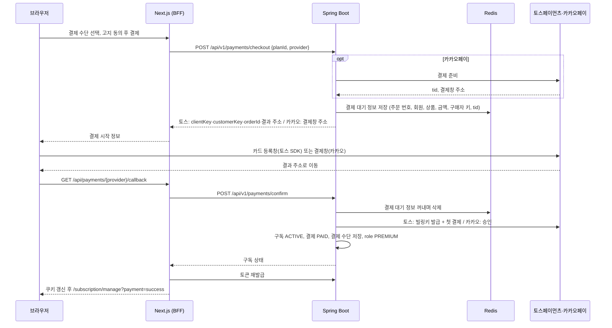
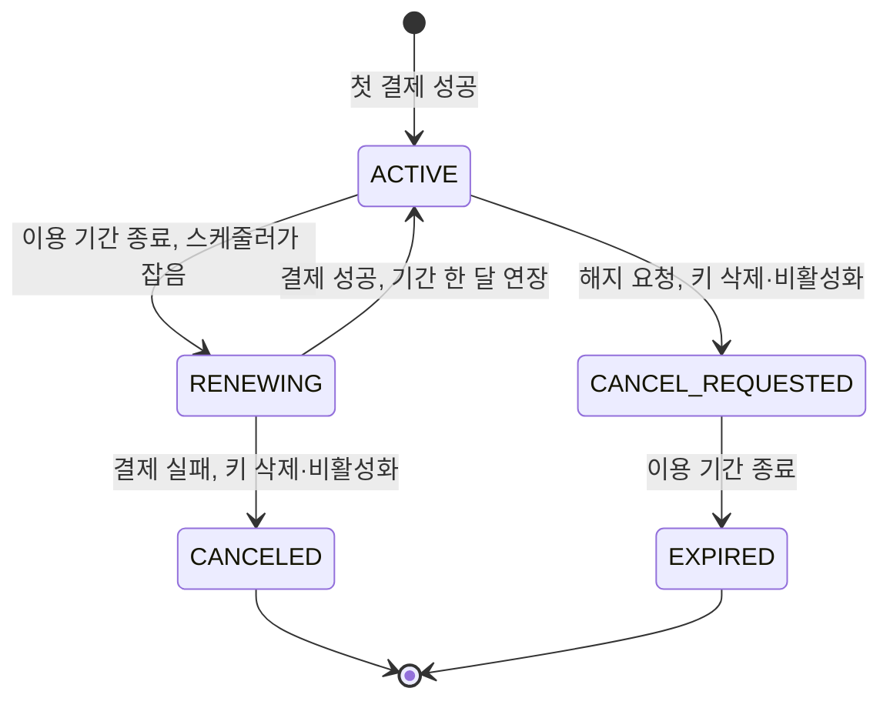
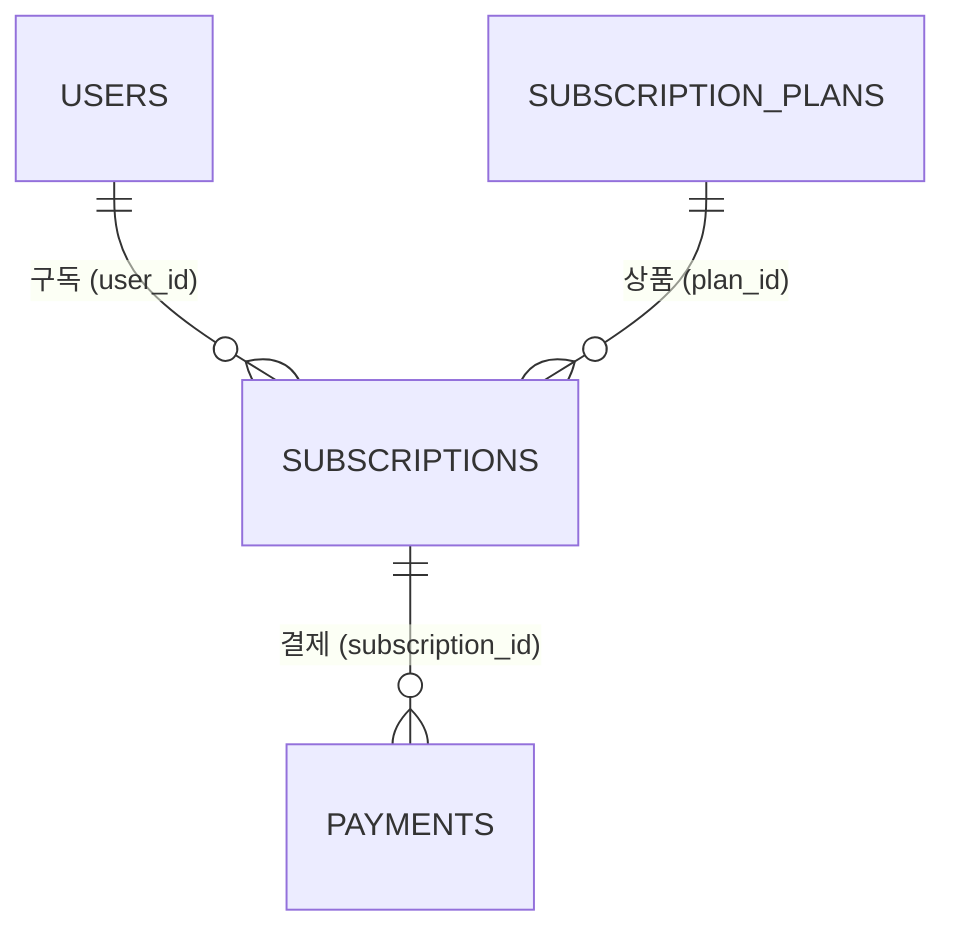

# 프리미엄 구독·정기결제 구현 계획

WBS 13.0 프리미엄/결제(13.1~13.5)를 토스페이먼츠·카카오페이 정기결제로 구현하기 위한 단계별 계획이다. 프론트엔드 UI를 먼저 고치고(일부 페이지 신규), 백엔드를 만든 뒤, 화면을 백엔드 API에 연결한다.

- 상태: 계획 작성, 2절 결정 반영. 0단계 남은 항목이 있다. 단계별 상태는 7절, 진행 내용은 9절에 기록한다.
- 각 단계는 사용자가 그 단계를 요청할 때만 시작한다. 한 단계가 끝나도 다음 단계를 자동으로 시작하지 않는다.
- 이 문서는 계획이며 구현 승인이 아니다. 현재 `AGENTS.md`는 Toss Payments 연결을 금지하고, 구현 범위에 구독·결제 도메인이 없다. 2단계를 시작할 때 승인 범위를 갱신하고 근거를 기록한다.
- 작업은 develop 기준으로 검증한다. 커밋·푸시·main 병합·배포는 사용자가 요청할 때만 한다.
- 페이지 경로와 API는 WBS 13.x를 따른다. WBS와 다르게 정한 항목은 2절에 적는다. 이전 초안(`docs/api-plan.md`의 `/premium/...`)과 `docs/routing.md`·`docs/frontend-pages.md`의 `/premium`은 사용하지 않는다.

## 1. 범위

| WBS | 기능 | 페이지 | API |
|---|---|---|---|
| 13.1 | 프리미엄 상품 안내 | `/subscription` | `GET /api/v1/subscription/plans` |
| 13.2 | 프리미엄 결제 | `/subscription/checkout` | `POST /api/v1/payments/checkout`(추가), `POST /api/v1/payments/confirm` |
| 13.3 | 구독 상태 및 권한 확인 | `/subscription/manage` | `GET /api/v1/subscription/me` |
| 13.4 | 구독 해지 | `/subscription/manage` | `POST /api/v1/subscription/cancel` |
| 13.5 | 결제 내역 조회 | `/subscription/history` | `GET /api/v1/payments/me` |
| 15.3 | 결제 API 연동 | 13.2와 같다 | `POST /api/v1/payments/confirm` |
| 17.4~17.6 | 개인정보 설정의 결제 정보·결제 수단·구독 정보 | `/settings/privacy` | 13.3·13.5 API, `GET /api/v1/payment-methods/me` |

- 15.3의 페이지 칸은 `/premium/checkout`이다. 같은 API를 쓰는 행이므로 13.2의 `/subscription/checkout` 하나로 만든다.
- 매월 자동 결제(갱신)는 WBS에 별도 행이 없지만 정기결제에 포함된 동작으로 보고 이 계획에서 만든다.
- 제외: 관리자 구독·결제 관리(14.12, 14.13), 역할 관리(2절). 프리미엄 혜택별 서버 권한 검사(AI 상세 분석 10.9, AI 한도 10.10, AI 포트폴리오 피드백 4.5, 공고 작성 7.2)는 각 기능 담당이 역할(`PREMIUM`)로 처리한다. 운영(라이브) 결제 전환(8단계).

### 현재 코드 (2026-11-09 확인)

| 위치 | 현재 | 이 계획의 변경 |
|---|---|---|
| [/subscription](../frontend/app/subscription/page.tsx) | 요금제 카드·비교표·내 구독 상태·결제 내역 예시가 한 페이지에 있다. 가격은 "예시 가격" ₩9,900이고, "무료로 데모 구독 전환"으로 즉시 프리미엄이 된다 | 상품 안내만 남기고 결제·관리·내역을 새 페이지로 나눈다 |
| `/subscription/checkout`, `/manage`, `/history` | 없음 | 새로 만든다 |
| [/settings/privacy](<../frontend/app/(user)/settings/privacy/page.tsx>)의 결제 정보 | 역할로 현재 구독을 표시하고, 결제 수단은 고정 문구(`mocks/account.ts`의 데모 카드), 결제 내역은 예시를 보여 준다 | 같은 구독·결제 상태를 표시한다 |
| 구독 상태 | `devmozip:administration:v1`의 `subscriptions`·`payments`. [effectiveUser](../frontend/lib/administration/administrationService.ts)가 서버 역할 위에 데모 구독을 덮어쓴다 | 연동 후에는 서버 역할만 쓴다 |
| 백엔드 | [Member](../backend/src/main/java/com/devmozip/backend/entity/Member.java)의 `role`(`USER`·`PREMIUM`·`OWNER`·`ADMIN`)과 `payment_methods`(JSON, 쓰는 코드 없음). 구독·결제 엔티티·API·스케줄러 없음 | 2~5단계 |
| 역할 전달 | 액세스 토큰에 역할 하나를 담고, [GET /api/v1/users/me](../backend/src/main/java/com/devmozip/backend/controller/MemberController.java)는 토큰의 역할을 돌려준다. 토큰 재발급은 DB의 역할을 읽는다 | 결제 직후 토큰을 재발급한다(3절) |

## 2. 결정 사항

### 확정

| 날짜 | 항목 | 결정 |
|---|---|---|
| 2026-11-09 | 결제 수단 | 토스페이먼츠 자동결제(카드 빌링)와 카카오페이 정기결제 두 가지. 15.3의 "PG사 미확정"을 이것으로 정한다. |
| 2026-11-09 | 진행 순서 | 프론트엔드 UI 수정(일부 페이지 신규) → 백엔드 → 연동 |
| 2026-11-09 | 결제 준비 API | WBS에 없는 `POST /api/v1/payments/checkout`을 추가한다. 카카오페이는 서버가 결제 준비를 요청해 결제창 주소와 거래 번호(`tid`)를 받아야 하고, 토스페이먼츠는 카드 등록창을 열기 전에 서버가 만든 구매자 키(`customerKey`)와 주문 번호가 필요하다. |
| 2026-11-09 | 가격 | 프리미엄 월 ₩9,900. 목업의 "예시 가격"을 확정 가격으로 바꾼다. |
| 2026-11-09 | 해지·환불·고지 | 사용자가 작성을 맡겼다. 3절 "서비스 정책"으로 정했다. |
| 2026-11-09 | 결제 실패 | 매월 결제가 실패하면 그 구독을 바로 취소하고, 정기결제 키(토스 빌링키·카카오 SID)도 삭제·비활성화해 이후 결제가 일어나지 않게 한다. |
| 2026-11-09 | 역할 | 결제는 `USER`를 `PREMIUM`으로, 구독이 끝나면 `PREMIUM`을 `USER`로 바꾸는 것만 한다. `ADMIN`·`OWNER` 등 역할 관리는 관리자 범위라 이 계획에서 다루지 않는다. 결제는 `USER`만 시작할 수 있다. |
| 2026-11-09 | 구독 기록 없는 `PREMIUM` | 서버 DB의 데모 프리미엄 계정처럼 결제 없이 역할만 `PREMIUM`인 회원은 따로 처리하지 않는다. |
| 2026-11-09 | ERD | 제공된 ERD의 `subscription_plans`·`subscriptions`·`payments`를 따른다(4절). `subscriptions.user_id`는 `users.id`를 참조한다. ERD에 결제 수단 테이블이 없으므로 결제 수단은 `users.payment_methods`(JSON)에 둔다. |
| 2026-11-09 | 17.5·17.6 API | WBS의 API 칸과 달리 이름에 맞춰 연결한다. 결제 수단은 `GET /api/v1/payment-methods/me`, 구독 정보는 `GET /api/v1/subscription/me`다. |
| 2026-11-09 | `payments` 추가 컬럼 | ERD에 `created_at`(결제 시도 시각)과 `order_id`(주문 번호, 유니크)를 추가한다(4절). 실패한 결제의 일시를 표시하고, 결과를 모르는 결제를 주문 번호로 조회하기 위해서다. ERDCloud에도 반영한다. |

## 3. 결제 흐름과 정책

### 서비스 정책

2026-11-09 사용자 위임으로 작성했다. 법률 검토를 거친 정책이 아니다(8절).

| 항목 | 정책 |
|---|---|
| 상품 | 프리미엄 월 구독 하나, 월 ₩9,900 |
| 결제일 | 첫 결제는 구독을 시작할 때 바로 한다. 이후 매월 구독 시작일과 같은 날에 결제한다. 그날이 없는 달(31일 등)은 그달 마지막 날에 결제한다 |
| 이용 기간 | 결제할 때마다 한 달씩 이어진다 |
| 해지 | `/subscription/manage`에서 언제든 요청한다. 요청 즉시 정기결제 키를 삭제·비활성화해 다음 결제가 일어나지 않는다. 이미 결제한 기간이 끝날 때까지 프리미엄을 이용하고, 끝나면 무료로 바뀐다 |
| 해지 후 다시 구독 | 해지 예약 중에는 새 결제를 시작할 수 없다. 이용 기간이 끝난 뒤 다시 구독한다 |
| 환불 | 이미 결제한 금액은 환불하지 않는다. 해지해도 남은 기간을 나눠 돌려주지 않는다. 서버 오류로 결제만 되고 구독이 만들어지지 않은 경우는 결제를 취소한다 |
| 결제 실패 | 매월 결제가 실패하면 구독을 바로 취소하고 정기결제 키를 삭제·비활성화한다. 무료로 바뀌며, 다시 이용하려면 새로 결제한다 |
| 결제 전 고지 | 결제 화면에 상품, 금액, 결제 주기, 오늘 결제와 다음 결제일, 해지 방법과 해지 후 이용 기간, 환불 불가, 결제 실패 시 구독 취소를 보여 준다. 이 내용에 동의를 체크해야 결제 버튼이 열린다 |

### 두 결제 수단의 차이

토스페이먼츠 내용은 [자동결제(빌링) 연동 가이드](https://docs.tosspayments.com/guides/v2/billing/integration)에서 확인했다. 카카오페이 [정기 결제 문서](https://developers.kakaopay.com/docs/payment/online/subscription)는 이 문서를 쓸 때 내용을 받지 못해, 아래 카카오페이 항목은 0단계에서 문서로 확인한다.

| 구분 | 토스페이먼츠 자동결제 | 카카오페이 정기결제 |
|---|---|---|
| 결제창 | SDK v2 `payment({ customerKey })`의 `requestBillingAuth()`로 카드 등록창을 연다. 등록만 하고 결제하지 않는다 | 서버의 결제 준비 응답에 있는 결제창 주소로 이동한다 |
| 돌아오는 값 | 성공 주소에 `customerKey`·`authKey`, 실패 주소에 오류 코드 | 승인 주소에 `pg_token`, 취소·실패 주소 |
| 서버 승인 | `authKey`로 빌링키 발급 → 빌링키로 첫 달 결제 | `pg_token`으로 결제 승인. 첫 달 결제와 정기결제 키(SID) 발급이 함께 일어난다 |
| 다음 달부터 | 빌링키 결제 API | SID 결제 API |
| 해지·결제 실패 | 빌링키 삭제 API(`DELETE /v1/billing/{billingKey}`) | SID 비활성화 API |
| 키 | API 개별 연동 키(클라이언트·시크릿). 시크릿 키 뒤에 `:`을 붙여 base64로 만든 Basic 인증 | Secret key, 정기결제 CID(알려진 테스트 CID는 `TCSUBSCRIP`) |
| 일정 | 결제 일정을 대신 실행하지 않는다. 서버가 직접 요청한다 | 서버가 직접 요청한다 |
| 라이브 | 자동결제 추가 계약·리스크 검토가 필요하다. 테스트 키는 가입만으로 쓸 수 있다 | 가맹 계약 후 CID 발급 |

빌링키 발급(`POST /v1/billing/authorizations/issue`)과 빌링키 결제(`POST /v1/billing/{billingKey}`)의 경로는 가이드 본문에 직접 적혀 있지 않아 0단계에서 API 레퍼런스로 확인한다.

### 첫 결제 (13.2)

공개 요청은 프론트엔드로만 전달되고 백엔드는 포트를 공개하지 않는다. 그래서 결제 결과 주소는 카카오 로그인과 같이 BFF 경로로 두고, BFF가 백엔드의 승인 API를 호출한다.

- 결제창에서 취소·실패: BFF가 승인 API를 부르지 않고 `/subscription/checkout?payment=<코드>`로 이동한다. 결제 대기 정보는 유효 시간이 지나면 사라진다.
- 첫 결제 실패: 토스는 빌링키 발급 뒤 첫 결제가 실패하면 발급한 빌링키를 삭제한다. 구독과 결제 행은 만들지 않는다.
- 토큰 재발급: 결제 직후의 액세스 토큰에는 이전 역할이 들어 있다. BFF가 기존 재발급([lib/auth/refresh.ts](../frontend/lib/auth/refresh.ts))으로 새 토큰을 받아 쿠키를 바꾼 뒤 이동한다.

### 매월 결제

- 스케줄러는 `ACTIVE`이고 `current_period_end`가 지난 구독을 잡는다. 먼저 구독을 `RENEWING`으로 바꾸고, 새 주문 번호(`order_id`)와 `created_at`을 넣은 결제 행을 `PENDING`으로 저장해 커밋한 뒤 외부 API를 부른다.
- 성공: 결제 행 `PAID`, `paid_at` 기록, 구독 `ACTIVE`, `current_period_end`를 다음 달로 바꾼다.
- 실패: 결제 행 `FAILED`, 구독 `CANCELED`와 `ended_at`, 정기결제 키 삭제·비활성화, `users.payment_methods` 비우기, 역할 `USER`.
- 해지 예약 만료: `CANCEL_REQUESTED`이고 기간이 지난 구독을 `EXPIRED`로 바꾸고 `ended_at`과 역할 `USER`를 반영한다. 결제하지 않는다.
- 역할은 `PREMIUM`일 때만 `USER`로 바꾼다. 그사이 관리자가 다른 역할을 줬으면 건드리지 않는다.

### 설계 기준

| 항목 | 기준 |
|---|---|
| 요청자 | Spring Security 인증 정보로 회원을 찾는다. 요청 본문·쿼리의 사용자 ID와 금액은 받지 않는다. |
| 금액 | 결제 준비 때 `subscription_plans`의 가격으로 정해 결제 대기 정보에 저장한다. 승인 응답의 금액이 이 금액과 다르면 결제를 취소하고 실패로 처리한다. ERD의 `DECIMAL(12,2)`는 Java `BigDecimal`이며, PG에는 원 단위 정수로 보낸다. |
| 결제 대기 정보 | `payments`는 구독에 속하므로, 구독이 생기기 전인 첫 결제의 주문은 Redis에 둔다(4절). 승인에 성공하면 그 주문 번호를 `payments.order_id`에 저장한다. 비밀번호 재설정과 같이 `local` 프로필은 메모리 구현을 쓴다. |
| 주문 소유 | `confirm`은 결제 대기 정보의 회원이 요청자와 같을 때만 처리한다. 토스는 돌아온 `customerKey`도 저장한 값과 같아야 한다. 다른 사람이 만든 결과 주소를 열게 해도 승인되지 않는다. |
| 중복 승인 | `confirm`은 결제 대기 정보를 꺼내면서 지운다(`GETDEL`). 같은 주문의 두 번째 요청은 찾을 수 없어 거절된다. |
| 이용 중 구독 하나 | 결제 준비와 저장 직전에 회원 행을 잠그고 이용 중 구독(`ACTIVE`·`RENEWING`·`CANCEL_REQUESTED`)이 없는지 확인한다. 그사이 다른 결제가 먼저 끝났으면 이번 결제를 취소한다. |
| 외부 호출과 트랜잭션 | 외부 API를 부르는 동안 DB 잠금을 잡지 않는다. 결제는 성공했는데 저장이 실패하면 결제 취소 API로 되돌리고, 취소도 실패하면 로그로 남긴다. |
| 구매자 키 | 결제 준비마다 무작위 UUID를 만들어 토스 `customerKey`와 카카오 `partner_user_id`에 쓰고, 성공하면 결제 수단과 함께 저장한다. 이메일·회원 ID는 쓰지 않는다. |
| 주문 번호 | UUID로 만든다. 두 서비스의 주문 번호 규칙은 0단계에서 확인한다. |
| 키 보관 | 빌링키·SID는 암호화해 `users.payment_methods`에 저장하고 응답·로그에 넣지 않는다. 토스 빌링키는 다시 조회할 수 없다. 화면에는 표시용 정보(카드사·마스킹 번호, 카카오페이 결제 수단 유형)만 보낸다. |
| 비밀값 | 시크릿 키는 백엔드에만 둔다. 토스 클라이언트 키는 결제 준비 응답으로 내려 프론트엔드 환경변수를 늘리지 않는다(카카오 로그인과 같다). |
| 결과 주소 | `DOMAINNAME`으로 만든다. 요청의 Host 헤더를 쓰지 않는다. |
| 화면 이동 | 결과 URL에는 코드만 싣고 문구는 화면이 정한다(`KakaoNotice`와 같다). |
| 로그 | `authKey`, `pg_token`, 빌링키, SID, 시크릿 키를 남기지 않는다. 외부 오류는 상태 코드와 오류 코드만 남긴다. |
| 시간 | 컨테이너 시간대 설정이 없으므로 Asia/Seoul `Clock`을 주입해 계산한다. 기간 끝은 `starts_at`에 결제 완료 횟수만큼 개월을 더해 정해, 말일 보정이 다음 달로 이어지지 않게 한다. |
| 스케줄러 중복 | 블루그린 배포 중에는 두 백엔드가 함께 떠 있다. PostgreSQL `FOR UPDATE SKIP LOCKED`로 구독을 잡고 `RENEWING`으로 바꿔 커밋하므로, 다른 실행은 같은 구독을 다시 잡지 못한다. |
| 결과를 모르는 결제 | 외부 호출 중 서버가 멈추면 구독은 `RENEWING`, 결제 행은 `PENDING`으로 남는다. 중복 청구를 막기 위해 자동으로 다시 결제하지 않는다. 토스는 `order_id`로 결제 결과를 조회해 확인하고, 카카오페이의 확인 방법은 0단계에서 정한다. |
| 시간 제한 | 백엔드의 외부 호출에 연결·읽기 제한을 둔다. BFF의 승인 요청은 `backendFetch` 기본 5초보다 긴 제한을 쓴다. |

## 4. 백엔드 구조

기존 계층형 패키지(`backend/src/main/java/com/devmozip/backend`)를 따른다. 탭 들여쓰기와 생성자 주입을 쓰고, 응답 DTO는 record로 만든다. 엔티티를 API 응답으로 직접 쓰지 않는다. Service는 프로젝트 기능처럼 인터페이스와 `service/impl` 구현으로 나눈다.

### ERD (2026-11-09 제공)

ERD 이미지에는 NULL 여부가 표시되지 않는다. DATETIME은 기존 기준대로 Java `LocalDateTime`, PostgreSQL `timestamp without time zone`으로 읽는다. 세 테이블 모두 `updated_at`이 없으므로 `BaseEntity`를 상속하지 않는다. `payments`의 `order_id`·`created_at`은 2026-11-09 결정으로 ERD에 추가하는 컬럼이다.

**subscription_plans — 프리미엄 상품**

| 필드 | 타입 | 의미 | 이 계획의 사용 |
|---|---|---|---|
| id | BIGINT / PK | 상품 ID | |
| name | VARCHAR(100) | 상품명 | 프리미엄 |
| price | DECIMAL(12,2) | 가격 | 9900.00 |
| currency | CHAR(3) | 통화 | `KRW` |
| billing_cycle | VARCHAR(20) | 결제 주기 | `MONTHLY` |
| feature_limits | JSON | 기능별 한도 | 목업의 프리미엄 한도(AI 추천 월 100회)를 넣는다. 키 이름은 AI 사용량(10.10) 담당과 맞추고, 이 계획은 저장과 13.1 응답만 한다 |
| is_active | BOOLEAN | 판매 여부 | 13.1과 결제 준비는 판매 중인 상품만 받는다 |

- 무료 요금제는 결제 상품이 아니므로 행으로 두지 않고 화면이 표시한다.
- 상품 행을 넣는 방법(SQL 파일 또는 시작 시 초기화)은 2단계에서 기존 데모 데이터 방식을 보고 정한다.

**subscriptions — 구독**

| 필드 | 타입 | 의미 | 이 계획의 사용 |
|---|---|---|---|
| id | BIGINT / PK | 구독 ID | |
| user_id | BIGINT / FK | 사용자 ID | `users.id` 참조 |
| plan_id | BIGINT / FK | 상품 ID | `subscription_plans.id` 참조 |
| status | VARCHAR(20) | 구독 상태 | 아래 값 목록 |
| starts_at | DATETIME | 구독 시작 시각 | 첫 결제 시각 |
| current_period_end | DATETIME | 현재 이용기간 종료 | 다음 결제 시각 |
| cancel_requested_at | DATETIME | 해지 요청 시각 | |
| ended_at | DATETIME | 구독 종료 시각 | 만료·취소 시각 |

| status | 의미 | 프리미엄 |
|---|---|---|
| `ACTIVE` | 이용 중. 기간이 끝나면 매월 결제한다 | 예 |
| `RENEWING` | 매월 결제 처리 중 | 예 |
| `CANCEL_REQUESTED` | 해지 예약. 기간 끝까지 이용하고 결제하지 않는다 | 예 |
| `EXPIRED` | 해지 예약 후 기간 종료 | 아니오 |
| `CANCELED` | 매월 결제 실패로 취소 | 아니오 |

**payments — 결제 내역**

| 필드 | 타입 | 의미 | 이 계획의 사용 |
|---|---|---|---|
| id | BIGINT / PK | 결제 ID | |
| subscription_id | BIGINT / FK | 구독 ID | 회원은 구독의 `user_id`로 찾는다 |
| order_id | VARCHAR(64) | 주문 번호 | **추가.** 유니크. 첫 결제는 결제 대기 정보의 주문 번호, 매월 결제는 새로 만든 UUID. 길이는 토스 주문 번호 최대 길이에 맞추며 0단계에서 확인한다 |
| provider | VARCHAR(50) | PG사 | `TOSS_PAYMENTS`·`KAKAO_PAY` |
| provider_payment_id | VARCHAR(255) | PG 결제 ID | 토스 `paymentKey`, 카카오 `tid` |
| payment_method_snapshot | JSON | 결제 수단 스냅샷 | 결제 당시 표시용 정보(결제 수단, 카드사·마스킹 번호 또는 카카오페이 결제 수단 유형). 키는 넣지 않는다 |
| amount | DECIMAL(12,2) | 결제 금액 | |
| currency | CHAR(3) | 통화 | `KRW` |
| status | VARCHAR(20) | 결제 상태 | `PENDING`(매월 결제 처리 중)·`PAID`·`FAILED`·`CANCELED`(결제 후 저장 실패로 취소) |
| paid_at | DATETIME | 결제 완료 시각 | `PAID`일 때만 |
| created_at | DATETIME | 결제 시도 시각 | **추가.** 행을 만든 시각. 실패한 결제의 일시 표시와 처리 중으로 남은 결제 확인에 쓴다 |

- 첫 결제는 승인과 저장이 한 요청에서 끝나므로 성공한 결제만 `PAID`로 남긴다. 첫 결제 실패는 구독이 없어 행을 만들지 않는다.
- 제약: `order_id` 유니크.

**users.payment_methods — 결제 수단 (기존 컬럼)**

현재 등록된 결제 수단 하나를 JSON 객체로 둔다. 해지·결제 실패 때 비운다.

| 키 | 의미 |
|---|---|
| provider | `TOSS_PAYMENTS`·`KAKAO_PAY` |
| customerKey | 구매자 키. 토스 `customerKey`, 카카오 `partner_user_id` |
| billingKey | 토스 빌링키 또는 카카오 SID. 암호화한 값 |
| display | 표시용 정보(카드사·마스킹 번호 또는 카카오페이 결제 수단 유형) |
| registeredAt | 등록 시각 |

`Member`는 공통 엔티티이므로 결제 수단을 바꾸는 메서드 추가를 팀에 공유한다.

### Redis — 결제 대기 정보

[PasswordResetService](../backend/src/main/java/com/devmozip/backend/service/PasswordResetService.java)와 같은 구조로 인터페이스와 Redis·메모리 구현(`local` 프로필)을 둔다.

| 키 | 값 | 수명 | 용도 |
|---|---|---|---|
| `payment-checkout:{주문 번호}` | 회원 ID, 상품 ID, 결제 수단, 금액, 통화, 구매자 키, 카카오 `tid` | 0단계에서 확인한 두 서비스의 결제창 제한 시간에 맞춘다 | 승인 때 꺼내며 삭제 |

### 파일 (예정)

| 위치 | 파일 | 역할 |
|---|---|---|
| entity | SubscriptionPlan, Subscription, Payment | ERD 매핑 |
| entity/enums | SubscriptionStatus, PaymentProvider, PaymentStatus | 값 목록 |
| entity | Member | 결제 수단 저장·삭제 메서드 추가 |
| repository | SubscriptionPlanRepository, SubscriptionRepository, PaymentRepository | 판매 중 상품 조회, 회원의 이용 중 구독 조회, 기간이 지난 구독의 `SKIP LOCKED` 조회, 회원별 결제 내역 페이지 |
| client | PaymentGateway, TossPaymentsClient, KakaoPayClient | 결제 수단별 외부 API 호출, 시간 제한, 오류 변환. 기존 `KakaoClient`와 같은 방식 |
| config | PaymentProperties | 키·CID·결과 주소·암호화 키, `isConfigured()` |
| config | 스케줄링 설정 | `@EnableScheduling`. 스케줄러가 저장소에 처음 생기므로 팀에 공유한다 |
| 암호화 | 결제 키 암호화 | 빌링키·SID 암호화·복호화. 위치는 2단계에서 기존 구조를 보고 정한다 |
| service | PaymentCheckoutService + impl(Redis·메모리) | 결제 대기 정보 저장·꺼내기 |
| service | SubscriptionService | 상품 안내, 구독 상태, 해지 (13.1, 13.3, 13.4) |
| service | PaymentService | 결제 준비·승인, 결제 내역, 결제 수단 (13.2, 13.5, 17.5) |
| service | SubscriptionRenewalService | 매월 결제, 결제 실패 취소, 해지 예약 만료. 시각을 인자로 받아 테스트에서 바꿀 수 있게 한다 |
| scheduler | SubscriptionRenewalScheduler | 주기적으로 `SubscriptionRenewalService`만 부른다. 실행 주기는 `application.yaml`에 둔다 |
| controller | SubscriptionController, PaymentController, PaymentMethodController | `/api/v1/subscription/**`, `/api/v1/payments/**`, `/api/v1/payment-methods/me` |
| dto/subscription, dto/payment | 요청·응답 record | 5절 |

### 공개 경로

- `/subscription`은 비로그인으로도 볼 수 있으므로 `GET /api/v1/subscription/plans`를 공개한다. 나머지는 기존 기본값(인증 필요)을 따른다.
- 공통 `SecurityConfig`를 바꾸므로 바꾸기 전에 팀에 공유한다.

### 환경변수

실제 값은 Git에 올라가지 않는 루트 `.env`(compose)와 `.env.local`(`bootRun`의 local 프로필)에만 둔다. 이 문서와 Git에는 적지 않는다.

| 변수 | 용도 | 비고 |
|---|---|---|
| `TOSS_CLIENT_KEY` | 토스 API 개별 연동 클라이언트 키 | 브라우저에 노출되는 값. 결제 준비 응답으로 전달한다 |
| `TOSS_SECRET_KEY` | 토스 시크릿 키 | 비밀값 |
| `KAKAOPAY_SECRET_KEY` | 카카오페이 Secret key | 비밀값 |
| `KAKAOPAY_CID` | 카카오페이 정기결제 CID | |
| `PAYMENT_ENCRYPTION_KEY` | 빌링키·SID 암호화 키 | 비밀값. 바꾸면 저장된 키를 읽을 수 없다 |
| `DOMAINNAME` | 결과 주소 | 기존 변수 재사용 |

- 값이 없어도 서버는 뜬다. 카카오 로그인의 `isConfigured()`처럼, 설정이 없는 결제 수단의 결제 준비·승인만 503으로 응답하고 상품 안내·구독 상태·내역은 동작한다.
- 반영 위치: `application.yaml`, `compose.prod.yaml`, `.env.example`, `compose.yaml`(Git 제외, 팀원 각자 추가), `application-local.yml`(Git 제외).

### 오류 응답

Service는 `ResponseStatusException`을 던지고 기존 `GlobalExceptionHandler`가 `ErrorResponse`로 바꾼다.

| 상태 | 상황 |
|---|---|
| 400 | 입력 오류, 판매하지 않는 상품, 지원하지 않는 결제 수단, PG가 거절한 결제(PG 오류 코드 포함) |
| 401 | 로그인 필요 |
| 403 | `USER`가 아닌 역할(`PREMIUM` 제외), 정지 회원 |
| 404 | 없거나 만료된 결제 대기 정보, 다른 회원의 주문 |
| 409 | 이미 이용 중(`PREMIUM` 역할 또는 이용 중 구독, 해지 예약 포함), 해지할 구독 없음 |
| 502 | PG 연결 실패 |
| 503 | 결제 환경변수 없음 |

### DB 반영 주의

- `ddl-auto: update`이므로 엔티티를 추가한 서버를 재시작하면 연결된 DB에 테이블이 생긴다. 개발 백엔드가 공용 DB에 연결된 경우 반영 시점을 팀과 맞춘다.
- ERD를 바탕으로 이미 만든 테이블이 DB에 있으면 컬럼 타입과 제약을 엔티티와 대조한다.

## 5. API (초안)

확정 계약은 4단계에서 `docs/premium-payment-api.md`로 작성한다.

| WBS | 메서드·경로 | 인증 | 요청 | 성공 응답 |
|---|---|---|---|---|
| 13.1 | `GET /api/v1/subscription/plans` | 공개 | 없음 | 200 `[{id, name, price, currency, billingCycle, featureLimits}]` |
| 13.2 | `POST /api/v1/payments/checkout` | 로그인 | `{planId, provider}` | 201. 토스 `{orderId, provider, clientKey, customerKey, successUrl, failUrl}`, 카카오 `{orderId, provider, redirectPcUrl, redirectMobileUrl}` |
| 13.2 | `POST /api/v1/payments/confirm` | 로그인 | 토스 `{orderId, authKey, customerKey}`, 카카오 `{orderId, pgToken}` | 200 구독 상태(13.3 형식) |
| 13.3 | `GET /api/v1/subscription/me` | 로그인 | 없음 | 200 `{status, premium, plan, startsAt, currentPeriodEnd, nextBillingAt, cancelRequestedAt, endedAt, paymentMethod}` |
| 13.4 | `POST /api/v1/subscription/cancel` | 로그인 | 없음 | 200 구독 상태(`CANCEL_REQUESTED`) |
| 13.5, 17.4 | `GET /api/v1/payments/me` | 로그인 | `page`(0부터), `size` | 200 `{items, page, size, hasNext}` |
| 17.5 | `GET /api/v1/payment-methods/me` | 로그인 | 없음 | 200 `{provider, display}`, 없으면 빈 값 |

- 13.3의 `status`: 구독한 적이 없으면 `NONE`, 그 밖에는 가장 최근 구독의 상태다. 결제 실패로 취소된 구독(`CANCELED`)이 최근 구독이면 관리 화면이 취소 안내를 보여 준다. `premium`은 현재 역할이 `PREMIUM`인지다. `nextBillingAt`은 `ACTIVE`일 때만 있다.
- 결제 내역 항목: 결제 일시(`PAID`는 `paid_at`, 그 밖에는 `created_at`), 상품명, 결제 수단 스냅샷의 표시 정보, 금액, 통화, 상태. `created_at` 최신순이다.
- 페이지 크기 기본값과 최대값은 프로젝트·피드 목록과 같게(기본 20, 최대 100) 둔다.

## 6. 프론트엔드

### 1단계 화면 (Mock)

백엔드 없이 Mock 상태로 동작한다. 외부 결제창은 열지 않는다. PC 1440px 우선, 화이트·연회색 바탕과 보라색·시안색 포인트를 유지한다.

| 페이지 | WBS | 화면 |
|---|---|---|
| `/subscription` | 13.1 | 요금제 카드와 비교표를 유지하고 가격을 ₩9,900으로 확정 표시한다("예시 가격" 문구 삭제). 프리미엄 카드 버튼을 `/subscription/checkout`으로 연결하고, 이미 이용 중이면 `/subscription/manage`로 안내한다. "내 구독 상태"와 "결제 내역 예시"는 새 페이지로 옮긴다 |
| `/subscription/checkout` | 13.2 | 상품 요약(이름·월 금액·결제 주기), 결제 수단 선택(토스페이먼츠 카드 자동결제 / 카카오페이 정기결제), 3절 "결제 전 고지"와 동의 체크, 결제 버튼, 실패·취소 결과 안내(`?payment=<코드>`). 비로그인·`USER`가 아닌 계정·이미 이용 중 처리 |
| `/subscription/manage` | 13.3, 13.4 | 현재 상태(무료·이용 중·해지 예약·해지 후 만료·결제 실패로 취소), 다음 결제일·금액 또는 이용 종료일, 결제 수단, 이용 중인 프리미엄 혜택, AI 사용량 링크, 해지 확인 모달(3절 해지·환불 정책 안내), 결제 완료 안내(`?payment=success`) |
| `/subscription/history` | 13.5 | 결제 일시·상품·결제 수단·금액·상태 목록, 빈 목록, 다음 페이지 표시 버튼 |
| `/settings/privacy` 결제 정보 | 17.4~17.6 | 현재 구독·결제 수단·최근 결제 내역을 같은 상태로 표시하고 관리·내역 페이지로 연결한다 |

- 파일 배치: 타입은 `types/subscription.ts`(5절 응답 형태), 원본 데이터는 `mocks/subscription.ts`, 상태·검증·저장은 `lib/subscription/`, 페이지 전용 컴포넌트와 CSS Module은 각 경로의 `_components`. 컴포넌트에 Mock 데이터를 직접 넣지 않는다.
- 상태는 버전이 있는 localStorage에 보존한다. 결제·해지 정보를 담으면 `devmozip:administration:v1`의 형식이 바뀌므로 새 키를 두거나 버전을 올린다. 1단계 시작 시 정한다.
- 화면 간 일관성: Mock 결제 완료는 기존 데모 전환처럼 다른 화면(공고 작성, AI 상세 추천 이유, PRO 뱃지 등)의 프리미엄 권한에 반영되어야 한다. Mock 해지는 3절 정책대로 기간 끝까지 프리미엄을 유지한다.
- `/subscription/checkout`·`/manage`·`/history`는 로그인이 필요하므로 [lib/auth/paths.ts](../frontend/lib/auth/paths.ts)의 보호 경로에 넣는다. `/subscription`은 공개로 둔다.
- [mocks/routes.ts](../frontend/mocks/routes.ts)와 [frontend-pages.md](frontend-pages.md)에 새 페이지를 적는다.

### 6단계 연동

- 구현 전 [frontend/AGENTS.md](../frontend/AGENTS.md)의 안내대로 `node_modules/next/dist/docs/`에서 필요한 내용을 확인한다.
- BFF: `app/api/subscription/...`, `app/api/payments/...` Route Handler. 기존 `app/api/projects/route.ts`처럼 `backendFetch`·`getSession`을 쓰고, 쓰기 요청은 같은 출처를 확인한다. 사용자 ID는 백엔드로 보내지 않는다.
- 결과 주소: `app/api/payments/[provider]/callback/route.ts`. 성공이면 승인 API 호출과 토큰 재발급 후 `/subscription/manage?payment=success`, 실패·취소면 `/subscription/checkout?payment=<코드>`로 이동한다. 액세스 토큰이 만료됐으면 기존 재발급으로 갱신한 뒤 승인한다.
- 토스: 결제 준비 응답의 클라이언트 키로 SDK v2를 불러 카드 등록창을 연다. SDK를 npm 패키지로 넣을지 스크립트로 불러올지는 6단계에서 문서로 확인해 정한다. 현재 앱에는 CSP 설정이 없다.
- 카카오페이: 결제 준비 응답의 결제창 주소로 이동한다. PC와 모바일 주소를 모두 받아 기기에 맞게 고른다.
- 해지 후 역할: 해지 요청은 역할을 바로 바꾸지 않는다. 기간이 끝나 역할이 바뀌면 다음 토큰 재발급부터 반영된다.
- 데모 덮어쓰기 제거: `effectiveUser`가 로그인한 서버 계정에 데모 구독을 적용하지 않게 한다. 저장된 `devmozip:administration:v1`은 기존 데이터를 읽을 수 있도록 형식을 유지한다.
- 화면의 Mock 상태를 API 응답으로 바꾸고 "데모·실제 청구 없음" 문구를 정리한다. 로딩·오류·재시도, 중복 제출 방지, 실패 시 선택 값 보존을 처리한다.

### 같은 상태를 쓰는 다른 화면

이 계획에서는 아래 화면 코드를 바꾸지 않는다.

| 화면 | 위치 | 연동 후 |
|---|---|---|
| 관리자 구독 현황 | `app/admin/subscriptions/page.tsx` | 14.12·14.13 범위. Mock 결제 내역 예시를 계속 보여 준다 |
| 관리자 대시보드 | `app/admin/page.tsx` | 프리미엄 수를 Mock 계정 기준으로 센다 |
| 프리미엄 혜택 화면 | AI 추천(`app/ai/matching/_components`), 공고 작성(`components/projects/PremiumProjectGate.tsx`), 포트폴리오 상세, 프로필 PRO 뱃지 | 역할(`premium`)로 판단하므로 서버 역할을 따른다 |

## 7. 단계별 진행

| 단계 | 내용 | 구분 | 수행 주체 | 상태 |
|---|---|---|---|---|
| 0 | 사전 준비·결정 | 공통 | 사용자 | 진행 중 |
| 1 | 화면 수정·페이지 추가 (Mock) | UI | 구현 | 미시작 |
| 2 | 엔티티·Repository·설정 | 백엔드 | 구현 | 미시작 |
| 3 | 토스페이먼츠·카카오페이 클라이언트 | 백엔드 | 구현 | 미시작 |
| 4 | 구독·결제 API | 백엔드 | 구현 | 미시작 |
| 5 | 매월 결제 스케줄러 | 백엔드 | 구현 | 미시작 |
| 6 | BFF·화면 연동 | 연동 | 구현 | 미시작 |
| 7 | 통합 검증·문서 정리 | 연동 | 구현 + 사용자 | 미시작 |
| 8 | 운영 배포 | 공통 | main 병합·라이브 계약 후 별도 진행 | 이번 작업에서 제외 |

모든 단계의 공통 종료 조건은 다음과 같다.

- `frontend`에서 `npm run build`와 관련 테스트를 실행한다. 백엔드를 바꾼 단계는 `backend`에서 `./gradlew test`도 실행한다.
- 실행 명령, 성공·실패, 실행하지 못한 이유를 9절에 기록한다. Mock 테스트 통과를 실제 결제·DB 검증으로 보고하지 않는다.
- 이 문서의 상태 표를 갱신한다.

### 0단계: 사전 준비·결정

- [x] 결제 준비 API, 가격, 서비스 정책, 결제 실패 처리, 역할 범위, ERD, 17.5·17.6 연결 결정 (2026-11-09)
- [x] `payments`에 `created_at`·`order_id` 추가 결정 (2026-11-09)
- [ ] ERDCloud에 `payments.created_at`·`order_id` 반영
- [ ] 실제 DB에 `subscription_plans`·`subscriptions`·`payments` 테이블과 데이터가 있는지 확인
- [ ] 토스페이먼츠 개발자센터의 테스트 키가 API 개별 연동 키인지 확인한다
- [ ] 토스 API 레퍼런스로 빌링키 발급·결제·삭제, 결제 취소, 주문 번호로 결제 조회, 멱등 키 지원, 주문 번호 규칙, 카드 등록창 제한 시간을 확인한다
- [ ] 카카오페이 개발자센터의 테스트 Secret key와 정기결제 테스트 CID를 확인한다
- [ ] 카카오페이 문서로 결제 준비·승인·SID 결제·SID 상태 조회·SID 비활성화·결제 취소·결제 조회의 경로와 인증 헤더, 주문 번호 규칙, 결제창 제한 시간을 확인한다
- [ ] 두 서비스에서 결과 주소(로컬·운영)를 미리 등록해야 하는지 확인한다
- [ ] 매월 결제 실패를 테스트 환경에서 재현할 방법을 확인한다
- [ ] 키 값을 `.env`·`.env.local`에 넣는다

**완료 기준:** ERDCloud 반영과 DB 확인이 끝나고, 두 서비스의 테스트 키와 API 경로를 확인했다.

### 1단계: 화면 수정·페이지 추가 (Mock)

- [ ] `types/subscription.ts`, `mocks/subscription.ts`, `lib/subscription/` Mock 상태
- [ ] `/subscription` 수정, `/subscription/checkout`·`/manage`·`/history` 추가
- [ ] `/settings/privacy` 결제 정보
- [ ] 보호 경로, `mocks/routes.ts`, `frontend-pages.md`
- [ ] Vitest: 상태 전이(결제·해지 예약·만료·결제 실패 취소), 동의 전 결제 버튼 비활성, 화면별 표시(비로그인·`USER`가 아닌 계정·무료·이용 중·해지 예약·만료·결제 실패 취소·결과 코드), 다른 화면의 프리미엄 권한 반영

**완료 기준:** `npm run build`와 `npm test` 통과. 외부 결제 요청이 없다. 브라우저로 네 페이지와 개인정보 설정의 표시를 확인한다.

### 2단계: 엔티티·Repository·설정

- [ ] `AGENTS.md` 승인 범위 갱신(구독·결제 도메인, 토스페이먼츠·카카오페이 연결)과 근거 기록
- [ ] enum, 엔티티 3개, `Member` 결제 수단 메서드, Repository(잠금 조회, `SKIP LOCKED` 조회), 결제 키 암호화
- [ ] 결제 대기 정보 저장소(Redis·메모리)
- [ ] 상품 행 넣기
- [ ] `PaymentProperties`, 4절 환경변수 반영
- [ ] Testcontainers PostgreSQL로 매핑, `order_id` 유니크, 잠금 조회, Redis로 결제 대기 정보의 수명과 1회 꺼내기 테스트
- [ ] 개발 서버 재시작 전 DB 반영 시점 공유

**완료 기준:** `./gradlew test` 통과. 결제 값이 없어도 기동한다. compose 설정 검증(`docker compose ... config --quiet`)이 통과한다. Docker를 쓸 수 없으면 Testcontainers 테스트와 compose 검증은 미실행으로 기록한다.

### 3단계: 토스페이먼츠·카카오페이 클라이언트

- [ ] `PaymentGateway`, `TossPaymentsClient`, `KakaoPayClient`
- [ ] `MockRestServiceServer`로 인증 헤더, 요청 본문, 오류 변환, 시간 제한, 로그에 비밀값이 없음을 확인한다
- [ ] 실제 테스트 서버에 잘못된 값을 보내 오류 변환을 확인한다. 이 검증은 실제 결제 성공을 뜻하지 않는다

**완료 기준:** `./gradlew test` 통과. 아직 클라이언트를 부르는 API는 없다.

### 4단계: 구독·결제 API

- [ ] DTO, `SubscriptionService`·`PaymentService`, Controller 세 개
- [ ] `SecurityConfig`에 상품 안내 공개(팀 공유 후)
- [ ] 테스트(가짜 클라이언트): 금액 위조 불가, 다른 회원의 주문 404, 토스 `customerKey` 불일치 거절, 같은 주문 두 번 승인 거절, 이미 이용 중 409, `USER`가 아닌 역할 403, 첫 결제 실패 시 빌링키 삭제, 승인 후 저장 실패 시 결제 취소, 해지 시 키 삭제·비활성화와 기간 유지, 결제 내역은 본인 것만
- [ ] 승인 후 역할이 `PREMIUM`이 되고 재발급한 토큰에 반영되는지 확인한다
- [ ] API 문서 `docs/premium-payment-api.md`

**완료 기준:** `./gradlew test` 통과. 로컬 서버에서 테스트 키로 두 결제 수단의 결제 준비까지 확인한다.

### 5단계: 매월 결제 스케줄러

- [ ] `SubscriptionRenewalService`, `SubscriptionRenewalScheduler`, 스케줄링 설정
- [ ] 테스트: 매월 결제 성공(기간 계산과 말일 보정 포함), 결제 실패 시 구독 취소·키 삭제·비활성화·역할 `USER`, 해지 예약 구독 만료, 역할이 `PREMIUM`이 아니면 바꾸지 않음, `RENEWING`·`PENDING`을 다시 결제하지 않음
- [ ] PostgreSQL에서 두 실행이 겹쳐도 한 구독을 한 번만 결제하는지 확인한다

**완료 기준:** `./gradlew test` 통과. Docker가 없어 PostgreSQL 테스트가 스킵되면 통과로 보고하지 않는다.

### 6단계: BFF·화면 연동

- [ ] Route Handler, 결과 주소 Route Handler, 결제 후 토큰 재발급
- [ ] 토스 카드 등록창, 카카오페이 결제창 이동
- [ ] 네 페이지와 개인정보 설정을 API로 연결, 데모 덮어쓰기 제거
- [ ] Vitest: 결과 주소의 성공·실패·취소·로그인 없음·승인 거절 이동, 화면의 로딩·오류 상태

**완료 기준:** `npm run build`와 `npm test` 통과. 로컬에서 실제 테스트 결제창이 열리는지 확인한다.

### 7단계: 통합 검증·문서 정리

`./gradlew test`, `npm test`, `npm run build`를 다시 실행한다. 이어서 실제 테스트 키로 로컬에서 다음 시나리오를 확인한다. 결제창 입력이 필요하므로 사용자와 함께 진행한다.

| # | 시나리오 | 기대 결과 |
|---|---|---|
| 1 | 토스페이먼츠로 결제 | 카드 등록 후 관리 페이지로 이동, 이용 중·다음 결제일 표시, 결제 내역 1건, 공고 작성 등 프리미엄 화면 사용 가능 |
| 2 | 카카오페이로 결제 | 1번과 같다 |
| 3 | 결제창에서 취소 | 결제 페이지로 돌아와 취소 안내, 구독 없음 |
| 4 | 같은 결과 주소 다시 열기 | 두 번 결제되지 않음 |
| 5 | 다른 회원이 로그인한 브라우저에서 결과 주소 열기 | 승인되지 않음 |
| 6 | 해지 | 해지 예약 표시, 기간 끝까지 이용, 토스 빌링키 삭제·카카오 SID 비활성화 |
| 7 | 이용 기간 종료(DB에서 기간을 당겨 확인) | 두 결제 수단 모두 매월 결제 성공, 결제 내역 추가, 기간 연장 |
| 8 | 해지 예약 구독의 기간 종료 | 결제 없이 무료 전환 |
| 9 | 매월 결제 실패 | 구독 취소, 키 삭제·비활성화, 무료 전환, 관리 화면에 취소 안내 |
| 10 | 이용 중·해지 예약 중에 다시 결제 | 이미 이용 중 안내 |
| 11 | 관리자 계정 | 결제할 수 없음 안내 |
| 12 | 결제 값이 없는 환경 | 결제만 503, 상품 안내·다른 기능 정상 |
| 13 | 서버 로그와 DB 확인 | 로그에 `authKey`·`pg_token`·빌링키·SID·시크릿 키 없음, `users.payment_methods`의 키는 암호문 |

문서는 실제 구현에 맞춰 [frontend-pages.md](frontend-pages.md), [decisions-pending.md](decisions-pending.md), [mock-data.md](mock-data.md), [demo-scenarios.md](demo-scenarios.md), [team-auth-deployment.md](team-auth-deployment.md), [setup-after-ai.md](setup-after-ai.md), [README](../README.md), [AGENTS.md](../AGENTS.md)를 갱신한다.

**완료 기준:** 시나리오 결과와 미검증 항목을 구분해 기록했다.

### 8단계: 운영 배포 (이번 작업에서 제외)

운영 확인은 main에 병합된 뒤에만 할 수 있고, 실제 청구에는 라이브 계약이 필요하다. main 병합 시 아래 항목으로 별도 진행한다.

1. 토스페이먼츠 자동결제 계약, 카카오페이 가맹 계약과 운영 CID 발급
2. 3절 서비스 정책의 법률 검토
3. 서버의 `.env`에 4절 값을 넣는다. `.env`는 Git에 없어 배포로 전달되지 않는다
4. 운영 결과 주소 등록(0단계에서 필요하다고 확인한 경우)
5. 운영 DB 반영 시점과 상품 행 확인

## 8. 알려진 제한

- 이 계획은 테스트 키로 검증한다. 실제 청구는 8단계의 계약 이후에 가능하다.
- 3절 서비스 정책(환불 불가 등)은 법률 검토를 거치지 않았다.
- 구독이 끝나 역할이 바뀌어도 이미 발급된 액세스 토큰(30분)이 만료될 때까지 이전 역할이 유지된다.
- 결과를 모르는 매월 결제(`RENEWING`·`PENDING`)는 자동으로 처리하지 않아 확인이 필요하다(토스는 `order_id`로 조회). 확인 전까지 그 회원은 프리미엄으로 남는다.
- 결제 수단 변경 기능이 없어, 카드가 만료되거나 바뀌면 매월 결제가 실패해 구독이 취소된다. 토스 빌링키는 카드 유효기간까지 쓸 수 있다.
- PG 콘솔이나 결제 서비스 앱에서 직접 해지·취소한 내용은 서버에 반영되지 않는다.
- 구독 기록 없이 `PREMIUM`인 회원은 관리 화면에 구독 정보가 없고 해지할 수 없다.

## 9. 진행 기록

| 날짜 | 단계 | 내용 |
|---|---|---|
| 2026-11-09 | 계획 | 이 문서 작성. 결제 수단(토스페이먼츠·카카오페이)과 진행 순서 반영. 코드 변경 없음. 문서의 로컬 링크 대상이 모두 있음을 확인했다. frontend `npm run build`는 HEAD를 임시 폴더에 복사해 `npm ci` 후 실행했고 성공했다(`frontend`에서 직접 실행하지 않음). 문서만 바꿔 새 기능 테스트와 백엔드 테스트는 실행하지 않았다. 커밋·푸시는 하지 않았다. |
| 2026-11-09 | 0단계 | 결정 반영: 결제 준비 API 추가, 월 ₩9,900, 서비스 정책(해지·환불·고지, 사용자 위임으로 작성), 결제 실패 시 구독 취소와 키 삭제·비활성화, 결제는 `USER`↔`PREMIUM`만 바꾸고 역할 관리는 관리자 범위, 구독 기록 없는 `PREMIUM`은 따로 처리하지 않음, 제공된 ERD 3개 테이블 반영(`subscriptions.user_id` → `users.id`, 결제 수단은 `users.payment_methods`), 17.5·17.6 연결. ERD에 맞춰 첫 결제 전 주문을 Redis에 두고 스케줄러 중복 방지를 상태 전환으로 바꿨다. `payments`의 `created_at`·`order_id`는 남은 결정으로 두었다. 코드 변경 없음. 로컬 링크 대상을 다시 확인했고, frontend `npm run build`는 같은 임시 복사본에서 다시 실행해 성공했다. |
| 2026-11-09 | 0단계 | `payments`에 `created_at`·`order_id` 추가 결정 반영(결제 내역 일시, 매월 결제 행, 결과 조회). ERDCloud 반영은 남았다. 코드 변경 없음. |
