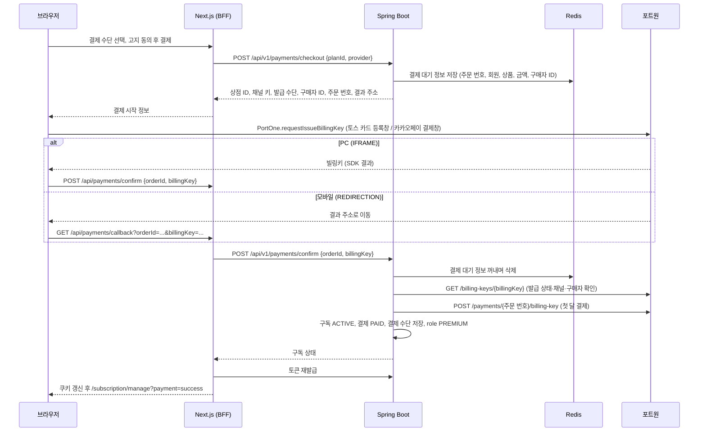
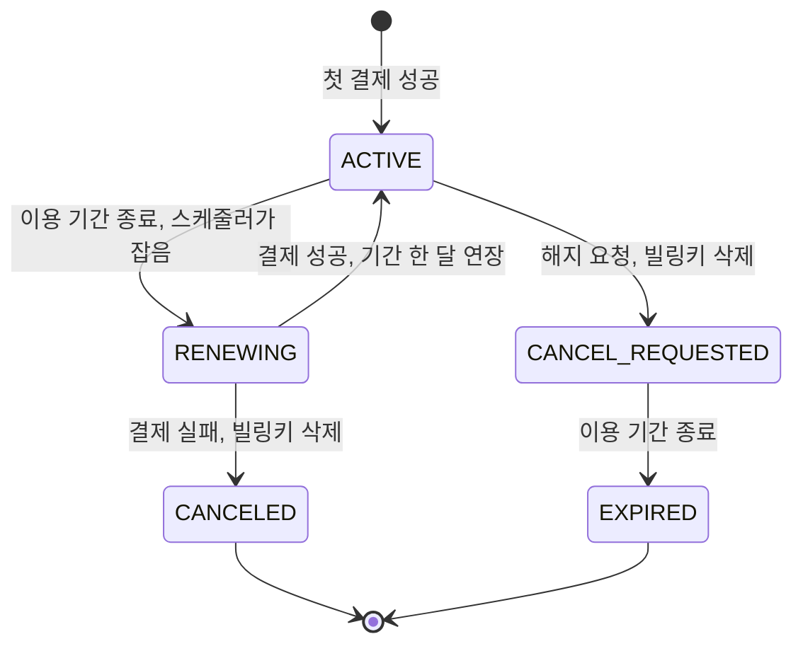
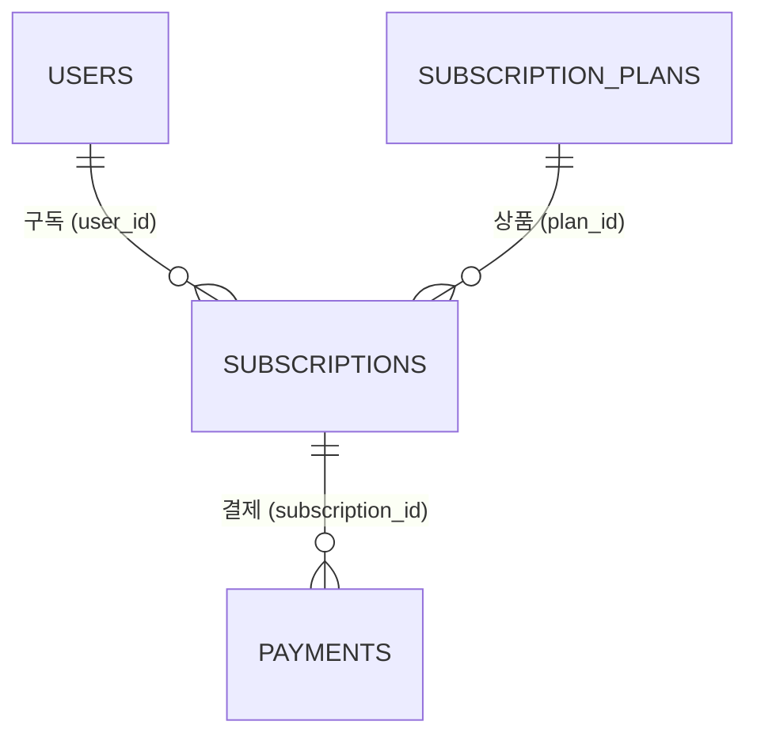

# 프리미엄 구독·정기결제 구현 계획

WBS 13.0 프리미엄/결제(13.1~13.5)를 토스페이먼츠·카카오페이 정기결제로 구현하기 위한 단계별 계획이다. 두 결제 수단은 포트원(PortOne) V2 채널로 연동한다. 프론트엔드 UI를 먼저 고치고(일부 페이지 신규), 백엔드를 만든 뒤, 화면을 백엔드 API에 연결한다.

- 상태: 1~6단계 완료. 7단계는 자동 검증과 문서 정리를 마쳤고, 실제 테스트 결제(결제창 입력) 시나리오가 사용자 확인으로 남았다. 단계별 상태는 7절, 진행 내용은 9절에 기록한다.
- 각 단계는 사용자가 그 단계를 요청할 때만 시작한다. 한 단계가 끝나도 다음 단계를 자동으로 시작하지 않는다.
- 이 문서는 계획이며 구현 승인이 아니다. 현재 `AGENTS.md`는 Toss Payments 연결을 금지하고, 구현 범위에 구독·결제 도메인이 없다. 2단계를 시작할 때 승인 범위(구독·결제 도메인, 포트원 연결)를 갱신하고 근거를 기록한다.
- 작업은 develop 기준으로 검증한다. 커밋·푸시·main 병합·배포는 사용자가 요청할 때만 한다.
- 페이지 경로와 API는 WBS 13.x를 따른다. WBS와 다르게 정한 항목은 2절에 적는다. 이전 초안(`docs/api-plan.md`의 `/premium/...`)과 `docs/routing.md`·`docs/frontend-pages.md`의 `/premium`은 사용하지 않는다.

## 1. 범위

| WBS | 기능 | 페이지 | API |
|---|---|---|---|
| 13.1 | 프리미엄 상품 안내 | `/subscription` | `GET /api/v1/subscription/plans` |
| 13.2 | 프리미엄 결제 | `/subscription/checkout` | `POST /api/v1/payments/checkout`(추가), `POST /api/v1/payments/confirm` |
| 13.3 | 구독 상태 및 권한 확인 | `/subscription/manage` | `GET /api/v1/subscription/me` |
| 13.4 | 구독 해지 | `/subscription/manage` | `POST /api/v1/subscription/cancel` |
| 13.5 | 결제 내역 조회 | `/subscription/history` | `GET /api/v1/payments/me` |
| 15.3 | 결제 API 연동 | 13.2와 같다 | `POST /api/v1/payments/confirm` |
| 17.4~17.6 | 개인정보 설정의 결제 정보·결제 수단·구독 정보 | `/settings/privacy` | 13.3·13.5 API, `GET /api/v1/payment-methods/me` |

- 15.3의 페이지 칸은 `/premium/checkout`이다. 같은 API를 쓰는 행이므로 13.2의 `/subscription/checkout` 하나로 만든다.
- 매월 자동 결제(갱신)는 WBS에 별도 행이 없지만 정기결제에 포함된 동작으로 보고 이 계획에서 만든다.
- 제외: 관리자 구독·결제 관리(14.12, 14.13), 역할 관리(2절). 프리미엄 혜택별 서버 권한 검사(AI 상세 분석 10.9, AI 한도 10.10, AI 포트폴리오 피드백 4.5, 공고 작성 7.2)는 각 기능 담당이 역할(`PREMIUM`)로 처리한다. 운영(라이브) 결제 전환(8단계).

### 현재 코드 (2026-11-09 확인)

| 위치 | 현재 | 이 계획의 변경 |
|---|---|---|
| [/subscription](../frontend/app/subscription/page.tsx) | 요금제 카드·비교표·내 구독 상태·결제 내역 예시가 한 페이지에 있다. 가격은 "예시 가격" ₩9,900이고, "무료로 데모 구독 전환"으로 즉시 프리미엄이 된다 | 상품 안내만 남기고 결제·관리·내역을 새 페이지로 나눈다 |
| `/subscription/checkout`, `/manage`, `/history` | 없음 | 새로 만든다 |
| [/settings/privacy](<../frontend/app/(user)/settings/privacy/page.tsx>)의 결제 정보 | 역할로 현재 구독을 표시하고, 결제 수단은 고정 문구(`mocks/account.ts`의 데모 카드), 결제 내역은 예시를 보여 준다 | 같은 구독·결제 상태를 표시한다 |
| 구독 상태 | `devmozip:administration:v1`의 `subscriptions`·`payments`. [effectiveUser](../frontend/lib/administration/administrationService.ts)가 서버 역할 위에 데모 구독을 덮어쓴다 | 연동 후에는 서버 역할만 쓴다 |
| 백엔드 | [Member](../backend/src/main/java/com/devmozip/backend/entity/Member.java)의 `role`(`USER`·`PREMIUM`·`OWNER`·`ADMIN`)과 `payment_methods`(JSON, 쓰는 코드 없음). 구독·결제 엔티티·API·스케줄러 없음 | 2~5단계 |
| 역할 전달 | 액세스 토큰에 역할 하나를 담고, [GET /api/v1/users/me](../backend/src/main/java/com/devmozip/backend/controller/MemberController.java)는 토큰의 역할을 돌려준다. 토큰 재발급은 DB의 역할을 읽는다 | 결제 직후 토큰을 재발급한다(3절) |

## 2. 결정 사항

### 확정

| 날짜 | 항목 | 결정 |
|---|---|---|
| 2026-11-09 | 결제 수단 | 토스페이먼츠(카드)와 카카오페이 정기결제 두 가지. 15.3의 "PG사 미확정"을 이것으로 정한다. |
| 2026-11-09 | 연동 방식 | 두 결제 수단 모두 포트원 V2에서 관리하는 채널로 연동한다. 서버는 포트원 API만 호출하고 토스페이먼츠·카카오페이 API를 직접 부르지 않는다. |
| 2026-11-09 | 진행 순서 | 프론트엔드 UI 수정(일부 페이지 신규) → 백엔드 → 연동 |
| 2026-11-09 | 결제 준비 API | WBS에 없는 `POST /api/v1/payments/checkout`을 추가한다. 빌링키를 발급하기 전에 서버가 주문 번호와 구매자 ID를 만들어 회원·상품·금액에 묶어 두어야, 승인할 때 다른 사람의 빌링키나 바뀐 금액을 걸러 낼 수 있다. |
| 2026-11-09 | 가격 | 프리미엄 월 ₩9,900. 목업의 "예시 가격"을 확정 가격으로 바꾼다. |
| 2026-11-09 | 해지·환불·고지 | 사용자가 작성을 맡겼다. 3절 "서비스 정책"으로 정했다. |
| 2026-11-09 | 결제 실패 | 매월 결제가 실패하면 그 구독을 바로 취소하고, 빌링키도 삭제해 이후 결제가 일어나지 않게 한다. |
| 2026-11-09 | 역할 | 결제는 `USER`를 `PREMIUM`으로, 구독이 끝나면 `PREMIUM`을 `USER`로 바꾸는 것만 한다. `ADMIN`·`OWNER` 등 역할 관리는 관리자 범위라 이 계획에서 다루지 않는다. 결제는 `USER`만 시작할 수 있다. |
| 2026-11-09 | 구독 기록 없는 `PREMIUM` | 서버 DB의 데모 프리미엄 계정처럼 결제 없이 역할만 `PREMIUM`인 회원은 따로 처리하지 않는다. |
| 2026-11-09 | ERD | 제공된 ERD의 `subscription_plans`·`subscriptions`·`payments`를 따른다(4절). `subscriptions.user_id`는 `users.id`를 참조한다. ERD에 결제 수단 테이블이 없으므로 결제 수단은 `users.payment_methods`(JSON)에 둔다. |
| 2026-11-09 | 17.5·17.6 API | WBS의 API 칸과 달리 이름에 맞춰 연결한다. 결제 수단은 `GET /api/v1/payment-methods/me`, 구독 정보는 `GET /api/v1/subscription/me`다. |
| 2026-11-09 | `payments` 추가 컬럼 | ERD에 `created_at`(결제 시도 시각)과 `order_id`(주문 번호, 유니크)를 추가한다(4절). 실패한 결제의 일시를 표시하고, 결과를 모르는 결제를 주문 번호로 조회하기 위해서다. ERDCloud에도 반영했다. |
| 2026-11-09 | 결제 대기 정보 수명 | 15분. 결제 준비 후 15분 안에 승인하지 않으면 다시 결제를 시작한다. |

## 3. 결제 흐름과 정책

### 서비스 정책

2026-11-09 사용자 위임으로 작성했다. 법률 검토를 거친 정책이 아니다(8절).

| 항목 | 정책 |
|---|---|
| 상품 | 프리미엄 월 구독 하나, 월 ₩9,900 |
| 결제일 | 첫 결제는 구독을 시작할 때 바로 한다. 이후 매월 구독 시작일과 같은 날 0시(한국 시간)에 결제한다. 그날이 없는 달(31일 등)은 그달 마지막 날에 결제한다 |
| 이용 기간 | 결제할 때마다 한 달씩 이어진다 |
| 해지 | `/subscription/manage`에서 언제든 요청한다. 요청 즉시 빌링키를 삭제해 다음 결제가 일어나지 않는다. 이미 결제한 기간이 끝날 때까지 프리미엄을 이용하고, 끝나면 무료로 바뀐다 |
| 해지 후 다시 구독 | 해지 예약 중에는 새 결제를 시작할 수 없다. 이용 기간이 끝난 뒤 다시 구독한다 |
| 환불 | 이미 결제한 금액은 환불하지 않는다. 해지해도 남은 기간을 나눠 돌려주지 않는다. 서버 오류로 결제만 되고 구독이 만들어지지 않은 경우는 결제를 취소한다 |
| 결제 실패 | 매월 결제가 실패하면 구독을 바로 취소하고 빌링키를 삭제한다. 무료로 바뀌며, 다시 이용하려면 새로 결제한다 |
| 결제 전 고지 | 결제 화면에 상품, 금액, 결제 주기, 오늘 결제와 다음 결제일, 해지 방법과 해지 후 이용 기간, 환불 불가, 결제 실패 시 구독 취소를 보여 준다. 이 내용에 동의를 체크해야 결제 버튼이 열린다 |

### 포트원 V2 연동

포트원 개발자센터의 [빌링키 발급](https://developers.portone.io/opi/ko/integration/start/v2/billing/issue?v=v2), [빌링키 결제](https://developers.portone.io/opi/ko/integration/start/v2/billing/payment?v=v2), [카카오페이](https://developers.portone.io/opi/ko/integration/pg/v2/kakaopay?v=v2)·[토스페이먼츠](https://developers.portone.io/opi/ko/integration/pg/v2/tosspayments?v=v2) 안내와 REST API V2 목록에서 확인했다.

| 구분 | 토스페이먼츠 채널 | 카카오페이 채널 |
|---|---|---|
| 빌링키 발급 | 브라우저 SDK `PortOne.requestIssueBillingKey()`에 `storeId`, `channelKey`, `billingKeyMethod: "CARD"` | 같은 함수에 `billingKeyMethod: "EASY_PAY"`, `issueName`(결제창 제목, 필수) |
| 결제창 | PC는 `IFRAME`(SDK가 결과를 돌려준다), 모바일은 `REDIRECTION`(`redirectUrl` 필수) | 같다 |
| 첫 결제·매월 결제 | 서버가 `POST https://api.portone.io/payments/{paymentId}/billing-key`로 결제한다. 본문은 `billingKey`, `orderName`, `customer`, `amount.total`, `currency` | 같다 |
| 해지·결제 실패 | `DELETE /billing-keys/{billingKey}` | 같다 |
| 결과 조회 | `GET /payments/{paymentId}` | 같다 |
| 결제 취소 | `POST /payments/{paymentId}/cancel` | 같다 |
| 인증 | 서버 API는 `Authorization: PortOne {API Secret}` | 같다 |

- `paymentId`는 우리가 만드는 결제 ID다. `payments.order_id`를 그대로 쓴다.
- 토스페이먼츠 키와 카카오페이 CID는 포트원 콘솔의 채널 설정에 들어간다. 우리 서버는 상점 ID, 채널 키, API Secret만 쓴다(4절).
- 포트원의 결제 예약(`POST /payments/{paymentId}/schedules`)은 결과를 받으려면 웹훅이 필요해 쓰지 않는다. 서버 스케줄러가 매월 직접 결제한다.
0단계 확인 결과 (2026-11-09, 포트원 [REST API V2 OpenAPI](https://developers.portone.io/schema/v2.openapi.json)와 [브라우저 SDK 스키마](https://github.com/portone-io/developers.portone.io/blob/main/src/schema/browser-sdk.yml)):

| 항목 | 확인 내용 | 계획 반영 |
|---|---|---|
| SDK 발급 파라미터 | `storeId`(필수), `channelKey`, `billingKeyMethod`, `issueName`, `issueId`(발급 주문 고유 번호), `customer.customerId`, `windowType`, `redirectUrl`, `forceRedirect` | `issueId`에 주문 번호를 넣는다 |
| 구매자 ID | `customer.customerId`는 토스페이먼츠 빌링키 발급에서 쓰고, 카카오페이 발급에는 쓰이지 않는다. 형식은 영문·숫자·`-_=.@` 2~50자 | 빌링키 검증은 구매자 ID가 아니라 `issueId`로 한다 |
| 빌링키 조회 응답 | `IssuedBillingKeyInfo`에 `status`(`ISSUED`·`DELETED`), `storeId`, `channels[]`(`key`, `pgProvider`), `customer.id`, `issueId`, `methods`가 있다 | 상태·채널 키·`issueId`를 대조한다 |
| 빌링키 결제 | 본문 필수 값은 `billingKey`, `orderName`, `amount.total`, `currency`. 응답은 `payment.pgTxId`, `payment.paidAt`. 같은 `paymentId`로 다시 요청하면 `AlreadyPaidError` | 같은 주문 번호로는 이중 청구가 되지 않는다 |
| 결제 실패 유형 | `BillingKeyAlreadyDeletedError`, `BillingKeyNotFoundError`, `PgProviderError`(카드 거절 등) 등 | 오류 유형만 로그에 남긴다 |
| 빌링키 삭제 | `DELETE /billing-keys/{billingKey}`. 오류에 `PgProviderError`(502)가 있어 결제대행사 쪽 처리를 함께 한다. 카카오페이 SID 비활성화 여부는 문서에 명시가 없다 | 7단계에서 카카오페이 콘솔로 확인한다 |
| 결제 취소 | `POST /payments/{paymentId}/cancel`, `reason` 필수. `amount`를 비우면 전액 취소 | 저장 실패 보상 취소에 사유를 넣는다 |
| `paymentId` | 문자열이며 스키마에 길이·형식 제한이 없다 | UUID를 쓴다 |
| 모바일 결과 주소 | 스키마에 쿼리 파라미터 이름이 따로 적혀 있지 않다. SDK 응답 필드(`billingKey`, `code`, `message`)가 붙는 것으로 보인다 | 6단계에서 실제 이동으로 확인한다. `forceRedirect: true`를 주면 PC에서도 결과 주소 방식으로 시험할 수 있다 |
| 결제창 제한 시간 | 문서에서 찾지 못했다 | 결제 대기 정보의 수명을 15분으로 정했다(2절) |
| 수동 승인 | 쓰면 SDK가 빌링키 대신 `NEEDS_CONFIRMATION`을 돌려준다 | 쓰지 않는다 |

### 첫 결제 (13.2)

공개 요청은 프론트엔드로만 전달되고 백엔드는 포트를 공개하지 않는다. 그래서 빌링키는 BFF가 받아 백엔드의 승인 API로 넘긴다.

- 결제창에서 취소·실패: BFF가 승인 API를 부르지 않고 `/subscription/checkout?payment=<코드>`로 이동한다. 결제 대기 정보는 유효 시간이 지나면 사라진다.
- 첫 결제 실패: 빌링키 발급 뒤 첫 결제가 실패하면 그 빌링키를 삭제한다. 구독과 결제 행은 만들지 않는다.
- 토큰 재발급: 결제 직후의 액세스 토큰에는 이전 역할이 들어 있다. BFF가 기존 재발급([lib/auth/refresh.ts](../frontend/lib/auth/refresh.ts))으로 새 토큰을 받아 쿠키를 바꾼 뒤 이동한다.

### 매월 결제

- 스케줄러는 매일 24:00(0시, 한국 시간)에 한 번 실행한다(2026-11-09 사용자 결정). `ACTIVE`이고 `current_period_end`가 오늘 안(내일 0시 전)인 구독을 잡는다. 지난 결제일의 구독도 포함하므로, 실행 시각에 서버가 멈춰 있었으면 다음 실행에서 함께 결제한다. 내일 0시 정각에 끝나는 구독은 내일 결제한다. 결제일 0시에 결제하므로 기간 끝 시각보다 일찍 결제될 수 있지만, 다음 기간은 시작일 기준으로 정해 밀리지 않는다.
- 구독을 잡는 방법: 먼저 구독을 `RENEWING`으로 바꾸고, 새 주문 번호(`order_id`)와 `created_at`을 넣은 결제 행을 `PENDING`으로 저장해 커밋한 뒤 포트원에 결제를 요청한다.
- 성공: 결제 행 `PAID`, `paid_at` 기록, 구독 `ACTIVE`, `current_period_end`를 다음 달로 바꾼다.
- 실패: 결제 행 `FAILED`, 구독 `CANCELED`와 `ended_at`, 빌링키 삭제, `users.payment_methods` 비우기, 역할 `USER`.
- 해지 예약 만료: `CANCEL_REQUESTED`이고 기간이 지난 구독(실행 시각 기준)을 `EXPIRED`로 바꾸고 `ended_at`과 역할 `USER`를 반영한다. 결제하지 않는다.
- 역할은 `PREMIUM`일 때만 `USER`로 바꾼다. 그사이 관리자가 다른 역할을 줬으면 건드리지 않는다.

### 설계 기준

| 항목 | 기준 |
|---|---|
| 요청자 | Spring Security 인증 정보로 회원을 찾는다. 요청 본문·쿼리의 사용자 ID와 금액은 받지 않는다. |
| 금액 | 결제 준비 때 `subscription_plans`의 가격으로 정해 결제 대기 정보에 저장하고, 서버가 그 금액으로 포트원에 결제를 요청한다. ERD의 `DECIMAL(12,2)`는 Java `BigDecimal`이며, 포트원에는 원 단위 정수로 보낸다. |
| 결제 대기 정보 | `payments`는 구독에 속하므로, 구독이 생기기 전인 첫 결제의 주문은 Redis에 둔다(4절). 결제에 성공하면 그 주문 번호를 `payments.order_id`에 저장한다. 비밀번호 재설정과 같이 `local` 프로필은 메모리 구현을 쓴다. |
| 빌링키 확인 | 빌링키는 브라우저를 거쳐 오므로 그대로 믿지 않는다. 결제 전에 포트원 빌링키 조회로 `status`가 `ISSUED`인지, `channels[].key`가 결제 대기 정보의 결제 수단 채널 키인지, `issueId`가 이 주문 번호인지 확인한다. 다른 주문(다른 사람)의 빌링키나 다른 채널의 빌링키는 거절한다. 카카오페이는 구매자 ID를 쓰지 않으므로 구매자 ID로는 검증하지 않는다. |
| 주문 소유 | `confirm`은 결제 대기 정보의 회원이 요청자와 같을 때만 처리한다. |
| 중복 승인 | `confirm`은 결제 대기 정보를 꺼내면서 지운다(`GETDEL`). 같은 주문의 두 번째 요청은 찾을 수 없어 거절된다. |
| 이용 중 구독 하나 | 결제 준비와 저장 직전에 회원 행을 잠그고 이용 중 구독(`ACTIVE`·`RENEWING`·`CANCEL_REQUESTED`)이 없는지 확인한다. 그사이 다른 결제가 먼저 끝났으면 이번 결제를 취소하고 빌링키를 삭제한다. |
| 외부 호출과 트랜잭션 | 포트원 API를 부르는 동안 DB 잠금을 잡지 않는다. 결제는 성공했는데 저장이 실패하면 결제 취소 API로 되돌리고, 취소도 실패하면 로그로 남긴다. |
| 구매자 ID | 결제 준비마다 무작위 UUID를 만들어 빌링키 발급의 `customer.customerId`로 넘기고(토스페이먼츠가 사용), 성공하면 결제 수단과 함께 저장한다. 이메일·회원 ID는 쓰지 않는다. |
| 주문 번호 | UUID로 만들어 빌링키 발급의 `issueId`와 첫 결제의 포트원 `paymentId`로 쓴다. 매월 결제는 새 UUID를 `paymentId`로 쓴다. 같은 `paymentId`로 다시 결제를 요청하면 포트원이 `AlreadyPaidError`로 거절한다. |
| 빌링키 삭제 실패 | 해지 때 빌링키 삭제가 실패해도 구독은 `CANCEL_REQUESTED`로 바꾼다. 스케줄러는 이 상태를 결제하지 않으므로 청구는 일어나지 않는다. 실패는 로그(`빌링키 삭제 실패`)로 남기고 포트원 콘솔에서 삭제한다. 결제 실패로 구독을 취소할 때도 같다. |
| 키 보관 | 빌링키는 암호화해 `users.payment_methods`에 저장하고 응답·로그에 넣지 않는다. 화면에는 표시용 정보(카드사·마스킹 번호, 카카오페이)만 보낸다. |
| 비밀값 | API Secret은 백엔드에만 둔다. 상점 ID와 채널 키는 브라우저 SDK에 쓰는 값이라 결제 준비 응답으로 내리며, 프론트엔드 환경변수를 늘리지 않는다(카카오 로그인과 같다). |
| 결과 주소 | `DOMAINNAME`으로 만든다. 요청의 Host 헤더를 쓰지 않는다. |
| 화면 이동 | 결과 URL에는 코드만 싣고 문구는 화면이 정한다(`KakaoNotice`와 같다). |
| 로그 | 빌링키, API Secret을 남기지 않는다. 포트원 오류는 상태 코드와 오류 유형만 남긴다. |
| 시간 | 컨테이너 시간대 설정이 없으므로 Asia/Seoul `Clock`을 주입해 계산한다. 기간 끝은 `starts_at`에 결제 완료 횟수만큼 개월을 더해 정해, 말일 보정이 다음 달로 이어지지 않게 한다. |
| 스케줄러 중복 | 블루그린 배포 중에는 두 백엔드가 함께 떠 있다. 구독을 잡을 때 "상태가 `ACTIVE`이고 이용 기간이 기준 시각(매월 결제는 내일 0시) 전에 끝날 때만 `RENEWING`으로 바꾸는" 조건부 UPDATE를 쓰고 결제 행(`PENDING`)과 함께 커밋한다. 바뀐 행이 1인 실행만 결제하므로 다른 실행은 같은 구독을 잡지 못한다. 기간 조건이 없으면, 먼저 읽어 둔 목록으로 이미 결제를 마치고 `ACTIVE`로 돌아온 구독을 다시 잡아 두 번 결제한다(5단계 PostgreSQL 동시 실행 테스트에서 확인). H2와 PostgreSQL에서 같게 동작하므로 계획의 `SKIP LOCKED` 대신 이 방식을 썼다. |
| 결제 수단을 읽지 못함 | 저장된 빌링키를 복호화하지 못하면(암호화 키 변경 등) 구독을 잡지 않고 `ACTIVE`로 둔 채 로그를 남겨 다음 실행으로 미룬다. 설정 오류 하나로 모든 구독이 결제 실패로 취소되지 않게 하기 위해서다. 포트원 설정이 없을 때도 같다. |
| 결과를 모르는 결제 | 포트원 호출 중 서버가 멈추면 구독은 `RENEWING`, 결제 행은 `PENDING`으로 남는다. 중복 청구를 막기 위해 자동으로 다시 결제하지 않고, `GET /payments/{order_id}`로 결과를 조회해 확인한다. |
| 시간 제한 | 백엔드의 포트원 호출에 연결·읽기 제한을 둔다. BFF의 승인 요청은 `backendFetch` 기본 5초보다 긴 제한을 쓴다. |

## 4. 백엔드 구조

기존 계층형 패키지(`backend/src/main/java/com/devmozip/backend`)를 따른다. 탭 들여쓰기와 생성자 주입을 쓰고, 응답 DTO는 record로 만든다. 엔티티를 API 응답으로 직접 쓰지 않는다. Service는 프로젝트 기능처럼 인터페이스와 `service/impl` 구현으로 나눈다.

### ERD (2026-11-09 제공)

ERD 이미지에는 NULL 여부가 표시되지 않는다. DATETIME은 기존 기준대로 Java `LocalDateTime`, PostgreSQL `timestamp without time zone`으로 읽는다. 세 테이블 모두 `updated_at`이 없으므로 `BaseEntity`를 상속하지 않는다. `payments`의 `order_id`·`created_at`은 2026-11-09 결정으로 ERD에 추가하는 컬럼이다.

**subscription_plans — 프리미엄 상품**

| 필드 | 타입 | 의미 | 이 계획의 사용 |
|---|---|---|---|
| id | BIGINT / PK | 상품 ID | |
| name | VARCHAR(100) | 상품명 | 프리미엄 |
| price | DECIMAL(12,2) | 가격 | 9900.00 |
| currency | CHAR(3) | 통화 | `KRW` |
| billing_cycle | VARCHAR(20) | 결제 주기 | `MONTHLY` |
| feature_limits | JSON | 기능별 한도 | 목업의 프리미엄 한도(AI 추천 월 100회)를 넣는다. 키 이름은 AI 사용량(10.10) 담당과 맞추고, 이 계획은 저장과 13.1 응답만 한다 |
| is_active | BOOLEAN | 판매 여부 | 13.1과 결제 준비는 판매 중인 상품만 받는다 |

- 무료 요금제는 결제 상품이 아니므로 행으로 두지 않고 화면이 표시한다.
- 상품 행을 넣는 방법(SQL 파일 또는 시작 시 초기화)은 2단계에서 기존 데모 데이터 방식을 보고 정한다.

**subscriptions — 구독**

| 필드 | 타입 | 의미 | 이 계획의 사용 |
|---|---|---|---|
| id | BIGINT / PK | 구독 ID | |
| user_id | BIGINT / FK | 사용자 ID | `users.id` 참조 |
| plan_id | BIGINT / FK | 상품 ID | `subscription_plans.id` 참조 |
| status | VARCHAR(20) | 구독 상태 | 아래 값 목록 |
| starts_at | DATETIME | 구독 시작 시각 | 첫 결제 시각 |
| current_period_end | DATETIME | 현재 이용기간 종료 | 다음 결제 시각 |
| cancel_requested_at | DATETIME | 해지 요청 시각 | |
| ended_at | DATETIME | 구독 종료 시각 | 만료·취소 시각 |

| status | 의미 | 프리미엄 |
|---|---|---|
| `ACTIVE` | 이용 중. 기간이 끝나면 매월 결제한다 | 예 |
| `RENEWING` | 매월 결제 처리 중 | 예 |
| `CANCEL_REQUESTED` | 해지 예약. 기간 끝까지 이용하고 결제하지 않는다 | 예 |
| `EXPIRED` | 해지 예약 후 기간 종료 | 아니오 |
| `CANCELED` | 매월 결제 실패로 취소 | 아니오 |

**payments — 결제 내역**

| 필드 | 타입 | 의미 | 이 계획의 사용 |
|---|---|---|---|
| id | BIGINT / PK | 결제 ID | |
| subscription_id | BIGINT / FK | 구독 ID | 회원은 구독의 `user_id`로 찾는다 |
| order_id | VARCHAR(64) | 주문 번호 | **추가.** 유니크. 포트원 `paymentId`로 쓴다. 첫 결제는 결제 대기 정보의 주문 번호, 매월 결제는 새로 만든 UUID. 포트원 `paymentId`에 길이 제한이 없어 UUID(36자)가 들어가는 길이로 둔다 |
| provider | VARCHAR(50) | PG사 | `TOSS_PAYMENTS`·`KAKAO_PAY`. 포트원이 아니라 실제 결제 수단의 PG사를 적는다 |
| provider_payment_id | VARCHAR(255) | PG 결제 ID | 포트원 결제 응답의 PG 거래 번호(`pgTxId`). PG 콘솔에서 결제를 찾을 때 쓴다 |
| payment_method_snapshot | JSON | 결제 수단 스냅샷 | 결제 당시 표시용 정보(결제 수단, 카드사·마스킹 번호 또는 카카오페이). 빌링키는 넣지 않는다 |
| amount | DECIMAL(12,2) | 결제 금액 | |
| currency | CHAR(3) | 통화 | `KRW` |
| status | VARCHAR(20) | 결제 상태 | `PENDING`(매월 결제 처리 중)·`PAID`·`FAILED`·`CANCELED`(결제 후 저장 실패로 취소) |
| paid_at | DATETIME | 결제 완료 시각 | `PAID`일 때만 |
| created_at | DATETIME | 결제 시도 시각 | **추가.** 행을 만든 시각. 실패한 결제의 일시 표시와 처리 중으로 남은 결제 확인에 쓴다 |

- 첫 결제는 승인과 저장이 한 요청에서 끝나므로 성공한 결제만 `PAID`로 남긴다. 첫 결제 실패는 구독이 없어 행을 만들지 않는다.
- 제약: `order_id` 유니크.

**users.payment_methods — 결제 수단 (기존 컬럼)**

현재 등록된 결제 수단 하나를 JSON 객체로 둔다. 해지·결제 실패 때 비운다.

| 키 | 의미 |
|---|---|
| provider | `TOSS_PAYMENTS`·`KAKAO_PAY` |
| customerId | 빌링키를 발급할 때 쓴 구매자 ID |
| billingKey | 포트원 빌링키. 암호화한 값 |
| display | 표시용 정보(카드사·마스킹 번호 또는 카카오페이) |
| registeredAt | 등록 시각 |

`Member`는 공통 엔티티이므로 결제 수단을 바꾸는 메서드 추가를 팀에 공유한다.

### Redis — 결제 대기 정보

[PasswordResetService](../backend/src/main/java/com/devmozip/backend/service/PasswordResetService.java)와 같은 구조로 인터페이스와 Redis·메모리 구현(`local` 프로필)을 둔다.

| 키 | 값 | 수명 | 용도 |
|---|---|---|---|
| `payment-checkout:{주문 번호}` | 회원 ID, 상품 ID, 결제 수단, 금액, 통화, 구매자 ID | 15분. `application.yaml`에서 바꿀 수 있게 둔다 | 승인 때 꺼내며 삭제 |

### 파일 (예정)

| 위치 | 파일 | 역할 |
|---|---|---|
| entity | SubscriptionPlan, Subscription, Payment | ERD 매핑 |
| entity/enums | SubscriptionStatus, PaymentProvider, PaymentStatus | 값 목록 |
| entity | Member | 결제 수단 저장·삭제 메서드 추가 |
| repository | SubscriptionPlanRepository, SubscriptionRepository, PaymentRepository | 판매 중 상품 조회, 회원의 이용 중 구독 조회, 기간이 지난 구독 조회와 상태 조건부 변경(`changeStatusIfDue`), 회원별 결제 내역 페이지 |
| client | PortOneClient | 빌링키 조회·삭제, 빌링키 결제, 결제 조회·취소. 시간 제한과 오류 변환. 기존 `KakaoClient`와 같은 방식 |
| config | PaymentProperties | 상점 ID·API Secret·채널 키·암호화 키·결과 주소, 결제 수단별 `isConfigured()` |
| config | 스케줄링 설정 | `@EnableScheduling`. 스케줄러가 저장소에 처음 생기므로 팀에 공유한다 |
| 암호화 | 빌링키 암호화 | 빌링키 암호화·복호화. 위치는 2단계에서 기존 구조를 보고 정한다 |
| service | PaymentCheckoutService + impl(Redis·메모리) | 결제 대기 정보 저장·꺼내기 |
| service | SubscriptionService | 상품 안내, 구독 상태, 해지 (13.1, 13.3, 13.4) |
| service | PaymentService | 결제 준비·승인, 결제 내역, 결제 수단 (13.2, 13.5, 17.5) |
| service | SubscriptionRenewalService | 매월 결제, 결제 실패 취소, 해지 예약 만료. 시각을 인자로 받아 테스트에서 바꿀 수 있게 한다 |
| scheduler | SubscriptionRenewalScheduler | 주기적으로 `SubscriptionRenewalService`만 부른다. 실행 주기는 `application.yaml`에 둔다 |
| controller | SubscriptionController, PaymentController, PaymentMethodController | `/api/v1/subscription/**`, `/api/v1/payments/**`, `/api/v1/payment-methods/me` |
| dto/subscription, dto/payment | 요청·응답 record | 5절 |

### 공개 경로

- `/subscription`은 비로그인으로도 볼 수 있으므로 `GET /api/v1/subscription/plans`를 공개한다. 나머지는 기존 기본값(인증 필요)을 따른다.
- 공통 `SecurityConfig`를 바꾸므로 바꾸기 전에 팀에 공유한다.

### 환경변수

실제 값은 Git에 올라가지 않는 루트 `.env`(compose)와 `.env.local`(`bootRun`의 local 프로필)에만 둔다. 이 문서와 Git에는 적지 않는다.

| 변수 | 용도 | 비고 |
|---|---|---|
| `PORTONE_STORE_ID` | 포트원 상점 ID | 브라우저 SDK에 쓰는 값. 결제 준비 응답으로 전달한다 |
| `PORTONE_API_SECRET` | 포트원 V2 API Secret | 비밀값. 백엔드만 쓴다 |
| `TOSS_CHANNEL_KEY` | 포트원 토스페이먼츠 채널 키 | 브라우저 SDK에 쓰는 값 |
| `KAKAOPAY_CHANNEL_KEY` | 포트원 카카오페이 채널 키 | 브라우저 SDK에 쓰는 값 |
| `PAYMENT_ENCRYPTION_KEY` | 빌링키 암호화 키 | 우리가 만드는 비밀값. 32바이트 무작위 값을 base64로 만든다(`openssl rand -base64 32`). 로컬과 서버는 다른 값을 쓰고, 정한 뒤에는 바꾸지 않는다. 바꾸면 저장된 빌링키를 풀 수 없다 |
| `DOMAINNAME` | 모바일 결과 주소 | 기존 변수 재사용 |

- 토스페이먼츠 클라이언트·시크릿 키와 카카오페이 CID는 포트원 콘솔의 채널 설정에 들어가므로 우리 서버의 환경변수로 두지 않는다.
- 값이 없어도 서버는 뜬다. 카카오 로그인의 `isConfigured()`처럼, 설정이 없는 결제 수단의 결제 준비·승인만 503으로 응답하고 상품 안내·구독 상태·내역은 동작한다.
- 반영 위치: `application.yaml`(설정으로 받기), `compose.prod.yaml`·`compose.yaml`(백엔드에만 빈 기본값으로 전달. `compose.yaml`은 Git 제외라 팀원 각자 추가), `.env.example`(자리표시 값), `application-local.yml`(Git 제외).

### 오류 응답

Service는 `ResponseStatusException`을 던지고 기존 `GlobalExceptionHandler`가 `ErrorResponse`로 바꾼다.

| 상태 | 상황 |
|---|---|
| 400 | 입력 오류, 판매하지 않는 상품, 지원하지 않는 결제 수단, 확인에 실패한 빌링키, PG가 거절한 결제(포트원 오류 유형 포함) |
| 401 | 로그인 필요 |
| 403 | `USER`가 아닌 역할(`PREMIUM` 제외), 정지 회원 |
| 404 | 없거나 만료된 결제 대기 정보, 다른 회원의 주문 |
| 409 | 이미 이용 중(`PREMIUM` 역할 또는 이용 중 구독, 해지 예약 포함), 해지할 구독 없음 |
| 502 | 포트원 연결 실패 |
| 503 | 결제 환경변수 없음 |

### DB 반영 주의

- `ddl-auto: update`이므로 엔티티를 추가한 서버를 재시작하면 연결된 DB에 테이블이 생긴다. 개발 백엔드가 공용 DB에 연결된 경우 반영 시점을 팀과 맞춘다.
- ERD를 바탕으로 이미 만든 테이블이 DB에 있으면 컬럼 타입과 제약을 엔티티와 대조한다.

## 5. API (초안)

확정 계약은 4단계에서 `docs/premium-payment-api.md`로 작성한다.

| WBS | 메서드·경로 | 인증 | 요청 | 성공 응답 |
|---|---|---|---|---|
| 13.1 | `GET /api/v1/subscription/plans` | 공개 | 없음 | 200 `[{id, name, price, currency, billingCycle, featureLimits}]` |
| 13.2 | `POST /api/v1/payments/checkout` | 로그인 | `{planId, provider}` | 201 `{orderId, provider, storeId, channelKey, billingKeyMethod, issueName, customerId, redirectUrl}` |
| 13.2 | `POST /api/v1/payments/confirm` | 로그인 | `{orderId, billingKey}` | 200 구독 상태(13.3 형식) |
| 13.3 | `GET /api/v1/subscription/me` | 로그인 | 없음 | 200 `{status, premium, plan, startsAt, currentPeriodEnd, nextBillingAt, cancelRequestedAt, endedAt, paymentMethod}` |
| 13.4 | `POST /api/v1/subscription/cancel` | 로그인 | 없음 | 200 구독 상태(`CANCEL_REQUESTED`) |
| 13.5, 17.4 | `GET /api/v1/payments/me` | 로그인 | `page`(0부터), `size` | 200 `{items, page, size, hasNext}` |
| 17.5 | `GET /api/v1/payment-methods/me` | 로그인 | 없음 | 200 `{provider, display}`, 없으면 빈 값 |

- 결제 준비 응답의 `billingKeyMethod`는 토스페이먼츠 `CARD`, 카카오페이 `EASY_PAY`다. `redirectUrl`은 모바일 결과 주소(`{DOMAINNAME}/api/payments/callback?orderId=...`)다. 화면은 `orderId`를 SDK의 `issueId`로, `customerId`를 `customer.customerId`로 넘긴다.
- 13.3의 `status`: 구독한 적이 없으면 `NONE`, 그 밖에는 가장 최근 구독의 상태다. 결제 실패로 취소된 구독(`CANCELED`)이 최근 구독이면 관리 화면이 취소 안내를 보여 준다. `premium`은 현재 역할이 `PREMIUM`인지다. `nextBillingAt`은 `ACTIVE`일 때만 있다.
- 결제 내역 항목: 결제 일시(`PAID`는 `paid_at`, 그 밖에는 `created_at`), 상품명, 결제 수단 스냅샷의 표시 정보, 금액, 통화, 상태. `created_at` 최신순이다.
- 페이지 크기 기본값과 최대값은 프로젝트·피드 목록과 같게(기본 20, 최대 100) 둔다.

## 6. 프론트엔드

### 1단계 화면 (Mock)

백엔드 없이 Mock 상태로 동작한다. 외부 결제창은 열지 않는다. PC 1440px 우선, 화이트·연회색 바탕과 보라색·시안색 포인트를 유지한다.

| 페이지 | WBS | 화면 |
|---|---|---|
| `/subscription` | 13.1 | 요금제 카드와 비교표를 유지하고 가격을 ₩9,900으로 확정 표시한다("예시 가격" 문구 삭제). 프리미엄 카드 버튼을 `/subscription/checkout`으로 연결하고, 이미 이용 중이면 `/subscription/manage`로 안내한다. "내 구독 상태"와 "결제 내역 예시"는 새 페이지로 옮긴다 |
| `/subscription/checkout` | 13.2 | 상품 요약(이름·월 금액·결제 주기), 결제 수단 선택(토스페이먼츠 카드 / 카카오페이), 3절 "결제 전 고지"와 동의 체크, 결제 버튼, 실패·취소 결과 안내(`?payment=<코드>`). 비로그인·`USER`가 아닌 계정·이미 이용 중 처리 |
| `/subscription/manage` | 13.3, 13.4 | 현재 상태(무료·이용 중·해지 예약·해지 후 만료·결제 실패로 취소), 다음 결제일·금액 또는 이용 종료일, 결제 수단, 이용 중인 프리미엄 혜택, AI 사용량 링크, 해지 확인 모달(3절 해지·환불 정책 안내), 결제 완료 안내(`?payment=success`) |
| `/subscription/history` | 13.5 | 결제 일시·상품·결제 수단·금액·상태 목록, 빈 목록, 다음 페이지 표시 버튼 |
| `/settings/privacy` 결제 정보 | 17.4~17.6 | 현재 구독·결제 수단·최근 결제 내역을 같은 상태로 표시하고 관리·내역 페이지로 연결한다 |

- 파일 배치: 타입은 `types/subscription.ts`(5절 응답 형태), 원본 데이터는 `mocks/subscription.ts`, 상태·검증·저장은 `lib/subscription/`, 페이지 전용 컴포넌트와 CSS Module은 각 경로의 `_components`. 컴포넌트에 Mock 데이터를 직접 넣지 않는다.
- 상태는 버전이 있는 localStorage에 보존한다. 결제·해지 정보를 담으면 `devmozip:administration:v1`의 형식이 바뀌므로 새 키를 두거나 버전을 올린다. 1단계 시작 시 정한다.
- 화면 간 일관성: Mock 결제 완료는 기존 데모 전환처럼 다른 화면(공고 작성, AI 상세 추천 이유, PRO 뱃지 등)의 프리미엄 권한에 반영되어야 한다. Mock 해지는 3절 정책대로 기간 끝까지 프리미엄을 유지한다.
- `/subscription/checkout`·`/manage`·`/history`는 로그인이 필요하므로 [lib/auth/paths.ts](../frontend/lib/auth/paths.ts)의 보호 경로에 넣는다. `/subscription`은 공개로 둔다.
- [mocks/routes.ts](../frontend/mocks/routes.ts)와 [frontend-pages.md](frontend-pages.md)에 새 페이지를 적는다.

### 6단계 연동

- 구현 전 [frontend/AGENTS.md](../frontend/AGENTS.md)의 안내대로 `node_modules/next/dist/docs/`에서 필요한 내용을 확인한다.
- BFF: `app/api/subscription/...`, `app/api/payments/...` Route Handler. 기존 `app/api/projects/route.ts`처럼 `backendFetch`·`getSession`을 쓰고, 쓰기 요청은 같은 출처를 확인한다. 사용자 ID는 백엔드로 보내지 않는다.
- 포트원 SDK: 결제 준비 응답의 상점 ID·채널 키로 `PortOne.requestIssueBillingKey()`를 부른다. SDK를 npm 패키지로 넣을지 스크립트로 불러올지는 6단계에서 문서로 확인해 정한다. 현재 앱에는 CSP 설정이 없다.
- 결과 받기:
  - PC: SDK가 돌려준 빌링키를 `app/api/payments/confirm/route.ts`(POST)로 보낸다. 오류 코드가 오면 승인하지 않고 안내한다.
  - 모바일: 결과 주소 `app/api/payments/callback/route.ts`(GET)가 빌링키 또는 오류 코드를 받는다.
  - 두 경로 모두 승인에 성공하면 토큰을 재발급하고 `/subscription/manage?payment=success`로, 실패·취소면 `/subscription/checkout?payment=<코드>`로 이동한다. 액세스 토큰이 만료됐으면 기존 재발급으로 갱신한 뒤 승인한다.
- 해지 후 역할: 해지 요청은 역할을 바로 바꾸지 않는다. 기간이 끝나 역할이 바뀌면 다음 토큰 재발급부터 반영된다.
- 데모 덮어쓰기 제거: `effectiveUser`가 로그인한 서버 계정에 데모 구독을 적용하지 않게 한다. 저장된 `devmozip:administration:v1`은 기존 데이터를 읽을 수 있도록 형식을 유지한다.
- 화면의 Mock 상태를 API 응답으로 바꾸고 "데모·실제 청구 없음" 문구를 정리한다. 로딩·오류·재시도, 중복 제출 방지, 실패 시 선택 값 보존을 처리한다.

### 같은 상태를 쓰는 다른 화면

이 계획에서는 아래 화면 코드를 바꾸지 않는다.

| 화면 | 위치 | 연동 후 |
|---|---|---|
| 관리자 구독 현황 | `app/admin/subscriptions/page.tsx` | 14.12·14.13 범위. Mock 결제 내역 예시를 계속 보여 준다 |
| 관리자 대시보드 | `app/admin/page.tsx` | 프리미엄 수를 Mock 계정 기준으로 센다 |
| 프리미엄 혜택 화면 | AI 추천(`app/ai/matching/_components`), 공고 작성(`components/projects/PremiumProjectGate.tsx`), 포트폴리오 상세, 프로필 PRO 뱃지 | 역할(`premium`)로 판단하므로 서버 역할을 따른다 |
| 공고 작성 안내 모달 | `components/projects/PremiumProjectGate.tsx` | "프리미엄 데모 활성화" 버튼은 데모 구독을 저장하지만 이제 역할을 바꾸지 않는다. 결제 페이지(`/subscription/checkout`) 링크로 바꾸는 것을 프로젝트 담당자에게 공유한다 |
| 프로젝트 등록 BFF | `app/api/projects/route.ts` | 같은 사이트 확인을 `request.url`의 origin과 비교한다. standalone 서버에서는 이 값이 실제 주소와 달라(`localhost`) nginx 뒤에서 등록이 403이 될 수 있다(7단계에서 결제 BFF로 확인한 동작). 프로젝트 담당자에게 공유한다 |

## 7. 단계별 진행

| 단계 | 내용 | 구분 | 수행 주체 | 상태 |
|---|---|---|---|---|
| 0 | 사전 준비·결정 | 공통 | 사용자 | 완료 |
| 1 | 화면 수정·페이지 추가 (Mock) | UI | 구현 | 완료 |
| 2 | 엔티티·Repository·설정 | 백엔드 | 구현 | 완료 (DB 반영 시점 공유 남음) |
| 3 | 포트원 클라이언트 | 백엔드 | 구현 | 완료 |
| 4 | 구독·결제 API | 백엔드 | 구현 | 완료 |
| 5 | 매월 결제 스케줄러 | 백엔드 | 구현 | 완료 |
| 6 | BFF·화면 연동 | 연동 | 구현 | 완료 |
| 7 | 통합 검증·문서 정리 | 연동 | 구현 + 사용자 | 자동 검증·문서 완료, 실제 테스트 결제 시나리오 남음 |
| 8 | 운영 배포 | 공통 | main 병합·라이브 계약 후 별도 진행 | 이번 작업에서 제외 |

모든 단계의 공통 종료 조건은 다음과 같다.

- `frontend`에서 `npm run build`와 관련 테스트를 실행한다. 백엔드를 바꾼 단계는 `backend`에서 `./gradlew test`도 실행한다.
- 실행 명령, 성공·실패, 실행하지 못한 이유를 9절에 기록한다. Mock 테스트 통과를 실제 결제·DB 검증으로 보고하지 않는다.
- 이 문서의 상태 표를 갱신한다.

### 0단계: 사전 준비·결정

- [x] 결제 준비 API, 가격, 서비스 정책, 결제 실패 처리, 역할 범위, ERD, 17.5·17.6 연결, `payments` 추가 컬럼, 포트원 연동 결정 (2026-11-09)
- [x] ERDCloud에 `payments.created_at`·`order_id` 반영 (2026-11-09, 사용자)
- [x] 실제 DB 확인 (2026-11-09, 개발 백엔드가 쓰는 원격 DB, 읽기만): `subscription_plans`·`subscriptions`·`payments` 테이블은 없다. `users.payment_methods`는 `jsonb`다. 역할은 `USER` 8명, `PREMIUM` 1명(데모 계정), `ADMIN` 1명이다
- [x] 포트원 키 확인 (2026-11-09): `.env`에 4절의 다섯 변수가 있다. `PAYMENT_ENCRYPTION_KEY`는 base64로 32바이트다. 없는 빌링키를 조회하면 `BILLING_KEY_NOT_FOUND`(404)가, 틀린 Secret은 401이 응답되어 API Secret과 상점 ID가 인증됨을 확인했다. 콘솔의 카카오페이 채널 MID는 정기결제 테스트 CID 형식이다
- [ ] 두 채널에서 실제로 빌링키가 발급되는지 확인 (7단계에서 두 결제창이 열리는 것까지 확인했다. 결제창 입력이 필요해 사용자 확인으로 남긴다. 특히 토스페이먼츠 채널의 포트원 테스트 MID)
- [x] 3절 "포트원 V2 연동"의 미확인 항목 확인 (2026-11-09). 모바일 결과 주소의 파라미터 이름은 6단계에서 실제 이동으로 확인한다
- [x] 결제 대기 정보의 수명 결정: 15분 (2026-11-09)
- [x] 매월 결제 실패 재현 방법 (2026-11-09): 빌링키를 먼저 삭제한 뒤 결제하면 `BillingKeyAlreadyDeletedError`로 실패한다. 카드 거절 같은 결제대행사 실패를 테스트 채널에서 일으키는 방법은 문서에서 찾지 못했다
- [x] 4절 환경변수 값을 `.env`에 넣었다. `.env.local`은 없어서 `./gradlew bootRun`(local 프로필)으로 결제를 시험하려면 같은 값을 넣어야 한다

**완료 기준:** ERDCloud 반영과 결제 대기 정보 수명 결정이 끝났다. (2026-11-09 완료. 실제 빌링키 발급 확인은 6단계에서 한다.)

### 1단계: 화면 수정·페이지 추가 (Mock)

- [x] `types/subscription.ts`, `mocks/subscription.ts`, `lib/subscription/` Mock 상태
- [x] `/subscription` 수정, `/subscription/checkout`·`/manage`·`/history` 추가
- [x] `/settings/privacy` 결제 정보
- [x] 보호 경로, `mocks/routes.ts`, `frontend-pages.md`
- [x] Vitest: 상태 전이(결제·해지 예약·만료·결제 실패 취소), 동의 전 결제 버튼 비활성, 화면별 표시(비로그인·`USER`가 아닌 계정·무료·이용 중·해지 예약·만료·결제 실패 취소·결과 코드), 다른 화면의 프리미엄 권한 반영

**완료 기준:** `npm run build`와 `npm test` 통과. 외부 결제 요청이 없다. 브라우저로 네 페이지와 개인정보 설정의 표시를 확인한다.

### 2단계: 엔티티·Repository·설정

- [x] `AGENTS.md` 승인 범위 갱신(구독·결제 도메인, 포트원 연결)과 근거 기록
- [x] enum, 엔티티 3개, `Member` 결제 수단 메서드, Repository(잠금 조회, 기간이 끝난 구독의 상태 조건부 변경), 빌링키 암호화
- [x] 결제 대기 정보 저장소(Redis·메모리)
- [x] 상품 행 넣기
- [x] `PaymentProperties`, 4절 환경변수 반영
- [x] Testcontainers PostgreSQL로 매핑, `order_id` 유니크, 잠금 조회, Redis로 결제 대기 정보의 수명과 1회 꺼내기 테스트
- [ ] 개발 서버 재시작 전 DB 반영 시점 공유 (사용자. 개발 백엔드가 원격 DB에 연결되어 있어 재시작하면 세 테이블과 상품 행이 생긴다)

**완료 기준:** `./gradlew test` 통과. 결제 값이 없어도 기동한다. compose 설정 검증(`docker compose ... config --quiet`)이 통과한다. Docker를 쓸 수 없으면 Testcontainers 테스트와 compose 검증은 미실행으로 기록한다.

### 3단계: 포트원 클라이언트

- [x] `PortOneClient`: 빌링키 조회·삭제, 빌링키 결제, 결제 조회·취소
- [x] `MockRestServiceServer`로 인증 헤더, 요청 경로·본문, 오류 변환, 시간 제한, 로그에 빌링키·API Secret이 없음을 확인한다
- [x] 실제 포트원 API에 없는 빌링키로 조회해 오류 변환을 확인한다. 이 검증은 실제 결제 성공을 뜻하지 않는다

**완료 기준:** `./gradlew test` 통과. 아직 클라이언트를 부르는 API는 없다.

### 4단계: 구독·결제 API

- [x] DTO, `SubscriptionService`·`PaymentService`, Controller 세 개
- [x] `SecurityConfig`에 상품 안내 공개. 팀 공유는 남았다(9절)
- [x] 테스트(가짜 클라이언트): 금액 위조 불가, 다른 회원의 주문 404, `issueId`가 다른 빌링키·다른 채널의 빌링키·삭제된 빌링키 거절, 같은 주문 두 번 승인 거절, 이미 이용 중 409, `USER`가 아닌 역할 403, 첫 결제 실패 시 빌링키 삭제, 결제 후 저장 실패 시 결제 취소, 해지 시 빌링키 삭제와 기간 유지, 결제 내역은 본인 것만
- [x] 결제 후 역할이 `PREMIUM`이 되고 재발급한 토큰에 반영되는지 확인한다
- [x] API 문서 `docs/premium-payment-api.md`

**완료 기준:** `./gradlew test` 통과. 로컬 서버에서 두 결제 수단의 결제 준비 응답을 확인한다.

### 5단계: 매월 결제 스케줄러

- [x] `SubscriptionRenewalService`, `SubscriptionRenewalScheduler`, 스케줄링 설정
- [x] 테스트: 매월 결제 성공(기간 계산과 말일 보정 포함), 결제 실패 시 구독 취소·빌링키 삭제·역할 `USER`, 해지 예약 구독 만료, 역할이 `PREMIUM`이 아니면 바꾸지 않음, `RENEWING`·`PENDING`을 다시 결제하지 않음
- [x] PostgreSQL에서 두 실행이 겹쳐도 한 구독을 한 번만 결제하는지 확인한다

**완료 기준:** `./gradlew test` 통과. Docker가 없어 PostgreSQL 테스트가 스킵되면 통과로 보고하지 않는다.

### 6단계: BFF·화면 연동

- [x] Route Handler, PC 승인 경로, 모바일 결과 주소, 결제 후 토큰 재발급
- [x] 포트원 SDK로 토스페이먼츠 카드 등록창, 카카오페이 결제창 열기
- [x] 네 페이지와 개인정보 설정을 API로 연결, 데모 덮어쓰기 제거
- [x] Vitest: 승인 경로와 결과 주소의 성공·실패·취소·로그인 없음·승인 거절 이동, 화면의 로딩·오류 상태

**완료 기준:** `npm run build`와 `npm test` 통과. 로컬에서 실제 테스트 결제창이 열리는지 확인한다.

### 7단계: 통합 검증·문서 정리

`./gradlew test`, `npm test`, `npm run build`를 다시 실행한다. 이어서 포트원 테스트 채널로 로컬에서 다음 시나리오를 확인한다. 결제창 입력이 필요하므로 사용자와 함께 진행한다.

| # | 시나리오 | 기대 결과 |
|---|---|---|
| 1 | 토스페이먼츠 채널로 결제(PC) | 카드 등록 후 관리 페이지로 이동, 이용 중·다음 결제일 표시, 결제 내역 1건, 공고 작성 등 프리미엄 화면 사용 가능 |
| 2 | 카카오페이 채널로 결제(PC) | 1번과 같다 |
| 3 | 모바일 화면 크기에서 결제 | 결과 주소를 거쳐 1번과 같은 결과 |
| 4 | 결제창에서 취소 | 결제 페이지로 돌아와 취소 안내, 구독 없음 |
| 5 | 같은 주문으로 다시 승인 요청 | 두 번 결제되지 않음 |
| 6 | 다른 회원이 발급한 빌링키로 승인 요청 | 승인되지 않음 |
| 7 | 해지 | 해지 예약 표시, 기간 끝까지 이용, 포트원 빌링키 삭제 |
| 8 | 이용 기간 종료(DB에서 기간을 당겨 확인) | 두 결제 수단 모두 매월 결제 성공, 결제 내역 추가, 기간 연장 |
| 9 | 해지 예약 구독의 기간 종료 | 결제 없이 무료 전환 |
| 10 | 매월 결제 실패 | 구독 취소, 빌링키 삭제, 무료 전환, 관리 화면에 취소 안내 |
| 11 | 이용 중·해지 예약 중에 다시 결제 | 이미 이용 중 안내 |
| 12 | 관리자 계정 | 결제할 수 없음 안내 |
| 13 | 결제 값이 없는 환경 | 결제만 503, 상품 안내·다른 기능 정상 |
| 14 | 서버 로그와 DB 확인 | 로그에 빌링키·API Secret 없음, `users.payment_methods`의 빌링키는 암호문 |

문서는 실제 구현에 맞춰 [frontend-pages.md](frontend-pages.md), [decisions-pending.md](decisions-pending.md), [mock-data.md](mock-data.md), [demo-scenarios.md](demo-scenarios.md), [team-auth-deployment.md](team-auth-deployment.md), [setup-after-ai.md](setup-after-ai.md), [README](../README.md), [AGENTS.md](../AGENTS.md)를 갱신한다.

**완료 기준:** 시나리오 결과와 미검증 항목을 구분해 기록했다.

### 8단계: 운영 배포 (이번 작업에서 제외)

운영 확인은 main에 병합된 뒤에만 할 수 있고, 실제 청구에는 라이브 계약이 필요하다. main 병합 시 아래 항목으로 별도 진행한다.

1. 토스페이먼츠 자동결제 계약, 카카오페이 가맹 계약, 포트원 실연동 채널 전환
2. 3절 서비스 정책의 법률 검토
3. 서버의 `.env`에 4절 값을 넣는다. `.env`는 Git에 없어 배포로 전달되지 않는다. `PAYMENT_ENCRYPTION_KEY`는 서버용으로 따로 만든다
4. 운영 결과 주소 등록(0단계에서 필요하다고 확인한 경우)
5. 운영 DB 반영 시점과 상품 행 확인
6. 결제 페이지의 테스트 결제 안내(`lib/subscription/subscriptionView.ts`의 `TEST_PAYMENT_NOTICES`, 토스페이먼츠 인증번호 `000000`)를 지운다. 라이브에서는 실제 본인인증 문자가 발송된다

## 8. 알려진 제한

- 이 계획은 포트원 테스트 채널로 검증한다. 실제 청구는 8단계의 계약 이후에 가능하다.
- 3절 서비스 정책(환불 불가 등)은 법률 검토를 거치지 않았다.
- 구독이 끝나 역할이 바뀌어도 이미 발급된 액세스 토큰(30분)이 만료될 때까지 이전 역할이 유지된다.
- 결과를 모르는 매월 결제(`RENEWING`·`PENDING`)는 자동으로 처리하지 않아 확인이 필요하다(`order_id`로 포트원 조회). 확인 전까지 그 회원은 프리미엄으로 남는다.
- 모바일 결과 주소의 쿼리에 빌링키가 실려 nginx 접근 로그에 남을 수 있다. 빌링키만으로는 API Secret 없이 결제할 수 없다.
- 결제 수단 변경 기능이 없어, 카드가 만료되거나 바뀌면 매월 결제가 실패해 구독이 취소된다.
- 웹훅을 쓰지 않으므로 포트원 콘솔이나 결제 서비스 앱에서 직접 해지·취소한 내용은 서버에 반영되지 않는다.
- 구독 기록 없이 `PREMIUM`인 회원은 관리 화면에 구독 정보가 없고 해지할 수 없다.
- 서버가 오래 멈춰 결제일을 여러 번 지나치면, 다시 뜬 뒤 스케줄러가 지난 달 수만큼 차례로 결제한다(기간 끝을 시작일 기준으로 계산하기 때문).
- 상품 비교표(`mocks/administration.ts`의 `planFeatures`)의 "AI 피드백 데모", "임시 정책" 문구는 각 기능 담당의 표기라 바꾸지 않았다.

## 9. 진행 기록

| 날짜 | 단계 | 내용 |
|---|---|---|
| 2026-11-09 | 계획 | 이 문서 작성. 결제 수단(토스페이먼츠·카카오페이)과 진행 순서 반영. 코드 변경 없음. 문서의 로컬 링크 대상이 모두 있음을 확인했다. frontend `npm run build`는 HEAD를 임시 폴더에 복사해 `npm ci` 후 실행했고 성공했다(`frontend`에서 직접 실행하지 않음). 문서만 바꿔 새 기능 테스트와 백엔드 테스트는 실행하지 않았다. 커밋·푸시는 하지 않았다. |
| 2026-11-09 | 0단계 | 결정 반영: 결제 준비 API 추가, 월 ₩9,900, 서비스 정책(해지·환불·고지, 사용자 위임으로 작성), 결제 실패 시 구독 취소와 키 삭제·비활성화, 결제는 `USER`↔`PREMIUM`만 바꾸고 역할 관리는 관리자 범위, 구독 기록 없는 `PREMIUM`은 따로 처리하지 않음, 제공된 ERD 3개 테이블 반영(`subscriptions.user_id` → `users.id`, 결제 수단은 `users.payment_methods`), 17.5·17.6 연결. ERD에 맞춰 첫 결제 전 주문을 Redis에 두고 스케줄러 중복 방지를 상태 전환으로 바꿨다. `payments`의 `created_at`·`order_id`는 남은 결정으로 두었다. 코드 변경 없음. 로컬 링크 대상을 다시 확인했고, frontend `npm run build`는 같은 임시 복사본에서 다시 실행해 성공했다. |
| 2026-11-09 | 0단계 | `payments`에 `created_at`·`order_id` 추가 결정 반영(결제 내역 일시, 매월 결제 행, 결과 조회). ERDCloud 반영은 남았다. 코드 변경 없음. |
| 2026-11-09 | 0단계 | 두 결제 수단이 포트원 V2 채널이므로 연동 방식을 바꿨다. 서버는 포트원 API만 호출하고, 첫 결제는 브라우저 SDK로 받은 빌링키를 서버가 확인한 뒤 결제한다. 결제 준비·승인 요청 형식, 환경변수(`PORTONE_STORE_ID`, `PORTONE_API_SECRET`, `TOSS_CHANNEL_KEY`, `KAKAOPAY_CHANNEL_KEY`, `PAYMENT_ENCRYPTION_KEY`), 클라이언트 구성, 0단계 확인 항목, 검증 시나리오를 고쳤다. 포트원 문서로 확인한 내용과 미확인 항목을 3절에 나눠 적었다. 코드 변경 없음. |
| 2026-11-09 | 0단계 | 포트원 OpenAPI·브라우저 SDK 스키마로 미확인 항목을 확인했다. 카카오페이 빌링키 발급은 구매자 ID를 쓰지 않으므로 빌링키 검증을 `issueId`(주문 번호)와 채널 키 대조로 바꿨다. 같은 `paymentId` 재결제 거절(`AlreadyPaidError`), 결제 취소의 `reason` 필수, 빌링키 삭제 실패 처리를 반영했다. `.env`의 포트원 값으로 없는 빌링키를 조회해 인증을 확인했다(404, 틀린 Secret은 401). 원격 개발 DB를 읽기로만 조회해 구독·결제 테이블이 아직 없음을 확인했다. 남은 항목은 ERDCloud 반영과 결제 대기 정보 수명 결정이다. 코드 변경 없음. |
| 2026-11-09 | 0단계 | 결제 대기 정보 수명 15분 결정, ERDCloud에 `payments.created_at`·`order_id` 반영(사용자). 0단계 완료. 실제 빌링키 발급과 모바일 결과 파라미터는 6단계에서 확인한다. 코드 변경 없음. |
| 2026-11-09 | 1단계 | `/subscription` 수정(데모 전환 제거, ₩9,900 확정 표시), `/subscription/checkout`·`/manage`·`/history`와 공통 머리말(`SubscriptionPage`), 개인정보 설정 결제 정보(`PaymentInfoPanel`), 타입·Mock 상태·문구, 보호 경로, `mocks/routes.ts` 추가. 공유 CSS Module은 같은 이름의 컴포넌트가 있어야 한다는 저장소 규칙에 맞췄다. 사용하지 않게 된 `mocks/account.ts`의 데모 카드 문구를 지웠다. 기존 `AdministrationPage` 화면 테스트 중 데모 전환 문구를 기대하던 4곳을 새 동작에 맞게 고쳤다. 임시 복사본에서 typecheck·eslint·build 성공, vitest 737개 중 736개 통과. 실패 1개는 HEAD에서도 실패하는 `projectService.test.ts`(날짜 의존)다. |
| 2026-11-09 | 2단계 | `AGENTS.md` 승인 범위 갱신(구독·결제 도메인, 포트원 V2 연결). enum 3개, `SubscriptionPlan`·`Subscription`·`Payment`, Repository 3개, `Member`의 결제 수단·역할 메서드, `PaymentProperties`, `BillingKeyCipher`(AES-256-GCM), `PaymentMethodCodec`, 결제 대기 정보 저장소(Redis·메모리), `paymentClock`, 상품이 없으면 프리미엄 월 상품을 넣는 초기화, `application.yaml`·`compose.prod.yaml`·`compose.yaml`(Git 제외) 반영. 새 테스트 22개(PostgreSQL 17 Testcontainers 5개, Redis 4개 포함) 모두 실행·통과, 스킵 없음. |
| 2026-11-09 | 3단계 | `PortOneClient`·`PortOneException`(`client` 패키지). 가짜 서버 테스트 9개 통과. 일회용 테스트(저장소에 넣지 않고 삭제)로 실제 포트원 API에서 없는 빌링키 404, 없는 결제 404, 틀린 Secret 401 변환을 확인했고 로그에 Secret이 없었다. |
| 2026-11-09 | 4단계 | DTO 8개, `SubscriptionService`·`PaymentService`와 구현, Controller 3개, `SecurityConfig`에 상품 안내 공개, API 문서 `premium-payment-api.md`. H2 통합 테스트 15개 통과(금액 위조, 다른 회원 주문, 다른 주문·채널·삭제된 빌링키, 중복 승인, 결제 대상 아님, 결제 거절·결과 미확인·저장 실패 보상, 해지, 내역, 재발급 토큰의 PREMIUM). |
| 2026-11-09 | 5단계 | `SubscriptionRenewalService`·구현, `SubscriptionRenewalScheduler`(10분마다, 끌 수 있음), `SchedulingConfig`. H2 통합 테스트 8개와 PostgreSQL 동시 실행 테스트 1개 통과. 동시 실행 테스트가 구독 5개를 9번 결제하는 결함을 찾아, 조건부 UPDATE에 이용 기간 조건을 더해 고쳤다(3절 "스케줄러 중복"). 백엔드 전체 `./gradlew test`(임시 복사본): 607개 중 실패 0, 스킵 11(프로젝트 팀 DB opt-in 테스트). |
| 2026-11-09 | 6단계 | 데이터 모듈을 BFF 호출로 교체, 포트원 SDK 로더(`lib/subscription/portone.ts`), BFF Route Handler 8개와 공통 처리(`lib/subscription/server.ts`, 결제 후 토큰 재발급), 결제 성공 시 새 문서로 이동, 로그인 계정에 데모 구독을 덮어쓰던 처리 제거(`authStore`). 테스트 추가·교체: API 클라이언트 15개(1단계 Mock 상태 테스트를 대체), 포트원 요청 4개, BFF 경로 12개. 화면 테스트 13개와 문구·계산 테스트 9개는 1단계부터 유지했다. |
| 2026-11-09 | 7단계 | 임시 PostgreSQL·Redis 컨테이너, 백엔드 jar, Next standalone 서버로 격리해 확인했다(끝난 뒤 모두 정리). curl 시나리오 20개 통과: 상품 안내 공개, 결제 준비 값(상점 ID·채널 키·결과 주소), 가짜 빌링키를 실제 포트원이 거절(`BILLING_KEY_NOT_FOUND`) → 400, 같은 주문 재승인 404, 모바일 결과 주소의 취소·실패 이동, 프리미엄 409·관리자 403·비로그인 401·다른 사이트 403, 보호 경로. 확인 중 standalone 서버의 `request.url`이 `localhost`로 고정되어 실제 도메인에서는 같은 사이트 확인이 모든 결제 요청을 403으로 막는 문제를 찾아, `Origin`과 `X-Forwarded-Host`/`Host`를 비교하도록 고쳤다. Chromium(Playwright)으로 토스페이먼츠 카드 등록창(`payment-gateway-sandbox.tosspayments.com`)과 카카오페이 결제창(`online-payment.kakaopay.com`)이 열리고 스크립트 오류가 없음을 확인했다. 백엔드·프론트 로그에 API Secret과 빌링키가 없었다. 프론트 최종: typecheck·eslint·build 성공, vitest 763개 중 762개 통과(실패는 1단계와 같은 기존 테스트). 관련 문서(`frontend-pages`, `decisions-pending`, `mock-data`, `demo-scenarios`, `team-auth-deployment`, `setup-after-ai`, `deployment-operations`, `README`)를 현재 동작에 맞췄다. 미검증: 결제창에 테스트 카드·카카오페이를 입력한 실제 결제 성공과 그 뒤의 시나리오(7단계 표 1~3, 7~9번), 모바일 결과 주소에 실제로 붙는 파라미터 이름. 커밋·푸시는 하지 않았다. |
| 2026-11-09 | 화면 수정 | 사용자 요청으로 상품 안내(`/subscription`)의 탭을 없애고, 구독 관리·결제 내역 페이지의 탭은 두 페이지(구독 관리, 결제 내역)만 오가도록 바꿨다(`SubscriptionTabs`). 화면 테스트 1개 추가. 임시 복사본에서 typecheck·eslint·build 성공, vitest 764개 중 763개 통과(실패는 기존 `projectService.test.ts`). 브라우저로는 다시 확인하지 않았다. |
| 2026-11-09 | 화면 수정 | 사용자 요청으로 헤더의 "개발자 탐색" 오른쪽에 "프리미엄"(`/subscription`) 메뉴를 추가했다(`mocks/routes.ts`의 `navigation`). 구독 관리·결제 내역 등 하위 페이지에서도 강조된다. 화면 테스트 1개 추가. 임시 복사본에서 typecheck·eslint·build 성공, vitest 765개 중 764개 통과(실패는 기존 `projectService.test.ts`). Chromium으로 1440·900·400px에서 네 메뉴가 한 줄에 보이고 가로 스크롤이 없음을 확인했다. |
| 2026-11-09 | 화면 수정 | 사용자가 토스페이먼츠 테스트 결제 중 본인인증 문자를 받지 못했다. 토스페이먼츠 문서상 테스트 환경에서는 문자가 발송되지 않고 인증번호 `000000`을 입력한다. 사용자 요청으로 결제 수단에 토스페이먼츠를 고르면 이 안내를 보여 주도록 했다(`TEST_PAYMENT_NOTICES`). 라이브 전환 때 지우도록 8단계에 넣었다. 화면 테스트 1개 추가. 임시 복사본에서 typecheck·eslint·build 성공, vitest 766개 중 765개 통과(실패는 기존 `projectService.test.ts`). |
| 2026-11-09 | 5단계 수정 | 사용자 결정으로 매월 결제 스케줄러를 10분마다에서 매일 24:00(0시, 한국 시간) 한 번으로 바꿨다(`payment.renewal-cron: "0 0 0 * * *"`). 매월 결제는 기간 끝이 오늘 안(내일 0시 전)인 구독을, 해지 예약 만료는 실행 시각에 기간이 지난 구독을 처리한다. 경계를 지키려고 `findDueIds`·`changeStatusIfDue`를 "기준 시각 전"(`<`)으로 바꿨다. 결제 페이지 고지에 "같은 날 0시(한국 시간)"를 넣었다. 테스트 2개 추가(결제일 0시 처리와 다음 날 0시 경계, cron 설정). 백엔드 `./gradlew test`(임시 복사본) 609개 중 실패 0, 스킵 11(프로젝트 팀 DB opt-in). 프론트 typecheck 성공, vitest 766개 중 765개 통과(실패는 기존 테스트). |
