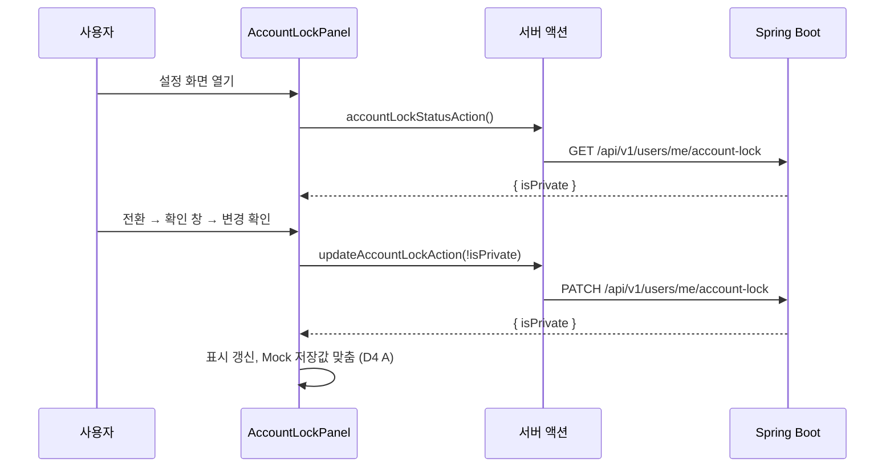

# 개인정보 설정 백엔드·연동 계획

WBS 17.0 개인정보 설정(17.1~17.7)을 실제 백엔드에 구현하고, 프론트엔드가 그 API를 쓰도록 연결하기 위한 단계별 계획이다.

17.2 비밀번호 수정과 17.3 카카오 연동 관리는 develop에 구현되어 있고, 17.4~17.6 결제·구독 조회는 프리미엄 브랜치(`feat/95-premium`)에 구현되어 있다. 이 계획에서 새로 만드는 것은 17.7 계정 잠금(비공개 계정)의 저장·설정 API와 화면 연결, 그리고 그 설정을 다른 사람이 보는 조회에 반영하는 작업이다. 17.1 페이지 구성은 네 영역이 모두 서버 값을 쓰도록 정리한다.

- 상태: 계획 작성. 구현은 시작하지 않았다. 2.2의 결정 항목은 아직 확정되지 않았다.
- 근거: WBS 17.1~17.7. 연관 항목은 2.7, 3.x, 6.x, 8.x, 9.x, 13.3, 13.5, 16.3이다.
- 이 문서는 구현 승인이 아니다. 각 단계는 사용자가 요청할 때만 시작하고, 한 단계가 끝나도 다음 단계를 자동으로 시작하지 않는다. 구현을 시작하는 단계에서 `AGENTS.md`의 승인 범위에 계정 잠금(비공개 계정)을 추가한다.
- 작업은 develop 기준으로 검증한다. 커밋·푸시·main 병합은 사용자가 요청할 때만 한다.
- API 경로와 메서드는 WBS를 따른다. WBS와 다르게 정한 항목은 2절에 근거와 함께 적는다.

## 1. 범위

### 1.1 WBS 항목

모든 항목의 페이지는 `/settings/privacy`다.

| 코드 | 작업 | API (WBS) | WBS 메모 | 현재 (2026-11-09) | 이 계획에서 |
|---|---|---|---|---|---|
| 17.1 | 개인정보 설정 페이지 구성 | 개별 설정 API 활용 | 본인만 접근, 공개 프로필과 분리 | 화면 있음. 비밀번호·카카오는 서버 값, 결제·계정 공개는 Mock | 모든 영역을 서버 값으로 정리 (2·3단계) |
| 17.2 | 비밀번호 수정 | `PATCH /api/v1/users/me/password` | 인증/회원가입의 비밀번호 재설정과 구분 | develop 구현 완료 ([password-reset-api.md](password-reset-api.md)) | 바꾸지 않는다. 회귀만 확인한다 |
| 17.3 | 연동 카카오 계정 조회·연결 관리 | `GET /api/v1/users/me/social-accounts`, `POST`·`DELETE /api/v1/users/me/social-accounts/{providerId}` | | develop 구현 완료 ([kakao-auth-api.md](kakao-auth-api.md)) | 바꾸지 않는다. 회귀만 확인한다 |
| 17.4 | 결제 정보 조회 | `GET /api/v1/payments/me` | PG사 확정 후 상세 정의 | `feat/95-premium` 구현, develop 미병합 | 병합 후 화면을 확인한다 (3단계) |
| 17.5 | 결제 수단 조회 | `GET /api/v1/subscription/me` | | 같음. `GET /api/v1/payment-methods/me`로 연결 | 같음 |
| 17.6 | 구독 정보 조회 | `GET /api/v1/payment-methods/me` | | 같음. `GET /api/v1/subscription/me`로 연결 | 같음 |
| 17.7 | 계정 잠금 설정 | `GET /api/v1/users/me/account-lock` (여부 확인), `PATCH /api/v1/users/me/account-lock` (변경) | | 백엔드 없음. 화면은 Mock(localStorage) | 새로 구현한다 (1·2·4단계) |

17.5·17.6의 연결 경로는 프리미엄 계획(`feat/95-premium`의 `docs/premium-payment-plan.md`)에서 정했다.

### 1.2 계정 잠금의 의미 (확정 정책)

[decisions-pending.md](decisions-pending.md)와 [changes-account-onboarding.md](changes-account-onboarding.md)에 기록된 정책이다.

- 계정 잠금은 비공개 계정이다. 로그인 제한이 아니며, 관리자 정지(`users.status = SUSPENDED`)와도 별개다.
- 본인은 로그인과 모든 기능을 그대로 쓴다.
- 다른 사용자와 비로그인 방문자에게 프로필 상세·팔로우 목록·작성한 SNS 글을 숨긴다. 검색·추천·피드·퍼간 원본·해당 글의 활동 알림에도 반영한다. 공개로 되돌리면 다시 보인다.
- 팔로우 승인 절차와 승인된 팔로워 예외는 없다.
- 관리자 운영 화면과 공개 프로젝트 이력은 별도 범위로 유지한다. Mock의 프로젝트 화면은 공개 여부를 보지 않는다.
- 글 단위의 공개 범위(게시글 `posts.visibility`, 포트폴리오 `portfolios.visibility`, [portfolio-query-api.md](portfolio-query-api.md))와는 다르다. Mock은 글의 공개 범위와 관계없이 작성자가 비공개 계정이면 숨긴다.

### 1.3 현재 코드 (2026-11-09, develop a04608f)

| 위치 | 현재 |
|---|---|
| `users` 테이블 | 공개 여부 컬럼이 없다. [Member](../backend/src/main/java/com/devmozip/backend/entity/Member.java)에는 계정 상태(`status`: ACTIVE·WARNED·SUSPENDED)만 있다. `@DynamicUpdate`라서 바뀐 컬럼만 갱신한다. |
| 회원 API | [MemberController](../backend/src/main/java/com/devmozip/backend/controller/MemberController.java)가 `/api/v1/users/me/availability`·`/me/password`·`/me`를, [SocialAccountController](../backend/src/main/java/com/devmozip/backend/controller/SocialAccountController.java)가 `/me/social-accounts`를 처리한다. 회원은 `Authentication.getName()`(이메일)으로 찾는다. |
| 보안 설정 | `/api/v1/users/me/account-lock`은 [SecurityConfig](../backend/src/main/java/com/devmozip/backend/config/SecurityConfig.java)의 `anyRequest().authenticated()`에 해당한다. 비로그인 허용 경로(`/api/v1/users/{slug}` 등)와 겹치지 않으므로 보안 설정을 바꿀 필요가 없다. 정지 회원은 JWT 필터가 403으로 막는다. |
| 프로필 공개 조회 (프로필 담당) | `GET /api/v1/users/{slug}`와 `/{slug}/options`·`/introduction`·`/links`·`/portfolios`는 비로그인도 허용한다. `status = ACTIVE`인 회원만 조회하고 나머지는 404다. [profile-detail-api.md](profile-detail-api.md)는 계정 잠금과 프로필 비공개의 관리 방식을 팀 확정 사항으로 남겼고, ERD에 공개 필드가 없어 컬럼을 만들지 않았다고 적었다. |
| 다른 브랜치의 계획 | 팔로우(`feat/94-follows`)와 개발자 찾기(`feat/104-find-developers`) 계획은 `users`에 공개 여부 컬럼이 없어 Mock의 비공개 처리를 API 화면으로 옮기지 않았다. 두 계획 모두 17.0이 DB에 연결될 때 맞추기로 했다. 피드(`feat/91-posts`) 계획에는 비공개 계정 처리가 없다. |
| 프론트 `/settings/privacy` | [page.tsx](<../frontend/app/(user)/settings/privacy/page.tsx>)에 네 영역이 있다. 계정 정보(이메일, 비밀번호 변경·첫 설정)와 카카오 계정은 서버 액션으로 서버 값을 쓴다. 결제 정보는 역할, 고정 데모 카드, Mock 결제 내역을 보여 준다. 계정 공개 설정은 `devmozip:account-area:v1`의 `isPrivate`를 바꾼다. [paths.ts](../frontend/lib/auth/paths.ts)의 `/settings` 보호 경로라서 로그인이 필요하다. |
| 이메일 안내 | 화면의 이메일은 서버가 확인한 로그인 이메일(`identity.username`)이다. 그런데 안내 문구는 "기존 Mock 계정 정보"라고 적는다. |
| Mock 계정 ID | [serverIdentity.ts](../frontend/lib/account/serverIdentity.ts)는 로그인 사용자 ID로 데모 계정 ID를 쓴다. 이메일이 같은 데모 계정이 없으면 첫 데모 계정의 ID를 쓰므로, 여러 서버 계정이 같은 Mock `isPrivate` 값을 나눠 쓴다. |
| 프리미엄 브랜치 | `feat/95-premium`이 결제 영역을 `_components/PaymentInfoPanel.tsx`로 바꾸면서 `page.tsx`를 고친다. 이 계획의 화면 변경과 같은 파일이다. |

### 1.4 Mock의 비공개 반영 위치와 서버 대응

Mock 화면은 [privacyService](../frontend/lib/profiles/privacyService.ts)의 `canViewAccount`(본인이거나 비공개가 아니면 볼 수 있음)를 `useAuth().canViewProfile`로 부른다. 같은 동작을 하는 서버 API와 담당은 다음과 같다.

| Mock 화면 | Mock 동작 | 서버 API | 담당·위치 |
|---|---|---|---|
| 프로필 `/users/{id}` | "비공개 계정입니다." 화면 | `GET /api/v1/users/{slug}`, `/options`, `/introduction`, `/links` | 프로필 담당, develop |
| 포트폴리오 탭·상세 | 숨김 | `GET /api/v1/users/{slug}/portfolios`, `GET /api/v1/portfolios/{id}` | 포트폴리오 담당, develop |
| 팔로우 목록 `/users/{id}/follows` | 대상이 비공개면 "비공개 계정입니다.", 목록에서 비공개 계정 제외 | `GET /api/v1/users/{slug}/followers`, `/following`, `/follow` | 사용자, `feat/94-follows` |
| 피드 목록·상세·메인 미리보기·퍼간 원본 (`PostCard`) | 비공개 작성자의 글 제외. 상세는 "삭제·숨김 처리되었거나 비공개 계정의 게시글입니다." | `GET /api/v1/feeds`, `/recommands`, `/following`, `/preview`, `/{id}`, `/{id}/comments` | 사용자, `feat/91-posts` |
| 개발자 탐색 `/explore` | 비공개 계정 제외 | `GET /api/v1/search?type=developers` | 사용자, `feat/104-find-developers` |
| AI 추천 결과 | 비공개 개발자 제외 | AI 개발자 추천 후보 조회 | AI 담당, develop |
| 좋아요한 글 (`PostCard`) | 비공개 작성자의 글 제외 | `GET /api/v1/users/me/liked-posts` | 좋아요 목록 담당, develop |
| 북마크한 게시글 | 비공개 작성자의 글 제외 | `GET /api/v1/users/me/bookmarks?type=posts` (WBS 16.3) | 북마크 담당 |
| 알림 (`messagingStore`) | 비공개 작성자의 글로 이동하는 알림 제외 | `GET /api/v1/notifications` | 사용자, `feat/109-notifications` 계획 |

## 2. 결정 사항

### 2.1 확정된 항목

| 항목 | 내용 | 근거 |
|---|---|---|
| 계정 잠금의 의미 | 비공개 계정 (1.2) | decisions-pending.md, changes-account-onboarding.md |
| 17.7 API | `GET`·`PATCH /api/v1/users/me/account-lock` | WBS 17.7 |
| 17.2·17.3 계약 | 기존 계약을 그대로 쓴다 | password-reset-api.md, kakao-auth-api.md |
| 17.4~17.6 | 프리미엄 계획에서 구현한다. 결제 수단은 `payment-methods/me`, 구독 정보는 `subscription/me`에 연결한다 | 프리미엄 계획 (2026-11-09) |
| 페이지 | `/settings/privacy` 하나에 모든 영역을 둔다. 로그인이 필요하고 공개 프로필과 분리한다 | WBS 17.1 |
| 대상 회원 | 모든 설정 API는 인증 정보의 회원만 대상으로 한다. 요청 값으로 회원을 지정할 수 없다 | AGENTS.md |

### 2.2 사용자가 확정할 항목

#### D1. 저장 컬럼과 API 필드 이름

| 안 | 내용 |
|---|---|
| A (제안) | 컬럼은 `users.is_private`, API 필드는 `isPrivate`로 한다. 경로만 WBS의 `account-lock`을 쓴다. |
| B | 컬럼은 `users.account_locked`, API 필드는 `locked`로 한다. WBS 경로와 이름이 같다. |

A는 프론트 타입과 Mock 저장값(`isPrivate`)과 이름이 같다. Mock은 처음에 `locked`로 저장했다가 로그인 제한으로 오해되어 `isPrivate`로 바꿨다(이전 값은 읽을 때 옮긴다). 다른 도메인이 조회 조건을 쓸 때 계정 상태(`status`, 정지)와 헷갈리지 않는다. 어느 안이든 0단계에서 ERDCloud에 반영한다.

#### D2. 공개 조회에 반영하는 범위

| 안 | 내용 |
|---|---|
| A (제안) | 이 계획에서 공통 판정 기준(4.2)을 만든다. 사용자 담당 공개 조회(팔로우·피드·개발자 찾기)는 각 브랜치가 develop에 병합된 뒤 4단계에서 적용한다. 다른 담당의 조회(프로필·포트폴리오·AI 추천·좋아요·북마크)는 8절대로 계약을 공유하고 담당자가 적용한다. |
| B | 이 계획은 저장·설정 API와 판정 기준까지만 만든다. 사용자 담당 도메인도 각 기능 계획에서 적용한다. |

팔로우·개발자 찾기 계획이 "17.0이 DB에 연결될 때 맞춘다"고 적었으므로 A가 그 기록과 맞는다. B를 고르면 각 계획 문서에 적용 단계를 추가해야 한다. 어느 안이든 다른 담당의 코드는 이 계획에서 고치지 않는다.

#### D3. 비공개 계정을 다른 사람이 열 때의 응답

| 안 | 내용 |
|---|---|
| A (제안) | 사람 단위 조회(프로필과 그 하위 정보, 팔로우 목록·상태)는 403과 "비공개 계정입니다." 문구를 돌려준다. 글 단위 조회(게시글 상세·댓글, 포트폴리오 상세)는 404다. 목록에서는 뺀다. |
| B | 모두 404로 응답해 없는 사용자와 구별하지 않는다. |

A는 Mock 화면(비공개 안내, 피드 상세의 "삭제·숨김 처리되었거나 비공개 계정의 게시글" 안내)과 같다. 비공개 계정이 있다는 사실은 드러나지만 Mock도 같다. B는 이 사실을 드러내지 않지만, 프로필 화면이 없는 사용자와 비공개 계정을 구별해 안내할 수 없다. 이 경로들은 비로그인도 허용하므로 정지 회원 403과 겹치지 않는다.

#### D4. Mock 토글과 기존 Mock 저장값

| 안 | 내용 |
|---|---|
| A (제안) | 설정 화면의 계정 공개 영역은 Mock 토글과 관계없이 서버 값을 읽고 바꾼다. 비밀번호·카카오 영역과 프리미엄 브랜치의 결제 영역도 이렇게 동작한다. 변경에 성공하면 기존 Mock 저장값(`devmozip:account-area:v1`의 `isPrivate`)도 같은 값으로 맞춘다. 그러면 토글 ON의 Mock 화면(피드·탐색 등)이 지금처럼 반응한다. |
| B | 토글 ON이면 지금처럼 Mock 값만, OFF이면 서버 값만 쓴다. |

Mock 계정 ID는 데모 계정 ID라서 여러 서버 계정이 같은 Mock 값을 나눠 쓴다(1.3). 그래서 B를 고르면 토글 ON에서 바꾼 설정이 실제 계정에 저장되지 않는다. A에서도 Mock 화면의 값은 같은 브라우저에서 마지막으로 바꾼 값이다.

### 2.3 설계 기준

| 항목 | 기준 |
|---|---|
| 판정 | 요청자가 대상 본인이거나 대상이 공개 계정이면 볼 수 있다. 관리자·프리미엄도 공개 화면에서는 예외가 아니다(Mock `canViewAccount`와 같다). 비로그인 요청자는 공개 계정만 본다. |
| 적용 위치 | 판정은 서버의 조회에서 한다. 화면에서 숨기는 것만으로는 막지 않는다. |
| 목록 | 비공개 계정과 그 계정의 글을 조회 조건에서 뺀다. 응답에 넣은 뒤 거르지 않는다. 그래야 페이지 크기와 `hasNext`·전체 수가 맞는다. |
| 쓰기 | 다른 사람이 비공개 계정의 글에 좋아요·댓글·퍼가기·북마크를 요청하면 상세 조회와 같이 404로 응답한다. |
| 반영 시점 | 설정을 바꾸면 다음 조회부터 반영한다. 서버에 공개 여부 캐시를 두지 않는다. |
| 동시 변경 | `PATCH`는 원하는 최종 값을 받으므로 같은 요청을 반복해도 결과가 같다. `@DynamicUpdate` 덕분에 같은 회원의 다른 컬럼 변경을 덮어쓰지 않는다. |
| 기존 동작 보존 | 정지·경고 회원 처리, 프로필 API의 기존 404 기준, 포트폴리오 공개 범위는 바꾸지 않는다. |

## 3. 데이터

### 3.1 ERD 대조

사용자가 제공한 ERD 이미지와 대조했다(2026-11-09).

- `users`(22개 컬럼)에 공개 여부·계정 잠금에 해당하는 컬럼이 없다. 다른 테이블에도 계정 단위 공개 설정은 없다. develop의 `Member` 엔티티와 `docs/sql`도 같다.
- 게시글(`posts.visibility`)과 포트폴리오(`portfolios.visibility`)의 공개 범위는 글 단위다. 피드 계획 기준으로 게시글 값은 `VISIBLE`·`HIDDEN`(작성자 숨김)·`RESTRICTED`(관리자 숨김)다. 계정 단위 비공개는 이와 별개이며, 다른 사람에게 보이려면 두 조건을 모두 만족해야 한다.
- 따라서 D1의 컬럼을 `users`에 새로 추가해야 한다. ERD 이미지에는 NULL 여부와 기본값이 표시되지 않으므로, 0단계에서 3.2의 값을 ERDCloud에 함께 적는다.
- `users`의 컬럼 이름은 `Member` 엔티티와 모두 같다. 이 계획과 관계없는 차이가 두 가지 있어 기록만 한다(회원·프로필 담당과 공유).
  - `career`: ERD는 VARCHAR(20)이고 이름이 "경력(개월수)"이다. 엔티티는 길이 30이고, 가입 화면에서 고른 문구(예: 3년 차)를 저장한다.
  - `collaboration_status`: ERD는 ENUM이다. 엔티티는 문자열로 저장하며 길이를 정하지 않았다.

### 3.2 users 추가 컬럼 (D1 A 기준)

| 필드 | 타입 | NULL | 기본값 | 의미 |
|---|---|---|---|---|
| is_private | BOOLEAN | 불가 | FALSE | 비공개 계정 여부. TRUE면 본인 외에는 공개 조회에서 숨긴다 |

- 기본값은 Mock의 신규 계정 값(`isPrivate: false`)과 같다.
- 가입 API와 `Member` 빌더는 바꾸지 않는다. 새 회원은 기본값으로 공개 계정이 된다.

### 3.3 DB 반영 주의

- `ddl-auto: update`이므로 엔티티를 바꾼 서버를 재시작하면 연결된 DB의 `users`에 컬럼이 추가된다. 개발 서버가 공용 DB에 연결되어 있으면 반영 시점을 팀과 맞춘다.
- 이미 행이 있는 `users`에 `NOT NULL` 컬럼을 기본값 없이 추가하면 PostgreSQL이 거절한다. 엔티티에 DB 기본값(`@ColumnDefault("false")`)을 함께 선언해 기존 회원이 공개 계정으로 채워지게 한다. 1단계에서 기존 행이 있는 DB로 확인한다.
- local 프로필의 H2와 Git 제외 SQL 파일(`members_data.sql`)은 기본값 덕분에 바꿀 필요가 없다. 1단계에서 local 프로필 기동으로 확인한다.

## 4. 백엔드 구조

### 4.1 파일

기존 계층형 패키지(`backend/src/main/java/com/devmozip/backend`)를 따른다. 탭 들여쓰기와 생성자 주입을 쓰고, DTO는 record로 만든다. 엔티티를 API 응답으로 쓰지 않는다. 회원 설정 API는 기존 `MemberController`·`MemberService`에 더한다.

| 위치 | 파일 | 역할 |
|---|---|---|
| entity | Member | `is_private` 필드와 변경 메서드 |
| dto/member | AccountLockRequest, AccountLockResponse | `{ isPrivate }` 요청·응답 |
| service | MemberService | 본인 설정 조회·변경 |
| controller | MemberController | `GET`·`PATCH /api/v1/users/me/account-lock` |
| service | AccountVisibilityPolicy | 공통 판정 기준(4.2). 다른 도메인이 주입받아 쓴다 |

### 4.2 공통 판정 기준

- `canView(Long viewerId, Member target)`: 단건 조회용이다. `viewerId`는 비로그인이면 `null`이다.
- 사람 단위 조회와 글 단위 조회의 거절 응답은 D3에 따라 나눈다. 정책 클래스는 두 응답을 만드는 메서드를 함께 둔다.
- 목록 조회 조건은 `(u.is_private = FALSE OR u.id = :viewerId)`다. `viewerId`가 `null`이면 앞쪽 조건만 남는다. JPQL·JDBC 어느 쪽에서도 같은 조건을 쓰며, 문서와 테스트로 고정한다.
- 요청자 ID는 각 도메인이 지금 쓰는 방식(인증 정보의 이메일로 회원 조회)으로 얻는다. 비로그인 허용 경로에서는 인증 정보가 없을 수 있다.

## 5. API 계약

브라우저는 BFF(서버 액션)만 호출한다. 요청자는 인증 정보로 정하며, 요청 값으로 회원을 지정할 수 없다.

### 5.1 개인정보 설정이 쓰는 API

| 코드 | 메서드·경로 | 계약 문서 | 상태 |
|---|---|---|---|
| 17.2 | `PATCH /api/v1/users/me/password` | [password-reset-api.md](password-reset-api.md) | develop |
| 17.3 | `GET /api/v1/users/me/social-accounts`, `POST`·`DELETE /api/v1/users/me/social-accounts/{providerId}` | [kakao-auth-api.md](kakao-auth-api.md) | develop |
| 17.4 | `GET /api/v1/payments/me` | `docs/premium-payment-api.md` (`feat/95-premium`) | 미병합 |
| 17.5 | `GET /api/v1/payment-methods/me` | 같음 | 미병합 |
| 17.6 | `GET /api/v1/subscription/me` | 같음 | 미병합 |
| 17.7 | `GET`·`PATCH /api/v1/users/me/account-lock` | 이 문서, 1단계 후 `docs/privacy-settings-api.md` | 이 계획 |

### 5.2 계정 잠금 (17.7, D1 A 기준)

- 조회: `GET /api/v1/users/me/account-lock` → 200 `{ "isPrivate": false }`.
- 변경: `PATCH /api/v1/users/me/account-lock`, 본문 `{ "isPrivate": true }` → 200 `{ "isPrivate": true }`. 같은 값을 다시 보내도 200이다.
- 본문의 `isPrivate`는 JSON boolean만 받는다. 문자열 `"true"`나 숫자를 받아들이면 기존 `Strict*Deserializer`처럼 boolean 전용 처리를 둔다.
- 응답 JSON의 필드 이름이 `isPrivate`로 나오는지 테스트로 고정한다(record의 boolean 필드 이름).

| 상태 | 상황 |
|---|---|
| 400 | 본문 없음, `isPrivate` 누락·`null`, boolean이 아닌 값 |
| 401 | 로그인 필요 |
| 403 | 정지 회원 (JWT 필터) |

오류는 기존 `ErrorResponse` 형식이다.

### 5.3 공개 조회의 비공개 응답 (D3 A 기준)

| 조회 | 다른 사람·비로그인 | 본인 |
|---|---|---|
| 프로필과 하위 정보, 팔로우 목록·상태 | 403, `message`: "비공개 계정입니다." | 그대로 |
| 게시글 상세·댓글, 포트폴리오 상세 | 404 (없는 글과 같음) | 그대로 |
| 목록 (피드, 검색, 추천, 팔로우 목록 항목, 좋아요·북마크) | 비공개 계정과 그 글을 뺀다 | 본인 것은 포함 |

## 6. 프론트엔드 연결

구현 전 [frontend/AGENTS.md](../frontend/AGENTS.md)의 안내대로 `node_modules/next/dist/docs/`에서 Server Actions 문서를 확인한다.

### 6.1 BFF

기존 비밀번호·카카오 영역처럼 서버 액션을 쓴다.

| 서버 액션 | 백엔드 | 내용 |
|---|---|---|
| `accountLockStatusAction()` | `GET /api/v1/users/me/account-lock` | `{ isPrivate } \| { error }` |
| `updateAccountLockAction(isPrivate)` | `PATCH /api/v1/users/me/account-lock` | boolean이 아니면 백엔드를 부르지 않고 오류를 돌려준다 |

- 파일: `lib/account/accountLockActions.ts`(`'use server'`, [backendFetch](../frontend/lib/auth/backend.ts)로 토큰을 붙인다). 응답 타입은 `types/account.ts`에 더한다.
- 응답은 `isPrivate`가 boolean인지 확인하고, 그 밖의 필드는 버린다. 오류는 상태별 안내 문구로 바꾼다. 401은 다른 영역과 같이 로그인 만료로 처리한다.

### 6.2 화면

| 영역 | 위치 | 내용 |
|---|---|---|
| 계정 공개 설정 (17.7) | `app/(user)/settings/privacy/_components/AccountLockPanel.tsx` | 지금 `page.tsx` 안의 영역과 확인 창을 옮긴다. 서버 값을 불러와 표시하고, 확인 창에서 변경을 요청한다. 로딩·오류·재시도, 요청 중 버튼 잠금을 처리한다. 실패하면 이전 값을 유지하고 오류를 표시한다. 성공하면 D4에 따라 Mock 저장값을 맞춘다. 문구와 확인 창은 지금 화면을 그대로 쓴다. |
| 페이지 구성 (17.1) | `app/(user)/settings/privacy/page.tsx` | 계정 공개 영역을 `AccountLockPanel`로 바꾼다. 사실과 다른 이메일 안내("기존 Mock 계정 정보")를 로그인 이메일이라는 안내로 고친다. 영역마다 따로 불러오고, 한 영역이 실패해도 다른 영역은 동작한다. |

결제 영역을 `PaymentInfoPanel`로 뺀 프리미엄 브랜치와 같은 방식이다. `page.tsx`에서 바뀌는 줄을 줄여 병합 충돌을 작게 한다.

### 6.3 바꾸지 않는 것

- 비밀번호·카카오 영역의 동작과 문구 (`AccountPasswordForm`, 서버 액션).
- Mock 화면의 `canViewProfile`과 `privacyService`. 토글 ON에서 지금처럼 동작한다.
- 프로필 화면(`ApiProfileContent` 등)과 다른 담당의 화면. 비공개 안내 표시는 8절대로 담당자와 맞춘다.

## 7. 단계별 수행

| 단계 | 내용 | WBS | 선행 조건 | 상태 |
|---|---|---|---|---|
| 0 | 결정·사전 확인 | | | 대기 |
| 1 | 저장 컬럼·설정 API·판정 기준 | 17.7 | 0 | 대기 |
| 2 | BFF·계정 공개 영역·페이지 정리 | 17.1, 17.7 | 1 | 대기 |
| 3 | 결제 영역 확인 | 17.1, 17.4~17.6 | `feat/95-premium` develop 병합 | 대기 |
| 4 | 사용자 담당 공개 조회에 반영 (D2 A) | 17.7 | 1, 해당 브랜치 develop 병합 | 대기 |
| 5 | 통합 검증·문서 정리 | 전체 | 1~4 | 대기 |

모든 단계의 공통 종료 조건은 다음과 같다.

- `frontend`에서 `npm run build`와 관련 테스트를 실행한다. 백엔드를 바꾼 단계는 `backend`에서 `./gradlew test`도 실행한다. 실행한 위치(저장소 또는 복사본), 명령, 성공·실패, 실행하지 못한 이유를 기록한다.
- Testcontainers 테스트가 Docker 없이 건너뛰어지면 통과로 보고하지 않는다. Mock 테스트 통과를 실제 DB 검증으로 보고하지 않는다.
- 이 문서의 상태 표와 10절 진행 기록을 갱신한다.

### 0단계: 결정·사전 확인

- [ ] 2.2의 D1~D4를 확정한다.
- [x] ERD의 `users`와 3.2를 대조한다 (2026-11-09, 3.1).
- [ ] 확정한 컬럼과 NULL 여부·기본값을 ERDCloud에 반영한다.
- [ ] 개발 DB의 `users`에 해당 컬럼이 없는지 읽기로 확인한다.
- [ ] `feat/95-premium`, `feat/94-follows`, `feat/91-posts`, `feat/104-find-developers`의 develop 병합 여부를 확인한다. 병합되지 않은 도메인의 3·4단계 작업은 대기한다.
- [ ] `AGENTS.md`의 구현 범위에 계정 잠금(비공개 계정)과 근거를 추가한다.
- [ ] 8절의 연결 사항을 담당자에게 공유한다.

**완료 기준:** 결정이 확정되고, ERD 대조 결과와 선행 브랜치 상태가 기록되어 있다.

### 1단계: 저장 컬럼·설정 API·판정 기준 (17.7)

- `Member`의 `is_private`(3.2), DTO, `MemberService` 조회·변경, `MemberController`의 두 경로, `AccountVisibilityPolicy`.
- 테스트(Testcontainers PostgreSQL):
  - 비로그인 401
  - 신규 회원 기본값 `false`
  - 변경과 반복 요청
  - 잘못된 본문 400(누락·`null`·문자열·숫자)
  - 다른 회원에 영향 없음
  - 응답 필드 이름
  - 기존 행이 있는 `users`에 컬럼이 추가되고 기존 회원이 공개로 읽힘
- `AccountVisibilityPolicy` 단위 테스트: 본인·다른 회원·비로그인 × 공개·비공개. 목록 조건은 `viewerId`가 `null`인 경우를 포함해 SQL로 확인한다.
- 기존 회원·인증 테스트(`KakaoAccountManagementIntegrationTest` 등)가 그대로 통과해야 한다.
- local 프로필(H2)로 기동해 컬럼 생성을 확인한다.
- `docs/privacy-settings-api.md` 초안을 쓴다(5절의 17.7 계약과 다른 항목 문서 링크).
- 개발 서버를 재시작하기 전에 DB 반영 시점을 공유한다.

**완료 기준:** `./gradlew test` 통과, Testcontainers 테스트 건너뜀 0.

### 2단계: BFF·계정 공개 영역·페이지 정리 (17.1·17.7)

- 6.1의 서버 액션과 타입, 6.2의 `AccountLockPanel`과 `page.tsx` 정리.
- `feat/95-premium`보다 먼저 진행하면 `page.tsx` 충돌을 병합할 때 해결한다.
- 테스트(Vitest):
  - 서버 액션의 응답 해석(잘못된 응답 거절, 상태별 문구, boolean이 아닌 입력 거절)
  - 계정 공개 영역의 로딩·오류·재시도·전환·실패 시 이전 값 유지
  - D4 A의 Mock 저장값 동기화
  - 비밀번호·카카오 영역 회귀
- 브라우저(1440px):
  - 비로그인으로 `/settings/privacy`에 들어가면 로그인으로 이동한다.
  - 전환 후 새로고침해도 서버 값이 유지된다.
  - 다른 계정으로 로그인하면 그 계정의 값이 보인다.

**완료 기준:** `npm run build`와 관련 테스트 통과, 브라우저 확인 결과 기록.

### 3단계: 결제 영역 확인 (17.4~17.6)

프리미엄 브랜치가 develop에 병합된 뒤에 시작한다.

- 설정 화면의 결제 영역(`PaymentInfoPanel`)이 구독 관리·결제 내역 화면과 같은 값을 보여 주는지 확인한다. 결제 영역이 실패해도 다른 영역이 동작하는지도 확인한다.
- 상단 안내("실제 개인정보·결제 정보는 입력하지 마세요")가 병합 후의 결제 흐름과 맞는지 확인하고, 다르면 보고한다.
- 결제 계약은 바꾸지 않는다. 코드 변경이 필요하면 범위를 먼저 보고한다.

**완료 기준:** `npm run build`와 관련 테스트 통과, 화면 확인 결과 기록.

### 4단계: 사용자 담당 공개 조회에 반영 (D2 A)

도메인별로 브랜치가 develop에 병합된 뒤 따로 진행할 수 있다. 각 항목은 2.3과 5.3을 따른다.

| 도메인 | 서버 | 화면 | 선행 |
|---|---|---|---|
| 팔로우 | `/users/{slug}/followers`·`/following`·`/follow`: 대상이 비공개면 403. 목록 항목에서 비공개 계정 제외(본인은 포함) | 팔로우 목록 화면이 403이면 Mock과 같은 "비공개 계정입니다." 화면을 보여 준다 | `feat/94-follows` |
| 피드 | 목록(`/feeds`, `/recommands`, `/following`, `/preview`)에서 비공개 작성자의 글 제외. 상세·댓글 404. 좋아요·댓글·퍼가기·북마크 쓰기 404. 퍼간 글의 원본이 비공개 작성자의 글이면 원본 내용을 내보내지 않는다(응답 형태는 피드 API 계약에 맞춰 그 단계에서 정한다) | 상세 404는 지금 피드 상세의 안내 문구를 쓴다 | `feat/91-posts` |
| 개발자 찾기 | `GET /api/v1/search?type=developers`에서 비공개 계정 제외. 전체 수·페이지 수에도 반영 | 변경 없음 | `feat/104-find-developers` |

- 테스트(Testcontainers): 도메인마다 본인·다른 회원·비로그인 × 공개·비공개 조합을 확인한다. 페이지 크기·`hasNext`·전체 수가 제외 뒤의 값인지, 공개로 되돌리면 다시 나오는지도 확인한다.
- 각 도메인의 기존 테스트가 그대로 통과해야 한다.

**완료 기준:** 진행한 도메인마다 `./gradlew test`와 `npm run build`, 관련 테스트 통과.

### 5단계: 통합 검증·문서 정리

`./gradlew test`, `npm test`, `npm run build`를 다시 실행한다. 공용 개발 DB에 시험 데이터를 만들지 않도록 임시 PostgreSQL에 연결한 백엔드와 프론트로 다음 시나리오를 확인한다.

| # | 시나리오 | 기대 결과 |
|---|---|---|
| 1 | 비로그인으로 `/settings/privacy` 접근 | 로그인 화면으로 이동, 로그인 후 복귀 |
| 2 | 비밀번호 변경, 카카오 회원 첫 비밀번호 설정 | 기존 동작 그대로 (17.2) |
| 3 | 카카오 연동·해제 | 기존 동작 그대로 (17.3) |
| 4 | 결제 영역 | 구독 관리·결제 내역과 같은 값 (17.4~17.6, 병합된 경우) |
| 5 | 비공개로 전환 후 새로고침 | 비공개 유지 |
| 6 | 다른 계정·비로그인으로 그 사람의 프로필·팔로우 목록 열기 | D3 응답과 비공개 안내 (적용된 도메인) |
| 7 | 다른 계정으로 피드·검색 | 그 사람과 그 글이 빠짐 (적용된 도메인) |
| 8 | 본인으로 같은 화면 | 모두 보임 |
| 9 | 공개로 되돌림 | 다시 보임 |
| 10 | 토글 ON | 기존 Mock 화면이 마지막 설정 값대로 반응 (D4 A) |

문서는 실제 구현에 맞춰 갱신한다.

- `docs/privacy-settings-api.md`: 확정 계약.
- [frontend-pages.md](frontend-pages.md)의 `/settings/privacy`, [decisions-pending.md](decisions-pending.md)의 계정 잠금 항목, [mock-data.md](mock-data.md)의 계정 Mock 범위.
- 팔로우·개발자 찾기 계획의 "17.0 연결 때 맞춘다" 항목을 결과에 맞게 고친다.
- `AGENTS.md`: 구현 범위와 "새 채팅에서 먼저 읽을 문서".

**완료 기준:** 시나리오 결과와 미검증 항목을 구분해 기록했다.

## 8. 다른 작업과의 연결

| 대상 | 내용 |
|---|---|
| 프로필 (WBS 3.x) | `GET /api/v1/users/{slug}`와 `/options`·`/introduction`·`/links`에 판정 기준과 D3 응답을 적용한다. API 프로필 화면의 비공개 안내와, 본인에게 보이는 "비공개 계정 · 나에게만 프로필이 표시됩니다" 안내(Mock 프로필 화면)를 맞춘다. 프로필 상세 문서에 남은 "계정 잠금과 프로필 비공개" 확정 항목이 이 계획으로 정해진다. 비공개 설정의 주된 효과가 프로필이므로, 2단계를 develop에 반영하는 시기와 적용 시기를 담당자와 맞춘다. |
| 포트폴리오 | `/users/{slug}/portfolios`에서 비공개 계정의 포트폴리오를 빼고, `/portfolios/{id}`는 404로 응답한다. 포트폴리오 자체의 공개 범위와 별개로 판정한다. |
| 프로젝트 (WBS 7.x) | 공고·이력에는 적용하지 않는다. 주최자의 지원자 열람은 [decisions-pending.md](decisions-pending.md)의 기존 정책(해당 공고의 프리미엄 주최자만 열람, 비공개 계정의 공개 프로필 접근은 넓히지 않음)을 따르며, 담당자와 확인한다. |
| AI 추천 | 개발자 추천 후보에서 비공개 계정을 뺀다. |
| 좋아요한 글 | `GET /api/v1/users/me/liked-posts`에서 비공개 작성자의 글을 뺀다. |
| 북마크 (WBS 16.3) | 북마크한 게시글에서 비공개 작성자의 글을 뺀다. |
| 알림 (WBS 12.x, 사용자) | 알림 계획이 피드·팔로우 알림을 연결할 때 비공개 작성자의 글로 이동하는 알림을 목록에서 뺀다. 이 방식은 Mock `messagingStore`와 같다. 지금 알림 계획(D2 A)의 프로젝트·리뷰 알림은 해당하지 않는다. |
| 프리미엄 (WBS 13.x, 사용자) | 결제 영역 계약은 그대로 쓴다. `page.tsx`를 함께 바꾸므로 병합 순서에 맞춰 충돌을 확인한다. |
| 공통 | `users`에 컬럼을 추가하므로 공용 `Member` 엔티티가 바뀐다. 개발 DB 반영 시점과 ERDCloud 변경을 팀에 공유한다. |

## 9. 알려진 제한

- 다른 담당의 조회에 판정 기준이 적용되기 전까지는, 비공개로 바꿔도 해당 화면에는 그대로 보인다. 설정 화면의 안내("다른 사용자에게 프로필과 작성한 SNS 게시글이 표시되지 않습니다")와 실제 동작이 그동안 다를 수 있다.
- 설정은 다음 조회부터 반영된다. 이미 열려 있는 다른 사람의 화면에는 새로고침 전까지 남는다.
- 토글 ON의 Mock 화면은 브라우저 저장값을 쓰므로, 같은 브라우저에서 마지막으로 바꾼 값과 데모 계정 ID 기준으로 동작한다.
- 알림 문구처럼 생성 시점에 저장한 내용(작성자 닉네임 등)은 비공개로 바꿔도 이미 받은 사람의 기록에 남는다.

## 10. 진행 기록

| 날짜 | 단계 | 내용 |
|---|---|---|
| 2026-11-09 | 계획 | 이 문서 작성. WBS 17.1~17.7을 develop(a04608f)의 회원·인증 코드, `/settings/privacy` 화면과 Mock 비공개 처리와 대조했다. 프리미엄·팔로우·피드·개발자 찾기·알림 브랜치의 관련 내용도 확인했다. ERD 원본은 대조하지 못했다. 코드 변경 없음. 문서만 작성해 빌드·테스트는 실행하지 않았다. |
| 2026-11-09 | 계획 | ERD 이미지와 대조한 결과를 3.1에 반영했다. `users`를 포함해 계정 단위 공개 여부 컬럼이 없어 새로 추가해야 한다. 게시글·포트폴리오의 `visibility`는 글 단위이며 계정 비공개와 별개다. 관계없는 `users` 차이 두 가지(`career` 길이, `collaboration_status` 타입)는 기록만 했다. 코드 변경 없음. 빌드·테스트는 실행하지 않았다. |
