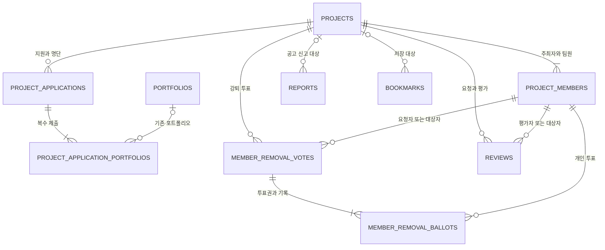

# 프로젝트 백엔드 청사진

사용자가 제공한 ERDCloud JSON(다이어그램 rqX799PsNgtJcL6bY, 엔티티 30개)을 기준으로 정리했다. 사용자가 end_requested_at을 포함한 ERDCloud 반영 완료를 확인했고 API 경로는 제공된 WBS 원안으로 진행한다. 최신 ERDCloud를 다시 내려받아 대조한 상태는 아니다. 이 문서는 설계 기준이며 #44 생성 API 구현 상태와 실행 방법은 [프로젝트 생성 API](project-creation.md)에 기록한다.

## 1. ERD 변경 요약

| 대상 | 정리 |
|---|---|
| projects | 모집 직군 JSONB 유지, 이미지 1장 필수, 공개 여부 boolean |
| project_applications | 기존 지원 테이블 유지, rejection_reason 추가 |
| project_applicants | 제거 제안. 지원 명단은 project_applications 조회 |
| project_application_portfolios | 새 연결 테이블. 기존 portfolios를 여러 개 제출 |
| project_members | 기존 테이블 유지, 실제 담당 직군 job_role 추가 |
| member_removal_votes / member_removal_ballots | 기존 이름 유지, 미투표·종료 시각 보완 |
| reviews | 요청·평가·임시 링크를 한 테이블에서 관리, 재알림 시각 보완 |
| reports / bookmarks | 기존 공통 테이블 사용. 프로젝트 전용 테이블 중복 생성 안 함 |

직접 설계할 테이블은 프로젝트·지원·제출 연결·멤버·강퇴 투표·개인 투표·리뷰 7개다. 공통 신고·북마크와 외부 users·portfolios·review_keywords·chat_members는 결합 지점이다.

## 2. 공통 기준

- 생성일·수정일은 공통 베이스 상속: created_at(생성 시각), updated_at(수정 시각). 개별 표에서 생략한다. Base는 별도 DB 테이블이 아니다.
- ERD 시각 표기는 DATETIME, Java는 LocalDateTime, PostgreSQL은 timestamp without time zone이다. 모집·개발 날짜는 DATE/LocalDate다. 기록·비교 기준은 Asia/Seoul로 통일한다.
- 삭제·종료·승인·투표 등 업무 시각은 필요한 엔티티에 선언한다. version은 초기 설계에서 제외한다.
- ID는 BIGINT. 외부 회원·포트폴리오의 실제 FK와 권한은 나중에 연결한다. 응답 DTO는 record로 작성한다.
- NULL 표시가 없는 필드는 필수 제안이다. 아래 이름·길이·NULL은 원본 그대로인 항목과 이번에 변경 제안한 항목을 구분해 읽는다.

## 3. 프로젝트 테이블

### projects — 프로젝트

| 필드 | 타입 | 의미 |
|---|---|---|
| id | BIGINT / PK | 프로젝트 ID |
| host_member_id | BIGINT | 주최자 users.id 참조 |
| title | VARCHAR(255) | 프로젝트 제목 |
| summary | VARCHAR(255) / NULL | 한 줄 소개 |
| description | TEXT | 상세 소개 |
| goal | TEXT / NULL | 프로젝트 목표. 원본의 선택 필드 유지 |
| recruitment_slots | JSONB | 모집 직군 코드·인원·최소 경력 |
| tech_stacks | JSONB | 기술 스택 문자열 배열 |
| interests | JSONB | 관심 분야 문자열 배열 |
| image_url | VARCHAR(2048) | 필수 이미지 1장의 URL |
| is_public | BOOLEAN | true 전체 공개·검색, false 현재 팀원만 조회 |
| status | VARCHAR(30) | 모집 중·모집 완료·진행 중·종료 |
| view_count | BIGINT / 기본 0 | 상세 열람 횟수. #45에서 사용자 승인으로 추가 |
| recruitment_start | DATE | 모집 시작일 |
| recruitment_end | DATE | 현재 모집 종료일 |
| development_start | DATE | 개발 시작 예정일 |
| development_end | DATE | 현재 개발 종료 예정일 |
| completed_at | DATETIME / NULL | 실제 프로젝트 종료 시각 |
| deleted_at | DATETIME / NULL | 논리 삭제 시각 |

원본의 `recruitement_start/end`는 오타를 바로잡아 `recruitment_start/end`로 제안한다. 원본에서 선택이던 image_url·is_public은 필수로, 모집 종료일·개발 예정일도 초기 생성 계약에서 필수로 제안한다. 기술·분야는 NULL 대신 배열로 통일한다.

```json
{
  "recruitmentSlots": [
    {"roleCode": "FRONTEND", "capacity": 2, "minimumYears": 0},
    {"roleCode": "BACKEND", "capacity": 1, "minimumYears": 1}
  ],
  "techStacks": ["React", "Spring Boot", "Svelte"],
  "interests": ["커뮤니티", "교육"],
  "imageUrl": "https://example.com/projects/sample.webp",
  "isPublic": true
}
```

모집 직군 테이블은 만들지 않는다. 기본 직군 코드는 프로젝트 내부 enum, 기본 기술·분야는 선택 후보 enum으로 제공한다. 기술·분야 저장 요청은 List<String>으로 받아 직접 입력도 허용한다. 검색은 분야 OR·기술 AND이며 JSONB에 맞는 인덱스를 검토한다.

공개는 비로그인 사용자도 조회·검색 가능하다. 비공개는 주최자를 포함한 현재 팀원만 조회하며 일반 검색·추천·결과 개수에서 제외한다. 승인 전 지원자·탈퇴자는 팀원 권한이 없다. 지원서 등 관리용 정보는 공개 여부와 별개로 권한을 검사한다.

이미지 누락·null·빈 URL은 거절한다. 파일 업로드·접근 권한·교체 파일 정리는 저장소 결합 시 처리한다. 공개 URL 자체는 비공개 프로젝트 권한만으로 보호되지 않는다.

기간 연장 시 현재 종료일만 갱신한다. 이전 날짜는 처리·알림 전달용으로 비교하며 별도 기간 이력 테이블을 만들지 않는다.

### project_applications — 지원 및 지원 명단

| 필드 | 타입 | 의미 |
|---|---|---|
| id | BIGINT / PK | 지원서 ID |
| project_id | BIGINT / FK | 지원 프로젝트 ID |
| applicant_member_id | BIGINT | 지원자 users.id 참조 |
| job_role | VARCHAR(50) | 프로젝트 모집 직군 중 선택한 코드 |
| introduction | TEXT / NULL | 지원 소개·멘트 |
| status | VARCHAR(20) | PENDING·APPROVED·REJECTED·CANCELLED |
| rejection_reason | VARCHAR(200) / NULL | 거절 시 전달할 한 줄 사유. 추가 필드 |
| applied_at | DATETIME | 지원 일시 |
| processed_at | DATETIME / NULL | 승인·거절 처리 시각 |
| cancelled_at | DATETIME / NULL | 지원 취소 시각. 추가 필드 |

프로젝트+지원자는 유일하게 관리한다. 원래 지원 명단의 멤버·현황·지원일시는 applicant_member_id·status·applied_at으로 조회한다. project_applicants는 별도로 만들지 않는다. 지원 전부터 project_members를 참조할 필요도 없다.

**job_role에는 한글 표시명 대신 recruitment_slots의 roleCode를 저장한다.** 프로젝트에 FRONTEND·BACKEND만 등록했다면 그중 하나만 받는다. 전체 enum에 있는 코드라도 해당 프로젝트에 없으면 거절한다. JSONB 원소에 FK를 걸 수 없으므로 프로젝트 잠금 안에서 검사한다. 직군 배열 순서를 ID처럼 사용하지 않는다.

거절 시 rejectionReason은 공백 제거 후 1~200자·줄바꿈 없는 한 줄 필수다. REJECTED일 때만 사유를 저장하고 processed_at을 기록한다. 사유는 지원자 본인·주최자에게만 제공한다. 재지원은 불가하다. 취소·거절·참여 취소 후에도 기존 지원서를 보존하며 같은 프로젝트+지원자의 신규 지원을 409로 거절한다. 기존 행을 PENDING으로 되돌리거나 사유를 초기화하지 않는다.

### project_application_portfolios — 제출 포트폴리오 연결(신규)

| 필드 | 타입 | 의미 |
|---|---|---|
| id | BIGINT / PK | 제출 연결 ID |
| application_id | BIGINT / FK | 지원서 ID |
| portfolio_id | BIGINT / 외부 FK 예정 / NULL | 기존 portfolios.id. 물리 삭제 시 NULL 허용안 |

기존 portfolios는 새로 만들지 않는다. 소유자는 portfolios.user_id로 확인한다. 연결 행으로 지원서 하나에 여러 포트폴리오를 제출한다. 포트폴리오 하나도 여러 지원서에 제출될 수 있다.

- application_id+portfolio_id는 유일하다. 제출 당시 제목과 사용자 지정 순서는 별도로 저장하지 않는다.
- portfolioIds는 1~3개만 허용한다. 존재·지원자 소유·중복을 검증한다.
- 지원서와 제출 목록은 같은 트랜잭션으로 저장한다. 재지원은 허용하지 않으며 기존 제출 연결을 보존한다.
- 포트폴리오 제목·내용은 기존 portfolios의 현재 값을 조회한다. 제출 당시 상태를 보존하지 않는다. 삭제 정책은 상대 담당자와 정한다. 논리 삭제 시 참조는 유지하며, 물리 삭제 시 SET NULL을 적용한다면 해당 연결은 삭제된 포트폴리오로 표시한다.
- 응답은 portfolios 배열에 포트폴리오 ID·현재 제목·참조 가능 여부를 담는다. 표시 순서는 연결 행 id 오름차순으로 일관되게 조회하며, 사용자가 선택한 순서를 보장하지 않는다. 상세 내용 권한은 포트폴리오 기능과 연결한다.

```json
{
  "jobRole": "FRONTEND",
  "portfolioIds": [101, 205],
  "introduction": "React 화면 개발과 코드 리뷰에 참여하고 싶습니다."
}
```

```json
{
  "status": "REJECTED",
  "rejectionReason": "이번 모집에서는 요구 기술의 실무 경험을 우선하고 있습니다."
}
```

### project_members — 실제 프로젝트 멤버

| 필드 | 타입 | 의미 |
|---|---|---|
| id | BIGINT / PK | 프로젝트 참여 관계 ID |
| project_id | BIGINT / FK | 프로젝트 ID |
| user_id | BIGINT | 참여자 users.id 참조 |
| role | VARCHAR(20) | HOST·PARTICIPANT, 프로젝트 내 권한 |
| job_role | VARCHAR(50) / NULL | 담당 모집 직군 코드. 추가 필드, 주최자는 미지정 가능 |
| status | VARCHAR(20) | ACTIVE·LEFT, 참여·탈퇴 상태 |
| joined_at | DATETIME | 참여 시각 |
| left_at | DATETIME / NULL | 참여 종료 시각 |
| end_requested_at | DATETIME / NULL | 종료 버튼을 누른 시각. NULL은 종료 미동의 |

프로젝트+사용자는 유일하다. 원본 role은 주최자/팀원 권한으로, 추가 job_role은 개발 직군으로 구분하는 초안이다. 원본 role의 실제 의도가 다르면 구현 전 확정한다. 주최자는 지원서 없이 role=HOST, job_role=NULL로 등록한다. 주최자는 특정 모집 직군 정원을 차지하지 않는다. recruitment_slots의 capacity는 주최자가 추가로 모집하는 인원이며 전체 정원은 1 + 직군별 capacity 합계다. 현재 전체 참여 인원에는 주최자를 포함한다. 승인 시 지원 상태 변경과 팀원 등록을 함께 처리한다.

### member_removal_votes — 팀원 강퇴 투표

| 필드 | 타입 | 의미 |
|---|---|---|
| id | BIGINT / PK | 강퇴 투표 ID |
| project_id | BIGINT / FK | 프로젝트 ID |
| proposer_member_id | BIGINT / FK | 요청한 project_members.id |
| target_member_id | BIGINT / FK | 대상 project_members.id |
| reason | TEXT | 제안 사유 |
| eligible_voter_count | INT | 시작 시 고정한 투표 가능 인원 |
| status | VARCHAR(20) | ACTIVE·PASSED·REJECTED·EXPIRED·CANCELLED |
| expires_at | DATETIME | 투표 만료 시각 |
| resolved_at | DATETIME / NULL | 결과 확정 시각. 추가 필드 |

### member_removal_ballots — 개인별 강퇴 투표 내역

| 필드 | 타입 | 의미 |
|---|---|---|
| id | BIGINT / PK | 개인 투표권·기록 ID |
| vote_id | BIGINT / FK | 투표 ID |
| voter_member_id | BIGINT / FK | 투표권자의 project_members.id |
| agree | BOOLEAN / NULL | true 찬성·false 반대·NULL 미투표 |
| voted_at | DATETIME / NULL | 투표 시각, 미투표는 NULL |

원본 agree·voted_at의 NOT NULL을 NULL 허용으로 바꾸는 안이다. 시작 시 대상자를 제외한 투표권자 행을 만들고 그 개수를 eligible_voter_count와 함께 저장한다. 투표+투표자는 유일하며, 미투표 행에 한 번만 기록한다. 고정 인원의 절반을 초과하는 찬성이면 가결한다. 두 인원 표현은 시작 트랜잭션에서 일치시킨다.

가결은 현재 정책상 채팅 접근 제한이며 project_members 참여 이력은 유지한다. 실제 퇴장과 재접근 제한은 기존 chat_members 및 채팅 기능과 결합한다. 종료 투표 목록은 votes.status로 조회한다.

### reviews — 팀원 리뷰·임시 링크

| 필드 | 타입 | 의미 |
|---|---|---|
| id | BIGINT / PK | 요청·리뷰 ID |
| project_id | BIGINT / FK | 함께한 프로젝트 ID |
| reviewer_member_id | BIGINT / FK | 평가자 project_members.id |
| reviewee_member_id | BIGINT / FK | 평가 대상 project_members.id |
| status | VARCHAR(20) | PENDING·SUBMITTED |
| token_hash | VARCHAR(255) | 리뷰 임시 링크 토큰 해시 |
| expires_at | DATETIME | 작성·링크 만료 시각 |
| rating | INT / NULL | 별점 1~5, 미작성은 NULL |
| selected_keywords | JSONB | 선택 키워드 배열, 미선택은 [] |
| submitted_at | DATETIME / NULL | 제출 시각 |
| last_reminded_at | DATETIME / NULL | 마지막 재알림 생성 시각. 추가 필드 |

원본 selected_keywords의 JSON은 JSONB로 변경 제안한다. 기존 review_keywords의 활성 목록에서 선택한 이름을 저장하는 초안이며 키워드 담당자와 ID/이름 저장 계약을 맞춘다.

프로젝트 종료 시 평가자→대상별 PENDING 행을 만든다. 프로젝트+평가자+대상은 유일하고 본인 제외다. 요청 생성 시각은 베이스 created_at이다. 별도 리뷰 요청 테이블은 없다.

평가자별 여러 행은 같은 토큰 해시·만료를 공유한다. 링크 생성·재발급·전체 제출은 프로젝트+평가자 단위로 처리하고, 각 행마다 별도 링크를 보내지 않는다. token_hash는 이런 구조에서 행 전체 유일 키로 지정하지 않는다. 제출 후 재사용은 상태로 차단하며 실제 링크 전달·인증은 나중에 결합한다.

리뷰 작성 가능 기간은 프로젝트 종료 시각부터 정확히 30일이다. expires_at은 completed_at + 30일로 설정하고, 현재 시각이 expires_at 이상이면 제출을 거절한다. 제출 후 수정은 불가하다. 제출 시 기존 행을 갱신하고 SUBMITTED는 rating·submitted_at 필수다. 통계에는 제출 완료만 포함한다. 자유 서술은 없다. 재알림은 미완료자별로 한 번 생성하고 관련 행의 last_reminded_at을 함께 갱신한다. 전체 완료·기간 만료 시 중단한다.

## 4. 기존 공통 테이블 연결

### reports — 공통 신고(기존)

| 필드 | 타입 | 의미 |
|---|---|---|
| id | BIGINT / PK | 신고 ID |
| reporter_id | BIGINT | 신고자 users.id |
| reported_user_id | BIGINT / NULL | 신고 대상 users.id |
| project_id | BIGINT / NULL | 신고 대상 projects.id |
| post_id | BIGINT / NULL | 신고 대상 게시글 ID |
| comment_id | BIGINT / NULL | 신고 대상 댓글 ID |
| handled_by | BIGINT / NULL | 처리 관리자 users.id |
| reason | TEXT | 신고 사유 |
| status | VARCHAR(20) | 접수·검토·처리 완료·반려 |
| resolution | TEXT / NULL | 처리 결과 |
| handled_at | DATETIME / NULL | 처리 시각 |

프로젝트 신고는 project_id, 팀원에 대한 회원 신고는 reported_user_id를 대상으로 사용한다. 대상 컬럼 중 하나를 선택하는 공통 계약을 제안한다. 여러 대상을 동시에 저장하거나 팀원 신고의 프로젝트 맥락까지 보관하려면 공통 신고 담당자와 별도 확정한다. 게시글·댓글 신고는 프로젝트 담당 범위가 아니다.

### bookmarks — 공통 북마크(기존)

| 필드 | 타입 | 의미 |
|---|---|---|
| id | BIGINT / PK | 북마크 ID |
| user_id | BIGINT | 저장한 users.id |
| project_id | BIGINT / NULL | 저장한 프로젝트 ID |
| post_id | BIGINT / NULL | 저장한 게시글 ID |

프로젝트 북마크는 project_id만 채우고 post_id는 NULL이다. 대상 중 하나만 선택하고 사용자+프로젝트 중복을 막는다. 프로젝트 전용 북마크 테이블은 만들지 않는다. 신고·북마크 시각도 베이스 생성일을 사용한다.

## 5. 관계도



회원·포트폴리오·직군·키워드·채팅 등의 기존 테이블은 새로 만들지 않는다. 위 관계도는 프로젝트 관련 연결만 표시했다.

## 6. WBS 7.0 URL·API 검토

화면 URL과 API URL은 별개다. 아래는 전체 개발 계약이다. #44 생성·선택지와 #45 목록·상세·내 프로젝트·관리 기본 정보 조회를 구현했다. 지원 중 최종 연동은 #48이며 상세 계약은 [조회 API](project-query.md)를 참조한다. {id}는 프로젝트 ID로 통일하고 applicationId·voteId는 해당 프로젝트 소속인지 검사한다. 응답 DTO는 record다.

| WBS | 기능 | 화면 URL | API 권장안 |
|---|---|---|---|
| 7.1 | 프로젝트 목록 | /projects | GET /api/v1/projects |
| 7.2 | 모집 공고 등록 | /projects/new | POST /api/v1/projects |
| 7.3 | 상세 조회 | /projects/{id} | GET /api/v1/projects/{id} |
| 7.4 | 공고 수정 | /projects/{id}/edit (신규 화면 계획) | PUT /api/v1/projects/{id} |
| 7.5 | 공고 삭제 | /projects/{id} 또는 관리 화면 | DELETE /api/v1/projects/{id} |
| 7.6 | 참여 신청 | /projects/{id} | POST /api/v1/projects/{id}/applications |
| 7.7 | 지원 취소 | /projects/{id} | PATCH /api/v1/projects/{id}/applications/{applicationId} |
| 7.8 | 지원 명단 | /projects/{id}/manage | GET /api/v1/projects/{id}/applications |
| 7.9 | 지원 승인·거절 | /projects/{id}/manage | PATCH /api/v1/projects/{id}/applications/{applicationId} |
| 7.10 | 참여 팀원 | /projects/{id}/manage | GET /api/v1/projects/{id}/members |
| 7.11 | 팀원 강퇴 투표 | /projects/{id}/manage | POST /api/v1/projects/{id}/members |
| 7.12 | 직군별 팀원 분류 | /projects/{id}/manage | GET /api/v1/projects/{id}/members?jobRole=FRONTEND |
| 7.13 | 상태 변경·기간 연장 | /projects/{id}/manage | PATCH /api/v1/projects/{id}/update |
| 7.14 | 모집 기한 자동 처리 | 별도 사용자 화면 없음 | 내부 날짜 판정·배치, 공개 API 없음 |
| 7.15 | 프로젝트 신고 | /projects/{id} | POST /api/v1/projects/{id}/reports |
| 7.16 | 북마크 추가·해제 | /projects/{id}, /explore?type=projects | POST /api/v1/projects/{id}/bookmark, DELETE /api/v1/projects/{id}/bookmark |
| 7.17 | 외부 공유 | /projects/{id} | URL 복사, 별도 API 없음 |
| 7.18 | 프로젝트 단톡방 | /messages/projects/{id} | GET /api/v1/messages/projects/{id}, POST /api/v1/messages/projects/{id} |

### 7.4 프로젝트 수정 상세 계획

| 항목 | 계약 |
|---|---|
| 화면 | /projects/{id}/edit |
| 초기 데이터 | GET /api/v1/projects/{id}로 기존 공고를 불러와 폼에 채움 |
| 저장 | PUT /api/v1/projects/{id} |
| 성공 응답 | 200, 수정된 프로젝트 상세 record |
| 저장 완료 이동 | /projects/{id}/manage |
| 취소 이동 | /projects/{id}/manage, 저장하지 않음 |
| 접근 | 주최자만 수정. 인증 결합 전에는 개발용 사용자 공급 경계로 검증 |

생성·수정 폼을 공통으로 사용하되 수정은 기존 값을 채워서 시작한다. 기존 이미지와 선택한 기술·분야·직군도 복원한다. 없는 공고·삭제된 공고는 404, 비주최자는 인증 결합 후 403으로 처리한다. 종료 프로젝트는 읽기 전용으로 두고 저장은 409로 거절하는 수정안을 적용한다.

| 수정 가능 | 수정 불가 |
|---|---|
| 제목·한 줄 소개·상세 소개·선택 목표 | 프로젝트 ID·주최자 ID |
| 이미지 URL 교체·공개 여부 | 생성일·수정일·삭제일·실제 종료 시각 |
| 기술 스택·관심 분야 | 지원서·승인 상태·참여 멤버 |
| 모집 직군·모집 인원·최소 경력 | 운영 상태의 임의 변경 |
| 모집·개발 예정 기간(공통 날짜 규칙 적용) | 서버가 계산하는 충원 인원 |

PUT 요청은 수정 가능한 공고 필드 전체를 받는다. 기술·분야·직군 배열도 전체 교체한다. 선택 목표·요약은 null로 비울 수 있지만 이미지 URL은 기존 값을 보내거나 새 URL로 교체해야 한다. 상태 변경은 7.13 PATCH로만 처리한다. PUT에서도 종료일을 바꾸려면 7.13과 동일한 기간 연장 규칙을 적용해 검증 우회를 막는다.

```json
{
  "title": "DevGarden — 코드 리뷰 커뮤니티",
  "summary": "리뷰와 회고를 나누는 개발자 공간",
  "description": "코드 리뷰와 회고를 함께 나누는 프로젝트입니다.",
  "goal": null,
  "imageUrl": "https://example.com/projects/devgarden.webp",
  "isPublic": true,
  "recruitmentSlots": [
    {"roleCode": "FRONTEND", "capacity": 2, "minimumYears": 0},
    {"roleCode": "BACKEND", "capacity": 1, "minimumYears": 1}
  ],
  "techStacks": ["React", "Spring Boot"],
  "interests": ["커뮤니티", "교육"],
  "recruitmentStart": "2026-11-10",
  "recruitmentEnd": "2026-11-30",
  "developmentStart": "2026-12-01",
  "developmentEnd": "2027-02-28"
}
```

저장 처리: 프로젝트 잠금 조회 → 주최자·삭제/종료 상태 확인 → 입력·직군·정원·기간 검사 → 공고/JSONB 갱신 → 트랜잭션 커밋 → 상세 record 반환. 베이스 updated_at은 공통 기능으로 갱신한다. 실패하면 전체 변경을 롤백한다.

- 대기/승인 지원자 또는 참여자가 있는 직군은 삭제하거나 코드 변경하지 않는다. 정원은 활성 참여 인원 아래로 줄일 수 없다.
- JSONB 기본 후보에 없는 기술·관심 분야의 직접 입력도 보존한다. 이미지·배열·필수값은 생성과 동일하게 검사한다.
- 생성과 달리 수정 당시 모집 기한이 지났다는 이유만으로 소개 수정까지 막지 않는다. 날짜 순서 조건은 검사하고, 변경하는 종료일에는 연장 규칙을 적용한다. 진행 중인 프로젝트의 시작일은 변경하지 않는 초안이다.
- 비공개 전환 시에도 기존 지원서·멤버는 유지한다. 대기 지원자는 팀원이 아니므로 비공개 공고 상세 권한을 얻지 않는다. 본인 지원 상태·거절 사유 조회는 별도 권한으로 유지한다.
- version은 사용하지 않으므로 같은 공고를 여러 화면에서 편집하면 마지막 저장이 앞선 수정을 덮을 수 있다. 프로젝트 잠금은 정원·상태 검사를 보호하며 오래된 폼의 덮어쓰기까지 감지하지는 않는다.
- 후속 알림은 공고 변경 커밋 후 처리할 결합 지점만 둔다. 독립 개발 단계에서 실제 알림을 발송하지 않는다.

검증 항목: 폼 복원, 필수 이미지, 배열 전체 교체, 직접 입력 보존, 비주최자/삭제/종료 공고 거절, 사용 중 직군 삭제 제한, 정원 축소 제한, 기간 검증, 마감 후 내용 수정, 실패 롤백, 수정 후 조회·updated_at 반영. #46에서 PUT/DELETE API를 구현했다. 상세 구현·검증 범위는 [프로젝트 수정·삭제 API](project-update-delete.md)에 기록하며 독립 수정 화면은 미구현이다.

### WBS 적용 시 요청·응답 계약

- **7.4 화면:** 현재는 관리 페이지의 수정 모달만 있다. WBS에 맞춰 /projects/{id}/edit를 독립 수정 페이지로 추가하는 계획이다. 상세·관리 화면의 수정 버튼은 이 경로로 연결하고 기존 모달은 전환 시 정리한다. 아직 화면을 구현한 것은 아니다.
- **7.7·7.9:** 같은 지원서의 상태 변경이므로 동일 PATCH 경로를 사용할 수 있다. 취소는 지원자 본인만, 승인·거절은 주최자만 허용하고 상태 전이를 제한한다. PENDING에서 CANCELLED/APPROVED/REJECTED로 변경한다. 참여 확정 후 취소는 APPROVED→CANCELLED와 연결된 프로젝트 멤버 LEFT 처리를 함께 수행한다. 승인 전 취소와 확정 후 취소를 구분하며 후자에 패널티 정책을 적용한다. 상태값을 바꾸는 범용 수정으로 소유권·정원 검사를 우회하지 않는다.
- **7.11:** WBS의 POST .../members를 강퇴 투표 요청으로 사용한다. 승인에 따른 팀원 등록과 혼동되지 않도록 Controller 메서드와 DTO에 투표 요청 목적을 명시한다. 요청 대상 projectMemberId와 사유를 계약해야 한다. 현재 투표 UI는 채팅방에 있으므로 관리 화면 진입 동선과의 연결은 화면 작업에서 맞춘다.
- **7.12:** ?<query>는 문서 자리표시자다. jobRole=FRONTEND처럼 실제 필터 이름·값을 정한다. 별도 분류 API나 DB 테이블은 필요 없다.
- **7.13:** WBS대로 PATCH /api/v1/projects/{id}/update를 사용한다. 일반 공고 전체 수정은 7.4 PUT으로, PATCH는 상태·기간 변경과 팀원의 종료 요청을 별도 DTO/명령으로 구분해 처리한다. 상태·기간 동시 요청은 검증 후 한 트랜잭션으로 반영한다.
- **7.14:** 기한이 지나면 신규 지원을 차단하고 모집 마감 표시를 계산한다. 운영 상태를 자동으로 프로젝트 종료로 바꾸지 않는다. 관리자 알림 배치는 이벤트 키로 중복을 막으며 실제 스케줄러는 해당 단계에서 구현한다.
- **7.16:** WBS의 POST·DELETE를 유지한다. 반복 추가는 중복 저장 없이 같은 결과를 반환하고 삭제도 안전하게 처리한다. 공통 bookmarks를 사용한다.
- **7.18:** GET/POST 모두 WBS의 /api/v1/messages/projects/{id}를 사용한다. POST의 동작이 방 생성인지 메시지 전송인지는 채팅 담당자와 요청·응답 계약으로 명시한다. 이 문서에서 경로를 추가하거나 바꾸지 않는다.

PUT/PATCH 구분 근거: [HTTP Semantics](https://www.rfc-editor.org/rfc/rfc9110.html#name-put), [PATCH 정의](https://www.rfc-editor.org/rfc/rfc5789.html). 이 청사진은 제공된 WBS의 URL·HTTP 메서드를 그대로 따른다.

### 주요 요청 예시

지원:

```json
{
  "jobRole": "FRONTEND",
  "portfolioIds": [101, 205],
  "introduction": "React 화면 개발에 참여하고 싶습니다."
}
```

거절(PATCH 지원서):

```json
{
  "status": "REJECTED",
  "rejectionReason": "이번 모집에서는 요구 기술의 실무 경험을 우선하고 있습니다."
}
```

취소는 status=CANCELLED, 승인은 status=APPROVED다. 거절 사유는 REJECTED에만 필수다. 참여 확정(APPROVED) 후 취소는 모집 마감일 일주일 전까지 패널티가 없고 그 이후 신뢰 점수가 하락한다. 고정 점수를 임의로 차감하지 않고 팀에서 사용하는 신뢰 점수 계산식에 취소 이벤트를 반영한다. 모집 마감일의 시각과 정확한 7일 경계 포함 여부는 날짜 처리 계약에서 맞춘다. 승인 전 지원 취소에는 이 감점 규칙을 적용하지 않는다. 반복 요청으로 감점이 중복 반영되지 않도록 취소 전이를 한 번만 처리한다.

종료 요청은 WBS 7.13 PATCH에서 action=REQUEST_END 같은 명시적 명령으로 구분하는 안이다. 인증된 팀원 본인의 동의만 기록하고 상태·기간의 주최자 수정 권한과 분리한다. 최종 DTO는 종료 정책 확정 후 맞춘다.

WBS에 없는 다음 경로는 아직 확정하지 않은 별도 검토안이다. 기본 후보 GET /api/v1/projects/options, 내 프로젝트 GET /api/v1/me/projects, 내 지원 GET /api/v1/projects/{id}/applications/me, 투표 목록/현황 GET .../kick-votes 및 .../kick-votes/{voteId}, 개인 투표 POST .../kick-votes/{voteId}/ballots, 리뷰 GET/PUT .../reviews/me다. WBS 다른 구간의 기능이라면 해당 번호와 연결한다.

공고 생성 201, 삭제 204, 나머지 성공 200을 기본으로 제안한다. 입력 오류 400, 없는 대상 404, 정원·상태·중복 처리 충돌 409를 구분한다. 일반 목록은 공개 공고만 대상으로 페이지(0부터, 기본 20·최대 100), 최신순·인기순·모집 마감 임박순을 제공한다. 최신순은 생성일 내림차순, 마감 임박순은 모집 중인 공고의 마감일 오름차순으로 제안한다. 인기순은 조회수 내림차순이다. 북마크 수는 인기순 점수에 포함하지 않는다. 동률은 최신 생성일·ID 순으로 고정하는 안이며 조회수 중복 집계 방식은 조회 기능에서 맞춘다.

## 7. 확정 정책과 남은 세부 결정

ERD 작성·WBS URL 결정은 완료로 기록한다. 아래 정책은 사용자와 정한 내용이다.

| 항목 | 확정 내용 |
|---|---|
| 모집 정원 | 주최자는 HOST로 별도 등록. 전체 정원은 주최자 1 + 직군별 추가 모집 인원 합계 |
| 기술·관심 분야 | 각각 최대 5개 선택 |
| 프로젝트 삭제 | 모집 중에 삭제 가능. 지원자·팀원 존재만으로 삭제를 막지 않음 |
| 프로젝트 종료 | 주최자를 포함한 현재 ACTIVE 팀원의 절반 초과가 종료 버튼을 누르면 종료 |
| 포트폴리오 | 지원서당 최대 3개 제출 |
| 재지원 | 불가. 취소·거절된 기록도 보존 |
| 참여 확정 후 취소 | 모집 마감일 일주일 전까지 패널티 없음, 이후 신뢰 점수 계산식 적용 |
| 리뷰 | 종료 시각부터 30일 이내 작성, 제출 후 수정 불가 |
| 구독 해지 | 기존 공고 관리 허용 |
| 정렬 | 최신순·인기순(조회수순)·모집 마감 임박순 |

구체 구현 전 필요한 결정만 남긴다.

| 세부 결정 | 정할 내용 |
|---|---|
| 종료 요청 동작 | #47에서 확정: 진행 중에만 요청, 종료 확정 전 취소 허용. 확정 후 취소 불가 |
| 취소 패널티 연동 | 신뢰 점수 계산식의 입력·반영 인터페이스, 정확한 7일 경계 시각 |
| 조회수 집계 | #45 확정: 비로그인 포함 성공한 상세 열람마다 1회. 새로고침도 집계하며 view_count에 저장 |
| 나머지 | 이미지 용량·형식, 강퇴 투표 기간·기권 처리, 리뷰 키워드 저장 계약·온도 계산식 |

삭제된 프로젝트는 지원·참여 이력을 보존하며 일반 조회에서 제외한다. 지원자 안내·채팅 처리·진행 중 종료 투표 무효화는 후속 연동 계약에서 정한다. 리뷰·투표·알림 등의 후속 정책은 해당 이슈에서 결정하며 프로젝트 생성 개발 전체를 막는 전제조건은 아니다.

## 8. 필수 검증과 개발 순서

- 직군: roleCode 유일, 직군별 capacity 1~10, minimumYears 0~5. job_role은 해당 프로젝트에 등록된 코드만 허용한다.
- 기술·분야: 각각 최대 5개, 문자열 1~30자, 빈 값·중복·표기 정규화. #44는 최소 1개 강제 정책이 확정되지 않아 빈 배열을 허용하며 배열 자체 누락은 거절한다.
- 공고: 제목·요약의 DB 길이는 원본 255를 유지한다. 필수 여부는 위 표를 따르고 상세·목표 최대 입력 길이는 DTO 계약에서 정한다.
- 날짜: 모집 시작≤모집 종료, 개발 시작≤개발 종료, 모집 종료≤개발 종료. 생성 시 지난 모집 마감일 거절. 연장은 종료일을 줄이지 않고 하나 이상 늘린다. Clock으로 테스트 시간을 고정한다.
- 상태: 모집 중→모집 완료→진행 중→종료. 기한 내 모집 재개 허용. 시작 전 대기 지원서는 처리한다. 종료는 팀원 동의를 집계해 확정하며 주최자가 PATCH로 COMPLETED를 직접 지정해 우회할 수 없다. 종료 버튼 상태는 project_members.end_requested_at으로 관리한다. 현재 ACTIVE 팀원 수 N(주최자 포함)을 기준으로 요청한 ACTIVE 팀원 수가 floor(N/2)+1명 이상이면 종료한다. 예를 들어 4명은 3명, 5명은 3명이 필요하다. 탈퇴자는 분모·동의 집계에서 제외하고 주최자의 동의를 자동으로 간주하지 않는다. 해당 필드는 사용자가 ERDCloud 추가 완료를 확인했다. 동의 기록·집계·프로젝트 종료 갱신은 같은 프로젝트 잠금 안에서 처리한다. 종료 후 일반 공고 수정은 제한한다.
- 승인·취소·직군 수정·삭제는 같은 프로젝트 잠금 규칙을 사용한다. 승인과 팀원 등록을 함께 저장한다. 각 직군의 활성 참여자 수 아래로 해당 직군 정원을 줄이거나 지원/팀원이 있는 직군을 삭제하지 않는다. HOST는 직군 정원 계산에서 제외하고 전체 팀원 수에는 포함한다. 모집 중 공고 삭제는 허용하고 논리 삭제하며, 운영 상태와 주최자를 검사한다.
- 가결·중복 투표는 같은 투표 잠금으로 보호한다. 리뷰 전체 제출·재발급·재알림도 평가자 단위로 직렬 처리한다.
- 공개/비공개 조회·지원서/거절 사유 권한·다른 사람 포트폴리오 제출·존재하지 않는 직군·중복 제출·포트폴리오 삭제 후 참조를 테스트한다. 실제 인증 연결 전에는 샘플 회원 ID 공급 경계로 로컬 검증한다. 구독 해지 후 기존 공고 관리는 허용하며 신규 생성 프리미엄 제한과 구분한다.

개발 순서: 프로젝트 생성·조회 → 독립 수정 화면·PUT·삭제 → 상태·연장 → 지원·복수 포트폴리오·멤버 → 투표 → 리뷰 → 공통 신고·북마크 연결 → 인증·구독·채팅·알림 결합. JSONB·동시성은 PostgreSQL 통합 테스트로 검증한다.

공개 범위·필수 이미지·기본 enum/직접 입력·record 응답·공통 베이스·기간 이력 제거는 앞선 합의를 유지했다. ERDCloud 반영 완료는 사용자 확인 사항이며 새 export와의 대조는 수행하지 않았다. #43 설계 단계에서는 문서 구조·JSON 예시만 점검했다. #44 구현·실행 검증 결과는 [프로젝트 생성 API](project-creation.md)에 기록한다.

## 팀 PostgreSQL 스키마 적용 — 2026-11-05

- 사용자 요청으로 `cloud.newlecture.com:5442/devmozip`의 `public`에 위 프로젝트 테이블 7개를 생성했다. 적용 전 보이는 업무 테이블은 없었다.
- 적용 SQL: [project-schema.sql](sql/project-schema.sql). 단일 트랜잭션이며 기존 테이블이 있으면 중단한다. 재실행하지 않는다.
- 검증: CREATE TABLE 7개 및 COMMIT 성공. 생성 후 7개 테이블·컬럼 타입·PK 7개·내부 FK 11개·유일 제약 5개를 카탈로그로 확인했으며 모든 테이블 행 수는 0이다.
- 외부 users·portfolios·review_keywords·chat_members 테이블과 외부 FK는 생성하지 않았다. 공통 신고·북마크도 별도 담당 범위로 남긴다.
- 현재 엔티티는 projects와 project_members만 존재한다. 나머지 5개 테이블의 API·엔티티 구현이나 Spring Boot 전체 스키마 검증 완료를 뜻하지 않는다. 동일 프로젝트 소속, 모집 직군, 리뷰 본인 제외·별점·제출 기간 등 업무 검증은 해당 구현 단계에서 처리한다.
- 최신 ERDCloud를 재다운로드하지 않았으며 이 문서의 필드 정의를 기준으로 적용했다. 커밋·푸시는 수행하지 않았다.


## #47 상태·기간 구현 반영

사용자 승인으로 진행 중 종료 요청·확정 전 취소 정책을 확정했다. WBS PATCH update 명령·현재 ACTIVE 과반수·기간 연장·대기 지원서 읽기 및 검증은 [상태·기간 API](project-lifecycle.md)에 기록한다. 실제 스케줄러·알림/채팅/리뷰 소비자·#48 팀원 변경 즉시 재집계는 후속이다.
